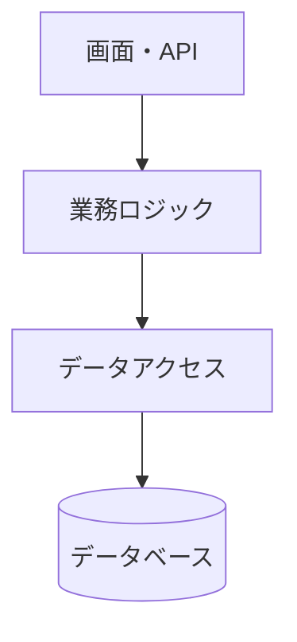
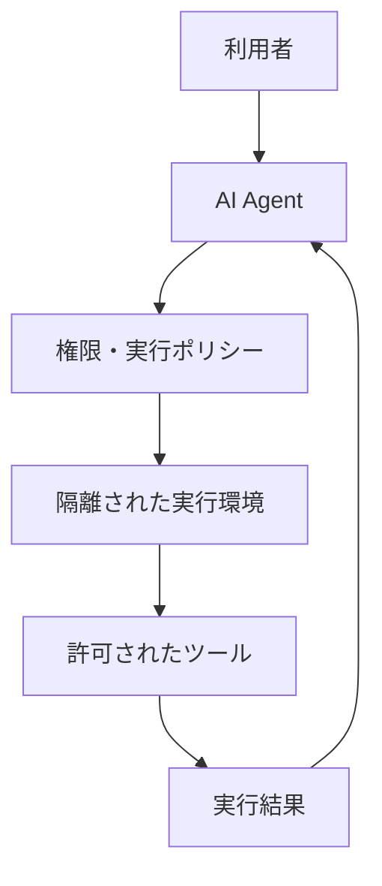

# アーキテクチャ入門 ― AI時代にシステムの構造を考える

> 公開先：ポートフォリオサイトの「AI/IT技術」タブ（`src/content/tech/architecture/`）

## 本書の目的

AIがコードを生成できる時代だからこそ、システム全体の構造を理解し、設計し、維持する能力が重要になる。

アーキテクチャとは、単に技術を組み合わせることではない。何を分離し、何を結びつけ、どのような制約のもとでシステムを成立させるかを考えることである。

本書は、ITを学び始めた読者でも理解できるよう、歴史・原理・実例の順に説明する。図は原則Mermaidで表現し、技術用語は用語集へのリンクで参照できるようにする。

## 想定読者と執筆方針

- 対象：IT初心者、ソフトウェア開発者、AIを活用してシステムを構築する人
- 構成：全11章＋付録（用語集・参考文献）
- 想定分量：本文180〜250ページ相当（執筆時に調整）
- 図：Mermaidを中心に、図1枚につき主要要素3〜7個を目安にする
- 説明順序：「なぜ必要か → 仕組み → 図 → 具体例 → 利点と欠点 → 関連用語」
- 共通題材：小さなECサイトを各章で段階的に拡張する
- 設計判断では、トレードオフと適用条件を必ず説明する

## 全体目次

| 章 | タイトル | 主な内容 |
|---|---|---|
| 1 | なぜAI時代にアーキテクチャが必要なのか | AI Coding Agent、複雑性、構造化、設計責任 |
| 2 | アーキテクチャの歴史と思想 | 建築学、Vitruvius、構造と機能、パターン |
| 3 | ITアーキテクチャの歴史 | メインフレーム、UNIX、Web、クラウド、分散システム |
| 4 | ITアーキテクチャ設計の基本 | 要件、Waterfall、Agile、UML、C4、ADR |
| 5 | コンピュータとインターネットのアーキテクチャ | OSI、TCP/IP、DNS、メール、Linuxカーネル、ネットワーク |
| 6 | アプリケーションアーキテクチャ | 3層、MVC、クリーン、DDD、マイクロサービス |
| 7 | システム間通信と連携のアーキテクチャ | REST、gRPC、イベント駆動、メッセージング、ファイル連携 |
| 8 | データと情報を管理するアーキテクチャ | RDB、NoSQL、DWH、Lakehouse、ETL、CDC、データ品質 |
| 9 | 安全性・信頼性・運用のアーキテクチャ | 認証、認可、IAM、SCIM、ログ、監視、可観測性 |
| 10 | GPUとAI計算基盤のアーキテクチャ | CPUとGPU、SM、Tensor Core、HBM、CUDA、分散学習、LLM推論 |
| 11 | AI時代の新しいアーキテクチャ | RAG、AI Agent、隔離、ハーネス・メタハーネス、Software Factory、Agentic Mesh |

---

# 第1章 なぜAI時代にアーキテクチャが必要なのか

## 1.1 AIによってソフトウェア開発はどう変わったか
## 1.2 コードを書くこととシステムを設計することの違い
## 1.3 システムが複雑になる理由
## 1.4 構造化、抽象化、モジュール化とは何か
## 1.5 AI Coding Agentが得意なこと、苦手なこと
## 1.6 アーキテクトが担う判断と責任
## 1.7 AI時代のアーキテクチャ設計の考え方

**主な図：** コード生成と全体設計／複雑なシステムを分割する例

# 第2章 アーキテクチャの歴史と思想

## 2.1 アーキテクチャという言葉の起源
## 2.2 古代ローマの建築理論とVitruvius
## 2.3 建築における強さ・使いやすさ・美しさ
## 2.4 建築物の構造とソフトウェアの構造
## 2.5 モジュール化と標準化の歴史
## 2.6 Christopher Alexanderのパターン・ランゲージ
## 2.7 建築から学べる設計原則と、その限界

**主な図：** 建築物の構造とITシステムの構造の対応

# 第3章 ITアーキテクチャの歴史

## 3.1 メインフレームと集中処理
## 3.2 UNIXとモジュール化の思想
## 3.3 クライアントサーバーと分散処理
## 3.4 インターネットとWebアプリケーション
## 3.5 SOAとエンタープライズアーキテクチャ
## 3.6 仮想化・クラウド・コンテナ
## 3.7 マイクロサービスとクラウドネイティブ
## 3.8 AI Agentと自律的なソフトウェアシステム

**主な図：** ITアーキテクチャの発展年表／集中型から分散型への変化

# 第4章 ITアーキテクチャ設計の基本

## 4.1 アーキテクチャ設計とは何を決めることか
## 4.2 要求、要件、制約、設計の違い
## 4.3 機能要件と非機能要件
## 4.4 Waterfall開発における設計
## 4.5 Agile開発における継続的な設計
## 4.6 UMLの基本（ユースケース図、クラス図、シーケンス図、コンポーネント図、配置図）
## 4.7 C4モデルによる構造の表現
## 4.8 ADR（Architecture Decision Record）
## 4.9 設計原則：関心の分離、凝集度、結合度、SOLID
## 4.10 品質特性とトレードオフ
## 4.11 アーキテクチャレビューと設計の進化

**主な図：** 開発工程と設計の関係／C4の4階層／ADRによる意思決定

# 第5章 コンピュータとインターネットのアーキテクチャ

## 5.1 コンピュータを構成するハードウェアとOS
## 5.2 Linuxカーネルの構造とユーザー空間
## 5.3 プロセス、スレッド、システムコール
## 5.4 OSI参照モデルの7層
## 5.5 TCP/IPモデルとパケット通信
## 5.6 IPアドレス、ルーティング、NAT
## 5.7 DNSによる名前解決
## 5.8 HTTP、HTTPS、TLS
## 5.9 メールの仕組み（SMTP、IMAP、DNS MX）
## 5.10 ネットワークの設計（LAN、VLAN、VPN、Firewall、Load Balancer）
## 5.11 クラウドネットワーク（VPC、Subnet、Gateway）

**主な図：** OSIとTCP/IPの対応／DNS名前解決／Linuxカーネル／メール配送

# 第6章 アプリケーションアーキテクチャ

## 6.1 アプリケーションを分割する理由
## 6.2 3層アーキテクチャとレイヤードアーキテクチャ
## 6.3 MVC、MVP、MVVM
## 6.4 モノリシックアーキテクチャ
## 6.5 クリーンアーキテクチャ
## 6.6 ヘキサゴナルアーキテクチャとPorts & Adapters
## 6.7 DDD（ドメイン駆動設計）
## 6.8 マイクロサービスアーキテクチャ
## 6.9 分散システムの基本（整合性、可用性、障害）
## 6.10 サーバーレスとクラウドネイティブ
## 6.11 各アーキテクチャをどう選ぶか

**主な図：** 3層構造／クリーンアーキテクチャ／モノリスとマイクロサービス

### 図6-1 アプリケーションの階層化（概念例）



> 注：この図はアプリケーション内部のレイヤー構成の例。Web・アプリケーション・データベースという物理的／論理的な「3層構成」との違いを本文で説明する。

# 第7章 システム間通信と連携のアーキテクチャ

## 7.1 システム同士が通信するとはどういうことか
## 7.2 同期通信と非同期通信
## 7.3 REST APIとHTTP
## 7.4 gRPCとProtocol Buffers
## 7.5 GraphQLとWebSocket
## 7.6 RPCとMessage Passing
## 7.7 Message QueueとPublish/Subscribe
## 7.8 イベント駆動アーキテクチャ（EDA）
## 7.9 Event SourcingとCQRS
## 7.10 ファイル連携、バッチ処理、SFTP
## 7.11 再試行、タイムアウト、冪等性、配信保証
## 7.12 通信方式の選び方

**主な図：** 同期・非同期／メッセージキュー／イベント駆動／ファイル連携

# 第8章 データと情報を管理するアーキテクチャ

## 8.1 データアーキテクチャとは何か
## 8.2 RDBとトランザクション（ACID）
## 8.3 NoSQL（Key-Value、Document、Graph、Column-family）
## 8.4 データベースの内部構造（インデックス、WAL、レプリケーション、シャーディング）
## 8.5 OLTPとOLAP
## 8.6 DWH、データレイク、Lakehouse
## 8.7 ETL、ELT、CDC、ストリーム処理
## 8.8 メタデータ、データカタログ、データ品質
## 8.9 データガバナンスとアクセス制御
## 8.10 ベクトルDBと知識グラフ
## 8.11 AI-Readyなデータ基盤とセマンティックレイヤー

**主な図：** DB内部構造／DWHとLakehouse／データパイプライン／AI-Readyデータ基盤

# 第9章 安全性・信頼性・運用のアーキテクチャ

## 9.1 セキュリティを構造として設計する
## 9.2 認証と認可の違い
## 9.3 OAuth 2.0、OpenID Connect、SAML
## 9.4 IAM、RBAC、ABAC、最小権限
## 9.5 SCIMとIDライフサイクル管理
## 9.6 Zero Trustとネットワーク分離
## 9.7 Secret管理、暗号化、鍵管理
## 9.8 ログアーキテクチャと監査ログ
## 9.9 Observability（Logs、Metrics、Traces）
## 9.10 SLI、SLO、SLAと信頼性
## 9.11 冗長化、バックアップ、災害復旧
## 9.12 DevSecOpsとPolicy as Code

**主な図：** 認証・認可フロー／SCIM／可観測性／冗長化

# 第10章 GPUとAI計算基盤のアーキテクチャ

## 10.1 なぜGPUが必要になったのか（CPUとGPUの設計思想の違い）
## 10.2 GPUの歴史（グラフィックス、GPGPU、CUDA、深層学習）
## 10.3 GPUの内部構造（SM、CUDAコア、Tensor Core、ワープ、SIMT）
## 10.4 メモリ階層とメモリ帯域（レジスタ、共有メモリ、L2、HBM）
## 10.5 CUDAプログラミングモデル（カーネル、グリッド、ブロック、スレッド）
## 10.6 行列演算と数値精度（FP32、BF16、FP8、INT8）
## 10.7 ルーフラインモデルで性能を考える
## 10.8 マルチGPUとインターコネクト（PCIe、NVLink、InfiniBand、NCCL）
## 10.9 分散学習の並列化（データ並列、テンソル並列、パイプライン並列、ZeRO/FSDP）
## 10.10 LLM推論のアーキテクチャ（KVキャッシュ、バッチング、量子化）
## 10.11 GPUクラスタとAIインフラの設計（スケジューリング、電力、コスト）
## 10.12 GPU以外のアクセラレータとGPUの選び方

**主な図：** CPUとGPUの構造比較／SMの内部／メモリ階層／ルーフライン／分散学習の並列化

# 第11章 AI時代の新しいアーキテクチャ

## 11.1 従来のアプリケーションとAIシステムの違い
## 11.2 LLMアプリケーションの基本構造
## 11.3 RAGアーキテクチャ
## 11.4 AI Agentの構造（Model、Tools、Memory、Planning）
## 11.5 Agent Runtimeと実行環境の分離
## 11.6 VM、Container、Sandboxによる隔離
## 11.7 AI Coding Agentと開発ハーネス
## 11.8 メタハーネス（モデル・ハーネス・メタハーネスの入れ子、合成・協働・統制、共通API）
## 11.9 Software Factoryと自律的な開発工程
## 11.10 Multi-AgentとAgentic Mesh
## 11.11 MCP、A2A、Agent Gateway
## 11.12 AIガバナンス、Guardrails、Human-in-the-Loop
## 11.13 自己改善するアーキテクチャと人間の役割

**主な図：** RAG／Agent Runtime隔離／メタハーネスの階層／Software Factory／Agentic Mesh／AIガバナンス

### 図11-1 AI Agentと隔離された実行環境（概念例）



> 実際の隔離設計では、ファイルシステム、ネットワーク、認証情報、実行時間、リソース、承認、監査ログを分けて検討する。

---

# 付録A 用語集・ハイパーリンクの方針

技術用語の初出時には一文で説明し、用語集のアンカーにリンクを張る。

本文中の例：

```markdown
システム間の通信には、[REST API](../glossary/terms.md#rest-api) や
[gRPC](../glossary/terms.md#grpc) が利用されます。
```

用語集の記述例：

```markdown
<a id="rest-api"></a>
### REST API

リソースを中心に設計された、Web APIの代表的な設計スタイル。
HTTPと組み合わせて使われることが多い。

- 関連用語：[HTTP](#http)
- 詳細：[第7章](../chapters/07-communication.md)

<a id="grpc"></a>
### gRPC

サービス間でメソッドを呼び出すRPCフレームワーク。
Protocol Buffersによるインターフェース定義がよく使われる。

- 関連用語：[RPC](#rpc)
- 詳細：[第7章](../chapters/07-communication.md)
```

### 用語集の編集ルール

- 日本語表記、英語表記、略語を併記する
- 用語の定義はまず1〜3文で説明する
- 必要に応じて関連語、反対語、具体例、参照章を記載する
- アンカー名は小文字の英数字とハイフンで統一する
- リンク切れをCIで検証する
- 英語アルファベット順と日本語五十音順の索引を作成する

# 付録B 各節の執筆テンプレート

```markdown
## X.Y 節のタイトル

### なぜ必要なのか
身近な問題から説明する。

### 仕組み
専門用語を初出時に短く定義する。

### 図解
\`\`\`mermaid
flowchart LR
    A["入力"] --> B["処理"] --> C["結果"]
\`\`\`

### 具体例
共通題材であるECサイトへの適用を示す。

### 利点と欠点
設計のトレードオフを説明する。

### 関連用語・参考文献
用語集と参考文献へリンクする。

### 理解度チェック
読者が説明できるか確認する問いを1〜3問。
```

# 付録C リポジトリ構成

```text
architecture-book/
├── README.md
├── SUMMARY.md
├── chapters/
│   ├── 01-why-architecture.md
│   ├── 02-history-of-architecture.md
│   ├── 03-it-architecture-history.md
│   ├── 04-architecture-design.md
│   ├── 05-computer-network.md
│   ├── 06-application-architecture.md
│   ├── 07-communication.md
│   ├── 08-data-architecture.md
│   ├── 09-security-operations.md
│   ├── 10-gpu-architecture.md
│   └── 11-ai-architecture.md
├── glossary/
│   ├── terms.md
│   └── index.md
├── references/
│   └── bibliography.md
├── examples/
│   └── sample-system.md
└── assets/
    └── images/
```

# 付録D 主要参考文献（候補）

| 分野 | 文献・資料 |
|---|---|
| 建築の思想 | Vitruvius, *De architectura* |
| パターン | Christopher Alexanderほか, *A Pattern Language* |
| モジュール設計 | David Parnas, *On the Criteria To Be Used in Decomposing Systems into Modules* |
| アーキテクチャ設計 | Bass, Clements, Kazman, *Software Architecture in Practice* |
| 設計原則 | Robert C. Martin, *Clean Architecture* |
| ドメイン設計 | Eric Evans, *Domain-Driven Design* |
| データ・分散システム | Martin Kleppmann, *Designing Data-Intensive Applications* |
| マイクロサービス | Sam Newman, *Building Microservices* |
| アーキテクチャ図 | Simon Brown, *The C4 Model*（公式ドキュメント） |
| GPU・並列計算 | Hennessy & Patterson, *Computer Architecture: A Quantitative Approach*／NVIDIA CUDA C++ Programming Guide |
| AI Agent | MCP・A2Aなどの公式仕様、関連原著論文 |

※ 本文執筆時に版・発行年・URL・参照日を確認し、正式な書誌情報を付ける。

# 本書を通じた結論

AIがアーキテクトを不要にするのではなく、アーキテクトが考えるべき対象を広げる。

システムの構造だけでなく、AI Agentの権限、実行環境、判断の境界、監査、継続的な改善までを含めて、全体の文脈を設計・維持していくことが重要になる。
