## 対応できる領域

| 領域 | 主な技術 | 代表プロジェクト |
|---|---|---|
| LLM・AI Agent | vLLM、Qwen、LangGraph、CrewAI、MCP、LLM as a Judge、Lean 4 による検証 | Jev Decision Router、Lean Agent Verification Lab |
| 機械学習・生成モデル | 埋め込み評価、拡散モデル、Transformer の実装、量子機械学習 | EmbeddingGemma Multimodal Lab |
| グラフ・知識グラフ・RAG | Neo4j、Cypher、Graph RAG、GNN（PyTorch Geometric） | Security Attack Graph 3D |
| コンピュータビジョン | 物体検出・追跡（YOLO、DETR、OWL-ViT、DeepSORT）、セグメンテーション、行動認識 | Grounding SAM 2、DETR 可視化 |
| データ基盤・インフラ | Snowflake、dbt、Cloudflare（Workers・R2・Iceberg）、Kafka、Go | Cloudflare Basin Iceberg、Kafka 3D ストリーミング可視化 |
| ロボティクス・空間AI・3D | 3D Gaussian Splatting、SAM 3.1、ROS 2、強化学習（PPO）、Three.js | SpatialSAM Studio、Smart 3D Ecosystem |

## 仕事の進め方の特徴

- **ローカル GPU（8GB）で完結させる設計。** 推論も学習も手元の GPU で動かし、外部の有料 API に頼らない構成を多く作っています。機密データを外に出せない案件に向きます。
- **数値で確かめる。** デモで終わらせず、評価セット・評価指標・実測値（IoU、nDCG、レイテンシなど）を README に残します。
- **壊れても止まらない設計。** LLM や推論サーバーが落ちたときにルールベースへ戻る仕組みや、LLM に危険な操作をさせないガードレールを組み込みます。
- **設計書から始める。** 設計書・TODO・ADR を先に書き、AI Coding Agent（Claude Code など）と小さな単位でテストしながら実装します。

## プロジェクト一覧

各リポジトリの README と設計書を読んでまとめました。<span class="status">中断</span> は開発を止めているものです。

| # | プロジェクト | カテゴリ | 状態 |
|---|---|---|---|
| 1 | [SpatialSAM Studio（gaussian-sam-studio）](#project-1) | ロボティクス・空間AI・3D | 実装済み |
| 2 | [Smart 3D Ecosystem — Boids + 機械学習](#project-2) | ロボティクス・空間AI・3D | 実装済み |
| 3 | [gsplat Gaussian Splatting 比較デモ（3DGS）](#project-3) | ロボティクス・空間AI・3D | 実装済み |
| 4 | [量子ロボット経路探索（quantum_policy_gradient）](#project-4) | ロボティクス・空間AI・3D | 実装済み |
| 5 | [Grounding SAM 2 動画物体追跡](#project-5) | コンピュータビジョン | 実装済み |
| 6 | [DETR 可視化アプリ](#project-6) | コンピュータビジョン | 実装済み |
| 7 | [SegFormer セマンティックセグメンテーション](#project-7) | コンピュータビジョン | 実装済み |
| 8 | [OWL-ViT オープンボキャブラリ物体検出](#project-8) | コンピュータビジョン | 実装済み |
| 9 | [GLIP 物体検出・グラウンディング](#project-9) | コンピュータビジョン | 実装済み |
| 10 | [Structure-CLIP + OWL-ViT](#project-10) | コンピュータビジョン | 実装済み |
| 11 | [DeepSORT オブジェクトトラッキング](#project-11) | コンピュータビジョン | 実装済み |
| 12 | [YOLOv8 物体検出・可視化](#project-12) | コンピュータビジョン | 実装済み |
| 13 | [画像シーングラフ生成（Graph R-CNN 風）](#project-13) | コンピュータビジョン | 実装済み |
| 14 | [MMAction2 行動認識デモ](#project-14) | コンピュータビジョン | 実装済み |
| 15 | [PySlowFast 行動認識（最小構成）](#project-15) | コンピュータビジョン | 実装済み |
| 16 | [ViTMAE 画像再構築](#project-16) | コンピュータビジョン | 実装済み |
| 17 | [SimCLR 対照学習の可視化](#project-17) | コンピュータビジョン | 実装済み |
| 18 | [画像キャプション評価アプリ（Qwen-VL）](#project-18) | コンピュータビジョン | 実装済み |
| 19 | [画像処理ツールキット（manipulate_image_lists）](#project-19) | コンピュータビジョン | 実装済み |
| 20 | [Jev Decision Router デモ](#project-20) | LLM・AI Agent | 実装済み |
| 21 | [Lean Agent Verification Lab](#project-21) | LLM・AI Agent | 実装済み |
| 22 | [Phoenix LLM Observability デモ](#project-22) | LLM・AI Agent | 実装済み |
| 23 | [Prompt Optimizer（LangChain 対応）](#project-23) | LLM・AI Agent | 実装済み |
| 24 | [Agent Evolution（Clojure）](#project-24) | LLM・AI Agent | 実装済み |
| 25 | [Research OS](#project-25) | LLM・AI Agent | 実装済み |
| 26 | [JAEA 特許・報告書検索（ローカル RAG）](#project-26) | LLM・AI Agent | 実装済み |
| 27 | [DLT スライド生成システム](#project-27) | LLM・AI Agent | 実装済み |
| 28 | [vLLM サーバーとモデルのダウンロード](#project-28) | LLM・AI Agent | 実装済み |
| 29 | [RoboPaper TUI（論文収集エージェント）](#project-29) | LLM・AI Agent | 中断 |
| 30 | [Security Attack Graph 3D](#project-30) | グラフ・知識グラフ・RAG | 実装済み |
| 31 | [Graph RAG Video（動画分析）](#project-31) | グラフ・知識グラフ・RAG | 実装済み |
| 32 | [Graph RAG アプリ](#project-32) | グラフ・知識グラフ・RAG | 実装済み |
| 33 | [日本語テキストからの知識グラフ構築](#project-33) | グラフ・知識グラフ・RAG | 実装済み |
| 34 | [GNN 可視化アプリ（R-GCN on Cora）](#project-34) | グラフ・知識グラフ・RAG | 実装済み |
| 35 | [Node2Vec + GCN 可視化](#project-35) | グラフ・知識グラフ・RAG | 実装済み |
| 36 | [ネットワーク指標の可視化](#project-36) | グラフ・知識グラフ・RAG | 実装済み |
| 37 | [EmbeddingGemma Multimodal Lab](#project-37) | 機械学習・生成モデル | 実装済み |
| 38 | [Diffusion Transformer vs U-Net](#project-38) | 機械学習・生成モデル | 実装済み |
| 39 | [AI 駆動創薬 × 量子コンピュータ デモ](#project-39) | 機械学習・生成モデル | 実装済み |
| 40 | [Simple GPT（学習用）](#project-40) | 機械学習・生成モデル | 実装済み |
| 41 | [BERT + UMAP + HDBSCAN テキストクラスタリング](#project-41) | 機械学習・生成モデル | 実装済み |
| 42 | [CLAP 音声とテキストの理解](#project-42) | 機械学習・生成モデル | 実装済み |
| 43 | [Whisper 日本語音声認識デモ](#project-43) | 機械学習・生成モデル | 実装済み |
| 44 | [PCA と NMF の可視化](#project-44) | 機械学習・生成モデル | 実装済み |
| 45 | [ランダムフォレストの決定境界](#project-45) | 機械学習・生成モデル | 実装済み |
| 46 | [Cloudflare Basin + Iceberg](#project-46) | データ基盤・インフラ・ツール | 実装済み |
| 47 | [Kafka 3D ストリーミング可視化](#project-47) | データ基盤・インフラ・ツール | 実装済み |
| 48 | [リアルタイム共有ホワイトボード](#project-48) | データ基盤・インフラ・ツール | 実装済み |
| 49 | [Raft の可視化（Go）](#project-49) | データ基盤・インフラ・ツール | 実装済み |
| 50 | [Git Uncommit Checker](#project-50) | データ基盤・インフラ・ツール | 実装済み |
| 51 | [ターミナル Todo アプリ](#project-51) | データ基盤・インフラ・ツール | 実装済み |
| 52 | [Ghostty AI-Native 開発環境](#project-52) | データ基盤・インフラ・ツール | 実装済み |
| 53 | [Engineering Research Portfolio（このサイト）](#project-53) | データ基盤・インフラ・ツール | 実装済み |

## ロボティクス・空間AI・3D

<a id="project-1"></a>

### 1. SpatialSAM Studio（gaussian-sam-studio）

<p class="meta"><span class="tag">SAM 3.1</span><span class="tag">3D Gaussian Splatting</span><span class="tag">gsplat</span><span class="tag">Streamlit</span><span class="tag">MLflow</span></p>

**GitHub:** [github.com/mutomasa/gaussian-sam-studio](https://github.com/mutomasa/gaussian-sam-studio)

#### 成果物の概要

テキストで「何を切り出すか」を指定して、動画と 3D シーン（3D Gaussian Splatting）をセグメンテーションする Streamlit アプリです。写真 292 枚から作った 3D シーンの中の盆栽を、「bonsai」というテキストだけで 3D のまま切り出せます。推論・3DGS の学習・描画は、すべてローカル GPU（8GB）で行います。

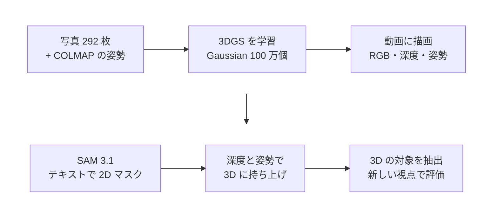

#### 工夫している点

- **2D のモデルで 3D を切り出す。** SAM 3.1 は 2D の画像しか扱えません。そこで、3D シーンをいったん動画に描画して SAM にかけ、その結果を深度とカメラ姿勢で各 Gaussian に戻しています。
- **学習に使っていない視点で検証する。** 切り出した 3D の対象を新しい視点で描き、その視点の実写に SAM をかけた結果と比べました。IoU は 0.908（bonsai）、0.927（table）です。
- **8GB の GPU で全工程が動く。** 3DGS の学習は 7000 step・9 分・VRAM 1.2GB で、評価用視点の PSNR は 30.7 です。動画セグメンテーションは DAVIS で J&F 0.95〜0.97 を確認しました。
- **実験を MLflow で記録する。** 条件と結果を一覧で比べられます。GPU がない環境では、ダミーのセグメンタで UI とパイプラインを確認できます。

<a id="project-2"></a>

### 2. Smart 3D Ecosystem — Boids + 機械学習

<p class="meta"><span class="tag">Three.js</span><span class="tag">Web Worker</span><span class="tag">PyTorch</span><span class="tag">PPO</span><span class="tag">FastAPI</span><span class="tag">WebSocket</span></p>

**GitHub:** [github.com/mutomasa/smart-3d-ecosystem](https://github.com/mutomasa/smart-3d-ecosystem)

#### 成果物の概要

数千匹の魚が 3D の水中で群れを作り、捕食者から逃げて餌を探すデモです。群れの意思決定を、ルールベースと学習済み方策（PyTorch・PPO）で切り替えられます。同じ条件で何が違うのかを、Streamlit のダッシュボードで数値で比べられます。

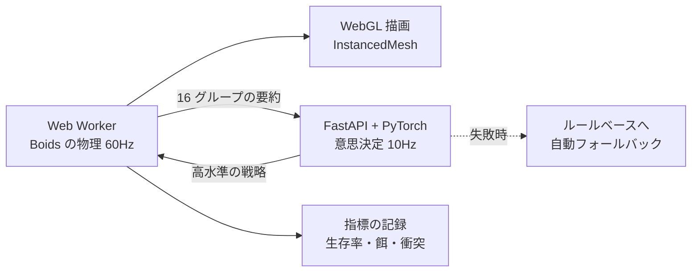

#### 工夫している点

- **高頻度のシミュレーションと ML を分けた。** 物理更新（60Hz）はブラウザの Web Worker で動かします。サーバーとやり取りするのは 10Hz で、送るのも 16 グループの要約（20 次元）だけです。帯域と遅延が破綻しない構成にしました。
- **壊れても止まらない。** 推論のタイムアウト（250ms）、切断、例外が起きると、直前の行動を 1 秒保ってからルールベースに戻ります。学習済みモデルがなければ「untrained」と表示し、学習済みと偽りません。
- **学習と推論のずれを防ぐ。** 観測と行動の形式を 1 つの JSON スキーマにまとめ、学習と推論で同じ前処理コードを使います。TypeScript と Python の実装が一致することもテストしています。
- **再現できる比較。** シードを固定し、学習に使っていないシードで評価します。学習済み方策がルールに勝てていない結果もそのまま見せ、「ML を入れる価値があるか」の判断材料にしています。

<a id="project-3"></a>

### 3. gsplat Gaussian Splatting 比較デモ（3DGS）

<p class="meta"><span class="tag">gsplat</span><span class="tag">COLMAP</span><span class="tag">FastAPI</span><span class="tag">TypeScript</span><span class="tag">three.js</span></p>

**GitHub:** [github.com/mutomasa/3DGS](https://github.com/mutomasa/3DGS)

#### 成果物の概要

同じオープンデータ（Mip-NeRF 360）から 2 通りの方法で Gaussian Splat を作り、three.js のビューアで左右に並べて比べる Web アプリです。1 つは COLMAP の点群をそのまま Gaussian にする方法、もう 1 つは姿勢付き画像で gsplat を学習する方法です。

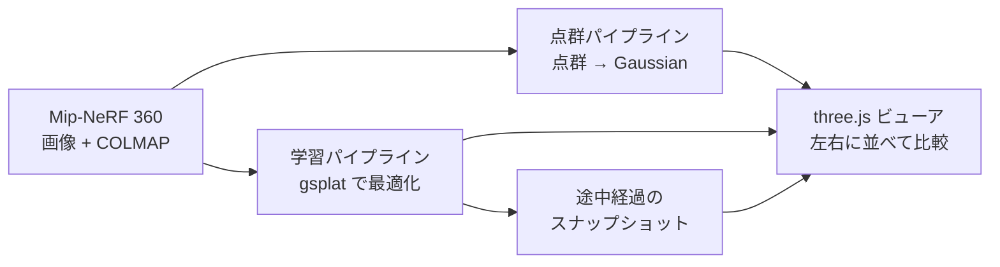

#### 工夫している点

- **学習の途中経過を再生できる。** 指定したステップごとに中間の Gaussian を書き出し、点群が最適化されていく様子をアニメーションで見せられます。発表や勉強会で使うための機能です。
- **学習中でも追いかけて再生する。** 学習が続いていてスナップショットが増えていく間も、一覧を取り直して再生を続けます。
- **CUDA ツールチェーンがない環境でも動かす。** nvcc を仮想環境の中だけに入れて gsplat のカーネルをビルドする手順を用意しました。システムには手を入れません。
- **バックエンドとフロントエンドを分けた。** Python（uv）の CLI と FastAPI、TypeScript（Vite）のビューアを分けて構成しています。

<a id="project-4"></a>

### 4. 量子ロボット経路探索（quantum_policy_gradient）

<p class="meta"><span class="tag">量子機械学習</span><span class="tag">変分量子回路</span><span class="tag">REINFORCE</span><span class="tag">Streamlit</span></p>

**GitHub:** [github.com/mutomasa/quantum_policy_gradient](https://github.com/mutomasa/quantum_policy_gradient)

#### 成果物の概要

グリッド上のロボットが、障害物と危険区域を避けてゴールへ向かう経路探索のデモです。変分量子回路（VQC）による方策勾配法と、古典ニューラルネットワークによる方策勾配法を、同じ条件で学習して比べます。

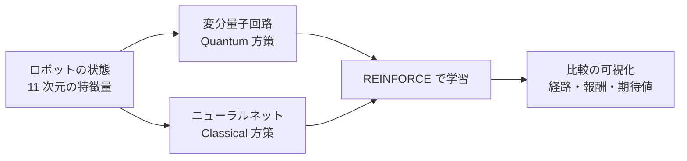

#### 工夫している点

- **公平に比べられる。** 同じグリッド設定なら、量子と古典は常に同じレイアウトで学習します。2 つの経路を同じグリッドに重ねて表示できます。
- **量子回路の条件を変えて試せる。** 量子ビット数（2〜8）、回路の深さ、有限ショット、脱分極ノイズを UI から変えられます。NISQ（ノイズのある中規模量子計算機）の制約を体感できます。
- **結果を 6 つの観点で見せる。** 行動確率のヒートマップ、移動のアニメーション、累積報酬、各量子ビットの期待値の推移などを確認できます。
- **理論とコードの対応を説明する。** README で、パラメータシフト則などの理論と実装の対応表を示しています。

## コンピュータビジョン

<a id="project-5"></a>

### 5. Grounding SAM 2 動画物体追跡

<p class="meta"><span class="tag">Grounding DINO</span><span class="tag">SAM 2</span><span class="tag">Streamlit</span><span class="tag">Plotly</span></p>

**GitHub:** [github.com/mutomasa/grounding_sam2_app](https://github.com/mutomasa/grounding_sam2_app)

#### 成果物の概要

テキストで指定した物体を、動画の中で検出・セグメンテーション・追跡する Streamlit アプリです。動画（MP4・AVI・MOV・MKV）をアップロードし、「人」「車」のような言葉で追いかける対象を指定します。

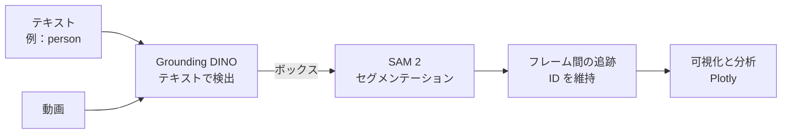

#### 工夫している点

- **学習なしで任意の物体を追える。** 検出に Grounding DINO を使うので、決まったクラスだけでなく、言葉で表せる物体なら追加の学習なしで検出できます。
- **検出と境界を役割分担させる。** 位置の特定は Grounding DINO、正確な境界は SAM 2 に任せ、2 つのモデルの得意な部分を組み合わせています。
- **結果を分析できる。** マスクの重ね合わせに加えて、Plotly のグラフで検出結果を分析できます。

<a id="project-6"></a>

### 6. DETR 可視化アプリ

<p class="meta"><span class="tag">DETR</span><span class="tag">Transformer</span><span class="tag">PyTorch</span><span class="tag">Streamlit</span></p>

**GitHub:** [github.com/mutomasa/detr_app](https://github.com/mutomasa/detr_app)

#### 成果物の概要

Transformer で物体を検出するモデル DETR について、検出結果だけでなくモデルの中で何が起きているかを見せる Streamlit アプリです。ResNet-50/101 版とパノプティックセグメンテーション版に対応しています。

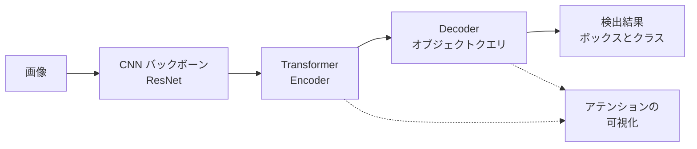

#### 工夫している点

- **中身が見える。** アテンションの重み、オブジェクトクエリの動き、隠れ状態を可視化し、DETR がどこを見て判断しているかを確認できます。
- **構造の図解つき。** DETR の構造と処理の流れを、アプリの中で図で説明しています。
- **デバッグ情報を出す。** モデルの情報、メモリ使用量などを表示し、検証に使えるようにしています。

<a id="project-7"></a>

### 7. SegFormer セマンティックセグメンテーション

<p class="meta"><span class="tag">SegFormer</span><span class="tag">ADE20K</span><span class="tag">Cityscapes</span><span class="tag">Streamlit</span></p>

**GitHub:** [github.com/mutomasa/segformer_app](https://github.com/mutomasa/segformer_app)

#### 成果物の概要

SegFormer（B0〜B5）で画像を画素単位に分類するセマンティックセグメンテーションのアプリです。ADE20K と Cityscapes の学習済みモデルに対応し、結果に加えてモデル内部の動作も可視化します。

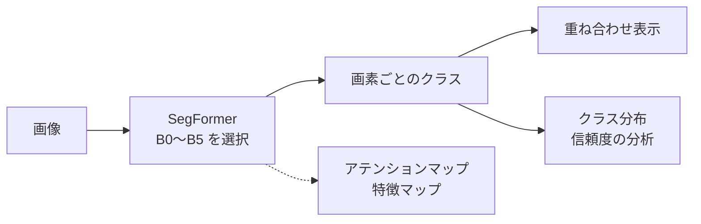

#### 工夫している点

- **モデルの大きさを選べる。** B0（軽量）から B5（高精度）まで切り替えて、精度と速度の違いを確かめられます。
- **内部を分析できる。** アテンションマップと特徴マップを表示し、処理時間とメモリ使用量も計測します。
- **結果を統計で見る。** クラス別の画素数や信頼度の分布を表示し、どのクラスが不安定かを把握できます。

<a id="project-8"></a>

### 8. OWL-ViT オープンボキャブラリ物体検出

<p class="meta"><span class="tag">OWL-ViT</span><span class="tag">Hugging Face Transformers</span><span class="tag">Streamlit</span></p>

**GitHub:** [github.com/mutomasa/owl-vit-app](https://github.com/mutomasa/owl-vit-app)

#### 成果物の概要

OWL-ViT で、決まったクラスに限らない物体（オープンボキャブラリ）を検出する Streamlit アプリです。テキストのクエリでも、例として与えた画像でも検出できます。画像はサンプル、アップロード、URL、カメラ撮影から入力できます。

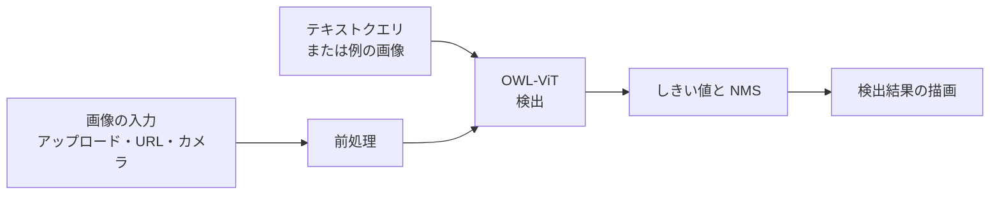

#### 工夫している点

- **単一責任で設計した。** 画像の読み込み・検証・前処理・可視化をそれぞれ別のクラスに分け、再利用とテストをしやすくしています。
- **3 つの検出モード。** 基本の検出、テキストで指定する検出、類似画像で指定する検出を切り替えられます。
- **使いやすさ。** プリセットのクエリ、カンマ区切りの複数入力、信頼度しきい値の自動調整、日本語と英語の翻訳に対応しています。

<a id="project-9"></a>

### 9. GLIP 物体検出・グラウンディング

<p class="meta"><span class="tag">GLIP</span><span class="tag">Swin Transformer</span><span class="tag">BERT</span><span class="tag">Streamlit</span></p>

**GitHub:** [github.com/mutomasa/glip_app](https://github.com/mutomasa/glip_app)

#### 成果物の概要

Microsoft の GLIP（Grounded Language-Image Pre-training）で、テキストのクエリに対応する物体を画像から検出・位置特定（グラウンディング）する Streamlit アプリです。バックボーンには Swin Transformer（Swin-T）を使っています。

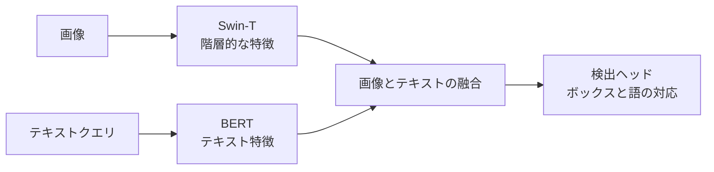

#### 工夫している点

- **言葉と物体を結びつける。** 文中の語と画像中の物体を対応させるので、新しいカテゴリも追加の学習なしで検出できます。
- **アーキテクチャを解説する。** Swin Transformer のシフトウィンドウや階層構造、Swin-T の仕様（約 28M パラメータなど）を README で説明しています。

<a id="project-10"></a>

### 10. Structure-CLIP + OWL-ViT

<p class="meta"><span class="tag">Structure-CLIP</span><span class="tag">OWL-ViT</span><span class="tag">Graphviz</span><span class="tag">Streamlit</span></p>

**GitHub:** [github.com/mutomasa/structure_clip_owl_vit_app](https://github.com/mutomasa/structure_clip_owl_vit_app)

#### 成果物の概要

Structure-CLIP（AAAI 2024）の CLIP 互換実装によるテキストと画像の類似度計算、OWL-ViT によるゼロショット検出、主語・関係・目的語のシーングラフ可視化を 1 つにまとめた Streamlit アプリです。

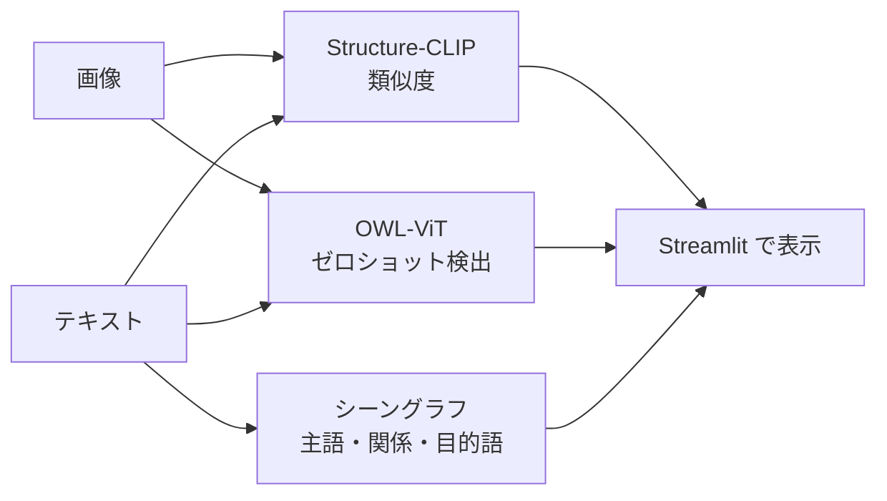

#### 工夫している点

- **論文の実装を最小構成で動かす。** 元の実装は追加の前処理や学習済みチェックポイントが必要ですが、同梱の CLIP 実装を直接使い、軽いデモとして動くようにしました。
- **構造の理解を見せる。** 文の構造（誰が・何を・どうした）をシーングラフで表示し、Structure-CLIP の狙いを直感的に伝えます。

<a id="project-11"></a>

### 11. DeepSORT オブジェクトトラッキング

<p class="meta"><span class="tag">YOLOv8</span><span class="tag">DeepSORT</span><span class="tag">OpenCV</span><span class="tag">Streamlit</span></p>

**GitHub:** [github.com/mutomasa/deepsort_app](https://github.com/mutomasa/deepsort_app)

#### 成果物の概要

YOLOv8 で検出した物体を DeepSORT で追跡し、動画の中の複数の物体に ID を付けて表示する Streamlit アプリです。処理済みの動画はダウンロードできます。

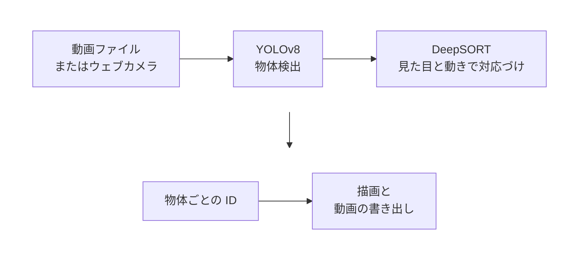

#### 工夫している点

- **用途に合わせた 3 つの版。** 動画全体を処理してからダウンロードする基本版、フレームごとに結果を見るリアルタイム版、ウェブカメラ入力のライブ版を用意しました。
- **性能を見ながら使える。** リアルタイム版では FPS と処理時間を画面に表示します。

<a id="project-12"></a>

### 12. YOLOv8 物体検出・可視化

<p class="meta"><span class="tag">YOLOv8</span><span class="tag">Ultralytics</span><span class="tag">OpenCV</span><span class="tag">Streamlit</span></p>

**GitHub:** [github.com/mutomasa/yoro_app](https://github.com/mutomasa/yoro_app)

#### 成果物の概要

YOLOv8 で画像の物体（COCO の 80 クラス）を検出し、検出結果の統計と YOLOv8 のアーキテクチャ図を表示する Streamlit アプリです。

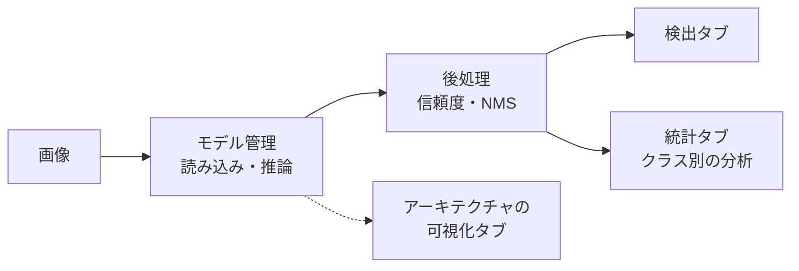

#### 工夫している点

- **役割ごとにモジュールを分けた。** モデル管理、可視化、UI 部品を別のファイルにし、エラー処理もモデル管理側にまとめています。
- **しきい値を調整できる。** 信頼度と NMS のしきい値を変えて、検出結果の変化を確かめられます。

<a id="project-13"></a>

### 13. 画像シーングラフ生成（Graph R-CNN 風）

<p class="meta"><span class="tag">Mask R-CNN</span><span class="tag">Multi-Head Attention</span><span class="tag">NetworkX</span><span class="tag">Plotly</span></p>

**GitHub:** [github.com/mutomasa/scene_graph_app](https://github.com/mutomasa/scene_graph_app)

#### 成果物の概要

画像から「何が・どの物体と・どんな関係にあるか」を表すシーングラフを作る最小実装です。Graph R-CNN（ECCV 2018）を参考にしています。

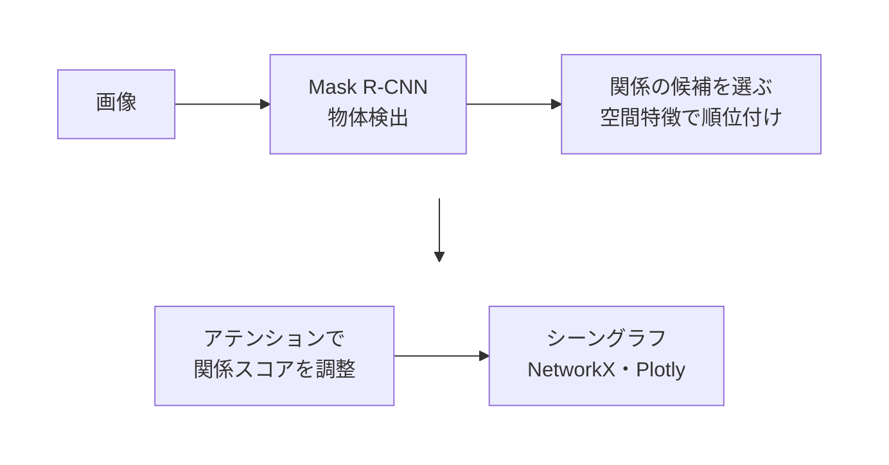

#### 工夫している点

- **論文の中心部分を自分で実装した。** 関係候補の選択（RePN）とアテンションによる関係スコアの調整を、簡易版として実装しています。
- **空間特徴で候補を絞る。** すべての物体の組み合わせについて IoU と相対位置・サイズを計算し、近いものから順に候補にします。

<a id="project-14"></a>

### 14. MMAction2 行動認識デモ

<p class="meta"><span class="tag">MMAction2</span><span class="tag">TSN</span><span class="tag">SlowFast</span><span class="tag">Streamlit</span></p>

**GitHub:** [github.com/mutomasa/mmaction1_app](https://github.com/mutomasa/mmaction1_app)

#### 成果物の概要

アップロードした動画の中の行動（歩く、跳ぶなど）を認識する Streamlit アプリです。上位のラベル、時間ごとのスコアの推移グラフ、動画のプレビューを表示します。

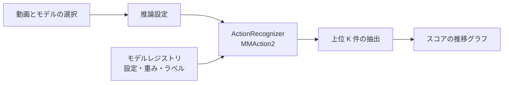

#### 工夫している点

- **速さと精度でモデルを選べる。** CPU でも動く軽量な TSN と、GPU を使う高精度な SlowFast を切り替えられます。
- **層を分けた設計。** UI、推論のサービス層、モデルのレジストリ（設定・重み・ラベルの管理）を分けています。

<a id="project-15"></a>

### 15. PySlowFast 行動認識（最小構成）

<p class="meta"><span class="tag">SlowFast</span><span class="tag">PyTorchVideo</span><span class="tag">Kinetics-400</span><span class="tag">Streamlit</span></p>

**GitHub:** [github.com/mutomasa/pyslowfast_app](https://github.com/mutomasa/pyslowfast_app)

#### 成果物の概要

Meta の SlowFast モデル（Kinetics-400 で学習済み）で、アップロードした動画の行動を認識する最小構成のアプリです。

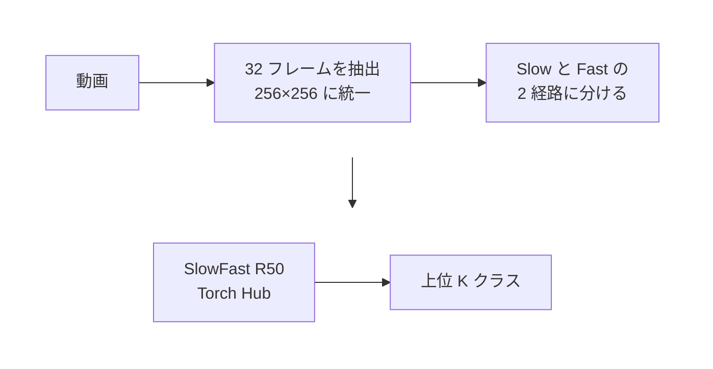

#### 工夫している点

- **前処理を明確にした。** フレームの抽出、リサイズ、2 経路のテンソル作成までを、パイプラインとして分けています。
- **ラベルがなくても動く。** 公式ラベルを取得できない環境では、仮のラベルを生成して動作を確認できます。

<a id="project-16"></a>

### 16. ViTMAE 画像再構築

<p class="meta"><span class="tag">ViTMAE</span><span class="tag">Vision Transformer</span><span class="tag">Streamlit</span></p>

**GitHub:** [github.com/mutomasa/vitmae](https://github.com/mutomasa/vitmae)

#### 成果物の概要

ViTMAE で画像の 75% を隠し、残りの 25% から元の画像を再構築する Streamlit アプリです。元の画像、隠した画像、再構築した画像を並べて表示します。

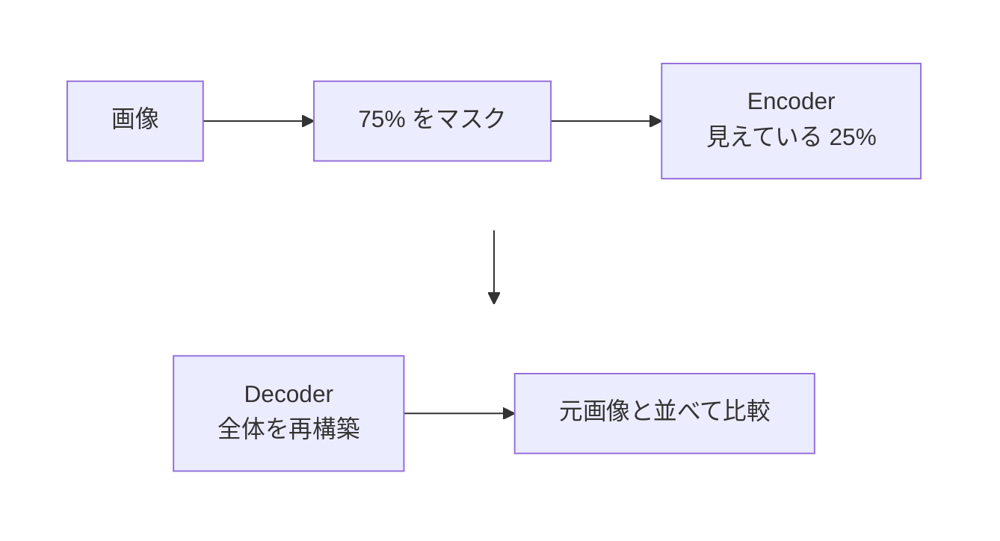

#### 工夫している点

- **自己教師あり学習の考え方を見せる。** どこを隠したかを可視化し、モデルが周りから全体を推測する様子を確かめられます。
- **入力と出力の扱いやすさ。** サンプル、アップロード、URL から画像を入れられ、結果は PNG で保存できます。

<a id="project-17"></a>

### 17. SimCLR 対照学習の可視化

<p class="meta"><span class="tag">SimCLR</span><span class="tag">ResNet</span><span class="tag">t-SNE</span><span class="tag">Streamlit</span></p>

**GitHub:** [github.com/mutomasa/simclr_app](https://github.com/mutomasa/simclr_app)

#### 成果物の概要

対照学習 SimCLR の仕組みを可視化する Streamlit アプリです。データ拡張、特徴抽出、t-SNE による埋め込み空間、コサイン類似度行列を確認できます。

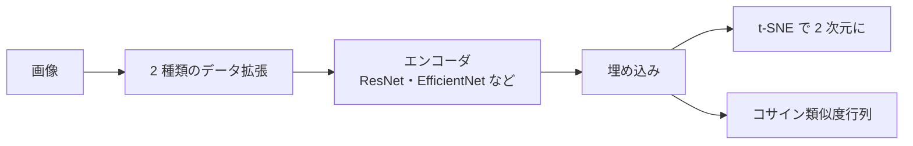

#### 工夫している点

- **バックボーンを切り替えられる。** ResNet18/50、EfficientNet、MobileNet で、埋め込みの違いを比べられます。
- **学習の過程も見せる。** 学習曲線と統計情報を表示します。

<a id="project-18"></a>

### 18. 画像キャプション評価アプリ（Qwen-VL）

<p class="meta"><span class="tag">Qwen2.5-VL</span><span class="tag">vLLM</span><span class="tag">LangChain</span><span class="tag">Streamlit</span></p>

**GitHub:** [github.com/mutomasa/qwen-vl-caption](https://github.com/mutomasa/qwen-vl-caption)

#### 成果物の概要

vLLM 上の視覚言語モデルで画像のキャプションを生成し、人が正解・不正解を付けて正解率を集計する評価アプリです。

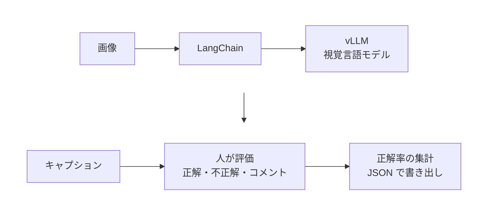

#### 工夫している点

- **人による評価を組み込んだ。** 生成して終わりではなく、評価ボタンと不正解時のコメントで、モデルの弱点を記録できます。
- **評価データを再利用できる。** 評価結果を JSON で書き出し、モデルの比較や改善に使えます。

<a id="project-19"></a>

### 19. 画像処理ツールキット（manipulate_image_lists）

<p class="meta"><span class="tag">OpenCV</span><span class="tag">Pillow</span><span class="tag">Streamlit</span></p>

**GitHub:** [github.com/mutomasa/manipulate_image_lists](https://github.com/mutomasa/manipulate_image_lists)

#### 成果物の概要

画像処理の操作をカテゴリ別に整理し、パラメータを変えながら試せる Streamlit アプリです。幾何変換、色・明るさの変換、ノイズとフィルタ、機械学習用の前処理の 4 種類を扱います。

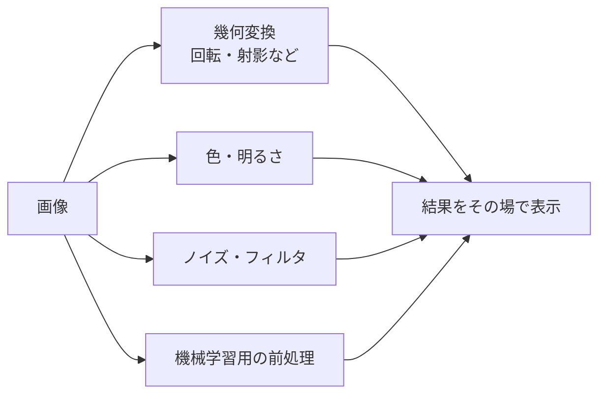

#### 工夫している点

- **格子状のボタン配置。** 操作を格子状に並べ、結果をボタンのすぐ上に表示するので、多くの変換を素早く比べられます。
- **データ拡張の確認に使える。** 機械学習の前処理（データ拡張）が画像にどう効くかを、学習の前に目で確かめられます。

## LLM・AI Agent

<a id="project-20"></a>

### 20. Jev Decision Router デモ

<p class="meta"><span class="tag">Jev</span><span class="tag">vLLM</span><span class="tag">Qwen2.5</span><span class="tag">Streamlit</span><span class="tag">Agentic Mesh</span></p>

**GitHub:** [github.com/mutomasa/jev-decision-router-demo](https://github.com/mutomasa/jev-decision-router-demo)

#### 成果物の概要

Jev を「判断のレイヤー」、ローカルの vLLM を「生成のレイヤー」として組み合わせたデモです。利用者の依頼を Jev で分類し、確信度のチェック（Confidence Gate）を通ったものだけを、ルートごとのシステムプロンプトで vLLM に渡します。Agentic Mesh の Decision Plane（判断を担う層）の最小 PoC です。

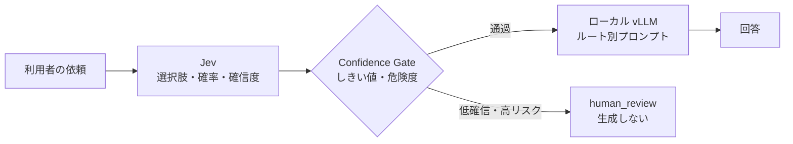

#### 工夫している点

- **判断をコードで扱える値にした。** 判断が LLM の出力文に埋もれないよう、選択肢・確率・確信度を型付きの値として受け取ります。しきい値の制御、ログ、テストを普通のコードで書けます。
- **危険な依頼は生成の前に止める。** 「本番 DB を削除して」のような依頼は、判断の時点で人の確認に回し、LLM は呼びません。実行するかどうかはソフトウェアのポリシーが決めます。
- **判断は速い。** 判断は約 0.2〜0.27 秒で、生成（1.3〜21 秒）に比べて小さく、ルーティングを加えても応答時間はほとんど変わりません。
- **精度を測れる。** 24 件の評価セットで全件正解（Gate 適用後は 23/24）でした。評価コマンドで、設定を変えたときの精度をすぐ確かめられます。
- **部品を差し替えられる。** 判断と生成を小さなインターフェースで分け、別のモデルや Mock に替えてもルーターと UI は変わりません。

<a id="project-21"></a>

### 21. Lean Agent Verification Lab

<p class="meta"><span class="tag">Lean 4</span><span class="tag">vLLM</span><span class="tag">Qwen3-1.7B</span><span class="tag">OR-Tools</span><span class="tag">Streamlit</span></p>

**GitHub:** [github.com/mutomasa/lean-agent-verification-lab](https://github.com/mutomasa/lean-agent-verification-lab)

#### 成果物の概要

ローカル GPU で動く AI Agent（vLLM + Qwen3-1.7B）と、手書きの Lean 4 による形式検証を組み合わせた 3 つのデモです。送金の可否、RBAC の権限表、OR-Tools による人員配置について、業務ルールを満たすことを Lean で証明します。

```mermaid
flowchart TB
    subgraph row0[" "]
        direction LR
        R["要求文"]
        Q["Qwen<br/>ツールと引数を提案"]
        S["JSON スキーマ検証<br/>失敗時は再試行"]
        R --> Q
        Q --> S
    end
    subgraph row1[" "]
        direction LR
        T["許可済みツールを実行"]
        L["Lean 4 で検証<br/>PASS・VIOLATION など"]
        E["Qwen が結果を説明<br/>矛盾したら定型文"]
        T --> L
        L --> E
    end
    row0 --> row1
    style row0 fill:none,stroke:none
    style row1 fill:none,stroke:none
```

#### 工夫している点

- **LLM に判定させない。** Qwen は許可済みのツールと引数を「提案するだけ」で、合否は Python と Lean が決めます。
- **LLM の出力を何重にも確かめる。** 構造化出力で形式を縛り、スキーマで検証し、要求文に現れない数値は警告します。判定と矛盾する説明は定型文に置き換えます。
- **判定の種類をはっきり分けた。** 「違反を証明した（VIOLATION）」と「証明が通らなかった（PROOF_FAILED）」を区別するなど、6 つの状態で結果を返します。
- **最適化の結果も検証する。** OR-Tools が求めた配置が全制約を満たすことを Lean で確かめます（最適性は証明しない、と範囲を明記）。

<a id="project-22"></a>

### 22. Phoenix LLM Observability デモ

<p class="meta"><span class="tag">Arize Phoenix</span><span class="tag">OpenInference</span><span class="tag">LangGraph</span><span class="tag">vLLM</span><span class="tag">Qwen3</span></p>

**GitHub:** [github.com/mutomasa/phoenix-llm-observability-demo](https://github.com/mutomasa/phoenix-llm-observability-demo)

#### 成果物の概要

Arize Phoenix とローカルの Qwen3（vLLM）で、LLM アプリの評価と可観測性を体験するデモです。1 つ目は、生成した回答を別の Qwen 呼び出し（Judge）が 4 つの観点で採点する LLM as a Judge です。2 つ目は、4 ノードの LangGraph Agent の実行を OpenInference で追跡します。

```mermaid
flowchart LR
    D["評価データセット"] --> G["Qwen3 で回答を生成"]
    G --> J["Judge<br/>4 観点で採点"]
    J --> P["Phoenix<br/>Experiments"]
    A["LangGraph Agent<br/>4 ノード"] -->|"OpenInference"| P2["Phoenix<br/>トレース"]
```

#### 工夫している点

- **外部の商用 API を使わない。** 生成も採点もローカルの Qwen3 で行い、可視化は Phoenix 標準の画面だけで完結させました。
- **再現できる環境。** Phoenix は Docker、依存は uv.lock で固定し、各ライブラリの検証済みバージョンを README に記録しています。
- **8GB の GPU に合わせた運用。** vLLM はプロジェクトの依存に入れず uvx で実行し、メモリが足りないときの設定（最大長、小さいモデル）も用意しました。

<a id="project-23"></a>

### 23. Prompt Optimizer（LangChain 対応）

<p class="meta"><span class="tag">LangChain</span><span class="tag">LangGraph</span><span class="tag">LLM as a Judge</span><span class="tag">Thompson Sampling</span><span class="tag">FAISS</span></p>

**GitHub:** [github.com/mutomasa/prompt_optimaizer](https://github.com/mutomasa/prompt_optimaizer)

#### 成果物の概要

プロンプトを YAML / TOML で管理し、LLM as a Judge で評価しながら最適化するフレームワークです。RAG 向けに、引用の正しさと忠実性を重視した評価ループを持ちます。

```mermaid
flowchart LR
    C["プロンプトの構成<br/>YAML・TOML"] --> R["RAG チェーン<br/>FAISS で検索"]
    R --> J["Judge<br/>A/B を比較採点"]
    J --> O["最適化<br/>Thompson Sampling・総当たり"]
    O -->|"弱い構成を入れ替え"| C
    O --> B["最良の構成"]
```

#### 工夫している点

- **2 つの探索方法。** 全構成を総当たりで対戦させるトーナメントと、Beta 分布で有望な構成に試行を集中させる Thompson Sampling を選べます。
- **Judge の偏りを抑える。** A と B の提示順をランダムにし、出力の JSON を厳密に検証します。僅差（0.05 未満）は引き分けにします。
- **既存のパイプラインに組み込める。** 最良の設定を LangChain / LangGraph のノードとしてそのまま使えます。

<a id="project-24"></a>

### 24. Agent Evolution（Clojure）

<p class="meta"><span class="tag">Clojure</span><span class="tag">遺伝的アルゴリズム</span><span class="tag">LLM Agent</span></p>

**GitHub:** [github.com/mutomasa/clojure-agent-evolution](https://github.com/mutomasa/clojure-agent-evolution)

#### 成果物の概要

LLM エージェントの振る舞いを遺伝子として表し、遺伝的アルゴリズムで世代ごとに進化させるプロトタイプです。遺伝子には、ツールの使い方の偏り、慎重さ、システムプロンプトに入れる方針の断片などを持たせます。

```mermaid
flowchart LR
    G["遺伝子<br/>ツール傾向・慎重さ・プロンプト断片"] --> P["システムプロンプトを組み立て"]
    P --> E["模擬タスクで評価<br/>適応度"]
    E --> S["選択・交叉・突然変異"]
    S --> G
    S --> CK["チェックポイント<br/>EDN に保存"]
```

#### 工夫している点

- **定期実行するだけで進化が続く。** 個体群と履歴をファイルに保存・復元するので、cron などで実行するたびに続きから進化します。
- **良い個体を失わない。** エリート保存戦略で、それまでの最良の個体を残します。
- **依存ゼロ。** Clojure の標準ライブラリだけで書き、外部ライブラリ・ネットワーク・API キーなしで動きます。テストも付けています。

<a id="project-25"></a>

### 25. Research OS

<p class="meta"><span class="tag">Python</span><span class="tag">Textual（TUI）</span><span class="tag">Claude Code</span><span class="tag">MCP</span><span class="tag">SQLite</span></p>

**GitHub:** [github.com/mutomasa/research_os](https://github.com/mutomasa/research_os)

#### 成果物の概要

文献検索から論文レビュー、知識グラフ、仮説、実験の実行までを、1 つの TUI（ターミナルの画面）でつなぐ研究開発 IDE です。Paperpile を文献 DB、Claude Code を Research Agent、MCP を外部サービスとの接続に使います。

```mermaid
flowchart TB
    subgraph row0[" "]
        direction LR
        H["研究者の目標<br/>自然言語"]
        A["Research Agent<br/>Claude Code"]
        T["ツール・MCP<br/>Paperpile・arXiv など"]
        H --> A
        A --> T
    end
    subgraph row1[" "]
        direction LR
        P["Papers・Review<br/>検索と比較"]
        G["Graph<br/>知識グラフ"]
        HY["Hypothesis・Run<br/>仮説と実験"]
        P --> G
        G --> HY
    end
    row0 --> row1
    style row0 fill:none,stroke:none
    style row1 fill:none,stroke:none
```

#### 工夫している点

- **研究のサイクル全体を 1 か所に。** 検索 → 読解 → 比較 → 仮説 → 実験の流れを、5 つの画面でつなぎます。
- **Agent に目標を伝える操作。** ツールを順番に操作する代わりに、「最近の触覚 World Model の論文を探して」のような目標を伝えると、検索から登録まで Agent が進めます。
- **設計の判断を記録している。** ADR（技術選定の記録）と C4 モデルの構成図をリポジトリに残しています。LLM なしでも動くオプションもあります。

<a id="project-26"></a>

### 26. JAEA 特許・報告書検索（ローカル RAG）

<p class="meta"><span class="tag">DuckDB</span><span class="tag">RAG</span><span class="tag">Claude Code</span><span class="tag">Codex</span><span class="tag">ベクトル検索</span></p>

**GitHub:** [github.com/mutomasa/jaea_search_skill](https://github.com/mutomasa/jaea_search_skill)

#### 成果物の概要

JAEA の特許と報告書を DuckDB に取り込み、Codex や Claude Code から `jaea-search "キーワード"` で関連資料を探すローカル RAG 検索システムです。関連の理由、技術分類、詳細 URL、PDF へのリンクを付けて返します。

```mermaid
flowchart LR
    D["特許・報告書<br/>CSV・JSONL"] --> DB["DuckDB<br/>文書テーブル"]
    DB --> CH["チャンクに分割<br/>埋め込みを付与"]
    Q["検索語・研究アイデア"] --> S["類似度 + キーワード一致<br/>+ 既存スコア"]
    CH --> S
    S --> O["文書ごとに集約<br/>根拠の断片つき"]
```

#### 工夫している点

- **外部 API にも学習済みモデルにも頼らない。** 文字 n-gram の埋め込みを自作し、日本語と英語が混ざった文書を検索できるようにしました。
- **根拠を示す。** どの本文の断片に反応したかを返すので、結果が正しいかを人が確かめられます。
- **検索語の長さで方法を変える。** 短い語は偶然の一致を避けるためキーワード一致を重視し、長い研究アイデアでは埋め込みの類似度も使います。
- **AI Agent のスキルとして使える。** Claude Code と Codex に使い方と返答形式を教える指示ファイルを付けています。

<a id="project-27"></a>

### 27. DLT スライド生成システム

<p class="meta"><span class="tag">vLLM</span><span class="tag">python-pptx</span><span class="tag">Streamlit</span></p>

**GitHub:** [github.com/mutomasa/dlt_genenrate_pptx](https://github.com/mutomasa/dlt_genenrate_pptx)

#### 成果物の概要

テキストのテーマから、レイアウトの生成と LLM による本文の生成を組み合わせて、PowerPoint のスライドを作るシステムです。

```mermaid
flowchart LR
    T["テーマ<br/>タイトル・メッセージ"] --> TP["テキストの処理"]
    TP --> L["レイアウト生成<br/>要素の位置とサイズ"]
    TP --> C["vLLM<br/>本文の生成"]
    L --> P["python-pptx<br/>PPTX を出力"]
    C --> P
```

#### 工夫している点

- **レイアウトと内容を分けた。** 要素の配置と本文の生成を別の部品にし、それぞれを改善しやすくしています。
- **実装の範囲を正直に書いた。** レイアウト生成は現時点ではルールベースのテンプレートです。本来の DLT（Transformer ベースの深層学習）との違いと、置き換える計画を README に明記しています。

<a id="project-28"></a>

### 28. vLLM サーバーとモデルのダウンロード

<p class="meta"><span class="tag">vLLM</span><span class="tag">Hugging Face</span><span class="tag">OpenAI 互換 API</span><span class="tag">量子化</span></p>

**GitHub:** [github.com/mutomasa/model_dl_vllm_server](https://github.com/mutomasa/model_dl_vllm_server)

#### 成果物の概要

Hugging Face のモデルをダウンロードし、OpenAI 互換 API の vLLM サーバーを起動するツール一式です。8GB の GPU で動くモデルの一覧を付けています。

```mermaid
flowchart TB
    subgraph row0[" "]
        direction LR
        H["Hugging Face Hub"]
        D["ダウンロード<br/>スクリプト"]
        M["ローカルのモデル"]
        H --> D
        D --> M
    end
    subgraph row1[" "]
        direction LR
        V["vLLM サーバー<br/>OpenAI 互換 API"]
        A["各種アプリ<br/>LangChain など"]
        V --> A
    end
    row0 --> row1
    style row0 fill:none,stroke:none
    style row1 fill:none,stroke:none
```

#### 工夫している点

- **8GB の GPU で使える構成。** モデルごとのサイズとメモリ使用量を表にまとめ、量子化モデルも含めて選べるようにしました。
- **ほかのプロジェクトの土台。** OpenAI 互換 API にすることで、このポートフォリオの多くのアプリが同じ方法でローカル LLM を使えます。

<a id="project-29"></a>

### 29. RoboPaper TUI（論文収集エージェント）

<p class="meta"><span class="status">中断</span> <span class="tag">Textual</span><span class="tag">vLLM</span><span class="tag">Qwen2.5-7B</span><span class="tag">pytest</span></p>

**GitHub:** [github.com/mutomasa/paper_research_agent](https://github.com/mutomasa/paper_research_agent)

#### 成果物の概要

Robot Foundation Model 関連の論文を定期的に集め、ローカルの vLLM + Qwen で構造化してから、キーボード操作の TUI で読むためのツールです。開発を中断し、機能は Research OS に統合する予定です。

```mermaid
flowchart LR
    S["論文の収集<br/>定期実行"] --> L["vLLM + Qwen<br/>構造化して解析"]
    L --> DB["データベース"]
    DB --> T["TUI で閲覧"]
```

#### 工夫している点

- **ローカル LLM で解析する。** OpenAI 互換 API を使うので、ローカルの vLLM でも、ほかのサーバーでも動きます。
- **コマンドを 2 つに分けた。** 収集・解析（research）と閲覧（tui）を分け、収集だけを定期実行できます。

## グラフ・知識グラフ・RAG

<a id="project-30"></a>

### 30. Security Attack Graph 3D

<p class="meta"><span class="tag">Neo4j</span><span class="tag">Cypher</span><span class="tag">vLLM</span><span class="tag">Qwen</span><span class="tag">FastAPI</span><span class="tag">Three.js</span><span class="tag">Streamlit</span></p>

**GitHub:** [github.com/mutomasa/security-attack-graph-3d](https://github.com/mutomasa/security-attack-graph-3d)

#### 成果物の概要

企業システムの資産・脆弱性・権限・シークレット・データを知識グラフで表し、「どの経路で顧客データまで到達できるか」を自然言語で質問して、3D で確かめるプロトタイプです。脆弱性を「点」ではなく「経路」で捉え、対策の優先順位を経営層と現場が同じ図で合意できるようにします。

```mermaid
flowchart TB
    subgraph row0[" "]
        direction LR
        Q["自然言語の質問"]
        I["Qwen on vLLM<br/>意図・起点・終点"]
        GR["ガードレール<br/>実在ノードに補正"]
        E["攻撃経路エンジン<br/>テンプレートで Cypher"]
        Q --> I
        I --> GR
        GR --> E
    end
    subgraph row1[" "]
        direction LR
        DB["Neo4j<br/>READ モード"]
        SC["リスクスコア<br/>Top N"]
        V["3D 表示と解説"]
        DB --> SC
        SC --> V
    end
    row0 --> row1
    style row0 fill:none,stroke:none
    style row1 fill:none,stroke:none
```

#### 工夫している点

- **LLM に Cypher を書かせない。** LLM は意図・起点・終点を JSON で返すだけで、クエリはテンプレートから作ります。利用者の値はすべてパラメータで渡し、読み取り専用の検証をしてから READ モードで実行します。
- **説明が正確。** 経路の説明文はグラフから組み立てます。LLM の解説も、ノード名を経路から固定（guided decoding）して、存在しない名前を出させません。
- **スコアの内訳を見せる。** 脆弱性の深刻度 × 悪用のしやすさ、奪われる権限、データの重要度、経路の長さから順位を付け、内訳で「なぜ危険か」を説明できます。長い経路ほど点が上がる設計書の式の問題に気づき、修正しました。
- **LLM がなくても動く。** vLLM が落ちているときは、ルールベースの解析とテンプレートの説明に自動で切り替えます。
- **デモの録画を自動化した。** Playwright でアプリを自動操作して GIF を撮影し、字幕を付けています。

<a id="project-31"></a>

### 31. Graph RAG Video（動画分析）

<p class="meta"><span class="tag">Whisper</span><span class="tag">YOLO</span><span class="tag">Neo4j</span><span class="tag">Graph RAG</span><span class="tag">Streamlit</span></p>

**GitHub:** [github.com/mutomasa/graph_rag_video](https://github.com/mutomasa/graph_rag_video)

#### 成果物の概要

Whisper の音声認識と YOLO の物体検出で動画の内容を取り出し、Neo4j の知識グラフに入れて、Graph RAG で検索・回答する動画分析システムです。

```mermaid
flowchart LR
    V["動画"] --> W["Whisper<br/>音声認識"]
    V --> Y["YOLO<br/>物体検出"]
    W --> KG["Neo4j<br/>知識グラフ"]
    Y --> KG
    Q["質問"] --> R["Graph RAG<br/>検索と生成"]
    KG --> R
    R --> A["回答"]
```

#### 工夫している点

- **音声と映像の両方を使う。** 話された内容（Whisper）と映っている物体（YOLO）を同じ知識グラフに入れ、動画の内容をまとめて検索できるようにしています。
- **関係で検索する。** ベクトル検索だけでなく、グラフの関係をたどって回答の根拠を集めます。

<a id="project-32"></a>

### 32. Graph RAG アプリ

<p class="meta"><span class="tag">Neo4j</span><span class="tag">vLLM</span><span class="tag">LangChain</span><span class="tag">Streamlit</span></p>

**GitHub:** [github.com/mutomasa/graph_rag_app](https://github.com/mutomasa/graph_rag_app)

#### 成果物の概要

Neo4j のグラフデータベースと vLLM サーバーを LangChain でつないだ Graph RAG アプリです。グラフの可視化も付いています。

```mermaid
flowchart LR
    U["質問"] --> LC["LangChain<br/>RAG パイプライン"]
    LC --> N["Neo4j<br/>グラフ検索"]
    N --> LC
    LC --> V["vLLM<br/>回答の生成"]
    V --> UI["Streamlit<br/>回答とグラフの表示"]
```

#### 工夫している点

- **ローカルで完結する RAG。** 生成はローカルの vLLM で行うので、社内データを外部に送らずに試せます。
- **接続先を設定で切り替える。** Neo4j と vLLM の接続先は環境変数で設定します。

<a id="project-33"></a>

### 33. 日本語テキストからの知識グラフ構築

<p class="meta"><span class="tag">日本語 NER</span><span class="tag">DeBERTa</span><span class="tag">Sudachi</span><span class="tag">Neo4j</span><span class="tag">pyvis</span></p>

**GitHub:** [github.com/mutomasa/create_knowledge_graph_neo4j](https://github.com/mutomasa/create_knowledge_graph_neo4j)

#### 成果物の概要

日本語のテキストから固有表現と簡単な関係を取り出し、Neo4j に知識グラフを作るツールです。CLI と、可視化付きの Streamlit アプリがあります。

```mermaid
flowchart LR
    T["日本語テキスト"] --> NER["固有表現抽出<br/>日本語 DeBERTa"]
    T --> SU["Sudachi<br/>動詞を抽出"]
    NER --> R["関係の組み立て<br/>実体の対 + 動詞"]
    SU --> R
    R --> N["Neo4j に投入"]
    R --> P["pyvis で<br/>プレビュー"]
```

#### 工夫している点

- **投入前に確認できる。** 「抽出のみ」で結果とグラフを画面で確かめてから、Neo4j に入れられます。
- **軽い関係抽出。** 文中の実体の対に、Sudachi で取り出した動詞の原形を関係として付けます。動詞が見つからないときは「related_to」にします。

<a id="project-34"></a>

### 34. GNN 可視化アプリ（R-GCN on Cora）

<p class="meta"><span class="tag">PyTorch Geometric</span><span class="tag">R-GCN</span><span class="tag">Plotly</span><span class="tag">Streamlit</span></p>

**GitHub:** [github.com/mutomasa/gnn_visualization_app](https://github.com/mutomasa/gnn_visualization_app)

#### 成果物の概要

PyTorch Geometric の R-GCN を Cora データセットで学習・評価し、学習曲線とグラフの構造を可視化する Streamlit アプリです。

```mermaid
flowchart LR
    D["Cora<br/>論文の引用グラフ"] --> S["学習・検証・テストに分割"]
    S --> M["R-GCN で学習"]
    M --> L["学習曲線を<br/>ライブ表示"]
    M --> E["評価<br/>分類レポート・ROC-AUC"]
    M --> G["グラフの可視化<br/>予測と正解の色分け"]
```

#### 工夫している点

- **学習の進み具合が見える。** 損失と正解率を学習中にライブで更新します。
- **予測と正解を比べられる。** ノードの色を予測ラベルと正解ラベルで切り替え、間違えやすい部分をグラフ上で確かめられます。

<a id="project-35"></a>

### 35. Node2Vec + GCN 可視化

<p class="meta"><span class="tag">Node2Vec</span><span class="tag">GCN</span><span class="tag">PyTorch Geometric</span><span class="tag">t-SNE</span></p>

**GitHub:** [github.com/mutomasa/node2vec_gcn_app](https://github.com/mutomasa/node2vec_gcn_app)

#### 成果物の概要

NetworkX のグラフに Node2Vec で埋め込みを作り、2 層の GCN を通した後の表現と並べて、2 次元で比べる Streamlit アプリです。

```mermaid
flowchart LR
    G["グラフ<br/>Karate・ER・BA"] --> N["Node2Vec 風<br/>ランダムウォーク + Word2Vec"]
    N --> GCN["2 層の GCN"]
    N --> T1["t-SNE<br/>Node2Vec の表現"]
    GCN --> T2["t-SNE<br/>GCN 後の表現"]
```

#### 工夫している点

- **左右に並べて比べる。** GCN が近くのノードの情報を集めて表現を滑らかにする様子を、前後で比べて理解できます。
- **グラフの種類を変えられる。** 構造の違う 3 種類のグラフで、埋め込みの違いを確かめられます。

<a id="project-36"></a>

### 36. ネットワーク指標の可視化

<p class="meta"><span class="tag">PyTorch Geometric</span><span class="tag">NetworkX</span><span class="tag">Node2Vec</span><span class="tag">Streamlit</span></p>

**GitHub:** [github.com/mutomasa/network_indicator_visualization](https://github.com/mutomasa/network_indicator_visualization)

#### 成果物の概要

PyTorch Geometric のデータセットを使い、中心性・クラスタ係数・直径などのネットワーク指標と、Node2Vec の埋め込みを計算・可視化する Streamlit アプリです。

```mermaid
flowchart LR
    D["データセット"] --> C["中心性<br/>次数・固有ベクトル・媒介・近接"]
    D --> K["クラスタ係数<br/>局所・大局"]
    D --> O["直径・密度・同類性"]
    D --> N["Node2Vec<br/>ウォークの可視化"]
```

#### 工夫している点

- **8 種類の指標をまとめて見られる。** どのノードが重要か、どれくらいまとまっているかを、指標ごとに比べられます。
- **探索の仕方を変えられる。** Node2Vec のパラメータで、近くを探るか遠くへ行くかを変え、ウォークの様子をその場で表示します。

## 機械学習・生成モデル

<a id="project-37"></a>

### 37. EmbeddingGemma Multimodal Lab

<p class="meta"><span class="tag">EmbeddingGemma</span><span class="tag">Matryoshka 埋め込み</span><span class="tag">マルチモーダル検索</span><span class="tag">Streamlit</span></p>

**GitHub:** [github.com/mutomasa/embeddinggemma-multimodal-lab](https://github.com/mutomasa/embeddinggemma-multimodal-lab)

#### 成果物の概要

`google/embeddinggemma-2` で、テキスト・画像・動画の意味検索を行い、Matryoshka の次元（128 / 256 / 512 / 768）ごとの精度・速度・保存量の違いをローカルで比べるデモです。正解ラベル付きの評価セットと、人が付けたラベルとの照合で、数値で比較できます。

```mermaid
flowchart TB
    subgraph row0[" "]
        direction LR
        D["テキスト・画像・動画"]
        E["EmbeddingGemma<br/>埋め込み"]
        T["次元を切り詰め<br/>128〜768"]
        D --> E
        E --> T
    end
    subgraph row1[" "]
        direction LR
        S["意味検索"]
        EV["評価<br/>nDCG@10・P@1"]
        R["精度・速度・保存量の比較"]
        S --> EV
        EV --> R
    end
    row0 --> row1
    style row0 fill:none,stroke:none
    style row1 fill:none,stroke:none
```

#### 工夫している点

- **見せるだけでなく測る。** 検索結果を表示するだけでなく、nDCG@10 などで次元ごとの精度を比べます。テキストでは 0.905〜0.917、画像では 0.948〜0.965 でした。
- **コストも測る。** 1 ベクトルの保存量（512B〜3KB）、クエリのエンコード時間（約 19〜22ms）、検索時間（約 0.03〜0.04ms）を記録しています。
- **結果の限界を正直に書く。** サンプルが小さく次元間の差は誤差の範囲であることや、合成動画で結果が偏る問題を、既知の問題として README に記録しています。

<a id="project-38"></a>

### 38. Diffusion Transformer vs U-Net

<p class="meta"><span class="tag">拡散モデル</span><span class="tag">DiT</span><span class="tag">U-Net</span><span class="tag">PyTorch</span></p>

**GitHub:** [github.com/mutomasa/cnn_unet_diffusion_transformer_app](https://github.com/mutomasa/cnn_unet_diffusion_transformer_app)

#### 成果物の概要

拡散モデルの中心となるネットワークについて、CNN ベースの U-Net と Transformer ベースの DiT（Diffusion Transformer）を実装し、構造と性能の違いを可視化して比べるプロジェクトです。

```mermaid
flowchart LR
    X["ノイズを加えた画像<br/>+ タイムステップ"] --> U["U-Net<br/>畳み込み + スキップ接続"]
    X --> D["DiT<br/>パッチ + 自己注意 + AdaLN"]
    U --> C["性能と特徴の比較"]
    D --> C
```

#### 工夫している点

- **同じ課題で 2 つの構造を比べる。** 局所的な特徴に強い U-Net と、全体の関係を捉える DiT の違いを、同じ拡散モデルの中で確かめます。
- **条件付けの仕組みも実装した。** DiT では、タイムステップとクラスラベルで正規化を調整する AdaLN を実装しています。

<a id="project-39"></a>

### 39. AI 駆動創薬 × 量子コンピュータ デモ

<p class="meta"><span class="tag">グラフ拡散モデル</span><span class="tag">E(3) 等変</span><span class="tag">VQE</span><span class="tag">量子化学</span><span class="tag">Streamlit</span></p>

**GitHub:** [github.com/mutomasa/graph-diffusion-quantum-molecular](https://github.com/mutomasa/graph-diffusion-quantum-molecular)

#### 成果物の概要

E(3) 等変なグラフ拡散モデルで 3D の分子構造を生成し、量子計算（VQE）で基底状態エネルギーや HOMO-LUMO ギャップを求める創薬支援のデモです。

```mermaid
flowchart LR
    G["グラフ拡散モデル<br/>3D 分子を生成"] --> Q["VQE<br/>量子化学計算"]
    Q --> P["物性<br/>エネルギー・ギャップ・双極子"]
    G --> L["Lipinski の法則<br/>薬らしさ"]
    P --> S["創薬適合性スコア"]
    L --> S
```

#### 工夫している点

- **生成と評価を 1 つの流れに。** 分子の生成、量子計算による物性の予測、薬らしさの評価を組み合わせ、候補の総合スコアを出します。
- **生成の過程を見せる。** 分子ができあがっていく過程を 3D のアニメーションで表示します。

<a id="project-40"></a>

### 40. Simple GPT（学習用）

<p class="meta"><span class="tag">PyTorch</span><span class="tag">Transformer</span><span class="tag">Hugging Face tokenizers</span></p>

**GitHub:** [github.com/mutomasa/simple_gpt_for_learning](https://github.com/mutomasa/simple_gpt_for_learning)

#### 成果物の概要

GPT の仕組みを理解するために、PyTorch で書いたシンプルな GPT です。Hugging Face のトークナイザーを使い、学習とテキスト生成の両方ができます。

```mermaid
flowchart TB
    subgraph row0[" "]
        direction LR
        T["テキスト"]
        TK["トークナイザー"]
        EM["埋め込み + 位置"]
        T --> TK
        TK --> EM
    end
    subgraph row1[" "]
        direction LR
        B["Transformer ブロック<br/>Multi-Head Attention・FFN"]
        O["次のトークンの確率"]
        G["テキスト生成"]
        B --> O
        O --> G
    end
    row0 --> row1
    style row0 fill:none,stroke:none
    style row1 fill:none,stroke:none
```

#### 工夫している点

- **読んで分かる大きさ。** Multi-Head Attention、Feed Forward、正規化、位置埋め込みを、理解しやすい形で実装しています。
- **学習から生成まで。** 1 つのスクリプトで学習と生成のモードを切り替えられます。

<a id="project-41"></a>

### 41. BERT + UMAP + HDBSCAN テキストクラスタリング

<p class="meta"><span class="tag">Sentence Transformers</span><span class="tag">UMAP</span><span class="tag">HDBSCAN</span><span class="tag">Streamlit</span></p>

**GitHub:** [github.com/mutomasa/bert_umap_hdbscan_clustering](https://github.com/mutomasa/bert_umap_hdbscan_clustering)

#### 成果物の概要

BERT の埋め込み、UMAP の次元削減、HDBSCAN の密度ベースクラスタリングを組み合わせ、テキストを自動で分類して可視化する Streamlit アプリです。

```mermaid
flowchart TB
    subgraph row0[" "]
        direction LR
        T["テキスト"]
        B["BERT<br/>意味の埋め込み"]
        U["UMAP<br/>次元削減"]
        T --> B
        B --> U
    end
    subgraph row1[" "]
        direction LR
        H["HDBSCAN<br/>クラスタとノイズ"]
        V["2D・3D の散布図<br/>分布グラフ"]
        H --> V
    end
    row0 --> row1
    style row0 fill:none,stroke:none
    style row1 fill:none,stroke:none
```

#### 工夫している点

- **クラスタ数を決めなくてよい。** HDBSCAN でクラスタ数を自動で決め、どこにも属さないテキストをノイズとして分けます。
- **パラメータを調整できる。** UMAP の近傍数や最小距離、モデルの種類を変えて、分類の変化を確かめられます。

<a id="project-42"></a>

### 42. CLAP 音声とテキストの理解

<p class="meta"><span class="tag">CLAP</span><span class="tag">librosa</span><span class="tag">Plotly</span><span class="tag">Streamlit</span></p>

**GitHub:** [github.com/mutomasa/clap_app](https://github.com/mutomasa/clap_app)

#### 成果物の概要

CLAP（Contrastive Language-Audio Pretraining）で、音声ファイルとテキストのクエリの類似度を計算し、波形・スペクトログラム・MFCC と合わせて可視化する Streamlit アプリです。

```mermaid
flowchart LR
    A["音声ファイル"] --> C["CLAP<br/>音声とテキストの埋め込み"]
    Q["テキストクエリ"] --> C
    C --> S["類似度"]
    A --> F["波形・スペクトログラム<br/>MFCC"]
    S --> V["可視化"]
    F --> V
```

#### 工夫している点

- **クエリを提案する。** 音声のカテゴリに合わせて、試すとよいテキストのクエリを提案します。
- **テスト用の音声を用意した。** カテゴリ別のサンプル音声と合成音声の生成機能で、手元に音声がなくても試せます。

<a id="project-43"></a>

### 43. Whisper 日本語音声認識デモ

<p class="meta"><span class="tag">Whisper</span><span class="tag">spaCy</span><span class="tag">gTTS</span><span class="tag">Streamlit</span></p>

**GitHub:** [github.com/mutomasa/whisper_app](https://github.com/mutomasa/whisper_app)

#### 成果物の概要

日本語の音声を Whisper で文字起こしし、波形の表示と spaCy による形態素解析まで行うデモアプリです。

```mermaid
flowchart LR
    A["音声<br/>アップロードまたは自動生成"] --> W["波形の表示"]
    A --> WH["Whisper<br/>tiny〜medium"]
    WH --> T["文字起こし"]
    T --> S["spaCy<br/>品詞・係り受け"]
```

#### 工夫している点

- **音声がなくても試せる。** gTTS でデモ用の日本語音声を自動で作ります。
- **モデルの大きさを選べる。** tiny から medium まで切り替えて、精度と速度の違いを確かめられます。

<a id="project-44"></a>

### 44. PCA と NMF の可視化

<p class="meta"><span class="tag">scikit-learn</span><span class="tag">Plotly</span><span class="tag">mypy</span><span class="tag">pytest</span></p>

**GitHub:** [github.com/mutomasa/pca_nmf_app](https://github.com/mutomasa/pca_nmf_app)

#### 成果物の概要

グレースケール画像に対する主成分分析（PCA）と非負値行列因子分解（NMF）を、基底と再構成画像を見ながら比べて学ぶ Streamlit アプリです。

```mermaid
flowchart LR
    I["サンプル画像<br/>64×64"] --> P["PCA"]
    I --> N["NMF"]
    P --> B["基底・重み"]
    N --> B
    B --> R["再構成画像の比較"]
```

#### 工夫している点

- **2 つの手法の違いが見える。** 画像を基底の線形和として表す方法の違い（負の値を許すか）を、基底の画像と再構成で比べられます。
- **品質管理の仕組み。** ruff、mypy、pytest で静的解析・型チェック・単体テストを行っています。

<a id="project-45"></a>

### 45. ランダムフォレストの決定境界

<p class="meta"><span class="tag">scikit-learn</span><span class="tag">Plotly</span><span class="tag">Streamlit</span></p>

**GitHub:** [github.com/mutomasa/random_forest_app](https://github.com/mutomasa/random_forest_app)

#### 成果物の概要

ランダムフォレストの決定境界が、木の本数を増やすにつれてどう変わるかをアニメーションで見る Streamlit アプリです。

```mermaid
flowchart LR
    D["2D データ<br/>moons・circles・iris"] --> RF["ランダムフォレスト<br/>木を 1 本ずつ増やす"]
    RF --> B["決定境界を描画"]
    B --> A["アニメーション"]
```

#### 工夫している点

- **アンサンブルの効果を直感的に。** 木が増えるほど予測が安定していく様子を、アニメーションで観察できます。

## データ基盤・インフラ・ツール

<a id="project-46"></a>

### 46. Cloudflare Basin + Iceberg

<p class="meta"><span class="tag">Cloudflare Workers</span><span class="tag">Pipelines</span><span class="tag">R2</span><span class="tag">Apache Iceberg</span><span class="tag">Vitest</span></p>

**GitHub:** [github.com/mutomasa/cloudflare_basin_iceberg](https://github.com/mutomasa/cloudflare_basin_iceberg)

#### 成果物の概要

Cloudflare Workers で受けたリクエストをイベントとして Pipelines に送り、R2 上の Apache Iceberg テーブルに貯めて、SQL で集計するサンプルです。

```mermaid
flowchart TB
    subgraph row0[" "]
        direction LR
        C["クライアント"]
        W["Worker<br/>応答を返す"]
        S["Stream"]
        C --> W
        W -->|"ctx.waitUntil"| S
    end
    subgraph row1[" "]
        direction LR
        P["Pipeline"]
        R["R2<br/>Iceberg テーブル"]
        Q["Basin SQL<br/>集計"]
        P --> R
        R --> Q
    end
    row0 --> row1
    style row0 fill:none,stroke:none
    style row1 fill:none,stroke:none
```

#### 工夫している点

- **応答を遅くしない。** イベントの送信は `ctx.waitUntil` で応答の後に行い、利用者への応答時間に影響させません。
- **サーバーなしのデータ基盤。** サーバーを持たずに、ログの収集から分析用テーブル（Iceberg・Parquet）までを作れます。
- **構成を文書にした。** 各部品の役割とデータの流れを図と文章で説明し、Vitest のテストも付けています。

<a id="project-47"></a>

### 47. Kafka 3D ストリーミング可視化

<p class="meta"><span class="tag">Kafka</span><span class="tag">Docker Compose</span><span class="tag">Plotly</span><span class="tag">Streamlit</span></p>

**GitHub:** [github.com/mutomasa/kafka_visualize_stream_app](https://github.com/mutomasa/kafka_visualize_stream_app)

#### 成果物の概要

ローカルの Kafka（Docker Compose）に 3D 座標の JSON ストリームを流し、Streamlit と Plotly でリアルタイムに描画するアプリです。

```mermaid
flowchart LR
    P["Producer<br/>3D 座標の JSON"] --> K["Kafka<br/>Docker Compose"]
    K --> C["Consumer"]
    C --> V["Streamlit + Plotly<br/>3D 点群をリアルタイム描画"]
```

#### 工夫している点

- **すぐに動かせる。** Kafka と Zookeeper を Docker Compose で立ち上げ、テスト用のデータを送る Producer も付けています。
- **表示を調整できる。** 表示する点の数とポーリング間隔を画面から変えられます。

<a id="project-48"></a>

### 48. リアルタイム共有ホワイトボード

<p class="meta"><span class="tag">TypeScript</span><span class="tag">Node.js</span><span class="tag">Express</span><span class="tag">WebSocket</span><span class="tag">Canvas</span></p>

**GitHub:** [github.com/mutomasa/websocket_whiteboard_app](https://github.com/mutomasa/websocket_whiteboard_app)

#### 成果物の概要

TypeScript・Express・WebSocket で作った、複数の人が同時に描けるリアルタイムの共有ホワイトボードです。

```mermaid
flowchart LR
    A["利用者 A<br/>Canvas"] <-->|"WebSocket"| S["Node.js サーバー<br/>Express + ws"]
    B["利用者 B<br/>Canvas"] <-->|"WebSocket"| S
    S -->|"描画とクリアを配信"| A
    S -->|"描画とクリアを配信"| B
```

#### 工夫している点

- **切れても戻る。** 接続が切れると自動で再接続し、接続の状態を画面に表示します。
- **リモート開発でも動く。** VS Code のポートフォワードを使うリモート環境での手順を用意しました。

<a id="project-49"></a>

### 49. Raft の可視化（Go）

<p class="meta"><span class="tag">Go</span><span class="tag">Raft</span><span class="tag">Mermaid</span></p>

**GitHub:** [github.com/mutomasa/go_visualize_raft_app](https://github.com/mutomasa/go_visualize_raft_app)

#### 成果物の概要

分散合意アルゴリズム Raft のリーダー選出とハートビートを擬似的に生成し、Mermaid のシーケンス図としてブラウザに表示する Go の学習用デモです。

```mermaid
flowchart LR
    B["ブラウザ<br/>Run・Reset"] --> S["Go の HTTP サーバー"]
    S --> SIM["擬似クラスタ 5 ノード<br/>選挙・ハートビート"]
    SIM --> E["イベント列"]
    E --> M["Mermaid の<br/>シーケンス図"]
    M --> B
```

#### 工夫している点

- **メッセージの流れが見える。** 選挙からリーダーの確定、ハートビートまでのやり取りを、シーケンス図で順を追って確かめられます。
- **範囲を明記した。** 学習用の擬似実装であり、実運用の合意の要件を満たさないことを README に書いています。

<a id="project-50"></a>

### 50. Git Uncommit Checker

<p class="meta"><span class="tag">Go</span><span class="tag">CLI</span><span class="tag">Git</span></p>

**GitHub:** [github.com/mutomasa/git_uncommit_checker](https://github.com/mutomasa/git_uncommit_checker)

#### 成果物の概要

指定したディレクトリの下にある Git リポジトリをすべて探し、コミットしていないファイルを一覧にする Go の CLI です。

```mermaid
flowchart LR
    D["ディレクトリ"] --> F["Git リポジトリを探索"]
    F --> S["状態を取得<br/>変更・追加・未追跡など"]
    S --> O["リポジトリごとに表示"]
```

#### 工夫している点

- **状態を見分けやすく。** 変更・追加・削除・未追跡など 8 種類の状態を、絵文字で区別して表示します。
- **多数のリポジトリを一度に確認。** 作業の終わりにコミット漏れがないかをまとめて確かめられます。

<a id="project-51"></a>

### 51. ターミナル Todo アプリ

<p class="meta"><span class="tag">Go</span><span class="tag">Redis</span><span class="tag">Docker Compose</span><span class="tag">promptui</span></p>

**GitHub:** [github.com/mutomasa/go_todo_db_terminal](https://github.com/mutomasa/go_todo_db_terminal)

#### 成果物の概要

Go と Redis で作ったターミナルの Todo アプリです。Docker Compose で動きます。

```mermaid
flowchart LR
    U["ターミナル UI<br/>promptui"] --> A["Go のアプリ"]
    A --> R["Redis<br/>Todo を保存"]
```

#### 工夫している点

- **環境構築が要らない。** アプリと Redis を Docker Compose でまとめて起動できます。
- **対話的な操作。** 追加・一覧・完了の切り替え・削除を、ターミナルのメニューで操作できます。

<a id="project-52"></a>

### 52. Ghostty AI-Native 開発環境

<p class="meta"><span class="tag">Ghostty</span><span class="tag">Neovim</span><span class="tag">yazi</span><span class="tag">fzf</span><span class="tag">mise</span><span class="tag">AI Coding Agent</span></p>

**GitHub:** [github.com/mutomasa/my_dev_environment](https://github.com/mutomasa/my_dev_environment)

#### 成果物の概要

ターミナル Ghostty を中心に、ファイル操作・編集・Git・Docker・API・データベース・AI Coding Agent までをターミナルで完結させる開発環境の構成をまとめたものです。

```mermaid
flowchart LR
    G["Ghostty"] --> N["Navigation<br/>yazi・fd・fzf・rg"]
    G --> D["Development<br/>nvim・mise・watchexec"]
    G --> O["DevOps<br/>Git・Docker"]
    G --> A["API / Data"]
    G --> AI["AI Coding Agent"]
```

#### 工夫している点

- **ツール同士の連携を表にした。** 各ツールの役割・用途・ほかのツールとの連携を一覧にし、環境全体を説明できるようにしています。
- **GUI への依存を減らす。** ターミナルを開発環境全体の入口にし、AI Coding Agent との作業もそこで完結させます。

<a id="project-53"></a>

### 53. Engineering Research Portfolio（このサイト）

<p class="meta"><span class="tag">Astro</span><span class="tag">GitHub Actions</span><span class="tag">Hugging Face Spaces</span><span class="tag">GitHub API</span></p>

**GitHub:** [github.com/mutomasa/engineering-research-portfolio](https://github.com/mutomasa/engineering-research-portfolio)

#### 成果物の概要

研究ポートフォリオのサイトです。Astro の静的出力で作り、GitHub Actions から Hugging Face Spaces にデプロイしています。プロジェクト、研究、発表資料、ブログ、技術書籍（アーキテクチャ入門）を載せています。

```mermaid
flowchart LR
    GH["GitHub API<br/>リポジトリ一覧"] --> B["Astro のビルド<br/>静的 HTML"]
    SD["Speaker Deck<br/>Atom フィード"] --> B
    MD["Markdown<br/>ブログ・書籍"] --> B
    B --> GA["GitHub Actions<br/>日次リビルド"]
    GA --> HF["Hugging Face Spaces"]
```

#### 工夫している点

- **サーバーを持たない。** ビルド時に GitHub と Speaker Deck から情報を取得して静的 HTML に埋め込み、毎日リビルドして最新に保ちます。
- **取得に失敗しても壊れない。** API の取得に失敗したときは、各サービスのページへのリンクを表示します。
- **日本語と英語に対応。** 言語の切り替え、数式（KaTeX）、Mermaid の図に対応しています。
