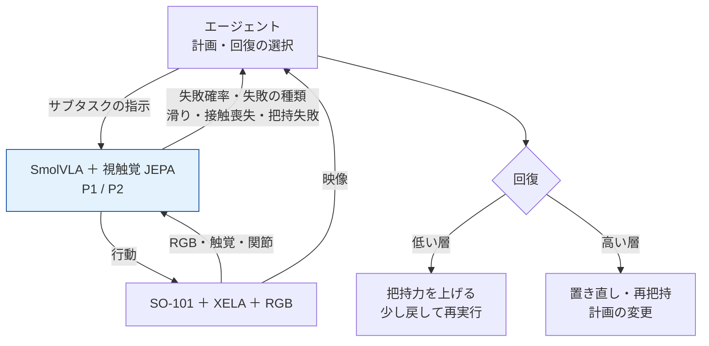
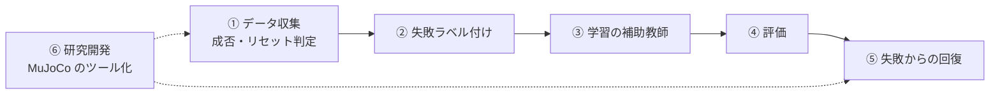

- 作成日：2026-11-13
- 本体の研究：[視覚と触覚で「失敗の予兆」を先読みするロボット操作](/research/vision-tactile-jepa)
- 起点：CoRL 2026 [Workshop on Agentic Robotics](https://agentic-robotics-workshop.github.io/)（2026-11-12、Austin。採択論文 39 本）

## 1. ひとことで言うと

> **ロボットのエージェントは、映像だけを見て判断するので、指先の滑りに気づくのが遅れます。視触覚 JEPA が出す「失敗の予兆」をエージェントに渡し、落とす前に回復を選ばせます。**

Agentic Robotics は、LLM/VLM のエージェントがタスクの分解・計画・成否の判定・ツール呼び出しを担い、VLA などの方策を「道具」として呼び出す考え方です。本テーマは、修士研究（視触覚 JEPA による失敗予測）の**拡張**として、この流れと本研究をつなぎます。

研究の主役は、あくまで視触覚 JEPA（P1）と失敗予測（P2）です。エージェントは、その**周りの手間のかかる工程**と、**失敗からの回復**を支える役として使います。

---

## 2. 解きたい課題：エージェントは運動層の失敗に気づくのが遅い

ワークショップの多くの手法では、エージェントが VLA を呼び、**映像を見て**成否を判断し、だめならやり直します。

| 手法 | やっていること | 結果 |
|---|---|---|
| Harness VLA | 凍結した VLA を接触の多い操作だけに使い、エージェントが位置決め・確認・やり直しを回す | LIBERO-Pro で 50.0% → 82.4% |
| Backtrack | SmolVLA の内部表現に失敗予測ヘッドを付け、しきい値を超えたら少し戻してやり直す | LIBERO-Long で失敗率を 19〜48% 削減 |
| AgenticTactileVLA | 把持の直後に指の位置とモータの力から「つかめているか」を判定し、必要なときだけ介入する | 61.3% → 84.0%、介入回数 65.7% 減 |
| DiMuRe | 状況に応じて「続ける／決まった回復動作／計画し直す」を選ぶ | — |

共通する弱点は、**失敗に気づくのが遅いか、映像だけで判断している**ことです。RoboARCade では、エージェントが成功していないサブタスクの **24〜39% を「成功」と申告**していました。把持のずれや滑りは、映像では見えにくいためです。

---

## 3. 提案：触覚由来の予兆を推論層へ返す

本研究の P2 は、この欠けている信号を埋めます。視触覚 JEPA が「この先 k ステップで滑りそう」「接触が失われそう」という予兆を出し、エージェントがそれを受けて回復を選びます。

失敗の種類によって、回復を返す層を変えられます。

- **滑りの予兆** → 低い層で対処（把持力を上げる、速度を落とす）
- **接触喪失の予兆** → 少し戻して、つかみ直す
- **落下・配置ミス** → 高い層で計画し直す（エージェントが判断）

### 3.1 ワークショップの未解決問題との対応

ワークショップは 6 つの未解決問題を挙げていました。本研究は特に 1 と 6 に答えられます。

| # | 未解決問題 | 本研究との関係 |
|---|---|---|
| 1 | **推論層と運動層の境界（agent–policy seam）** | **強い。** 運動層からエージェントへ返す「状態の報告」として、触覚由来の失敗予兆が役に立つことを示せる |
| 2 | 人の介入なしの実機での自己改善 | 中。残差 RL の報酬・リセット判定にエージェントを使える |
| 3 | 修正をどの階層に返すか | 弱〜中。失敗の種類で、低い層（把持力）と高い層（計画）を振り分ける根拠にできる |
| 4 | シミュレーションによるデータの増量 | 中。MuJoCo はパイプライン検証に限る。シミュレーションの触覚は実機と合わないため、学習データには使わない |
| 5 | ゼロショットの合成 | 中。「接近→把持→持ち上げ→搬送→配置」をエージェントが分け、各段で VLA を呼ぶ構成と比べられる |
| 6 | **回復を含めた評価** | **強い。** 失敗予測の AUROC・リードタイムと、外乱からの回復（タスク 4）がそのまま当てはまる |

---

## 4. 研究の工程で使うところ

| # | 使うところ | 内容 | 時期 |
|---|---|---|---|
| ① | データ収集 | VLM が成否とリセットを判定し、失敗しやすい条件（滑りやすい物体など）を優先して集める。失敗した軌跡からも、成功したサブタスクを切り出して使う | 2027-01〜06 |
| ② | **失敗ラベルの付与** | 動画からエージェントが付けたラベル（Episode → Subtask → Primitive の階層）と、XELA の 3 軸力によるルール判定（接線力／法線力の比の急変、法線力の消失）を突き合わせ、食い違ったものだけ人が確認する。2,000 軌跡のラベル付けの人手を大きく減らせる | **2027-01** |
| ③ | 学習の補助 | エージェントが推定したタスクの進捗を擬似ラベルにして、JEPA の潜在から成功確率を予測する補助ヘッドを足す | 2027-06〜07 |
| ④ | 評価 | 予測リードタイムの中央値、見逃し・誤警報の上限を保証するしきい値の較正、回復の評価の作法を取り入れる | 2027-06〜08 |
| ⑤ | **失敗からの回復** | P2 の予兆をエージェントに渡して回復を選ばせる（5 章の実験） | 2027-07〜08 |
| ⑥ | 研究開発 | MuJoCo の SO-101 を Python／MCP のツールとして包み、エージェントから「つかむ・置く」を呼べるようにする。シミュレーションと実機で同じ API にする | 2026-11〜12 |

一番効くのは②（ラベル付けの人手）、論文として一番の見せ場になるのは⑤（触覚の予兆でエージェントが回復する）です。

②には副産物もあります。「映像だけのエージェントは、触覚で分かる滑りの始まりを何フレーム遅れて見つけるか」を測れるので、「カメラでは接触が見えにくい」という本研究の前提をデータで示せます。

---

## 5. 回復の実験（タスク 4：外乱と回復）

回復を始めるきっかけ（トリガー）だけを変え、回復の動作は全条件で同じにします。こうすると、失敗予測の効果と回復動作の効果を混同せずに比べられます。

| 条件 | 回復のきっかけ | 確かめること |
|---|---|---|
| R0 | 回復なし（P1 をそのまま実行） | 基準 |
| R1 | VLM エージェントが映像で判断 | 映像だけで判断する限界 |
| R2 | 視触覚 JEPA の失敗予測（P2）で判断 | 触覚の予兆の効果 |
| **R3** | **P2 の予兆をエージェントに渡し、エージェントが回復を選ぶ** | **予兆と計画を組み合わせる効果** |

- **仮説**：R2・R3 は R1 より早く失敗に気づき、タスクの完遂率が高い。R3 は失敗の種類に応じて回復を選べるので、R2 より回復の成功率が高い。
- **比べ方**：同じ物体・同じ初期条件で条件を交互に並べ、McNemar 検定で比べる。
- この実験は P2 が動いた後の拡張です。研究の最小の成果（P1・P2）には含めません。

---

## 6. スケジュール

| 時期 | やること |
|---|---|
| 2026-11〜12 | MuJoCo の SO-101 を Python／MCP のツールで包む |
| 2027-01（Pilot） | 100 軌跡で、エージェントのラベルと XELA のルールのラベルを突き合わせ、一致率と費用を測る |
| 2027-02〜06 | 本収集で VLM の成否判定と、失敗しやすい条件の優先収集を使う |
| 2027-06〜07 | P2 をリードタイム・較正したしきい値で評価する |
| 2027-07〜08 | タスク 4 で R0〜R3 を比べる |

---

## 7. 注意していること

- **エージェントの判定は正解ではありません。** VLM のラベルや成否判定はそのまま学習に入れず、触覚のルールや人の確認と突き合わせます。
- **費用を先に確かめます。** 2,000 軌跡すべてに動画のラベル付けをかける前に、Pilot の 100 軌跡で費用と精度を測り、安いモデルで足りるかも確かめます。
- **近い研究が出ています。** 2026年9〜10月に、未来の触覚を予測する VLA（ForeTac-VLA）、SmolVLA の内部表現から失敗を予測してやり直す手法（Backtrack）、視覚・行動・力の世界モデルで異常を先読みする手法（MAIA）が発表されました。ただし「JEPA の潜在空間で視触覚を同時に予測し、そこから失敗を予測する」「XELA の左右の指の 3 軸力」「SO-101 の複数工程タスク」の組み合わせは、調べた範囲では見当たりません。エージェントに触覚の予兆を渡す構成は、これらとの差をさらに広げる方向になります。
