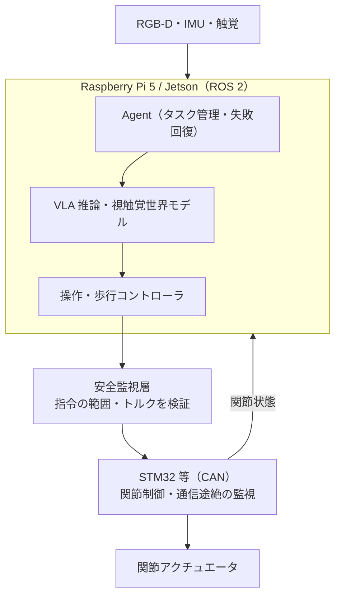

- 作成日：2026-11-24
- 位置づけ：本業の研究とは別の、ハードウェアを学ぶためのサブプロジェクト（計画・初期設計の段階）
- 完成目標：2028 年 1 月
- リポジトリ：[mutomasa/kawasemi-humanoid](https://github.com/mutomasa/kawasemi-humanoid)

## 1. ひとことで言うと

> **VLA や世界モデルの研究では既製のロボットを使うので、関節・減速機・電源・低レベル制御は中身を知らないまま使いがちです。Berkeley Humanoid Lite を技術的な参考にして、オリジナルの小型ヒューマノイドを自分で作り、研究で使える実機プラットフォームにします。**

Kawasemi Humanoid（仮称）は、Bambu Lab P2S と Autodesk Fusion で作る 3D プリント製の小型ヒューマノイドです。[Berkeley Humanoid Lite](https://github.com/HybridRobotics/berkeley-humanoid-lite)（BHL）の公開設計を参考にしますが、コピーではありません。形状と関節は自分で設計します。

---

## 2. 開発の順番

VLA の研究を優先するため、上半身から作ります。

**片腕 → 両腕・上半身 → VLA → 下半身 → 二足歩行 → 全身協調 VLA**

物体操作と二足歩行は必要な技術が違います。操作には VLA・模倣学習・視触覚認識、歩行には動力学・姿勢制御・強化学習が要ります。上半身で操作が安定してから下半身に進みます。ただし、VLA は SO-101 で、歩行の強化学習はシミュレーションで、実機の完成を待たずに先に始めます。

## 3. 目標仕様（初期案）

| 項目 | 目標 |
|---|---|
| 高さ | 60〜90 cm（暫定） |
| 自由度 | 片腕 6〜7、両腕 12〜14、片脚 6〜7 |
| ハンド | 初期はグリッパ、将来は多指ハンド |
| フレーム | 3D プリント（PLA / PETG / ASA）+ 金属補強、足裏は TPU |
| 駆動 | BLDC モータ + 減速機（自作サイクロイド減速機か市販の関節アクチュエータ） |
| 計算機 | Raspberry Pi 5 / Jetson + STM32 等（CAN） |
| センサ | RGB-D カメラ、IMU、関節エンコーダ、触覚（将来） |
| ソフトウェア | Ubuntu + ROS 2、LeRobot、SmolVLA、MuJoCo / Isaac Lab |

身長と自由度は最初に決めません。アクチュエータのトルク、機体重量、電源容量、費用を確かめてから決めます。

## 4. Berkeley Humanoid Lite から参考にするもの

| 参考元 | 特徴 | 使い方 |
|---|---|---|
| BHL V1 | 3D プリント機構、サイクロイド減速機、Isaac Lab での RL 歩行 | 関節ユニットと印刷手順 |
| BHL Arm v1.5 | 3D プリント製の双腕、LeRobot 対応、テレオペレーション | VLA 用のデータ収集 |
| BHL V2 | URDF / MJCF / Xacro、RobStride 系アクチュエータ | ROS 2 とシミュレーションの構成 |

V1 と V2 のアクチュエータは互換ではありません。公式の印刷条件は Bambu Lab X1C 向けなので、P2S では寸法を確かめ直します。

## 5. システム構成

学習済みモデルの関節指令は、そのままモータに通さず、安全監視層で検証します。速い関節制御と安全停止はマイコン側に置き、モータの電源と計算機の電源は系統を分けます。

アクチュエータは、市販品で VLA の実装を進めながら、自作の関節ユニットを並行して研究します。2027 年 3 月の単関節の評価（トルク・バックラッシュ・発熱）で、どちらを主に使うかを決めます。

## 6. VLA で試すタスク

最初は歩かせず、固定した上半身と両腕で物体を操作します。LeRobot でデータを集め、SmolVLA・ACT・Diffusion Policy を比べます。

| タスク | 指示の例 | 評価 |
|---|---|---|
| 1. 把持 | 「赤いブロックをつかんでください」 | 把持成功率、位置誤差 |
| 2. Pick and Place | 「青いブロックを右側の箱に入れてください」 | 物体識別・把持・配置の成功率 |
| 3. 両腕協調 | 「左手で箱を支え、右手で物体を取り出してください」 | 協調動作の成功率、接触の安定 |
| 4. 失敗回復 | 「滑った物体を持ち直してください」 | 失敗検知率、回復成功率 |

## 7. 視触覚世界モデルと失敗予測

カメラ・関節状態・触覚（モータ電流）から潜在状態を学習し、操作の結果や失敗を予測します。本業の研究テーマ（視触覚の世界モデルによる失敗予測）をヒューマノイドに広げる部分です。

$$
z_t = E(o_t), \qquad \hat{z}_{t+1} = F(z_t, a_t), \qquad e_t = \lVert z_{t+1} - \hat{z}_{t+1} \rVert_2^2
$$

予測誤差 $e_t$ は異常検知の特徴量に使います。誤差が大きいことだけで失敗とは判定せず、タスク状態や接触情報と組み合わせます。

## 8. スケジュールと完成条件

| 時期 | 内容 |
|---|---|
| 2026 年 12 月〜2027 年 1 月 | Phase 0：参考設計の分析、MuJoCo / RViz2 で表示、初期 BOM。SO-101 で VLA を先に始める |
| 2027 年 1〜3 月 | Phase 1：単関節の試作と評価。自作か市販かを決める |
| 2027 年 3〜7 月 | Phase 2・3：片腕 → 両腕・上半身、テレオペでデータ収集 |
| 2027 年 7〜10 月 | Phase 4：実機データで VLA を学習（Task 1・2 で成功率 70% 以上） |
| 2027 年 4〜12 月 | Phase 5：シミュレーションでの歩行学習、脚部の製作、支持具付き歩行 |
| 2028 年 1 月 | 全身の統合試験とデモ |

2028 年 1 月末の完成条件は次のとおりです。

- 全身のオリジナルヒューマノイドが組み上がっている
- 上半身が、自然言語指示による Pick and Place を成功率 70% 以上でこなす
- 安全支持具ありで、立位保持と前進歩行（数メートル）ができる
- ROS 2・安全監視層・データ収集基盤が動き、リポジトリから再現できる

歩きながらの物体操作と、世界モデル・Agentic AI による自己改善は、2028 年 2 月以降の延長目標です。

## 9. 注意していること

- **安全。** 物理非常停止、モータ電源の遮断、関節トルク・角度の制限、温度監視を入れます。歩行実験は支持具・吊り具を使います。
- **費用。** 上半身まで累計 20 万〜50 万円、下半身まで 50 万〜100 万円以上を予算枠として、段階的に買います。
- **ライセンス。** BHL の CAD やコードを使うときは、リポジトリごとにライセンスを確認します。
