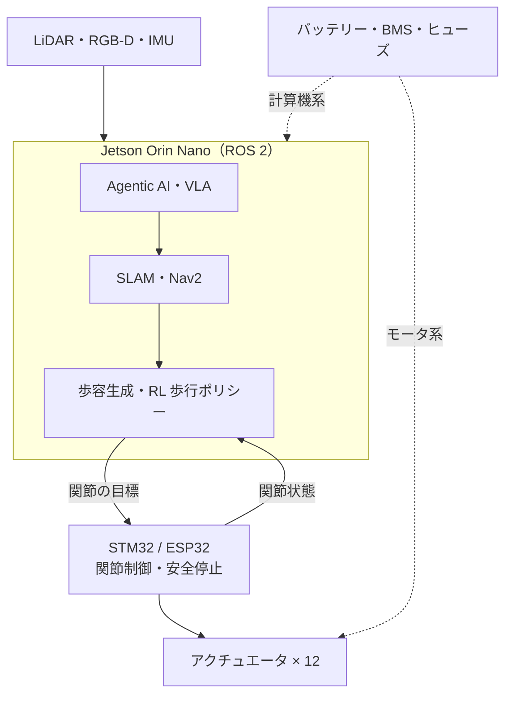

- 作成日：2026-11-24
- 位置づけ：本業の研究とは別の、ハードウェアを学ぶためのサブプロジェクト（計画・初期設計の段階）
- リポジトリ：[mutomasa/kawasemi-rover](https://github.com/mutomasa/kawasemi-rover)

## 1. ひとことで言うと

> **研究では既製のロボットを使うので、機構・モータ・電源・配線は「中身を知らない箱」になりがちです。12 自由度の四足ロボットを CAD 設計から屋外実験まで自分で作り、ハードウェアがどう動いているかを手で理解します。**

Kawasemi Rover（仮称）は、3D プリンタで作る屋外向けの四足歩行ロボットです。[Stanford Pupper v3](https://pupper-v3-documentation.readthedocs.io/en/latest/) の機構と制御を参考にしますが、コピーではありません。筐体・機構・ソフトウェアは自分で設計します。

カワセミのコバルトブルーの背中、オレンジの腹部、黒く長いくちばし、赤い脚がモチーフです。頭頂に 3D LiDAR、目の位置に RGB-D カメラ、腹部に計算機と電源を収め、くちばしは前方のバンパーにします。寸法と機構は今後の設計で変わります。

---

## 2. 作りながら学ぶこと

| 分野 | 内容 |
|---|---|
| 機械設計 | Autodesk Fusion で CAD。3D プリントの積層方向、応力集中、ねじ固定部 |
| アクチュエータ | トルク・速度・重量・価格・エンコーダを比べて選ぶ |
| 電源・配線 | バッテリー、BMS、ヒューズ、モータ系と計算機系の分離、非常停止回路 |
| 運動学・動力学 | 脚の順・逆運動学、必要な関節トルクの推定 |
| 組込み・通信 | マイコン（STM32 / ESP32）での関節制御、CAN などの通信、ROS 2 との接続 |
| 屋外対応 | 防塵・防滴、放熱、転倒時の衝撃、足裏のグリップ |

## 3. 目標仕様（初期案）

| 項目 | 目標 |
|---|---|
| サイズ | 全長 35〜45 cm / 全幅 20〜25 cm / 高さ 25〜35 cm |
| 重量 | 3〜5 kg |
| 自由度 | 12（1 脚 3 自由度 × 4 脚） |
| フレーム・外装 | 3D プリント（PETG 等）+ 部分的な金属補強、足裏は TPU |
| 計算機 | NVIDIA Jetson Orin Nano + STM32 / ESP32 |
| センサ | RGB-D カメラ、3D LiDAR、IMU、関節エンコーダ |
| ソフトウェア | Ubuntu 22.04（JetPack 6）/ ROS 2 Humble |

重量・寸法・関節トルク・電源容量は互いに影響するので、機構計算と実験の結果で決めます。

## 4. システム構成

速い関節制御はマイコンに、重い推論は Jetson に分けます。モータの電源と計算機の電源は系統を分け、電圧降下やノイズで計算機が落ちないようにします。

## 5. 地形に合わせた寸法の最適化

平地・芝生・砂利・段差・斜面では、適した脚の長さや胴体の寸法が違います。CAD の詳細設計に入る前に、シミュレーションで寸法を決めます。

参考は [RoboGrammar](https://people.csail.mit.edu/jiex/papers/robogrammar/)（SIGGRAPH Asia 2020）です。構成の探索まではせず、四足 12 自由度の構成は固定して、大腿・下腿の長さ、股関節の配置、胴体の寸法と重心位置、足先形状、関節の可動範囲を最適化します。MuJoCo に平地・凹凸・溝・斜面・低摩擦面を用意し、候補ごとに歩行制御（MPC か RL）を最適化して、速度・エネルギー・転倒率・関節トルクを比べます。

## 6. ロードマップ

| Phase | 内容 | 成果物 |
|---|---|---|
| 1 | 1 脚の試作（寸法の評価・設計・IK・トルク推定・実機制御） | 3 自由度のオリジナル脚 |
| 2 | 四足の製作（胴体・4 脚・IMU・ROS 2） | 12 自由度の四足ロボット |
| 3 | URDF・MuJoCo モデル、PPO による歩行学習、Sim2Real | RL で歩けるロボット |
| 4 | 足裏・筐体の改良、芝生・砂利・段差・斜面での検証 | 屋外対応の四足ロボット |
| 5 | RGB-D・LiDAR 統合、SLAM、Nav2、屋外巡回 | 屋外を自律巡回するロボット |
| 6 | VLA、世界モデル、失敗検知と回復 | 自然言語で探索し、失敗から回復するロボット |

アクチュエータは、まず 3 個だけ買って 1 脚を作り、性能を確かめてから 12 個に増やします。

## 7. 注意していること

- **安全から作る。** 関節の可動範囲とトルクを制限し、非常停止回路を付けます。最初の実機試験は支持具に吊るして行います。
- **費用。** 概算は 20 万〜60 万円で、大半は関節アクチュエータ 12 個です。1 脚で確かめてから増やします。
- **ライセンス。** Pupper v3 の設計やコードを使うときは、リポジトリ・CAD・ファームウェアごとにライセンスを確認します。

Phase 6 では、本業の研究で扱っている失敗検知と回復の考え方を、四足ロボットでも試したいと考えています。
