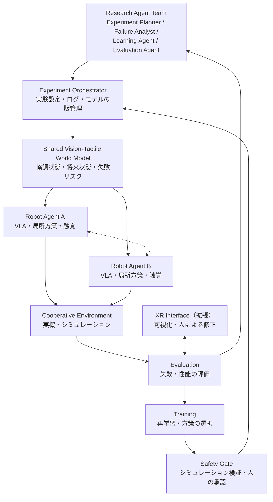
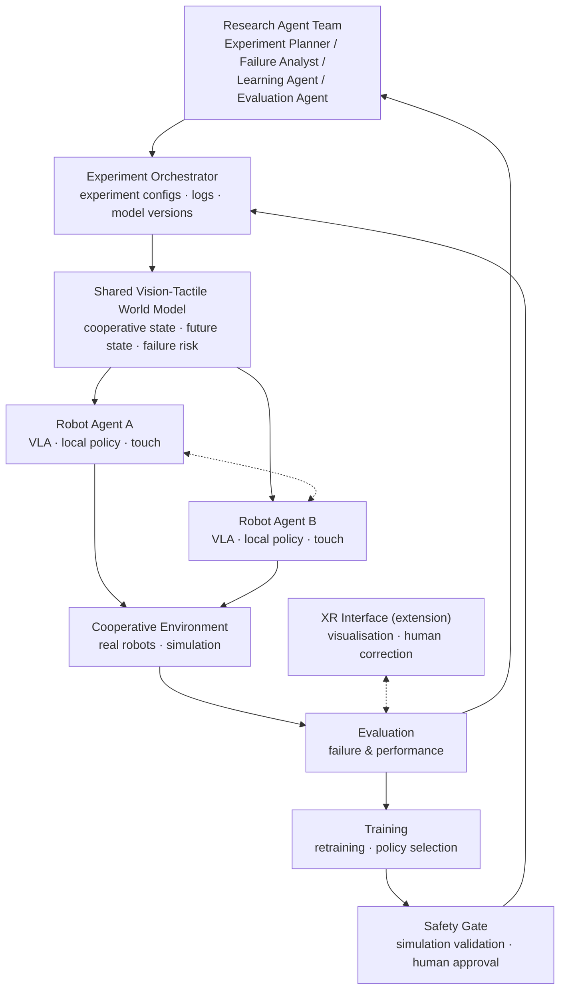

- 位置づけ：**博士課程入学予定の研究**（修士研究の延長。2028年4月の進学を予定）
- 修士での研究：[視覚と触覚で「失敗の予兆」を先読みするロボット操作](/research/vision-tactile-jepa)
- 関連テーマ：[エージェントに「失敗の予兆」を渡すロボット操作 — Agentic Robotics との連携](/research/agentic-robotics)

## 1. ひとことで言うと

> **複数のロボットが、視覚と触覚から「協調の失敗」を先読みして回復し、その改善の手順そのものを AI エージェントが回し続ける仕組みをつくります。**

修士では、1台のアームで視覚と触覚から失敗を予測する方法をつくります。博士では、これを**複数ロボットの協調**へ広げ、失敗の予測と回復に加えて、失敗データを使った**実験の選択と方策の改善を Agentic AI で自動化**することを目指します。

## 2. 解きたい課題

- 複数のロボットが同時に動くと、**相互干渉・役割分担・通信遅延・接触の不確かさ**が問題になります。
- 物を受け渡すときの小さなずれや滑りは、**映像だけでは見えにくい**です。
- 協調に失敗したとき、**どのロボットの、どの行動や条件が原因か**を切り分けにくいです。
- 失敗のあとの再学習や再評価は**人手に頼りがち**で、実機での試行には手間と費用がかかります。
- エージェントの数を増やすだけでは、性能が上がるとは限りません。

## 3. 研究の目的

**視触覚世界モデルを土台に、複数ロボットの協調で起きる失敗を予測して回復し、失敗データにもとづく実験の選択と方策の改善を自動化する手法を確立します。**

1. **協調状態の予測**：ロボット同士の相互作用と接触の状態を、視覚と触覚をまとめた潜在表現で予測する。
2. **協調の失敗への対応**：失敗のリスクを見積もり、役割の変更・持ち直し・計画のやり直し・支援の要求などの回復行動を選ぶ。
3. **失敗から学ぶ自己改善**：Agentic AI が失敗事例から次の実験を選び、学習と評価を繰り返して、限られた試行回数で性能を上げる。

## 4. 研究構想の全体像

**ロボット同士が協調する層**（実時間に近い行動）と、**研究・実験を管理するエージェントの層**（実時間ではない改善のループ）を分けます。

複数ロボットと環境をまとめた潜在状態 $z_t$ の将来を JEPA 型で予測し、別の失敗ヘッドで失敗リスクを出します。

$$
\hat z_{t+1} = f_{\theta}(z_t, a_t^1, \dots, a_t^N), \qquad \hat p_{fail} = g_{\phi}(z_t, a_t^1, \dots, a_t^N)
$$

JEPA の潜在予測そのものは、校正された失敗確率を与えるわけではありません。そのため、失敗ラベルを用意し、確率の校正は別に評価します。

LLM/VLM は**原因の候補を整理し、実験を提案する**ために使います。原因の確定は、ログ・介入実験・統計的な評価で行います。検証していない方策を、そのまま実機に載せることはしません。

## 5. Research Questions

| ID | 問い | 主な指標 |
|---|---|---|
| RQ1 | 視覚と触覚をまとめると、協調の失敗をより正しく予測できるか | AUROC、予測のリードタイム |
| RQ2 | 共有世界モデルで相手の将来状態を考えると、協調はよくなるか | 共同タスクの成功率、回復率 |
| RQ3 | 失敗にもとづいて実験を選ぶと、ランダムな試行より少ない試行で目標の性能に届くか | 目標性能に届くまでの試行数 |
| RQ4 | 改善した方策は、未知の形状・配置・相手の動きの変化にも通用するか | 未知条件での成功率 |

## 6. 検証計画

1. **SO-101 × 2台での物の受け渡し**：位置ずれや滑りをわざと起こし、失敗予測と回復を比べる（まずはシミュレーションで行う）。
2. **SO-101 と TurtleBot3 の役割分担**：TurtleBot3 が運び、SO-101 がつかんで置く。到着の遅れや通信の遅れが起きたときの計画のやり直しと支援要求を調べる。
3. **失敗分析からの自動実験と再学習**：原因の候補 → 原因を見分けるための追加実験 → 再学習 → 新旧の比較 → 安全ゲート、の順に回す。
4. **XR による人の介入（拡張）**：Meta Quest 3 でロボットの予測軌道・役割・失敗リスクを見せ、人による修正とその理由を記録する。

比較は、固定ルール → 分散エージェント → ＋視覚世界モデル → ＋触覚 → ＋失敗回復 → ＋自己改善、と要素を1つずつ足し、それぞれの寄与を分けて調べます。**マルチエージェントの方式が常に優れているとは仮定せず**、利点とコストの両方を数字で示します。

## 7. 新規性の候補

1. **視触覚の協調世界モデル**：1台ではなく、複数ロボットと環境の相互作用を潜在空間で予測する。
2. **相互作用から起きる失敗からの協調回復**：役割の変更・持ち直し・計画のやり直し・支援の要求を選ぶ。
3. **失敗の原因を見分ける実験の選択**：限られた実機の試行回数の中で自己改善する。
4. **XR による人の修正の取り込み（拡張）**：人の介入を見える形で記録し、改善のループに使う。

これらは新規性の**候補**です。先行研究との違いは、文献の調査を進めて確定させます。

## 8. 準備状況と研究基盤

| 項目 | 内容 |
|---|---|
| 実機 | SO-101、TurtleBot3 Burger、Meta Quest 3 |
| センサ | XELA 触覚センサ（3軸・500 Hz）、RGB-D カメラ、関節の状態 |
| ソフトウェア | ROS 2、LeRobot、SmolVLA、MuJoCo / Isaac Sim |
| 計算資源 | JAIST の GPU クラスタ（A100 / A40） |

- 視触覚 JEPA の実装と実機データの収集（修士で進行中）
- RGB・触覚・状態・行動を同じ時刻で記録する基盤（修士で進行中）
- 2台以上の協調環境とエージェントの層（博士で構築）

安全面では、非常停止・速度と作業空間の制限をモデルとは独立に設けます。モデルの更新は、オフライン評価 → シミュレーション → 人の承認 → 限られた実機評価、の順に進めます。

## 9. 研究の方針

**修士では「視触覚世界モデルによる失敗予測」の土台をつくり、博士では「複数ロボットの協調の失敗を予測して回復し、その改善の手順を Agentic AI で自動化する」ことを中心の課題にします。** はじめは条件をそろえやすく、繰り返し実験できるマルチロボット環境に絞り、最終的には人が加わる協調作業にも広げられる、安全で自己改善できる協調ロボットシステムを目指します。

- Status: **planned PhD research** (an extension of my master's research; I plan to start the PhD in April 2028)
- Master's research it builds on: [Anticipating "failure precursors" from vision and touch in robot manipulation](/research/vision-tactile-jepa) (in Japanese)
- Related theme: [Feeding tactile failure precursors back to robot agents (Agentic Robotics)](/research/agentic-robotics) (in Japanese)

## 1. In one sentence

> **Multiple robots anticipate cooperative failures from vision and touch and recover from them, while AI agents keep running the process that improves them.**

In my master's research I am building a way for a single arm to predict failures from vision and touch. In the PhD I plan to extend this to **multi-robot collaboration**: on top of predicting and recovering from failures, the goal is to **automate failure-driven experiment selection and policy improvement with Agentic AI**.

## 2. Problems to tackle

- When several robots act at once, **interference, role allocation, communication delay and contact uncertainty** become problems.
- Small offsets and slip during a hand-over are **hard to observe with vision alone**.
- When cooperation fails, it is hard to tell **which robot, which action or which condition** caused it.
- Retraining and re-evaluation after failures **rely on humans**, and real-robot trials are costly.
- Simply adding more agents does not guarantee better performance.

## 3. Goal

**Building on vision-tactile world models, establish a method that predicts and recovers from failures in multi-robot collaboration, and automates failure-driven experiment selection and policy improvement.**

1. **Predicting the cooperative state**: predict robot–robot interaction and contact states in a latent representation that fuses vision and touch.
2. **Handling cooperative failures**: estimate failure risk and choose recovery actions such as changing roles, re-grasping, replanning or asking for help.
3. **Failure-driven self-improvement**: Agentic AI selects the next experiments from failure cases and iterates training and evaluation, improving performance within a limited trial budget.

## 4. Overall concept

The **layer where robots cooperate** (near-real-time action) is separated from the **agent layer that manages research and experiments** (a non-real-time improvement loop).

The future of the joint latent state $z_t$ of all robots and the environment is predicted JEPA-style, and a separate failure head outputs the failure risk.

$$
\hat z_{t+1} = f_{\theta}(z_t, a_t^1, \dots, a_t^N), \qquad \hat p_{fail} = g_{\phi}(z_t, a_t^1, \dots, a_t^N)
$$

The JEPA latent prediction itself does not give a calibrated failure probability, so failure labels are prepared and probability calibration is evaluated separately.

LLMs/VLMs are used to **organise candidate causes and propose experiments**. Causes are confirmed by logs, interventional experiments and statistical evaluation. Unverified policies are never deployed directly to real robots.

## 5. Research questions

| ID | Question | Main metric |
|---|---|---|
| RQ1 | Does fusing vision and touch improve the prediction of cooperative failures? | AUROC, lead time |
| RQ2 | Does considering the partner's future state via a shared world model improve cooperation? | Joint success rate, recovery rate |
| RQ3 | Does failure-driven experiment selection reach the target performance with fewer trials than random trials? | Trials to target |
| RQ4 | Do improved policies generalise to unseen shapes, layouts and partner variation? | Success on unseen conditions |

## 6. Validation plan

1. **Hand-over between two SO-101 arms**: deliberately induce offsets and slip to compare failure prediction and recovery (simulation first).
2. **Role sharing between SO-101 and TurtleBot3**: TurtleBot3 transports, SO-101 grasps and places; study replanning and help requests under arrival and communication delay.
3. **Automated experiments and retraining from failure analysis**: candidate causes → discriminating experiments → retraining → old vs. new comparison → safety gate.
4. **Human intervention via XR (extension)**: show predicted trajectories, roles and failure risk on Meta Quest 3, and record human corrections and their reasons.

Components are added one at a time — fixed rules → decentralised agents → + visual world model → + touch → + failure recovery → + self-improvement — to isolate each contribution. **I do not assume that multi-agent designs are always better**, and will quantify both their benefits and their costs.

## 7. Novelty candidates

1. **A cooperative vision-tactile world model** that predicts robot–robot–environment interaction in latent space, rather than for a single robot.
2. **Recovery from interaction-induced failures** by choosing role changes, re-grasping, replanning or help requests.
3. **Experiment selection that discriminates failure causes**, enabling self-improvement within a limited real-robot budget.
4. **Incorporating human corrections via XR (extension)**: visualising and recording human interventions for use in the improvement loop.

These are **candidates**; the precise differences from prior work will be fixed through a literature survey.

## 8. Preparation and infrastructure

| Item | Details |
|---|---|
| Robots | SO-101, TurtleBot3 Burger, Meta Quest 3 |
| Sensors | XELA tactile sensors (3-axis, 500 Hz), RGB-D camera, joint states |
| Software | ROS 2, LeRobot, SmolVLA, MuJoCo / Isaac Sim |
| Compute | JAIST GPU cluster (A100 / A40) |

- Vision-tactile JEPA implementation and real-robot data collection (in progress in my master's)
- Synchronised logging of RGB, touch, state and action (in progress in my master's)
- A setup with two or more robots and the agent layer (to be built in the PhD)

For safety, emergency stops and speed/workspace limits are set independently of the models. Model updates go through offline evaluation → simulation → human approval → limited real-robot trials.

## 9. Research direction

**In the master's course I will establish the foundation of "failure prediction with vision-tactile world models"; in the PhD, the central problem will be "predicting and recovering from cooperative failures of multiple robots, and automating the improvement process with Agentic AI".** I will start with multi-robot environments where conditions are easy to control and experiments can be repeated, and ultimately aim for a safe, self-improving collaborative robot system that can be extended to cooperative work involving people.

