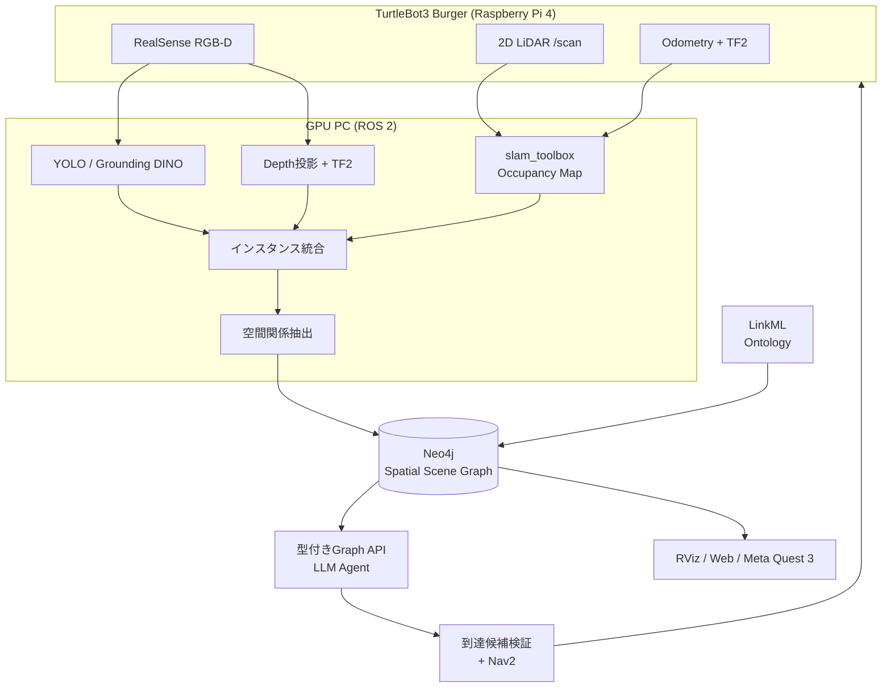

## 1. 研究概要

本研究では、小型移動ロボット TurtleBot3 Burger に搭載した 2D LiDAR と RGB-D カメラを用いて、ロボットが観測した物体を **位置・意味・物体間の空間関係・観測履歴** を持つグラフ構造（Spatial Scene Graph）として逐次構築する。構築したグラフを大規模言語モデル（LLM）から型付きツールを介して検索し、「観葉植物の近くにある椅子まで移動して」といった自然言語指示に対して、対象物体を根拠付きで特定し、Navigation 2（Nav2）によって安全に到達させる。

本研究の中心的な問いは、**明示的な空間関係と観測履歴をグラフに持たせることが、物体カテゴリと座標のみを持つ従来の Semantic Map と比べて、自然言語による物体特定および到達性能をどの程度改善するか** である。これを、情報量の異なる3条件（A: 物体のみ、B: 空間関係あり、C: 時間・信頼度あり）の比較実験により定量的に検証する。

---

## 2. 研究背景

### 2.1 移動ロボットにおける環境表現

従来の 2D SLAM で得られる占有格子地図（Occupancy Grid）は、壁や障害物の有無と自己位置を表現するが、「椅子」「植物の近く」といった **意味や物体間の関係** を表現しない。人間がロボットに与える指示の多くは「〜の近くの〜」「〜の部屋にある〜」のように関係的・文脈的であり、幾何的な地図だけではこれらの指示を解釈できない。

近年、環境を物体・部屋・場所をノード、空間関係をエッジとする **3D Scene Graph** として表現する研究が進展している [1–4]。また、LLM と Scene Graph を組み合わせてタスク計画や言語ナビゲーションを行う研究も報告されている [8–10]。

| 表現 | 表現できる内容 |
| --- | --- |
| Metric Map（2D SLAM） | 壁・障害物とロボット位置 |
| Semantic Map | 地図上の物体カテゴリ・インスタンス・位置 |
| Spatial Scene Graph | 物体・部屋・場所と、その間の空間関係 |
| Knowledge Graph / Ontology | 分類体系・制約・語彙（型・値域の定義） |

### 2.2 既存研究の課題

1. **関係の寄与の定量化が不十分:** 多くの研究はシステム全体の性能を報告しており、「空間関係を明示的に持つこと」そのものの寄与を、同一の検出結果・同一の質問集合で切り分けて評価した例は限られる [5]。
2. **時間変化と不確実性:** 物体の移動や誤検出によって関係は変化するが、静的なグラフでは古い関係が残り続ける。「未観測」と「存在しない」の区別も曖昧になりやすい [14]。
3. **LLM 利用時の安全性と根拠:** LLM はグラフに存在しない物体を生成したり、実行不可能な行動を提案したりする可能性がある。物理ロボットでは、LLM の出力と制御系の責務を分離する設計が必要である [8]。
4. **高コストな機材構成:** 多くの先行研究は 3D LiDAR や高性能な計算機を搭載したロボットを前提としており、低コストな 2D LiDAR 構成での有効性は十分に検証されていない。

---

## 3. 研究目的とリサーチクエスチョン

### 3.1 研究目的

低コストな移動ロボット構成において、空間関係と観測履歴を持つ Spatial Scene Graph を構築し、それが自然言語指示に基づく物体特定とナビゲーションに与える効果を定量的に明らかにする。

### 3.2 リサーチクエスチョン

- **RQ1:** 明示的な空間関係（`NEAR`, `IN_ROOM` 等）をグラフに持たせることで、自然言語指示からの対象物体特定の精度は向上するか。
- **RQ2:** 観測時刻・関係信頼度・観測履歴を付与することで、物体の移動や誤検出が生じる環境での特定精度・到達成功率は向上するか。
- **RQ3:** 2D LiDAR と RGB-D カメラによる低コスト構成で、物体位置推定と関係抽出は、物体特定とナビゲーションに必要な精度を達成できるか。

### 3.3 仮説

- **H1:** 関係を用いる質問（例：「植物に一番近い椅子」）において、条件 B は条件 A より対象物体の正答率が高い。カテゴリのみで特定できる質問では差が小さい。
- **H2:** 物体を移動させたシナリオにおいて、条件 C は条件 B より誤った対象を選ぶ割合が低い。
- **H3:** 型付きツールによる検索に限定することで、グラフに存在しない物体を回答する事例（捏造）は抑制される。

---

## 4. 関連研究と本研究の位置づけ

| 研究 | 概要 | 本研究との関係 |
| --- | --- | --- |
| Kimera [1] / Hydra [2] | SLAM と統合した階層型 3D Dynamic Scene Graph の実時間構築 | 階層構造・時間的関係・ループクロージャ後の修正の設計原則 |
| ConceptGraphs [3] | 2D 基盤モデル出力の多視点統合によるオープン語彙 3D Scene Graph | RGB-D からの物体統合・グラフ化の手法 |
| HOV-SG [4] | Floor→Room→Object 階層による言語ナビゲーション | 部屋階層と言語ナビゲーションの統合 |
| Relational Scene Graphs [5] | 空間関係が自然言語の物体特定に有効かを検証 | RQ1 と最も近い。本研究は実機・移動ロボット・時間変化へ拡張 |
| ReasoningGraph [6] | VLM 由来の関係特徴による階層グラフ上のタスク推論 | 幾何ルールによる関係抽出の発展先 |
| SayPlan [8] | LLM がサブグラフを参照して計画し、古典プランナーで実行可能性を担保 | LLM と Nav2 の責務分離の根拠 |
| SayNav [9] | 未知環境での Scene Graph 更新と LLM による逐次再計画 | 将来の自律探索への拡張 |
| OntoPlan [10] | オントロジーに基づくシーン表現とエージェント計画 | LinkML オントロジー + Knowledge Graph + LLM 構成 |
| DynaMem [14] | 変化する環境に対応する動的空間意味メモリ | RQ2（時間変化への対応）の比較対象 |
| VLMaps [11] | 視覚言語特徴を空間地図に埋め込む | グラフを用いないベースライン候補 |

**本研究の新規性:**

1. 同一の検出ログ・同一の質問集合・同一の LLM 設定の下で、**空間関係（B）と時間・信頼度（C）の寄与を段階的に切り分けて評価**する。
2. 関係エッジに有効期間・信頼度・地図版を持たせ、**物体移動時の関係の無効化と「未観測/非存在」の区別**を実機で検証する。
3. **2D LiDAR + RGB-D の低コスト構成**で、Scene Graph 構築から言語指示による到達までを一貫して実装・評価する。

---

## 5. 提案手法

### 5.1 システム構成



ロボット本体はセンサー取得と低レベル制御のみを担い、物体認識・グラフ構築・LLM 推論は ROS 2 ネットワーク上の GPU PC で行う。LLM は制御周期に関与せず、移動制御・衝突回避は Nav2 が担当する。

### 5.2 RGB-D による物体の3次元位置推定

物体検出器が出力したバウンディングボックス内の画素 $(u, v)$ と深度 $Z$ 、カメラ内部パラメータ $(f_x, f_y, c_x, c_y)$ から、光学座標系の 3 次元点を求め、TF2 により地図座標系へ変換する。

$$
X = \frac{(u - c_x)\,Z}{f_x},\quad Y = \frac{(v - c_y)\,Z}{f_y},\qquad
\mathbf{p}_{map} = T_{map \leftarrow cam}(t_{img})\,[X, Y, Z, 1]^\top
$$

- 深度はバウンディングボックス中央領域（またはセグメンテーションマスク）内の有効値の **中央値** を用い、外れ値の影響を抑える。
- 座標変換 $T_{map \leftarrow cam}$ は最新時刻ではなく **画像の取得時刻 $t_{img}$** で取得し、走行中の位置ずれを防ぐ。
- RGB と Depth は位置合わせ（alignment）済みの画像を用いる。
- 深度欠損率・外れ値・距離範囲を検査し、信頼性の低い観測を棄却する。

### 5.3 複数観測の統合（データアソシエーション）

同一物体を複数回観測した場合に単一のノードへ統合する。ベースライン手法は次のとおりとする。

1. 同一カテゴリの既存物体を候補とする。
2. ユークリッド距離と位置推定共分散によるゲーティングで候補を絞る。
3. 同時刻に別物体として検出された候補を除外する。
4. 必要に応じて CLIP 等の外観特徴量を併用する。
5. 対応が曖昧な場合は `tentative` 状態とし、確定を保留する。
6. 物体 ID を保持したまま、位置・観測回数・時刻・信頼度を更新する。

Hungarian 法による割当、カルマンフィルタ、特徴量による再識別は、このベースラインに対する改善として段階的に導入し、効果を測定する。

### 5.4 Scene Graph のデータモデル

**ノード型**

| ノード | 主な属性 | 意味 |
| --- | --- | --- |
| `Room` | `id`, `name`, `polygon`, `map_id` | 部屋（初期は手動で領域を定義） |
| `Object` | `id`, `category`, `pose`, `confidence`, `status` | 観測された個別物体 |
| `Place` | `id`, `pose`, `free_space` | 走行可能な地点 |
| `Observation` | `id`, `stamp`, `sensor`, `score`, `pose` | 観測来歴 |
| `Concept` | `id`, `label` | 分類概念（例：Chair → Furniture） |

**エッジ型**

| エッジ | 意味 | 判定方法 |
| --- | --- | --- |
| `IN_ROOM` | 物体が部屋内にある | 床面射影位置と部屋ポリゴンの包含判定 |
| `NEAR` | 一定距離以内にある | カテゴリ別しきい値による距離判定 |
| `LEFT_OF` / `RIGHT_OF` 等 | 方向関係 | 基準視点を明示して判定 |
| `ON_TOP_OF` | 支持関係 | 3 次元形状・支持面の判定（発展課題） |
| `INSTANCE_OF` | 概念への所属 | オントロジーの分類体系と対応 |
| `OBSERVED_AS` | 観測来歴 | `Object` と `Observation` の対応 |

関係エッジには `distance_m`, `confidence`, `rule_version`, `observed_at`, `valid_from`, `valid_to`, `map_revision` を付与する。物体が移動した場合は旧関係の `valid_to` を設定して無効化し、**未観測と非存在を区別**する。また、SLAM のループクロージャで地図座標が変化し得るため、元の観測・座標変換・地図版を保持して再投影可能にする。

ノード・エッジの型、値域、必須属性は **LinkML** でオントロジーとして定義し、グラフへの書き込み時にデータ検証を行う。

### 5.5 LLM による自然言語指示の解釈

LLM には自由なクエリ文やロボット操作を実行させず、**限定された型付きツール** のみを提供する。

```text
list_objects(category?, room_id?)                          -> list[ObjectSummary]
find_objects_near(category, reference_category, max_m)    -> list[ObjectSummary]
get_object_relations(object_id, relation_types?)           -> list[Relation]
get_robot_pose()                                           -> Pose2D
propose_navigation_goal(object_id, stand_off_m)            -> CandidateGoal
request_navigation(goal_id)                                -> NavigationResult
```

- 各ツールは内部でパラメータ化された Cypher テンプレートを実行する。
- 返り値には物体 ID・位置・関係・距離・観測時刻・信頼度を含め、回答の根拠をグラフ上の観測まで追跡可能にする。
- LLM の出力は JSON Schema / Pydantic で型検証し、検証に失敗した場合は安全側（移動しない）に倒す。
- 候補が複数存在する、または不確実な場合は、追加の確認を返す。

比較条件 A/B/C では、ツールが返す情報の範囲のみを変え、LLM・プロンプト・その他の設定は共通とする。

### 5.6 ナビゲーション目標の生成

物体の中心座標は障害物内部であるため、直接ゴールにしない。物体周囲に一定距離（stand-off）を取った候補点を複数サンプリングし、占有格子・Nav2 costmap・ロボットのフットプリント・到達可能性で検証した上で、**到達可能かつ対象を観測しやすい姿勢** を選択する。結果は成功・キャンセル・タイムアウト・失敗原因を記録する。

---

## 6. 実験計画

### 6.1 実験環境

| 項目 | 内容 |
| --- | --- |
| ロボット | TurtleBot3 Burger（差動二輪、2D LiDAR、Raspberry Pi 4） |
| カメラ | Intel RealSense D435i または D455 |
| 計算機 | Ubuntu PC（GPU 搭載） |
| ソフトウェア | ROS 2 Humble, slam_toolbox, Nav2, Neo4j, LinkML, LangGraph |
| 可視化 | RViz, Web ビューア, Meta Quest 3（WebXR） |

### 6.2 データ収集

1. 机 2 台・椅子 3 脚・植物 1 個など、**同一カテゴリの物体を複数配置** した室内シーンを構築する。
2. 物体の正解座標と部屋領域を手作業で測定する。
3. ロボットを 3 周以上巡回させ、画像・深度・LiDAR・TF・オドメトリを rosbag2 で記録する。
4. `NEAR` / `IN_ROOM` の正解関係を人手でアノテーションする。
5. **関係を必要とする質問** と **カテゴリのみで特定できる質問** を分けて作成する。
6. 椅子を移動させる変更前後のシナリオを追加する。
7. 照明・物体配置・日時の異なるホールドアウトデータを用意する。

### 6.3 比較条件

| 条件 | LLM に与える情報 | 検証対象 |
| --- | --- | --- |
| A: Objects Only | 物体カテゴリ・位置のみ | ベースライン（Semantic Map 相当） |
| B: Spatial Relations | A + `NEAR` / `IN_ROOM` | RQ1・H1：空間関係の寄与 |
| C: Temporal + Confidence | B + 観測時刻・関係信頼度・履歴 | RQ2・H2：時間変化・不確実性への頑健性 |

公平性を担保するため、3 条件は **同一の検出ログ・同一の質問集合・同一の LLM と設定** を用いる。LLM の試行回数、乱数シード、プロンプト、入力トークン数、タイムアウトを記録する。しきい値は小規模なパイロット実験で事前に決定し、評価データに対する事後的な調整は行わない。

### 6.4 評価指標

| 評価軸 | 指標 | 測定方法 | 対応 RQ |
| --- | --- | --- | --- |
| 物体検出 | Precision / Recall / F1 | 人手アノテーションとの比較 | RQ3 |
| 位置推定 | 位置誤差の平均・中央値 [m] | 手測定座標との比較 | RQ3 |
| インスタンス統合 | ID switch 数、重複率、IDF1 | 時系列ラベルとの照合 | RQ3 |
| 空間関係 | Relation Precision / Recall / F1 | 正解関係集合との比較 | RQ3 |
| 物体特定 | 対象物体 ID の正答率、Top-k accuracy | 一意に特定可能な質問集合 | RQ1, RQ2 |
| 捏造 | 存在しない物体を回答した割合 | 回答とグラフの照合 | H3 |
| ナビゲーション | 成功率、走行距離、到達時間、介入回数 | Nav2 の結果とログ | RQ1, RQ2 |
| 動的変化 | 変化検出遅延、誤更新率 | 物体移動後の再観測 | RQ2 |
| システム | 処理遅延、fps、CPU/GPU 使用率、トークン数 | ROS 2 トレース・監視ログ | — |

結果は平均と分散、混同行列、失敗事例の分析としてまとめ、条件間の差には適切な統計的検定を適用する。

---

## 7. 研究スケジュール

| 段階 | 内容 | 完了条件 |
| --- | --- | --- |
| **Phase 0** 基盤構築 | ROS 2 ワークスペース、Neo4j 環境、模擬データによるグラフ検索・可視化 | 模擬データの投入・検索・表示が再現可能 |
| **Phase 1** グラフ構築 | 2D SLAM、RGB-D 物体位置推定、インスタンス統合、`IN_ROOM`/`NEAR` 生成、データ収集 | 記録データの再生で物体 ID・位置・関係が安定して再現される（RQ3 の評価） |
| **Phase 2** 言語指示と移動 | 型付き Graph API、LLM による物体特定、到達候補生成、条件 A/B の比較 | 存在しない物体を捏造せず、既知物体に安全なゴールを生成（RQ1 の評価） |
| **Phase 3** 動的環境と XR | 物体移動時の関係更新、条件 C の評価、Meta Quest 3 による可視化と移動承認 | 新旧位置の履歴が区別され、XR 上の選択と物体 ID が一致（RQ2 の評価） |

各段階で動作するシステムと測定可能な指標を残し、問題の切り分けと再現性を確保する。実機センサーが利用できない期間も、rosbag2 と Gazebo シミュレーションにより開発を継続する。

---

## 8. 期待される成果と貢献

1. **学術的貢献:** 空間関係および観測履歴が自然言語による物体特定・到達性能に与える効果を、条件を統制した比較実験により定量的に示す。
2. **手法的貢献:** 有効期間・信頼度・地図版を持つ関係エッジと、観測来歴へ遡れるグラフ設計により、動的環境での Scene Graph 更新手法を提示する。
3. **LLM の安全な利用:** 型付きツールと出力検証による LLM と制御系の責務分離が、捏造の抑制と安全な移動に有効であることを示す。
4. **再現可能な研究基盤:** 低コストな機材構成での実装、rosbag2 データセット、アノテーション、評価コードを公開し、追試可能な形で提供する。

---

## 9. 研究の範囲と限界

本研究は「2D 地図上に射影した物体インスタンスと空間関係」を主な対象とし、完全な 3D Scene Graph の構築は扱わない。以下は本研究の範囲外とする。

- 人物の顔認識・個人識別・行動追跡
- LLM による直接の速度指令
- 3D メッシュの完全再構築、3D Gaussian Splatting の生成
- 複数階のナビゲーション、ドアの開閉、マニピュレータによる把持
- 完全自律の未知環境探索

また、深度欠損・反射面・狭い画角・動きブレ・照明変化・座標変換誤差といったセンサー由来の誤差は、認識モデル由来の誤差と区別して記録し、結果の解釈に反映する。

---

## 10. 倫理的配慮と安全性

- **走行安全:** 管理された室内環境で、低速・見通しのよい範囲・人の立会いのもと実験を行い、緊急停止手段を事前に確認する。実験初期の走行開始は人の承認を必須とする。
- **制御分離:** LLM が発行できるのは型付きの高レベル意図のみとし、速度制御・衝突回避は Nav2 に限定する。
- **プライバシー:** 不要な人物映像や私物情報を記録・公開データ・外部 LLM に含めない。データ公開前に映り込みと機密物を確認する。
- **再現性:** 使用モデルの名称・バージョン・ライセンス、実行環境、実験時の環境条件を記録する。

---

## 参考文献

[1] A. Rosinol et al., "Kimera: From SLAM to Spatial Perception with 3D Dynamic Scene Graphs," *The International Journal of Robotics Research*, vol. 40, no. 12–14, 2021. doi:10.1177/02783649211056674

[2] N. Hughes, Y. Chang, and L. Carlone, "Hydra: A Real-time Spatial Perception System for 3D Scene Graph Construction and Optimization," in *Robotics: Science and Systems (RSS)*, 2022. arXiv:2201.13360

[3] Q. Gu et al., "ConceptGraphs: Open-Vocabulary 3D Scene Graphs for Perception and Planning," in *IEEE ICRA*, 2024. arXiv:2309.16650

[4] A. Werby et al., "Hierarchical Open-Vocabulary 3D Scene Graphs for Language-Grounded Robot Navigation," in *Robotics: Science and Systems (RSS)*, 2024. arXiv:2403.17846

[5] J. Kuhn, F. Verdoja, T. Mihaylova, and V. Kyrki, "Relational Scene Graphs for Object Grounding of Natural Language Commands," in *IEEE RO-MAN*, 2026. arXiv:2602.04635

[6] A. Gassol Puigjaner, A. Zacharia, and K. Alexis, "Relationship-Aware Hierarchical 3D Scene Graph for Task Reasoning," in *IEEE ICRA*, 2026. arXiv:2602.02456

[7] U.-H. Kim, J.-M. Park, T.-J. Song, and J.-H. Kim, "3-D Scene Graph: A Sparse and Semantic Representation of Physical Environments for Intelligent Agents," *IEEE Transactions on Cybernetics*, vol. 50, no. 12, pp. 4921–4933, 2020.

[8] K. Rana et al., "SayPlan: Grounding Large Language Models using 3D Scene Graphs for Scalable Robot Task Planning," in *Conference on Robot Learning (CoRL)*, 2023. arXiv:2307.06135

[9] A. Rajvanshi et al., "SayNav: Grounding Large Language Models for Dynamic Planning to Navigation in New Environments," in *ICAPS*, 2024. arXiv:2309.04077

[10] H. Nam, W. Cho, J. Kim, and J. Choi, "OntoPlan: An Ontology-Grounded Scene Representation and Agentic Framework for Scalable Robot Task Planning," arXiv preprint arXiv:2610.07649, 2026.

[11] C. Huang, O. Mees, A. Zeng, and W. Burgard, "Visual Language Maps for Robot Navigation," arXiv preprint arXiv:2210.05714, 2022.

[12] C. Agia et al., "TASKOGRAPHY: Evaluating Robot Task Planning over Large 3D Scene Graphs," in *CoRL*, PMLR 164, 2022. arXiv:2207.05006

[13] P. B. Hellesylt, A. Gassol Puigjaner, K. Alexis, and A. Stahl, "TRACKGRAPH: Online Open-Vocabulary 3D Scene Graphs via Image-Space Tracking," arXiv preprint arXiv:2609.31005, 2026.

[14] P. Liu et al., "DynaMem: Online Dynamic Spatio-Semantic Memory for Open World Mobile Manipulation," in *IEEE ICRA*, 2025. arXiv:2411.04999

[15] S. Liu et al., "Grounding DINO: Marrying DINO with Grounded Pre-Training for Open-Set Object Detection," arXiv preprint arXiv:2303.05499, 2023.

[16] S. Peng et al., "OpenScene: 3D Scene Understanding with Open Vocabularies," in *IEEE/CVF CVPR*, 2023.
