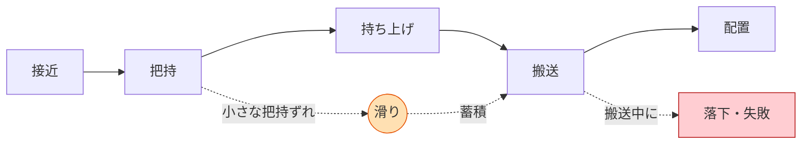
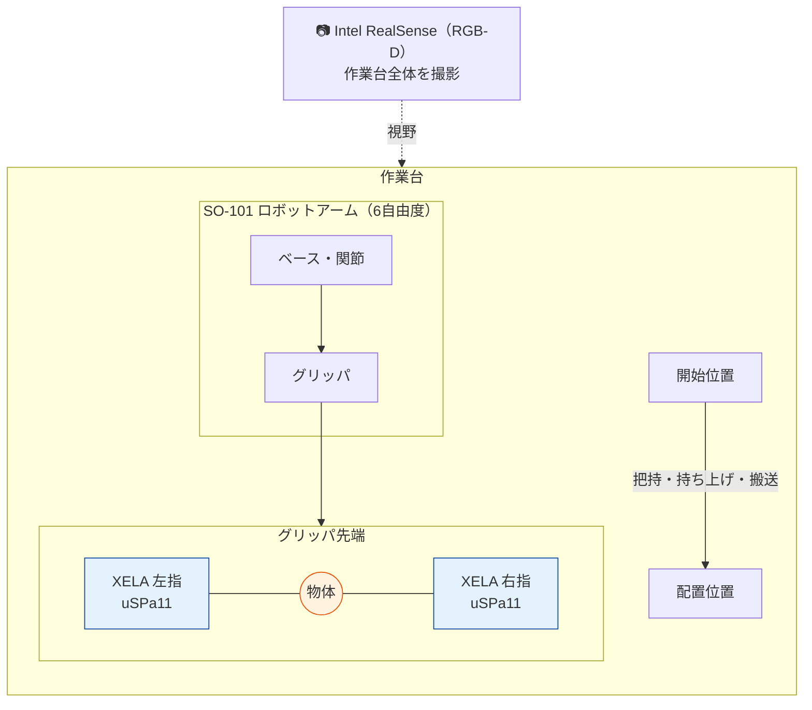
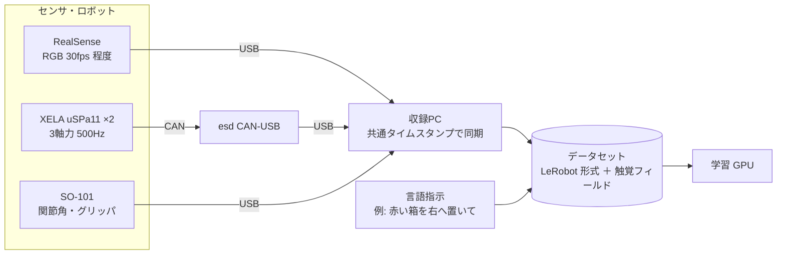
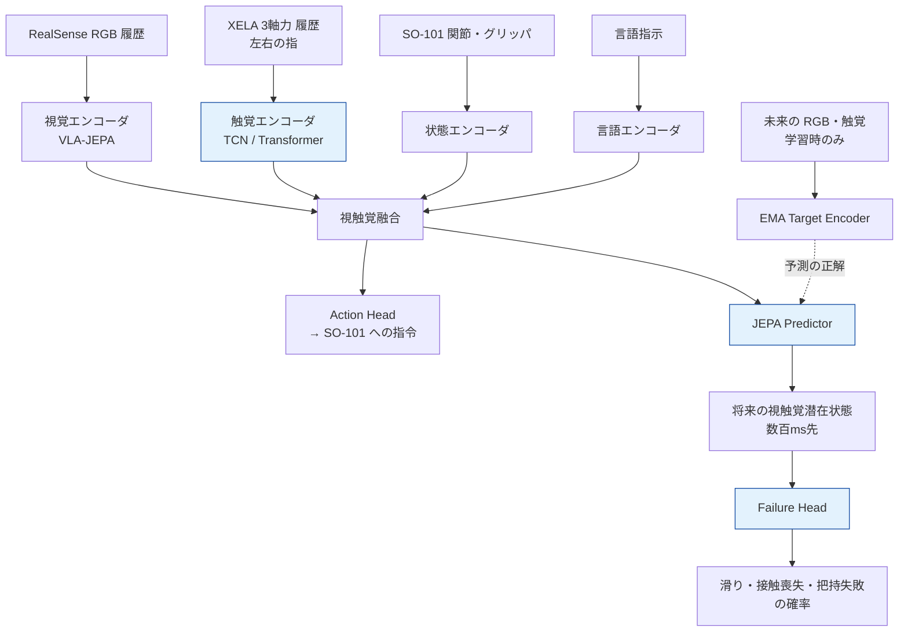
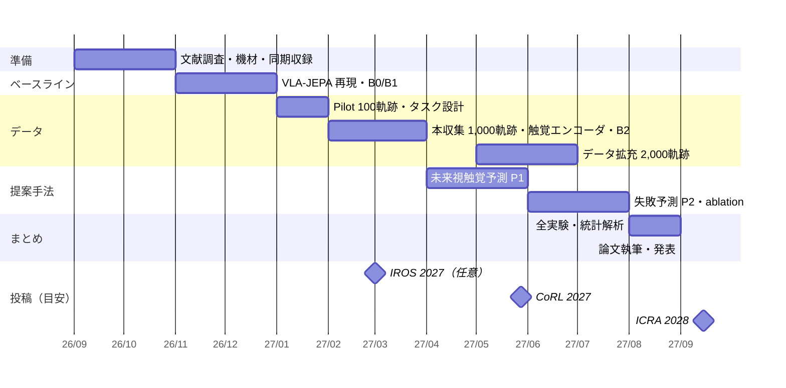
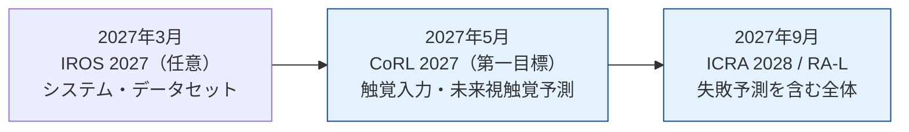

- 作成日：2026-11-03（修士1年・研究期間 2026年9月〜2027年10月）
- 実機：SO-101 ロボットアーム ＋ Intel RealSense カメラ ＋ XELA 触覚センサ（uSPa11 ×2）

## 1. ひとことで言うと

> **カメラだけでは見えない「指先の滑り」を触覚センサで捉え、物を落とす前に失敗を予測できるロボットを作る研究です。**

ロボットに「物をつかんで、運んで、置く」を連続でやらせると、つかんだ時の小さなずれが運んでいる途中の落下につながります。カメラ映像だけで判断すると、気づくのは**落ちた後**になります。そこで指先の触覚センサから力の変化を読み取り、「数百ミリ秒後の接触状態」を予測して、**落ちる前に**失敗を検知します。

---

## 2. 解きたい課題



| 課題 | 内容 |
|---|---|
| 長い作業ほど失敗が積み重なる | 複数の工程を続けて行うと、前の工程の小さなずれが後の工程の失敗になる |
| カメラでは接触が見えにくい | 指と物の間の滑り、荷重の変化、指が物から離れる瞬間は、映像では分かりにくい |
| 既存手法は失敗に後から気づく | 映像で成否を判定する方法では、失敗が起きてから対応することになる |

---

## 3. 実験システム（ハードウェア構成）

### 3.1 機材の配置



### 3.2 各機材の役割

| 機材 | 役割 | 取得する情報 |
|---|---|---|
| **SO-101**（LeRobot のオープンソースアーム） | 操作を実行するロボット。テレオペでデモを集め、学習した方策で動かす | 関節角、関節速度、グリッパ開閉状態、指令値（行動） |
| **Intel RealSense** | 作業の様子を撮影する「目」 | RGB 画像（必要に応じて深度） |
| **XELA uSPa11 ×2** | グリッパの左右の指に付ける「指先の感覚」 | 3 軸力（法線力 Fz・接線力 Fx, Fy）、温度。**500 Hz** |

### 3.3 データの流れ



- カメラ（約 30 fps）と触覚（500 Hz）は速さが大きく違うので、**共通のタイムスタンプ**で揃えて保存します。
- 触覚データは、ゼロ点補正、正規化、飽和処理、欠損マスクの前処理をしてから使います。

### 3.4 なぜ XELA uSPa11 か

- 1 本の指につき検知点（taxel）は 1 個ですが、**サンプリングが 500 Hz と速い**ので、滑りが始まる瞬間の力の変化を時間方向で捉えられます。
- **法線力と接線力の比**（摩擦円錐にどれだけ近いか）が直接分かります。この比が摩擦係数に近づくことが、滑りの物理的な予兆になります。

```
   Ft (tangential force)
     ^          /  friction limit: Ft = mu * Fn
     |        /
     |      /   <- approaching this line = about to slip
     |    / *
     |  /  *    <- force trajectory while grasping
     |/ *
     +--------------> Fn (normal force)
```

接線力 Ft が摩擦の限界（Ft = μ·Fn）の線に近づくほど、滑りやすい状態です。

---

## 4. 提案手法：Vision-Tactile JEPA

### 4.1 考え方

**JEPA**（Joint-Embedding Predictive Architecture）は、未来の画像そのものを生成するのではなく、未来の状態を**特徴量（潜在表現）として予測する**学習の枠組みです。画素を一つずつ再現する必要がないので、行動に関係する変化に絞って学習できます。

既存の **VLA-JEPA** は「映像の未来」を潜在空間で予測します。本研究はこれを拡張して、**映像と触覚の両方の未来**を予測させ、その予測から失敗の確率を出します。

### 4.2 モデル構成



青色が本研究で新しく加える部分です。

| 構成要素 | 役割 |
|---|---|
| 触覚エンコーダ | 左右の指の 3 軸力の時系列を、どちらの指かを区別して符号化する |
| JEPA Predictor | 現在までの観測から、複数の時間幅（ホライズン）先の視触覚の状態を予測する |
| Failure Head | 予測した未来の状態から、滑り・接触喪失・把持失敗の確率を出す |
| EMA Target Encoder | 学習時だけ未来の観測を見て「予測の正解」を作る。推論時には未来の情報を使わない |

### 4.3 学習の目的関数

```
L = L_action  +  λ1 · L_future_latent  +  λ2 · L_failure
```

- `L_action`：デモの行動を真似る損失（模倣学習）
- `L_future_latent`：未来の視触覚の潜在状態を予測する損失
- `L_failure`：滑り・接触喪失・把持失敗を予測する損失

公開されている VLA-JEPA の学習済みモデルを土台にし、最初は視覚エンコーダを固定して、触覚エンコーダ・融合層・予測器・行動出力部を学習します。

---

## 5. 実機タスクと評価

### 5.1 タスク

| # | タスク | ねらい |
|---|---|---|
| 1 | **Pick–Lift–Transport–Place** | 接近から配置までの基本の長期操作 |
| 2 | **Low-Friction Transport** | 滑りやすい物体を運ぶ。触覚の効果が出やすい |
| 3 | **Multi-Object Sequential** | 2〜3 個の物体を指示の順に移動する |
| 4 | Disturbance and Recovery（拡張） | 搬送中に外乱を与え、警告で止まる・つかみ直す |

### 5.2 比較するモデル

| ID | モデル | 確かめること |
|---|---|---|
| B0 | SmolVLA | 軽量 VLA の参考値 |
| B1 | VLA-JEPA（視覚のみ） | 主なベースライン |
| B2 | VLA-JEPA ＋ 触覚入力 | 触覚を入れるだけの効果 |
| **P1** | **Vision-Tactile JEPA** | **未来の触覚を予測する効果** |
| **P2** | **P1 ＋ Failure Head** | **失敗を事前に予測する効果** |

B1 → B2 → P1 → P2 と一つずつ要素を足すことで、どの要素が性能に効いたのかを切り分けます。

### 5.3 評価指標

- **主指標**：全工程を完了できた試行の割合（End-to-End Task Success Rate）。主要な条件は 50 試行以上行い、95% 信頼区間を付ける
- **失敗予測**：AUROC、AUPRC、F1、**予測リードタイム**（失敗の何 ms 前に検知できたか）
- **その他**：落下率、滑り率、最大接触力、未知の物体・摩擦での性能低下、推論レイテンシ

---

## 6. 新規性

1. **VLA-JEPA に触覚を統合**：XELA の 3 軸力時系列を扱う触覚エンコーダを組み込む
2. **未来の視触覚を潜在空間で予測**：画像を生成せず、映像と触覚の共同の潜在状態を予測する
3. **失敗の事前予測**：予測した潜在状態から、滑り・接触喪失・把持失敗を起きる前に推定する
4. **実機での長期タスク評価**：SO-101 で複数工程の操作を実際に行い、成功率と予測性能を測る
5. **エージェントへの失敗予兆の受け渡し（拡張）**：触覚由来の予兆を LLM/VLM のエージェントに返し、失敗の種類に応じた回復を選ばせる（7 章）

映像で失敗を判定する既存の方法と比べて、「どれだけ早く気づけるか（リードタイム）」が触覚の価値を示す評価軸になります。

---

## 7. Agentic Robotics との連携（拡張）

LLM/VLM のエージェントが VLA を道具として呼び出す Agentic Robotics では、エージェントが映像だけで成否を判断するため、指先の滑りに気づくのが遅れます。本研究の失敗予測（P2）をエージェントに渡し、失敗の種類に応じて回復を選ばせる構成を、拡張テーマとして検討しています。

- **回復の実験**：タスク 4 で回復のきっかけだけを変えて比べる（R0 回復なし／R1 映像で判断するエージェント／R2 P2 の予測／R3 P2 の予兆を受けたエージェント）
- **工程の効率化**：エージェントのラベルと XELA のルール判定を突き合わせて、2,000 軌跡の失敗ラベル付けの人手を減らす

詳しくは [エージェントに「失敗の予兆」を渡すロボット操作 — Agentic Robotics との連携](/research/agentic-robotics) にまとめています。

---

## 8. 進捗とスケジュール

### 8.1 現在の状況（2026-11-03 時点）

| 項目 | 状況 |
|---|---|
| SO-101 実機セットアップ | ✅ 完了 |
| XELA uSPa11 ×2 | ✅ 受領（10/28）。CAN-USB 経由の Linux での読み出しを確認中 |
| RealSense のセットアップ | 🔄 着手予定 |
| RGB・触覚・ロボット状態の同期収録系 | 🔄 構築中（触覚なしの系を先に作り、触覚を後から統合） |
| 文献調査（VLA-JEPA、視触覚世界モデルなど） | 🔄 進行中 |
| 研究計画・評価設計 | ✅ 作成済み |

### 8.2 全体スケジュール（目安）

研究期間（2026年9月〜2027年10月）に合わせた目安です。進み具合に応じて見直します。



### 8.3 国際会議への投稿計画（2027年）

ロボット学習の主要な国際会議と IEEE のロボット系国際会議の締切を調べ、8.2 のスケジュールと照らし合わせました（2026-11-03 時点）。締切順に並べ、IEEE の会議・論文誌には〔IEEE〕を付けています。2027年の締切の多くはまだ正式に発表されていないため、前年の日程からの推定を含みます。「その時点で出せる成果」も 8.2 に沿った目安です。

| 会議 | 締切 | 開催 | その時点で出せる成果（目安） | 判断 |
|---|---|---|---|---|
| SII 2027〔IEEE〕 | 本論文は 2026-09-10 で終了（速報ポスターは 11-05） | 2027年1月・神戸 | 機材と同期収録系のみ | ✕ 終了 |
| RSS 2027 | 2026-12-04（Extended Abstract、正式発表） | 2027年7月・アテネ | 機材と同期収録系のみ | ✕ 結果が間に合わない |
| World Haptics 2027〔IEEE〕 | 2027-01-29（公式サイト。日程は暫定） | 2027年7月・ボストン | XELA の校正、試験収集の触覚データ | △ 触覚データの分析（滑りの予兆）に絞れば可能。準備期間は短い |
| IROS 2027〔IEEE〕 | 2027-03-01（推定） | 2027年9〜10月・フィレンツェ | Pilot 100 軌跡、ベースライン B0/B1、本収集を開始したところ | △ システム・データ収集系の論文なら可能 |
| CASE 2027〔IEEE〕 | 2027-03-01（IEEE RAS の掲載） | 2027年8月・リンツ | 同上 | △ IROS の代わり。自動化の応用寄りの会議 |
| AIM 2027〔IEEE〕 | 2027-03-02（IEEE RAS の掲載） | 未確認 | 同上 | △ IROS の代わり。メカトロニクス寄りの会議 |
| RO-MAN 2027〔IEEE〕 | 2027-03-07（公式サイト） | 2027年8月・ウォータールー | 同上 | ✕ 人とロボットの関わりが主題で、テーマが合わない |
| **CoRL 2027** | **2027年5月下旬（推定。2026年は 5/28）** | 2027年11月 | 本収集 1,000 軌跡、B1 と B2 の比較（触覚入力の効果）、P1 の初期結果 | ◎ **第一目標** |
| Humanoids 2027〔IEEE〕 | 未発表（2026年は 7/24） | 未発表 | P1 の結果、データ拡充の途中 | △ ヒューマノイドが主題で、テーマが合いにくい |
| **ICRA 2028**〔IEEE〕 | **2027年9月中旬（推定。2027年は 9/15）** | 2028年5月・グアダラハラ | 2,000 軌跡、B1・B2・P1・P2 の比較、ablation、失敗予測（全実験・統計解析をまとめる段階） | ◎ **研究の集大成として投稿** |
| RA-L（論文誌）〔IEEE〕 | 随時（ICRA・IROS・Humanoids での発表オプションあり） | — | 完成した結果一式 | ○ ICRA 2028 と同時に検討 |

- IEEE の会議では、**ICRA と IROS** がロボット分野の二大会議です。CASE・AIM は IROS と締切がほぼ同じなので、3月に出すならどれか一つを選びます。
- **World Haptics** は触覚の専門会議です。本研究の触覚の部分だけを切り出して発表する場として使えます。



- **第一目標は CoRL 2027** です。ロボット学習（VLA・世界モデル）の研究が集まる会議で、本研究のテーマに最も合います。5月の締切に向けて、4月までに触覚入力の効果（B1 と B2 の比較）を出し、4〜5月に進める未来の視触覚予測（P1）の初期結果を加えます。
- **ICRA 2028 には、失敗予測（P2）まで含めた全体の成果**を投稿します。P2・ablation を8月までに終え、9月の締切に合わせて論文にまとめます。研究期間の最後（2027年10月）の成果発表とも重なります。
- 締切は正式な Call for Papers が出た時点で確認し、この表を更新します。

---

## 9. この研究で身につけていること

| 分野 | 内容 |
|---|---|
| ロボット実機 | SO-101 の組み立て・キャリブレーション、テレオペによるデモ収集（LeRobot） |
| センサ統合 | RealSense、XELA 触覚センサ（CAN 通信、SocketCAN）、速さの違うセンサの時刻同期 |
| 機械学習 | VLA、JEPA／世界モデル、自己教師あり学習、時系列エンコーダ（TCN・Transformer）、模倣学習 |
| 実験設計 | ベースラインと ablation による効果の切り分け、信頼区間を付けた統計評価、未来情報のリークを防ぐデータ分割 |
| 研究の進め方 | 判断の時期と代替案を先に決めておく計画（例：再現できなければ公開モデルを固定して触覚系に絞る） |

---

