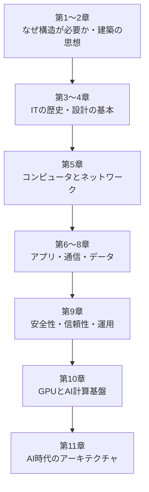
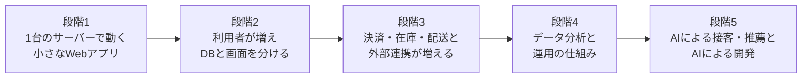

## AIがコードを書く時代に、なぜ「構造」を学ぶのか

AIがコードを生成できるようになり、「プログラムを書く」作業そのものは急速に安くなっています。数行の説明から画面やAPIが出来上がり、テストまで書いてくれる時代です。

それでも、システムは相変わらず壊れます。遅くなり、変更しにくくなり、情報が漏れ、障害が連鎖します。その原因の多くは、一行一行のコードではなく、**何を分け、何をつなぎ、どこに責任を置くか**という全体の構造、つまり[アーキテクチャ](/tech/architecture/glossary#architecture)にあります。

> **アーキテクチャとは、単に技術を組み合わせることではない。何を分離し、何を結びつけ、どのような制約のもとでシステムを成立させるかを考えることである。**

コードを書く速さが上がるほど、間違った構造の上に大量のコードが積み上がる速さも上がります。だからこそ、AI時代には「構造を考える力」の価値が上がります。

## 注意事項 ― 本書が扱う範囲

> **本書は、著者自身が設計・構築したアーキテクチャのみを記載しています。すべてのITアーキテクチャ・AIアーキテクチャを網羅したものではありません。**

- 取り上げる技術や構成は、著者が実際に設計・構築した経験の範囲に限られます。業界で使われている方式や製品のすべてを紹介するものではありません。
- 本書で扱っていない方式が、劣っている・使うべきでないという意味ではありません。
- 実際のシステムで方式を選ぶときは、要件や制約に合わせて、公式ドキュメントやほかの文献もあわせて確認してください。主な参考文献は[参考文献](/tech/architecture/references)にまとめています。

## 本書の特徴

- **歴史 → 原理 → 実例の順に説明します。** 今の技術は、過去の問題を解決するために生まれました。「なぜ生まれたか」を知ると、「いつ使うべきか」が分かります。
- **「なぜ必要か → 仕組み → 図 → 具体例 → 利点と欠点 → 関連用語」の順で書きます。** 技術の名前を覚えるより、判断できるようになることを目指します。
- **図は Mermaid で描きます。** 1枚の図に載せる要素は3〜7個程度に絞ります。
- **用語は[用語集](/tech/architecture/glossary)にリンクします。** 初めて出てくる用語は本文で一言説明し、詳しくは用語集で確認できます。
- **設計判断には必ずトレードオフと適用条件を書きます。** 「常に正しいアーキテクチャ」は存在しません。

## 想定読者

- ITを学び始めた人、情報系の学生
- 日々コードを書いているが、システム全体の設計に自信がないソフトウェア開発者
- AI Coding Agent を使ってシステムを作る人、AIを業務システムに組み込む人

プログラミング経験はあると読みやすくなりますが、必須ではありません。

## 本書の地図

| 章 | タイトル | 主な内容 |
|---|---|---|
| 1 | [なぜAI時代にアーキテクチャが必要なのか](/tech/architecture/01-why-architecture) | AI Coding Agent、複雑性、構造化、設計責任 |
| 2 | [アーキテクチャの歴史と思想](/tech/architecture/02-history-of-architecture) | 建築学、Vitruvius、構造と機能、パターン |
| 3 | [ITアーキテクチャの歴史](/tech/architecture/03-it-architecture-history) | メインフレーム、UNIX、Web、クラウド、分散システム |
| 4 | [ITアーキテクチャ設計の基本](/tech/architecture/04-architecture-design) | 要件、Waterfall、Agile、UML、C4、ADR |
| 5 | [コンピュータとインターネットのアーキテクチャ](/tech/architecture/05-computer-network) | OS、OSI、TCP/IP、DNS、メール、ネットワーク |
| 6 | [アプリケーションアーキテクチャ](/tech/architecture/06-application-architecture) | 3層、MVC、クリーン、DDD、マイクロサービス |
| 7 | [システム間通信と連携のアーキテクチャ](/tech/architecture/07-communication) | REST、gRPC、イベント駆動、メッセージング |
| 8 | [データと情報を管理するアーキテクチャ](/tech/architecture/08-data-architecture) | RDB、NoSQL、DWH、Lakehouse、CDC |
| 9 | [安全性・信頼性・運用のアーキテクチャ](/tech/architecture/09-security-operations) | 認証、認可、IAM、可観測性、SLO |
| 10 | [GPUとAI計算基盤のアーキテクチャ](/tech/architecture/10-gpu-architecture) | CPUとGPU、CUDA、HBM、分散学習、LLM推論 |
| 11 | [AI時代の新しいアーキテクチャ](/tech/architecture/11-ai-architecture) | RAG、AI Agent、隔離、MCP、ガバナンス |
| 付録 | [用語集](/tech/architecture/glossary)・[参考文献](/tech/architecture/references) | |

前半（第1〜4章）は「考え方」、中盤（第5〜9章）は「これまでのITシステムを支えてきた構造」、後半（第10〜11章）は「AIを支える計算基盤と、AIを組み込んだシステムの構造」です。順番に読むことを想定していますが、興味のある章から読んでも構いません。

## 共通題材：小さなECサイト「Kawasemi Shop」

抽象的な話だけでは理解しにくいので、本書では架空のECサイト **Kawasemi Shop**（手作り雑貨のオンラインショップ）を共通題材にします。最初は1人の開発者が作った小さなアプリですが、章が進むごとに利用者が増え、機能が増え、AIが組み込まれていきます。

| 段階 | Kawasemi Shop の状況 | 主に関係する章 |
|---|---|---|
| 1 | 商品一覧・カート・注文だけの小さなアプリ | 第1・4章 |
| 2 | アクセス増加、サーバーとDBの分離、ドメイン名とHTTPS | 第5・6章 |
| 3 | 決済サービス・倉庫システム・配送業者との連携 | 第6・7章 |
| 4 | 売上分析、ログ監視、会員情報の保護 | 第8・9章 |
| 5 | 商品推薦、問い合わせ対応AI、AI Coding Agent による開発 | 第10・11章 |

## 各章の読み方

各章は、おおむね次の流れで書かれています。

1. **なぜ必要なのか** ― 身近な問題から始めます。
2. **仕組み** ― 専門用語を初出時に短く定義します。
3. **図解** ― Mermaid の図で構造を示します。
4. **具体例** ― Kawasemi Shop に当てはめます。
5. **利点と欠点** ― トレードオフと、向いている条件・向いていない条件を説明します。
6. **理解度チェック** ― 章末に、自分の言葉で説明できるか確かめる問いを置きます。

それでは、まず「なぜAI時代にアーキテクチャが必要なのか」から始めましょう。
