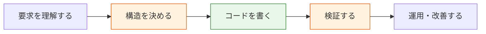
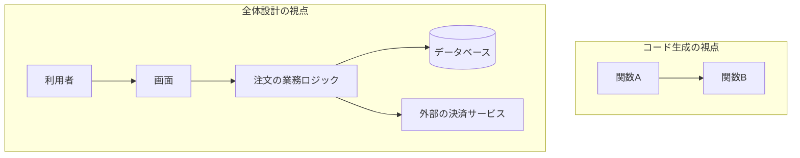
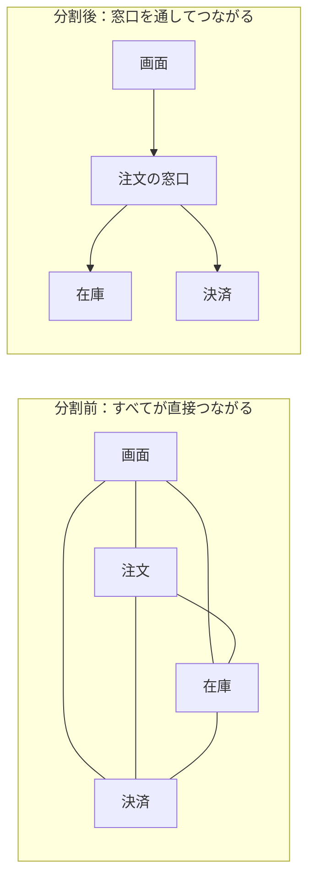
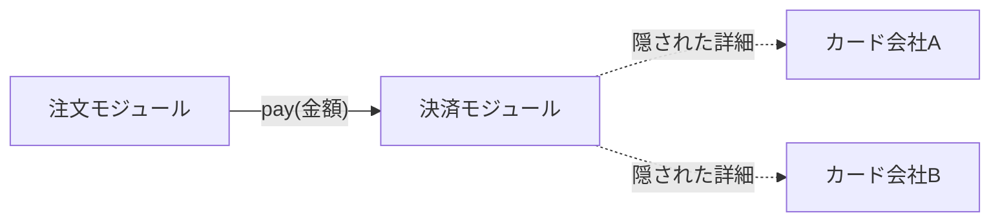
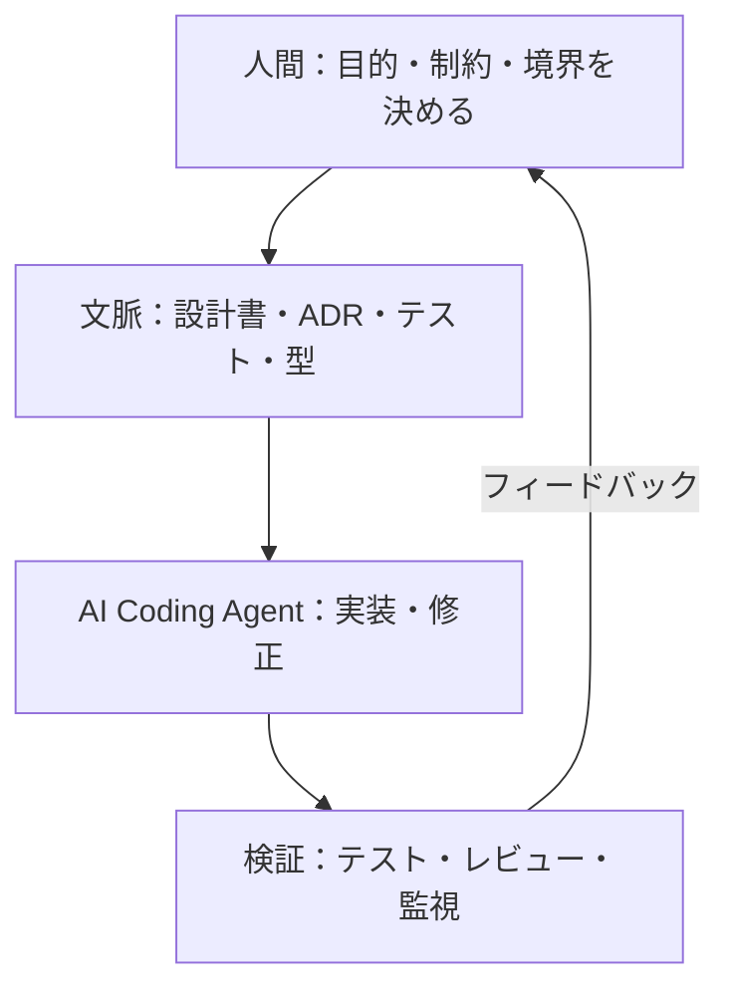
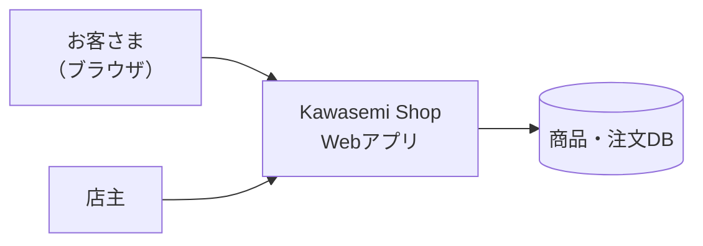

この章では、本書全体の出発点として「なぜ今、アーキテクチャを学ぶのか」を考えます。キーワードは **複雑性** と **判断の責任** です。

## 1.1 AIによってソフトウェア開発はどう変わったか

### なぜ変化を押さえる必要があるのか

2020年代に入り、大規模言語モデル（[LLM](/tech/architecture/glossary#llm)）がプログラムを書けるようになりました。最初は補完（次の数行を予測する）でしたが、やがてチャットで関数を書かせるようになり、今では [AI Coding Agent](/tech/architecture/glossary#ai-coding-agent) がリポジトリを読み、ファイルを編集し、テストを実行し、修正を繰り返すところまで来ています。

### 何が変わったのか

| 観点 | 以前 | AI時代 |
|---|---|---|
| コードを書くコスト | 高い（人間が1行ずつ書く） | 低い（説明すれば生成される） |
| 試行錯誤の速さ | 1日に数回 | 1時間に何十回 |
| ボトルネック | 実装の速さ | **何を作るか、どう分けるか、正しいかの判断** |
| 主なリスク | 実装が間に合わない | 誤った構造のコードが大量に積み上がる |

> [!POINT]
> コードを書くコストが下がると、相対的に「何を作るべきか」「どういう構造にすべきか」「本当に正しく動いているか」を判断するコストの比重が大きくなります。生産性のボトルネックは、**タイピングから判断へ**移ったのです。

*図1-1　AIで大幅に速くなったのは「コードを書く」工程（緑）。相対的に重みが増したのは「構造を決める」「検証する」工程（橙）。*

## 1.2 コードを書くこととシステムを設計することの違い

### なぜ区別が必要か

「コードを書ける」ことと「システムを設計できる」ことは別の能力です。料理にたとえると、レシピどおりに一品を作ることと、レストラン全体の厨房の動線・仕入れ・衛生管理・メニュー構成を決めることの違いに近いでしょう。

### 違いの整理

- **コードを書く**：与えられた範囲の中で、正しく動く手順を作ること。範囲が局所的で、正解をテストで確かめやすい。
- **システムを設計する**：範囲そのものを決めること。どこで区切り、どこに責任を置き、何を共有し、何を共有しないか。正解が一つではなく、**将来の変更・障害・組織**まで考えて選ぶ必要がある。

*図1-2　コード生成は「箱の中」を作る。設計は「箱の切り方と、箱同士のつなぎ方」を決める。*

### 具体例：Kawasemi Shop の「注文」

AIに「注文機能を作って」と頼めば、注文を保存するコードはすぐできます。しかし設計者は次のような問いに答える必要があります。

- 決済が成功したのに注文の保存に失敗したら、どうするか（お金だけ引き落とされる事故）
- 在庫は注文時に減らすか、決済完了時に減らすか
- 注文データを分析チームが使うとき、本番データベースに直接アクセスさせてよいか
- 1年後に海外配送を始めるとき、どこを変更すれば済むか

これらは一つの関数の中では答えられない、**構造の問い**です。

## 1.3 システムが複雑になる理由

### 複雑性とは何か

ソフトウェアの複雑性とは、「理解しにくく、変更しにくい」性質のことです。複雑さは主に次の原因から生まれます。

1. **要素の数**：機能・画面・データ・外部連携が増える。
2. **要素同士のつながり（依存）**：一つを変えると、どこまで影響するか分からない。
3. **状態**：時間とともに変わるデータ（在庫、残高、セッション）が整合性の問題を生む。
4. **分散**：複数のコンピュータに処理が分かれると、通信の遅延や部分的な故障が起きる。
5. **人と組織**：作る人が増えると、コミュニケーションの経路が増える。

つながりの数は、要素の数より速く増えます。n 個の要素がすべて互いに依存しうるとき、組み合わせは最大で $\frac{n(n-1)}{2}$ 本になります。要素が10個なら45本、100個なら4,950本です。

*図1-3　つながりを整理すると、変更の影響範囲を予測しやすくなる。*

### 本質的な複雑さと偶有的な複雑さ

Fred Brooks は1986年の論文「No Silver Bullet」で、複雑さを2種類に分けました。

- **本質的な複雑さ（essential complexity）**：問題そのものが持つ複雑さ。消費税の計算ルールや配送料の体系は、どう作っても複雑です。
- **偶有的な複雑さ（accidental complexity）**：作り方が原因で生まれた余計な複雑さ。同じ計算があちこちにコピーされている、などです。

> [!POINT]
> アーキテクチャの大きな役割は、**本質的な複雑さを適切な場所に閉じ込め、偶有的な複雑さを減らすこと**です。

## 1.4 構造化、抽象化、モジュール化とは何か

複雑さと戦うための基本的な道具は3つあります。

### 構造化

全体を部分に分け、部分同士の関係を整理することです。「画面」「業務ロジック」「データの保存」のように役割ごとに層を分けるのが典型例です（第6章）。

### 抽象化

[抽象化](/tech/architecture/glossary#abstraction)とは、細部を隠して本質だけを見せることです。車の運転者はエンジンの燃焼制御を知らなくても、アクセルとハンドルという**インターフェース**だけで車を操作できます。ソフトウェアでも「決済する」という操作の裏で、どのカード会社とどう通信しているかを隠せます。

### モジュール化

[モジュール化](/tech/architecture/glossary#modularization)とは、内部を隠した部品（モジュール）に分け、部品同士を決められた接点だけでつなぐことです。David Parnas は1972年の論文で、モジュールを「処理の手順」ではなく「**変更されそうな設計判断を隠す単位**」で分けるべきだと主張しました。これは50年以上経った今も、設計の最も重要な原則の一つです。

*図1-4　注文モジュールは「pay」という接点だけを知る。カード会社が変わっても注文モジュールは変更不要。*

### 利点と欠点

| | 利点 | 欠点・注意点 |
|---|---|---|
| 構造化 | 全体像を理解しやすい | 分け方を間違えると、かえって行き来が増える |
| 抽象化 | 詳細の変更から利用者を守る | 抽象化しすぎると、何が起きているか分からなくなる |
| モジュール化 | 並行開発・部分的な交換・テストが容易 | 接点（インターフェース）の設計に手間がかかる |

## 1.5 AI Coding Agentが得意なこと、苦手なこと

### 得意なこと

- 明確に範囲が決まった関数・画面・テストの生成
- 既存のパターンに沿った繰り返し作業（同じ形のAPIを10本作るなど）
- エラーメッセージからの原因推定と修正
- 大量のコードの要約、ドキュメントの作成
- 複数の設計案の列挙と比較表の作成

### 苦手なこと（あるいは、人間が責任を持つべきこと）

- **暗黙の前提の把握**：「この会社では個人情報を海外のサーバーに置けない」といった、コードにもドキュメントにも書かれていない制約
- **長期的な影響の評価**：今は動くが、3年後の変更を難しくする構造
- **境界の判断**：どこまでを一つのサービスにし、どのチームが持つか
- **価値の優先順位**：速さと安全性、コストと可用性のどちらを取るか
- **責任**：障害や情報漏えいが起きたとき、説明し責任を負うこと

AIは与えられた**文脈（コンテキスト）**の中では非常に優秀です。逆に言えば、文脈を整え、境界を決め、正しさを検証する仕組みを作るのは人間の仕事です。良いアーキテクチャは、AIにとっても「迷わずに正しい変更ができる地図」になります。

*図1-5　人間とAIの協働。アーキテクチャは「文脈」と「検証」の質を決める。*

## 1.6 アーキテクトが担う判断と責任

[アーキテクト](/tech/architecture/glossary#architect)は「一番難しいコードを書く人」ではありません。主な仕事は次の判断です。

1. **何を作るかの翻訳**：ビジネスの要求を、システムの構造と[非機能要件](/tech/architecture/glossary#non-functional-requirement)（性能、可用性、セキュリティなど）に翻訳する。
2. **分割と境界**：システムをどう分け、どこを外部に任せるか。
3. **トレードオフの選択**：[トレードオフ](/tech/architecture/glossary#trade-off)（一方を得ると他方を失う関係）を明示し、選ぶ。
4. **決定の記録**：なぜその選択をしたかを残す（第4章の [ADR](/tech/architecture/glossary#adr)）。
5. **進化の管理**：一度決めた構造を、状況の変化に合わせて安全に変えていく。

Martin Fowler らは、アーキテクチャを「**後から変えるのが難しい重要な決定の集まり**」と表現しています。変えにくい決定ほど、慎重に、根拠を持って行う必要があります。

## 1.7 AI時代のアーキテクチャ設計の考え方

本書全体を通じて、次の5つの考え方を繰り返し使います。

1. **境界を明確にする**：モジュール、サービス、権限、データの境界を明示する。AI Agent に与える権限の境界も同じ考え方で設計する。
2. **変更しやすさを優先する**：未来は予測できない。予測より「変えやすさ」に投資する。
3. **決定を記録する**：AIも人間も、後から理由を参照できるようにする。
4. **検証を自動化する**：生成されたコードの正しさを、テスト・型・ポリシーで機械的に確かめる。
5. **小さく始めて進化させる**：最初から完璧な構造を目指さず、問題が見えたら構造を変える。

### Kawasemi Shop の出発点

Kawasemi Shop の最初の姿は、1台のサーバーで動く小さなWebアプリです。

*図1-6　Kawasemi Shop 段階1。これから章を追うごとに、この図に要素が増えていく。*

> [!POINT]
> この段階では、これで十分です。過剰な設計は、それ自体が偶有的な複雑さになります。大切なのは、**いつ、どの理由で構造を変えるべきかを判断できること**です。

## まとめ

- AIによってコードを書くコストは下がり、ボトルネックは「判断」に移った。
- システムの複雑さは、要素の数・依存・状態・分散・組織から生まれる。
- 構造化・抽象化・モジュール化は、複雑さを閉じ込めるための基本的な道具である。
- AI Coding Agent は文脈の中では優秀だが、境界・制約・トレードオフ・責任は人間が担う。
- 良いアーキテクチャは、人間とAIの両方にとっての「地図」になる。

## 理解度チェック

1. 「コードを書くこと」と「システムを設計すること」の違いを、身近な例を使って説明してください。
2. 本質的な複雑さと偶有的な複雑さの違いは何ですか。Kawasemi Shop の例を一つずつ挙げてください。
3. AI Coding Agent に任せやすい作業と、人間が判断すべき事柄をそれぞれ2つ挙げてください。
