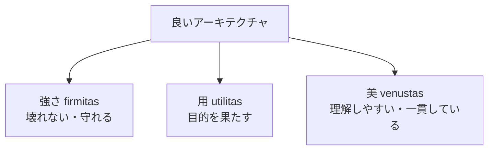
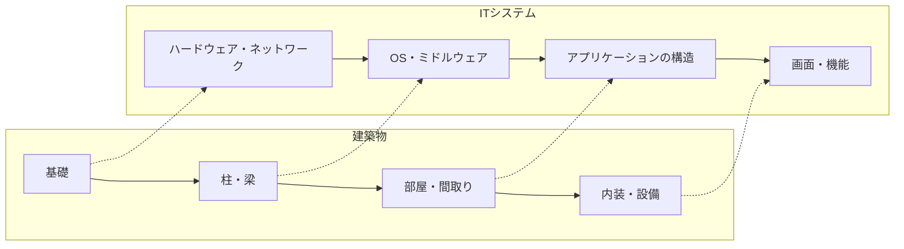
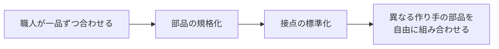
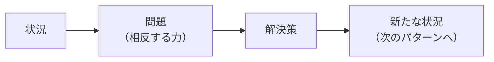

ソフトウェアの世界で使われる「アーキテクチャ」という言葉は、もともと建築の言葉です。この章では建築の歴史と思想をたどり、ソフトウェアの設計に通じる考え方を取り出します。

## 2.1 アーキテクチャという言葉の起源

英語の *architecture* は、ラテン語の *architectura*、さらにギリシャ語の *architektōn* に由来します。*archi-* は「首位の、統べる」、*tektōn* は「大工、職人」を意味し、合わせて「**職人たちを統べる者＝棟梁**」という意味になります。

つまり、アーキテクトは本来「自分ですべてを作る人」ではなく、**多くの職人の仕事を一つの全体にまとめる人**でした。これは現代のソフトウェアアーキテクト、さらには複数の AI Agent の仕事をまとめる人の役割にもよく当てはまります。

コンピュータの分野で「アーキテクチャ」という言葉が広く使われたのは、1964年に IBM が発表した **System/360** からだと言われています。IBM は、複数の性能・価格のコンピュータが**同じ命令セット**を共有し、同じプログラムが動くようにしました。このとき、「利用者（プログラマ）から見たコンピュータの構造」をアーキテクチャと呼び、内部の実装と区別したのです。

## 2.2 古代ローマの建築理論とVitruvius

紀元前1世紀、ローマの建築家 **Vitruvius（ウィトルウィウス）** は『建築について（*De architectura*）』全10書を著しました。現存する最古の体系的な建築書で、都市計画、建材、神殿、水道、機械まで幅広く扱っています。

Vitruvius は、建築家には幅広い教養が必要だと説きました。製図、幾何学、歴史、哲学、音楽、医学、法律、天文学まで。理由は、建物が人間の生活・健康・社会と切り離せないからです。現代のソフトウェアアーキテクトに技術だけでなく業務・法律・組織の理解が求められるのと、よく似ています。

## 2.3 建築における強さ・使いやすさ・美しさ

Vitruvius の最も有名な言葉は、建築が備えるべき3つの性質です。

| ラテン語 | 日本語 | 建築での意味 | ソフトウェアでの対応 |
|---|---|---|---|
| *firmitas* | 強さ | 倒れない、長持ちする | 信頼性、可用性、セキュリティ |
| *utilitas* | 用（使いやすさ） | 目的に合い、使いやすい | 機能要件、ユーザビリティ |
| *venustas* | 美しさ | 見て心地よい、調和がある | 単純さ、一貫性、理解しやすさ |

*図2-1　Vitruvius の3原則とソフトウェアの品質。*

ソフトウェアの「美しさ」は見た目のことではありません。**構造が一貫していて、初めて読む人でも理解できる**ことです。理解しやすい構造は変更しやすく、変更しやすい構造は長く使えます。美しさは、強さと用を長期的に支える性質なのです。

## 2.4 建築物の構造とソフトウェアの構造

建築とソフトウェアには、構造上の対応関係が多くあります。

*図2-2　建築物の構造とITシステムの構造の対応。下の層ほど後から変えにくい。*

建築家 Stewart Brand は著書 *How Buildings Learn*（1994年）で、建物を変化の速さが異なる層（敷地、構造、外装、設備、間取り、家具）に分けて考える「**シアリング・レイヤー（shearing layers）**」という考え方を紹介しました。変化の遅い層と速い層を同じ部材で固く結びつけると、速い層を変えたいときに遅い層まで壊すことになります。

ソフトウェアでも同じです。

- 変わりにくいもの：データの意味、業務の中心的なルール、外部との契約（API）
- 変わりやすいもの：画面のデザイン、使うライブラリ、キャンペーンのルール

**変化の速さが違うものは分けて置く**。これは第6章のレイヤードアーキテクチャやクリーンアーキテクチャの動機です。

## 2.5 モジュール化と標準化の歴史

### 交換可能な部品

18〜19世紀、銃の製造で「**互換性部品**」の考え方が広まりました。それまで部品は一つひとつ職人が合わせて作っていたため、壊れると同じ職人でなければ直せませんでした。部品の寸法を規格化すると、どの部品でも組み合わせられるようになり、大量生産と修理が容易になりました。

### 標準化がもたらしたもの

- **ねじの規格**：異なるメーカーの部品を組み合わせられる
- **輸送用コンテナ**（1950年代〜）：箱のサイズを統一したことで、船・鉄道・トラックの積み替えが効率化した。ソフトウェアの「コンテナ」（第3章）の名前の由来でもある
- **電源コンセントや USB**：中身を知らなくても、接点の約束だけでつながる

*図2-3　モジュール化と標準化の流れ。*

ソフトウェアにおける「規格化された接点」が、[API](/tech/architecture/glossary#api)・プロトコル・ファイル形式です。インターネットが巨大になれたのは、TCP/IP や HTTP という標準の接点があったからです（第5章）。

## 2.6 Christopher Alexanderのパターン・ランゲージ

### パターンとは

建築家 **Christopher Alexander** は、1977年に仲間とともに『*A Pattern Language*（パターン・ランゲージ）』を出版しました。この本には、町・建物・部屋のスケールで繰り返し現れる設計上の問題と、その解決策が253個の「**パターン**」としてまとめられています。

パターンは次の形で書かれます。

1. **状況（context）**：どんな場面で起きるか
2. **問題（problem）**：何と何がぶつかっているか（相反する力）
3. **解決（solution）**：繰り返し使える解決の核

例えば「窓のある場所（Window Place）」というパターンは、「人は明るい窓辺に引き寄せられるが、窓辺に座る場所がないと落ち着かない」という問題に対し、「窓辺に座れる場所を作る」という解決を示します。

### ソフトウェアへの影響

Alexander の考え方は、ソフトウェアの世界に大きな影響を与えました。

- 1987年、Kent Beck と Ward Cunningham がパターンをプログラミングに応用する試みを発表
- 1994年、Gamma, Helm, Johnson, Vlissides（通称 **GoF**）が『*Design Patterns*』で23のオブジェクト指向設計パターンを発表
- その後、アーキテクチャパターン、エンタープライズ統合パターン、クラウド設計パターンなどが次々にまとめられた
- Ward Cunningham が作った最初の Wiki（1995年）も、パターンを共有するための場だった

*図2-4　パターンの構造。パターン同士はつながり、「言語」を形づくる。*

パターンの価値は、**設計の語彙を共有できること**です。「ここは Pub/Sub にしよう」「Adapter を挟もう」と言えば、チームの全員（そして AI）が同じ構造を思い浮かべられます。

## 2.7 建築から学べる設計原則と、その限界

### 学べること

1. **全体と部分の調和**：部分の最適化の積み重ねが、全体の最適になるとは限らない。
2. **変化の速さで層を分ける**：変わりやすいものと変わりにくいものを分離する。
3. **標準化された接点**：中身を知らなくてもつながる約束を作る。
4. **パターンという語彙**：繰り返し現れる問題と解決に名前をつける。
5. **使う人のための設計**：建築が住む人のためにあるように、システムは使う人のためにある。

### 限界：ソフトウェアは建築と何が違うか

| 観点 | 建築 | ソフトウェア |
|---|---|---|
| 変更のコスト | 完成後の変更は非常に高い | 比較的安い（ただし構造次第） |
| 複製のコスト | 同じ建物をもう一つ建てるのは高い | コピーはほぼ無料 |
| 物理法則 | 重力・材料の強度が制約になる | 制約は論理・通信・組織・人の理解力 |
| 完成の概念 | 竣工がある | 運用しながら変わり続ける |
| 規模の変化 | 建物は後から10倍に伸ばせない | 利用者が1年で100倍になることもある |

建築のメタファーは、ソフトウェアを「一度設計して作れば終わり」と誤解させる危険もあります。Waterfall 型開発（第4章）の問題の一部は、このメタファーを強く当てはめすぎたことにありました。

ソフトウェアのアーキテクチャは、建物よりも**都市**や**生き物**に近いかもしれません。都市は少しずつ建て替えられ、道路が増え、用途が変わりながら、全体としての秩序を保ちます。Alexander 自身も、良い建築は一度に計画されるのではなく、小さな改善の積み重ねで「育つ」ものだと考えていました。

## まとめ

- アーキテクトの語源は「職人を統べる者」。全体をまとめる役割を指す。
- Vitruvius の「強さ・用・美」は、ソフトウェアの品質（信頼性・機能・理解しやすさ）にも当てはまる。
- 変化の速さが違うものは分けて置く。標準化された接点が、組み合わせの自由を生む。
- Alexander のパターン・ランゲージは、ソフトウェアのデザインパターンの源流になった。
- ソフトウェアは建築より変化が速く、「完成」がない。設計は進化させ続けるものである。

## 理解度チェック

1. Vitruvius の3原則を、ソフトウェアの品質に当てはめて説明してください。
2. 「変化の速さが違うものを分ける」とはどういうことですか。Kawasemi Shop で、変わりやすいものと変わりにくいものを1つずつ挙げてください。
3. パターンを使うと、設計の議論にどんな利点がありますか。
