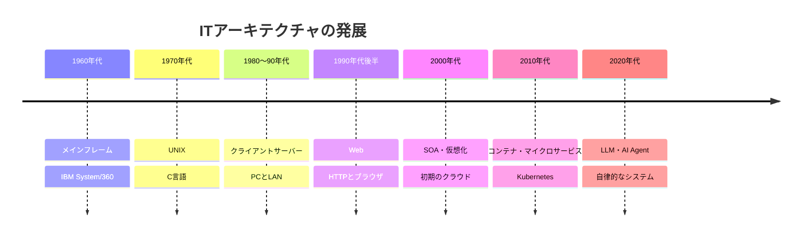
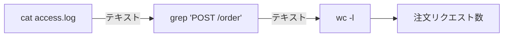
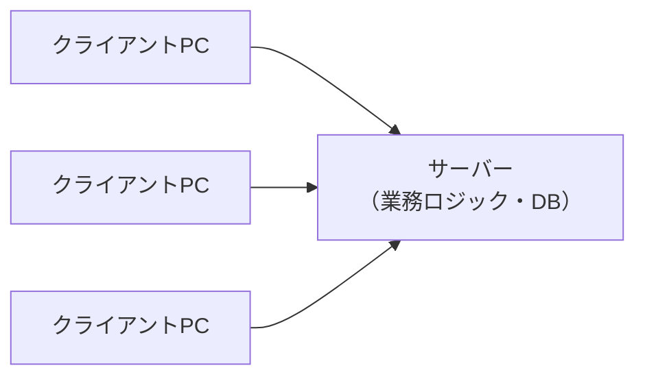
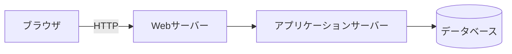
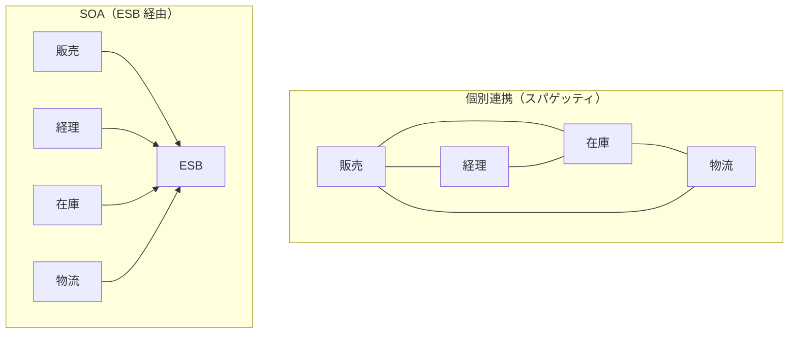
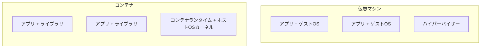
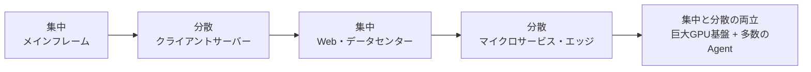

今使われている技術は、すべて過去の何らかの問題を解くために生まれました。この章では、ITアーキテクチャの約70年の歴史を「**集中と分散の振り子**」という視点でたどります。

*図3-1　ITアーキテクチャの発展年表（年代はおおよその目安）。*

## 3.1 メインフレームと集中処理

### 背景

1950〜60年代のコンピュータは非常に高価で、部屋一つを占めるほど巨大でした。企業や研究機関は1台の大型コンピュータ（**[メインフレーム](/tech/architecture/glossary#mainframe)**）を共有して使いました。

### 仕組み

- 計算もデータもすべて中央の1台に集める（**集中処理**）
- 利用者は、計算能力を持たない **端末（ダム端末）** から接続する
- 給与計算などを夜間にまとめて処理する **バッチ処理** と、銀行の窓口のように即座に応答する **オンライン処理（トランザクション処理）** が発達した
- 1964年の IBM System/360 は、命令セットを共通化して「同じソフトウェアを異なる機種で動かせる」ようにした。アーキテクチャと実装を分けた歴史的な製品である

### 利点と欠点

| 利点 | 欠点 |
|---|---|
| 管理が一か所で済み、データの整合性を保ちやすい | 非常に高価で、性能を上げるには全体を買い替える必要がある |
| 高い信頼性（現在も銀行・保険の基幹系で稼働） | 特定ベンダーへの依存が強い |
| | 利用者は中央の都合に合わせる必要がある |

メインフレームは「古い技術」ではありません。高い信頼性が求められる基幹システムでは、今も現役です。

## 3.2 UNIXとモジュール化の思想

### 背景

1969年、AT&T ベル研究所の Ken Thompson と Dennis Ritchie らは、小型コンピュータで動く OS として **[UNIX](/tech/architecture/glossary#unix)** の開発を始めました。1973年には大部分が C 言語で書き直され、異なるハードウェアへ移植しやすくなりました。

### UNIX の設計思想

UNIX の思想は、Doug McIlroy らによって次のようにまとめられています。

1. **一つのことをうまくやる小さなプログラムを作る**
2. **プログラム同士を組み合わせて使えるようにする**
3. **テキストを共通のインターフェースにする**

*図3-2　パイプによる小さなプログラムの組み合わせ。各プログラムは他を知らなくてよい。*

「すべてはファイル」という抽象化、パイプによる組み合わせは、モジュール化（第1章）の実例です。この思想は Linux に引き継がれ、現在のクラウドやマイクロサービス、さらには AI Agent が小さなツールを組み合わせて仕事をする設計にまで影響を与えています。

## 3.3 クライアントサーバーと分散処理

### 背景

1980年代、パーソナルコンピュータ（PC）が普及し、社内の PC 同士を LAN（Local Area Network）でつなげるようになりました。PC 自体にも計算能力があるのだから、すべてを中央でやる必要はありません。

### 仕組み

**[クライアントサーバー](/tech/architecture/glossary#client-server)** モデルでは、処理を2種類の役割に分けます。

- **クライアント**：利用者の操作を受け付け、画面を表示する（PC のアプリケーション）
- **サーバー**：データを保持し、要求に応えて処理する（データベースサーバーなど）

*図3-3　クライアントサーバー。処理の一部が利用者の手元に分散した。*

### 利点と欠点

| 利点 | 欠点 |
|---|---|
| 安価な PC とサーバーで構築できる | クライアントアプリを全 PC に配布・更新する手間が大きい |
| 画面の応答が速く、操作性が高い | クライアントごとにバージョンが揃わない問題 |
| | 社外からの利用が難しい |

## 3.4 インターネットとWebアプリケーション

### 背景

1989年、CERN の Tim Berners-Lee が **World Wide Web** を提案しました。[HTTP](/tech/architecture/glossary#http)（通信の約束事）、HTML（文書の形式）、URL（場所の指し方）という3つの単純な標準によって、世界中の文書がリンクでつながりました。1990年代半ばには商用利用が広がり、ブラウザさえあれば誰でもサービスを使えるようになりました。

### Webアプリケーションの構造

クライアントアプリの配布問題は、「**画面はブラウザに任せ、処理はサーバーで行う**」ことで解決されました。これが Web 版の3層構成です（第6章で詳しく扱います）。

*図3-4　典型的なWebアプリケーションの構成。*

Webは、一度は分散した処理を再びサーバー側に集めた、という意味で「振り子」を中央に戻しました。ただし今度は、サーバー自体を何台にも並べる（**スケールアウト**）方向に進化していきます。

## 3.5 SOAとエンタープライズアーキテクチャ

### 背景

2000年代、大企業の中には、部門ごとに作られた数百のシステムが乱立していました。顧客情報が販売・経理・サポートでばらばらに管理され、システム同士は個別に、場当たり的につながっていました（**スパゲッティ連携**）。

### SOA の考え方

**[SOA](/tech/architecture/glossary#soa)（Service-Oriented Architecture、サービス指向アーキテクチャ）** は、業務機能を「**サービス**」という再利用可能な単位として公開し、標準的なインターフェースでつなぐ考え方です。当時は SOAP や XML による Web サービスと、サービス間の通信を仲介する **[ESB](/tech/architecture/glossary#esb)（Enterprise Service Bus）** がよく使われました。

*図3-5　個別連携から、共通の基盤を介した連携へ。*

同じ時期に、組織全体の業務・データ・アプリケーション・技術を体系的に設計する **エンタープライズアーキテクチャ（EA）** の手法（Zachman フレームワーク、TOGAF など）も普及しました。

### 教訓

SOA は「再利用」と「標準化」という正しい目標を持っていましたが、ESB に業務ロジックや変換処理が集中しすぎて、ESB 自体が巨大で変更しにくい中心になってしまう例も多くありました。この反省は、後のマイクロサービスの「**賢いエンドポイントと単純な通信路（smart endpoints and dumb pipes）**」という考え方につながります。

## 3.6 仮想化・クラウド・コンテナ

### 仮想化

**[仮想化](/tech/architecture/glossary#virtualization)** とは、1台の物理コンピュータの上で、複数の仮想的なコンピュータ（**仮想マシン、VM**）を動かす技術です。ハイパーバイザーと呼ばれるソフトウェアが、CPU・メモリ・ディスクを分割して各 VM に割り当てます。サーバーの利用率が上がり、物理機器を買わずに新しいサーバーを用意できるようになりました。

### クラウド

2006年に Amazon Web Services（AWS）が S3 と EC2 の提供を開始し、**クラウドコンピューティング** の時代が本格的に始まりました。サーバーを「買う」のではなく、必要な分だけ「借りる」ようになったのです。

| 提供形態 | 利用者が管理する範囲 | 例 |
|---|---|---|
| IaaS | OS より上 | 仮想マシン、仮想ネットワーク |
| PaaS | アプリケーションとデータ | 実行基盤、マネージドDB |
| SaaS | 使うだけ | メール、会計ソフト |

### コンテナ

**[コンテナ](/tech/architecture/glossary#container)** は、アプリケーションとその実行に必要なライブラリを一つにまとめ、OS のカーネルを共有しながら隔離して動かす技術です。2013年に登場した Docker によって一気に普及しました。VM より軽く、数秒で起動でき、「開発者の PC では動くのに本番では動かない」問題を減らしました。

*図3-6　仮想マシンとコンテナの違い。コンテナはOSカーネルを共有するため軽いが、隔離の強さはVMに劣る（第12章で再び扱う）。*

多数のコンテナを複数のサーバーに配置し、障害時に再起動し、負荷に応じて数を増減させる仕組みとして、2014年に Google が **[Kubernetes](/tech/architecture/glossary#kubernetes)** を公開しました。現在ではコンテナ運用の事実上の標準になっています。

## 3.7 マイクロサービスとクラウドネイティブ

### 背景

Netflix や Amazon のような大規模サービスでは、1つの巨大なアプリケーション（**[モノリス](/tech/architecture/glossary#monolith)**）を数百人で開発すると、変更のたびに全体をテストしてリリースしなければならず、開発速度が落ちていきました。

### マイクロサービス

**[マイクロサービス](/tech/architecture/glossary#microservices)** は、アプリケーションを、独立してデプロイできる小さなサービスの集まりとして作る考え方です。2014年に James Lewis と Martin Fowler が記事で特徴を整理し、広く知られるようになりました。

- 各サービスは一つの業務の能力（注文、在庫、決済など）を担う
- 各サービスは自分のデータを持ち、他のサービスのデータベースに直接触れない
- サービスごとに独立してリリースできる
- 小さなチームが一つのサービスを「作って運用する」責任を持つ

**[クラウドネイティブ](/tech/architecture/glossary#cloud-native)** は、こうしたコンテナ、マイクロサービス、自動化された運用、宣言的な設定などを前提に、クラウドの性質（弾力性、従量課金、障害を前提にした設計）を最大限に活かすアプローチです。

### 注意点

マイクロサービスは銀の弾丸ではありません。ネットワーク越しの通信、データの整合性、監視、デプロイの仕組みなど、**分散システム特有の難しさ** を背負うことになります。小さなチーム・小さなサービスでは、モノリスの方が合理的なことも多くあります（第6章）。

## 3.8 AI Agentと自律的なソフトウェアシステム

### 背景

2017年に発表された [Transformer](/tech/architecture/glossary#transformer) アーキテクチャと、GPU による大規模な学習（第10章）によって、LLM が急速に進化しました。2022年末の ChatGPT の公開以降、LLM はチャットから業務システム、開発ツールへと組み込まれていきます。

### 新しい構成要素

AI時代のシステムには、従来にない要素が加わりました。

- **LLM**：自然言語を理解し、文章やコードを生成する確率的なモデル
- **[RAG](/tech/architecture/glossary#rag)**：社内文書などを検索して LLM に渡し、根拠のある回答を作る仕組み
- **[AI Agent](/tech/architecture/glossary#ai-agent)**：目的を与えられると、自分で計画を立て、ツールを呼び出し、結果を見て次の行動を決めるソフトウェア
- **ツール連携の標準**：[MCP](/tech/architecture/glossary#mcp) や [A2A](/tech/architecture/glossary#a2a) など、AI とツール、AI 同士をつなぐプロトコル

*図3-7　集中と分散の振り子。AI時代は、巨大な計算基盤への集中と、多数の Agent による分散が同時に進んでいる。*

### 何が本質的に新しいのか

従来のシステムは、**同じ入力には同じ出力を返す（決定的）** ことを前提に設計されてきました。LLM や AI Agent は、同じ入力でも異なる出力を返すことがあり、ときに誤った内容をもっともらしく出力します。さらに Agent は、ファイルの書き換えやメールの送信など、**現実世界に作用する行動** をとります。

そのため、権限の境界、実行環境の隔離、人間による承認、監査ログといった「振る舞いを制御する構造」が、アーキテクチャの中心的なテーマになってきました。これは第12章で詳しく扱います。

## まとめ

| 時代 | 解こうとした問題 | 新たに生まれた課題 |
|---|---|---|
| メインフレーム | 高価な計算資源の共有 | ベンダー依存、拡張の難しさ |
| UNIX | 移植性と組み合わせやすさ | — （思想として今も生きている） |
| クライアントサーバー | 安価な分散処理 | クライアント配布の手間 |
| Web | 配布不要・どこからでも利用 | 大量アクセスへの対応 |
| SOA | 部門システムの乱立 | 中央基盤の肥大化 |
| クラウド・コンテナ | 調達の遅さ、環境差 | 運用の複雑化 |
| マイクロサービス | 大組織での開発速度 | 分散システムの難しさ |
| AI Agent | 知的作業の自動化 | 非決定性、行動の安全性 |

> [!POINT]
> 各時代のアーキテクチャは、前の時代の問題を解き、新しい問題を生み出してきました。**新しい技術を学ぶときは、「何の問題を解くのか」「代わりに何を背負うのか」を必ずセットで考えましょう。**

## 理解度チェック

1. クライアントサーバーからWebアプリケーションへの移行は、どんな問題を解決しましたか。
2. 仮想マシンとコンテナの違いを、「何を共有しているか」に注目して説明してください。
3. AI Agent が従来のソフトウェアと比べて「本質的に新しい」点を2つ挙げてください。
