前の章までで、なぜアーキテクチャが必要かを見てきました。この章では、実際に「設計する」ときの基本的な考え方と道具を学びます。

## 4.1 アーキテクチャ設計とは何を決めることか

アーキテクチャ設計で決めることは、大きく次の5つです。

1. **構成要素**：システムをどんな部品（モジュール、サービス、データストア）に分けるか
2. **関係**：部品同士がどうつながり、どう通信するか
3. **配置**：部品をどのコンピュータ・ネットワーク・クラウドに置くか
4. **原則とルール**：全体で守るべき約束（例：「他のサービスのDBには直接アクセスしない」）
5. **品質の目標**：性能・可用性・セキュリティなどをどの水準で満たすか

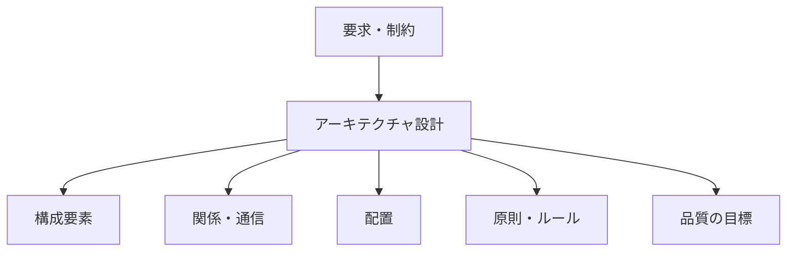

*図4-1　アーキテクチャ設計で決めること。*

## 4.2 要求、要件、制約、設計の違い

設計の議論が混乱する原因の多くは、次の4つを区別していないことにあります。

| 用語 | 意味 | Kawasemi Shop の例 |
|---|---|---|
| **要求**（need） | 利用者や事業が「こうしたい」と望むこと | 「スマホから気軽に買い物できるようにしたい」 |
| **要件**（requirement） | システムが満たすべき条件として明確にしたもの | 「スマホのブラウザで、3ステップ以内に注文を完了できる」 |
| **制約**（constraint） | 選択の余地がない前提条件 | 「予算は月5万円まで」「カード情報は自社で保存しない」 |
| **設計**（design） | 要件を制約の中で満たすための具体的な選択 | 「決済は外部の決済サービスに任せ、自社はトークンだけ扱う」 |

要求は曖昧で構いません。それを測定可能な要件に翻訳し、制約を確認し、設計で答える。これが設計の基本的な流れです。

## 4.3 機能要件と非機能要件

### 機能要件

**機能要件** は、システムが「何をするか」です。「商品を検索できる」「カートに入れられる」「注文履歴を見られる」などです。

### 非機能要件

[非機能要件](/tech/architecture/glossary#non-functional-requirement) は、システムが「どのように」動くべきかです。アーキテクチャを決める大きな要因は、実は機能要件より非機能要件です。同じ「商品を検索できる」機能でも、利用者が10人か1,000万人かで構造は全く変わります。

| 品質特性 | 問い | 要件の例 |
|---|---|---|
| 性能 | どれだけ速いか | 商品一覧は95%のリクエストで0.5秒以内に表示 |
| 拡張性 | 負荷が増えたら対応できるか | セール時に通常の10倍のアクセスに耐える |
| 可用性 | どれだけ止まらないか | 月間の稼働率99.9%（停止は月約43分以内） |
| セキュリティ | どう守るか | 会員情報は暗号化して保存、管理画面は多要素認証 |
| 保守性 | どれだけ変更しやすいか | 新しい決済手段を2週間以内に追加できる |
| 運用性 | 異常に気づき対処できるか | 注文エラー率が1%を超えたら5分以内に通知 |
| コスト | いくらかかるか | インフラ費用は売上の3%以内 |

> [!POINT]
> 非機能要件は「速いほうがいい」のような曖昧な形では役に立ちません。**数値と条件で表す**ことが大切です。

## 4.4 Waterfall開発における設計

### 仕組み

**[Waterfall](/tech/architecture/glossary#waterfall)（ウォーターフォール）** は、要件定義 → 基本設計 → 詳細設計 → 実装 → テスト → リリースという工程を、滝が流れ落ちるように順番に進める開発手法です。

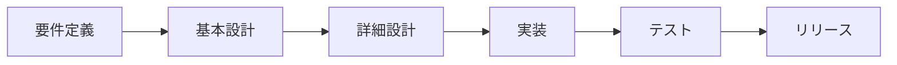

*図4-2　Waterfall の工程。設計は前半に集中して行う。*

### 利点と欠点

| 利点 | 欠点 |
|---|---|
| 計画・見積もり・契約を立てやすい | 要件の誤りがテスト工程まで見つかりにくい |
| 文書が整備され、引き継ぎしやすい | 途中の変更に弱い |
| 規制が厳しい分野（医療機器、航空など）と相性が良い | 利用者が動くものを見るまでに時間がかかる |

要件が安定していて、失敗のコストが極めて高い領域では、今も合理的な選択です。

## 4.5 Agile開発における継続的な設計

### 仕組み

**[Agile](/tech/architecture/glossary#agile)（アジャイル）** 開発は、短い期間（1〜4週間程度）で「計画 → 実装 → 確認 → 改善」を繰り返し、動くソフトウェアを少しずつ作り上げていく考え方です。2001年の「アジャイルソフトウェア開発宣言」で広く知られるようになりました。

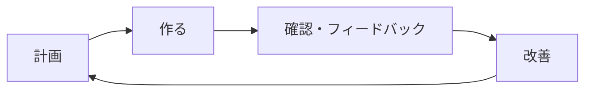

*図4-3　Agile の反復。設計も反復の中で継続的に行う。*

### Agile における設計の考え方

「Agile では設計しない」は誤解です。Agile では、設計を最初に一度だけ行うのではなく、**継続的に行います**。

- **最初に決めるべきこと**：変えにくい決定（言語、データの基本構造、主要な境界、セキュリティの方針）は、早めに意識的に決める
- **後で決めてよいこと**：変えやすい決定は、必要になるまで遅らせる（**最終責任時点**まで待つ）
- **リファクタリング**：構造の歪みを見つけたら、動作を変えずに内部構造を改善する

AI Coding Agent の登場で、実装と反復のサイクルはさらに速くなりました。速く回すほど、「構造の歪み」も速く溜まります。継続的な設計レビューの重要性は、むしろ高まっています。

## 4.6 UMLの基本

**[UML](/tech/architecture/glossary#uml)（Unified Modeling Language）** は、ソフトウェアの構造や振る舞いを図で表すための標準的な記法です。全部で十数種類の図がありますが、実務でよく使うのは次の5つです。

### ユースケース図

**誰が、システムで何をするか** を示します。

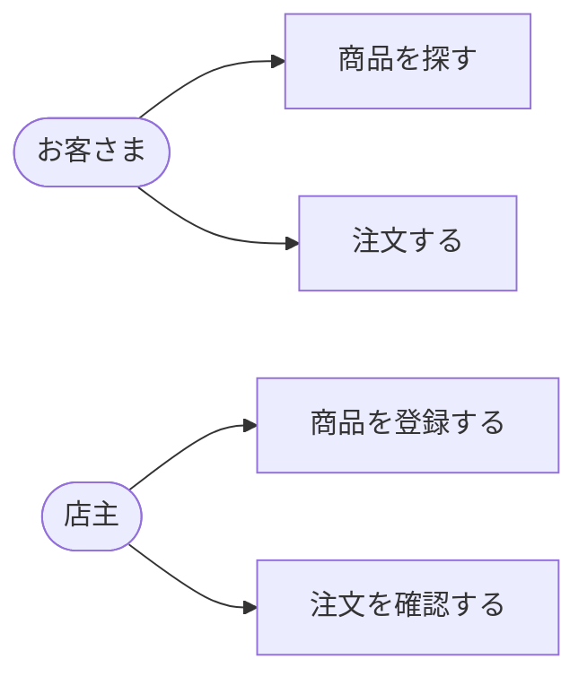

*図4-4　ユースケース図（Mermaid の flowchart で簡略的に表現）。*

### クラス図

**データや部品の構造と関係** を示します。

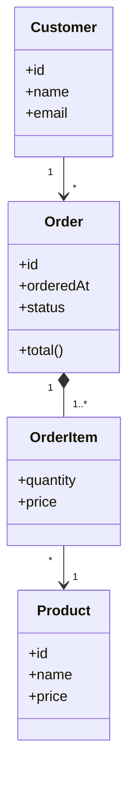

*図4-5　Kawasemi Shop の注文に関するクラス図。*

### シーケンス図

**時間の流れに沿った、部品同士のやり取り** を示します。

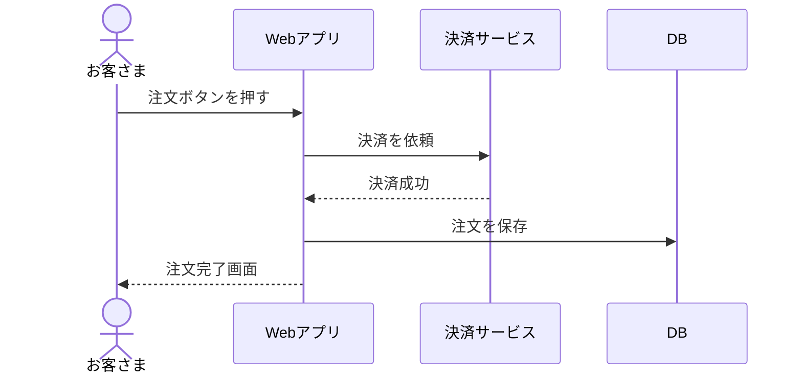

*図4-6　注文処理のシーケンス図。*

### コンポーネント図と配置図

- **コンポーネント図**：システムを構成する部品と、その間のインターフェース
- **配置図**：部品を、どのサーバー・ネットワーク上に置くか

これらは次に説明する C4 モデルでも表現できます。

## 4.7 C4モデルによる構造の表現

### なぜ必要か

アーキテクチャ図でよくある失敗は、「何を表しているのか分からない箱と矢印」です。経営者向けの図と開発者向けの図が混ざり、粒度もばらばらになりがちです。

### 仕組み

Simon Brown が提唱した **[C4 モデル](/tech/architecture/glossary#c4-model)** は、地図のズームのように、4つの階層で構造を表します。

| 階層 | 示すもの | 主な読者 |
|---|---|---|
| 1. System Context | システムと、その利用者・外部システム | 全員（非技術者を含む） |
| 2. Container | 実行単位（Webアプリ、API、DB など）※Dockerのコンテナとは別の意味 | 開発者・運用者 |
| 3. Component | コンテナ内部の主要な部品 | 開発者 |
| 4. Code | クラスなどのコード構造 | 必要な場合のみ |

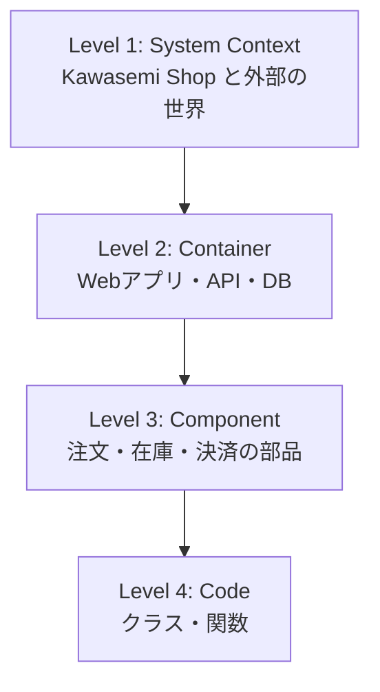

*図4-7　C4 モデルの4階層。上から下へズームインしていく。*

Kawasemi Shop の System Context 図は、例えば次のようになります。

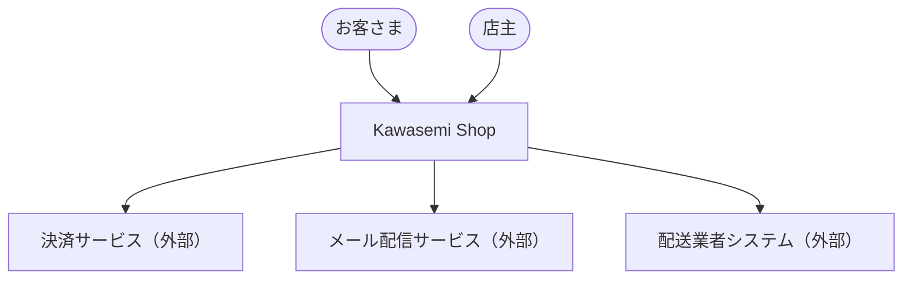

*図4-8　Kawasemi Shop の System Context 図。*

C4 の図は「必ず4つ描く」ものではありません。多くの場合、Level 1 と Level 2 だけで十分な価値があります。

## 4.8 ADR（Architecture Decision Record）

### なぜ必要か

半年後に新しいメンバー（あるいは AI Coding Agent）が来て、「なぜここは PostgreSQL なのか」「なぜ決済を同期で呼んでいるのか」と疑問に思ったとき、答えられる人がいなければ、正しかった決定が理由も分からず覆されたり、逆に古くなった決定が惰性で守られたりします。

### 仕組み

**[ADR](/tech/architecture/glossary#adr)** は、重要な設計判断を1件につき1つの短い文書として記録する方法です。Michael Nygard が2011年に提案しました。一般的には次の項目で書きます。

```markdown
# ADR-0003: 決済は外部の決済サービスに委託する

- 状態：承認済み（2026-11-01）

## 背景
カード情報を自社で保存すると、PCI DSS への準拠に大きなコストがかかる。

## 決定
カード情報は決済サービスの画面で入力してもらい、自社ではトークンのみを扱う。

## 結果
- 良い点：セキュリティ上の責任範囲が小さくなる
- 悪い点：決済サービスの障害時に注文できない。手数料がかかる
- 今後：決済サービスの障害に備え、2社目の導入を半年後に検討する
```

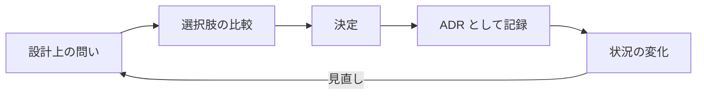

*図4-9　ADR による意思決定のサイクル。決定を覆すときは、古い ADR を「廃止」にして新しい ADR を書く。*

ADR はリポジトリの中（例：`docs/adr/`）に Markdown で置くのがおすすめです。コードと一緒にバージョン管理され、AI Coding Agent も読むことができます。

## 4.9 設計原則：関心の分離、凝集度、結合度、SOLID

### 関心の分離

**[関心の分離](/tech/architecture/glossary#separation-of-concerns)（Separation of Concerns）** とは、異なる関心事（画面表示、業務ルール、データ保存、ログ出力など）を、異なる部品に分けることです。Edsger Dijkstra が1974年の文章で用いた言葉として知られています。

### 凝集度と結合度

- **[凝集度](/tech/architecture/glossary#cohesion)（cohesion）**：一つの部品の中身が、どれだけ一つの目的にまとまっているか。**高いほど良い**。
- **[結合度](/tech/architecture/glossary#coupling)（coupling）**：部品同士が、どれだけ互いに依存しているか。**低いほど良い**。

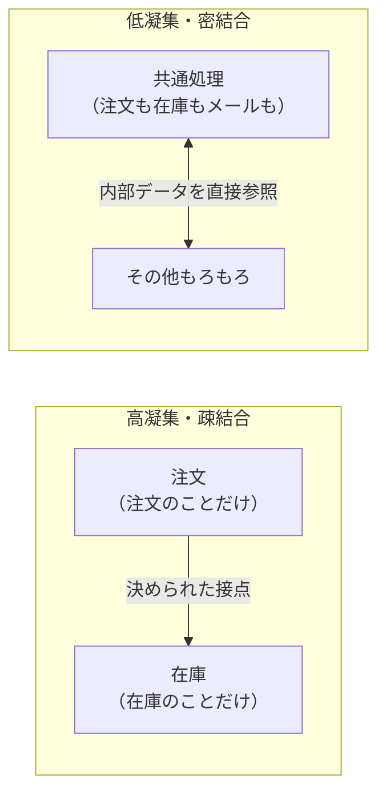

*図4-10　高凝集・疎結合と、低凝集・密結合。*

### SOLID 原則

Robert C. Martin が広めた **[SOLID](/tech/architecture/glossary#solid)** は、オブジェクト指向設計の5つの原則の頭文字です。

| 原則 | 意味 | 一言で |
|---|---|---|
| **S**ingle Responsibility | 単一責任の原則 | 変更する理由は一つだけにする |
| **O**pen/Closed | 開放閉鎖の原則 | 拡張に開き、修正に閉じる |
| **L**iskov Substitution | リスコフの置換原則 | 派生型は基底型と置き換えても正しく動く |
| **I**nterface Segregation | インターフェース分離の原則 | 使わないメソッドへの依存を強制しない |
| **D**ependency Inversion | 依存性逆転の原則 | 具体ではなく抽象に依存する |

特に **依存性逆転の原則** は、第6章のクリーンアーキテクチャの中核です。「注文処理」が「MySQL のコード」に直接依存するのではなく、「注文を保存する」という抽象（インターフェース）に依存し、MySQL の実装がその抽象を満たす形にします。

## 4.10 品質特性とトレードオフ

### すべてを最大化することはできない

品質特性は互いにぶつかり合います。

| 上げたいもの | 犠牲になりやすいもの | 例 |
|---|---|---|
| 可用性 | コスト | サーバーを3つのデータセンターに置くと費用は数倍 |
| セキュリティ | 使いやすさ | 多要素認証は安全だが手間が増える |
| 性能 | 整合性 | キャッシュで速くすると、古いデータが見えることがある |
| 柔軟性 | 単純さ | 何でも設定で変えられる仕組みは、理解が難しい |
| 開発速度 | 長期の保守性 | 急いで作ると、後で直すコスト（技術的負債）が溜まる |

### トレードオフの決め方

1. **品質特性に優先順位をつける**：全部「高」にしない。Kawasemi Shop なら「セキュリティ（決済・個人情報）＞ 可用性 ＞ 性能 ＞ コスト」など。
2. **シナリオで具体化する**：「セール開始の瞬間にアクセスが10倍になったとき、注文の受付を止めない」。
3. **選択肢を比較し、ADR に残す**。

Software Engineering Institute（SEI）の **ATAM**（Architecture Tradeoff Analysis Method）は、このような品質シナリオに基づいてアーキテクチャを評価する代表的な手法です。

## 4.11 アーキテクチャレビューと設計の進化

### アーキテクチャレビュー

設計は、一人の頭の中で完結させてはいけません。定期的に次の観点でレビューします。

- 品質シナリオを満たせるか（性能・可用性・セキュリティ）
- 単一障害点（そこが壊れると全体が止まる箇所）はないか
- 境界は明確か。依存は一方向か
- 運用・監視の方法は考えられているか
- 決定は ADR に記録されているか

### 進化的アーキテクチャ

Neal Ford らは、アーキテクチャを「変化を前提に、少しずつ進化させるもの」と捉える **進化的アーキテクチャ** を提唱しました。その中心的な道具が **適応度関数（fitness function）** です。これは、アーキテクチャの特性を自動で検証するテストのことです。

- 「`order` モジュールは `payment` モジュールの内部クラスを import してはならない」をテストで検証する
- 「API の応答時間の95パーセンタイルが500ms を超えたら CI を失敗させる」

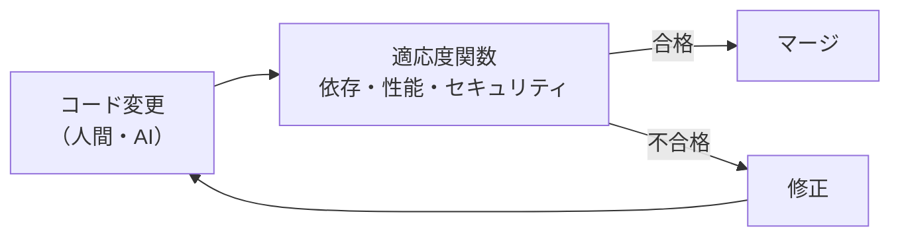

*図4-11　適応度関数による構造の自動検証。AI が大量のコードを書く時代に特に有効。*

> [!POINT]
> AI Coding Agent が生成するコードは、局所的には正しくても、境界のルールを破ることがあります。設計ルールを文書だけでなく**自動テストとして表現しておく**ことは、AI時代のアーキテクチャ設計の重要な実践です。

## まとめ

- アーキテクチャ設計では、構成要素・関係・配置・原則・品質の目標を決める。
- 要求・要件・制約・設計を区別し、非機能要件は数値で表す。
- Waterfall は前半に設計を集中させ、Agile は設計を継続的に行う。
- UML と C4 モデルで構造を伝え、ADR で決定の理由を残す。
- 高凝集・疎結合、関心の分離、SOLID は、変更しやすい構造の基本原則である。
- 品質特性はトレードオフの関係にある。優先順位をつけ、適応度関数で継続的に検証する。

## 理解度チェック

1. 「要求」と「要件」の違いを、Kawasemi Shop の例で説明してください。
2. C4 モデルの Level 1 と Level 2 では、それぞれ何を描きますか。
3. あなたの身近なシステムで、2つの品質特性がトレードオフになっている例を挙げ、ADR の形で決定を書いてみてください。
