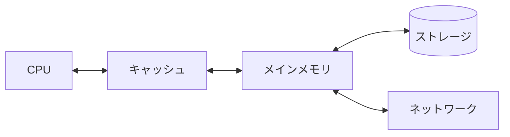
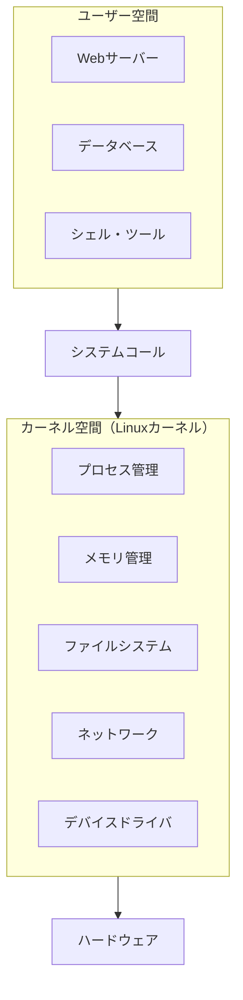
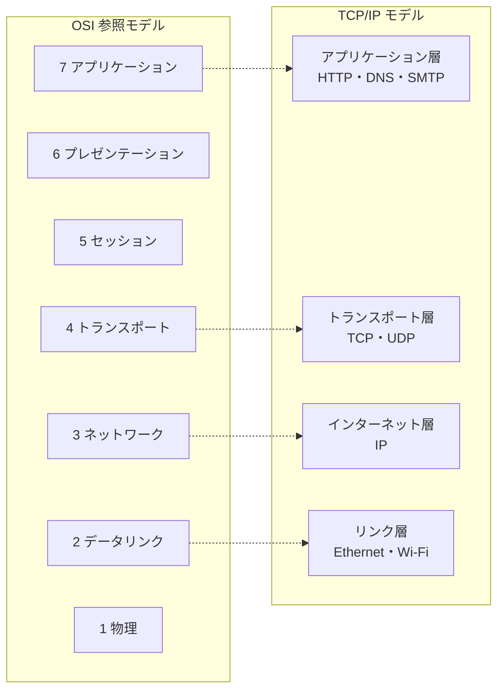
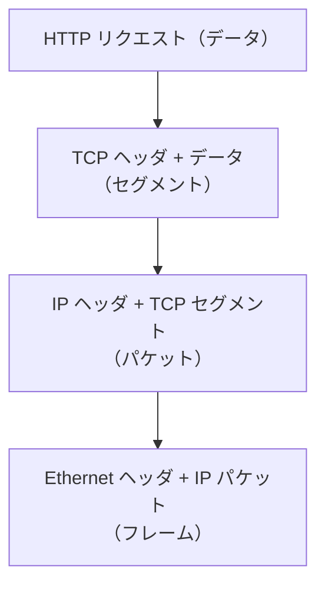
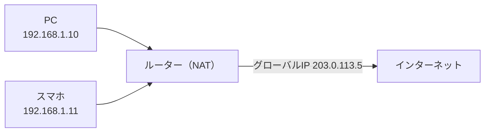
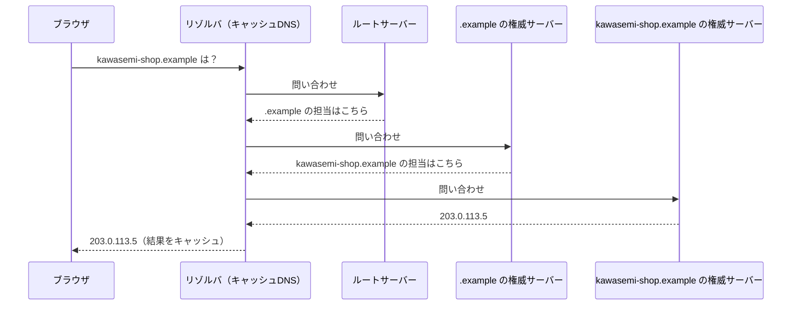
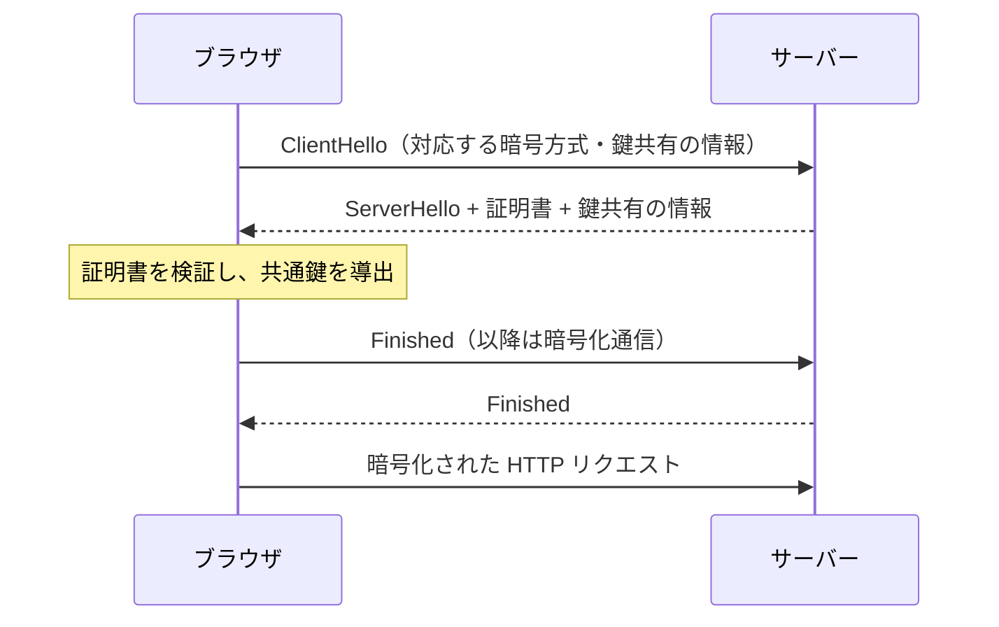
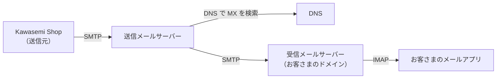
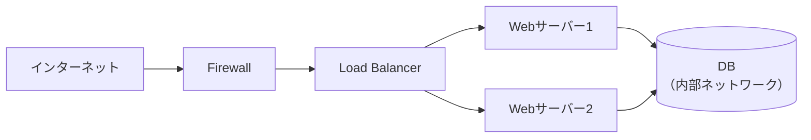
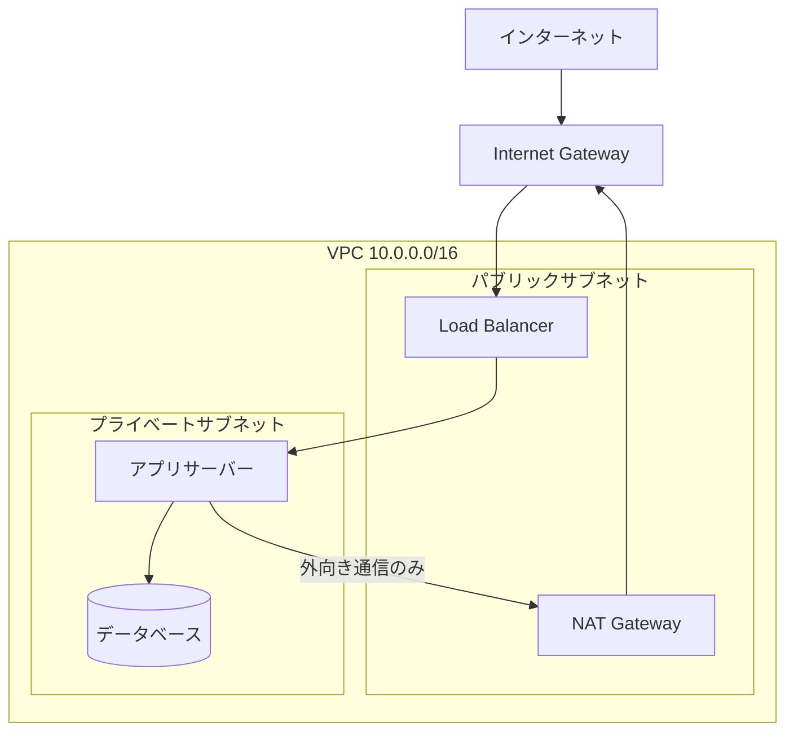

アプリケーションの設計を考える前に、その土台を知っておく必要があります。この章では、1台のコンピュータの中の構造から始め、コンピュータ同士がつながるインターネットの構造までを見ていきます。

## 5.1 コンピュータを構成するハードウェアとOS

### なぜ知る必要があるのか

「なぜこの処理は遅いのか」「なぜメモリが足りなくなるのか」を判断するには、コンピュータの構造の基本を知っておく必要があります。第10章の GPU を理解する土台にもなります。

### ハードウェアの基本構成

現代のコンピュータの多くは、John von Neumann らが1945年に示した **ノイマン型（von Neumann）アーキテクチャ** に基づいています。プログラムとデータを同じメモリに置き、CPU が命令を一つずつ読み出して実行します。

| 部品 | 役割 | 速さと容量の目安 |
|---|---|---|
| CPU | 命令を実行する | ナノ秒（10億分の1秒）単位で動作 |
| キャッシュ | CPU のすぐ近くの小さく速いメモリ | 数MB〜数百MB |
| メインメモリ（RAM） | 実行中のプログラムとデータを置く | 数GB〜数TB、電源を切ると消える |
| ストレージ（SSD/HDD） | データを永続的に保存する | 数百GB〜数十TB、メモリより桁違いに遅い |
| ネットワーク | 他のコンピュータと通信する | 同じデータセンター内でも往復でマイクロ秒〜ミリ秒単位 |



*図5-1　コンピュータの記憶階層。CPU から遠いほど大きく、遅い。*

> [!POINT]
> 設計上重要なのは、**階層が一つ下がるごとに、アクセス時間が桁違いに大きくなる**ことです。キャッシュ、データベースのインデックス（第8章）、GPU のメモリ階層（第10章）は、すべてこの差を埋めるための工夫です。

### OS の役割

**[OS](/tech/architecture/glossary#os)（Operating System）** は、ハードウェアとアプリケーションの間に立つソフトウェアです。主な役割は次の3つです。

1. **抽象化**：ディスクの物理的な配置を「ファイル」、ネットワークカードを「ソケット」として見せる
2. **資源の配分**：CPU 時間やメモリを、複数のプログラムに公平に割り当てる
3. **保護**：あるプログラムが他のプログラムやOS自身を壊さないようにする

## 5.2 Linuxカーネルの構造とユーザー空間

### 仕組み

Linux は、1991年に Linus Torvalds が開発を始めた UNIX 系の OS です。現在ではサーバー、クラウド、スマートフォン（Android）、スーパーコンピュータ、組み込み機器で広く使われています。

OS の中心部分を **[カーネル](/tech/architecture/glossary#kernel)** と呼びます。Linux では、メモリ空間が2つに分けられています。

- **カーネル空間**：カーネルが動く、ハードウェアを直接操作できる特権的な領域
- **ユーザー空間**：通常のアプリケーションが動く領域。ハードウェアには直接触れられない



*図5-2　Linux カーネルとユーザー空間。アプリケーションはシステムコールを通してのみカーネルに依頼できる。*

Linux カーネルは、主要な機能を一つの大きなプログラムとして動かす **モノリシックカーネル** です。ただし、デバイスドライバなどを後から読み込める **カーネルモジュール** の仕組みを持ち、柔軟性も確保しています。

### コンテナを支える機能

第3章で紹介したコンテナは、Linux カーネルの次の機能で実現されています。

- **namespaces**：プロセスから見えるもの（プロセス一覧、ファイルシステム、ネットワーク、ユーザー）を分ける
- **cgroups**：プロセスが使える資源（CPU、メモリ）を制限する

コンテナは「軽い仮想マシン」ではなく、**同じカーネルの上で、見えるものと使える量を制限されたプロセス** なのです。この理解は、第12章で AI Agent の隔離を考えるときに重要になります。

## 5.3 プロセス、スレッド、システムコール

- **[プロセス](/tech/architecture/glossary#process)**：実行中のプログラム。それぞれが独立したメモリ空間を持ち、他のプロセスのメモリには触れられない。
- **[スレッド](/tech/architecture/glossary#thread)**：プロセスの中で並行して動く実行の流れ。同じプロセスのスレッド同士はメモリを共有する。
- **[システムコール](/tech/architecture/glossary#system-call)**：アプリケーションがカーネルに処理を依頼するための呼び出し。ファイルを開く（`open`）、読む（`read`）、ネットワークに送る（`send`）、新しいプロセスを作る（`fork`/`execve`）など。

| | プロセス | スレッド |
|---|---|---|
| メモリ | 独立 | 共有 |
| 作成コスト | 比較的大きい | 小さい |
| 障害の影響 | 他のプロセスに波及しにくい | 同じプロセス内に波及する |
| データの受け渡し | プロセス間通信が必要 | 共有メモリで直接（ただし競合に注意） |

Webサーバーが多数のリクエストを同時に処理する方式には、プロセスを複数立てる、スレッドを複数立てる、少数のスレッドでイベントを順に処理する（イベントループ、非同期I/O）などがあり、それぞれ性能と安全性のトレードオフがあります。

## 5.4 OSI参照モデルの7層

### なぜ層に分けるのか

ネットワーク通信は、電気信号を送ることから、Webページを表示することまで、非常に多くの仕事を含みます。これを一つの仕組みで扱うのは不可能です。そこで、役割を **層（レイヤー）** に分け、各層は「すぐ下の層のサービスを使い、すぐ上の層にサービスを提供する」ようにしました。

**[OSI参照モデル](/tech/architecture/glossary#osi-model)** は、ISO が1984年に標準化した7層のモデルです。実際のインターネットは次節の TCP/IP で動いていますが、OSI は通信を説明するための共通言語として今も使われます。

| 層 | 名前 | 役割 | 例 |
|---|---|---|---|
| 7 | アプリケーション層 | アプリケーション固有の通信 | HTTP、SMTP、DNS |
| 6 | プレゼンテーション層 | データの表現形式、暗号化 | 文字コード、TLS（の一部） |
| 5 | セッション層 | 通信の開始・維持・終了 | （TCP/IP では明確に分かれない） |
| 4 | トランスポート層 | アプリ間の通信の信頼性 | TCP、UDP |
| 3 | ネットワーク層 | ネットワークをまたいだ配送 | IP |
| 2 | データリンク層 | 隣接する機器間の配送 | Ethernet、Wi-Fi |
| 1 | 物理層 | 電気・光・電波による信号 | ケーブル、光ファイバー |

## 5.5 TCP/IPモデルとパケット通信

### TCP/IP モデル

インターネットは **[TCP/IP](/tech/architecture/glossary#tcp-ip)** と呼ばれるプロトコル群で動いています。TCP/IP モデルは4層で表されることが多く、OSI と次のように対応します。



*図5-3　OSI 参照モデルと TCP/IP モデルの対応（OSI の5〜7層は TCP/IP のアプリケーション層に、1〜2層はリンク層にまとめられる）。*

### パケット通信

インターネットでは、データを **パケット** と呼ばれる小さな単位に分けて送ります。各層は、上の層から受け取ったデータに自分の制御情報（**ヘッダ**）を付けて下の層に渡します。これを **カプセル化** と呼びます。



*図5-4　カプセル化。受信側では逆の順にヘッダを外していく。*

### TCP と UDP

| | TCP | UDP |
|---|---|---|
| 接続 | 通信前に接続を確立する（3ウェイハンドシェイク） | 接続なしで送る |
| 信頼性 | 届かなかったデータは再送し、順番を揃える | 届く保証も順番の保証もない |
| 速さ | 制御の分だけ遅延がある | 軽くて速い |
| 用途 | Web、メール、ファイル転送 | 音声通話、動画配信、DNS、ゲーム |

HTTP/3 は、UDP の上に信頼性や暗号化を自前で実装した **QUIC** というプロトコルを使い、TCP の弱点（接続確立の遅さなど）を改善しています。

## 5.6 IPアドレス、ルーティング、NAT

### IPアドレス

**[IPアドレス](/tech/architecture/glossary#ip-address)** は、ネットワーク上の機器を識別する番号です。

- **IPv4**：32ビット。`192.0.2.10` のように表記する。約43億個しかなく、枯渇が問題になった
- **IPv6**：128ビット。`2001:db8::10` のように表記する。事実上無限に近い数がある

IPアドレスは、**ネットワーク部** と **ホスト部** に分けて考えます。`192.0.2.0/24` は「先頭24ビットがネットワーク部」という意味で、`192.0.2.0`〜`192.0.2.255` の範囲を表します（**CIDR 表記**）。

### ルーティング

**ルーター** は、パケットの宛先IPアドレスを見て、次にどのルーターへ送るかを決める機器です。インターネットは、無数のルーターがバケツリレーのようにパケットを転送することで成り立っています。組織（AS：自律システム）同士の経路情報は、**BGP** というプロトコルで交換されます。

### NAT

**[NAT](/tech/architecture/glossary#nat)（Network Address Translation）** は、プライベートIPアドレス（家庭や社内でのみ使うアドレス）とグローバルIPアドレス（インターネットで通用するアドレス）を変換する仕組みです。家庭のルーターは、複数の機器が1つのグローバルIPアドレスを共有できるよう、NAT を行っています。



*図5-5　NAT による複数機器のアドレス共有。*

## 5.7 DNSによる名前解決

### なぜ必要か

人間は `203.0.113.5` のような数字を覚えられません。そこで `kawasemi-shop.example` のような **ドメイン名** を使います。ドメイン名を IP アドレスに変換する仕組みが **[DNS](/tech/architecture/glossary#dns)（Domain Name System）** です。

### 仕組み

DNS は、世界中に分散した階層的なデータベースです。



*図5-6　DNS の名前解決。結果は TTL（有効期間）の間キャッシュされる。*

主なレコードの種類は次のとおりです。

| レコード | 意味 |
|---|---|
| A / AAAA | ドメイン名に対応する IPv4 / IPv6 アドレス |
| CNAME | 別名（あるドメイン名を別のドメイン名に向ける） |
| MX | そのドメインのメールを受け取るサーバー |
| TXT | 任意の文字列。メールの送信元認証（SPF など）やドメイン所有の確認に使う |

### 設計上の注意

DNS はキャッシュされるため、変更がすぐには全世界に反映されません。サーバーの引っ越しを計画するときは、事前に TTL を短くしておくのが定石です。また、DNS が止まるとサービス全体に到達できなくなるため、DNS は重要な単一障害点になりえます。

## 5.8 HTTP、HTTPS、TLS

### HTTP

**[HTTP](/tech/architecture/glossary#http)（HyperText Transfer Protocol）** は、Web の通信の約束事です。クライアントが **リクエスト** を送り、サーバーが **レスポンス** を返します。

```text
GET /products/42 HTTP/1.1
Host: kawasemi-shop.example
Accept: text/html

HTTP/1.1 200 OK
Content-Type: text/html; charset=utf-8

<html>...商品ページ...</html>
```

- **メソッド**：GET（取得）、POST（作成）、PUT（置き換え）、PATCH（部分更新）、DELETE（削除）
- **ステータスコード**：2xx 成功、3xx リダイレクト、4xx クライアントの誤り（404 Not Found など）、5xx サーバーの誤り
- **ステートレス**：HTTP 自体は前のリクエストを覚えていない。ログイン状態は Cookie やトークンで表す

### HTTPS と TLS

**HTTPS** は、HTTP を **[TLS](/tech/architecture/glossary#tls)（Transport Layer Security）** で暗号化したものです。TLS は次の3つを提供します。

1. **暗号化**：通信の内容を盗み見られない
2. **改ざん検知**：通信の途中で内容を書き換えられたら分かる
3. **サーバー認証**：接続先が本物の `kawasemi-shop.example` であることを、認証局（CA）が発行した **証明書** で確かめる



*図5-7　TLS 1.3 のハンドシェイクの概略（実際にはさらに詳細な手順がある）。*

現在では、ほぼすべての Web サイトで HTTPS を使うのが当たり前です。Let's Encrypt のような無料の認証局の登場で、証明書の取得・更新も自動化できるようになりました。

## 5.9 メールの仕組み（SMTP、IMAP、DNS MX）

Kawasemi Shop は注文確認メールを送ります。メールは、インターネットで最も古い仕組みの一つで、複数のプロトコルの組み合わせで動いています。

- **[SMTP](/tech/architecture/glossary#smtp)**：メールを送信・転送するプロトコル
- **IMAP / POP3**：受信者がメールサーバーからメールを読み出すプロトコル（IMAP はサーバー上で管理、POP3 は手元にダウンロード）
- **DNS の MX レコード**：宛先ドメインのメールをどのサーバーが受け取るかを示す



*図5-8　メールの配送経路。*

### 送信元の認証

SMTP は元々、送信元を偽れる設計でした。迷惑メールやなりすましを防ぐため、現在は次の仕組みを組み合わせます。

| 仕組み | 確認すること |
|---|---|
| SPF | このサーバーは、そのドメインからメールを送ってよいか（DNS の TXT レコードで宣言） |
| DKIM | メールに付けた電子署名で、送信ドメインと改ざんの有無を確認 |
| DMARC | SPF・DKIM の結果をどう扱うか（拒否・隔離など）の方針を宣言 |

自社でメールサーバーを運用するのは難しいため、Kawasemi Shop では外部のメール配信サービスを使い、SPF・DKIM・DMARC を正しく設定するのが現実的な設計です。

## 5.10 ネットワークの設計（LAN、VLAN、VPN、Firewall、Load Balancer）

| 要素 | 役割 |
|---|---|
| **LAN** | 建物やフロアなど、限られた範囲のネットワーク |
| **[VLAN](/tech/architecture/glossary#vlan)** | 物理的には同じスイッチにつながっていても、論理的にネットワークを分割する |
| **[VPN](/tech/architecture/glossary#vpn)** | インターネット上に暗号化された仮想的な専用線を作る（拠点間接続、リモートワーク） |
| **[Firewall](/tech/architecture/glossary#firewall)** | 通信を、送信元・宛先・ポートなどのルールで許可・拒否する |
| **[Load Balancer](/tech/architecture/glossary#load-balancer)** | 受け取ったリクエストを複数のサーバーに振り分け、負荷分散と冗長化を行う |



*図5-9　Kawasemi Shop 段階2のネットワーク構成。DB はインターネットから直接到達できない場所に置く。*

ロードバランサーには、TCP/UDP のレベルで振り分ける **L4 ロードバランサー** と、HTTP の内容（URL、ヘッダ）を見て振り分ける **L7 ロードバランサー** があります。L7 では TLS の終端、パスごとの振り分け、ヘルスチェックなども行えます。

> [!POINT]
> ネットワーク設計の基本原則は、**外部に公開する部分を最小にし、内側をゾーンに分けること** です。ただし、「内側なら安全」という前提には限界があり、第9章の Zero Trust につながります。

## 5.11 クラウドネットワーク（VPC、Subnet、Gateway）

クラウドでは、物理的な機器の代わりに、ソフトウェアで定義された仮想ネットワークを使います。

- **[VPC](/tech/architecture/glossary#vpc)（Virtual Private Cloud）**：クラウド上に作る、自分専用の論理的に隔離されたネットワーク
- **Subnet（サブネット）**：VPC の中をさらに分割した範囲。インターネットに直接出られる **パブリックサブネット** と、出られない **プライベートサブネット** を分けるのが基本
- **Internet Gateway**：VPC とインターネットの間で通信できるようにする部品
- **NAT Gateway**：プライベートサブネットのサーバーが、外部（例：OS の更新サーバー）へ通信するときだけに使う経路
- **Security Group / Network ACL**：仮想的なファイアウォール



*図5-10　クラウドネットワークの典型的な構成。*

クラウドのネットワークは、設定をコードで管理（**Infrastructure as Code**：Terraform など）できるのが大きな利点です。ネットワーク構成もレビューし、バージョン管理し、再現できるようになります。

## まとめ

- コンピュータは記憶階層を持ち、階層が下がるほど遅くなる。設計の多くはこの差を埋める工夫である。
- OS はハードウェアを抽象化し、資源を配分し、プログラムを互いに保護する。コンテナは Linux カーネルの namespaces と cgroups で実現される。
- ネットワークは層に分けて設計されている。TCP/IP、DNS、HTTP、TLS は Web の土台である。
- メールは SMTP・IMAP・DNS MX の組み合わせで動き、SPF・DKIM・DMARC で送信元を認証する。
- ネットワーク設計の基本は、公開範囲を最小にしてゾーンを分けることである。

## 理解度チェック

1. ブラウザに `https://kawasemi-shop.example` と入力してからページが表示されるまでに、DNS・TCP・TLS・HTTP がどの順に使われるか説明してください。
2. コンテナと仮想マシンの隔離の違いを、カーネルに注目して説明してください。
3. データベースをプライベートサブネットに置く理由は何ですか。
