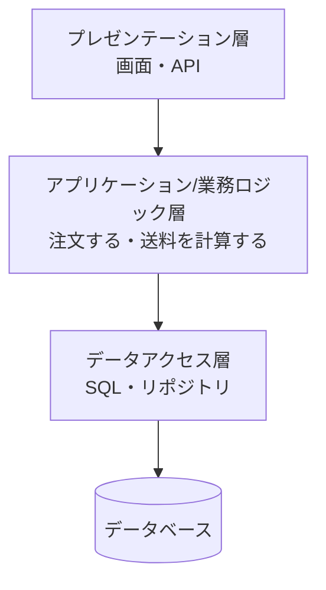
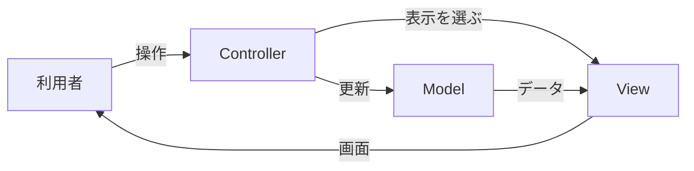
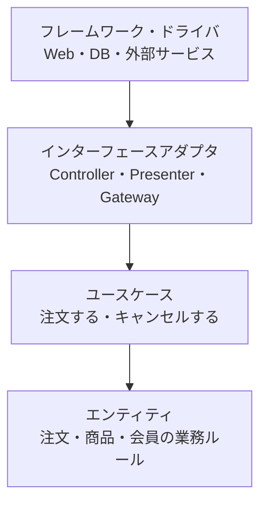
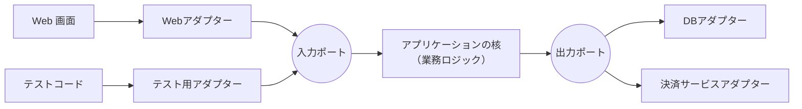
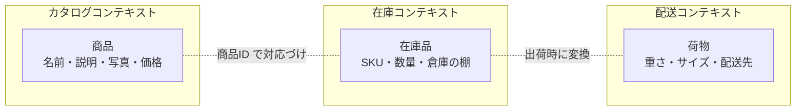
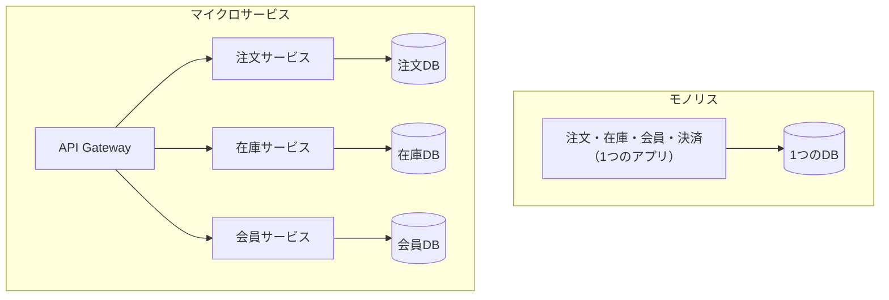
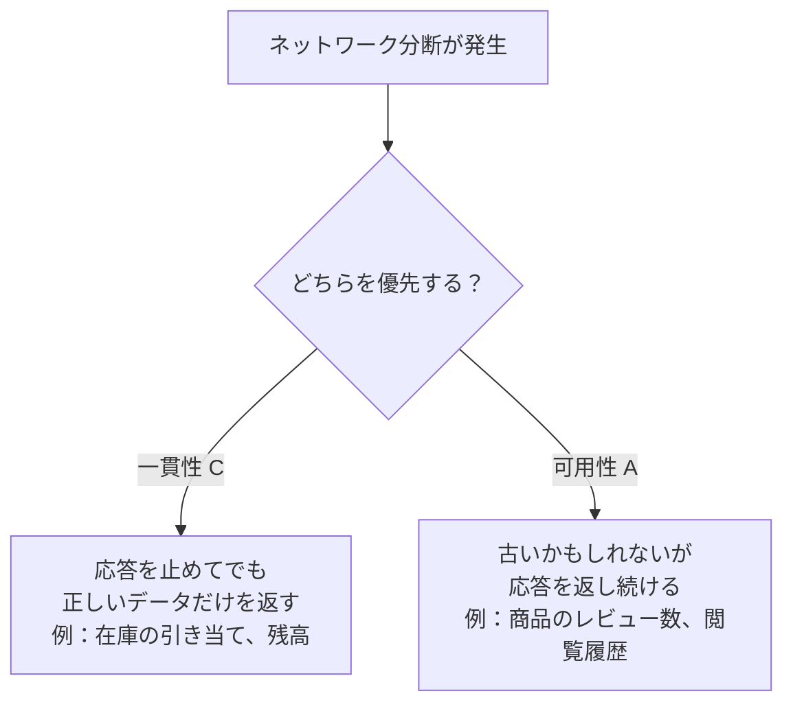
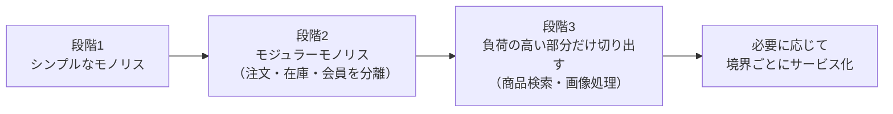

この章では、アプリケーションの内部をどのように分け、どのように組み立てるかを扱います。紹介するスタイルは「どれが一番優れているか」ではなく、**どんな問題を解くために生まれ、どんな条件で有効か** に注目してください。

## 6.1 アプリケーションを分割する理由

Kawasemi Shop の最初のコードは、1つのファイルに画面の HTML、注文の計算、SQL がすべて書かれていたとします。これでも動きますが、次のような問題が起きます。

- 送料のルールを変えたいだけなのに、画面のコードと SQL の間を探し回る
- 同じ計算が複数の画面にコピーされ、一部だけ直し忘れる
- テストするには、ブラウザとデータベースを毎回用意しなければならない
- AI Coding Agent に「送料を変えて」と頼むと、関係ない画面まで書き換えてしまう

分割の目的は、**変更の影響範囲を小さくし、理解とテストを容易にすること** です。

## 6.2 3層アーキテクチャとレイヤードアーキテクチャ

### 2つの「3層」

「3層」という言葉は、2つの異なる意味で使われるので注意が必要です。

- **物理的・論理的な3層構成（3-tier）**：Webサーバー、アプリケーションサーバー、データベースサーバーという **実行環境の分け方**（第3章 図3-4）
- **レイヤードアーキテクチャ（layered）**：1つのアプリケーションの **コードの中の分け方**

### レイヤードアーキテクチャ

**[レイヤードアーキテクチャ](/tech/architecture/glossary#layered-architecture)** では、コードを役割ごとの層に分け、**上の層は下の層だけを呼び出す** ルールを守ります。



*図6-1　レイヤードアーキテクチャ。依存は上から下への一方向。*

| 利点 | 欠点 |
|---|---|
| 分かりやすく、多くの開発者が知っている | 業務ロジックがデータベースの構造に引きずられやすい |
| 層ごとに担当や技術を分けられる | 単純な処理でも全層を通る「素通り」のコードが増える |
| | 機能が増えると、層の中が巨大になる |

## 6.3 MVC、MVP、MVVM

画面を持つアプリケーションでは、表示と処理を分けるパターンがよく使われます。

### MVC

**[MVC](/tech/architecture/glossary#mvc)（Model-View-Controller）** は、1970年代末に Trygve Reenskaug が Smalltalk で考案したパターンです。

- **Model**：データと業務ルール
- **View**：表示
- **Controller**：利用者の入力を受け取り、Model を操作し、View を選ぶ



*図6-2　MVC の役割分担（Web フレームワークでの典型的な解釈）。*

Ruby on Rails、Django、Spring MVC などの Web フレームワークは、MVC（またはその変形）を採用しています。

### MVP と MVVM

| パターン | 特徴 | よく使われる場面 |
|---|---|---|
| MVP | Presenter が View と Model の仲介を全て担い、View は受け身になる | テストしやすい画面ロジック |
| MVVM | ViewModel の状態と View を **データバインディング** で自動同期する | WPF、モバイルアプリ、React/Vue などの宣言的 UI |

どれも根本の考えは同じで、**表示の都合と業務の都合を分けること** です。

## 6.4 モノリシックアーキテクチャ

### 仕組み

**[モノリス](/tech/architecture/glossary#monolith)（monolith）** は、アプリケーション全体を1つの単位としてビルド・デプロイする構造です。「モノリス＝悪い設計」と誤解されがちですが、そうではありません。

| 利点 | 欠点 |
|---|---|
| 開発・テスト・デプロイが単純 | 規模が大きくなると、ビルドやテストに時間がかかる |
| 関数呼び出しなので速く、障害点が少ない | 一部の変更でも全体を再デプロイする |
| トランザクションで整合性を保ちやすい | 部分ごとにスケールさせられない |
| 小さなチームに最適 | 境界が崩れると「大きな泥団子（big ball of mud）」になる |

### モジュラーモノリス

近年注目されているのが **モジュラーモノリス** です。デプロイは1つのまま、内部を「注文」「在庫」「会員」などのモジュールに厳格に分け、モジュール間は公開されたインターフェースだけで呼び合います。後でマイクロサービスに切り出す必要が出たとき、境界がすでに整っているため移行しやすくなります。

Kawasemi Shop の段階2では、モジュラーモノリスが最も合理的な選択でしょう。

## 6.5 クリーンアーキテクチャ

### なぜ必要か

レイヤードアーキテクチャでは、業務ロジックがデータアクセス層に依存します。つまり、データベースを変えると業務ロジックにも影響が出ます。しかし、本当に大切で長く使われ続けるのは業務ルール（「会員ランクがゴールドなら送料無料」）の方で、データベースやフレームワークは **入れ替え可能な詳細** のはずです。

### 仕組み

Robert C. Martin が2012年に提唱した **[クリーンアーキテクチャ](/tech/architecture/glossary#clean-architecture)** は、同心円で構造を表します。



*図6-3　クリーンアーキテクチャの依存の方向。外側が内側に依存し、内側は外側を知らない（同心円を、外側から内側への矢印で表現）。*

中心になるのは **依存性のルール** です。**ソースコードの依存は、常に内側（業務ルール）に向かう**。内側の円は、外側の円にあるもの（データベース、Web フレームワーク、UI）の名前を一切知ってはいけません。

ではユースケースはどうやってデータを保存するのでしょうか。ここで第4章の **依存性逆転の原則** を使います。

```text
// ユースケース層（内側）が「欲しい機能」をインターフェースとして定義する
interface OrderRepository {
  save(order: Order): void
}

// 外側の層が、それを実装する
class PostgresOrderRepository implements OrderRepository { ... }
```

| 利点 | 欠点 |
|---|---|
| 業務ルールを、DB や UI なしでテストできる | ファイルとインターフェースが増え、小さなアプリには過剰 |
| フレームワークや DB を後から交換しやすい | 層の間でデータの詰め替えが多くなる |
| 業務の中心がコードの構造から読み取れる | チーム全員が考え方を理解していないと形骸化する |

## 6.6 ヘキサゴナルアーキテクチャとPorts & Adapters

Alistair Cockburn が2005年に提唱した **[ヘキサゴナルアーキテクチャ](/tech/architecture/glossary#hexagonal-architecture)** は、クリーンアーキテクチャと同じ発想を、より単純な言葉で表したものです。正式名称は **Ports & Adapters** です。

- **アプリケーションの核**：業務ロジック。外の世界を知らない
- **Port（ポート）**：核が外の世界とやり取りするための接点（インターフェース）
- **Adapter（アダプター）**：ポートと具体的な技術をつなぐ実装



*図6-4　Ports & Adapters。核の周りに、交換可能なアダプターが並ぶ。*

この構造は、テストと非常に相性が良く、外部の決済サービスをテスト用の偽物（モック）に差し替えて、業務ロジックだけを高速に検証できます。AI Coding Agent に変更を任せるときも、「核は変えずにアダプターだけ追加する」という明確な指示が可能になります。

## 6.7 DDD（ドメイン駆動設計）

### なぜ必要か

複雑な業務を扱うシステムでは、技術よりも **業務そのものの理解** が難しくなります。開発者と業務の専門家が別々の言葉を使っていると、誤解がそのままコードに埋め込まれます。

### 仕組み

**[DDD](/tech/architecture/glossary#ddd)（Domain-Driven Design）** は、Eric Evans が2003年の著書で体系化した設計手法です。主な考え方は次のとおりです。

- **ドメイン**：システムが扱う業務の領域（EC、物流、会計など）
- **ユビキタス言語**：開発者と業務の専門家が共通に使う言葉。コードのクラス名・メソッド名にもそのまま使う
- **[境界づけられたコンテキスト](/tech/architecture/glossary#bounded-context)（Bounded Context）**：同じ言葉が同じ意味を持つ範囲。範囲が違えば、同じ言葉でも別のモデルにしてよい

例えば「商品」という言葉は、コンテキストによって意味が違います。



*図6-5　境界づけられたコンテキスト。1つの巨大な「商品」クラスを作らず、文脈ごとにモデルを分ける。*

DDD の戦術的なパターンには、**エンティティ**（ID で識別されるもの：注文）、**値オブジェクト**（値で識別されるもの：金額、住所）、**集約**（一緒に整合性を保つ単位：注文と注文明細）などがあります。

境界づけられたコンテキストは、次の節のマイクロサービスの「サービスの境界」を決めるときの、最も重要な手がかりになります。

## 6.8 マイクロサービスアーキテクチャ

### 仕組み

第3章で紹介した **[マイクロサービス](/tech/architecture/glossary#microservices)** は、アプリケーションを独立してデプロイできる小さなサービスに分けるスタイルです。



*図6-6　モノリスとマイクロサービス。マイクロサービスでは各サービスが自分のデータを持つ。*

### 利点と欠点

| 利点 | 欠点 |
|---|---|
| サービスごとに独立してリリースできる | ネットワーク通信が増え、遅延と部分的な障害が起きる |
| 負荷の高いサービスだけをスケールできる | サービスをまたぐデータの整合性が難しい（分散トランザクション） |
| サービスごとに最適な技術を選べる | 監視・ログ・トレースの仕組みが必須になる |
| 障害の影響をサービス内に閉じ込めやすい | デプロイ・テスト・運用の自動化に大きな投資が必要 |
| チームの自律性が高まる | 境界を間違えると「分散したモノリス」になる |

### コンウェイの法則

Melvin Conway は1968年に「システムの構造は、それを設計する組織のコミュニケーション構造を写したものになる」と指摘しました（**コンウェイの法則**）。マイクロサービスは技術の選択であると同時に **組織の設計** でもあります。逆に、望むアーキテクチャに合わせてチームを編成する考え方を「**逆コンウェイ戦略**」と呼びます。

## 6.9 分散システムの基本（整合性、可用性、障害）

### 分散システムの誤謬

複数のコンピュータで動く **分散システム** では、1台では起きなかった問題が起きます。Peter Deutsch らがまとめた「**分散コンピューティングの誤謬**」は、開発者が無意識に置いてしまう誤った前提です。

1. ネットワークは信頼できる
2. 遅延はゼロである
3. 帯域は無限である
4. ネットワークは安全である
5. ネットワーク構成は変わらない
6. 管理者は一人である
7. 転送コストはゼロである
8. ネットワークは均質である

### CAP 定理

**[CAP 定理](/tech/architecture/glossary#cap-theorem)** は、Eric Brewer が2000年に提唱し、2002年に Gilbert と Lynch が証明したものです。分散システムで **ネットワーク分断（Partition）** が起きたとき、次のどちらかを選ばなければならないことを示します。

- **一貫性（Consistency）**：すべてのノードが同じ最新のデータを返す（そのために、一部のリクエストをエラーにする）
- **可用性（Availability）**：すべてのリクエストに応答する（そのために、古いデータを返すことがある）



*図6-7　CAP 定理が示す選択。分断がないときにも、遅延と一貫性のトレードオフ（PACELC）がある。*

すべてのデータが同じ一貫性を必要とするわけではありません。Kawasemi Shop では、在庫の引き当てや決済は強い一貫性が必要ですが、「この商品を見た人はこんな商品も見ています」は数分遅れても問題ありません。この **後から整合する（結果整合性、eventual consistency）** という考え方は、第7・8章で重要になります。

### 障害を前提にした設計

分散システムでは「部品はいつか必ず壊れる」と考え、次のような仕組みで全体を守ります。

- **タイムアウト**：応答しない相手を永遠に待たない
- **リトライ**：一時的な失敗なら再試行する（ただし冪等性が必要。第7章）
- **サーキットブレーカー**：失敗が続く相手への呼び出しを一時的に止め、障害の連鎖を防ぐ
- **バルクヘッド**：資源を区画に分け、一部の障害が全体に広がらないようにする

## 6.10 サーバーレスとクラウドネイティブ

### サーバーレス

**[サーバーレス](/tech/architecture/glossary#serverless)** は、サーバーの管理をクラウド事業者に任せ、開発者はコード（関数）だけを書くスタイルです。AWS Lambda（2014年）が代表例です。サーバーが存在しないわけではなく、**利用者がサーバーを意識しなくてよい** という意味です。

| 利点 | 欠点 |
|---|---|
| 使った分だけ課金（アクセスがなければほぼ無料） | 起動時の遅延（コールドスタート）がある |
| 自動でスケールする | 実行時間・メモリなどの制限がある |
| サーバーのパッチ当てが不要 | 特定クラウドへの依存が強くなる |
| | 処理の流れが分散し、全体像を把握しにくい |

画像のサムネイル作成、定期的な集計、Webhook の受信など、イベントをきっかけに短時間で終わる処理に向いています。

### クラウドネイティブ

**[クラウドネイティブ](/tech/architecture/glossary#cloud-native)** は、コンテナ、[Kubernetes](/tech/architecture/glossary#kubernetes)、マイクロサービス、宣言的な API、自動化された CI/CD、可観測性（第9章）などを組み合わせ、変化に強く、障害から自動で回復するシステムを作るアプローチです。

## 6.11 各アーキテクチャをどう選ぶか

### 判断の軸

| 判断の軸 | モノリス / モジュラーモノリス | マイクロサービス | サーバーレス |
|---|---|---|---|
| チームの規模 | 1〜数チーム | 多数のチーム | 小〜中規模 |
| 業務の複雑さ | 低〜中 | 高（境界が明確） | 低〜中 |
| 変更の頻度 | 中 | 高（部分ごとに独立） | 中 |
| 負荷の特徴 | 均一 | 部分ごとに大きく異なる | 散発的・急増 |
| 運用の成熟度 | 低くてもよい | 高い自動化が必須 | クラウドに任せる |

### Kawasemi Shop の選択



*図6-8　Kawasemi Shop のアーキテクチャの進化。最初からマイクロサービスにはしない。*

Martin Fowler は「**モノリスファースト**」、つまり、まずモノリスで始めて境界を学び、必要になったら分割することを勧めています。境界は、業務を深く理解した後でなければ正しく引けないからです。

## まとめ

- 分割の目的は、変更の影響範囲を小さくし、理解とテストを容易にすることである。
- レイヤードは分かりやすいが、業務ロジックが DB に引きずられやすい。クリーンアーキテクチャとヘキサゴナルは、依存を業務ルールの方向に向ける。
- DDD は業務の言葉と境界を明確にし、サービス分割の手がかりを与える。
- マイクロサービスは独立性を得る代わりに、分散システムの難しさを背負う。
- 「最良のアーキテクチャ」はない。チーム・業務・負荷・運用の成熟度で選び、進化させる。

## 理解度チェック

1. クリーンアーキテクチャの「依存性のルール」とは何ですか。それによってどんな利点がありますか。
2. Kawasemi Shop で「在庫数の表示」と「在庫の引き当て」に求められる一貫性の違いを、CAP 定理の言葉を使って説明してください。
3. モジュラーモノリスがマイクロサービスより適している状況を2つ挙げてください。
