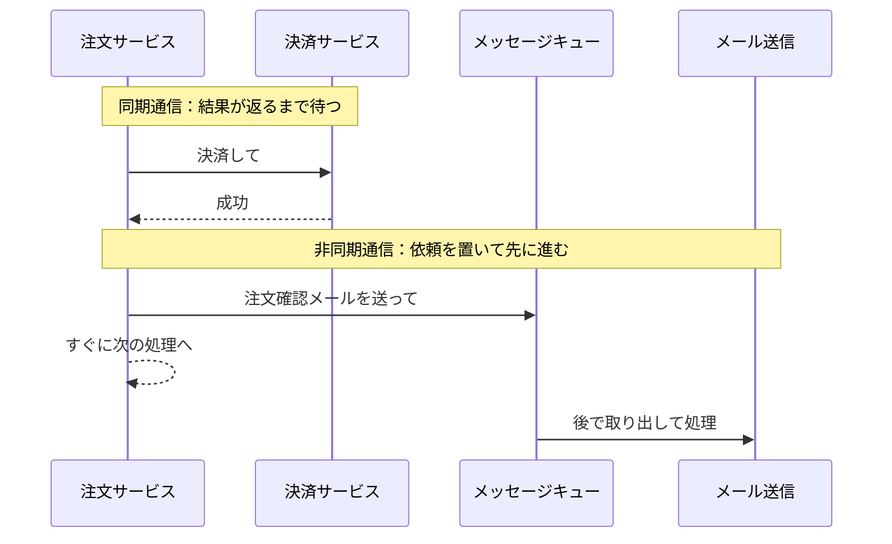
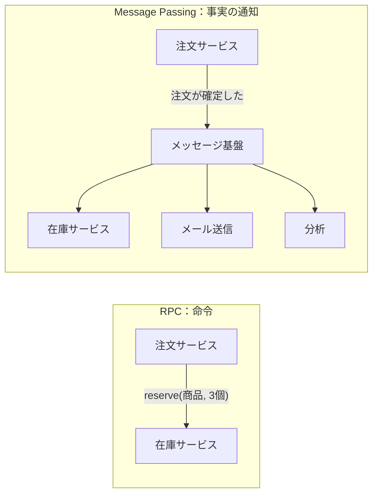
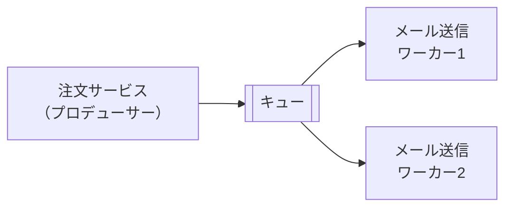
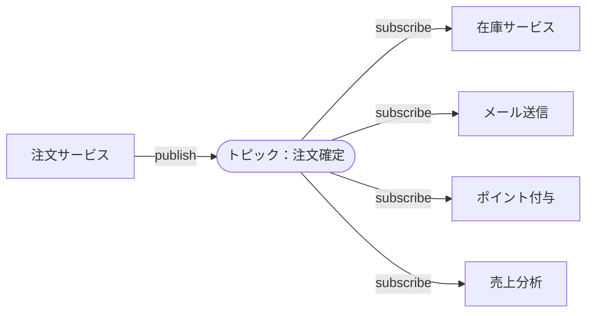
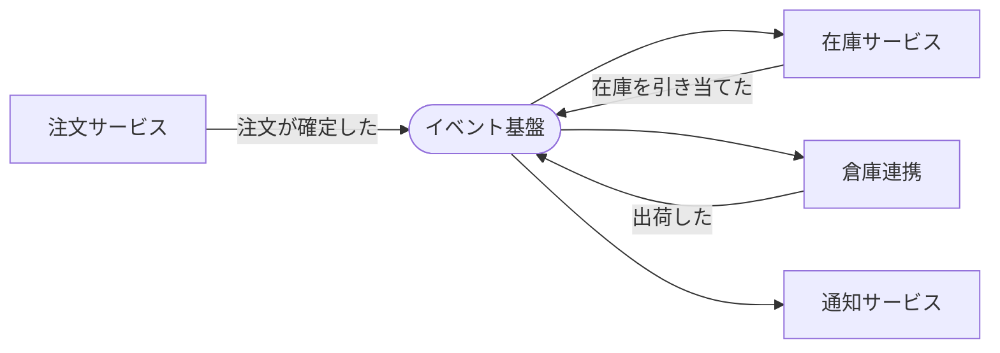
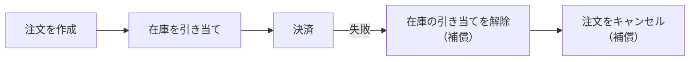
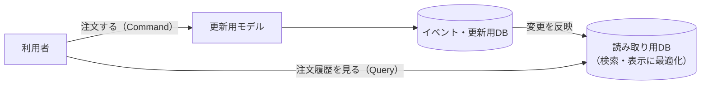
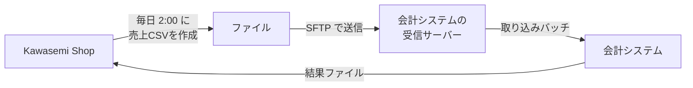
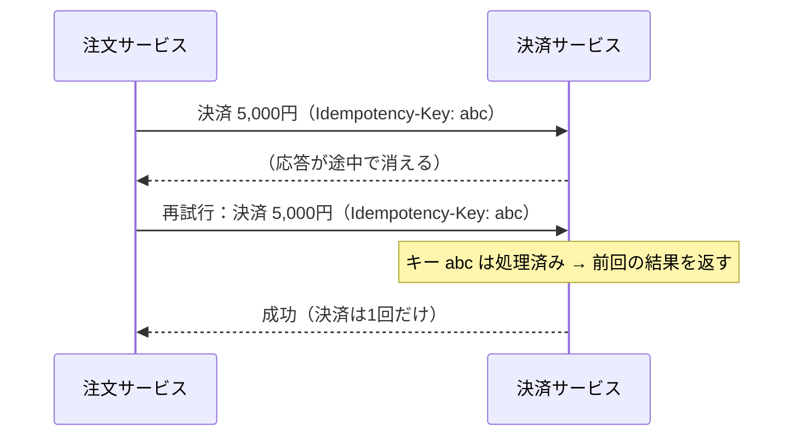
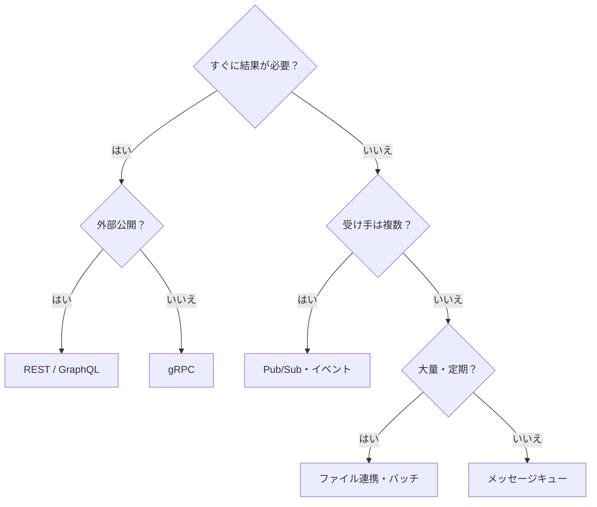

システムが分割されると、分割された部品同士の「つなぎ方」が設計の中心になります。この章では、システム間通信の方式と、その選び方を学びます。

## 7.1 システム同士が通信するとはどういうことか

Kawasemi Shop の段階3では、次のような連携が必要になります。

- 注文サービス → 決済サービス：「この金額を決済して」
- 注文サービス → 在庫サービス：「この商品を3個引き当てて」
- 注文サービス → 倉庫システム：「この注文を出荷して」
- 会計システム ← Kawasemi Shop：「昨日の売上データ」

通信方式を決めるときは、次の問いに答えます。

1. **相手の応答を待つ必要があるか**（同期か非同期か）
2. **相手は1つか、複数か**（1対1か、1対多か）
3. **データの量と頻度**（1件ずつリアルタイムか、まとめて定期的か）
4. **失敗したらどうするか**（再試行、補償、人手）
5. **相手との契約（インターフェース）をどう定義し、どう変更していくか**

## 7.2 同期通信と非同期通信



*図7-1　同期通信と非同期通信。*

| | 同期通信 | 非同期通信 |
|---|---|---|
| 動き | 応答が返るまで待つ | 依頼を置いてすぐ次へ進む |
| 分かりやすさ | 高い（関数呼び出しに近い） | 低い（結果が後から来る） |
| 結合度 | 高い（相手が止まると自分も止まる） | 低い（相手が止まっても依頼は溜まる） |
| 向いている処理 | 結果がすぐ必要（決済の可否、在庫の確認） | 後でよい（メール送信、分析、外部への通知） |

> [!POINT]
> 設計の原則は、**利用者がその場で結果を必要とする処理だけを同期にし、それ以外は非同期にする** ことです。注文確認メールの送信が遅れても注文は成立しますが、メールサーバーの障害で注文ができなくなってはいけません。

## 7.3 REST APIとHTTP

### 仕組み

**[REST](/tech/architecture/glossary#rest-api)（Representational State Transfer）** は、Roy Fielding が2000年の博士論文で示した、Web のアーキテクチャスタイルです。REST API では、操作の対象を **リソース** として URL で表し、HTTP のメソッドで操作します。

| 操作 | メソッドと URL | 意味 |
|---|---|---|
| 一覧取得 | `GET /products` | 商品の一覧を取得 |
| 1件取得 | `GET /products/42` | ID 42 の商品を取得 |
| 作成 | `POST /orders` | 注文を作成 |
| 部分更新 | `PATCH /orders/1001` | 注文を一部変更 |
| 削除 | `DELETE /cart/items/7` | カートから商品を削除 |

```http
POST /orders HTTP/1.1
Content-Type: application/json
Idempotency-Key: 6f1c2a9e-...

{ "items": [{ "productId": 42, "quantity": 2 }], "shippingAddressId": 3 }
```

### 利点と欠点

| 利点 | 欠点 |
|---|---|
| HTTP の仕組み（キャッシュ、認証、プロキシ）をそのまま使える | 必要以上のデータを返したり（over-fetching）、複数回の呼び出しが必要になったりする |
| ブラウザ・curl など、どこからでも呼べる | 型の定義が弱く、仕様と実装がずれやすい |
| 人間が読みやすい（JSON） | 高頻度・低遅延のサービス間通信では効率が劣る |

API の仕様は **OpenAPI** 形式で定義し、ドキュメントやクライアントコードを自動生成するのが一般的です。OpenAPI の仕様は、AI Coding Agent に API の使い方を正確に伝える文脈としても有効です。

## 7.4 gRPCとProtocol Buffers

**[gRPC](/tech/architecture/glossary#grpc)** は、Google が2015年に公開した RPC フレームワークです。インターフェースを **[Protocol Buffers](/tech/architecture/glossary#protocol-buffers)**（protobuf）で定義し、そこからサーバーとクライアントのコードを生成します。

```protobuf
syntax = "proto3";

service InventoryService {
  rpc Reserve (ReserveRequest) returns (ReserveResponse);
}

message ReserveRequest {
  string product_id = 1;
  int32 quantity = 2;
  string order_id = 3;
}

message ReserveResponse {
  bool reserved = 1;
}
```

| 利点 | 欠点 |
|---|---|
| バイナリ形式で小さく速い。HTTP/2 で多重化される | ブラウザから直接呼ぶには工夫が必要（gRPC-Web など） |
| 型が厳密で、コード生成によりずれが起きにくい | 人間が通信内容を直接読みにくい |
| 双方向ストリーミングに対応 | HTTP キャッシュなどの Web の仕組みと相性が悪い |

**外部向けは REST、内部のサービス間は gRPC** という使い分けがよく見られます。

## 7.5 GraphQLとWebSocket

### GraphQL

**[GraphQL](/tech/architecture/glossary#graphql)** は、Facebook（現 Meta）が開発し2015年に公開した API の問い合わせ言語です。クライアントが **必要なデータの形をクエリで指定** し、サーバーはその形で返します。

```graphql
query {
  order(id: "1001") {
    status
    items { quantity product { name price } }
  }
}
```

画面ごとに必要なデータが大きく異なるアプリ（モバイルとWebの両方など）で有効です。一方、クエリが自由な分、重いクエリへの対策（深さ制限など）やキャッシュの設計が難しくなります。

### WebSocket

**[WebSocket](/tech/architecture/glossary#websocket)** は、ブラウザとサーバーの間で、双方向の接続を保ち続ける仕組みです。HTTP は「クライアントが聞き、サーバーが答える」形ですが、WebSocket ではサーバーから自由にデータを送れます。チャット、通知、共同編集、価格のリアルタイム更新などに使われます。LLM の回答を少しずつ表示する用途では、より単純な **Server-Sent Events（SSE）** もよく使われます。

## 7.6 RPCとMessage Passing

通信の考え方は、大きく2つに分けられます。

- **[RPC](/tech/architecture/glossary#rpc)（Remote Procedure Call）**：遠くのサービスの関数を、手元の関数のように呼ぶ。「在庫を引き当てよ」という **命令** を送る。
- **Message Passing（メッセージパッシング）**：メッセージを送り、受け手がそれをどう処理するかは受け手に任せる。「注文が確定した」という **事実** を伝える。



*図7-2　RPC とメッセージパッシング。後者では、送り手は受け手を知らなくてよい。*

RPC は「ネットワークの向こう側を手元の関数のように見せる」ため便利ですが、第6章の「分散コンピューティングの誤謬」を忘れさせる危険もあります。リモート呼び出しは、遅く、失敗しうるものとして扱いましょう。

## 7.7 Message QueueとPublish/Subscribe

### メッセージキュー

**[メッセージキュー](/tech/architecture/glossary#message-queue)** は、メッセージを一時的に溜めておく仕組みです。送り手（**プロデューサー**）はキューにメッセージを置き、受け手（**コンシューマー**）は自分のペースで取り出して処理します。



*図7-3　メッセージキュー。1つのメッセージは1つのコンシューマーが処理する。ワーカーを増やせば処理能力が上がる。*

キューは **緩衝材** の役割を果たします。セールでアクセスが急増しても、注文はキューに溜まり、裏側のシステムは自分の処理能力に合わせて順に処理できます（**負荷平準化**）。

### Publish/Subscribe

**[Pub/Sub](/tech/architecture/glossary#pub-sub)（出版・購読）** では、送り手はメッセージを **トピック** に発行し、そのトピックを購読しているすべての受け手にメッセージが届きます。



*図7-4　Pub/Sub。新しい受け手を追加しても、送り手は変更不要。*

代表的な製品には、RabbitMQ（キュー中心）、Apache Kafka（大量のイベントを永続的なログとして扱う）、クラウドの Amazon SQS/SNS、Google Cloud Pub/Sub などがあります。Kafka のようにメッセージを一定期間保存しておく仕組みでは、新しく参加した受け手が過去のイベントを読み直すこともできます。

## 7.8 イベント駆動アーキテクチャ（EDA）

### 仕組み

**[イベント駆動アーキテクチャ](/tech/architecture/glossary#eda)（Event-Driven Architecture）** は、「何かが起きた」という **イベント** を中心にシステムを組み立てるスタイルです。

- **イベント**：過去に起きた事実。名前は過去形にする（`OrderPlaced`、`PaymentCompleted`、`ItemShipped`）
- 各サービスは、自分に関係するイベントに反応して処理を行い、必要なら新しいイベントを発行する



*図7-5　イベント駆動。各サービスはイベントを介して緩やかにつながる。*

### サービスをまたぐ処理：Saga

マイクロサービスでは、複数のサービスにまたがる処理を1つのトランザクションでまとめられません。そこで **Saga** パターンを使います。処理を各サービスのローカルなトランザクションの連続として実行し、途中で失敗したら、それまでの処理を取り消す **補償トランザクション** を実行します。



*図7-6　Saga による補償。データベースのロールバックの代わりに、業務的な「取り消し」を行う。*

### 利点と欠点

| 利点 | 欠点 |
|---|---|
| サービス同士が疎結合になり、追加・変更が容易 | 処理の流れが見えにくい（全体を追うには分散トレースが必要） |
| 負荷の変動に強い | 結果整合性になり、一時的に状態がずれる |
| 過去のイベントを再生して分析・復旧できる | イベントの順序・重複・欠落への対処が必要 |

## 7.9 Event SourcingとCQRS

### Event Sourcing

通常のデータベースは「現在の状態」だけを保存します。**[Event Sourcing](/tech/architecture/glossary#event-sourcing)** では、状態を変えた **イベントの履歴** をすべて保存し、現在の状態はイベントを順に再生して求めます。銀行の通帳が、残高だけでなく入出金の履歴を記録しているのと同じ発想です。

```text
1. 注文を作成した      (商品A ×2)
2. 商品を追加した      (商品B ×1)
3. 商品を削除した      (商品A ×1)
4. 注文を確定した
→ 現在の状態：商品A ×1、商品B ×1、確定済み
```

監査やデバッグに強く、「ある時点の状態」をいつでも再現できます。一方で、イベントの形式を後から変える（スキーマの進化）のが難しく、設計と運用の負担は大きくなります。

### CQRS

**[CQRS](/tech/architecture/glossary#cqrs)（Command Query Responsibility Segregation）** は、データを **更新する側（Command）** と **読み取る側（Query）** でモデルを分ける考え方です。



*図7-7　CQRS。読み取り用のモデルは、画面に合わせて自由に最適化できる。*

ECサイトのように **読み取りが書き込みより圧倒的に多い** システムでは、読み取り側だけを独立してスケールできる利点があります。ただし、読み取り側への反映には遅れがあるため、「注文した直後に履歴に出ない」問題への配慮が必要です。Event Sourcing と CQRS は相性が良く組み合わせて使われることが多いですが、どちらも複雑さが大きいので、本当に必要な部分だけに適用しましょう。

## 7.10 ファイル連携、バッチ処理、SFTP

### なぜ今もファイル連携なのか

API やイベントが主流になった今でも、企業間の連携では **ファイル連携** が広く使われています。会計システム、銀行、物流会社、官公庁など、相手のシステムが API を持っていないことも多く、また大量のデータをまとめて渡すには効率的だからです。



*図7-8　ファイル連携の典型的な流れ。*

- **バッチ処理**：データを一定期間ためて、まとめて処理する方式
- **[SFTP](/tech/architecture/glossary#sftp)**：SSH の上でファイルを安全に転送するプロトコル。古い FTP は暗号化されないため避ける
- 最近は、クラウドのオブジェクトストレージ（Amazon S3 など）を受け渡し場所にする方式も増えている

### 設計のポイント

| 観点 | 決めておくこと |
|---|---|
| 形式 | 文字コード（UTF-8 か Shift_JIS か）、区切り文字、改行、ヘッダ行の有無 |
| 完全性 | 書き込み途中のファイルを読まれないよう、完了ファイル（`.done`）やチェックサムを使う |
| 再実行 | 同じファイルを2回取り込んでも二重計上されないようにする |
| 失敗時 | 一部の行がエラーのとき、全体を止めるか、エラー行だけ除外するか |
| 監視 | ファイルが届かない、件数が極端に少ない、を検知する |

## 7.11 再試行、タイムアウト、冪等性、配信保証

分散システムの通信で最も重要で、最も見落とされやすいのがこの節の内容です。

### タイムアウトと再試行

ネットワーク越しの呼び出しには、必ず **タイムアウト** を設定します。タイムアウトや一時的なエラーのときは **再試行（リトライ）** しますが、全員が一斉に再試行すると、すでに負荷の高い相手にリクエストがさらに集中し、相手を完全に止めてしまいます。そこで、待ち時間を指数的に伸ばし（**指数バックオフ**）、ランダムなずれ（**ジッター**）を加えます。

### 冪等性

ここで問題が生じます。決済サービスに「5,000円決済して」と送り、タイムアウトしたとします。

- 実は決済は成功していて、応答だけが届かなかったのかもしれない
- それとも、リクエスト自体が届かなかったのかもしれない

区別できないまま再試行すると、**二重決済** が起きる可能性があります。これを防ぐのが **[冪等性](/tech/architecture/glossary#idempotency)（idempotency）** です。冪等な操作とは、**何回実行しても、1回実行したのと同じ結果になる** 操作です。



*図7-9　冪等キーによる二重処理の防止。*

| HTTP メソッド | 冪等か |
|---|---|
| GET、PUT、DELETE | 冪等（何度呼んでも結果は同じ） |
| POST | 冪等ではない（冪等キーなどの工夫が必要） |

### 配信保証

メッセージ基盤がメッセージをどこまで確実に届けるかを **配信保証** と呼びます。

| 保証 | 意味 | 注意点 |
|---|---|---|
| at-most-once（最大1回） | 届かないことはあるが、重複はない | メッセージが失われうる |
| at-least-once（最低1回） | 必ず届くが、重複することがある | **受け手を冪等にする** 必要がある |
| exactly-once（ちょうど1回） | 必ず1回だけ届く | 実現が難しく、条件付き・範囲限定で提供される |

> [!POINT]
> 実務では、**at-least-once ＋ 冪等な受け手** で「実質的に1回」を実現するのが定石です。

### データベース更新とメッセージ送信の一貫性

「注文をDBに保存する」と「注文確定イベントを送る」は、別々のシステムへの操作です。片方だけ成功すると、注文はあるのにメールが送られない、といったずれが起きます。これを防ぐのが **Transactional Outbox** パターンです。イベントを同じDBの「送信待ちテーブル」に注文と同じトランザクションで書き込み、別のプロセスがそれを読み取ってメッセージ基盤に送ります（第8章の CDC で実現することもあります）。

## 7.12 通信方式の選び方

| 状況 | 推奨される方式 |
|---|---|
| ブラウザ・外部パートナーに公開する API | REST（OpenAPI で仕様を管理） |
| 画面ごとに必要なデータが大きく異なる | GraphQL |
| 内部サービス間の高頻度・低遅延の呼び出し | gRPC |
| サーバーからのリアルタイム通知 | WebSocket、SSE |
| 時間のかかる処理・負荷の平準化 | メッセージキュー |
| 1つの出来事を複数のシステムが知る必要がある | Pub/Sub、イベント駆動 |
| 大量データの定期的な受け渡し、レガシーシステムとの連携 | ファイル連携（SFTP、オブジェクトストレージ） |



*図7-10　通信方式の選び方の目安。実際には複数を組み合わせる。*

## まとめ

- 通信方式は、応答の必要性、相手の数、データの量と頻度、失敗時の扱いで選ぶ。
- 同期は分かりやすいが結合が強い。非同期は疎結合だが、流れが見えにくい。
- REST・gRPC・GraphQL・WebSocket には、それぞれ得意な場面がある。
- イベント駆動、Saga、Event Sourcing、CQRS は強力だが複雑で、必要な部分に限って使う。
- ネットワーク越しの処理は、タイムアウト・再試行・冪等性・配信保証をセットで設計する。

## 理解度チェック

1. 注文確認メールの送信を同期ではなく非同期にすべき理由を説明してください。
2. 冪等性とは何ですか。決済の再試行を例に、冪等でない場合に何が起きるか説明してください。
3. Kawasemi Shop で、REST・gRPC・Pub/Sub・ファイル連携をそれぞれどこに使うか、図に描いてみてください。
