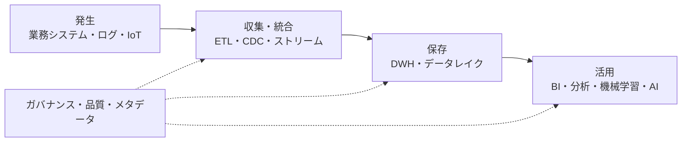
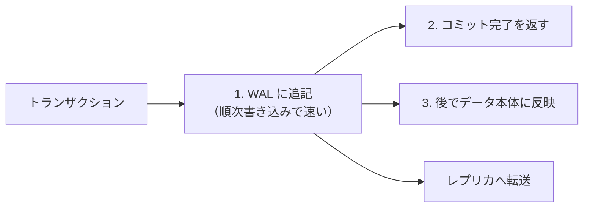
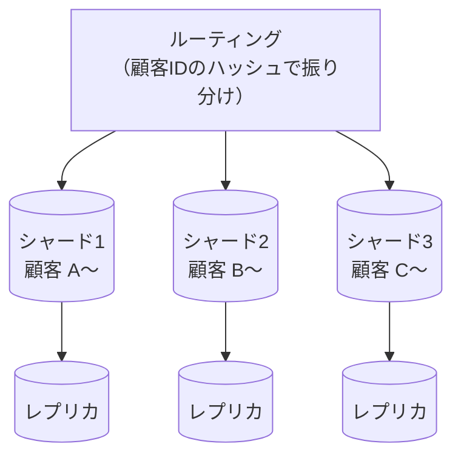
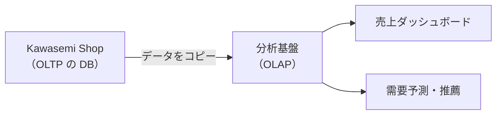
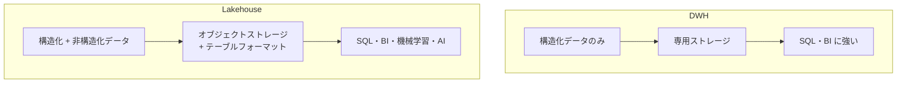
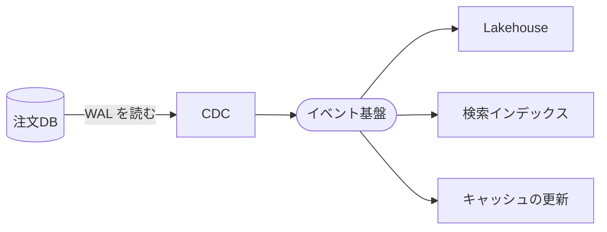
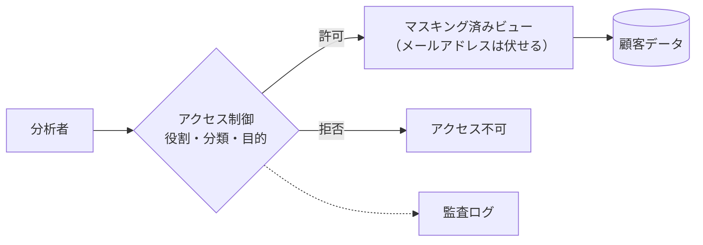
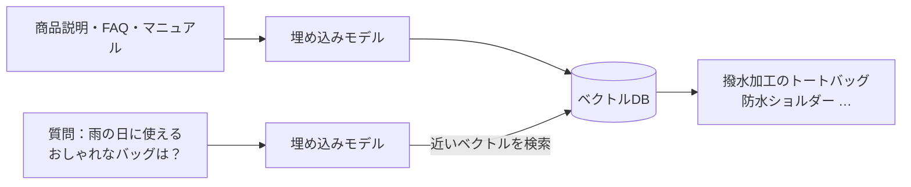
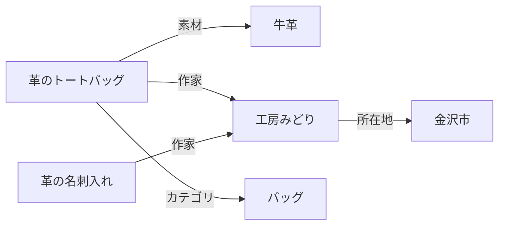
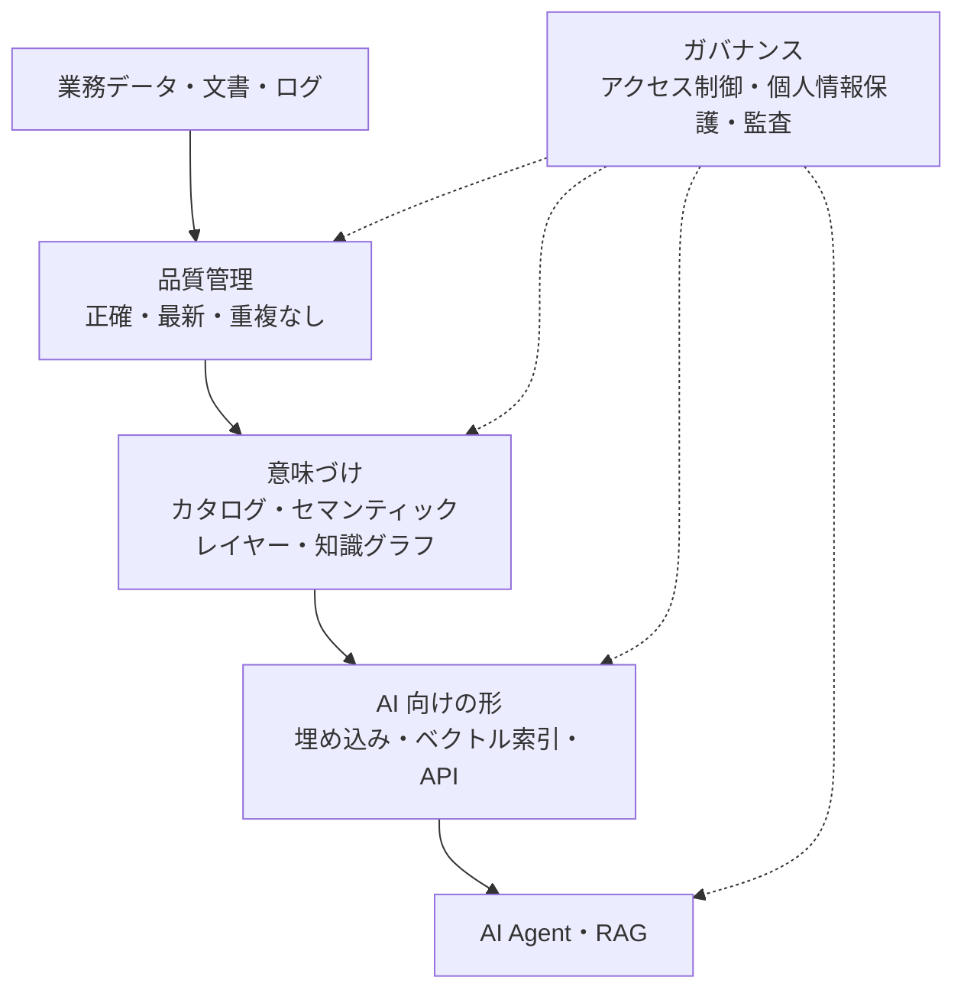

アプリケーションは何度も作り直されますが、データは長く生き続けます。10年前に作られたシステムは置き換えられても、その中の顧客データや取引データは引き継がれます。この章では、データを扱うアーキテクチャを学びます。

## 8.1 データアーキテクチャとは何か

**データアーキテクチャ** とは、組織のデータを **どこに、どんな形で保存し、どう流し、誰が使えるようにし、どう品質を保つか** を設計することです。



*図8-1　データのライフサイクル。全体を横断してガバナンスが働く。*

AI時代には、データアーキテクチャの重要性がさらに増しています。LLM や AI Agent が正しく働くかどうかは、渡されるデータの質と、データへのアクセスの設計に大きく左右されるからです。

## 8.2 RDBとトランザクション（ACID）

### リレーショナルデータベース

**[RDB](/tech/architecture/glossary#rdb)（Relational Database）** は、Edgar F. Codd が1970年に提唱した **関係モデル** に基づくデータベースです。データを行と列からなる **テーブル** で表し、**SQL** で操作します。PostgreSQL、MySQL、Oracle Database、SQL Server などが代表的です。

```sql
SELECT o.id, o.ordered_at, SUM(i.price * i.quantity) AS total
FROM orders o
JOIN order_items i ON i.order_id = o.id
WHERE o.customer_id = 123
GROUP BY o.id, o.ordered_at
ORDER BY o.ordered_at DESC;
```

データの重複をなくすようにテーブルを分割することを **正規化** と呼びます。正規化されたデータは更新の矛盾が起きにくく、どんな問い合わせにも柔軟に答えられます。

### トランザクションと ACID

**トランザクション** とは、複数の操作をひとまとまりとして扱う仕組みです。「在庫を1減らす」と「注文を1件作る」は、両方成功するか、両方なかったことになるかのどちらかでなければいけません。

RDB のトランザクションは **[ACID](/tech/architecture/glossary#acid)** と呼ばれる4つの性質を保証します。

| 性質 | 意味 |
|---|---|
| **A**tomicity（原子性） | 全部成功するか、全部取り消されるか |
| **C**onsistency（一貫性） | 制約（在庫は0以上など）を常に満たす |
| **I**solation（分離性） | 同時に実行されるトランザクションが互いに干渉しない |
| **D**urability（永続性） | 確定した結果は、障害が起きても失われない |

分離性には複数の **分離レベル** があり、厳しくするほど安全ですが、同時実行の性能は下がります。「残り1個の商品を2人が同時に買う」ような競合をどう扱うかは、分離レベルとロックの設計で決まります。

## 8.3 NoSQL（Key-Value、Document、Graph、Column-family）

### なぜ生まれたか

2000年代後半、Web サービスの規模が爆発的に大きくなり、1台の RDB では処理しきれなくなりました。また、構造が頻繁に変わるデータや、関係そのものが主役のデータは、テーブルで表しにくい場合があります。こうして、RDB 以外のデータベースの総称として **[NoSQL](/tech/architecture/glossary#nosql)**（Not only SQL）が広がりました。

| 種類 | データの形 | 得意なこと | 代表例 | Kawasemi Shop での用途 |
|---|---|---|---|---|
| Key-Value | キーと値の組 | 超高速な読み書き | Redis、DynamoDB | セッション、カート、キャッシュ |
| Document | JSON のような文書 | 構造が柔軟なデータ | MongoDB | 商品ごとに属性が異なる商品情報 |
| Column-family | 行キー＋列の集まり | 大量の書き込み、時系列 | Cassandra、HBase | アクセスログ、閲覧履歴 |
| Graph | ノードと関係（エッジ） | 関係をたどる問い合わせ | Neo4j | 「この商品を買った人が買った商品」 |

### RDB と NoSQL の選び方

NoSQL の多くは、スケールアウトしやすい代わりに、JOIN や複数データにまたがるトランザクションに制限があります（近年は制限の少ない製品も増えています）。

**まず RDB を検討し、明確な理由があるときに NoSQL を選ぶ** のが、多くの場合に安全な方針です。用途に応じて複数のデータベースを使い分けることを **ポリグロット・パーシステンス** と呼びます。

## 8.4 データベースの内部構造（インデックス、WAL、レプリケーション、シャーディング）

### インデックス

**[インデックス](/tech/architecture/glossary#index)** は、本の索引のように、目的のデータを素早く見つけるための補助的なデータ構造です。多くの RDB では **B+木** という木構造を使い、数億行のテーブルからでも数回のディスクアクセスで目的の行にたどり着けます。

インデックスは読み取りを速くしますが、書き込みのたびに更新が必要で、容量も使います。**よく検索される列にだけ** 付けるのが原則です。

### WAL（ログ先行書き込み）

**[WAL](/tech/architecture/glossary#wal)（Write-Ahead Logging）** は、データを本体に書き込む前に、まず「何を変更するか」をログに追記する仕組みです。途中で電源が落ちても、ログを読み直せば変更をやり直したり取り消したりでき、ACID の永続性と原子性を支えています。



*図8-2　WAL の役割。WAL はレプリケーションや CDC の情報源にもなる。*

### レプリケーション

**[レプリケーション](/tech/architecture/glossary#replication)** は、同じデータを複数のサーバーに複製することです。

- **目的**：障害時の切り替え（可用性）、読み取りの負荷分散
- **構成**：書き込みを受け付ける **プライマリ** と、複製を持つ **レプリカ**
- **同期レプリケーション**：レプリカへの書き込み完了を待つ。安全だが遅い
- **非同期レプリケーション**：待たない。速いが、障害時に直近のデータを失う可能性があり、レプリカから読むと少し古いデータが見えることがある（レプリケーション遅延）

### シャーディング

**[シャーディング](/tech/architecture/glossary#sharding)** は、データを複数のサーバーに分割して保存することです。例えば顧客IDの範囲やハッシュ値で、データを置くサーバーを決めます。



*図8-3　シャーディングとレプリケーションの組み合わせ。*

シャーディングは書き込みの性能と容量の限界を超える手段ですが、シャードをまたぐ問い合わせやトランザクションが難しくなり、運用も複雑になります。**最後の手段** として検討しましょう。

## 8.5 OLTPとOLAP

データの使い方は、大きく2種類に分かれます。

| | [OLTP](/tech/architecture/glossary#oltp)（オンライン取引処理） | [OLAP](/tech/architecture/glossary#olap)（オンライン分析処理） |
|---|---|---|
| 目的 | 日々の業務を処理する | 傾向を分析し、意思決定に使う |
| 例 | 注文を1件登録する | 過去3年の月別・地域別の売上を集計する |
| 1回の処理 | 少数の行を読み書き | 大量の行を読んで集計 |
| 求められるもの | 速い応答、強い整合性 | 大量データの高速な集計 |
| 保存形式 | 行指向（1行をまとめて保存） | 列指向（1列をまとめて保存・圧縮） |



*図8-4　OLTP と OLAP の分離。本番 DB で重い集計を行うと、注文処理が遅くなる。*

## 8.6 DWH、データレイク、Lakehouse

### データウェアハウス（DWH）

**[DWH](/tech/architecture/glossary#dwh)（Data Warehouse）** は、分析のために、複数のシステムのデータを統合・整理して保存するデータベースです。1990年代に Bill Inmon や Ralph Kimball らによって方法論が整えられました。データはあらかじめ決められた構造（スキーマ）に変換してから格納されます。Snowflake、BigQuery、Amazon Redshift などのクラウド DWH が広く使われています。

### データレイク

**[データレイク](/tech/architecture/glossary#data-lake)** は、構造化データ（テーブル）だけでなく、ログ、JSON、画像、音声などを **元の形のまま** 大量に保存する場所です。安価なオブジェクトストレージ（Amazon S3 など）の上に作られることが多く、機械学習のデータ置き場として普及しました。ただし、整理されないまま放置されると、何がどこにあるか分からない「**データの沼（data swamp）**」になりがちです。

### Lakehouse

**[Lakehouse](/tech/architecture/glossary#lakehouse)** は、データレイクの安さと柔軟性に、DWH のトランザクション・スキーマ管理・高速な問い合わせを組み合わせたアーキテクチャです。オブジェクトストレージ上のファイル（Parquet などの列指向形式）に、Delta Lake・Apache Iceberg・Apache Hudi といった **テーブルフォーマット** でトランザクションやバージョン管理の機能を加えます。



*図8-5　DWH と Lakehouse。*

### メダリオンアーキテクチャ

Lakehouse でよく使われる整理の方法が、データを品質の段階で3層に分ける **メダリオンアーキテクチャ** です。

| 層 | 内容 |
|---|---|
| Bronze | 取り込んだままの生データ |
| Silver | 重複除去・型変換・結合などで整えたデータ |
| Gold | 業務の目的（売上集計、顧客分析など）に合わせて加工したデータ |

## 8.7 ETL、ELT、CDC、ストリーム処理

### ETL と ELT

- **[ETL](/tech/architecture/glossary#etl)（Extract, Transform, Load）**：データを取り出し、変換してから、分析基盤に格納する。従来の DWH で主流。
- **[ELT](/tech/architecture/glossary#elt)（Extract, Load, Transform）**：まず生データのまま格納し、分析基盤の計算能力で後から変換する。クラウド DWH・Lakehouse で主流。dbt のような SQL ベースの変換ツールがよく使われる。

### CDC（変更データキャプチャ）

**[CDC](/tech/architecture/glossary#cdc)（Change Data Capture）** は、データベースの変更（挿入・更新・削除）を、WAL などから検知して、ほぼリアルタイムに他のシステムへ流す仕組みです。Debezium などのツールが代表的です。



*図8-6　CDC によるデータの流れ。アプリケーションを変更せずに、変更を他のシステムに伝えられる。*

毎晩の一括コピーと比べて、本番 DB への負荷が小さく、分析基盤のデータを数秒〜数分の遅れで最新に保てます。

### ストリーム処理

**ストリーム処理** は、データを溜めてから処理する（バッチ）のではなく、流れてくるデータを到着した順に処理する方式です。不正な注文のリアルタイム検知、在庫の即時集計、アクセス急増の検知などに使われます。Apache Flink、Kafka Streams、Spark Structured Streaming などが代表的です。

| | バッチ処理 | ストリーム処理 |
|---|---|---|
| 遅延 | 数時間〜1日 | 数秒〜数分 |
| 実装と運用 | 比較的単純 | 複雑（遅れて届くデータ、状態の管理） |
| 向いている用途 | 月次の売上集計、会計連携 | 不正検知、リアルタイムのダッシュボード |

## 8.8 メタデータ、データカタログ、データ品質

### メタデータとデータカタログ

**メタデータ** は「データについてのデータ」です。列の意味、型、作成者、更新頻度、元のデータ、利用者、個人情報を含むかどうか、などを指します。

**[データカタログ](/tech/architecture/glossary#data-catalog)** は、組織のデータを検索し、意味や出所、品質を確認できるようにする仕組みです。「売上」という列がどのシステムから来て、どんな計算で作られているかを追跡する **データリネージ（系譜）** の機能も重要です。

### データ品質

データの品質は、次のような観点で測ります。

| 観点 | 問い | 例 |
|---|---|---|
| 正確性 | 値は正しいか | 価格がマイナスになっていない |
| 完全性 | 欠けていないか | 注文に顧客IDが必ずある |
| 一貫性 | システム間で矛盾していないか | 注文DBと会計の売上が一致する |
| 適時性 | 十分に新しいか | 昨日の売上が今朝9時までに反映されている |
| 一意性 | 重複していないか | 同じ注文が2回計上されていない |

データの品質チェックを、データの流れの中で自動的に行い、問題があれば止める・通知する仕組みを作ります。データの提供者と利用者の間で、形式・意味・品質・更新頻度を明文化した約束を **データコントラクト** と呼ぶこともあります。

## 8.9 データガバナンスとアクセス制御

**データガバナンス** とは、データを組織の資産として管理するためのルールと体制です。

- **責任者**：データごとにオーナー（責任を持つ部門・人）を決める
- **分類**：公開、社内、機密、個人情報などに分類する
- **アクセス制御**：誰がどのデータを見られるかを、分類と役割に基づいて決める（第9章の RBAC・ABAC）
- **保護**：個人情報の **マスキング**（一部を伏せる）や **仮名化**（別のIDに置き換える）
- **保存期間と削除**：法律（日本の個人情報保護法、EU の GDPR など）に従って、不要になったデータを確実に削除する
- **監査**：誰がいつどのデータにアクセスしたかを記録する



*図8-7　データアクセスの制御。AI Agent にデータを使わせるときも、同じ仕組みを通す。*

## 8.10 ベクトルDBと知識グラフ

### 埋め込みとベクトル DB

AI がテキストや画像の「意味」を扱うために、データを数百〜数千次元の数値の並び（**ベクトル**）に変換します。これを **[埋め込み](/tech/architecture/glossary#embedding)（embedding）** と呼びます。意味が近いもの同士は、ベクトル空間でも近い位置に置かれます。

**[ベクトル DB](/tech/architecture/glossary#vector-db)** は、大量のベクトルを保存し、あるベクトルに **近いもの** を高速に検索できるデータベースです。完全に正確な最近傍探索は大規模データでは遅いため、HNSW などの **近似最近傍探索（ANN）** のアルゴリズムが使われます。専用製品（Milvus、Qdrant、Weaviate など）のほか、PostgreSQL の拡張（pgvector）や既存の検索エンジンの機能として使うこともできます。



*図8-8　ベクトル検索。キーワードが一致しなくても、意味が近い商品を見つけられる。第11章の RAG の土台になる。*

### 知識グラフ

**[知識グラフ](/tech/architecture/glossary#knowledge-graph)** は、実世界の物事（エンティティ）とその関係を、ノードとエッジのグラフとして表したものです。



*図8-9　知識グラフの例。*

ベクトル検索は「なんとなく似ているもの」を見つけるのが得意ですが、「工房みどりが作った、牛革の商品」のような **正確な関係** をたどるのは苦手です。知識グラフはその逆です。両者を組み合わせる **GraphRAG** などの手法も研究・実用化が進んでいます。

## 8.11 AI-Readyなデータ基盤とセマンティックレイヤー

### セマンティックレイヤー

組織の中で「売上」の定義が部署ごとに違う（税込か税抜か、返品を含むか）ことはよくあります。**[セマンティックレイヤー](/tech/architecture/glossary#semantic-layer)** は、指標やビジネス用語の **定義を一か所にまとめ**、BI ツールや AI など、すべての利用者が同じ定義でデータを使えるようにする層です。

AI Agent に「先月の売上は？」と質問させるとき、AI が毎回 SQL を自由に組み立てると、定義の揺れによって間違った答えを返す危険があります。セマンティックレイヤーを通すことで、AI は「定義済みの『売上』を、先月の範囲で取得する」だけで済み、正確さと説明可能性が上がります。

### AI-Ready なデータ基盤

AI がデータを安全かつ効果的に使える状態を「**AI-Ready**」と呼ぶことがあります。その条件は次のとおりです。



*図8-10　AI-Ready なデータ基盤の構成。*

1. **品質**：古い、誤った、重複したデータは、AI の回答をそのまま誤らせる
2. **意味**：列や文書の意味、指標の定義が機械にも読める形で整備されている
3. **アクセス可能性**：AI が使える API・検索の仕組みがある
4. **権限の継承**：元のデータのアクセス権限が、AI 経由の検索でも守られる（人事データを AI 経由で誰でも見られる、という事故を防ぐ）
5. **追跡可能性**：AI の回答が、どのデータに基づくかを示せる

**「AIの性能はデータで決まる」** という言葉どおり、AI 時代のアーキテクチャの成否は、多くの場合データ基盤の設計で決まります。

## まとめ

- データはアプリケーションより長生きする。データの構造と流れは慎重に設計する。
- RDB は ACID で整合性を守り、NoSQL は用途に特化した性能と拡張性を持つ。
- インデックス・WAL・レプリケーション・シャーディングは、性能・永続性・可用性・拡張性を支える内部構造である。
- OLTP と OLAP を分け、DWH・データレイク・Lakehouse に ETL/ELT・CDC でデータを流す。
- 品質・メタデータ・ガバナンスがなければ、データは資産にならない。
- ベクトル DB・知識グラフ・セマンティックレイヤーは、AI がデータを正しく使うための土台である。

## 理解度チェック

1. 本番の注文 DB で売上の集計を行うべきでない理由を、OLTP と OLAP の違いから説明してください。
2. CDC を使うと、夜間の一括コピーと比べてどんな利点がありますか。
3. AI Agent に社内データを使わせるとき、データ基盤側で用意すべき仕組みを3つ挙げてください。
