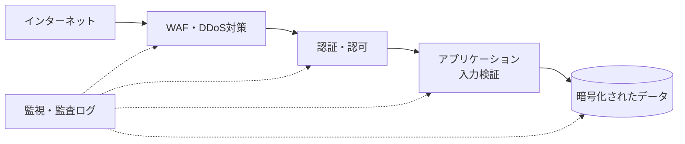
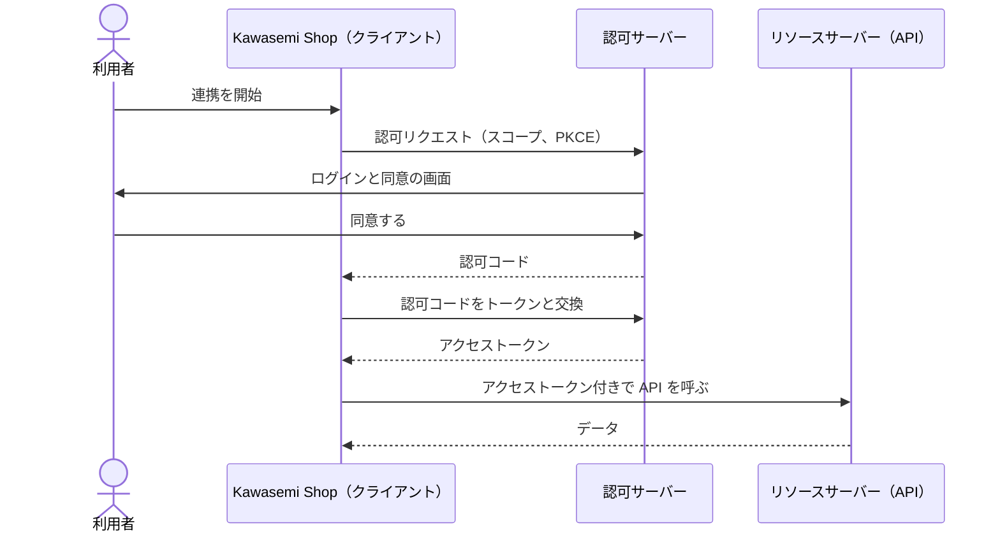
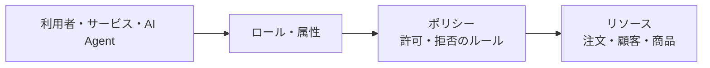
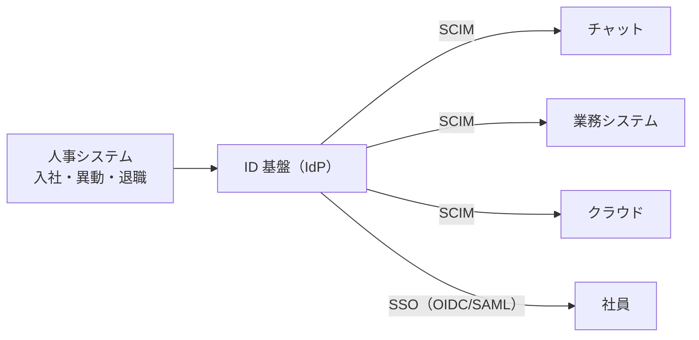
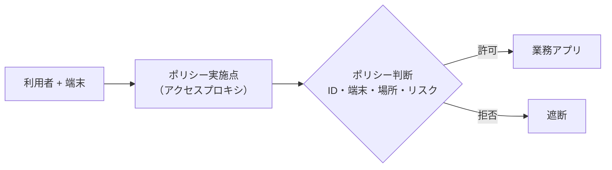
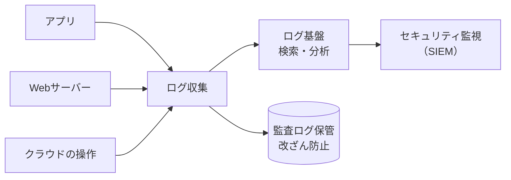
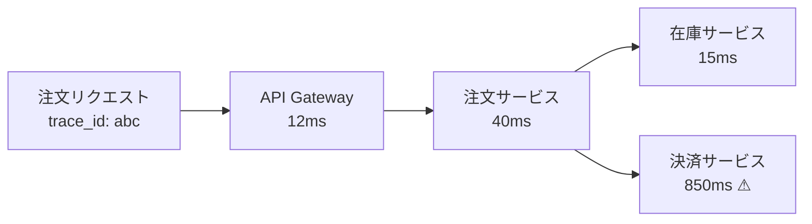
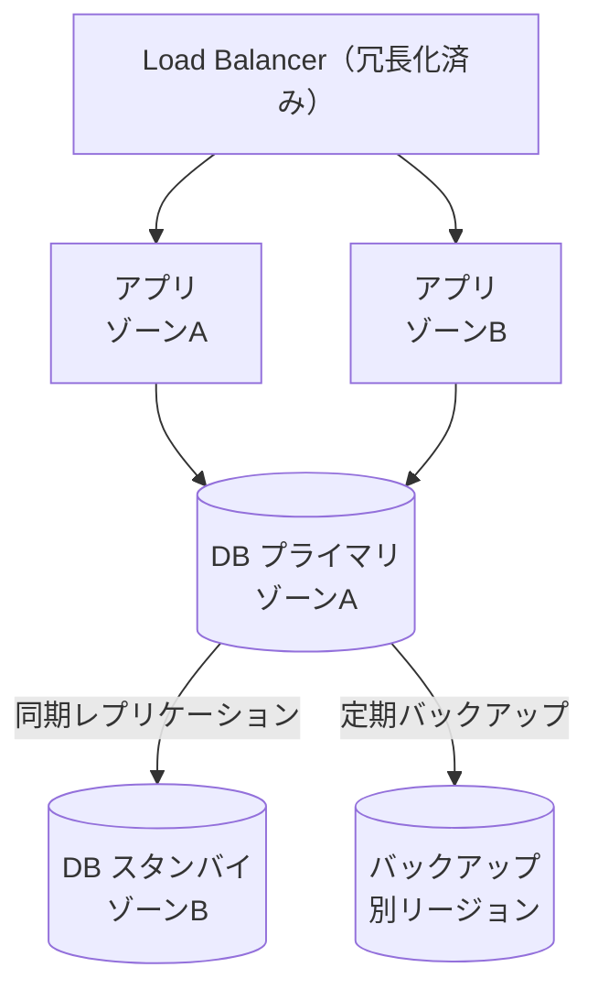
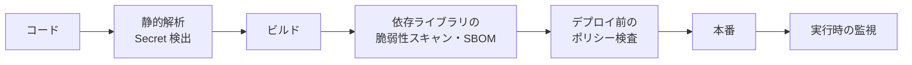

どれほど便利なシステムでも、情報が漏れたり、肝心なときに止まったりすれば、信頼を失います。この章では、システムを **守り、止めず、異常に気づき、回復する** ためのアーキテクチャを学びます。

## 9.1 セキュリティを構造として設計する

### なぜ「構造」なのか

> [!POINT]
> セキュリティは、完成したシステムに後から「鍵を付ける」ものではありません。データをどこに置くか、誰がどの経路でアクセスするか、境界をどこに引くかといった **構造そのもの** が、守りやすさを決めます。

### セキュリティの基本原則

| 原則 | 意味 |
|---|---|
| **CIA** | 機密性（Confidentiality）、完全性（Integrity）、可用性（Availability）を守る |
| **多層防御** | 1つの対策が破られても、次の層で止める |
| **[最小権限](/tech/architecture/glossary#least-privilege)** | 必要な権限だけを、必要な期間だけ与える |
| **安全な既定値** | 何も設定しなければ「拒否」になるようにする |
| **攻撃対象領域の縮小** | 公開する機能・ポート・データを最小限にする |
| **職務の分離** | 1人（1つのプログラム）だけで重大な操作を完結させない |

設計段階で「何を守るのか」「誰がどう攻撃しうるか」を洗い出すことを **脅威モデリング** と呼びます。Microsoft の STRIDE（なりすまし、改ざん、否認、情報漏えい、サービス妨害、権限昇格）がよく使われる分類です。



*図9-1　多層防御。各層が独立して守り、全体を監視する。*

## 9.2 認証と認可の違い

- **[認証](/tech/architecture/glossary#authentication)（Authentication、AuthN）**：**あなたは誰か** を確かめること。パスワード、指紋、ワンタイムコードなど。
- **[認可](/tech/architecture/glossary#authorization)（Authorization、AuthZ）**：**あなたは何をしてよいか** を決めること。「店主は商品を登録できる」「お客さまは自分の注文だけ見られる」。

ホテルにたとえると、フロントで身分証を確認してカードキーを受け取るのが認証、カードキーで開けられるのが自分の部屋だけ、というのが認可です。

### 認証を強くする

- **多要素認証（MFA）**：知識（パスワード）、所持（スマホ）、生体（指紋）のうち2つ以上を組み合わせる
- **パスキー（FIDO2/WebAuthn）**：公開鍵暗号を使い、パスワードを使わずに認証する。フィッシングに強い
- パスワードを保存する場合は、平文ではなく、bcrypt や Argon2 などの遅いハッシュ関数で保存する

## 9.3 OAuth 2.0、OpenID Connect、SAML

### OAuth 2.0

**[OAuth 2.0](/tech/architecture/glossary#oauth)** は、**認可を委譲する** ための仕組みです。例えば、Kawasemi Shop が利用者の代わりに配送業者のサービスで配送状況を確認するとき、利用者のパスワードを Kawasemi Shop に渡す必要はありません。代わりに、限られた範囲（**スコープ**）と期間だけ使える **アクセストークン** を発行してもらいます。



*図9-2　OAuth 2.0 の認可コードフロー（PKCE 付き）。パスワードはクライアントに渡らない。*

### OpenID Connect

OAuth 2.0 は「何をしてよいか」を扱い、「誰か」を伝える仕組みではありません。**[OpenID Connect](/tech/architecture/glossary#oidc)（OIDC）** は、OAuth 2.0 の上に **認証** の機能を加えた仕様で、利用者が誰かを表す **ID トークン**（JWT 形式）を発行します。「Google でログイン」のようなソーシャルログインの多くは OIDC です。

### SAML

**[SAML](/tech/architecture/glossary#saml)** は、XML ベースの古くからある認証連携の仕様で、主に企業向けの **シングルサインオン（SSO）** に使われます。社員が会社の ID 基盤に一度ログインすれば、経費精算・勤怠・チャットなどの各 SaaS にログインし直さずに使えます。新しいシステムでは OIDC が選ばれることが多くなっています。

| | OAuth 2.0 | OpenID Connect | SAML |
|---|---|---|---|
| 目的 | 認可の委譲 | 認証（+認可） | 認証（SSO） |
| 形式 | トークン（形式は規定しない） | JWT | XML |
| 主な用途 | API へのアクセス | Web・モバイルのログイン | 企業の SSO |

## 9.4 IAM、RBAC、ABAC、最小権限

### IAM

**[IAM](/tech/architecture/glossary#iam)（Identity and Access Management）** は、ID（人、サービス、AI Agent）と、その ID が何にアクセスできるかを管理する仕組みの総称です。クラウドでは、「この仮想マシンは、この S3 バケットを読むことだけができる」のように、**サービスやプログラムにも ID を与えて** 権限を管理します。

### RBAC と ABAC

| | [RBAC](/tech/architecture/glossary#rbac)（ロールベース） | [ABAC](/tech/architecture/glossary#abac)（属性ベース） |
|---|---|---|
| 判断の基準 | 役割（ロール） | 利用者・リソース・環境の属性 |
| 例 | 「店舗スタッフ」ロールは注文を閲覧できる | 「所属＝サポート部門」かつ「勤務時間内」かつ「担当地域の顧客」なら閲覧できる |
| 利点 | 単純で分かりやすい | きめ細かい制御ができる |
| 欠点 | 例外が増えるとロールが爆発的に増える | ルールが複雑で、検証が難しい |



*図9-3　ID・ロール・ポリシー・リソースの関係。*

### 最小権限

> [!POINT]
> [最小権限](/tech/architecture/glossary#least-privilege)の原則は、権限設計で最も重要です。「とりあえず管理者権限」は、事故や攻撃の被害を最大化します。一時的に必要な強い権限は、承認を経て時間制限付きで与える（**Just-In-Time アクセス**）ようにします。この原則は、第11章で AI Agent に権限を与えるときにそのまま当てはまります。

## 9.5 SCIMとIDライフサイクル管理

### なぜ必要か

社員が入社すると、メール、チャット、業務システム、クラウドなど数十のサービスにアカウントが必要になります。退職したら、すべてのアカウントを **確実に、すぐに** 無効化しなければなりません。退職者のアカウントが残っていると、重大なセキュリティ事故につながります。

### 仕組み

**[SCIM](/tech/architecture/glossary#scim)（System for Cross-domain Identity Management）** は、ID 情報（ユーザー、グループ）を、ID 基盤から各サービスへ自動で作成・更新・削除するための標準仕様です（RFC 7643、7644）。REST API と JSON で定義されています。



*図9-4　SCIM による ID ライフサイクルの自動化。*

ID のライフサイクルは、**入社（Joiner）・異動（Mover）・退職（Leaver）** の3つの場面で考えます（JML）。特に「異動」で古い権限が残り続ける **権限の累積** は見落とされやすい問題で、定期的な **権限の棚卸し** が必要です。

## 9.6 Zero Trustとネットワーク分離

### 境界型防御の限界

従来は「社内ネットワークの内側は安全、外側は危険」という **境界型防御** が主流でした。しかし、クラウドの利用、リモートワーク、スマートフォン、そして内部に侵入した攻撃者の横移動などにより、「内側なら安全」という前提は成り立たなくなりました。

### Zero Trust

**[Zero Trust](/tech/architecture/glossary#zero-trust)** は、「**決して信頼せず、常に検証する**」という考え方です。米国 NIST の SP 800-207（2020年）で体系的に整理されています。

- ネットワーク上の場所では信頼しない。すべてのアクセスで、ID・端末の状態・状況を検証する
- アクセスは、リソース単位で、最小権限で与える
- 侵害されていることを前提に、通信を暗号化し、セグメントを細かく分け、監視する



*図9-5　Zero Trust のアクセス制御。毎回、条件に基づいて判断する。*

サービス同士の通信でも、相互に証明書で認証する **mTLS** を使い、「同じネットワーク内だから信頼する」ことをやめます。Kubernetes では **サービスメッシュ** がこれを担うことがあります。

## 9.7 Secret管理、暗号化、鍵管理

### Secret 管理

**Secret**（秘密情報）とは、パスワード、API キー、データベースの接続情報、秘密鍵などです。

- **ソースコードに書かない**。Git の履歴に一度入ると、消したつもりでも残る
- 専用の **Secret 管理サービス**（HashiCorp Vault、AWS Secrets Manager など）に保存し、実行時に取得する
- 定期的に、また漏えいが疑われたらすぐに **ローテーション**（交換）する
- 可能なら、長期間有効な鍵ではなく、**短時間だけ有効な認証情報** を動的に発行する

AI Coding Agent を使う開発では、Agent が `.env` ファイルや認証情報を読み取ってログや外部に出してしまうリスクがあります。Agent の実行環境に本番の Secret を置かないことが重要です（第11章）。

### 暗号化と鍵管理

| 対象 | 方法 |
|---|---|
| 通信中のデータ（in transit） | TLS、mTLS |
| 保存されたデータ（at rest） | ディスク・データベース・オブジェクトストレージの暗号化 |
| 特に機密性の高い項目 | アプリケーションでの項目単位の暗号化 |

暗号化の強さは、**鍵をどう守るか** で決まります。**[KMS](/tech/architecture/glossary#kms)（Key Management Service）** や、専用のハードウェアである **HSM** で鍵を管理し、データを暗号化する鍵（データ鍵）を、さらに別の鍵（マスター鍵）で暗号化する **エンベロープ暗号化** がよく使われます。

## 9.8 ログアーキテクチャと監査ログ

### ログの種類

| 種類 | 目的 | 例 |
|---|---|---|
| アプリケーションログ | 動作の記録、障害調査 | 「注文1001の決済でタイムアウト」 |
| アクセスログ | 誰がいつ何にアクセスしたか | Web サーバーのリクエスト記録 |
| **監査ログ** | 重要な操作の証跡（後から改ざんできないこと） | 「管理者Aが顧客Bの住所を変更」 |
| セキュリティログ | 攻撃や異常の検知 | ログイン失敗の急増 |

### ログの設計

- **構造化ログ**：JSON などの機械が読める形式で、時刻・リクエストID・利用者ID などを項目として持たせる
- **集約**：各サーバーのログを一か所に集め、検索・分析できるようにする
- **個人情報・Secret を書かない**：パスワードやカード番号がログに出ると、ログ自体が漏えい源になる
- **保存期間と改ざん防止**：監査ログは書き換えできない場所（WORM ストレージなど）に、規定の期間保存する



*図9-6　ログアーキテクチャ。*

## 9.9 Observability（Logs、Metrics、Traces）

### 監視と可観測性

従来の **監視（monitoring）** は、「CPU 使用率が90%を超えたら通知」のように、**あらかじめ想定した異常** を検知します。分散システムでは、想定していなかった形の障害が起きます。**[可観測性](/tech/architecture/glossary#observability)（Observability）** とは、システムの外に出力されたデータから、**内部で何が起きているかを後から問い合わせて理解できる** 性質のことです。

### 3つの柱

| 種類 | 内容 | 答えられる問い |
|---|---|---|
| **Logs** | 個々の出来事の記録 | 「何が起きたか」 |
| **Metrics** | 数値の時系列（リクエスト数、エラー率、遅延） | 「どれくらい起きているか、傾向は」 |
| **Traces** | 1つのリクエストが複数のサービスを通る経路と時間 | 「どこで遅くなっているか」 |



*図9-7　分散トレース。同じ trace_id でつながった処理の時間から、遅い箇所（決済）が分かる。*

**OpenTelemetry** は、ログ・メトリクス・トレースを収集するための、ベンダー中立な標準です。アプリケーションを OpenTelemetry で計装しておけば、後から分析基盤を自由に選べます。

## 9.10 SLI、SLO、SLAと信頼性

Google が広めた **SRE（Site Reliability Engineering）** では、信頼性を数値で管理します。

- **SLI（Service Level Indicator）**：サービスの品質を表す指標。「注文 API のリクエストのうち、成功し、かつ1秒以内に応答した割合」
- **SLO（Service Level Objective）**：SLI の目標値。「30日間で99.9%」
- **SLA（Service Level Agreement）**：顧客との契約。下回ったら返金などの補償がある。SLO より緩く設定するのが普通

詳しくは用語集の [SLI・SLO・SLA](/tech/architecture/glossary#sli-slo-sla) も参照してください。

### エラーバジェット

SLO が99.9%なら、残りの0.1%は「失敗してよい量」です。これを **エラーバジェット（error budget）** と呼びます。

| 可用性の目標 | 30日間で許される停止時間 |
|---|---|
| 99% | 約7.2時間 |
| 99.9% | 約43分 |
| 99.99% | 約4.3分 |
| 99.999% | 約26秒 |

エラーバジェットが残っていれば新機能を積極的にリリースし、使い切りそうなら信頼性の改善を優先する、というように、**開発速度と信頼性のバランスを数字で決められる** のが利点です。100%を目標にしないことがポイントです。可用性を1桁上げるごとに、コストは大きく跳ね上がります。

## 9.11 冗長化、バックアップ、災害復旧

### 冗長化

**冗長化** とは、同じ役割の部品を複数用意し、1つが壊れても全体が止まらないようにすることです。どこか1か所が壊れると全体が止まる箇所を **単一障害点（SPOF）** と呼び、設計でなくしていきます。



*図9-8　クラウドでの冗長構成の例。ゾーン（独立したデータセンター群）をまたいで配置する。*

### バックアップ

- **3-2-1 ルール**：3つのコピーを、2種類の媒体に、うち1つは別の場所に保管する
- **ランサムウェア対策**：本番環境から削除・書き換えできない場所（イミュータブルなバックアップ）にも保管する
- **リストアの訓練**：バックアップは「戻せることを確認して」初めて意味がある

### 災害復旧（DR）

災害復旧の目標は2つの指標で表します（[RTO・RPO](/tech/architecture/glossary#rto-rpo)）。

- **RTO（Recovery Time Objective）**：どれくらいの時間で復旧するか
- **RPO（Recovery Point Objective）**：どの時点までのデータを取り戻せればよいか（失ってよいデータの量）

| DR の方式 | 内容 | RTO/RPO | コスト |
|---|---|---|---|
| バックアップから復元 | 別の場所にバックアップだけ置く | 数時間〜数日 | 低 |
| パイロットライト | 最小限の環境を待機させる | 数十分〜数時間 | 中 |
| ウォームスタンバイ | 縮小した環境を常時稼働 | 数分〜数十分 | 中〜高 |
| マルチサイト（アクティブ/アクティブ） | 複数拠点で同時に稼働 | ほぼゼロ | 高 |

障害を意図的に起こして耐性を確かめる **カオスエンジニアリング**（Netflix の Chaos Monkey が有名）も、信頼性を高める有効な手段です。

## 9.12 DevSecOpsとPolicy as Code

### DevSecOps

**[DevSecOps](/tech/architecture/glossary#devsecops)** は、開発（Dev）・セキュリティ（Sec）・運用（Ops）を一体として、セキュリティの確認を開発の流れの早い段階から自動で組み込む考え方です（**シフトレフト**）。



*図9-9　DevSecOps のパイプライン。*

近年は、使っているライブラリやビルド過程が攻撃される **ソフトウェアサプライチェーン攻撃** への対策として、ソフトウェアの部品表である **SBOM** の作成や、ビルドの来歴を証明する SLSA などの取り組みも重要になっています。

### Policy as Code

**[Policy as Code](/tech/architecture/glossary#policy-as-code)** は、セキュリティや運用のルールをコードとして書き、自動で検査する方法です。Open Policy Agent（OPA）の Rego 言語などが使われます。

```text
# 例：ルール（擬似コード）
deny if:
  resource.type == "storage_bucket"
  resource.public_access == true
  message: "ストレージを公開設定にすることは禁止されています"
```

ルールがコードであれば、レビューでき、バージョン管理でき、すべての変更に例外なく適用できます。人間が書いた変更にも、**AI Agent が書いた変更にも同じルールを機械的に適用できる** ため、AI 時代のガバナンスの基盤になります（第11章）。

## まとめ

- セキュリティは構造で決まる。最小権限、多層防御、安全な既定値を設計の段階から組み込む。
- 認証は「誰か」、認可は「何をしてよいか」。OAuth 2.0 は認可の委譲、OIDC と SAML は認証の連携に使う。
- ID のライフサイクルは SCIM で自動化し、Zero Trust では毎回のアクセスを検証する。
- ログ・メトリクス・トレースによる可観測性と、SLO・エラーバジェットで信頼性を数値で管理する。
- 冗長化・バックアップ・DR は、RTO・RPO とコストのトレードオフで選ぶ。
- DevSecOps と Policy as Code で、人間にも AI にも同じルールを自動で適用する。

## 理解度チェック

1. 認証と認可の違いを、Kawasemi Shop の管理画面を例に説明してください。
2. SLO を99.99%から99.9%に下げると、30日間で許される停止時間はどう変わりますか。それは開発にどんな影響を与えますか。
3. Zero Trust が従来の境界型防御と比べて優れている点と、導入の難しさを1つずつ挙げてください。
