LLM や画像生成 AI は、膨大な計算によって作られ、動いています。その計算を担っているのが **[GPU](/tech/architecture/glossary#gpu)（Graphics Processing Unit）** です。この章では、GPU がなぜ AI に向いているのか、その内部構造はどうなっているのか、そして何千台もの GPU をどう束ねて巨大なモデルを学習・推論させるのかを見ていきます。

第5章でコンピュータの記憶階層を学びました。GPU のアーキテクチャも、**計算をどう並列にするか** と **データをどう計算器の近くに運ぶか** という2つの問題への答えとして理解できます。

## 10.1 なぜGPUが必要になったのか（CPUとGPUの設計思想の違い）

### AI の計算は「同じ計算の大量の繰り返し」

ニューラルネットワークの計算の大部分は **行列の掛け算** です。例えば、1,000×1,000 の行列同士の掛け算には、約10億回（$10^9$）の掛け算と足し算が必要です。LLM の学習では、このような計算が $10^{23}$〜$10^{25}$ 回のオーダーで行われることもあります。

行列の掛け算には、**多数の計算を互いに独立して同時に行える** という性質があります。結果の行列の各要素は、他の要素の計算結果を待たずに計算できます。

### CPU と GPU の設計思想

| | CPU | GPU |
|---|---|---|
| 設計の目標 | 1つの処理を **できるだけ速く**（低遅延） | 大量の処理を **まとめて多く**（高スループット） |
| コアの数 | 数個〜百数十個の強力なコア | 数千〜1万個以上の単純な演算器 |
| 1コアの制御 | 分岐予測・順序の入れ替え実行など高度な制御 | 制御は単純、多数のスレッドで同じ命令を実行 |
| チップ面積の使い方 | 制御回路と大きなキャッシュに多くを割く | 演算器に多くを割く |
| 得意な処理 | OS、Web サーバー、複雑な分岐のある処理 | 行列演算、画像処理、物理シミュレーション |

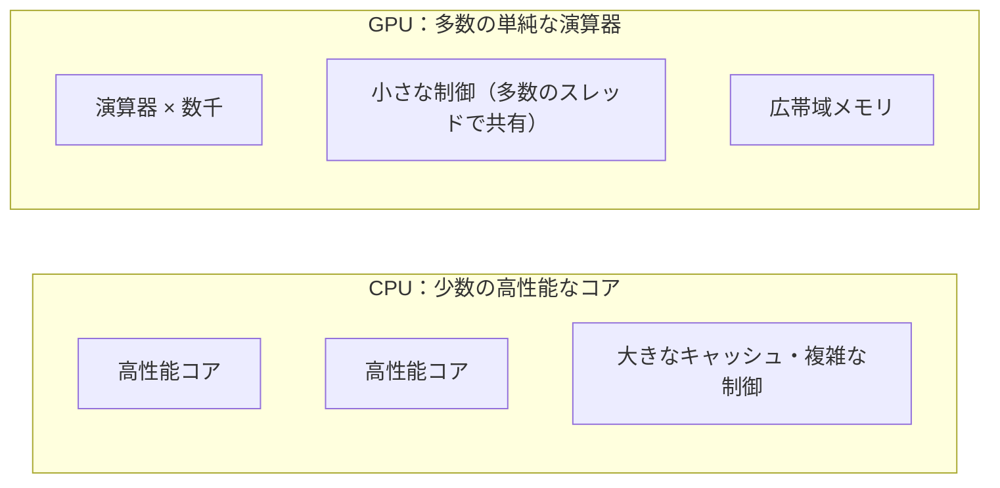

*図10-1　CPU と GPU の設計思想の違い。*

たとえるなら、CPU は「何でもこなせる少数の熟練シェフ」、GPU は「同じ作業を一斉に行う何千人もの調理スタッフ」です。1皿のフルコースを最短で作るならシェフですが、1万個のおにぎりを握るなら大勢のスタッフの方が速く終わります。

### 実際のシステムでは両方を使う

GPU は単独では動きません。CPU が OS を動かし、データを準備し、GPU に「この計算をして」と依頼します。GPU は **アクセラレータ**（計算の加速装置）として、CPU と協調して働きます。

## 10.2 GPUの歴史（グラフィックス、GPGPU、CUDA、深層学習）

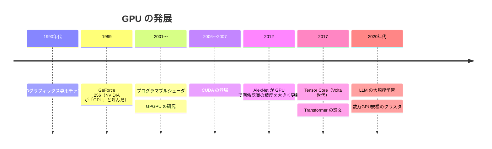

*図10-2　GPU の発展年表。*

### グラフィックスのための専用チップ

3D ゲームの画面を描くには、画面の数百万個の画素（ピクセル）それぞれについて、色や明るさを計算する必要があります。各画素の計算は互いに独立しているため、並列に処理するのに向いています。1990年代に3Dグラフィックス用のチップが普及し、1999年に NVIDIA は GeForce 256 を「GPU」と名付けて発表しました。

### GPGPU とプログラマブルシェーダ

2000年代初め、GPU の描画処理の一部（**シェーダ**）がプログラムで書き換えられるようになりました。研究者たちは、画像の計算に見せかけて、物理シミュレーションや行列演算を GPU にさせる工夫を始めます。これを **GPGPU（General-Purpose computing on GPU）** と呼びます。

### CUDA の登場

2006年に NVIDIA が発表し、2007年に公開した **[CUDA](/tech/architecture/glossary#cuda)** は、C 言語を拡張した形で、GPU を汎用の並列計算機としてプログラムできるようにしました。グラフィックスの知識がなくても GPU を使えるようになり、科学技術計算の分野に急速に広がりました。

### 深層学習との出会い

2012年、Alex Krizhevsky、Ilya Sutskever、Geoffrey Hinton は、2枚の GPU を使って学習した畳み込みニューラルネットワーク **AlexNet** で、画像認識コンテスト ImageNet（ILSVRC）の誤り率を大幅に下げました。これをきっかけに深層学習の時代が始まり、GPU は AI 研究の必需品になりました。

その後、NVIDIA は2017年の Volta 世代で、行列演算に特化した演算器 **Tensor Core** を搭載し、GPU は「グラフィックスもできる AI 計算機」へと性格を変えていきます。同じ2017年に発表された Transformer（第11章）は、GPU での並列計算と非常に相性が良く、LLM の急速な発展につながりました。

## 10.3 GPUの内部構造（SM、CUDAコア、Tensor Core、ワープ、SIMT）

ここでは NVIDIA の GPU を例に、内部構造を説明します（AMD などの GPU も、名前は違いますが似た構造を持っています）。

### 階層的な構造

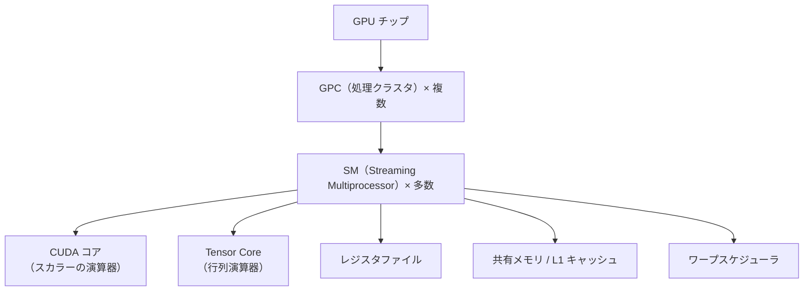

*図10-3　GPU の階層構造。*

- **[SM](/tech/architecture/glossary#sm)（Streaming Multiprocessor）**：GPU の基本的な処理単位。データセンター向けの GPU では、1チップに100個以上の SM が並ぶ。
- **CUDA コア**：1回に1つの数値の足し算・掛け算などを行う演算器。1つの SM に数十〜百数十個ある。
- **[Tensor Core](/tech/architecture/glossary#tensor-core)**：小さな行列同士の掛け算と足し算（$D = A \times B + C$）を1命令でまとめて行う専用の演算器。AI の計算性能の大部分はここから生まれる。
- **レジスタファイル・共有メモリ**：SM の中にある、非常に高速で小さなメモリ（10.4 節）。

### ワープと SIMT

GPU では、プログラムの実行単位である **スレッド** を、32個ずつ束ねた **[ワープ](/tech/architecture/glossary#warp)（warp）** という単位で実行します。1つのワープの32スレッドは、**同じ命令を、異なるデータに対して同時に** 実行します。NVIDIA はこの方式を **SIMT（Single Instruction, Multiple Threads）** と呼んでいます。

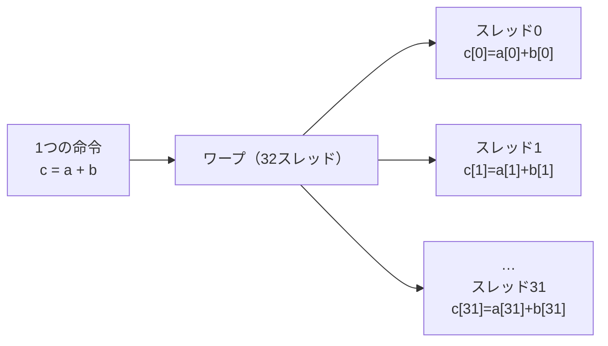

*図10-4　SIMT。1つの命令で32個のデータを同時に処理する。*

### 分岐の弱点

同じワープの中で `if` の条件によってスレッドが異なる処理に分かれると（**ワープダイバージェンス**）、GPU は両方の処理を順番に実行し、その間は該当しないスレッドを待機させます。分岐の多い処理が GPU で遅いのはこのためです。

### 遅延を隠す

GPU のメモリアクセスには数百サイクルかかることがあります。CPU は大きなキャッシュと高度な制御で待ち時間を **減らそう** としますが、GPU は別のやり方をとります。SM は多数のワープを同時に保持しておき、あるワープがメモリを待っている間に、**すぐに別のワープの命令を実行** します。こうして待ち時間を **隠す** のです。そのため、GPU の性能を引き出すには、SM を十分なワープで埋める（**占有率、occupancy** を高める）ことが大切です。

## 10.4 メモリ階層とメモリ帯域（レジスタ、共有メモリ、L2、HBM）

### GPU の性能はメモリで決まることが多い

> [!POINT]
> GPU の演算器は非常に速いため、多くの場合、ボトルネックは計算ではなく **データを演算器に届ける速さ（メモリ帯域）** になります。

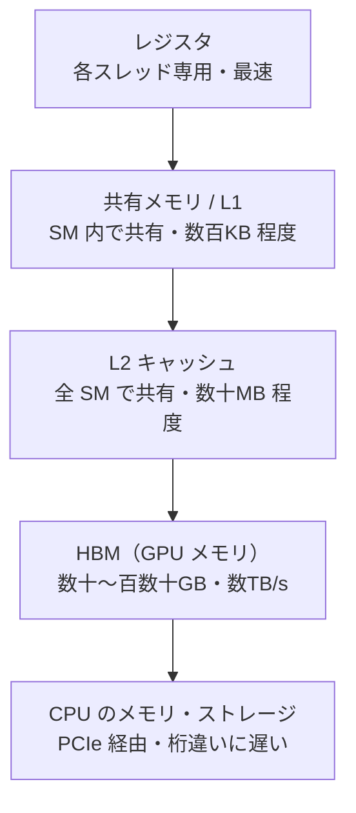

*図10-5　GPU のメモリ階層（容量・速度は世代や製品によって大きく異なるため、目安として示す）。*

| 階層 | 範囲 | 特徴 |
|---|---|---|
| レジスタ | 1スレッド | 最も速い。数が限られ、使いすぎると占有率が下がる |
| 共有メモリ | 1つのスレッドブロック（同じ SM 内） | プログラマが明示的に使える高速な作業用メモリ |
| L2 キャッシュ | GPU 全体 | 全 SM が共有する |
| [HBM](/tech/architecture/glossary#hbm) | GPU 全体 | モデルの重みや中間データを置く主記憶 |

### HBM（High Bandwidth Memory）

データセンター向けの GPU では、**HBM** と呼ばれる特殊なメモリを使います。DRAM のチップを縦に何層も積み重ね、GPU のすぐ隣に配置し、非常に多数の配線で結ぶことで、一般的な PC のメモリより桁違いに大きな帯域（毎秒数TB 規模）を実現します。

それでも、演算器の速さに比べるとメモリは遅いのが実情です。そこで GPU のプログラムでは、**一度 HBM から読み込んだデータを、共有メモリやレジスタの上でできるだけ何度も再利用する** 工夫（**タイリング**）が重要になります。

### 具体例：FlashAttention

LLM の中心的な計算である Attention（第11章）を素直に実装すると、大きな中間結果の行列を何度も HBM に書いては読み直すことになります。2022年に発表された **FlashAttention** は、計算を小さなブロックに分け、中間結果を高速な共有メモリの中だけで処理することで、**計算量を変えずに HBM へのアクセスを大幅に減らし**、Attention を高速化しました。これは「計算よりデータの移動がボトルネック」という GPU の性質をよく表す例です。

## 10.5 CUDAプログラミングモデル（カーネル、グリッド、ブロック、スレッド）

### 仕組み

CUDA では、GPU で実行する関数を **カーネル** と呼びます。カーネルは、多数のスレッドによって同時に実行されます。スレッドは次のような階層にまとめられます。

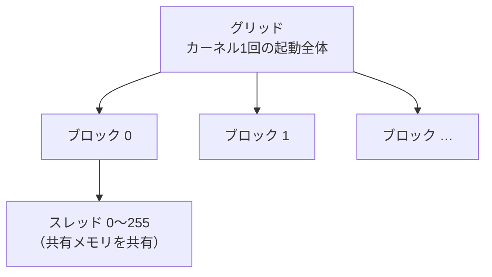

*図10-6　CUDA のスレッド階層。ブロックは1つの SM に割り当てられて実行される。*

- **スレッド**：最小の実行単位
- **ブロック**：スレッドの集まり。同じブロックのスレッドは共有メモリを使って協力し、同期できる
- **グリッド**：ブロックの集まり。カーネル1回の起動で実行されるすべてのスレッド

### 例：ベクトルの足し算

```cpp
// GPU で実行されるカーネル。1つのスレッドが1つの要素を担当する
__global__ void add(const float* a, const float* b, float* c, int n) {
    int i = blockIdx.x * blockDim.x + threadIdx.x;  // 自分が担当する要素の番号
    if (i < n) c[i] = a[i] + b[i];
}

// CPU 側：256 スレッドのブロックを必要な数だけ起動する
int threads = 256;
int blocks = (n + threads - 1) / threads;
add<<<blocks, threads>>>(d_a, d_b, d_c, n);
```

CPU のプログラムでは `for` 文で1つずつ処理しますが、CUDA では「**1つのスレッドが1つの要素を担当する**」ように書き、それを何百万スレッドも同時に起動します。

### ソフトウェアスタック

実際には、AI の開発者が CUDA のカーネルを直接書くことは多くありません。

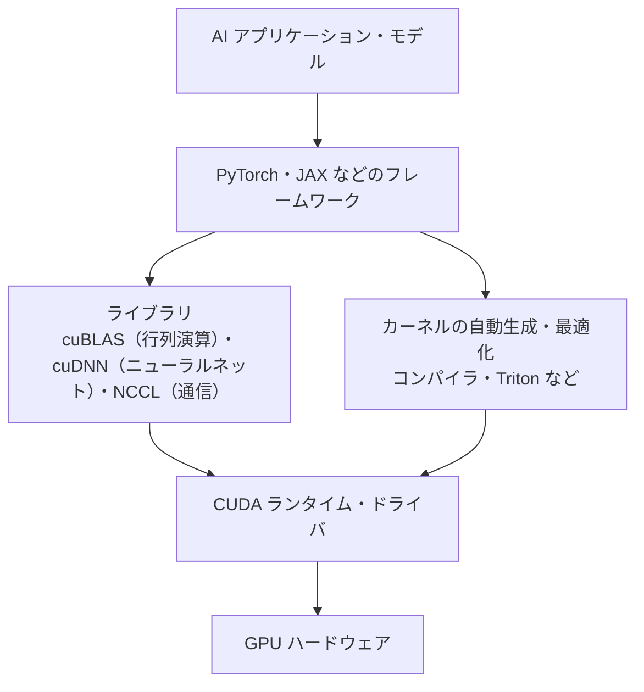

*図10-7　GPU のソフトウェアスタック。*

NVIDIA の強さはハードウェアだけでなく、こうしたライブラリやツールの **エコシステム** にあります。AMD は ROCm、Google は TPU 向けに XLA など、他社もそれぞれのソフトウェアスタックを整備しています。OpenAI が公開した **Triton** のように、Python に近い記法で高速な GPU カーネルを書ける言語も広がっています。

## 10.6 行列演算と数値精度（FP32、BF16、FP8、INT8）

### なぜ精度を下げるのか

コンピュータは実数を **浮動小数点数** で表します。ビット数が多いほど正確ですが、メモリと計算のコストが増えます。深層学習は、多少の誤差があっても結果があまり変わらない性質があるため、**精度を下げて速さと省メモリを得る** 工夫が広く行われています。

| 形式 | ビット数 | 主な用途 | 特徴 |
|---|---|---|---|
| FP32 | 32 | 従来の学習・科学計算 | 標準的な単精度 |
| TF32 | （内部的に19ビット相当） | Tensor Core での学習 | FP32 の範囲を保ちつつ精度を下げ、高速化 |
| FP16 | 16 | 学習・推論 | 表せる範囲が狭く、値があふれやすい |
| BF16 | 16 | 現在の LLM 学習の主流 | FP32 と同じ指数部で範囲が広く、扱いやすい |
| FP8 | 8 | 最新世代での学習・推論 | さらに高速。スケーリングの工夫が必要 |
| INT8 / INT4 など | 8・4 | 推論（量子化） | 整数で表し、メモリと計算を大幅に削減 |

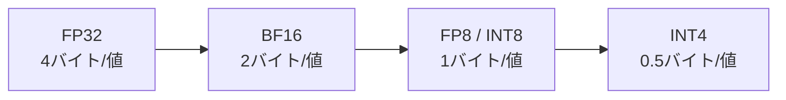

*図10-8　精度を下げるほど、同じメモリに多くの値を置け、同じ帯域で多くの値を運べる。*

### 混合精度学習

**混合精度学習（mixed precision training）** では、行列演算などの重い計算は BF16 や FP16 で行い、誤差が蓄積しやすい部分（重みの更新など）は FP32 で行います。精度をほとんど落とさずに、速度とメモリ効率を大きく改善できます。

### メモリの見積もり

精度はメモリの必要量に直結します。例えば、700億（70B）パラメータのモデルの重みだけを置くのに必要なメモリは、次のようになります。

| 精度 | 1パラメータあたり | 70B モデルの重み |
|---|---|---|
| FP32 | 4バイト | 約280GB |
| BF16 | 2バイト | 約140GB |
| INT8 | 1バイト | 約70GB |
| INT4 | 0.5バイト | 約35GB |

学習の場合はさらに、勾配やオプティマイザ（Adam など）の状態を保持する必要があり、重みの数倍のメモリが必要になります。1枚の GPU に収まらないモデルをどう扱うかが、10.9 節の分散学習のテーマです。

## 10.7 ルーフラインモデルで性能を考える

### 計算が律速か、メモリが律速か

ある処理が GPU で遅いとき、原因は大きく2つに分かれます。

- **計算律速（compute-bound）**：演算器が休みなく働いていて、計算能力が限界
- **メモリ律速（memory-bound）**：演算器はデータが届くのを待っていて、メモリ帯域が限界

どちらかを見分ける指標が **算術強度（arithmetic intensity）** です。

$$
\text{算術強度} = \frac{\text{演算の回数（FLOP）}}{\text{メモリとの間で移動したデータ量（バイト）}}
$$

### ルーフラインモデル

**[ルーフラインモデル](/tech/architecture/glossary#roofline)** は、Samuel Williams らが2009年に提案した、性能の上限を視覚的に示すモデルです。

$$
\text{達成可能な性能} = \min\left(\text{ピーク演算性能},\ \text{メモリ帯域} \times \text{算術強度}\right)
$$

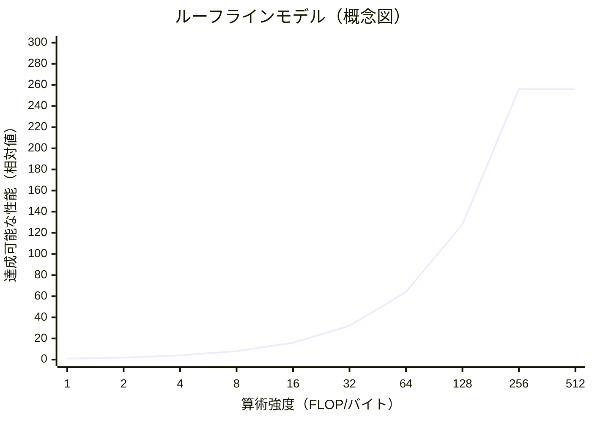

*図10-9　ルーフラインモデルの概念図。左側の斜めの部分はメモリ帯域が、右側の平らな部分は演算性能が上限になる。屋根（roof）の形に見えることが名前の由来。*

### 具体例

| 処理 | 算術強度 | 律速 |
|---|---|---|
| ベクトルの足し算（1回の足し算のために3つの値を読み書き） | 非常に低い | メモリ律速 |
| 要素ごとの活性化関数、正規化 | 低い | メモリ律速 |
| 大きな行列同士の掛け算 | 高い | 計算律速 |
| LLM 推論の「1トークンずつの生成」（バッチが小さい場合） | 低い | メモリ律速（10.10 節） |

> [!POINT]
> この見方を持つと、「GPU を速いものに替えれば速くなる」とは限らないことが分かります。メモリ律速の処理を速くするには、演算性能ではなく **データの移動量を減らす**（精度を下げる、処理をまとめる＝**カーネル融合**、データを再利用する）ことが効果的です。

## 10.8 マルチGPUとインターコネクト（PCIe、NVLink、InfiniBand、NCCL）

### なぜ GPU 同士をつなぐのか

大規模なモデルの学習は、1枚の GPU では何年もかかったり、そもそもメモリに収まらなかったりします。そこで、何十〜何万枚もの GPU に仕事を分けます。このとき、**GPU 同士がデータをやり取りする速さ** が、システム全体の性能を大きく左右します。

### インターコネクトの階層

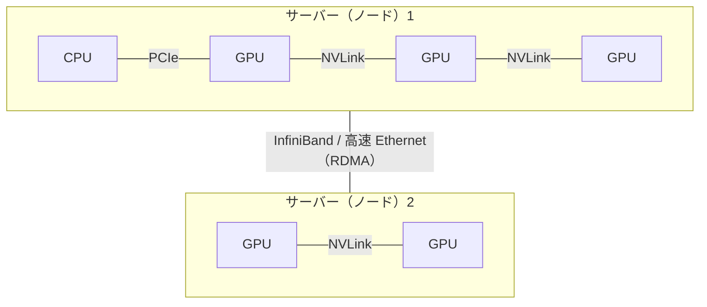

*図10-10　GPU のインターコネクトの階層。ノード内は NVLink、ノード間は InfiniBand などの高速ネットワーク。*

| 接続 | 範囲 | 特徴 |
|---|---|---|
| PCIe | CPU と GPU、汎用の拡張カード | 汎用の標準規格。GPU 同士の大量通信には帯域が不足しがち |
| [NVLink](/tech/architecture/glossary#nvlink) / NVSwitch | 同じノード（または同じラック）内の GPU 同士 | NVIDIA 独自の高速接続。PCIe より大幅に広帯域 |
| InfiniBand / RoCE（高速 Ethernet） | ノード間 | **RDMA**（CPU を介さずに相手のメモリへ直接読み書き）で低遅延 |

### 集団通信

分散学習では、全 GPU の計算結果を集めて足し合わせる、といった **集団通信（collective communication）** が頻繁に行われます。

| 操作 | 内容 |
|---|---|
| All-Reduce | 全員の値を合計（など）し、結果を全員に配る。データ並列の勾配の集約に使う |
| All-Gather | 全員の断片を集め、全員が全体を持つ |
| Reduce-Scatter | 合計した結果を分割して、各自に1断片ずつ配る |
| Broadcast | 1つの値を全員に配る |

**[NCCL](/tech/architecture/glossary#nccl)**（NVIDIA Collective Communications Library）は、これらの集団通信を、NVLink や InfiniBand の構成に合わせて最適な経路で実行するライブラリです。All-Reduce には、GPU を輪のようにつないで少しずつデータを回す **リング All-Reduce** などのアルゴリズムが使われます。

### 計算と通信の重ね合わせ

通信を待つ間、GPU は計算をせずに待つことになります。そこで、ある層の勾配を通信している間に、別の層の計算を進める **計算と通信のオーバーラップ** が重要な最適化になります。

## 10.9 分散学習の並列化（データ並列、テンソル並列、パイプライン並列、ZeRO/FSDP）

大規模モデルの学習では、仕事の分け方にいくつかの方法があり、それらを組み合わせて使います。

### データ並列

**[データ並列](/tech/architecture/glossary#data-parallelism)** では、各 GPU が **モデル全体のコピー** を持ち、**異なるデータ（ミニバッチの一部）** で計算します。各 GPU で計算した勾配を All-Reduce で平均し、全員が同じように重みを更新します。

- 利点：実装が単純で、GPU を増やすとほぼ比例して速くなる
- 欠点：モデル全体が1枚の GPU に収まる必要がある

### ZeRO と FSDP

データ並列では、全 GPU が同じ重み・勾配・オプティマイザの状態を重複して持つため、メモリの無駄が大きくなります。Microsoft の DeepSpeed が提案した **ZeRO**（Zero Redundancy Optimizer、2019年）は、これらを GPU 間で **分割して持ち**、必要なときだけ集めることで、メモリの重複をなくします。PyTorch の **FSDP**（Fully Sharded Data Parallel）も同様の考え方です。

### テンソル並列

**[テンソル並列](/tech/architecture/glossary#tensor-parallelism)** では、1つの層の **行列そのものを分割** し、複数の GPU で分担して計算します。NVIDIA の Megatron-LM（2019年）で広く知られるようになりました。層ごとに頻繁な通信が必要なため、通常は NVLink でつながった **同じノード内の GPU** で使います。

### パイプライン並列

**[パイプライン並列](/tech/architecture/glossary#pipeline-parallelism)** では、モデルを **層の順番で区切り**、前半の層を GPU 1、後半の層を GPU 2 のように割り当てます。データを小さな **マイクロバッチ** に分けて流れ作業のように処理することで、GPU の待ち時間（**パイプラインバブル**）を減らします。

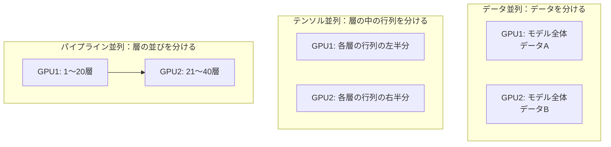

*図10-11　分散学習の3つの基本的な並列化。*

### 組み合わせ（3D 並列）

大規模な LLM の学習では、これらを組み合わせます。例えば「ノード内の8 GPU でテンソル並列、ノードをまたいでパイプライン並列、さらにそのまとまりを複製してデータ並列」のように構成します。さらに、長い文章を分割して扱う **シーケンス並列** や、Mixture of Experts（MoE）モデルの専門家を GPU に分散する **エキスパート並列** なども使われます。

| 並列化 | 分けるもの | 通信量 | 主に使う範囲 |
|---|---|---|---|
| データ並列 | データ | 勾配の集約（1ステップに1回） | ノード間を含む全体 |
| ZeRO / FSDP | 重み・勾配・オプティマイザ状態 | 必要なときに集める | 全体 |
| テンソル並列 | 層の中の行列 | 多い（層ごと） | ノード内（NVLink） |
| パイプライン並列 | 層の並び | 層の境界のみ | ノード間 |

どの組み合わせが最適かは、モデルの大きさ、GPU のメモリ、インターコネクトの帯域によって変わります。これはまさに、**計算・メモリ・通信のトレードオフを設計する** アーキテクチャの問題です。

### 障害への備え

数千台の GPU を何週間も動かし続けると、どこかの GPU やネットワークが故障するのは避けられません。そのため、学習の状態を定期的に保存する **チェックポイント** と、故障したノードを外して再開する仕組みが必要です。第9章の「障害を前提にした設計」は、AI の学習基盤でもそのまま当てはまります。

## 10.10 LLM推論のアーキテクチャ（KVキャッシュ、バッチング、量子化）

学習が「一度に大量の計算をする」のに対し、推論（実際にモデルを使って回答を生成すること）は「**多数の利用者のリクエストに、低い遅延で、安く応え続ける**」ことが求められます。性質が大きく異なるため、別の設計が必要です。

### 2つのフェーズ

LLM は、文章を **[トークン](/tech/architecture/glossary#token)**（単語や文字の断片）単位で1つずつ生成します。

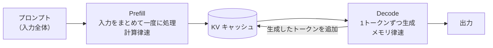

*図10-12　LLM 推論の2つのフェーズ。*

- **Prefill（プリフィル）**：入力されたプロンプト全体を一度に処理する。多数のトークンを並列に計算できるため、計算律速になりやすい。最初のトークンが出るまでの時間（**TTFT**：Time To First Token）に影響する。
- **Decode（デコード）**：1トークンずつ順番に生成する。1トークンのたびにモデルの全重みを HBM から読む必要があり、メモリ律速になりやすい。トークンの生成速度（**TPOT**：Time Per Output Token）に影響する。

### KV キャッシュ

Transformer は、新しいトークンを生成するたびに、それまでのすべてのトークンとの関係（Attention）を計算します。毎回すべてを計算し直すのは無駄なので、過去のトークンの中間結果（Key と Value）を保存して再利用します。これが **[KV キャッシュ](/tech/architecture/glossary#kv-cache)** です。

KV キャッシュは、**文章が長くなるほど、同時に処理する利用者が増えるほど** 大きくなり、GPU メモリの大部分を占めることもあります。LLM 推論の設計は、多くの場合「KV キャッシュのメモリをどう管理するか」の問題になります。

### 推論を効率化する技術

| 技術 | 内容 |
|---|---|
| **連続バッチング（continuous batching）** | 複数の利用者のリクエストをまとめて処理し、終わったものから順に新しいリクエストを入れ替える。GPU の利用率を大きく高める |
| **PagedAttention** | OS の仮想メモリのページングと同じ考え方で、KV キャッシュを小さなブロックに分けて管理し、メモリの断片化をなくす（vLLM、2023年） |
| **プレフィックスキャッシュ** | 共通のシステムプロンプトなど、同じ先頭部分の KV キャッシュを複数のリクエストで共有する |
| **[量子化](/tech/architecture/glossary#quantization)** | 重みや KV キャッシュを INT8・INT4・FP8 などの低精度で表し、メモリと帯域を削減する |
| **投機的デコーディング** | 小さなモデルで数トークン先を予想し、大きなモデルでまとめて検証することで、生成を速める |
| **Prefill と Decode の分離** | 性質の違う2つのフェーズを、別々の GPU 群で処理する |

PagedAttention は、第5章で学んだ OS の考え方が、最先端の AI 基盤でもそのまま使われている例です。

### 推論サーバーの構成

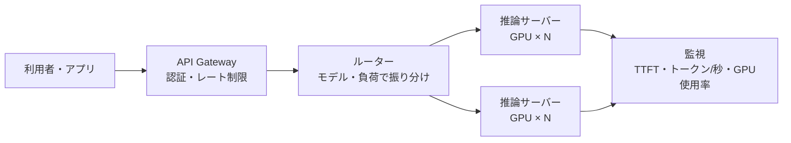

*図10-13　LLM 推論サービスの構成例。vLLM、TensorRT-LLM、SGLang などの推論エンジンが使われる。*

> [!POINT]
> 推論の設計は、**遅延（1人あたりの速さ）とスループット（全体で捌ける量）とコスト** のトレードオフです。バッチを大きくすれば全体の効率は上がりますが、1人あたりの待ち時間は増えます。

## 10.11 GPUクラスタとAIインフラの設計（スケジューリング、電力、コスト）

### GPU クラスタの構成

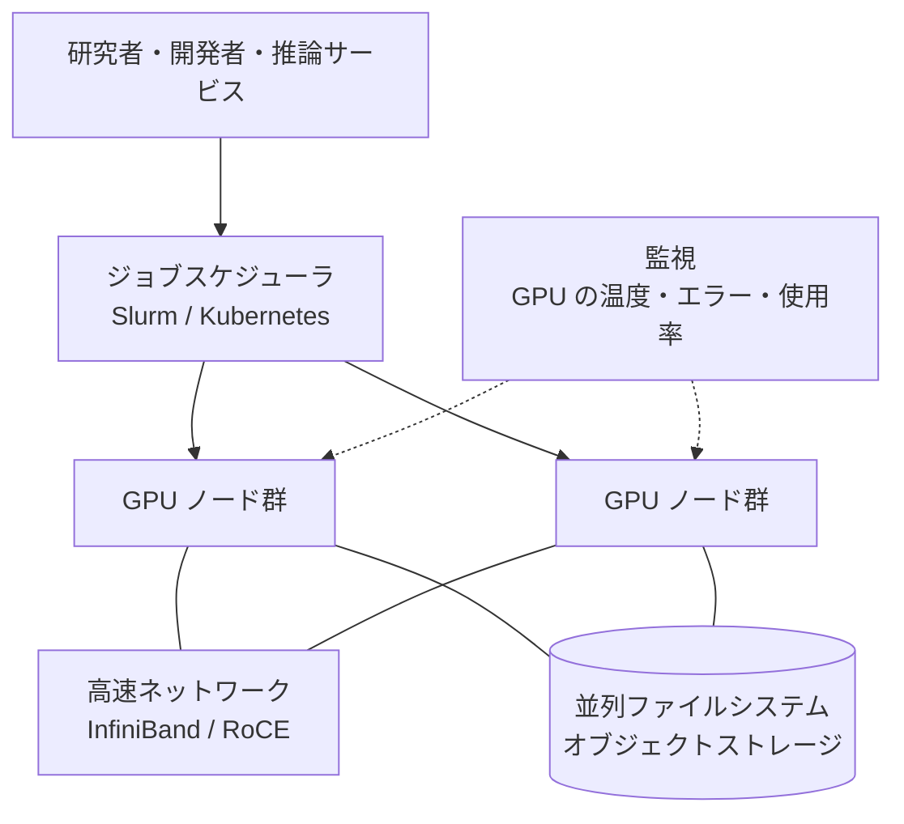

*図10-14　GPU クラスタの全体構成。*

### スケジューリング

GPU は非常に高価な資源なので、**使われずに空いている時間を減らすこと** が重要です。

- **Slurm**：スーパーコンピュータで使われてきたジョブスケジューラ。大規模な学習ジョブに広く使われる
- **Kubernetes**：推論サービスや、多様なワークロードの混在に向く。GPU を扱うためのデバイスプラグインやスケジューラの拡張がある
- **ギャングスケジューリング**：分散学習のジョブは、必要な GPU が **全部同時に** 揃わないと開始できない
- **トポロジーを考慮した配置**：テンソル並列のジョブは、NVLink でつながった GPU にまとめて配置する
- **GPU の分割**：小さな推論やデバッグには、1枚の GPU を複数に分けて使う（NVIDIA の MIG など）

### 電力と冷却

最新のデータセンター向け GPU は、1枚で数百ワットから1キロワットを超える電力を使い、GPU を高密度に積んだラックは従来のサーバーラックの何倍もの電力を必要とします。空冷では冷やしきれず、**液冷** が広がりつつあります。AI インフラの規模は、今や **電力の確保** によって制約されるようになっています。

### コストの考え方

| 観点 | 考えること |
|---|---|
| 調達 | クラウドで借りるか、自社で持つか。予約・スポットなどの購入方式 |
| 利用率 | GPU が実際に計算している時間の割合。待ち時間・通信待ち・データ読み込み待ちを減らす |
| 学習の効率 | MFU（Model FLOPs Utilization：理論性能に対して、モデルの計算にどれだけ使えたか） |
| 推論の効率 | 1トークン（または1リクエスト）あたりのコスト |
| データの近さ | 学習データを GPU の近くに置き、読み込みがボトルネックにならないようにする |

### Kawasemi Shop の場合

Kawasemi Shop のような小さな事業者が、自前で GPU クラスタを持つ必要はほとんどありません。

- 商品推薦や画像の自動タグ付け：クラウドの GPU インスタンスを、必要なときだけ使う（第11章）
- 問い合わせ対応の AI：外部の LLM API を使う（第12章）
- 機密性の高いデータを扱う場合：小さなオープンモデルを、量子化して1枚の GPU で動かす

**どこまでを自分で持ち、どこからをサービスとして使うか** は、他の章と同じく、コスト・機密性・運用能力のトレードオフで決めます。

## 10.12 GPU以外のアクセラレータとGPUの選び方

### さまざまなアクセラレータ

| 種類 | 例 | 特徴 |
|---|---|---|
| GPU | NVIDIA、AMD | 汎用性が高く、ソフトウェアのエコシステムが成熟 |
| [TPU](/tech/architecture/glossary#tpu) | Google | 行列演算に特化した **シストリックアレイ** を持つ専用チップ。2015年頃から Google 社内で使われ、2016年に発表。大規模なチップ間ネットワークを備える |
| クラウド事業者の独自チップ | AWS Trainium / Inferentia など | 自社クラウド向けに、学習・推論の性能あたりのコストを最適化 |
| NPU | スマートフォン・PC の SoC | 端末上での低消費電力の推論 |
| その他の専用チップ | 巨大チップ、推論特化チップなど | 特定の用途で、メモリ帯域や遅延を大きく改善 |

**シストリックアレイ** は、多数の演算器を格子状に並べ、データを隣の演算器へ脈打つように（systolic）受け渡しながら計算する構造です。メモリとの往復を減らせるため、行列演算を非常に効率よく行えます。GPU の Tensor Core も、行列演算に特化しているという意味で、同じ方向の進化です。

### GPU の選び方

GPU を選ぶときは、ピーク性能の数字だけでなく、次の観点もあわせて見ます。

1. **メモリ容量**：モデルの重みと KV キャッシュ（または学習時の状態）が収まるか。多くの場合、最初の制約になる
2. **メモリ帯域**：推論の Decode のようなメモリ律速の処理では、演算性能より重要
3. **対応する数値精度**：BF16、FP8、INT4 などを高速に扱えるか
4. **インターコネクト**：複数の GPU を使う場合、NVLink などの帯域
5. **ソフトウェアの対応**：使いたいフレームワーク・推論エンジン・ライブラリが対応しているか
6. **総コスト**：価格だけでなく、電力・冷却・運用・調達の待ち時間

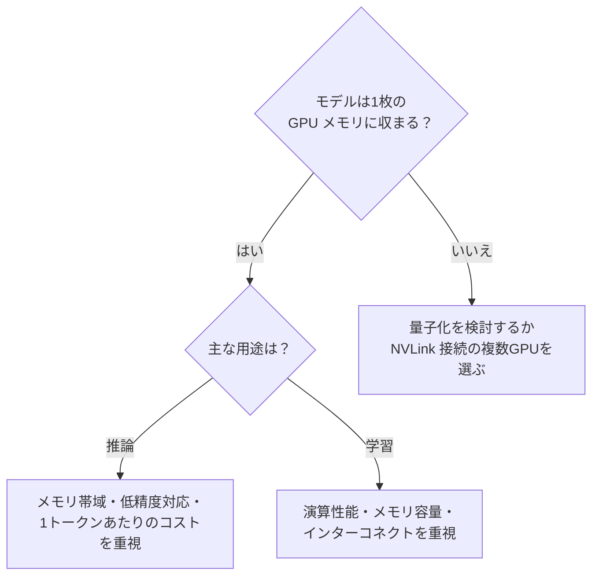

*図10-15　GPU 選定の考え方（簡略化した目安）。*

## まとめ

- GPU は「大量の同じ計算を同時に行う」ことに特化した、スループット重視のプロセッサである。
- GPU は SM・ワープ・Tensor Core という階層で並列性を実現し、多数のワープを切り替えてメモリの遅延を隠す。
- 多くの処理のボトルネックは計算ではなくメモリ帯域である。ルーフラインモデルで、どちらが律速かを見極める。
- 低精度（BF16、FP8、INT4）と混合精度は、速さとメモリ効率を大きく改善する。
- 大規模学習は、データ並列・テンソル並列・パイプライン並列・ZeRO を組み合わせ、計算・メモリ・通信のトレードオフを設計する。
- LLM 推論は Prefill と Decode で性質が異なり、KV キャッシュの管理とバッチングが効率の鍵になる。
- GPU クラスタの設計は、スケジューリング・ネットワーク・ストレージ・電力・コストを含む総合的なアーキテクチャの問題である。

## 理解度チェック

1. CPU と GPU の設計思想の違いを、「遅延」と「スループット」という言葉を使って説明してください。
2. LLM 推論の Decode フェーズが「メモリ律速」になりやすいのはなぜですか。ルーフラインモデルの考え方で説明してください。
3. 1枚の GPU に収まらない大きなモデルを学習するとき、どのような並列化の方法がありますか。それぞれの通信量の違いにも触れてください。
