第10章では、AI の計算を支える GPU を見ました。この章では、その上で動く **機械学習** のアーキテクチャを扱います。

機械学習には、2つの「アーキテクチャ」があります。

1. **モデルのアーキテクチャ**：ニューラルネットワークの中で、データがどのような層を通って変換されるか（CNN、RNN、Liquid Neural Networks、Transformer など）
2. **機械学習システムのアーキテクチャ**：データを集め、モデルを学習・評価し、本番で動かし、監視して作り直すまでの仕組み（MLOps）

前半でモデルの構造を、後半でシステムの構造を見ていきます。どちらにも、これまでの章と同じ問い ―「何を分け、何をつなぎ、どこに制約を置くか」― が当てはまります。

> [!POINT]
> この章は、本書のほかの章と異なり、著者が構築したものに限らず、**機械学習で一般的に使われているアーキテクチャ** を紹介します。個々の製品や手法の細部は変わりやすいため、実際に使うときは公式ドキュメントで最新の情報を確認してください。

## 11.1 機械学習システムは何が違うのか

### ルールを書くのではなく、データから学ばせる

従来のソフトウェアでは、人間がルール（`if 金額 > 10000 then 送料無料`）を書きます。機械学習では、**入力と正解の例（データ）** を大量に用意し、そこからルールに相当するもの（**モデル**）をコンピュータに見つけさせます。

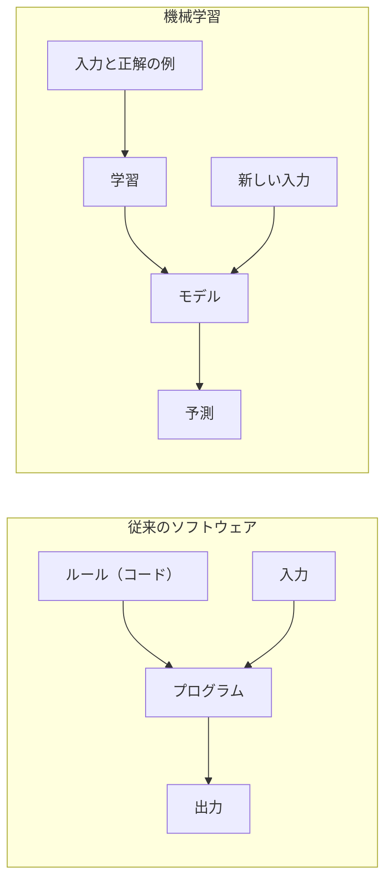

*図11-1　従来のソフトウェアと機械学習の違い。機械学習では、データがコードの役割の一部を担う。*

### 機械学習システムに特有の難しさ

| 観点 | 従来のソフトウェア | 機械学習システム |
|---|---|---|
| 振る舞いを決めるもの | コード | コード ＋ **データ** ＋ 学習の設定 |
| 正しさの確かめ方 | テストが通るか（合否） | 評価指標がどれだけ良いか（程度） |
| 壊れ方 | 例外やエラーで止まる | **エラーを出さずに、精度が静かに落ちる** |
| 変化の原因 | コードを変えたとき | コードを変えなくても、世の中（データ）が変わる |
| 再現に必要なもの | コードのバージョン | コード・データ・設定・乱数・環境のすべてのバージョン |

2015年に Google の研究者が発表した論文「Hidden Technical Debt in Machine Learning Systems」は、実際の機械学習システムでは **モデルのコードはごく一部** で、データの収集・検証、特徴量の抽出、設定、サービング、監視などの周辺の仕組みがほとんどを占めると指摘しました。機械学習のアーキテクチャを考えることは、この「周辺」を設計することでもあります。

## 11.2 ニューラルネットワークの基本構造

### ニューロンと層

**[ニューラルネットワーク](/tech/architecture/glossary#neural-network)** は、単純な計算をする「ニューロン」を層状につないだモデルです。1つのニューロンは、入力に重みを掛けて足し合わせ、**活性化関数** を通して出力します。

$$
y = f(w_1 x_1 + w_2 x_2 + \cdots + w_n x_n + b)
$$

$w$ は **重み**、$b$ は **バイアス** で、これらをまとめて **パラメータ** と呼びます。活性化関数 $f$ には ReLU（負の値を0にする）などの非線形な関数を使います。非線形な関数を挟むことで、層を重ねたときに複雑な関係を表せるようになります。

層をまとめて見ると、1つの層の計算は「入力ベクトル × 重み行列」という **行列の掛け算** になります。これが、第10章で見たように GPU が AI に向いている理由です。


*図11-2　ニューラルネットワークの基本構造。層を重ねたものを「深層学習（ディープラーニング）」と呼ぶ。*

### 学習：損失を小さくする方向に少しずつ動かす

学習は、次の繰り返しです。

1. **順伝播**：入力を層に通して予測を出す
2. **損失の計算**：予測と正解のずれを数値（**損失**）にする。分類なら交差エントロピー、数値の予測なら二乗誤差などを使う
3. **[誤差逆伝播法](/tech/architecture/glossary#backpropagation)**：損失を各パラメータで微分した値（**勾配**）を、出力側から入力側へ順に計算する
4. **パラメータの更新**：勾配の逆方向に少しだけパラメータを動かす（**勾配降下法**）。実際には、データを小分けにした **ミニバッチ** ごとに更新する（SGD、Adam など）

$$
w \leftarrow w - \eta \frac{\partial L}{\partial w}
$$

$\eta$（学習率）は、1回にどれだけ動かすかを決める **ハイパーパラメータ**（人間が学習の前に決める設定）です。

### 過学習と汎化

モデルが学習データの細部（ノイズ）まで覚え込み、新しいデータでは性能が落ちる状態を **過学習** といいます。機械学習の目的は、学習データでの成績ではなく、**まだ見ていないデータでの成績（汎化性能）** です。そのため、データを **学習用・検証用・テスト用** に分け、学習に使っていないデータで性能を測ります（11.9 節）。

### 帰納バイアス：構造に「前提」を埋め込む

すべての層がすべての入力とつながる **全結合層** だけでも、理論上は多くの関数を表せます。しかし、画像や文章のような大きなデータでは、パラメータが膨大になり、学習に大量のデータが必要になります。

そこで、データの性質に合った **前提（帰納バイアス）** をモデルの構造に埋め込みます。「画像では近くの画素同士が関係する」という前提を入れたのが CNN、「文章は順番に並んでいる」という前提を入れたのが RNN、「状態は時間とともに連続的に変化する」という前提を入れたのが Liquid Neural Networks、「どの要素同士が関係するかもデータから学ぶ」としたのが Transformer です。

> [!POINT]
> **モデルのアーキテクチャとは、データについての前提を構造として埋め込むことである。** 前提が強いほど少ないデータで学べるが、前提が外れると性能が伸びない。これは、ソフトウェアのアーキテクチャで「制約を置くことで変更しやすさを得る」のと同じトレードオフである。

## 11.3 CNN（畳み込みニューラルネットワーク）

### なぜ必要か

224×224 画素のカラー画像は、約15万個の数値です。これを全結合層に入れると、最初の層だけで数億個のパラメータが必要になります。しかも、猫が画像の左上にいても右下にいても「猫」であることを、位置ごとに別々に学ばなければなりません。

### 仕組み

**[CNN](/tech/architecture/glossary#cnn)（Convolutional Neural Network）** は、小さな **フィルタ（カーネル）**（例：3×3）を画像の上でずらしながら掛け合わせる **畳み込み** を使います。

- **局所的な結合**：1つの出力は、近くの小さな範囲の画素だけを見る
- **重みの共有**：同じフィルタを画像全体で使い回す。そのため、パラメータが少なく、どの位置にある模様も同じように検出できる
- **プーリング**：小さな範囲の最大値や平均をとって画像を縮め、位置の小さなずれに強くする

層を重ねると、浅い層は「線」や「角」、中間の層は「目」や「毛の模様」、深い層は「猫の顔」のように、**小さな特徴から大きな特徴へと階層的に** 組み合わさっていきます。

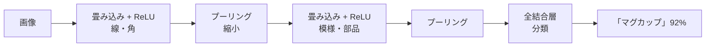

*図11-3　CNN の構造。畳み込みとプーリングを繰り返し、最後に分類する。*

### 発展の歴史

| モデル（年） | 意味 |
|---|---|
| LeNet-5（1998） | 手書き数字の認識。CNN の基本形 |
| AlexNet（2012） | GPU で学習し、画像認識コンテスト ImageNet で大差の優勝。深層学習ブームのきっかけ（第10章） |
| VGG、GoogLeNet（2014） | 層をより深くする工夫 |
| **ResNet**（2015） | **残差接続**（層を飛び越える近道）で、100層を超える深いネットワークを学習可能にした |

**残差接続** は、ある層の出力に、その層への入力をそのまま足し合わせる仕組みです。層が「入力からの差分」だけを学べばよくなり、勾配が深い層まで届きやすくなります。この考え方は、後の Transformer にもそのまま受け継がれています。

### 利点と欠点

- **利点**：パラメータが少なく、少ないデータでも学びやすい。位置のずれに強い。計算が規則的で GPU と相性が良い
- **欠点**：遠く離れた領域同士の関係を捉えるには、層を深くする必要がある
- **向いている用途**：画像分類、物体検出、画像の領域分割、音声のスペクトログラム、組み込み機器での画像認識（軽量な CNN が今も広く使われる）

## 11.4 RNN・LSTM（再帰型ニューラルネットワーク）

### なぜ必要か

文章、音声、センサーの値、株価などは **順番に意味がある系列データ** です。長さもまちまちです。「今日は雨なので傘を」の次に来る単語を予測するには、それまでの単語を覚えておく必要があります。

### 仕組み

**[RNN](/tech/architecture/glossary#rnn)（Recurrent Neural Network）** は、系列を1つずつ読みながら、それまでの内容を要約した **隠れ状態** を更新していきます。同じ重みを、すべての時刻で使い回します。

$$
h_t = f(W_x x_t + W_h h_{t-1} + b)
$$

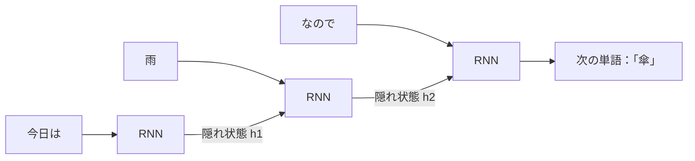

*図11-4　RNN を時間方向に展開した図。前の時刻の隠れ状態を次の時刻に渡す。*

### 勾配消失と LSTM

単純な RNN では、長い系列をさかのぼって学習するときに、勾配が何度も掛け算されて0に近づく（**勾配消失**）か、爆発的に大きくなります。そのため、遠い過去の情報を覚えておくことが苦手です。

1997年に提案された **[LSTM](/tech/architecture/glossary#lstm)（Long Short-Term Memory）** は、情報を長く保つための **セル状態** と、何を忘れ、何を書き込み、何を出力するかを決める3つの **ゲート** を持ちます。セル状態は足し算で更新されるため、勾配が遠くまで届きやすくなります。ゲートを2つに簡略化した **GRU** もよく使われます。

### Seq2Seq と Attention の誕生

2014年には、入力の系列を読む **エンコーダ** と、出力の系列を作る **デコーダ** を RNN でつないだ **Seq2Seq** が機械翻訳で成果を上げました。しかし、長い文全体を1つの隠れ状態に押し込むと、情報が失われます。

そこで、デコーダが出力の各単語を作るときに、**入力のどの単語に注目すべきかを毎回計算する** 仕組みとして **Attention** が加えられました（2014〜2015年）。これが、次の Transformer につながります。

### 利点と欠点

- **利点**：任意の長さの系列を扱える。推論時は1ステップごとの計算とメモリが一定で、ストリーミング処理に向く
- **欠点**：**前の時刻の計算が終わらないと次に進めない** ため、学習時に GPU で並列化しにくい。長い依存関係が苦手
- **向いている用途**：小さな時系列予測、センサーデータの異常検知、組み込み機器での音声処理など。なお、RNN のように状態を持ちつつ並列に学習できる **状態空間モデル（SSM）** の研究も進んでいる。RNN の考え方を **連続時間** に広げたのが、次の Liquid Neural Networks である

## 11.5 Liquid Neural Networks（液体ニューラルネットワーク）

### なぜ必要か

ロボットやドローン、自動運転のように、**現実の世界で連続的に変化する信号を、限られた計算資源で処理する** 用途があります。こうした用途には、次のような要求があります。

- センサーの値が **不規則な間隔** で届いても扱いたい
- 機器に載せるため、**モデルを小さく** したい
- 学習時と少し違う環境（天候、照明、季節）でも、**頑健に動いて** ほしい
- 安全のために、**何を見て判断しているかを人間が理解できる** ほうがよい

数百万〜数十億のパラメータを持つ大きなモデルは、この要求に合いにくい場合があります。

### 仕組み

**[Liquid Neural Networks](/tech/architecture/glossary#liquid-neural-network)** は、MIT の Ramin Hasani、Mathias Lechner らが提案した、**連続時間** で動く RNN の一種です。線虫 *C. elegans*（神経細胞が302個しかない生物）の神経回路から着想を得ています。中心となるモデルは **Liquid Time-constant Network（LTC）**（2021年）です。

通常の RNN は、「1ステップごとに隠れ状態を更新する」という **離散的な時間** で動きます。LTC は、隠れ状態 $x(t)$ の **時間変化の速さ** を微分方程式で表します。

$$
\frac{dx(t)}{dt} = -\left[\frac{1}{\tau} + f(x(t), I(t), \theta)\right] x(t) + f(x(t), I(t), \theta)\, A
$$

$I(t)$ は入力、$f$ はニューラルネットワーク、$\tau$ は時定数（状態がどれくらいの速さで変化するか）、$A$ はパラメータです。重要なのは、括弧の中の **実効的な時定数が、入力 $I(t)$ に応じて変わる** ことです。入力が急に変わる場面では素早く反応し、落ち着いている場面ではゆっくり変化する、というように、**ニューロンの振る舞いが入力に合わせて「液体のように」変わる** ことが名前の由来です。

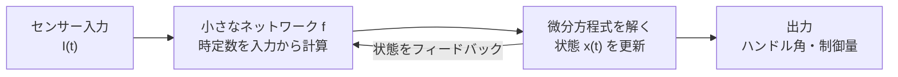

*図11-5　Liquid Time-constant Network の構造。状態の変化の速さそのものが、入力によって変わる。*

### 発展：NCP と CfC

| 手法（年） | 内容 |
|---|---|
| **Neural Circuit Policies（NCP）**（2020） | 線虫の神経回路を参考に、感覚・中間・指令・運動の4層を疎につないだ構造。わずか **19個** のニューロンで、自動運転車の車線維持を学習できることを示した |
| **LTC**（2021） | 入力に応じて時定数が変わる、連続時間のニューロンモデル |
| **CfC（Closed-form Continuous-time）**（2022） | LTC の微分方程式を近似的に **閉じた式** で表し、数値的に解く手間をなくした。LTC より大幅に速く学習・推論できる |

### 利点と欠点

- **利点**
  - **小さい**：数十〜数百のニューロンで、制御などのタスクをこなせることがある。機器に組み込みやすい
  - **不規則な時系列に強い**：連続時間のモデルなので、データの間隔がばらばらでも、経過時間をそのまま扱える
  - **分布の変化に頑健**：ドローンの実験では、学習時と異なる環境（季節や背景）でも目標を追跡できたと報告されている
  - **解釈しやすい**：ニューロンが少なく、つながりが疎なため、どのニューロンが何に反応しているかを調べやすい
- **欠点**
  - LTC は、微分方程式を数値的に解くため、**学習と推論が遅い**（CfC で大きく改善された）
  - 基本的には RNN なので、**学習時の並列化** は Transformer ほど容易ではない
  - 大規模な言語や画像のタスクでの実績や、ライブラリ・事前学習済みモデルなどのエコシステムは、CNN や Transformer に比べてまだ小さい
- **向いている用途**：ロボットやドローンの制御、自動運転の一部、医療やセンサーの不規則な時系列、計算資源が限られた機器での推論

> [!POINT]
> Liquid Neural Networks は、「モデルを大きくして性能を上げる」Transformer の方向とは逆に、**少数のニューロンに、時間の振る舞いという強い前提を埋め込む** ことで、小ささ・頑健さ・解釈しやすさを得ようとするアーキテクチャです。11.2 節で見た帰納バイアスのトレードオフの、もう1つの例といえます。なお、提案者らが設立した Liquid AI 社はこの考え方を発展させたモデルを公開していますが、その構成は製品ごとに異なるため、公式の資料で確認してください。

## 11.6 Transformer

### なぜ必要か

RNN は系列を1つずつ順番に処理するため、学習を並列化できず、大量のデータと GPU を活かしきれませんでした。2017年の論文「Attention Is All You Need」は、RNN を使わず、**Attention だけで系列を処理する** **[Transformer](/tech/architecture/glossary#transformer)** を提案しました。

### Self-Attention の仕組み

**[Self-Attention](/tech/architecture/glossary#attention)** では、系列の各要素（[トークン](/tech/architecture/glossary#token)）から3つのベクトルを作ります。

- **Query（Q）**：自分が探している情報
- **Key（K）**：自分が持っている情報の見出し
- **Value（V）**：実際に渡す情報の中身

各トークンの Query と、すべてのトークンの Key の内積で「関係の強さ」を計算し、その重みで Value を足し合わせます。

$$
\mathrm{Attention}(Q, K, V) = \mathrm{softmax}\left(\frac{QK^\top}{\sqrt{d_k}}\right)V
$$

例えば「その **マグカップ** は青い。**それ** は手作りだ」という文では、「それ」の Query が「マグカップ」の Key と強く一致し、「マグカップ」の情報が「それ」に取り込まれます。距離が離れていても、**1回の計算で直接つながる** のが特徴です。

この計算は、全トークン分をまとめた **行列の掛け算** で一度に行えます。そのため GPU で並列に計算でき、モデルとデータを大きくするほど性能が伸びる（**スケーリング則**）という性質が、LLM の発展を支えました。

### Transformer ブロックの構造

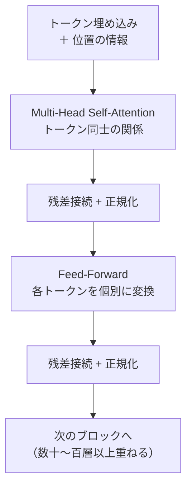

*図11-6　Transformer ブロック。このブロックを何層も重ねる。*

- **Multi-Head Attention**：Attention を複数並列に行い、「文法的な関係」「意味的な関係」など異なる種類の関係を同時に捉える
- **位置の情報**：Attention 自体は順番を区別しないため、各トークンに位置を表す情報を加える（位置エンコーディング。最近の LLM では RoPE などの方式が多い）
- **残差接続と正規化**：ResNet と同じ考え方で、深い層を安定して学習させる

### 3つの型

| 型 | 構造 | 代表例 | 得意なこと |
|---|---|---|---|
| Encoder 型 | 入力全体を双方向に見る | BERT | 分類、検索のための埋め込み |
| Encoder-Decoder 型 | 入力を読み、出力を生成する | 元の Transformer、T5 | 翻訳、要約 |
| **Decoder 型** | 前のトークンだけを見て、次のトークンを予測する | GPT 系、多くの LLM | 文章・コードの生成 |

現在の [LLM](/tech/architecture/glossary#llm) の多くは Decoder 型です。次のトークンを1つずつ生成するため、推論では過去の Key と Value を保存して使い回す **[KV キャッシュ](/tech/architecture/glossary#kv-cache)** が重要になります（第10章）。

### 画像や音声への広がり

Transformer は文章だけのものではありません。画像を小さなパッチに分けてトークンとして扱う **Vision Transformer（ViT）**、音声、さらには画像と文章を一緒に扱う **マルチモーダルモデル** にも使われています。

### 利点と欠点

- **利点**：遠く離れた要素の関係を直接捉えられる。学習を大規模に並列化できる。データとモデルを大きくするほど性能が伸びやすい
- **欠点**：Self-Attention の計算量とメモリが **系列の長さの2乗** に比例する。帰納バイアスが弱く、少ないデータでは CNN に劣ることがある。学習・推論のコストが大きい
- **工夫**：FlashAttention（第10章）、計算の一部の専門家だけを動かす **Mixture of Experts（MoE）**、長い系列向けの Attention の近似など

## 11.7 モデルアーキテクチャの比較と選び方

| | CNN | RNN / LSTM | Liquid NN（LTC・CfC） | Transformer |
|---|---|---|---|---|
| 前提（帰納バイアス） | 近くのもの同士が関係する | 順番に並んでいる | 状態は連続的に変化し、その速さは入力で変わる | 関係はデータから学ぶ |
| 得意なデータ | 画像、格子状のデータ | 短〜中程度の時系列 | 不規則な間隔の時系列、制御の信号 | 文章、長い系列、マルチモーダル |
| 学習の並列化 | しやすい | しにくい（逐次的） | しにくい（逐次的） | しやすい |
| 長距離の関係 | 層を深くすれば捉えられる | 苦手 | 苦手 | 得意 |
| 必要なデータ量 | 少なめでもよい | 少なめでもよい | 少なめでもよい | 多い（事前学習済みモデルを使うのが普通） |
| モデルの大きさ | 小〜中 | 小〜中 | **非常に小さくできる** | 大きい |
| 推論のコスト | 小さい | 小さい | 小さい（LTC は微分方程式を解く分だけ重い） | 大きい（長さの2乗） |

ほかにも、データの形に合わせたアーキテクチャがあります。

- **表形式のデータ**（売上、会員情報など）：ニューラルネットワークより、**勾配ブースティング決定木**（XGBoost、LightGBM など）が高い性能を出すことが多い
- **グラフ構造のデータ**（SNS のつながり、分子、知識グラフ）：**グラフニューラルネットワーク（GNN）**
- **画像の生成**：ノイズを少しずつ取り除いて画像を作る **拡散モデル**

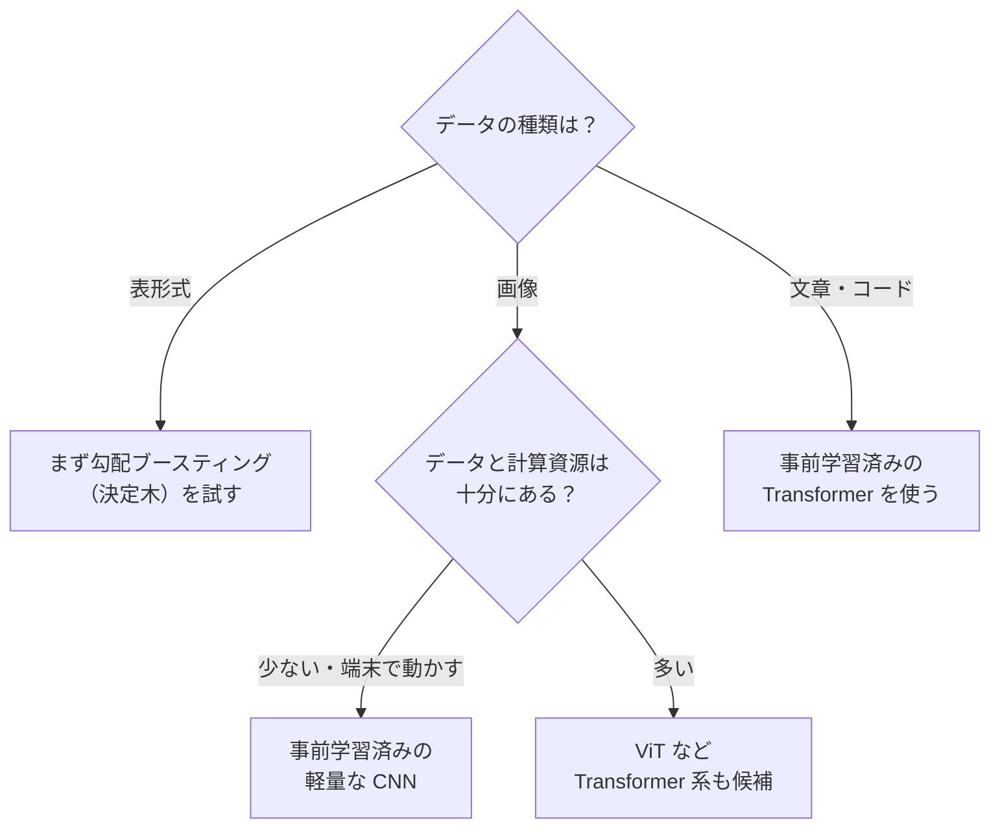

*図11-7　モデルの選び方の目安（簡略化したもの）。*

> [!POINT]
> 実務では、**モデルを一から作ることはまれ** です。多くの場合、大量のデータで学習済みの **事前学習済みモデル** を選び、自分のデータで少しだけ追加学習（**ファインチューニング**）します。「どのアーキテクチャを作るか」より、「どの学習済みモデルを、どのデータで、どう調整するか」を考えることが多くなります。

## 11.8 機械学習システムの全体像（MLOps）

ここからは、モデルを動かすシステムの構造を見ていきます。

### 機械学習のライフサイクル

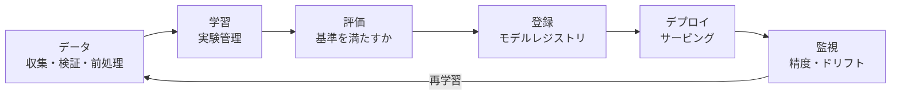

*図11-8　機械学習のライフサイクル。一度作って終わりではなく、輪のように回り続ける。*

**[MLOps](/tech/architecture/glossary#mlops)** は、この輪を、DevOps（第9章）の考え方で自動化し、安定して回すための考え方と仕組みです。DevOps との違いは、**コードに加えて、データとモデルもバージョン管理し、テストし、デプロイの対象にする** 点です。

### 成熟度の段階

Google は MLOps の成熟度を、おおむね次の3段階で説明しています。

| レベル | 状態 | 典型的な問題 |
|---|---|---|
| 0：手作業 | データサイエンティストがノートブックで学習し、モデルのファイルを手で渡す | 再現できない、更新がまれ、本番での性能が分からない |
| 1：パイプラインの自動化 | データ準備から学習・評価・登録までをパイプラインとして自動化し、定期的または変化を検知して再学習する（継続的学習） | パイプライン自体の変更は手作業 |
| 2：CI/CD の自動化 | パイプラインのコードもテスト・ビルド・デプロイを自動化する | 仕組みが大きく、運用のコストがかかる |

最初からレベル2を目指す必要はありません。**モデルの更新頻度と、間違えたときの影響** に見合った段階を選びます。

### 構成要素

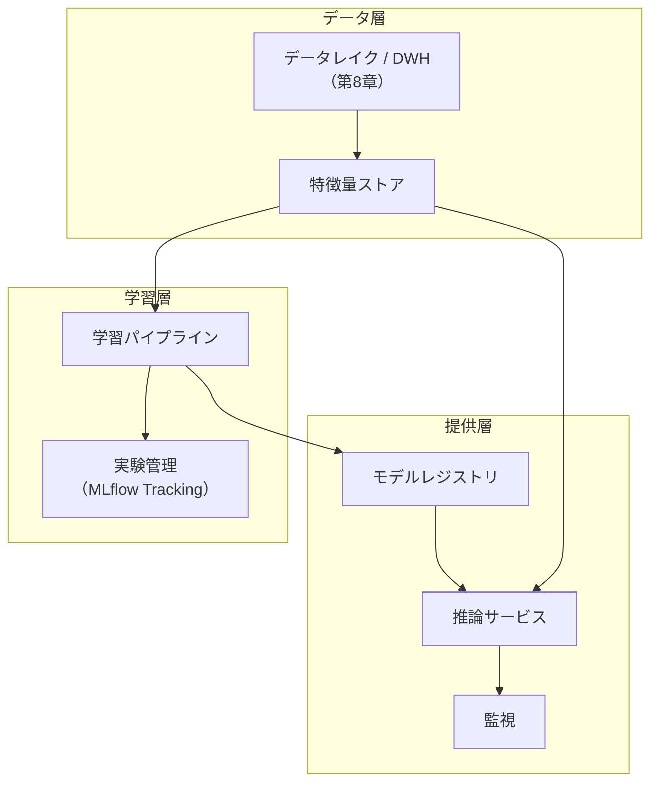

*図11-9　機械学習システムの主な構成要素。*

## 11.9 データ処理パイプライン

機械学習の品質は、モデルよりもデータで決まることがほとんどです。「ゴミを入れればゴミが出る（Garbage In, Garbage Out）」という言葉の通りです。

### パイプラインの流れ

1. **収集**：業務データベース、ログ、外部データなどから集める。第8章の ETL・ELT・CDC の仕組みをそのまま使う
2. **検証**：列の型、値の範囲、欠損の割合、件数などが想定どおりかを自動で確かめる。想定外なら、学習を止める
3. **ラベル付け**：正解（ラベル）を付ける。人手で付ける場合は、作業の基準を文書にし、複数人の判断の一致度を確かめる
4. **前処理と特徴量の作成**：欠損の補完、数値の正規化、カテゴリの数値化、文章のトークン化、画像のサイズ調整など。モデルの入力として使う値を **特徴量** という
5. **分割**：学習用・検証用・テスト用に分ける

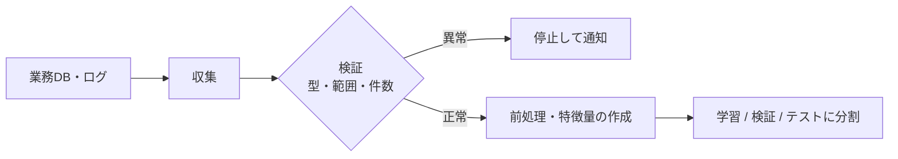

*図11-10　データ処理パイプライン。検証で問題があれば、学習に進まない。*

### データリーケージ

**[データリーケージ](/tech/architecture/glossary#data-leakage)（情報の漏れ）** は、予測するときには手に入らないはずの情報が、学習データに混ざってしまうことです。評価では素晴らしい成績が出るのに、本番では全く当たらない、という失敗の典型的な原因です。

- **時間の漏れ**：「来月の購入」を予測するのに、来月のデータから作った特徴量を使ってしまう。時系列のデータは、**ランダムではなく時間で分割** する
- **重複の漏れ**：同じ利用者や同じ商品のデータが、学習用とテスト用の両方に入る
- **前処理の漏れ**：平均や標準偏差を、テスト用のデータも含めた全体から計算してしまう。前処理のパラメータは学習用データだけから求める

### 特徴量ストアと学習・推論のずれ

学習時はバッチ処理（Python と SQL）で特徴量を作り、推論時は API サーバー（別の言語）で作り直す、という構成はよくあります。このとき、計算の細かな違いで **学習時と推論時の特徴量が食い違う**（**Training-Serving Skew**）と、モデルの性能が静かに落ちます。

**[特徴量ストア](/tech/architecture/glossary#feature-store)（Feature Store）** は、特徴量の定義を一か所にまとめ、学習用には過去の値を、推論用には最新の値を低遅延で提供する仕組みです。

- **オフラインストア**：学習用。過去のある時点の値を正しく取り出せる（その時点で分かっていなかった値を使わない）
- **オンラインストア**：推論用。Key-Value ストア（第8章）などで、ミリ秒単位で最新の値を返す

小さなシステムでは、特徴量の計算処理を1つのライブラリにまとめ、学習と推論の両方から呼ぶだけでも、ずれの多くは防げます。

### データのバージョン管理

モデルを再現するには、どのデータで学習したかを特定できなければなりません。データのスナップショットにバージョンを付ける（Lakehouse のテーブル形式のタイムトラベル機能、DVC などのツール）、またはデータの場所とハッシュ値を実験の記録に残します。

## 11.10 学習パイプラインと実験管理（MLflow）

### なぜ実験管理が必要か

機械学習の開発は、データ、特徴量、モデルの種類、ハイパーパラメータを変えながら何十回、何百回と学習を試す **実験** の繰り返しです。記録がなければ、すぐに「一番良かったモデルは、どの設定で、どのデータで作ったのか」が分からなくなります。

### MLflow の構成

**[MLflow](/tech/architecture/glossary#mlflow)** は、機械学習のライフサイクルを管理するオープンソースのプラットフォームです。主な構成要素は次のとおりです。

| 構成要素 | 役割 |
|---|---|
| **Tracking** | 実験ごとに、パラメータ・評価指標・成果物（モデル、グラフなど）・コードのバージョンを記録し、比較する |
| **Models** | モデルを、フレームワーク（scikit-learn、PyTorch など）に依存しない共通の形式で保存する。入出力の形式（シグネチャ）や依存ライブラリも一緒に記録する |
| **Model Registry** | モデルにバージョンを付けて一元管理し、「本番で使うのはどれか」を管理する |
| **Evaluation** | 評価データに対して、分類・回帰などの標準的な評価指標をまとめて計算し、記録する |
| **Serving** | 保存したモデルを、REST API として起動する |

近年の MLflow は、LLM アプリケーションや AI Agent の記録（トレース）と評価の機能も強化しています。

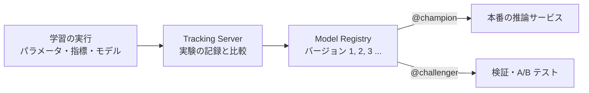

*図11-11　MLflow による実験管理とモデルの登録。本番のサービスは、バージョン番号ではなくエイリアスでモデルを参照する。*

### 実験の記録の例

```python
import mlflow
from mlflow.models import infer_signature
from sklearn.ensemble import RandomForestClassifier

mlflow.set_experiment("kawasemi-repeat-purchase")

with mlflow.start_run():
    params = {"n_estimators": 200, "max_depth": 8}
    model = RandomForestClassifier(**params).fit(X_train, y_train)

    mlflow.log_params(params)
    mlflow.log_param("train_data_version", "orders_2026-10-31")
    mlflow.log_metric("val_f1", f1_score(y_val, model.predict(X_val)))

    mlflow.sklearn.log_model(
        model,
        name="model",
        signature=infer_signature(X_train, model.predict(X_train)),
        registered_model_name="repeat-purchase",  # レジストリにも登録する
    )
```

### モデルレジストリとエイリアス

**[モデルレジストリ](/tech/architecture/glossary#model-registry)** は、モデルのバージョンを管理する場所です。MLflow では、`champion`（本番で使うもの）や `challenger`（比較中のもの）のような **エイリアス** をバージョンに付け、推論サービスは `models:/repeat-purchase@champion` のようにエイリアスでモデルを参照します。

こうすると、新しいモデルへの切り替えは **エイリアスの付け替えだけ** で済み、推論サービスのコードを変える必要がありません。問題があれば、エイリアスを前のバージョンに戻すだけで **ロールバック** できます。これは第6章で見た「依存の向きを抽象に向ける」考え方と同じです。

> [!POINT]
> 以前の MLflow では、Staging・Production といった固定の「ステージ」でモデルを管理していましたが、現在はエイリアスとタグによる管理が推奨されています。古い記事を参考にするときは注意してください。

### 再現性のために記録するもの

| 対象 | 記録する内容 |
|---|---|
| コード | Git のコミット ID |
| データ | データのバージョン、場所、ハッシュ値 |
| 設定 | ハイパーパラメータ、前処理の設定 |
| 環境 | ライブラリのバージョン、コンテナイメージ、GPU の種類 |
| 乱数 | 乱数のシード（GPU の計算では、完全な再現が難しい場合もある） |

### ハイパーパラメータの探索

学習率や木の深さなどの最適な値は、試してみないと分かりません。グリッドサーチ、ランダムサーチ、過去の結果から有望な値を推測するベイズ最適化（Optuna などのツール）を使い、各試行を実験として記録します。探索では、**必ず検証用データで比べ、テスト用データは最後の1回にだけ使います**。テスト用データで何度も選ぶと、テスト用データに過学習してしまいます。

## 11.11 モデルの評価

### 目的に合った評価指標を選ぶ

| タスク | 主な指標 | 注意点 |
|---|---|---|
| 分類 | 正解率、**適合率**（陽性と予測したうち本当に陽性の割合）、**再現率**（本当の陽性のうち見つけられた割合）、F1、ROC-AUC | 不均衡なデータ（不正が全体の0.1%など）では、正解率は役に立たない。全部「正常」と答えても99.9%になる |
| 回帰（数値の予測） | MAE、RMSE、MAPE | RMSE は大きな外れを重く罰する |
| ランキング・推薦 | 適合率@K、再現率@K、NDCG | 上位に何を出せたかを測る |
| 生成（LLM） | 人手の評価、LLM による評価、タスクの成功率 | 第12章の eval を参照 |

適合率と再現率は、たいていトレードオフの関係にあります。不正検知で見逃しを減らしたい（再現率を上げたい）なら、誤検知が増えることを受け入れる必要があります。**どちらの間違いが、業務上どれだけ困るか** から、指標と判定のしきい値を決めます。

### 評価の自動化と合格基準

評価は、学習のたびに同じ手順で自動的に行い、**あらかじめ決めた合格基準を満たさないモデルは登録・デプロイしない** ようにします。MLflow の評価機能を使うと、標準的な指標の計算と、しきい値による判定をパイプラインに組み込めます。

```python
from mlflow.models import MetricThreshold

result = mlflow.models.evaluate(
    model_uri, eval_data, targets="label", model_type="classifier"
)

# 基準を満たさなければ例外になり、パイプラインが止まる
mlflow.validate_evaluation_results(
    candidate_result=result,
    validation_thresholds={
        "f1_score": MetricThreshold(threshold=0.70, greater_is_better=True),
    },
)
```

全体の平均だけでなく、**グループごと（地域、年齢層、新規の利用者など）の性能** も確かめます。平均は良くても、特定のグループで大きく性能が落ちていることがあり、公平性の問題にもつながります。

### オフライン評価とオンライン評価

| | オフライン評価 | オンライン評価 |
|---|---|---|
| 方法 | 過去のデータで予測の精度を測る | 本番で実際の利用者に使ってもらい、行動を測る |
| 測るもの | 正解率、NDCG などのモデルの指標 | 売上、クリック率、継続率などの **事業の指標** |
| 手段 | テスト用データ、交差検証 | **A/B テスト**、シャドーデプロイ |
| 弱点 | 過去のデータと本番の状況が異なる | 時間がかかり、悪いモデルは利用者に影響する |

オフラインで良いモデルが、オンラインでも良いとは限りません。例えば、推薦モデルは「過去に表示されたもの」から学ぶため、過去のデータでの精度が、新しい推薦での効果と一致しないことがあります。**最終的な判断は、事業の指標で行います**。

## 11.12 デプロイとサービング

### 推論の4つの形

| 形 | 仕組み | 遅延 | 例 |
|---|---|---|---|
| **バッチ推論** | 定期的にまとめて予測し、結果をデータベースに保存する | 数時間〜1日（事前に計算） | 毎晩、全会員のおすすめ商品を計算する |
| **オンライン推論** | リクエストごとに API で予測する | ミリ秒〜秒 | 決済のたびに不正かどうか判定する |
| **ストリーミング推論** | イベントの流れ（第7章）を読みながら予測する | 秒 | 閲覧の行動から、その場で興味を推定する |
| **エッジ推論** | スマートフォンや機器の中で予測する | 通信なし | カメラアプリでの画像認識 |

**バッチ推論で済むなら、バッチ推論を選びます。** 事前に計算した結果を読むだけなので、仕組みが単純で、障害にも強くなります。オンライン推論が必要なのは、「リクエストの瞬間にしか分からない情報」を使う場合だけです。

### 推論サービスの構成

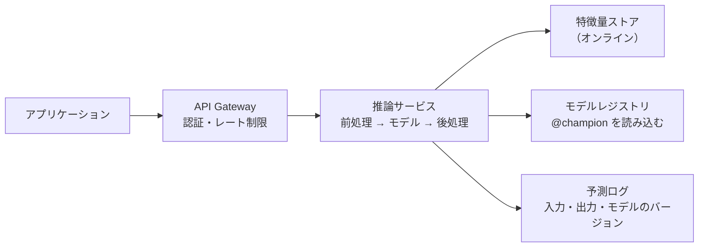

*図11-12　オンライン推論サービスの構成。*

- **モデルのパッケージ化**：モデルと依存ライブラリをコンテナイメージにまとめる。MLflow では `mlflow models serve` で REST API として起動したり、コンテナイメージを作ったりできる
- **形式の変換**：学習に使ったフレームワークに依存しない **ONNX** などの形式に変換し、推論に特化したエンジンで高速に動かすこともある
- **推論サーバー**：大規模な用途では、複数のモデル、GPU、動的なバッチ処理に対応した専用の推論サーバーを使う。LLM の推論サーバーは第10章で見た
- **予測ログ**：すべての予測について、入力・出力・**モデルのバージョン** を記録する。監視、障害の調査、次の学習データの作成に使う

### 安全に切り替える

新しいモデルは、第9章のデプロイ戦略と同じ考え方で、少しずつ本番に出します。

1. **シャドーデプロイ**：新しいモデルにも本番と同じリクエストを流すが、結果は利用者に返さず、記録して比べるだけにする
2. **カナリアリリース**：一部（例：5%）の利用者だけに新しいモデルを使い、問題がなければ割合を増やす
3. **A/B テスト**：利用者を無作為に分け、事業の指標の差を統計的に確かめる
4. **ロールバック**：問題があれば、レジストリのエイリアスを前のバージョンに戻す

## 11.13 監視と継続的学習

### 機械学習システムは静かに壊れる

通常のソフトウェアは、壊れればエラーになります。機械学習のモデルは、**入力の傾向が変わっても、何事もなかったかのように予測を返し続けます**。そのため、通常の監視（第9章の可観測性）に加えて、機械学習に特有の監視が必要です。

| 監視の対象 | 内容 |
|---|---|
| システム | 遅延、エラー率、スループット、GPU の使用率 |
| データの品質 | 欠損、型の違反、値の範囲外の割合 |
| **[データドリフト](/tech/architecture/glossary#data-drift)** | 入力の分布が、学習時と比べて変わっていないか |
| **コンセプトドリフト** | 入力と正解の関係そのものが変わっていないか（例：流行が変わり、同じ閲覧履歴でも買うものが変わる） |
| 予測の分布 | 予測の結果の偏りが急に変わっていないか |
| 性能と事業の指標 | 正解が後から分かったときの精度、売上やクリック率 |

正解がすぐに分からない場合（「この会員は3か月以内に退会するか」など）も多いため、**入力と予測の分布の変化** を、性能低下の早期の手がかりとして監視します。

### 再学習の仕組み

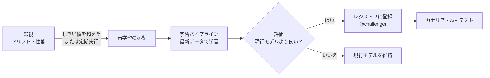

*図11-13　継続的学習。再学習したモデルも、評価と段階的なリリースを経て本番に出す。*

再学習は、**定期的に**（毎週など）、**ドリフトを検知したとき**、**新しいデータが一定量たまったとき** などに起動します。どの場合も、自動で本番を置き換えるのではなく、評価の基準と段階的なリリースを通します。

### フィードバックループに注意する

推薦システムでは、モデルが推薦した商品ばかりが表示され、購入され、それが次の学習データになります。この **フィードバックループ** によって、人気の商品ばかりが推薦され、新しい商品が埋もれていくことがあります。一部の枠で無作為な商品を表示するなど、**モデルが選ばなかったもののデータも集める** 工夫が必要です。

## 11.14 Kawasemi Shop の商品推薦システム

Kawasemi Shop では、利用者が増えたことで「この商品を見た人はこんな商品も買っています」という推薦を導入することにしました。

### 設計の判断

| 判断 | 選択 | 理由 |
|---|---|---|
| 推論の形 | **バッチ推論**（毎晩）＋ 軽いオンラインの並べ替え | 商品数は数千点で、夜間にすべての組み合わせを計算できる。仕組みが単純で、推薦が止まっても注文は止まらない |
| モデル | 購入履歴の協調フィルタリング ＋ 勾配ブースティングによる並べ替え | 表形式のデータが中心で、データ量も少ない。大きなニューラルネットワークは不要 |
| 画像 | 事前学習済みの CNN で商品画像の埋め込みを作る | 新しい商品（購入履歴がない）でも、見た目の似た商品を推薦できる |
| 実験管理 | MLflow Tracking と Model Registry | 1人でも、どのモデルを本番で使っているかを確実に管理できる |
| 評価 | オフラインは NDCG@10、オンラインは推薦枠からの購入率で A/B テスト | 最終的には売上への効果で判断する |

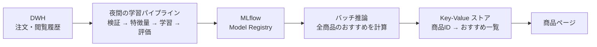

*図11-14　Kawasemi Shop の商品推薦システム。Web アプリは、事前に計算された結果を読むだけで、モデルには直接依存しない。*

この構成では、推薦のモデルを何度作り直しても、Web アプリのコードには影響しません。モデルと Web アプリの間の **境界** は、「商品 ID からおすすめの一覧を返す Key-Value ストア」という単純な形です。第6章で学んだ、**境界をはっきりさせることで、変化の速さが異なる部分を独立させる** という原則が、ここでも当てはまります。

将来、閲覧中の行動に応じてリアルタイムに推薦を変えたくなったら、そのときにオンライン推論と特徴量ストアを追加します。**最初から最も複雑な構成にする必要はありません**。

## まとめ

- 機械学習には「モデルのアーキテクチャ」と「機械学習システムのアーキテクチャ」の2つがある。
- モデルのアーキテクチャは、データについての前提（帰納バイアス）を構造として埋め込むことである。CNN は「近くのもの同士の関係」、RNN は「順番」、Transformer は「関係そのものを学ぶ」という前提を持つ。
- Liquid Neural Networks は、入力に応じて時定数が変わる連続時間のニューロンにより、少数のニューロンで頑健に制御や不規則な時系列を扱う。小ささ・解釈しやすさと引き換えに、大規模化や並列化は得意ではない。
- Transformer は、Self-Attention によって遠い要素同士を直接つなぎ、並列に学習できるため、大規模化によって LLM の基盤になった。代わりに、計算量が系列の長さの2乗に比例する。
- 機械学習システムでは、データがコードの一部になる。データの検証、リーケージの防止、学習と推論の特徴量のずれの防止が品質を左右する。
- MLflow のような仕組みで、実験（パラメータ・指標・データ・コード）を記録し、モデルをレジストリでバージョン管理する。本番はエイリアスでモデルを参照し、切り替えとロールバックを簡単にする。
- 評価は、業務上の間違いのコストに合わせて指標を選び、合格基準をパイプラインに組み込む。最終判断は、オンラインでの事業の指標で行う。
- デプロイはバッチ推論で済むならバッチ推論を選び、新しいモデルはシャドー・カナリア・A/B テストで段階的に出す。
- 機械学習システムは静かに壊れる。ドリフトを監視し、評価と段階的なリリースを通した再学習の仕組みを作る。

## 理解度チェック

1. 「モデルのアーキテクチャは、データについての前提を構造に埋め込むことである」とはどういう意味ですか。CNN を例に説明してください。
2. RNN と比べて、Transformer が大規模な学習に向いているのはなぜですか。逆に、Transformer の弱点は何ですか。
3. Liquid Neural Networks の「Liquid（液体）」とは、何が変化することを指していますか。どのような用途に向いていますか。
4. 時系列のデータで、学習用とテスト用をランダムに分割すると、どのような問題が起きますか。
5. 推論サービスが、モデルのバージョン番号ではなく、レジストリのエイリアス（`@champion` など）でモデルを参照する利点を説明してください。
6. あるサービスで、オンライン推論とバッチ推論のどちらを選ぶべきかを判断するとき、何を基準にしますか。
7. コードを何も変えていないのに、機械学習モデルの性能が落ちることがあるのはなぜですか。それに気づくためには、何を監視すればよいですか。
