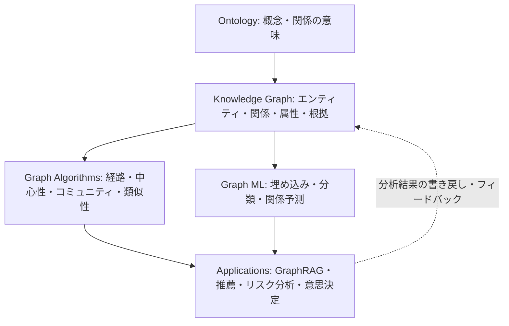

## 1.1 なぜ両者を組み合わせるのか

**知識グラフ（Knowledge Graph：KG）は「何が、どのような意味で関係しているか」を表現する。グラフアルゴリズム（Graph Algorithms）は「その関係から、どのような構造・重要性・パターン・新しい関係を発見できるか」を計算する技術である。**

検索だけであれば、既知の事実をたどって終わることが多い。一方、計算を加えると、重要な技術、組織の橋渡しとなる人物、共通する依存関係、まだ登録されていない関係の候補まで発見できる。

| 技術 | 主な役割 | 例 |
|---|---|---|
| オントロジー | 概念と関係の意味を定義する | 「社員はスキルを持つ」 |
| 知識グラフ | 具体的な事実と関係を記録する | 「田中さんはPythonを使える」 |
| グラフアルゴリズム | 関係構造を分析する | 「組織内で重要なスキルは何か」 |
| グラフ機械学習 | 未知の関係や特徴を予測する | 「習得しやすいスキルは何か」 |
| LLM・AIエージェント | 自然言語から知識と分析を利用する | 「案件に適した人材を推薦して」 |

## 1.2 全体像



**分析の結果と元の事実は区別して管理する。** 予測された関係が真実として確定したわけではない。アルゴリズム名、スコア、計算日時、入力データ、検証状態を付与して追跡可能にすることが望ましい。

## 1.3 6つの分野と17アルゴリズム

| 分野 | 代表的なアルゴリズム | 知識グラフでの用途 |
|---|---|---|
| 経路探索 | BFS、Dijkstra、A* | 依存関係、影響経路、複数ホップ探索 |
| 中心性分析 | Degree、PageRank、Betweenness | 重要人物・技術、ボトルネック特定 |
| コミュニティ検出 | Louvain、Leiden、Label Propagation | 関連する知識や組織のグループ発見 |
| 類似性分析 | Jaccard、Common Neighbors、SimRank | 類似人材・製品、関連技術の発見 |
| リンク予測 | Adamic-Adar、Preferential Attachment | 未登録の関係や接続候補の発見 |
| グラフ表現学習 | Node2Vec、GraphSAGE、R-GCN | ノード分類、関係予測、推薦システム |

Neo4j Graph Data Science（GDS）やAmazon Neptune Analyticsなどの分析サービスも、これらと重なる分野のアルゴリズムを提供する。サービスごとの提供内容はバージョン・エディション・成熟度によって変わる。

## 1.4 一般的なグラフと知識グラフの違い

一般的なグラフアルゴリズムは、ノードとエッジの接続構造を中心に扱う。しかし知識グラフでは、エッジの種類・向き・意味が重要である。

たとえば「AがBを管理する」と「AがBに依存している」を同一のエッジとみなすと、中心性の解釈も影響範囲の計算も変わる。**何の関係を含むグラフに、何を求めるためにアルゴリズムを実行するのか**を先に設計しなければならない。

グラフ上に経路があっても、それが論理的に成立する事実を表すとは限らない。たとえば、

```text
A --MANAGES--> B --DEPENDS_ON--> C
```

という経路から、`A --MANAGES--> C` が成立するとは限らない。検索・構造分析・論理推論・統計的予測の違いは、[第9章](/tech/knowledge-graph-algorithms/09-ontology-reasoning)で詳しく扱う。

## 1.5 各分野の関係

- **経路探索**は、どこに到達でき、どの経路が最小コストなのかを計算する。
- **中心性分析**は、どのノードが構造上重要なのかを測る。
- **コミュニティ検出**は、どのノード群が内部で密につながるかを求める。
- **類似性分析**は、関係パターンの近さを測る。
- **リンク予測**は、まだ観測されていない接続の候補を推定する。
- **グラフ表現学習**は、ノード・関係を学習可能なベクトルに写像する。

これらは互いに独立ではない。共通近傍やAdamic-Adarはリンク予測に利用でき、Leidenで得たコミュニティはGraphRAGで利用でき、R-GCNで得た埋め込みは関係予測の入力にもなる。

## 1.6 本書の流れ

[第2章](/tech/knowledge-graph-algorithms/02-mathematical-foundations)ではグラフの数理表現、[第3〜8章](/tech/knowledge-graph-algorithms/03-path-finding)では6分野のアルゴリズム、[第9章](/tech/knowledge-graph-algorithms/09-ontology-reasoning)では意味論、[第10章](/tech/knowledge-graph-algorithms/10-graphrag-ai-agents)ではGraphRAGとエージェント、[第11〜14章](/tech/knowledge-graph-algorithms/11-libraries-platforms)では実装・設計・応用、[第15章](/tech/knowledge-graph-algorithms/15-roadmap-summary)では学習の順序を整理する。
