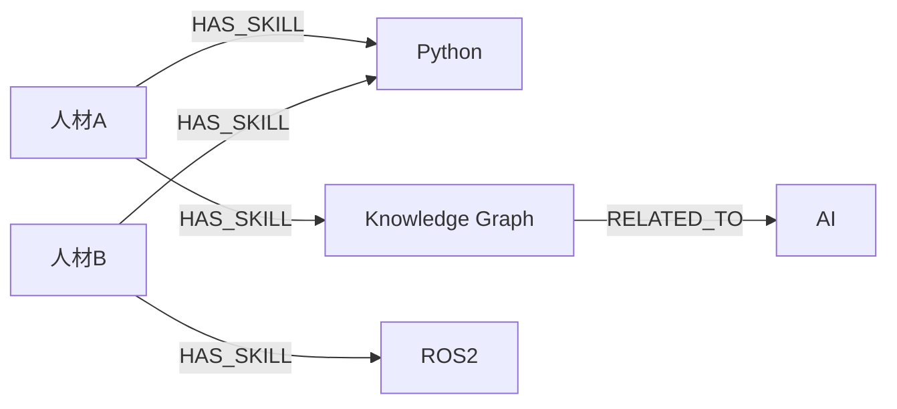
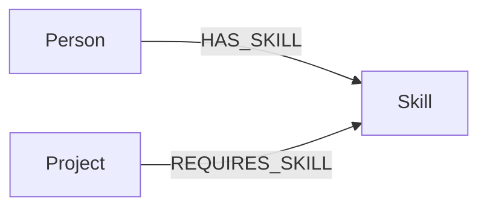
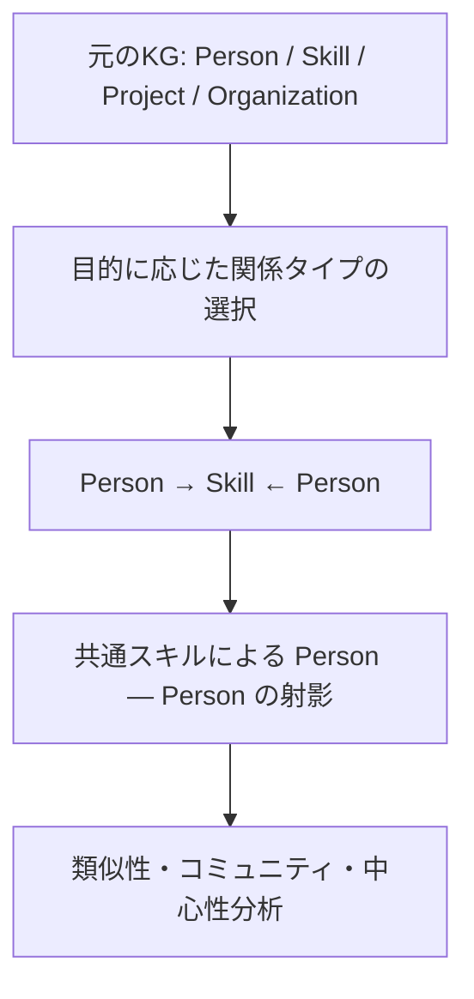

## 2.1 グラフの数学的定義

通常のグラフはノード集合 $V$ とエッジ集合 $E$ で定義される。

$$
\boxed{G=(V,E)}
$$

- $V=\{v_1,v_2,\ldots,v_n\}$：ノード集合
- $E\subseteq V\times V$：エッジ集合（有向グラフの場合）
- $n=|V|$：ノード数
- $m=|E|$：エッジ数

無向グラフでは、エッジは順序を区別しないペアとして扱う。多重グラフでは、同じ2ノード間に複数のエッジが存在する。知識グラフでは有向・多関係のグラフが重要になる。



この図は、人材・スキル・技術領域の関係を表す。エッジに意味を付与することが、KGの特徴である。

## 2.2 隣接行列と隣接リスト

隣接行列 $A\in\{0,1\}^{n\times n}$ を、

$$
A_{ij}=\begin{cases}1&(v_i,v_j)\in E\\0&\text{otherwise}\end{cases}
$$

と定義する。例えば $A\to B\to C$ という有向グラフは、

$$
A=\begin{bmatrix}0&1&0\\0&0&1\\0&0&0\end{bmatrix}
$$

で表せる。行列を2乗すると、

$$
A^2=\begin{bmatrix}0&0&1\\0&0&0\\0&0&0\end{bmatrix}
$$

となる。$(A^2)_{13}=1$ は、ノード1からノード3への長さ2の**ウォーク**が1本あることを示す。

一般に、

$$
\boxed{(A^k)_{ij}=\text{ノード }i\text{ から }j\text{ への長さ }k\text{ のウォーク数}}
$$

である。ウォークは同じノードやエッジの再訪を許す。単純路（simple path）の本数と同一視してはならない。

隣接行列は行列演算と相性がよい。一方、密行列は $O(n^2)$ の記憶領域を使うので、疎グラフでは非効率になりやすい。実装では、隣接リストや疎行列（CSR/CSC）も使う。

## 2.3 重み付きグラフと有向グラフ

重み付きグラフでは各エッジに $w:E\to\mathbb R$ を与える。

$$
G=(V,E,w)
$$

重みは、距離、遅延、コスト、関係の強度などを表せる。ただし「大きいほど良い／悪い」の方向や、重みの尺度を明確にしておくことが必要である。

有向グラフでは、

$$
N^{in}(v)=\{u:(u,v)\in E\},\qquad N^{out}(v)=\{u:(v,u)\in E\}
$$

を区別する。障害分析で `DEPENDS_ON` をたどる場合、依存する側と依存される側を逆に理解すると影響範囲を誤る。

## 2.4 知識グラフの三つ組

知識グラフの基本要素は、

$$
\boxed{(h,r,t)}
$$

である。

- $h$：Head Entity（主語）
- $r$：Relation（述語）
- $t$：Tail Entity（目的語）

```text
(田中, HAS_SKILL, Python)
(Python, USED_IN, AI_Project)
(AI_Project, REQUIRES_SKILL, Machine_Learning)
```

ここで通常の単一隣接行列を拡張し、関係タイプ $r$ ごとに、

$$
A_{ij}^{(r)}=\begin{cases}1&(v_i,r,v_j)\in E\\0&\text{otherwise}\end{cases}
$$

を定義できる。関係タイプ集合を $\mathcal R$ とすると、

$$
\mathcal A=\{A^{(r)}:r\in\mathcal R\}
$$

を考えられる。これは関係タイプ別の隣接行列の集まりであり、異種・多関係のKGを解析する基礎になる。

## 2.5 関係の組合せと行列積

例えば、

$$
A^{(\mathrm{HAS\_SKILL})}A^{(\mathrm{USED\_IN})}
$$

の $(i,j)$ 成分は、人材 $i$ が `HAS_SKILL`、`USED_IN` の順にたどってプロジェクト $j$ に到達する長さ2のウォーク数を表す。意味の違う関係を適切な順番で接続することが重要である。

## 2.6 二部グラフとメタパス（Meta-path）

人物集合 $P$、スキル集合 $S$、案件集合 $J$ を考える。人物とスキルの接続を $B\in\{0,1\}^{|P|\times|S|}$、案件とスキルの接続を $R\in\{0,1\}^{|J|\times|S|}$ とする。

$$
\boxed{M=BR^\top}
$$

とすると、$M_{ij}$ は人物 $i$ と案件 $j$ に共通するスキルの数である。これは次のメタパスに対応する。



$$
\mathrm{Person}\xrightarrow{HAS\_SKILL}\mathrm{Skill}\xleftarrow{REQUIRES\_SKILL}\mathrm{Project}
$$

関係タイプの組合せを指定した経路は、知識グラフの意味を保つ分析に有用である。

## 2.7 グラフ射影（Graph Projection）

実際のKGには人物、組織、文書、技術、システムが混在する。すべてのノードとエッジを一度にPageRankやLeidenへ渡すと、何を測るのか曖昧になる。



分析用の射影グラフを、

$$
G_P=(V_P,E_P,W_P)
$$

と定義する。$W_P$ は共通スキル数、Jaccard類似度、依存コストなどで定められる。関係の向き・タイプ・重みを固定した上で、結果の意味を説明する。

## 2.8 オントロジーとアルゴリズムの関係

オントロジーは概念と関係の意味を記述する。アルゴリズムは与えられたグラフの構造を計算する。これらは補完的だが同一ではない。例えば `A MANAGES B` と `B DEPENDS_ON C` が存在しても、`A MANAGES C` が論理的に従うとは限らない。この問題は[第9章](/tech/knowledge-graph-algorithms/09-ontology-reasoning)で詳しく説明する。

## 2.9 この章の要点

1. $G=(V,E)$ がグラフ理論の基礎である。
2. 隣接行列のべき乗は、指定された長さのウォーク数と関係する。
3. KGでは $(h,r,t)$ という意味付き関係が基礎となる。
4. 関係タイプ別の隣接行列とメタパスを使うと意味を保つ分析が可能になる。
5. **グラフ射影を設計することは、アルゴリズムを選ぶことと同じくらい重要**である。
