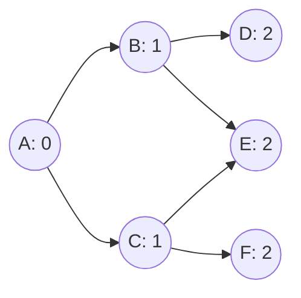
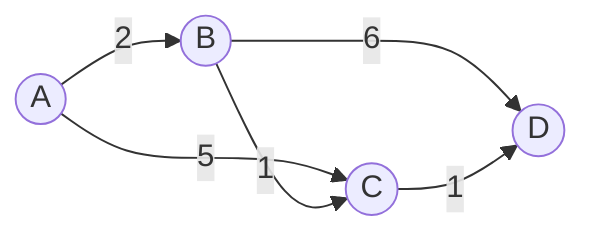
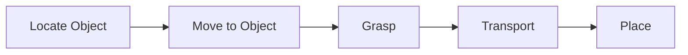

## 3.1 経路探索は何を計算するのか

経路探索（Path Finding）は、2つのノード間の接続、到達可能性、最短経路、最小コスト経路を計算する。知識グラフでは、システムの依存関係、障害の波及、セキュリティ上の到達経路、技術や概念の多段階の関係探索に利用する。

| アルゴリズム | 最小化するもの | 前提 |
|---|---|---|
| BFS | エッジの本数（ホップ数） | 各エッジを等コストとして扱う |
| Dijkstra | 非負エッジ重みの総和 | 重みが非負 |
| A* | エッジ重みの総和 | 非負重み、目標・ヒューリスティックを利用 |

## 3.2 BFS（Breadth-First Search、幅優先探索）

### 3.2.1 数学的定義

始点 $s$ から終点 $v$ までの、ホップ数が最小の経路の距離を、

$$
\boxed{d(s,v)=\min_{P:s\leadsto v}|P|}
$$

と定義する。ここで $|P|$ は経路のエッジ数である。到達不能なら距離は無限大とする。

### 3.2.2 アルゴリズム

BFSはFIFOキューを用いる。

1. 始点 $s$ の距離を0とし、キューに格納する。
2. キューの先頭のノード $u$ を取り出す。
3. $u$ の未訪問の隣接ノード $v$ について、$d(v)=d(u)+1$ としてキュー末尾に追加する。
4. キューが空になるまで繰り返す。



ノードAを始点とすれば、まず深さ0のA、次に深さ1のBとC、その後深さ2のD・E・Fを探索する。同じ深さの訪問順は隣接リストの順序による。

### 3.2.3 計算量

隣接リスト表現なら、各ノードを高々1回訪問し、各エッジを定数回調べるため、

$$
\boxed{T(n,m)=O(n+m)}
$$

となる。キューや訪問済み集合は $O(n)$ 程度の追加空間を使う。

### 3.2.4 NetworkX実装

```python
import networkx as nx

G = nx.DiGraph()
G.add_edges_from([
    ("Service_A", "Service_B"),
    ("Service_B", "Database"),
    ("Service_A", "Service_C"),
    ("Service_C", "Database"),
])

# Service_Aからの最少ホップ数
print(nx.single_source_shortest_path_length(G, "Service_A"))

# 最少ホップ数の経路（複数ある場合はその1本）
print(nx.shortest_path(G, "Service_A", "Database"))

# 幅優先探索で生成した探索木
print(list(nx.bfs_tree(G, "Service_A").edges()))
```

### 3.2.5 知識グラフへの応用

```text
(Service_A, DEPENDS_ON, Service_B)
(Service_B, DEPENDS_ON, Database)
(Service_C, DEPENDS_ON, Database)
```

Databaseが停止した際の潜在的な影響先を調べるには、`DEPENDS_ON` を**逆向き**にBFSでたどる。到達できることと、実際に障害が発生することは同じではない。冗長構成やフェイルオーバーを無視した結果は「影響候補」の集合にとどまる。

## 3.3 Dijkstra（ダイクストラ法）

### 3.3.1 最短重み付き経路

非負エッジ重み $w(e)\ge0$ を持つグラフで、経路の総コストを、

$$
L(P)=\sum_{e\in P}w(e)
$$

と定義すると、

$$
\boxed{d(s,v)=\min_{P:s\leadsto v}\sum_{e\in P}w(e)}
$$

を求めるのがDijkstra法である。



AからDへは、

- $A\to B\to D$：$2+6=8$
- $A\to C\to D$：$5+1=6$
- $A\to B\to C\to D$：$2+1+1=4$

となり、最適経路は $A\to B\to C\to D$、コスト4である。

### 3.3.2 緩和（Relaxation）

重要な操作は、候補距離を更新する緩和である。

$$
\boxed{d(v)\leftarrow\min\{d(v),d(u)+w(u,v)\}}
$$

未確定ノードから暫定距離が最も小さいノードを選び、非負重みであることを利用して順に距離を確定する。

### 3.3.3 計算量と制約

二分ヒープの代表的実装では、

$$
\boxed{O((n+m)\log n)}
$$

である。重みが負の場合、Dijkstra法の正当性は保証されない。必要に応じてBellman–Ford法などを使う。

### 3.3.4 Python実装

```python
import networkx as nx

G = nx.DiGraph()
G.add_weighted_edges_from([
    ("A", "B", 2),
    ("A", "C", 5),
    ("B", "C", 1),
    ("B", "D", 6),
    ("C", "D", 1),
])

path = nx.dijkstra_path(G, "A", "D")
cost = nx.dijkstra_path_length(G, "A", "D")
print(path)  # ['A', 'B', 'C', 'D']
print(cost)  # 4
```

### 3.3.5 KGでの応用：確率からコストへの変換

依存や遷移について、経路の各ステップの条件付き確率 $p_e\in(0,1]$ をモデル化できる場合、

$$
w(e)=-\log p_e
$$

とおくと、

$$
\min_P\sum_{e\in P}-\log p_e
=-\log\max_P\prod_{e\in P}p_e
$$

となる。これは**経路確率の積**を最大化する問題を、非負重みの最短経路問題へ変換する方法である。

ただし、現実の故障伝播・攻撃成功確率を経路上の単純な積として扱えるかは別途検証が必要である。関係の条件付き確率をどう定義するか、条件の依存性があるかを明示する。

## 3.4 A*（エースター探索）

### 3.4.1 評価関数

A*は現在までのコスト $g(v)$ と、目標までの推定残余コスト $h(v)$ を加えた、

$$
\boxed{f(v)=g(v)+h(v)}
$$

が小さいノードを優先して探索する。$h(v)$ が真の残余コストに近ければ、Dijkstra法より少ないノード展開で目標へ到達できることがある。

### 3.4.2 許容性と一貫性

真の残余最短コスト $h^*(v)$ に対し、

$$
\boxed{0\le h(v)\le h^*(v)}
$$

なら、ヒューリスティックは許容的（Admissible）である。さらに、すべてのエッジ $(u,v)$ で、

$$
h(u)\le w(u,v)+h(v)
$$

なら一貫している（Consistent）。$h$ が許容的なら、閉じたノードの再展開を許すA*は最適解を返す。$h$ が一貫的で、目標ノードで $h=0$ なら、$h$ は許容的でもある。このときは、閉じたノードを再展開しないグラフ探索でも最適解が得られ、各ノードの展開は高々1回で済む。$h(v)=0$ はDijkstra法に相当する。

### 3.4.3 計算量

A*の性能はヒューリスティックの質、分岐数、深さに依存する。良いヒューリスティックは展開数を減らす。KGのような有限の明示グラフで一貫したヒューリスティックを使うなら、最悪でもDijkstra法と同じ $O((n+m)\log n)$ である。一方、分岐数 $b$、深さ $d$ の暗黙的な状態空間では $O(b^d)$ になりうる。許容的だが一貫的でないヒューリスティックでは、再展開によって探索量が指数的に増える場合もある。

### 3.4.4 NetworkX実装

```python
import networkx as nx

G = nx.grid_2d_graph(5, 5)

def heuristic(a, b):
    return abs(a[0] - b[0]) + abs(a[1] - b[1])

path = nx.astar_path(
    G,
    source=(0, 0),
    target=(4, 4),
    heuristic=heuristic,
)
print(path)
```

上下左右の移動コストを1とするグリッドでは、マンハッタン距離は許容的なヒューリスティックである。

### 3.4.5 KGでの応用

A*は、物理空間を含むロボットのScene Graphや、行動コストが定義されたタスクグラフに適する。



一方、一般の企業KGでは地理的距離のような下界が定義されていない。埋め込みベクトル間の距離をそのまま $h$ に使っても、実際の残余コストを過大評価しない保証はない。最適性が必要なら、まずDijkstra法を基準にする。

## 3.5 3手法の比較

| 観点 | BFS | Dijkstra | A* |
|---|---|---|---|
| 重み | 等コスト | 非負 | 非負 |
| 目的 | 最少ホップ数 | 最小総コスト | 推定値で探索誘導し最小総コスト |
| ヒューリスティック | 不要 | 不要 | 必要（0でも可） |
| 計算量 | $O(n+m)$ | $O((n+m)\log n)$ | 問題・ヒューリスティック依存 |
| KGでの利用 | 影響範囲・接続 | コストを持つ依存経路 | 目標志向の探索 |

## 3.6 注意点

1. KGでは関係の向きと型を指定して探索する。
2. 最短ホップと最小リスクは異なる概念である。
3. 重みが「距離」「関連度」「確率」のどれかを明確にする。
4. どの経路が有効かを決めるには、オントロジーの制約や業務ルールも必要である。
5. 単純な到達可能性は実際の因果関係や故障発生を意味しない。

**資料**：[NetworkX shortest paths](https://networkx.org/documentation/stable/reference/algorithms/shortest_paths.html) ／ [Neo4j GDS algorithms](https://neo4j.com/docs/graph-data-science/current/algorithms/)
