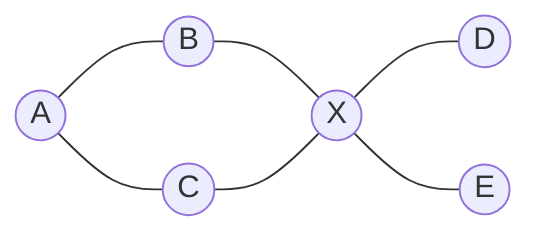

## 4.1 中心性とは

中心性（Centrality）は、グラフにおけるノードの構造的な「重要さ」を定量化する。ただし、何を重要とするかは手法によって異なる。次数中心性は直接の接続数、PageRankは重要な参照元を持つ度合い、媒介中心性は最短経路上の橋渡しの程度を測る。

## 4.2 Degree Centrality（次数中心性）

### 数式

無向単純グラフの次数中心性は、

$$
\boxed{C_D(v)=\frac{\deg(v)}{n-1}}
$$

である。たとえば5ノードのグラフでノードAが他の4ノードすべてと接続していれば、$C_D(A)=4/4=1$ となる。NetworkXの`degree_centrality()`は、単純グラフでこの正規化を行う。

有向グラフでは、

$$
\deg^{in}(v)=|N^{in}(v)|,\quad \deg^{out}(v)=|N^{out}(v)|
$$

を区別する。入次数は受ける参照、出次数は発する参照であり、`DEPENDS_ON`の向きをどう定義したかが分析結果の解釈に直結する。多重グラフでは中心性の値が1を超える場合がある点にも注意する。

### 計算量

隣接リスト表現で全ノードの次数を集計する処理は $O(n+m)$ である。

### Python実装

```python
import networkx as nx

G = nx.DiGraph()
G.add_edges_from([
    ("Agent_A", "Database"),
    ("Agent_B", "Database"),
    ("Agent_C", "Database"),
    ("Agent_A", "API"),
])

print(nx.in_degree_centrality(G))
print(nx.out_degree_centrality(G))
```

### 知識グラフでの応用

`Service --DEPENDS_ON--> Database` とするなら、多数のサービスから依存されるDBは入次数が高い。共有依存の大きいシステムを抽出できるが、故障損失や代替可能性までは示さない。技術KGでは、ある技術を利用・参照する製品やプロジェクト数の指標としても使える。

## 4.3 PageRank

### 4.3.1 重要なノードからの参照

PageRankは、重要なノードから参照されるノードが重要であると考える再帰的な中心性である。標準的な一様ジャンプモデルは、

$$
\boxed{
PR(v)=\frac{1-d}{n}
+d\sum_{u\in In(v)}\frac{PR(u)}{\deg^{out}(u)}
}
$$

で表せる（出次数0のノードは別途補完する）。$d$ はダンピング係数で、例として0.85が使われる。

PageRankは、ランダムウォークの定常分布として理解できる。ノードから出るリンクを確率的にたどり、一定の確率で別のノードへジャンプする。

### 4.3.2 行列形式

確率遷移行列を $P$（行確率行列）、PageRankベクトルを $\boldsymbol\pi$、ジャンプ分布を $\boldsymbol q$ とすると、

$$
\boxed{\boldsymbol\pi=dP^\top\boldsymbol\pi+(1-d)\boldsymbol q}
$$

である。Dangling Node（出リンクがないノード）の遷移行は、$\boldsymbol q$ 等で補完して確率行列にする。

### 4.3.3 べき乗反復法

$$
\boldsymbol\pi^{(k+1)}=dP^\top\boldsymbol\pi^{(k)}+(1-d)\boldsymbol q
$$

を反復し、例えば、

$$
\|\boldsymbol\pi^{(k+1)}-\boldsymbol\pi^{(k)}\|_1<\epsilon
$$

などの収束条件で終了する。

疎行列で1反復を行う計算量は $O(n+m)$ 程度。反復回数を $K$ とすると $O(K(n+m))$ 程度である。

### 4.3.4 Python実装

```python
import networkx as nx

G = nx.DiGraph()
G.add_edges_from([
    ("AI_Agent", "Ontology"),
    ("GraphRAG", "Ontology"),
    ("Knowledge_Graph", "Ontology"),
    ("Knowledge_Graph", "GraphRAG"),
    ("Ontology", "Knowledge_Graph"),
])

scores = nx.pagerank(G, alpha=0.85)
for node, score in sorted(scores.items(), key=lambda x: x[1], reverse=True):
    print(node, round(score, 4))
```

### 4.3.5 Personalized PageRank

ジャンプ分布 $\boldsymbol q$ を一様ではなく、特定テーマに関連したノード群へ集中させれば、特定の質問・人物・テーマを起点とした相対的重要度を計算できる。

```python
personalization = {n: 0.0 for n in G.nodes}
personalization["Ontology"] = 1.0
scores = nx.pagerank(G, alpha=0.85, personalization=personalization)
```

Personalized PageRankは、GraphRAGで質問に関連するエンティティを優先付けするときに役立つ。

### 4.3.6 知識グラフでの応用

- 技術の依存関係から基盤となる技術を抽出する。
- 論文の引用関係から影響度の高い研究を特定する。
- 業務サービスの依存関係から重要サービスを発見する。
- 特定の質問に関連する知識をPersonalized PageRankで順位付けする。

エッジが「引用」「依存」「所有」「関連」など混在するKGでは、単一のPageRankが何を表すのか曖昧になる。関係ごとに射影を設計するか、重み付けを検証する。

## 4.4 Betweenness Centrality（媒介中心性）

### 4.4.1 数式

$$
\boxed{
C_B(v)=\sum_{\substack{s\ne v\ne t\\s\ne t}}\frac{\sigma_{st}(v)}{\sigma_{st}}
}
$$

- $\sigma_{st}$：ノード $s,t$ 間の最短経路数
- $\sigma_{st}(v)$：そのうちノード $v$ を通る最短経路数

到達不能ペアは寄与しないと考える。無向グラフではペアの重複や正規化の定義によって係数が変わる。



ノードXが左右のノード群を結ぶ場合、左右を結ぶ最短経路の多くがXを通るため、Xは高い媒介中心性を持つ。

### 4.4.2 Brandesのアルゴリズムと計算量

全点対の最短経路に対する寄与を効率的に集約するBrandesのアルゴリズムの計算量は、次のとおりである。

- 無重みグラフ：$O(nm)$
- 非負重みグラフ：フィボナッチヒープで $O(nm+n^2\log n)$、二分ヒープで $O(n(n+m)\log n)$

大きなKGでは高コストになりやすいため、始点の一部をサンプリングして近似する。

### 4.4.3 Python実装

```python
import networkx as nx

G = nx.Graph()
G.add_edges_from([
    ("A", "B"), ("A", "C"),
    ("B", "X"), ("C", "X"),
    ("X", "D"), ("X", "E"),
])

scores = nx.betweenness_centrality(G, normalized=True, weight=None)
print(sorted(scores.items(), key=lambda x: x[1], reverse=True))

# 大規模グラフでは近似
# kはサンプリングする始点数。k <= ノード数とする
approx = nx.betweenness_centrality(G, k=3, seed=42)
print(approx)
```

### 4.4.4 知識グラフでの応用

組織間の知識を仲介する人物、複数のサービスをつなぐ共有インフラ、業務フローの構造上のボトルネック、異なる技術領域をつなぐ概念などを抽出する。例えばロボティクスと知識グラフを結ぶScene Graphのような概念が、射影の仕方によっては高い媒介中心性を持つことがある。

ただし媒介中心性が高くても、通信量や業務上のリスクが高いとは限らない。計算結果はグラフ上の最短経路に基づく**構造指標**として解釈する。

## 4.5 比較表

| アルゴリズム | 何を測るか | KGの例 | 主な計算負荷 |
|---|---|---|---|
| Degree | 直接の接続数 | 多くのサービスが依存するDB | 低い |
| PageRank | 重要なノードからの参照 | 文献・技術の相対的重要度 | 反復計算 |
| Betweenness | 最短経路の中継度 | 部署間仲介者、共有依存 | 大きくなりやすい |

## 4.6 設計上の注意

1. 有向グラフでIn/Outを取り違えない。
2. 中心性の高いノードが業務上重要とは限らない。
3. 組織・文書・人物を混在させたKGでは、型によるバイアスがある。
4. PageRankの向きと重みが、どの参照を「重要」とみなすかを決める。
5. Betweennessの大規模計算では、近似誤差と所要メモリを評価する。

**資料**：[NetworkX centrality](https://networkx.org/documentation/stable/reference/algorithms/centrality.html) ／ [PageRank](https://networkx.org/documentation/stable/reference/algorithms/generated/networkx.algorithms.link_analysis.pagerank_alg.pagerank.html) ／ [Brandes (2001)](https://doi.org/10.1080/0022250X.2001.9990249)
