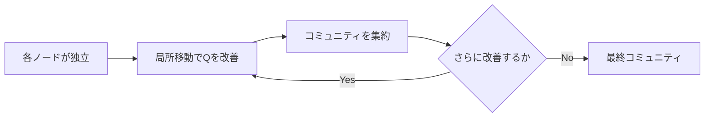
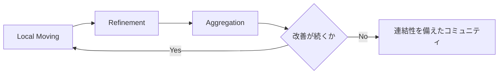

## 5.1 コミュニティ検出とは

コミュニティ検出（Community Detection）は、グラフの内部で密につながるノード群を見つける技術である。知識グラフでは研究テーマ、技術分類、人材集団、関連する文書・概念、組織を横断する知識群を探索できる。

ただし、**構造的なコミュニティは、オントロジー上のクラスと同一ではない**。密接な関係を持つ集合が、必ずしも意味的に1つのカテゴリに対応するとは限らない。

## 5.2 Modularity（モジュラリティ）

LouvainとLeidenを理解するうえで重要なのがModularityである。無向グラフの代表的定義は、

$$
\boxed{
Q=\frac{1}{2m}\sum_{i,j}\left(A_{ij}-\gamma\frac{k_i k_j}{2m}\right)\delta(c_i,c_j)
}
$$

である。

- $A_{ij}$：ノード間のエッジの有無・重み
- $k_i,k_j$：次数または重み付き次数
- $m$：無向グラフのエッジ数（重み付きでは総重み）
- $c_i$：ノード$i$の所属コミュニティ
- $\delta(c_i,c_j)$：コミュニティが同じなら1、それ以外は0
- $\gamma$：解像度パラメータ

$$
A_{ij}-\gamma\frac{k_i k_j}{2m}
$$

は、実際の接続と、次数に基づく帰無モデルで期待される接続との差を表す。一般に、$\gamma$ を大きくすると分割は細かくなり、小さくすると大きくなる傾向がある。

Modularity最大化には、比較的小さなコミュニティを見逃しやすいResolution Limitの問題がある。これは、Resolution Limitを持たないCPM（Leidenで最適化できる目的関数の一つ）など、別の目的関数を選ぶ理由の一つである。

## 5.3 Louvain Algorithm

### 5.3.1 理論と手順

LouvainはModularityの局所的改善とグラフ集約を繰り返すヒューリスティックである。

1. すべてのノードを別々のコミュニティとして初期化する。
2. 各ノードを隣接コミュニティへ移した場合のModularityの増分を計算する。
3. 改善する移動を繰り返す。
4. 生成された各コミュニティを1ノードに集約する。
5. 集約グラフ上で処理を繰り返す。



一例として、孤立したノード $i$ をコミュニティ $C$ に追加する場合、Modularity増分を、

$$
\Delta Q=\frac{k_{i,in}}{m}-\gamma\frac{\Sigma_{tot}k_i}{2m^2}
$$

と表すことができる。$k_{i,in}$ はノード$i$から$C$内部への重み合計、$\Sigma_{tot}$は$C$に属するノードの次数合計である。これは一例の定式化であり、完全な移動操作（元コミュニティからの除去と新コミュニティへの追加）ではそれぞれの変化を考慮する。

### 5.3.2 計算量

実用上、大規模疎グラフで高速に動作する。しかし局所移動・階層化の回数はグラフに依存するため、常に$O(m)$と保証されるわけではない。

### 5.3.3 Python実装

```python
import networkx as nx

G = nx.karate_club_graph()
communities = nx.community.louvain_communities(
    G, resolution=1.0, seed=42
)
modularity = nx.community.modularity(G, communities)
print("Communities:", len(communities))
print("Modularity:", modularity)
for i, nodes in enumerate(communities):
    print(i, sorted(nodes))
```

### 5.3.4 KGでの応用

文書、人物、技術、引用を関係として管理しているKGから、「ロボティクス」「データ基盤」「エージェント」などに対応するコミュニティが発見されることがある。これは事前にクラスを定義しない探索的な分類であり、検出結果の意味をあとから調べる必要がある。

## 5.4 Leiden Algorithm

### 5.4.1 Louvainからの改良

Louvainでは、同じコミュニティに属するノードどうしの接続が弱くなったり、コミュニティが非連結な部分を含んだりすることがある。Leidenは、局所移動、Refinement（洗練）、集約を行い、結果のコミュニティの連結性を保証する。



### 5.4.2 CPM（Constant Potts Model）

LeidenはModularityだけでなくCPMを最適化できる。無向単純グラフでの例は、

$$
\boxed{H(\mathcal C)=\sum_{c\in\mathcal C}\left[e_c-\gamma\binom{n_c}{2}\right]}
$$

である。$e_c$はコミュニティ内部のエッジ数、$n_c$はコミュニティ内ノード数、$\gamma$は解像度である。CPMは、コミュニティ内部のエッジ数を評価する一方で、コミュニティの規模にペナルティを与える。

ModularityとCPMは異なる目的関数であり、同じ入力でも違う分割を返しうる。

### 5.4.3 計算量

Leidenも実用上は高速なコミュニティ検出法だが、実行時間は入力グラフ・実装・解像度・反復数によって変わり、一律の実行時間は保証されない。

### 5.4.4 igraph実装

```python
import igraph as ig

G = ig.Graph.Famous("Zachary")
clusters = G.community_leiden(
    objective_function="modularity",
    resolution=1.0
)
print("Community count:", len(clusters))
print("Membership:", clusters.membership)
```

### 5.4.5 Neo4j GDS実装

GDSのLeidenは無向グラフでしか実行できない。`gds.graph.project`は既定で関係を有向（`NATURAL`）のまま投影するので、関係を`orientation: 'UNDIRECTED'`で投影した`myGraph`を先に用意しておく（投影例は[第12章](/tech/knowledge-graph-algorithms/12-hands-on)の12.11節）。

```cypher
CALL gds.leiden.stream('myGraph', {randomSeed: 42})
YIELD nodeId, communityId
RETURN nodeId, communityId
```

### 5.4.6 KGでの応用：GraphRAG

LLMで抽出したエンティティと関係をグラフ化し、Leidenで階層的なコミュニティを作り、各コミュニティの記述をLLMで要約する。Microsoft GraphRAGはこのような設計を採用している。この設計では、複数の文書にまたがるグローバルな質問に答えるための材料を用意できる。詳しくは[第10章](/tech/knowledge-graph-algorithms/10-graphrag-ai-agents)。

## 5.5 Label Propagation（ラベル伝播）

### 5.5.1 原理

各ノードに初期ラベルを与え、近傍で最も多いラベルを採用する更新を繰り返す。

$$
\boxed{c_i^{(t+1)}=\arg\max_{\ell}\sum_{j\in N(i)}w_{ij}\mathbf1[c_j^{(t)}=\ell]}
$$

- $c_i^{(t)}$：時点$t$のラベル
- $w_{ij}$：隣接エッジの重み
- $\mathbf1[\cdot]$：条件が成立したら1

同点時の選択規則や同期・非同期更新によって結果が変化しうる。必ずしも唯一の分割に収束するとは限らない。

### 5.5.2 計算量

各反復で全エッジを処理するなら、反復回数を$T$として$O(Tm)$程度である。

### 5.5.3 Python実装

```python
import networkx as nx

G = nx.karate_club_graph()
communities = list(nx.community.asyn_lpa_communities(G, seed=42))
print(communities)
```

### 5.5.4 KGでの応用

文書間の引用、概念間の関連、技術間の依存関係から、密接な知識群を比較的軽い処理で抽出できる。ただし、コミュニティ検出のラベル伝播は、既知の正解クラスを未分類データへ伝える半教師あり分類のラベル伝播とは区別する。

## 5.6 3手法の比較

| 観点 | Louvain | Leiden | Label Propagation |
|---|---|---|---|
| 原理 | Modularity局所改善 | 局所改善＋Refinement＋集約 | 近傍ラベルの多数決 |
| 目的関数 | 主にModularity | Modularity、CPM等 | 明示的なModularity最適化なし |
| コミュニティ連結性保証 | なし | あり | 一般的な保証なし |
| 特徴 | 高速・汎用 | 分割品質と連結性を改善 | 単純・軽量 |
| KGでの用途 | 知識群探索 | GraphRAG・階層化 | 初期クラスタリング |

## 5.7 設計・評価の注意

- 検出したコミュニティに意味があるか、人間が代表的なノードと関係を検査する。
- 関係タイプが混在する場合、関係の多さだけでグループが決まらないよう射影を工夫する。
- モジュラリティ値だけでは、分割結果の品質を十分に評価できない。
- 解像度、乱数シード、エッジ重み、ノード種類を変更して安定性を比較する。

**資料**：[Louvain (Blondel et al.)](https://arxiv.org/abs/0803.0476) ／ [Leiden (Traag et al.)](https://doi.org/10.1038/s41598-019-41695-z) ／ [igraph Leiden](https://python.igraph.org/en/stable/api/igraph.Graph.html#community_leiden)
