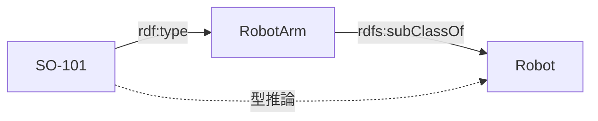
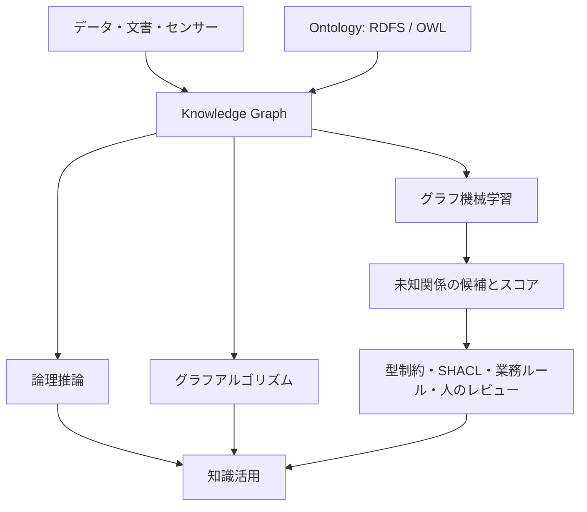

## 9.1 オントロジーが与えるもの

オントロジーは、対象領域における概念（クラス）、その性質、関係、制約や公理を明示する。製造業なら設備・工程・部品・品質・作業などの意味を、創薬なら化合物・標的・疾患・相互作用などの意味を整理する土台になる。

グラフアルゴリズムが計算するのは主に**接続構造**であり、オントロジーの推論器が扱うのは**意味論的な帰結**である。両者の区別が重要となる。

## 9.2 RDFS/OWLによる推論

例えば、

```text
SO-101 rdf:type RobotArm
RobotArm rdfs:subClassOf Robot
```

という知識がある場合、RDFSのクラス継承から、

```text
SO-101 rdf:type Robot
```

が導出できる。

これはグラフ上で2ホップをたどったというだけでなく、`subClassOf`という関係が持つ論理的意味に基づく。



OWL 2では、クラスの包含、同値、互いに素なクラス、プロパティの性質など、より豊かな論理表現を扱える。ある関係が推移的と宣言されていれば、その宣言に従って新しい関係が導出される。一方、通常の`MANAGES`や`DEPENDS_ON`に、勝手に推移性を仮定してはいけない。

## 9.3 グラフ経路と論理的な結論は別

```text
A --MANAGES--> B --DEPENDS_ON--> C
```

という経路が存在しても、

```text
A --MANAGES--> C
```

は通常導出できない。導出するには、関係の意味が定義され、対応する推論規則が存在する必要がある。

| 比較 | グラフアルゴリズム | オントロジー・論理推論 |
|---|---|---|
| 基本原理 | グラフ理論、最適化、統計 | 形式論理、意味論 |
| 結果 | 重要度、最短経路、グループ、類似度 | 定義・公理から導かれる関係や分類 |
| 技術 | BFS、PageRank、Leiden、GNN等 | RDFS、OWL、ルール推論 |
| 結果の性質 | スコアや構造的な発見 | 論理的帰結 |
| 得意な用途 | 分析、推薦、構造発見 | 意味的一貫性、分類、推論 |

## 9.4 SHACLによる検証

SHACL（Shapes Constraint Language）は、RDFグラフが指定した形状・条件を満たすかを検証するための仕様である。

例えば、`Person`には氏名が必要である、`HAS_SKILL`の対象は`Skill`クラスである、といったデータ品質チェックを実装する際に有用である。これはOWLの論理推論とは目的が異なる。RDFSで定義されOWLでも使われる`rdfs:domain`・`rdfs:range`は、一般に型を推論するための記述であり、データ入力を拒絶するバリデーションではない。OWLで矛盾を検出できるのは、互いに素なクラスなどの公理があわせて定義されている場合に限られる。

## 9.5 関係予測と推論の使い分け

TransEやDistMultなどの関係予測モデルは、三つ組の妥当性を表すスコア関数

$$
s(h,r,t)
$$

を学習する。R-GCNはエンティティの表現を作るエンコーダであり、三つ組を評価するにはDistMultなどのデコーダと組み合わせる。スコアをシグモイド関数で変換し、$P((h,r,t)\text{ is plausible}\mid KG)$ のように確率として解釈することはあるが、確率として校正されているとは限らない。一方、論理推論は、理論$\mathcal K$と公理が与えられたもとで、

$$
\mathcal K\models(h,r,t)
$$

といった形で論理的な帰結を扱う。両者は同じ主張をしているわけではない。

例：

- **論理推論**：「RobotArmはRobotの一種なので、SO-101はRobotである」
- **統計的予測**：「過去のグラフ構造から、この人物がKnowledge Graphスキルを持つ可能性が高い」
- **グラフ分析**：「この技術ノードは多数の重要ノードから参照され、PageRankが高い」

## 9.6 検証を組み込んだ構成



実際には、検証した候補の承認や、根拠文書の紐付けも必要となる。元の事実と推論結果・予測結果を区別して管理する設計が望ましい。

## 9.7 RDF・SPARQLとProperty Graph

RDFは三つ組で知識を表現し、SPARQLはRDFグラフに対する問い合わせ言語である。Property Graphはノードやエッジに属性を付けて表現し、Neo4jではCypherで問い合わせる。

| 観点 | RDF/OWL/SPARQL | Property Graph/Cypher |
|---|---|---|
| 重視する点 | 標準化された意味表現と推論 | プロパティを持つグラフの操作・検索・分析 |
| グラフ分析 | RDFを適切に変換・射影して実行 | GDS等と統合しやすい |
| 代表的用途 | オントロジー連携、知識標準化 | 業務アプリ、GraphRAG、推薦 |

両者は排他的ではない。意味論を使ったモデル管理と、大規模グラフ分析を組み合わせる構成が考えられる。

**参考**：[W3C OWL 2](https://www.w3.org/TR/owl2-overview/) ／ [W3C SHACL](https://www.w3.org/TR/shacl/) ／ [W3C SPARQL 1.1](https://www.w3.org/TR/sparql11-query/)
