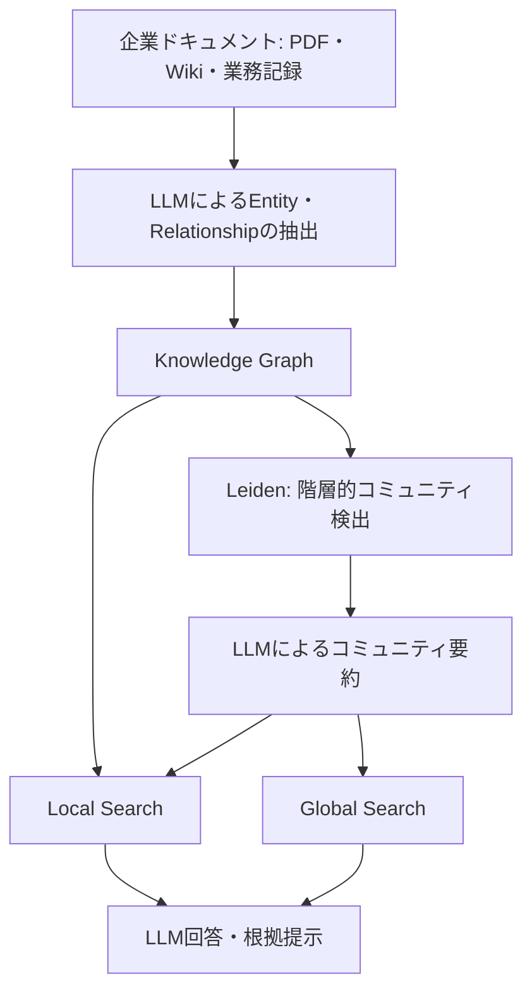
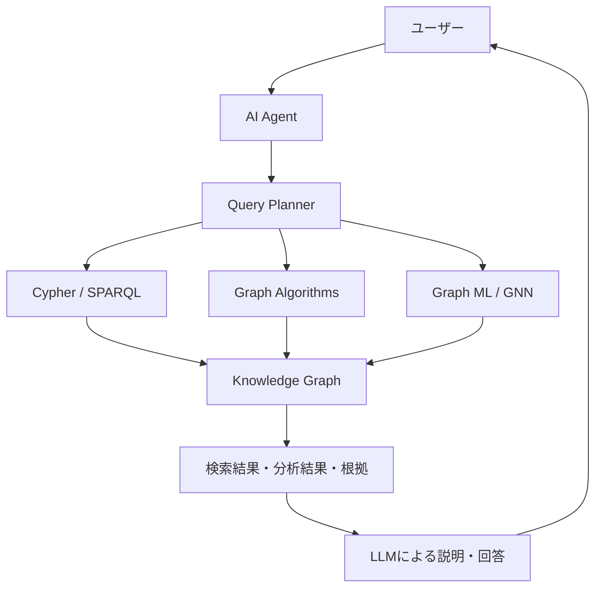

## 10.1 GraphRAGとグラフアルゴリズム

GraphRAGは、文書から抽出したエンティティ・関係をグラフとして保持し、その構造を検索・要約に利用する設計の総称として広く用いられている。なかでもMicrosoft GraphRAGは、エンティティ・関係の抽出、コミュニティ検出、コミュニティ要約を組み合わせる代表例である。

グラフアルゴリズムの役割は、単に検索対象を増やすことではない。**知識がどのようにまとまっているか、どの概念が重要か、どの経路で関係するか**を計算し、検索・回答の文脈選択を改善することにある。

## 10.2 Microsoft GraphRAGの基本的な流れ

1. 文書を前処理し、エンティティや関係を抽出する。
2. 抽出した関係からグラフを構築する。
3. Leiden等で階層的なコミュニティを検出する。
4. コミュニティごとに説明・要約を生成する。
5. 質問に応じてローカルな関係や全体の要約を取得し、回答する。

## 10.3 Local SearchとGlobal Search

**Local Search**は特定エンティティと周辺文脈に関する質問に向く。例：「この技術の依存先は何か」「この人物が関与したプロジェクトは何か」。

**Global Search**は複数コミュニティ要約を横断した質問に向く。例：「社内のAI研究にはどんな大きなテーマがあるか」「文書全体に共通する課題は何か」。

| 観点 | Local Search | Global Search |
|---|---|---|
| 中心 | 特定のエンティティ・周辺関係 | コミュニティ要約の横断 |
| 質問の例 | AはBにどう依存するか | 組織全体に見られる共通傾向は何か |
| 活用する構造 | 隣接関係、関連エンティティ、原文、関連するコミュニティ要約 | コミュニティとその要約 |

Microsoft GraphRAGには、このほかにDRIFT SearchとBasic Searchもある。GraphRAGの実装方式は多様であり、すべてのGraphRAGがLeidenを必須とするわけではない。

## 10.4 PageRank・経路探索・コミュニティの組合せ

Microsoft GraphRAGに限らず、独自のGraphRAGでは次のようなアルゴリズムを組み合わせられる。

- BFS：質問に含まれるエンティティから周辺グラフを展開する。
- Personalized PageRank：質問を起点に関連ノードをランキングする。
- Dijkstra：関係にコストが定義される場合に、説明用の経路を探索する。
- Leiden：知識群をまとめ、全体横断の要約を構築する。
- Node2Vec・GraphSAGE：構造的な類似性から補助候補を検索する。

ただし、どの手法の結果も「関連しているらしい」構造を示すだけの場合がある。回答を生成する際には、原文・事実関係に基づく根拠が必要となる。

## 10.5 AIエージェントとKG分析

AIエージェントにKGを接続する場合、LLMがCypher/SPARQLを生成するだけでなく、用途に応じてグラフアルゴリズムの実行を選択する構成が考えられる。

例：「この案件に最適な人材を推薦して」

1. 案件が要求するスキルをKGから取得する。
2. Jaccard・Adamic-Adarによって候補人物を抽出する。
3. GraphSAGE等で学習した埋め込みから追加候補を得る。
4. 経験年数や実績、稼働状況、制約条件を考慮して再ランキングする。
5. 根拠となる事実・文書を提示する。

候補生成と説明を分離し、LLMの自然言語による説明が、スコアの意味以上の主張をしないようにする。

## 10.6 KG構築と評価の注意

- LLMの抽出したエンティティ・関係は誤る可能性がある。
- 同名異義語、表記ゆれ、エンティティ同定を管理する。
- 根拠文書ID・版・抽出日時を保存する。
- 抽出グラフのエッジと推論・予測したエッジを区別する。
- GraphRAGの評価は検索のRecallだけでなく、回答の根拠性・正確性・遅延・コストも測定する。

## 10.7 製造業や技術知識への応用

製造業なら「設備―工程―部品―品質―不具合―対策」のKGに対して、特定の設備障害の影響範囲をBFSで調べ、関係の要約や過去の事例をGraphRAGで取得する。AIエージェントは、関係の探索結果をもとに改善候補を説明する。重要な意思決定には、根拠の提示と人による確認を組み込む。

**参考**：[Microsoft GraphRAG](https://microsoft.github.io/graphrag/) ／ [GraphRAG repository](https://github.com/microsoft/graphrag) ／ [Edge et al. (2024)](https://arxiv.org/abs/2404.16130)
