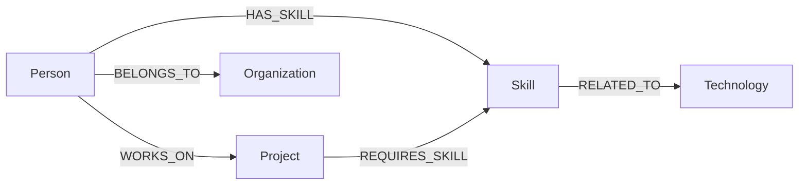
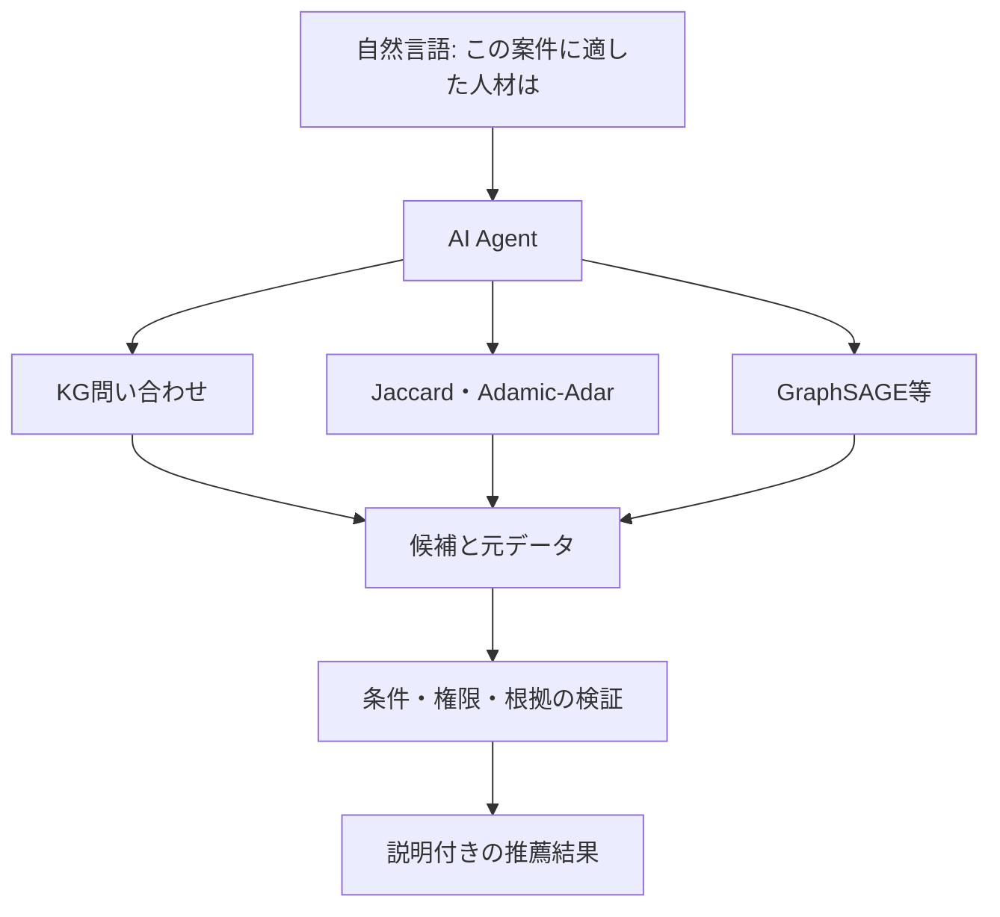

## 12.1 ハンズオンの目的

ここでは企業の人材・スキル・プロジェクトからなる小さな知識グラフを使い、クエリ、グラフ射影、類似性分析、中心性分析、AIエージェントへの接続までを整理する。データは説明用の架空例である。



| 目的 | アルゴリズム | 出力 |
|---|---|---|
| 案件に必要なスキルを探索 | BFS | 関連するスキル・人物 |
| 重要技術の発見 | PageRank | 技術の重要度 |
| 部署横断の橋渡しを発見 | Betweenness | 仲介する人物 |
| 専門家集団を抽出 | Leiden | 人材コミュニティ |
| 似たスキル構成の人材を発見 | Jaccard | 人材類似度 |
| 希少な共通スキルを考慮 | Adamic-Adar | 類似候補スコア |
| 人材属性も取り入れて推薦 | GraphSAGE | 学習済み埋め込み |
| 関係の種類を考慮した予測 | R-GCN＋デコーダ（DistMult等） | 三つ組スコア |

## 12.2 環境

最低限のPythonでの練習：

```bash
python -m venv .venv
source .venv/bin/activate
python -m pip install --upgrade pip
python -m pip install networkx matplotlib
```

Neo4j GDSの場合、別途Neo4jとGDSプラグインが必要となる。PythonのGNNはPyTorch/PyGの対応バージョン・CUDA・拡張ライブラリの整合性を確認して導入する。

## 12.3 Pythonで小さなKGを作る

```python
import networkx as nx

G = nx.MultiDiGraph()

G.add_edge("Person_A", "Python", relation="HAS_SKILL")
G.add_edge("Person_A", "Knowledge_Graph", relation="HAS_SKILL")
G.add_edge("Person_B", "Python", relation="HAS_SKILL")
G.add_edge("Person_B", "SQL", relation="HAS_SKILL")
G.add_edge("Project_X", "Python", relation="REQUIRES_SKILL")
G.add_edge("Project_X", "Knowledge_Graph", relation="REQUIRES_SKILL")

for u, v, attrs in G.edges(data=True):
    print(u, attrs["relation"], v)
```

ここでは複数関係を表現可能な`MultiDiGraph`を使った。ただしNetworkXのアルゴリズムには、無向単純グラフや`DiGraph`だけに対応するものもある。分析前に適切な射影を作る。

## 12.4 人材・スキルからJaccardを計算

```python
from collections import defaultdict

skills = defaultdict(set)
for u, v, attrs in G.edges(data=True):
    if attrs["relation"] == "HAS_SKILL":
        skills[u].add(v)

def jaccard(a, b):
    union = a | b
    if not union:
        return 0.0  # この実装での規約
    return len(a & b) / len(union)

score = jaccard(skills["Person_A"], skills["Person_B"])
print("Jaccard:", score)  # 1/3
```

Person_AのスキルはPythonとKnowledge_Graph、Person_BはPythonとSQLである。共通集合は1、和集合は3なので$1/3$となる。異なる`REQUIRES_SKILL`関係を人材スキルに混入させていない点が重要である。

## 12.5 メタパスで案件マッチ度を計算

人物集合と案件集合を抽出し、`Person --HAS_SKILL--> Skill <--REQUIRES_SKILL-- Project`というメタパスを通る共通スキルを計算する。

```python
required = defaultdict(set)
for u, v, attrs in G.edges(data=True):
    if attrs["relation"] == "REQUIRES_SKILL":
        required[u].add(v)

for person, person_skills in skills.items():
    shared = person_skills & required["Project_X"]
    print(person, "matching skills:", sorted(shared), "count:", len(shared))
```

数学的には第2章の$M=BR^\top$に対応する。

## 12.6 Neo4jにKGを格納する

以下は概念を理解するための小さなデータ例である。

```cypher
CREATE (a:Person {name: 'Person_A'})
CREATE (b:Person {name: 'Person_B'})
CREATE (python:Skill {name: 'Python'})
CREATE (kg:Skill {name: 'Knowledge_Graph'})
CREATE (sql:Skill {name: 'SQL'})
CREATE (a)-[:HAS_SKILL]->(python)
CREATE (a)-[:HAS_SKILL]->(kg)
CREATE (b)-[:HAS_SKILL]->(python)
CREATE (b)-[:HAS_SKILL]->(sql)
```

繰り返し実行する場合は`MERGE`や一意制約を用い、重複エンティティの生成を避ける。

## 12.7 GDSへの投影

事前にNeo4j Graph Data Scienceプラグインを導入しておく。

```cypher
CALL gds.graph.project(
    'personSkills',
    ['Person', 'Skill'],
    'HAS_SKILL'
)
```

ここでは`HAS_SKILL`関係だけを分析対象にしている。製品バージョンによってグラフの投影・実行APIが変化する可能性がある。

## 12.8 Node Similarityの実行

```cypher
CALL gds.nodeSimilarity.stream(
    'personSkills',
    {
        similarityMetric: 'JACCARD',
        similarityCutoff: 0.0
    }
)
YIELD node1, node2, similarity
WHERE node1 < node2
RETURN
    gds.util.asNode(node1).name AS Person1,
    gds.util.asNode(node2).name AS Person2,
    similarity
ORDER BY similarity DESC
```

`HAS_SKILL`による共通近傍を比較する例である。既定の`NATURAL`投影では、出ていく関係を持つノード（ここではPerson）だけが比較対象になる。`stream`は同じペアを(A, B)と(B, A)の両方向で同じスコアとして返すので、ここでは`WHERE node1 < node2`で片方だけを残している。また、既定では各ノードにつき上位10件（`topK: 10`）だけを返す。`similarityCutoff`や`topK`の設定によって、0スコアのペアが出ない、または候補としてそもそも列挙されない場合がある。

## 12.9 分析結果の書き戻し

分析結果を`SIMILAR_TO`として保存する場合は、元の`HAS_SKILL`のような事実と区別する。例えば、`score`、`algorithm`、`computedAt`、`graphVersion`の属性を保持する。

```cypher
MATCH (a:Person {name: 'Person_A'})
MATCH (b:Person {name: 'Person_B'})
MERGE (a)-[r:SIMILAR_TO {algorithm: 'JACCARD', graphVersion: 'demo-v1'}]->(b)
SET r.score = 0.3333333333,
    r.computedAt = datetime()
RETURN a.name, b.name, r.score
```

実際の運用では、スコアを手で書かずにGDSの計算結果から書き戻し、アクセス権限・更新方針・再計算時の履歴を管理する。

## 12.10 PageRankの実行

別途適切に射影済みの`myGraph`に対して、

```cypher
CALL gds.pageRank.stream('myGraph')
YIELD nodeId, score
RETURN gds.util.asNode(nodeId).name AS name, score
ORDER BY score DESC
```

のように実行する。重要度分析では、どの関係タイプを含むのかを明示する。

## 12.11 Leidenの実行

GDSのLeidenは無向グラフでしか実行できない。12.7節の`gds.graph.project`は既定で関係を有向（`NATURAL`）のまま投影するため、Leiden用には無向で投影し直す。

```cypher
CALL gds.graph.project(
    'personSkillsUndirected',
    ['Person', 'Skill'],
    {HAS_SKILL: {orientation: 'UNDIRECTED'}}
)
```

```cypher
CALL gds.leiden.stream('personSkillsUndirected', {randomSeed: 42})
YIELD nodeId, communityId
RETURN nodeId, communityId
```

投影する関係タイプ、重み、解像度、乱数シードによって結果が変わる。業務上のカテゴリとして採用する前には、コミュニティ内に存在する具体的なエンティティと根拠を確認する。

## 12.12 GraphSAGE・R-GCNへ進む

GraphSAGEを学習する場合、ノードの特徴行列$X$とエッジ集合`edge_index`を準備する。関係タイプを考慮するR-GCNでは`edge_type`を追加する。実装の基本形は[第8章](/tech/knowledge-graph-algorithms/08-graph-representation-learning)に掲載した。

評価は、単純な共通スキル数、Jaccard、Adamic-Adarから始め、学習モデルがどれだけ追加価値を出したかを検証する。

## 12.13 AIエージェントとの連携



LLMには候補生成の理由、元のKGで確認できる事実、モデル推定を区別して説明させる。

## 12.14 実験チェックリスト

- [ ] ノード・関係タイプの定義と一意性を確認した。
- [ ] グラフ射影の関係の方向を確認した。
- [ ] ベースラインと比較した。
- [ ] ラベル・評価データの漏洩を確認した。
- [ ] 推論と予測と事実の保存先を分離した。
- [ ] 計算時間とメモリを測定した。
- [ ] 元の文書や記録への参照を残した。
