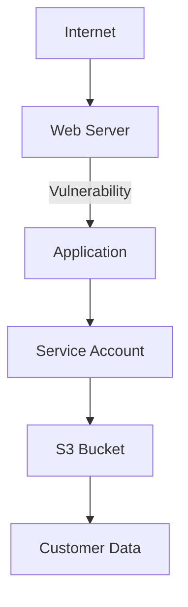
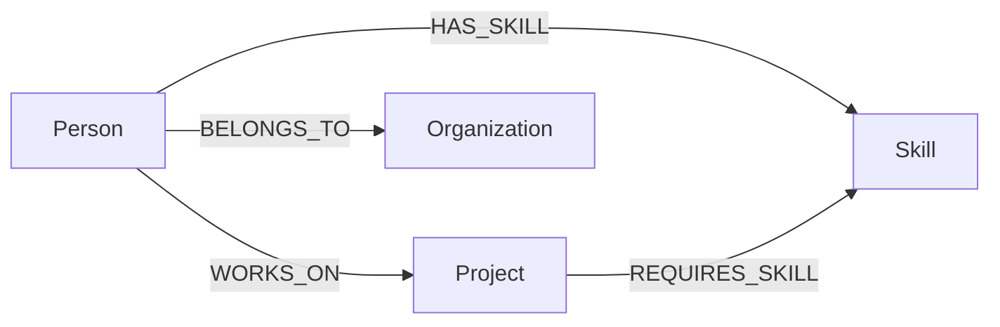
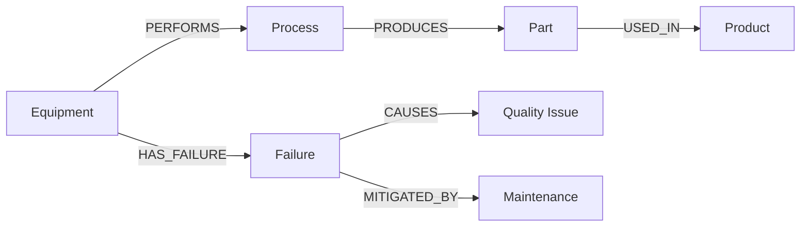
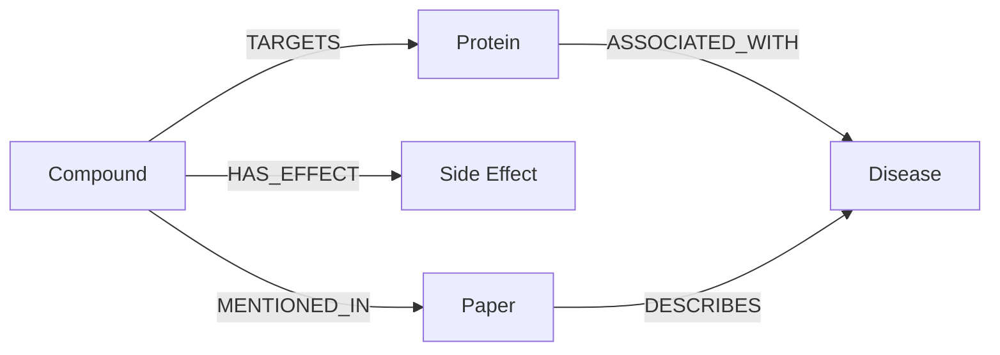
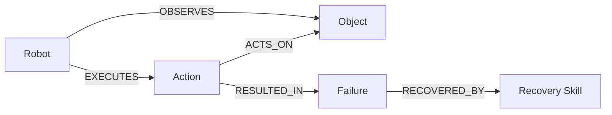

## 14.1 Security Attack Graph：侵入経路とリスク分析

情報システムの資産・権限・脆弱性・データをグラフにする。

エンティティ例：`Asset`、`Identity`、`Permission`、`Vulnerability`、`Secret`、`Data`。

- BFS：特定資産から顧客データへ到達できるか。
- Dijkstra：適切なコストモデルがあるときの最小コスト経路。
- Betweenness：複数の到達経路を中継する資産の候補。
- PageRank：参照構造上の相対的重要度。
- Link Prediction：未登録のアクセス関係の**調査候補**。
- AIエージェント：自然言語の問いを適切な経路検索へ変換する。

重要な注意：最短経路をそのまま最も危険な攻撃経路とは呼べない。危険度を判断するには、脆弱性の成立条件、権限、攻撃可能性、検知、防御策、影響度を考慮する必要がある。実際の侵入テストは許可された範囲で実施する。

## 14.2 人材・スキル・案件の知識グラフ

- Jaccard：人物間のスキル集合の重なり。
- Common Neighbors：共有スキル数。
- Adamic-Adar：希少な共有スキルを高く評価。
- Leiden：人材・知識のグループ分け。
- GraphSAGE：属性や近傍情報を使った推薦。
- R-GCN：`HAS_SKILL`、`WORKS_ON`、`BELONGS_TO`の違いを考慮した予測。

元データにないスキルを予測した結果は、本人による確認や実績検証を通す。

## 14.3 製造業オントロジーと設備・工程KG

製造業では設備、工程、部品、製品、不具合、品質、保守作業などの概念を整理し、関係を定義する。

- BFS：設備の不具合がどの工程・製品へ関係するかの影響候補。
- Betweenness：多数の工程を接続する共有設備の抽出。
- Leiden：密接につながる設備群・工程群の発見。
- SimRank：似た構造の製造工程の発見。
- R-GCN：設備の属性と関係タイプを使った不具合分類・候補予測。
- GraphRAG：保守記録、品質報告書、対策履歴の横断検索・説明。

中心性の値だけでは、対策の優先度は決められない。生産量、工程能力、故障率、設備の冗長性もあわせて見る必要がある。

## 14.4 創薬と知識グラフ

創薬では、化合物、タンパク質、遺伝子、疾患、副作用、文献などが多様な関係を持つ。例えば、

のようなKGが考えられる。

- Meta-path：化合物から標的・疾患へ至る関係の探索。
- Personalized PageRank：特定疾患を起点にした関連エンティティの優先付け。
- SimRank：同じ生物学的文脈にあるノード間の構造的類似性。
- Link Prediction：未登録の化合物―標的候補などの仮説生成。
- R-GCN / KG Embedding：異種関係を使った予測モデル。

予測された化合物―標的関係はあくまで研究仮説であり、実験的な検証や外部データでの再現性確認が必要である。データには文献バイアスや既知標的への偏りがあり、未知の関係が負例とは限らない。

## 14.5 量子コンピューティングとグラフ最適化

グラフ理論は量子最適化の問題定式化でも重要である。例えばMax-Cutでは、グラフのノードに二値変数$s_i\in\{-1,+1\}$を割り当て、異なるグループにまたがるエッジの総重みを最大化する。

$$
\boxed{\max_{s_i\in\{-1,+1\}}\frac12\sum_{(i,j)\in E}w_{ij}(1-s_is_j)}
$$

QAOA等では、このようなグラフ最適化問題を量子回路による近似最適化として扱うことがある。

知識グラフから依存や関係を抽出して最適化グラフを構成することはできるが、元の意味付きKGをそのまま量子回路へ渡せばよいわけではない。目的関数、制約、変数、重みを定義する必要がある。

知識グラフ分析と量子最適化の接点には、次のような例がある。

- コミュニティ検出や分割問題とグラフカット。
- 設備・工程の関係から組合せ最適化問題を構築する。
- グラフから取り出した依存関係を制約最適化へ変換する。

ただし、量子アルゴリズムが古典手法より高速・高精度であることは一般には保証されない。古典手法との比較が必要である。

## 14.6 ロボティクスとScene Graph

ロボット、物体、位置、動作、把持状態、失敗、回復スキルなどの関係をKGとして表す。

- BFS：ある失敗事例から利用可能な回復スキルへの到達。
- A*：実行コストやヒューリスティックを定義したタスク・動作計画。
- Jaccard / Node2Vec：類似した操作・状況を検索する。
- R-GCN：物体・動作・失敗・スキルの多関係を学習する。
- GraphRAG：過去のエピソードや説明文を参照し、行動候補の理由を説明する。

物理世界での安全性、動作可能性、接触力、センサー不確実性は、KG上の経路探索だけでは保証できない。ロボットの運動計画、制御、状態推定、世界モデルと役割を分担する設計が必要である。

## 14.7 各領域の比較

| 領域 | 主なKGの関係 | 有効なアルゴリズム | 検証すべきこと |
|---|---|---|---|
| セキュリティ | 資産・権限・脆弱性・データ | BFS、Dijkstra、Betweenness | 実際の到達条件・損失 |
| 人材推薦 | 人・スキル・案件・組織 | Jaccard、Adamic-Adar、GNN | 実績・熟練度・公平性 |
| 製造業 | 設備・工程・部品・品質 | BFS、Leiden、R-GCN | 生産・品質への因果影響 |
| 創薬 | 化合物・標的・疾患・文献 | PPR、SimRank、R-GCN | 生物学的妥当性・実験検証 |
| 量子最適化 | 問題に応じて射影した制約グラフ | Graph Cut、QAOA等 | 古典法との比較・定式化 |
| ロボティクス | ロボット・物体・動作・失敗 | A*、GNN、GraphRAG | 実機での実行可能性と安全性 |
