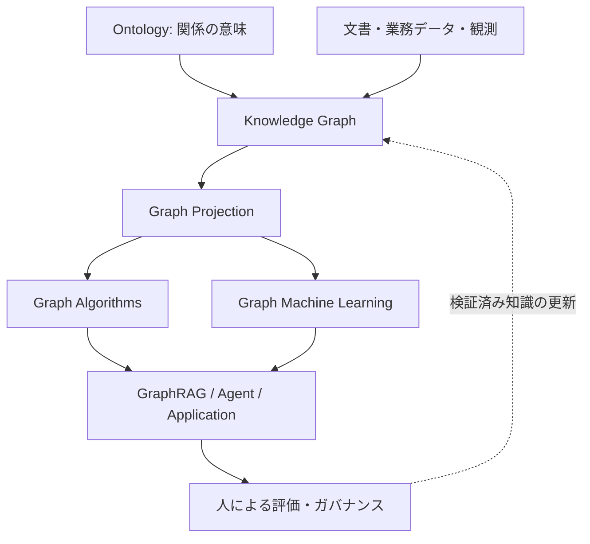

## 15.1 何から始めるべきか

理論を理解しながら実装する場合は、グラフ理論から始め、中心性・コミュニティ検出・リンク予測へ進み、最後にグラフニューラルネットワークとKGエージェントを統合する順番が学びやすい。

| 順序 | 学習内容 | 理解する数理 | 推奨ライブラリ |
|---|---|---|---|
| 1 | グラフ理論 | 集合、隣接行列、行列積 | NetworkX |
| 2 | BFS、Dijkstra、A* | 最短経路、漸化式、ヒューリスティック | NetworkX |
| 3 | Degree、PageRank、Betweenness | 次数、確率遷移、最短経路 | NetworkX |
| 4 | Louvain、Leiden | Modularity、最適化、グラフ分割 | igraph、GDS |
| 5 | Jaccard、SimRank、Adamic-Adar | 集合演算、再帰計算、重み付け | NetworkX |
| 6 | Node2Vec | ランダムウォーク、Skip-gram | PyG |
| 7 | GraphSAGE | ニューラルネットワーク、近傍集約 | PyG |
| 8 | R-GCN、KG Embedding | 関係埋め込み、メッセージパッシング | PyG |
| 9 | KG + AI Agent | 検索、ランキング、評価、根拠管理 | Neo4j、GDS、LLM |

## 15.2 数学的な概念のまとめ

| 分野 | 主要な数学的概念 | 得られるもの |
|---|---|---|
| 経路探索 | 最短経路、コスト最小化 | 到達可能性、依存経路 |
| 中心性分析 | 次数、定常分布、最短経路の寄与 | 重要なエンティティ |
| コミュニティ検出 | Modularity、グラフ分割 | 関連知識のまとまり |
| 類似性分析 | 集合類似性、再帰的類似性 | 関連人物・技術・文書 |
| リンク予測 | 構造的スコア、ランキング | 未知の関係の候補 |
| グラフ表現学習 | 埋め込み、メッセージパッシング | 学習可能な知識表現 |

## 15.3 知識グラフ活用の4段階

| 段階 | 技術 | できること |
|---|---|---|
| Level 1 | KG + Cypher / SPARQL | 既知の事実・関係を検索する |
| Level 2 | KG + Graph Algorithms | 重要性・構造・コミュニティを発見する |
| Level 3 | KG + OWL / GNN / KGE | 論理推論、未知の関係の予測を行う |
| Level 4 | KG + GraphRAG + AI Agent | 知識に基づいて調査・計画・意思決定を支援する |

この4段階は**厳密な技術成熟度の序列ではなく、活用方法を整理するためのモデル**である。OWLによる推論がGNNより初歩的だという意味ではなく、各技術は課題によって使い分ける。

## 15.4 知識グラフを「検索」から「分析」へ

KGを保存するだけでなく、グラフアルゴリズムを適用すると、接続構造を使った新しい洞察を得られる。

1. オントロジーで意味を定義する。
2. KGで実データと出典を統合する。
3. 目的に合うグラフを射影する。
4. グラフアルゴリズムで構造を分析する。
5. 必要ならグラフ表現学習で未知の関係の候補を予測する。
6. LLM/AIエージェントが、分析結果を元データと区別して説明する。
7. 人間が検証した結果を更新・改善へつなげる。

## 15.5 書籍全体の結論

知識グラフは、エンティティと関係を保存するだけのデータ構造ではない。オントロジーで意味を定義し、グラフアルゴリズムで構造を分析し、グラフ機械学習で未知の関係を予測し、AIエージェントがその結果を利用することで、知識グラフを**知識を分析・学習・活用するための基盤**へ発展させられる。

最初はNetworkXで数式と結果を確かめ、Neo4j GDSで実データを分析し、PyTorch GeometricでNode2Vec・GraphSAGE・R-GCNを検証するとよい。さらに、RDF/OWLによる意味論、SHACLによるデータ検証、GraphRAGによる説明と根拠提示を組み合わせる。

そして、どの段階においても忘れてはならないのは、**数式の前提が、実際に解きたい問題の前提と一致しているか**という問いである。グラフ理論と知識の意味が結び付くところに、知識グラフの本当の強みがある。
