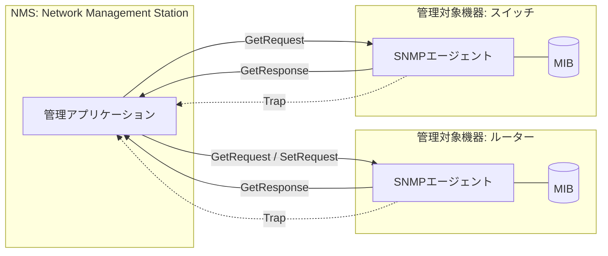
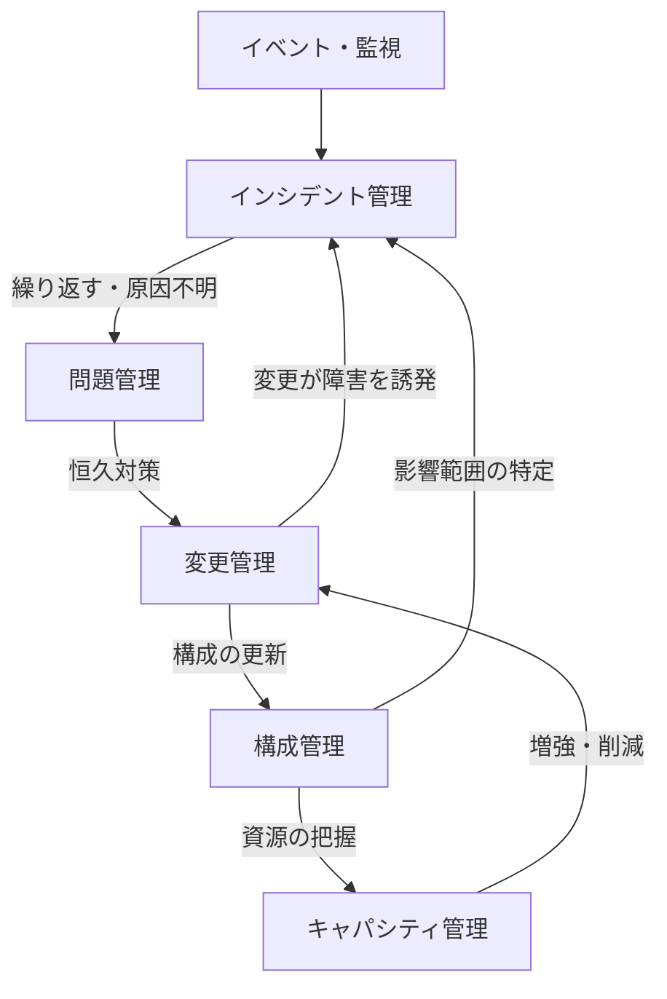
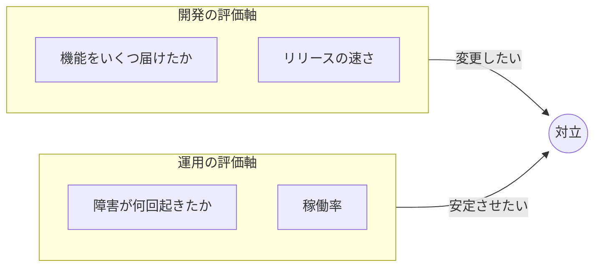
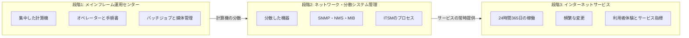

> <strong>第Ⅰ部　IT運用と監視の歴史</strong>
>
> 第Ⅰ部では、ITシステムの運用がどのように始まり、監視ツールがどのように進化し、そしてなぜ「監視だけではシステムを守れない」という認識に至ったのかをたどる。ここで扱う技術の多くは現在の主流ではない。しかし、今日のObservabilityやSRE、AIOpsが解こうとしている問題の原型は、すでにこの時代に現れている。

## 本章の問い

システムを本番環境に設置した後、人間はどのような責任を負ってきたのか。運用は単なる監視や保守と何が違うのか。

ソフトウェアの開発には始まりと終わりがある。要件を定め、設計し、実装し、テストして、リリースする。しかし本番環境に置かれたシステムには「終わり」がない。利用者がいる限り動き続けなければならず、ハードウェアは劣化し、データは増え、業務は変わり、セキュリティの脅威は新しくなる。この「終わりのない期間」に発生するあらゆる仕事を、私たちは<strong>運用（Operations）</strong>と呼んできた。

本章では、メインフレームの計算機室から、クライアントサーバー、ネットワーク管理、ITサービスマネジメントへと至る運用の歴史をたどり、運用という仕事の本質を定義する。

## 本書における「Operations」の定義

議論の出発点として、本書では次の操作的定義を用いる。

> <strong>Operations（運用）</strong>とは、サービスを継続的に提供するために、障害・変更・性能・安全性・費用を扱う活動の総称である。（本書の操作的定義）

この定義のポイントは三つある。

第一に、対象は「機器」ではなく「<strong>サービス</strong>」である。サーバーが正常に動いていても、利用者が目的を達成できなければ運用は失敗している。この視点は1.6節で詳しく扱う。

第二に、運用は「障害対応」だけではない。<strong>変更</strong>――ソフトウェアの更新、設定の変更、容量の追加――も運用の中心的な仕事である。そして後に見るように、障害の多くは変更によって引き起こされる。

第三に、<strong>安全性と費用</strong>が最初から含まれている。後の章で扱うDevSecOpsとFinOpsは、新しい関心事が発明されたというより、運用が本来抱えていた責任に名前が付き、専門化したものと捉えられる。

## 1.1　メインフレーム時代――ジョブ管理、バックアップ、オペレーターの仕事

### 計算機室という職場

1960年代から1980年代にかけて、企業の計算処理の中心はメインフレームだった。計算機は空調の効いた専用の部屋に置かれ、そこには<strong>オペレーター</strong>と呼ばれる専門職が常駐していた。

オペレーターの仕事は、今日の運用の原型をすべて含んでいる。

| 業務 | 内容 | 今日の対応概念 |
|---|---|---|
| ジョブの投入と監視 | 夜間バッチを順番に投入し、終了コードを確認する | ジョブスケジューラ、ワークフローエンジン |
| 媒体の管理 | 磁気テープのマウント、ラベル管理、保管庫への搬送 | ストレージ管理、バックアップ |
| コンソール監視 | システムコンソールに出るメッセージを読み、対処する | ログ監視、アラート |
| 障害時の対応 | 手順書に従い再実行・切り戻し・エスカレーション | Runbook、On-call |
| 運用記録 | 運用日誌に作業と異常を記録する | インシデント記録、監査ログ |
| 計画停止 | 保守時間帯に停止・起動を行う | メンテナンスウィンドウ、変更管理 |

### ジョブ管理という発明

メインフレーム運用で最も重要だったのは<strong>ジョブ管理</strong>である。業務処理は「売上集計」「請求書作成」「帳票出力」のようなバッチジョブの連鎖として構成され、あるジョブの出力が次のジョブの入力になる。ジョブの依存関係を正しく管理し、失敗したジョブを適切に再実行することが、業務の継続そのものだった。

ここにはすでに、今日のデータパイプラインやCI/CDと同じ問題が現れている。

- <strong>依存関係</strong>：上流のジョブが失敗したら、下流を止めるべきか。
- <strong>冪等性</strong>：同じジョブを二度実行したら、結果は二重になるのか。
- <strong>再実行の単位</strong>：失敗した地点から再開できるか、最初からやり直すしかないのか。
- <strong>締め時刻</strong>：朝の業務開始までに終わらなければ、業務に影響が出る。

第10章で扱うDataOpsや、第13章で扱うAgentOpsにおける「Retry」「Idempotency」は、この時代から引き継がれた課題である。

### バックアップと復旧

オペレーターのもう一つの重要な仕事はバックアップだった。データを磁気テープに定期的に書き出し、遠隔地の保管庫に運ぶ。災害時には保管庫からテープを取り寄せ、別の計算機で業務を再開する。

バックアップの価値は「取ったこと」ではなく「<strong>戻せること</strong>」にある。この原則は、第3章で扱うRTO（目標復旧時間）・RPO（目標復旧時点）の考え方につながる。実際、多くの組織が「バックアップは取っていたが、復元手順を一度も試していなかった」ために、障害時に復旧できない経験をしてきた。

### オペレーター運用の特徴と限界

メインフレーム時代の運用には、次の特徴があった。

1. <strong>集中</strong>：計算機は一か所にあり、観測と操作も一か所で行えた。
2. <strong>手順化</strong>：作業は手順書として文書化され、人が正確に実行した。
3. <strong>変更の抑制</strong>：システムの変更は年に数回の計画的なイベントだった。
4. <strong>人の注意力への依存</strong>：異常の発見は、オペレーターがコンソールを見ていることに依存していた。

1と3は、後の時代に崩れていく。システムは分散し、変更は頻繁になる。そして4の「人の注意力への依存」は、規模が大きくなるにつれて最大の弱点となる。

## 1.2　分散システム・クライアントサーバー時代の障害管理

### 計算機が「部屋」から出ていく

1980年代後半から1990年代にかけて、ミニコンピュータ、UNIXワークステーション、PCサーバーが普及し、<strong>クライアントサーバー型</strong>のシステムが広がった。データベースサーバー、アプリケーションサーバー、ファイルサーバー、そして利用者のPCが、LANで接続されて一つの業務システムを構成するようになった。

この変化は、運用に三つの新しい問題をもたらした。

<strong>第一に、観測点が分散した。</strong> 一台のコンソールを見ていれば全体がわかる時代は終わった。障害の兆候は、あるサーバーのログ、別のサーバーのディスク、ネットワーク機器のポート、利用者のPCに散らばるようになった。

<strong>第二に、部分障害が生まれた。</strong> メインフレームは「動いているか止まっているか」が比較的明確だった。分散システムでは、一部のコンポーネントだけが故障し、システム全体は「一部の機能が遅い」「ときどきエラーが出る」という曖昧な状態になる。

<strong>第三に、障害の原因が境界にあるようになった。</strong> アプリケーションもデータベースも正常なのに、両者の間のネットワークが不安定で処理が失敗する。こうした障害は、どの担当者の責任範囲にも属さず、調査が難航する。

### 分散システムの本質的な難しさ

分散システムの運用の難しさは、技術の未熟さだけに由来するものではない。分散システムでは、ネットワークは遅延し、パケットは失われ、時計はずれ、ノードは予告なく止まる。ある時点で「システム全体が今どういう状態にあるか」を一つの視点から正確に知ることは、原理的に難しい。

この難しさは、第7章のObservabilityと分散トレーシングでもう一度扱う。分散トレーシングは、一つのリクエストがどのコンポーネントを通ったかを記録することで、分散システムの「見えなさ」に対抗する技術である。

## 1.3　ネットワーク運用の成立――SNMP、MIB、NMS

### 多数の機器を統一的に管理する必要

インターネットの前身となるネットワークが拡大した1980年代後半、ネットワーク管理者は深刻な問題に直面していた。ルーター、ブリッジ、ゲートウェイといった機器はメーカーごとに管理方法が異なり、それぞれに専用のコマンドや端末接続が必要だった。機器の数が増えるにつれ、一台ずつ状態を確認する方法は破綻した。

こうした中でIETF（Internet Engineering Task Force）が標準化したのが、<strong>SNMP（Simple Network Management Protocol）</strong>である。1990年に公開された *RFC 1157* は、SNMPを次のような目的のプロトコルとして定めた。[R01]

- ネットワーク要素（管理対象機器）の管理情報を、管理ステーションから監視・操作する。
- 管理エージェントの実装をできる限り単純にし、多様な機器に実装可能にする。

名前の「Simple」は、機能の少なさを意味するのではなく、<strong>管理される側の負担を小さくする</strong>という設計思想を表している。管理対象のネットワーク機器は計算資源が限られており、複雑なプロトコルは実装できなかった。

### SNMPの構成要素

SNMPのアーキテクチャは、次の三つの要素からなる。



- <strong>NMS（Network Management Station）</strong>：管理者が使う管理用の計算機とソフトウェア。
- <strong>エージェント</strong>：管理対象機器の中で動き、NMSからの要求に応答するソフトウェア。
- <strong>MIB（Management Information Base）</strong>：機器が持つ管理情報（インターフェースの通信量、エラー数、稼働時間など）を、木構造の識別子（OID）で体系化したもの。

RFC 1157が定めた操作は、GetRequest、GetNextRequest、GetResponse、SetRequest、Trapの五種類である。[R01] 特に重要なのは、通信の方向が異なる二つの方式があることだ。

- <strong>ポーリング（Polling）</strong>：NMSが定期的にエージェントへ問い合わせ、値を取得する（Get系）。
- <strong>トラップ（Trap）</strong>：エージェントが異常を検知したとき、自発的にNMSへ通知する。

この「ポーリングかプッシュか」という選択は、今日の監視設計でも繰り返し登場する。第7章で扱うPrometheusはポーリング（Pull）型であり、OpenTelemetryのCollectorへの送信は多くの場合プッシュ型である。それぞれに利点と欠点があることは、SNMPの時代から知られていた。

| 方式 | 利点 | 欠点 |
|---|---|---|
| ポーリング | 管理側が取得頻度と対象を制御できる。対象が応答しないこと自体を検知できる | 取得間隔の間に起きた短い異常を見逃す。対象数が増えると管理側の負荷が増える |
| トラップ | 異常を即座に知ることができる。通信量が少ない | 機器が完全に停止すると通知が来ない。UDPのため通知が失われることがある |

### MIBが運用にもたらしたもの

MIBの意義は、プロトコルそのもの以上に大きかった。MIBは「機器の状態を、ベンダーに依存しない共通の語彙で表現する」という考え方を確立した。インターフェースの受信バイト数は、どのメーカーのルーターでも同じOIDで取得できる。これにより、異なるベンダーの機器を一つの管理ツールで監視できるようになった。

これは、本書の後半で繰り返し登場する主題――<strong>共通の語彙とインターフェースを定めることで、多様な対象を統一的に扱う</strong>――の最初の大規模な成功例である。OpenTelemetryのセマンティック規約（第7章）、Backstageのソフトウェアカタログ（第15章）、MCPによるツール接続（第19章）は、いずれもこの系譜に位置づけられる。

### SNMPのその後

SNMPはその後、SNMPv2、SNMPv3へと改訂され、特にv3では認証と暗号化が強化された。初期のSNMP（v1）では「コミュニティ名」と呼ばれる平文の文字列が実質的なパスワードとして使われており、セキュリティ上の弱点が指摘されていた。現在でもネットワーク機器の監視ではSNMPが広く使われているが、新規にv1/v2cを外部に公開する運用は避けるべきである。

## 1.4　IT Operations、IT Service Management（ITSM）、ITIL

### 技術管理からサービス管理へ

1980年代後半から、企業のIT部門は新たな問いに直面した。「IT部門は、事業に対して何を提供しているのか」。機器を動かしているだけでは、その価値を説明できない。IT部門が提供しているのは「サービス」であり、そのサービスの品質を管理する必要がある――この考え方が<strong>ITサービスマネジメント（ITSM）</strong>である。

ITSMの代表的なフレームワークが<strong>ITIL</strong>（Information Technology Infrastructure Library）である。ITILはもともと英国政府機関によって1980年代後半に作成された一連の文書群で、その後、版を重ねて国際的に普及した。ITILは、IT運用の業務をプロセスとして定義し、役割、入出力、指標を体系化した。

> <strong>執筆上の注意</strong>：ITILは版によって構成と用語が大きく異なる（例：v2のサービスサポート／サービスデリバリー、v3のサービスライフサイクル、ITIL 4のサービスバリューシステムとプラクティス）。本書では個別の版の詳細には立ち入らず、版を越えて共通する主要な管理領域の考え方を説明する。用語を厳密に引用する際は、版を明記すること。

### ITILがもたらした価値

ITILのようなフレームワークは、後にDevOpsの文脈で「重厚で官僚的」と批判されることも多い。しかし、ITSMが運用にもたらした価値は大きい。

1. <strong>用語の統一</strong>：インシデント、問題、変更といった言葉に明確な意味を与えた。
2. <strong>責任の明確化</strong>：誰が何を承認し、誰が何を記録するかを定めた。
3. <strong>顧客視点の導入</strong>：ITを「サービス」として捉え、利用者との合意（SLA）を重視した。
4. <strong>継続的改善</strong>：運用の結果を測定し、改善につなげる仕組みを持ち込んだ。

これらは、後のSREやPlatform Engineeringにも引き継がれている。SREのSLO（第5章）はSLAの考え方を内部の工学的目標に置き換えたものであり、Platform Engineeringの「Platform as a Product」（第14章）は、IT部門を社内向けサービス提供者とみなすITSMの発想と地続きである。

## 1.5　インシデント／問題／変更／構成／キャパシティの各管理

ITSMの中核となる管理領域を、運用の観点から整理する。

### インシデント管理

<strong>インシデント</strong>とは、サービスの計画外の中断、または品質の低下である。インシデント管理の目的は、<strong>できるだけ早くサービスを正常な状態に戻すこと</strong>である。原因の究明は、ここでは二の次になる。

例えば、Webサーバーが応答しなくなったとき、インシデント管理として行うのは「サーバーを再起動する」「予備系に切り替える」といった応急処置である。なぜ応答しなくなったのかを調べるのは、次の問題管理の仕事になる。

### 問題管理

<strong>問題（Problem）</strong>とは、一つ以上のインシデントの根本的な原因である。問題管理の目的は、原因を特定し、<strong>同じインシデントの再発を防ぐこと</strong>にある。

インシデント管理と問題管理を区別することは、本書全体を通じて重要な意味を持つ。

| 観点 | インシデント管理 | 問題管理 |
|---|---|---|
| 目的 | サービスの早期回復 | 根本原因の除去と再発防止 |
| 時間軸 | 分〜時間 | 日〜週 |
| 主な活動 | 緩和、回避、切り替え、再起動 | 根本原因分析、恒久対策 |
| 評価指標 | 復旧時間（MTTR）、影響範囲 | 再発件数、未解決問題の数 |
| 本書の関連章 | 第3章、第5章（On-call） | 第3章（RCA）、第5章（ポストモーテム） |

この区別が曖昧になると、二種類の失敗が起きる。障害の最中に原因究明に時間をかけすぎて復旧が遅れる失敗と、応急処置で満足して根本原因を放置し、同じ障害を繰り返す失敗である。

### 変更管理

<strong>変更管理</strong>は、システムへの変更を評価し、承認し、計画的に実施するためのプロセスである。変更管理が重視されてきた理由は単純である。<strong>多くの障害は変更によって引き起こされる。</strong> 設定の誤り、互換性のない更新、手順の抜け漏れが、本番環境の障害の大きな割合を占める。

伝統的な変更管理では、変更要求（RFC: Request for Change）を提出し、変更諮問委員会（CAB: Change Advisory Board）がリスクを評価して承認する。この仕組みは変更の安全性を高める一方で、変更の速度を大きく下げる。この緊張関係は1.7節と第4章のテーマである。

> <strong>用語の注意</strong>：変更管理における「RFC（Request for Change）」と、IETFの技術文書である「RFC（Request for Comments）」は別物である。本書でRFC 1157などと書く場合は後者を指す。

### 構成管理

<strong>構成管理</strong>は、システムを構成する要素（構成アイテム、CI: Configuration Item）とその関係を記録・管理する活動である。サーバー、ソフトウェア、ネットワーク機器、それらの依存関係を<strong>CMDB（Configuration Management Database）</strong>に記録する。

構成管理の価値は、障害時や変更時に「この要素が壊れたら、何に影響するか」を答えられることにある。しかし実際には、CMDBの情報はすぐに古くなる。人が手作業で更新する限り、現実の構成とCMDBの記録は乖離していく。

この問題に対する一つの答えが、第6章で扱う<strong>Infrastructure as Code（IaC）</strong>と<strong>GitOps</strong>である。構成を「記録」するのではなく、構成の「定義」をコードとして持ち、そこから現実を生成・同期する。また第15章のBackstageのソフトウェアカタログは、所有者や依存関係といったメタデータをリポジトリと一緒に管理することで、記録の陳腐化を防ごうとする。

### キャパシティ管理

<strong>キャパシティ管理</strong>は、現在と将来の需要に対して、十分な資源（CPU、メモリ、ストレージ、ネットワーク帯域）を、適切なコストで確保する活動である。

オンプレミスの時代、キャパシティ管理は数か月から数年先を見越した調達計画だった。サーバーの発注から設置までに時間がかかるため、需要予測を誤ると、資源不足でサービスが止まるか、過剰投資で費用が無駄になる。

クラウドの登場により、資源は数分で追加・削除できるようになった。しかしキャパシティ管理が不要になったわけではない。問題は「調達の計画」から「<strong>弾力的な資源の自動調整と費用管理</strong>」へと形を変えた。前者は第6章のオートスケーリング、後者は第11章のFinOpsにつながる。

### 五つの管理の関係

五つの管理領域は独立していない。次の図は、典型的な関係を示している。



この図の中で特に注目すべきは、「変更管理 → インシデント管理」の矢印である。変更は障害を解決する手段であると同時に、障害の最大の原因でもある。運用の歴史は、<strong>変更をどう安全に、かつ速く行うか</strong>という問いを中心に展開してきたと言ってよい。

## 1.6　「機器の正常性」から「サービスと顧客価値」へ

### 「全部緑」なのに利用者は困っている

運用の歴史の中で、何度も繰り返されてきた光景がある。監視画面のすべてのランプが緑色（正常）を示しているのに、利用者からは「システムが使えない」という問い合わせが殺到している。

これは、監視の対象が「機器の正常性」に限られていたことによる。CPU使用率は正常、ディスク容量も十分、プロセスも動いている。しかし、アプリケーションの設定ミスで特定の画面だけがエラーを返していたり、外部の決済サービスとの連携が失敗していたりする。機器の指標をいくら見ても、利用者の体験はわからない。

### サービスの視点への転換

ITSMが「サービス」という概念を中心に据えたのは、この問題への応答だった。運用の目的は、機器を動かすことではなく、<strong>利用者が目的を達成できる状態を保つこと</strong>である。

この転換は、監視の設計にも影響を与えた。

| 観点 | 機器中心の監視 | サービス中心の監視 |
|---|---|---|
| 主な対象 | サーバー、ネットワーク機器、プロセス | 利用者が行う操作（ログイン、検索、購入） |
| 代表的な指標 | CPU、メモリ、ディスク、Ping応答 | 成功率、応答時間、処理完了率 |
| 問い | 「機械は動いているか」 | 「利用者は目的を達成できているか」 |
| 本書の関連章 | 第2章 | 第5章（SLI/SLO）、第7章 |

ただし、機器の監視が不要になったわけではない。機器の指標は障害の<strong>原因</strong>を調べるために重要であり、サービスの指標は障害の<strong>影響</strong>を知るために重要である。後にGoogleのSREは、この区別を「症状（symptom）に基づいてアラートし、原因（cause）は調査に使う」という原則として明確にした（第3章、第5章）。

### 顧客価値と運用の距離

サービスの視点はさらに、<strong>事業成果</strong>の視点へと広がっていく。利用者が操作を完了できたかどうかだけでなく、それが事業にどれだけの価値をもたらしたか。障害で失われた売上はいくらか。応答時間が0.5秒遅くなると、成約率はどれだけ下がるか。

運用と事業価値を結びつけるこの視点は、第11章のFinOps（技術支出と事業価値）、第23章の「事業成果で測る」という議論へとつながっていく。

## 1.7　変化に対応する運用と、変更を抑制する運用の緊張関係

### 安定のための変更抑制

運用の歴史を通じて、運用担当者は<strong>変更を抑制する</strong>方向の圧力を受け続けてきた。障害の多くが変更から生じる以上、変更を減らせば障害も減る。厳格な変更管理、承認プロセス、変更凍結期間（年末年始や繁忙期に変更を禁止する期間）は、いずれもこの考え方に基づいている。

### 事業のための変更要求

一方で、事業は<strong>変化を要求する</strong>。新しい機能、法令への対応、セキュリティパッチ、性能改善。変化に対応できないシステムは、事業の足かせになる。そしてインターネットサービスの時代になると、変化の速さそのものが競争力となった。

### 緊張関係の構造

この二つの力は、組織の中で対立として現れやすい。



開発は「機能を届けた数」で評価され、運用は「障害の少なさ」で評価される。この評価構造のもとでは、開発は変更を増やしたがり、運用は変更を減らしたがる。双方が自分の職務に誠実であるほど、対立は深まる。

この対立は、個人の性格や努力の問題ではなく、<strong>組織構造と評価指標の問題</strong>である。この認識が、第4章で扱うDevOpsの出発点となる。そしてDevOpsは、「変更を減らすことで安定を得る」のではなく、「<strong>小さく頻繁に変更し、すばやく検知・回復できる仕組みを作ることで、速度と安定を両立させる</strong>」という新しい答えを示すことになる。

### 本章の結論

本章で見てきたように、運用の基本的な構成要素――ジョブ管理、バックアップ、監視、インシデント・問題・変更・構成・キャパシティの管理――は、メインフレームとITSMの時代にすでに出そろっていた。その後の歴史は、これらの要素が消えていく歴史ではない。<strong>同じ問題が、規模・速度・対象の変化によって、新しい形で現れ続ける歴史</strong>である。

- ジョブ管理の依存関係と再実行は、データパイプラインとエージェントのワークフローで再び問題になる。
- SNMPとMIBが確立した「共通の語彙による統一的な管理」は、OpenTelemetryやMCPに受け継がれる。
- 構成管理の陳腐化という問題は、IaCとGitOpsによって新しい解き方を得る。
- 変化と安定の緊張関係は、DevOps、SRE、そしてPlatform Engineeringの中心的なテーマであり続ける。

## 図・実装例

### 運用の3段階図



| 観点 | 段階1 | 段階2 | 段階3 |
|---|---|---|---|
| 観測の単位 | 計算機・ジョブ | 機器・ネットワーク | サービス・リクエスト |
| 変更の頻度 | 年に数回 | 月に数回 | 日に数回〜数十回 |
| 主な手段 | 手順書と人の注意力 | 管理プロトコルとプロセス | ソフトウェアによる自動化 |
| 主な課題 | 夜間バッチの完了 | 部分障害と原因の切り分け | 速度と安定の両立 |

### 実装例：SNMPで機器の稼働時間を取得する

SNMPの仕組みを体験するために、Net-SNMPのコマンドラインツールで機器の情報を取得する例を示す。検証環境のLinuxにSNMPエージェント（snmpd）を立ち上げ、ローカルから問い合わせる。

```bash
# 検証用: エージェントを導入（Debian/Ubuntu系の例）
sudo apt-get install -y snmpd snmp

# sysUpTime（エージェント起動からの経過時間）を取得する
# OID 1.3.6.1.2.1.1.3.0 は MIB-II の system.sysUpTime.0
snmpget -v2c -c public localhost 1.3.6.1.2.1.1.3.0

# system グループ全体を走査する（GetNext の繰り返し）
snmpwalk -v2c -c public localhost 1.3.6.1.2.1.1
```

> <strong>注意</strong>：上記の `public` は検証用のコミュニティ名である。v1/v2cのコミュニティ名は平文で送信されるため、本番環境では外部からアクセスできないネットワークに限定するか、認証・暗号化を備えたSNMPv3を用いること。

Pythonから定期的に値を取得し、前回値との差分から異常を判定する最小の「ポーリング監視」も書ける。ここでは外部ライブラリへの依存を避け、`snmpget` コマンドを呼び出す形にしている。

```python
"""SNMPで sysUpTime をポーリングし、再起動を検知する最小例。"""
import subprocess
import time

SYS_UPTIME_OID = "1.3.6.1.2.1.1.3.0"

def fetch_uptime_ticks(host: str, community: str) -> int:
    """sysUpTime を 1/100 秒単位の整数で返す。"""
    out = subprocess.run(
        ["snmpget", "-v2c", "-c", community, "-Ovqt", host, SYS_UPTIME_OID],
        check=True, capture_output=True, text=True,
    ).stdout.strip()
    return int(out)

def is_rebooted(previous: int, current: int) -> bool:
    """稼働時間が減っていれば、その間に再起動があったと判定する。"""
    return current < previous

def poll(host: str, community: str = "public", interval_sec: int = 60) -> None:
    previous = fetch_uptime_ticks(host, community)
    while True:
        time.sleep(interval_sec)
        current = fetch_uptime_ticks(host, community)
        if is_rebooted(previous, current):
            print(f"[ALERT] {host} が再起動した可能性があります")
        previous = current

if __name__ == "__main__":
    poll("localhost")
```

この例は意図的に素朴に作ってある。ポーリング間隔の間に起きた短い停止は検知できないこと、監視対象が応答しない場合の扱いが定義されていないこと、通知先が標準出力しかないことなど、限界は多い。第2章では、こうした限界をNagiosやZabbixがどのように解決していったかを見る。

## 評価指標とトレードオフ

本章の段階では、まだ精緻な指標は登場しない。しかし、後の章で扱う指標の原型はすでに存在している。

| 指標 | 意味 | 本章での位置づけ | 発展先 |
|---|---|---|---|
| 稼働率 | サービスが利用可能だった時間の割合 | SLAの基礎 | 第5章 SLI/SLO |
| 復旧時間 | 障害発生から復旧までの時間 | インシデント管理の評価 | 第3章 MTTR |
| 変更成功率 | 障害を起こさずに完了した変更の割合 | 変更管理の評価 | 第4章 DORA指標 |
| バッチ完了時刻 | 締め時刻までにジョブが終わったか | ジョブ管理の評価 | 第10章 データの鮮度 |

本章で扱った最大のトレードオフは、<strong>変更の速度と安定性</strong>である。伝統的な運用はこれをゼロサムの関係（一方を取れば他方を失う）と考えた。第4章以降では、この前提そのものが問い直されていく。

## 演習

### 演習1-1：仮想企業の運用業務を分類する

本書の共通題材であるミナト・サポート株式会社では、問い合わせ支援サービス「Askline」の最初のバージョンを、3台の仮想マシン（Webサーバー、APIサーバー、データベースサーバー）で運用している。運用担当者は2名である。

次の業務を、「<strong>定常業務</strong>」「<strong>障害対応</strong>」「<strong>改善業務</strong>」の三つに分類し、それぞれがITSMのどの管理領域（インシデント／問題／変更／構成／キャパシティ）に対応するかを答えよ。

1. 毎朝9時に前夜のバックアップが成功したかを確認する。
2. データベースの応答が遅いという問い合わせを受け、接続数を一時的に増やす。
3. 先月3回発生した「API応答停止」の原因を調べ、メモリリークを特定する。
4. OSのセキュリティパッチを適用する計画を立て、承認を得る。
5. 新しいディスクを追加した後、構成表を更新する。
6. 半年後の利用者数予測をもとに、データベースサーバーの増強を提案する。
7. 夜間のログ集計ジョブが失敗したため、手動で再実行する。

### 演習1-2：「全部緑」問題を探す

あなたが関わったことのあるシステムで、「監視上は正常なのに利用者は困っていた」事例を一つ挙げよ。そのとき、どのような指標を監視していれば早く気づけたかを考えよ。経験がない場合は、Asklineで起こりうる事例を想定せよ。

### 演習1-3：変更と障害の関係を調べる

自組織、または公開されているポストモーテム（障害報告）を三つ選び、障害の直接のきっかけが「変更」だったかどうかを調べよ。変更だった場合、その変更はどのような承認プロセスを経ていたか。

## 参考文献

- [R01] J. Case, M. Fedor, M. Schoffstall, J. Davin, *RFC 1157: A Simple Network Management Protocol (SNMP)*, IETF, 1990. https://www.rfc-editor.org/rfc/rfc1157
- [R05] B. Treynor Sloss et al., "Introduction", in *Site Reliability Engineering*, O'Reilly / Google, 2016. https://sre.google/sre-book/introduction/
- ITIL関連文献：本文で用語を引用する場合は、参照した版（ITIL v3 / ITIL 4 等）と出版年を明記すること。

