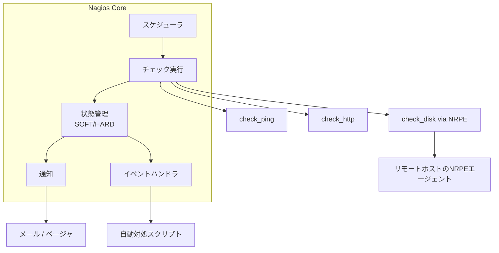
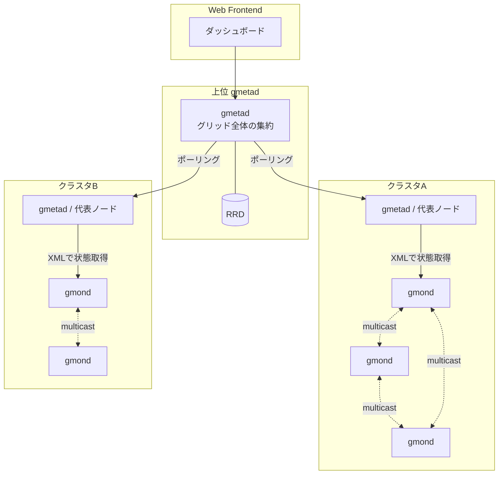
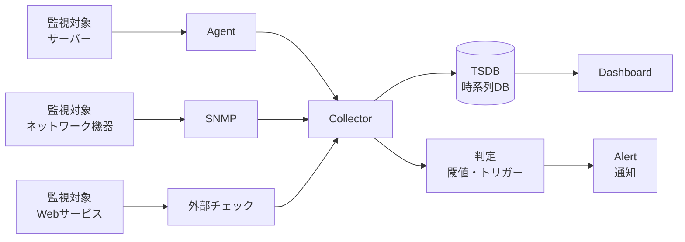

## 本章の問い

障害の兆候を把握するために、システムは何を、どの頻度で、どこから観測すべきなのか。

第1章で見たように、分散システムでは観測点が散らばり、部分障害が生まれ、原因が境界に潜むようになった。SNMPは機器の情報を統一的に取得する手段を与えたが、それだけでは「どの値がどうなったら異常なのか」「誰に、どう知らせるのか」「過去と比べてどう変化しているのか」には答えられない。

1990年代後半から2000年代にかけて、こうした問いに答えるオープンソースの監視ツールが次々に登場した。本章では、その代表であるNagios、Zabbix、Gangliaを取り上げ、それぞれがどのような問題に対して、どのような設計で応えたのかを比較する。

> **記述方針**：本章は監視ツールの**歴史と設計思想**を扱う。各ツールの現行バージョン、サポート状況、商用版の機能は歴史とは分けて記述し、刊行直前に公式情報で再確認する。

## 2.1　Ping、プロセス監視、ログ、SNMPとPolling

監視ツールの話に入る前に、監視の基本的な手段を整理しておく。初期の監視は、次のような素朴な方法の組み合わせだった。

| 手段 | 何を確かめるか | わかること | わからないこと |
|---|---|---|---|
| Ping（ICMP Echo） | ホストがネットワーク上で応答するか | 電源・ネットワークの到達性 | アプリケーションが動いているか |
| ポート監視 | 特定のTCPポートが接続を受け付けるか | サービスのプロセスが待ち受けているか | 正しい応答を返すか |
| プロセス監視 | 特定のプロセスが存在するか | プロセスが落ちていないか | プロセスがハングしていないか |
| ログ監視 | ログに特定の文字列が出たか | 既知のエラーの発生 | 未知のエラー、ログに出ない異常 |
| SNMP | 機器の内部カウンタの値 | 通信量、エラー数、資源使用率 | アプリケーションの意味的な正しさ |
| 合成監視（HTTPチェック） | 実際にリクエストを送り、応答を確かめる | 利用者から見た到達性と応答 | 内部のどこが遅いか |

この表から読み取れるのは、**どの手段も単独では不十分**だということである。Pingが通ってもWebサーバーは落ちているかもしれない。プロセスが存在してもハングしているかもしれない。監視とは、複数の手段を組み合わせて、システムの状態を多面的に推定する営みである。

もう一つ重要なのは、手段によって**観測の深さ**が異なることだ。Pingはネットワーク層、ポート監視はトランスポート層、HTTPチェックはアプリケーション層を見ている。浅い層の監視は簡単で汎用的だが、得られる情報は少ない。深い層の監視は情報が多いが、対象ごとに作り込みが必要になる。この「汎用性と深さのトレードオフ」が、監視ツールの設計を方向づけてきた。

### Pollingの頻度という問題

監視の多くはポーリング（定期的な問い合わせ）で行われる。このとき避けて通れないのが、**どの頻度で問い合わせるか**という問題である。

- 頻度を上げれば、短い異常も捉えられ、検知も早くなる。しかし、監視対象と監視サーバーの負荷が増え、保存するデータ量も増える。
- 頻度を下げれば負荷は減るが、間隔の間に起きた異常を見逃し、検知が遅れる。

例えば5分間隔のポーリングでは、障害の検知に最大5分、平均2.5分の遅れが生じる。さらに誤検知を避けるため「3回連続で失敗したら通知する」と設定すれば、最大15分の遅れになる。監視間隔の設計は、そのまま復旧時間（第3章）に影響する。

## 2.2　NetSaintからNagiosへ――プラグインによる監視モデル

### 誕生の経緯

Nagiosは、Ethan Galstadが開発したオープンソースの監視ツールである。その前身は**NetSaint**という名前で1999年に公開され、2002年に名称を**Nagios**に改めた。[R02] NetSaintからNagiosへの改称は、商標上の理由によるとされる。

Nagiosは、2000年代を通じてオープンソースの監視ツールの事実上の標準となり、多くの派生ソフトウェア（フォーク）や互換製品を生んだ。

### 設計の核心：プラグインモデル

Nagiosの最大の特徴は、**監視の実行部分をコア本体から切り離した**ことにある。

Nagiosのコアは、監視の「何を、いつ、どの順で実行し、結果をどう扱うか」というスケジューリングと状態管理だけを担う。実際に対象を調べる処理は、**プラグイン**と呼ばれる独立した実行ファイルに任される。プラグインは、次の単純な約束（インターフェース）に従えば、どの言語で書かれていてもよい。

- 終了コードで状態を返す：`0` = OK、`1` = WARNING、`2` = CRITICAL、`3` = UNKNOWN
- 標準出力の1行目に人間が読める説明を出す（任意で `|` の後に性能データを付ける）

```text
DISK OK - free space: / 3326 MB (56% inode=99%); | /=2643MB;5948;5958;0;5968
```

この設計は、きわめて大きな成功を収めた。

1. **拡張性**：監視したい対象があれば、誰でもシェルスクリプト一本でプラグインを書ける。
2. **生態系**：コミュニティが膨大な数のプラグインを共有し、データベース、メールサーバー、ハードウェアセンサーなど、あらゆる対象の監視が可能になった。
3. **単純さ**：終了コードと標準出力という、UNIXの最も基本的な約束だけでつながる。

ここには、第1章のMIBと同じ思想が見える。**共通のインターフェースを定めれば、多様な対象を一つの仕組みで扱える**。後のPrometheusのExporter（第7章）、さらにはMCPのツール定義（第13章、第19章）も、「本体は小さく、拡張は外部の部品に任せる」という同じ設計パターンに属する。

### Nagiosの監視モデル

Nagiosの監視は、次の概念で構成される。



- **ホストとサービス**：監視対象は「ホスト」（サーバーや機器）と、その上の「サービス」（HTTP、ディスク、プロセスなど）に分けて定義される。
- **SOFT状態とHARD状態**：一度のチェック失敗ですぐに通知せず、指定回数（`max_check_attempts`）連続で失敗したときに初めて「HARD」状態とし、通知する。一時的な揺らぎによる誤報を抑えるための仕組みである。
- **依存関係**：ルーターが落ちれば、その先のサーバーもすべて到達不能になる。Nagiosでは親子関係を定義し、親が落ちているときは子の障害を「到達不能（UNREACHABLE）」として扱い、通知の嵐を防ぐ。
- **イベントハンドラ**：状態変化時に任意のスクリプトを実行できる。プロセスの自動再起動などに使われた。これは今日の自動復旧（第3章、第10章）の素朴な原型である。

### 設定ファイルによる監視定義

Nagiosの監視は、テキストの設定ファイルで定義する。

```cfg
define host {
    use                 linux-server
    host_name           askline-api-01
    address             10.0.1.21
    parents             core-switch-01
}

define service {
    use                 generic-service
    host_name           askline-api-01
    service_description HTTP API Health
    check_command       check_http!-u /healthz -e 200
    max_check_attempts  3
    check_interval      1
    retry_interval      1
    contact_groups      askline-oncall
}
```

設定がテキストであることは、後の「監視設定をコードとして管理する」実践の先駆けでもあった。一方で、数千台規模になると設定ファイルは巨大になり、手作業での管理は困難になった。この問題に対して、テンプレートの継承や、構成管理ツールによる設定の自動生成が使われるようになる。

### プラグインモデルの限界

Nagiosの設計は、状態監視（OK/WARNING/CRITICAL）にはきわめて強かったが、次の点で限界があった。

- **時系列データの扱い**：Nagiosの本質は「今、正常か異常か」の判定であり、値の推移を蓄積・分析する仕組みは標準では弱かった。性能データを保存してグラフにするには、別のツール（後述のRRDToolを使うアドオンなど）が必要だった。
- **中央集約の負荷**：すべてのチェックを中央のサーバーから実行するため、監視対象が増えると中央サーバーがボトルネックになった。分散監視のための拡張は存在したが、構成は複雑になった。
- **状態の粒度**：4種類の状態は単純でわかりやすい一方、「徐々に悪化している」といった連続的な変化を表現するには向かなかった。

## 2.3　Zabbix――統合監視、エージェント、テンプレート、トリガー

### 誕生の経緯

Zabbixは、ラトビアのAlexei Vladishevが開発したオープンソースの監視ソフトウェアである。開発は1990年代末に始まり、**最初の版は2001年に公開された**。[R03] その後、開発元として企業が設立され、オープンソースのまま商用サポートを提供する形で発展した。

### 設計の核心：統合監視

Nagiosが「チェックの実行と状態管理」に焦点を絞り、それ以外を外部に任せたのに対し、Zabbixは**監視に必要な機能を一つの製品に統合する**方向を選んだ。

| 機能 | Nagios（コア） | Zabbix |
|---|---|---|
| データ収集 | プラグインの実行 | エージェント、SNMP、IPMI、JMX、HTTPなど多様な方式を内蔵 |
| データ保存 | 状態が中心。履歴は限定的 | リレーショナルデータベースに履歴とトレンドを保存 |
| 可視化 | 別ツールが必要 | グラフ、ダッシュボード、マップを内蔵 |
| 設定 | テキストファイル | Web UIとAPI、テンプレート |
| 異常判定 | プラグインの終了コード | トリガー式（収集値に対する条件式） |

この違いは、単なる機能の多寡ではなく、設計思想の違いである。Nagiosは「判定はプラグインが行い、コアは結果を受け取るだけ」だったのに対し、Zabbixは「**データは生の値として集め、判定はサーバー側の式で行う**」。これにより、同じ収集データに対して、複数の異なる条件で判定したり、過去の値と比較したりすることが容易になった。

### アイテム、トリガー、テンプレート

Zabbixの監視は、次の概念で構成される。

- **アイテム（Item）**：収集する個々の値。例：CPU使用率、空きメモリ、HTTPの応答時間。
- **トリガー（Trigger）**：アイテムの値に対する条件式。条件を満たすと「障害（Problem）」状態になる。
- **アクション（Action）**：トリガーの状態変化に応じて、通知やコマンド実行を行う。
- **テンプレート（Template）**：アイテム、トリガー、グラフなどをまとめた再利用可能な定義。ホストに適用するだけで、一式の監視が設定される。

トリガー式の例を示す（Zabbix 5.4以降の式の書式）。

```text
# 直近5分間の平均CPU使用率が90%を超えたら障害
avg(/Askline API Server/system.cpu.util,5m)>90

# 空きディスクが10%未満、かつ直近1時間で5%以上減少している
last(/Askline DB Server/vfs.fs.size[/,pfree])<10
and
change(/Askline DB Server/vfs.fs.size[/,pfree])<-5
```

> **注意**：Zabbixのトリガー式の書式は、バージョン5.4で大きく変更された。古い資料の `{host:key.func(param)}` 形式と混同しないこと。

### テンプレートという発明

テンプレートは、監視の歴史の中で見過ごされがちだが重要な発明である。「Linuxサーバーならこの一式」「MySQLならこの一式」という**標準的な監視の型**を定義し、新しいホストにはそれを適用するだけでよい。監視の品質を担当者の経験に依存させず、組織として標準化できる。

これは、第14章以降で扱うPlatform Engineeringの**Golden Path**（推奨される標準的な道筋）の考え方と本質的に同じである。「良い監視とは何か」を組織の知識として部品化し、誰でも再利用できるようにする。テンプレートを使わずに各担当者が個別に監視を設定する組織では、監視の網羅性と品質がばらつく。

### エージェント型監視の利点と負担

Zabbixは、監視対象のホストに**Zabbixエージェント**を導入する方式を中心に据えた。エージェントはOSの内部から情報を収集できるため、SNMPやリモートからのチェックよりも詳しく、効率的に監視できる。また、エージェント側からサーバーへデータを送る「アクティブチェック」を使えば、中央サーバーの負荷を下げられる。

一方で、エージェント型には固有の負担がある。

- すべての監視対象にエージェントを導入・更新・設定する必要がある。
- エージェント自体が障害の原因になりうる（資源消費、脆弱性）。
- 導入できない対象（ネットワーク機器、アプライアンス）には別の方式が必要になる。

エージェントを「導入する」か「導入しない（エージェントレス）」かは、現在でも監視設計の重要な選択である。第7章のOpenTelemetryでは、アプリケーション内部の計装（SDK）と、ホスト上のCollectorという二つの形でこの問題が再び現れる。

## 2.4　Ganglia――HPCクラスタを監視する分散アーキテクチャ

### 異なる問題設定

NagiosとZabbixが主に企業のサーバー群を対象としていたのに対し、**Ganglia**は異なる問題から生まれた。数百台から数千台のノードからなる**HPC（高性能計算）クラスタ**と、それらを束ねた**グリッド**をどう監視するかという問題である。

Gangliaは、カリフォルニア大学バークレー校で開発された。Matthew L. Massie、Brent N. Chun、David E. Cullerによる2004年の論文 *The Ganglia Distributed Monitoring System: Design, Implementation, and Experience* は、その設計と運用経験を詳しく報告している。[R04]

### 規模がもたらす制約

HPCクラスタの監視には、企業のサーバー監視とは異なる制約がある。

1. **ノード数が非常に多い**：一つのクラスタに数百〜数千のノードがあり、さらに複数のクラスタがある。
2. **監視のオーバーヘッドが許されない**：計算ノードの資源は本来の計算処理のためにある。監視が計算性能を落としてはならない。
3. **ノードの追加・故障が日常的**：ノードは頻繁に入れ替わり、監視設定を個別に書いていては追いつかない。
4. **知りたいのは主に資源の傾向**：個々のサービスの正常・異常よりも、CPU負荷、メモリ、ネットワークなどの資源利用の全体像が重要。

### 設計の核心：階層構造と集約

この制約に対して、Gangliaは**階層型（フェデレーション型）のアーキテクチャ**で応えた。論文の説明に基づき、その構造を整理する。[R04]



- **クラスタ内（gmond）**：各ノードで動く監視デーモン`gmond`は、自分の状態をマルチキャストでクラスタ内の全ノードに送信する。その結果、**クラスタ内のどのノードもクラスタ全体の状態を保持する**。特定の中央サーバーに依存しないため、一部のノードが落ちても監視は継続する。
- **クラスタ間（gmetad）**：`gmetad`は、各クラスタの代表ノードから状態をまとめて取得し、さらに上位の`gmetad`に提供する。これを木構造に重ねることで、グリッド全体を監視できる。
- **データ表現**：状態の交換には、XML（データ表現）とXDR（コンパクトなバイナリ形式）が使われ、時系列の保存にはRRDTool（次節）が使われた。

### Gangliaから学べること

Gangliaの論文が示した重要な教訓は、**監視システムそのものもスケーラビリティと耐障害性を持つ分散システムとして設計しなければならない**ということである。監視対象が数千台になれば、監視システムの設計を誤ると、監視が対象に与える負荷、監視サーバーの処理能力、ネットワーク帯域のいずれかが限界に達する。

またGangliaは、**個々の値を中央に送らず、階層ごとに集約する**という考え方を示した。数千ノードの個別の値を常に見る必要はなく、上位層ではクラスタ単位の合計や平均が見えればよい。この「集約による規模の制御」は、後のPrometheusのフェデレーションや、大規模な時系列基盤におけるダウンサンプリングにも通じる。

### 中央集約型と階層型の比較

| 観点 | 中央集約型（Nagios/Zabbixの典型構成） | 階層型（Ganglia） |
|---|---|---|
| 構成 | 中央サーバーが全対象を監視 | ノード→クラスタ→グリッドと段階的に集約 |
| 強み | 設定と状態が一か所にあり、把握しやすい。個別サービスの細かい判定に強い | 大規模でもスケールする。単一障害点が少ない |
| 弱み | 対象数が増えると中央がボトルネック | 個別サービスの細かい状態判定や通知は弱い |
| 適した用途 | 企業システム、多様なサービスの状態監視 | HPCクラスタ、同質な大量ノードの資源傾向 |
| 補足 | Zabbixにもプロキシによる分散構成がある | 障害通知は別ツールと組み合わせることが多い |

ここで注意すべきは、両者が競合ではなく**問題設定の違い**から生まれていることである。どちらが優れているかではなく、何を監視したいのかによって適切な設計が変わる。

## 2.5　RRDTool、時系列データ、履歴と可視化

### 時系列データという問題

監視が生み出すデータの多くは**時系列データ**――時刻とその時点の値の組――である。CPU使用率を1分ごとに記録すれば、1台あたり1日1,440点、1年で約52万点になる。1,000台で100種類の指標を集めれば、データ量は膨大になる。

時系列データの扱いには、一般的なデータベースとは異なる要求がある。

- 書き込みは常に「最新の時刻」に対して行われ、過去を書き換えることはほとんどない。
- 読み出しは「ある期間の推移」として行われることが多い。
- 古いデータほど、細かい粒度は不要になる（1年前の1分ごとの値はほとんど見ない）。

### RRDToolの設計

この問題に対する初期の代表的な解答が**RRDTool（Round Robin Database Tool）**である。RRDToolは、Tobias Oetikerがネットワークトラフィックを可視化するツールMRTGの後継として開発したもので、多くの監視ツール（Gangliaを含む）がデータの保存と描画に利用した。

RRDToolの核心は、**固定サイズのデータベース**という発想にある。

1. データベースの作成時に、保存する期間と粒度をあらかじめ決める。
2. データは「ラウンドロビン（循環）」形式で保存され、古いデータは新しいデータで上書きされる。
3. 複数の粒度のアーカイブ（RRA: Round Robin Archive）を持ち、古いデータは平均・最大・最小などに**集約（統合）**して長期間保存する。

例えば、次のような設計ができる。

| アーカイブ | 粒度 | 保存期間 | 点数 |
|---|---|---|---|
| RRA 1 | 1分 | 2日 | 2,880 |
| RRA 2 | 5分平均 | 2週間 | 4,032 |
| RRA 3 | 1時間平均 | 2か月 | 1,440 |
| RRA 4 | 1日平均 | 2年 | 730 |

```bash
# 1分ごとにCPU使用率（0-100のGAUGE）を格納するRRDを作成する例
rrdtool create askline-api-cpu.rrd \
  --step 60 \
  DS:cpu:GAUGE:120:0:100 \
  RRA:AVERAGE:0.5:1:2880 \
  RRA:AVERAGE:0.5:5:4032 \
  RRA:AVERAGE:0.5:60:1440 \
  RRA:MAX:0.5:60:1440 \
  RRA:AVERAGE:0.5:1440:730

# 値を書き込む（N は現在時刻）
rrdtool update askline-api-cpu.rrd N:42.5

# 直近1日のグラフを描く
rrdtool graph cpu-1d.png --start -1d \
  DEF:c=askline-api-cpu.rrd:cpu:AVERAGE \
  LINE2:c#0066cc:"CPU %"
```

### 固定サイズ設計のトレードオフ

RRDToolの設計の利点は明快である。**データベースのサイズが時間とともに増えない**ため、ディスク容量を事前に見積もることができ、運用が容易になる。

一方で、次の制約もある。

- **集約によって情報が失われる**：5分平均にすれば、その間の瞬間的なスパイクは消える。そのため、平均だけでなく最大値も保存するのが一般的である（上記の例のRRA:MAX）。
- **スキーマが固定される**：後から保存期間や粒度を変えるのは容易ではない。
- **多次元のデータに向かない**：一つのファイルが一つの対象の一組の系列に対応するため、「全サーバーのうち、特定のバージョンを動かしているものだけの平均」のような、ラベルによる柔軟な集計は難しい。

最後の制約は、2010年代に登場するPrometheusなどの**ラベル（次元）付き時系列データベース**によって大きく改善される（第7章）。しかし、それは同時に次節で述べる「系列数の爆発」という新しい問題を生むことになる。

## 2.6　監視のスケール――対象ノード、系列数、ストレージ、ノイズ

監視システムの規模は、単に「監視対象のノード数」だけでは測れない。本書では、監視のスケールを次の四つの次元で捉える。

### 次元1：対象数

監視対象のホスト、コンテナ、サービスの数。クラウドとコンテナの時代には、対象が数分で生まれ、数分で消える。静的な設定ファイルに対象を列挙する方式は成り立たなくなり、**サービスディスカバリ**（第7章、第15章）が必要になる。

### 次元2：系列数（カーディナリティ）

保存される時系列の数。「対象数 × 指標の種類 × ラベルの組み合わせ」で決まる。例えば、HTTPリクエスト数を「サービス × エンドポイント × ステータスコード × 利用者ID」で分けると、利用者IDの数だけ系列が増え、系列数は爆発的に大きくなる。これを**高カーディナリティ問題**と呼ぶ。

### 次元3：ストレージと保存期間

系列数 × 収集頻度 × 保存期間で決まるデータ量。RRDToolのような固定サイズ設計、ダウンサンプリング、保存期間の階層化（直近は高精度、過去は低精度）といった手法でこれを制御する。

### 次元4：ノイズ

最も見過ごされやすく、しかし運用にとって最も深刻なのが**ノイズ**――対応の必要がないアラートや、意味のない変動――である。監視対象と指標が増えるほど、ノイズも増える。ノイズが多いと、本当に重要なアラートが埋もれる。この問題は第3章の「アラート疲れ」で詳しく扱う。

| 次元 | 増えると何が起きるか | 主な対策 |
|---|---|---|
| 対象数 | 設定の手作業管理が破綻する | テンプレート、自動登録、サービスディスカバリ |
| 系列数 | 保存・クエリ性能が劣化する | ラベル設計、集約、カーディナリティ制限 |
| ストレージ | 費用が増え、検索が遅くなる | ダウンサンプリング、保存期間の階層化 |
| ノイズ | 重要な信号が埋もれ、人が疲弊する | 症状ベースのアラート、抑制、依存関係 |

四つの次元は互いに関係している。対象数が増えれば系列数が増え、系列数が増えればストレージが増え、指標が増えればノイズも増える。そして重要なのは、**これらの次元のうち、最初の三つは技術で解決できても、四つ目のノイズは技術だけでは解決できない**ということだ。何を重要とみなすかは、システムの目的と利用者への影響に依存する、設計上の判断だからである。

## 2.7　単純な閾値監視の限界

本章で扱った監視ツールの多くは、**閾値（しきいち）**による判定を基本としていた。「CPU使用率が90%を超えたら警告」「ディスクの空きが10%を切ったら重大」といった判定である。閾値監視は単純でわかりやすく、今でも有用である。しかし、次のような限界がある。

### 限界1：正常の範囲は一定ではない

業務システムのCPU使用率は、日中は高く、夜間は低い。月末の締め処理の日には、普段より大幅に高くなる。固定の閾値では、月末には誤報が鳴り続け、夜間には異常を見逃す。

### 限界2：「変化の仕方」が見えない

ディスク使用率が80%であること自体は問題ではないかもしれない。しかし、それが1時間で50%から80%に増えたのであれば、深刻な問題の兆候である。値の大きさだけでなく、**変化の速度**や**予測される到達時点**が重要な場合がある。Zabbixのトリガー式で `change()` 関数を使った例は、この問題への一つの対応である。

### 限界3：閾値は原因の指標であることが多い

CPU使用率が高いこと自体は、利用者にとっての問題ではない。利用者が困るのは、応答が遅いこと、エラーが返ることである。CPU使用率が95%でも応答時間が正常なら、アラートで人を起こす必要はない。逆に、CPU使用率が30%でも、ロック競合で応答が止まっていれば重大な障害である。

### 限界4：未知の障害を検知できない

閾値監視は「事前に想定した異常」しか検知できない。誰も想定していなかった種類の障害――特定の利用者だけに起きる問題、特定の組み合わせでのみ発生する問題――は、閾値の網をすり抜ける。

### 限界への応答：その後の発展

これらの限界は、その後の監視・運用技術の発展の方向を決めることになった。

| 限界 | その後の発展 | 本書の関連章 |
|---|---|---|
| 正常の範囲が一定でない | 季節性を考慮した異常検知、動的閾値 | 第10章 AIOps |
| 変化の仕方が見えない | 予測に基づくアラート（例：ディスクが満杯になる時刻の予測） | 第7章 |
| 原因の指標である | 症状（利用者影響）に基づくアラート、SLI/SLO | 第3章、第5章 |
| 未知の障害を検知できない | Observability（高カーディナリティの探索的分析、分散トレーシング） | 第7章 |

## 図・実装例

### 監視の基本アーキテクチャ

本章で扱ったツールは、細部は異なっていても、次の共通構造を持っている。



| 構成要素 | Nagios | Zabbix | Ganglia |
|---|---|---|---|
| 収集 | プラグイン、NRPE | Zabbixエージェント、SNMP、外部チェック | gmond |
| 集約 | Nagios Core | Zabbixサーバー（＋プロキシ） | gmetad（階層） |
| 保存 | 状態中心（履歴は外部ツール） | RDBMS（履歴・トレンド） | RRD |
| 判定 | プラグインの終了コード | トリガー式 | （主に可視化。通知は別ツール） |
| 可視化 | 状態画面（グラフは外部ツール） | 内蔵（グラフ、ダッシュボード） | Webフロントエンド |

### 実装例：Nagios互換プラグインをPythonで書く

Asklineの「問い合わせ受付API」が正しく応答しているかを確かめるプラグインを書く。単にHTTP 200が返るかだけでなく、応答時間と、応答本文に含まれる状態を確認する。

関数を小さく分け、判定ロジックをネットワーク処理から切り離しておくと、単体テストが書きやすくなる。

```python
#!/usr/bin/env python3
"""Askline API の健全性を確認する Nagios 互換プラグイン。

終了コード: 0=OK, 1=WARNING, 2=CRITICAL, 3=UNKNOWN
"""
from __future__ import annotations

import argparse
import json
import sys
import time
import urllib.request
from dataclasses import dataclass

OK, WARNING, CRITICAL, UNKNOWN = 0, 1, 2, 3
LABELS = {OK: "OK", WARNING: "WARNING", CRITICAL: "CRITICAL", UNKNOWN: "UNKNOWN"}

@dataclass(frozen=True)
class Probe:
    status_code: int
    elapsed_ms: float
    body: dict

@dataclass(frozen=True)
class Thresholds:
    warn_ms: float
    crit_ms: float

def fetch(url: str, timeout: float) -> Probe:
    """HTTP GET を実行し、応答コード・所要時間・JSON本文を返す。"""
    start = time.monotonic()
    with urllib.request.urlopen(url, timeout=timeout) as res:
        body = json.loads(res.read().decode("utf-8"))
        code = res.status
    return Probe(code, (time.monotonic() - start) * 1000, body)

def evaluate(probe: Probe, th: Thresholds) -> tuple[int, str]:
    """プローブ結果を Nagios の状態に変換する（副作用なし）。"""
    if probe.status_code != 200:
        return CRITICAL, f"HTTP {probe.status_code}"
    if probe.body.get("status") != "ok":
        return CRITICAL, f"status={probe.body.get('status')}"
    if probe.elapsed_ms >= th.crit_ms:
        return CRITICAL, f"slow response {probe.elapsed_ms:.0f}ms"
    if probe.elapsed_ms >= th.warn_ms:
        return WARNING, f"slow response {probe.elapsed_ms:.0f}ms"
    return OK, f"healthy {probe.elapsed_ms:.0f}ms"

def format_output(state: int, message: str, probe: Probe | None, th: Thresholds) -> str:
    """Nagios 形式の1行出力（性能データ付き）を組み立てる。"""
    line = f"ASKLINE API {LABELS[state]} - {message}"
    if probe is not None:
        line += f" | time={probe.elapsed_ms:.0f}ms;{th.warn_ms:.0f};{th.crit_ms:.0f};0"
    return line

def main(argv: list[str]) -> int:
    parser = argparse.ArgumentParser()
    parser.add_argument("--url", required=True)
    parser.add_argument("--warn-ms", type=float, default=500)
    parser.add_argument("--crit-ms", type=float, default=2000)
    parser.add_argument("--timeout", type=float, default=10)
    args = parser.parse_args(argv)
    th = Thresholds(args.warn_ms, args.crit_ms)
    try:
        probe = fetch(args.url, args.timeout)
    except Exception as exc:  # 接続失敗・タイムアウト・JSON不正
        print(format_output(CRITICAL, f"probe failed: {exc}", None, th))
        return CRITICAL
    state, message = evaluate(probe, th)
    print(format_output(state, message, probe, th))
    return state

if __name__ == "__main__":
    sys.exit(main(sys.argv[1:]))
```

判定関数 `evaluate` はネットワークに依存しないため、pytestで単体テストできる。

```python
# test_check_askline.py
from check_askline import CRITICAL, OK, WARNING, Probe, Thresholds, evaluate

TH = Thresholds(warn_ms=500, crit_ms=2000)

def test_healthy_fast_response_is_ok():
    assert evaluate(Probe(200, 120, {"status": "ok"}), TH)[0] == OK

def test_slow_response_is_warning():
    assert evaluate(Probe(200, 800, {"status": "ok"}), TH)[0] == WARNING

def test_degraded_body_is_critical_even_if_fast():
    assert evaluate(Probe(200, 50, {"status": "degraded"}), TH)[0] == CRITICAL

def test_non_200_is_critical():
    assert evaluate(Probe(503, 10, {}), TH)[0] == CRITICAL
```

このプラグインは「ステータスコード」「本文の意味」「応答時間」という三つの観点を組み合わせている。2.1節で述べたように、単一の手段では不十分であり、利用者から見た正しさ（本文の`status`）と、性能（応答時間）の両方を見る必要がある。

### 演習：GangliaとZabbixの比較

次の二つのシナリオについて、Gangliaの階層型とZabbixの中央集約型（必要に応じてプロキシを用いる）のどちらが適しているか、理由とともに答えよ。

1. 大学の研究室が運用する、同一構成の計算ノード800台からなるGPUクラスタ。研究者は、クラスタ全体の資源利用率の推移を知りたい。
2. Asklineの本番環境。Webサーバー、APIサーバー、データベース、メールサーバー、外部連携サービスなど、性質の異なる30種類のサービスがあり、それぞれに異なる障害判定と通知先が必要。

## 評価指標とトレードオフ

本章の内容を、監視システムそのものを評価する指標として整理する。

| 指標 | 意味 | 典型的なトレードオフ |
|---|---|---|
| 検知遅延 | 異常発生から検知までの時間 | 収集頻度を上げると負荷とデータ量が増える |
| 検知漏れ率 | 実際の障害のうち検知できなかった割合 | 閾値を厳しくすると誤検知が増える |
| 誤検知率 | アラートのうち対応不要だった割合 | 閾値を緩くすると検知漏れが増える |
| 監視オーバーヘッド | 監視が対象に与える資源負荷 | 詳細な監視ほど負荷が大きい |
| 監視カバレッジ | 重要なサービスのうち監視されている割合 | 網羅しようとすると設定と保守の負担が増える |
| 保存コスト | 時系列データの保存に要する費用 | 長期・高精度の保存ほど費用が増える |

監視設計の本質は、これらの指標のバランスを、**システムの目的と利用者への影響に照らして決める**ことにある。この判断は、ツールが代わりに行ってくれるものではない。

## 本章の結論

Nagios、Zabbix、Gangliaは、それぞれ異なる問題から生まれ、異なる設計で応えた。

- **Nagios**は、プラグインという単純なインターフェースによって、監視の拡張性と生態系を生み出した。
- **Zabbix**は、収集・保存・判定・可視化を統合し、テンプレートによって監視の標準化を可能にした。
- **Ganglia**は、階層構造と集約によって、大規模クラスタの監視をスケールさせた。

そして三者に共通する限界として、閾値による判定の限界が浮かび上がった。正常の範囲は変動し、閾値は原因の指標であることが多く、未知の障害は検知できない。次章では、さらに根本的な問題――**監視でアラートが出ても、なぜ障害は防げないのか**――を考える。

## 参考文献

- [R02] Nagios, *History of Nagios*. https://www.nagios.org/about/history/
- [R03] Zabbix, *The story of how Zabbix software became...*（公式沿革）. https://www.zabbix.com/jp/pr/pr280
- [R04] M. L. Massie, B. N. Chun, D. E. Culler, "The Ganglia Distributed Monitoring System: Design, Implementation, and Experience," *Parallel Computing*, 30(7), 2004. https://doi.org/10.1016/j.parco.2004.04.001
- RRDTool公式サイト（刊行前にURLと沿革を確認して追加する）
- Zabbix公式ドキュメント「Trigger expression」（参照したバージョンを明記する）
