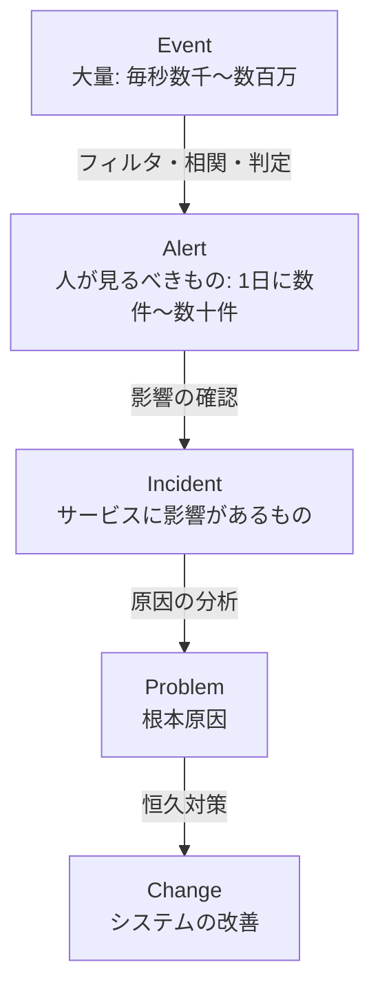
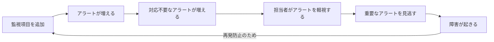
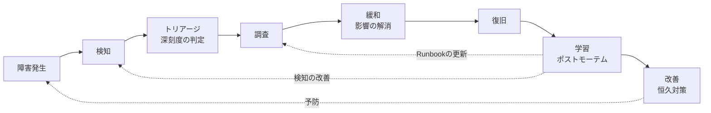

## 本章の問い

アラートが出ても、なぜ障害は防げないのか。運用はどこまで自動化すべきなのか。

第2章では、監視ツールが「異常を検知する」能力をどのように高めてきたかを見た。しかし、検知はあくまで出発点にすぎない。アラートを受け取った人が、状況を理解し、影響を判断し、正しい対処を選び、実行し、サービスを回復させ、二度と同じことが起きないよう学ぶ――この一連の流れがすべて機能して、初めてシステムは守られる。

本章では、検知の後に続く運用の仕事を、イベント・アラート・インシデント・問題という概念の区別から始めて、復旧の指標、手順書と当番制、根本原因分析とポストモーテム、アラート疲れ、自動化と人間の判断の境界の順に整理する。そして最後に、これらの課題に対する新しい答えとしてのSREへの橋渡しを行う。

## 3.1　Event、Alert、Incident、Problemの関係

運用の現場では、これらの言葉が混同されがちである。しかし、四つを区別することが、適切な運用設計の出発点になる。

| 用語 | 定義（本書） | 例 | 誰が扱うか |
|---|---|---|---|
| <strong>Event（イベント）</strong> | システムで起きた、観測可能な出来事 | ディスク使用率が85%に達した、デプロイが完了した | 機械（記録・集約） |
| <strong>Alert（アラート）</strong> | 人の注意や対応を求める通知 | 「API応答時間がSLOを超過」という通知 | 機械が生成し、人が受け取る |
| <strong>Incident（インシデント）</strong> | サービスの計画外の中断、または品質の低下 | 問い合わせ受付APIが30%のリクエストでエラーを返している | 対応チーム |
| <strong>Problem（問題）</strong> | 一つ以上のインシデントの根本的な原因 | 接続プールの設定値が、ピーク時の同時接続数に対して不足している | 問題管理の担当者 |

### 漏斗としての関係

四つの概念の関係は、<strong>漏斗</strong>として捉えるとわかりやすい。



漏斗の各段階で、量は減り、意味は増していく。良い運用設計とは、この漏斗の各段階が適切に機能するように設計することである。

- <strong>イベントからアラートへ</strong>：大量のイベントのうち、人の注意が必要なものだけをアラートにする。ここが緩すぎると、次節で述べるアラート疲れが起きる。
- <strong>アラートからインシデントへ</strong>：アラートを受けた人が、それが利用者に影響のある事態かどうかを判断する。
- <strong>インシデントから問題へ</strong>：復旧後、インシデントの根本原因を調べる。
- <strong>問題から変更へ</strong>：原因を取り除くための恒久対策を実施する。

### 「すべてのアラートは行動を要求すべき」

アラートの設計において、最も重要な原則は次のものである。

> <strong>アラートは、人が何らかの行動を取る必要があるときにだけ送るべきである。</strong>

この原則は、多くの実務家とGoogleのSRE文献で繰り返し強調されてきた。[R43] 行動を必要としない情報は、アラートではなくダッシュボードやログに記録すればよい。「念のため知らせておく」アラートは、一つひとつは無害に見えても、積み重なると本当に重要なアラートを埋もれさせる。

## 3.2　平均復旧時間MTTR、可用性、復旧目標RTO/RPO

### 可用性

<strong>可用性（Availability）</strong>は、システムが利用可能だった時間の割合である。

$$
\text{可用性} = \frac{\text{稼働時間}}{\text{稼働時間} + \text{停止時間}}
$$

可用性は「9の数」で表現されることが多い。

| 可用性 | 呼び方 | 年間の許容停止時間 | 30日あたりの許容停止時間 |
|---|---|---|---|
| 99% | ツーナイン | 約3.65日 | 約7.2時間 |
| 99.9% | スリーナイン | 約8.77時間 | 約43.2分 |
| 99.95% | | 約4.38時間 | 約21.6分 |
| 99.99% | フォーナイン | 約52.6分 | 約4.3分 |
| 99.999% | ファイブナイン | 約5.26分 | 約26秒 |

（年間は365.25日、30日は43,200分として計算）

この表が示すのは、可用性を一桁上げるごとに、許容される停止時間が10分の1になるということだ。99.99%を目指すなら、30日間で4分程度しか止められない。人がアラートを受けて、ログインして、状況を把握するだけで、この時間は過ぎてしまう。<strong>高い可用性は、人の対応速度だけでは達成できない</strong>。自動化、冗長化、そして障害の影響範囲を限定する設計が必要になる。

### MTTRとMTBF

可用性は、二つの量から決まる。

- <strong>MTBF（Mean Time Between Failures：平均故障間隔）</strong>：障害と障害の間の平均時間。
- <strong>MTTR（Mean Time To Recovery / Restore：平均復旧時間）</strong>：障害発生から復旧までの平均時間。

$$
\text{可用性} \approx \frac{\text{MTBF}}{\text{MTBF} + \text{MTTR}}
$$

この式は、可用性を高める二つの方向を示している。<strong>障害を減らす（MTBFを伸ばす）</strong>か、<strong>復旧を速くする（MTTRを縮める）</strong>かである。

伝統的な運用は、主に前者を目指した。変更を減らし、厳格なテストと承認を行い、障害の発生そのものを防ぐ。しかし複雑な分散システムでは、障害を完全に防ぐことはできない。そこで、後者――<strong>障害は起きるものとして、すばやく検知し、すばやく回復する</strong>――の重要性が高まった。第4章のDORA指標が「変更失敗率」と並んで「復旧時間」を重視するのは、この考え方に基づいている。

### MTTRを分解する

MTTRは一つの数字だが、その中身は複数の段階に分けられる。


| 段階 | 主な要因 | 改善の手段 |
|---|---|---|
| 検知（MTTD） | 監視の網羅性、収集頻度、閾値 | 症状ベースの監視、合成監視 |
| 対応開始（MTTA） | 通知経路、当番体制 | On-call、エスカレーション |
| 調査・診断 | 観測データの質、システムの理解 | Observability、Runbook |
| 緩和 | 切り戻しや切り替えの容易さ | ロールバック、フィーチャーフラグ |
| 事後復旧（MTTR外） | データ修復、後処理 | バックアップ、冪等な処理 |

本書のMTTRは、図の「利用者から見たサービス復旧」までを測る。データ修復や後処理がその後も続く場合、その時間はMTTRとは分けて記録する。

> <strong>用語の注意</strong>：MTTRの「R」は、Repair（修理）、Recovery（回復）、Restore（復元）、Respond（対応）など、文献によって異なる意味で使われる。本書では、利用者から見てサービスが回復するまでの時間（Restore / Recovery）を指す。指標を比較するときは、定義が揃っているかを必ず確認すること。

MTTRの分解から明らかなのは、<strong>多くの場合、最も時間がかかるのは「調査・診断」の段階</strong>だということである。何が起きているのかを理解するのに時間がかかる。この段階を短縮するための技術が、第7章で扱うObservabilityである。

### RTOとRPO

災害や大規模障害に備えた計画では、二つの目標が使われる。

- <strong>RTO（Recovery Time Objective：目標復旧時間）</strong>：障害発生から、どれだけの時間内にサービスを復旧させるか。
- <strong>RPO（Recovery Point Objective：目標復旧時点）</strong>：障害発生時に、どの時点までのデータを失ってよいか（どこまで遡ってよいか）。


例えば、RPO = 1時間、RTO = 4時間と定めれば、「障害が起きても、失うデータは最大1時間分、停止は最大4時間」という目標になる。RPOを短くするには、バックアップやレプリケーションの頻度を上げる必要があり、RTOを短くするには、待機系の準備や復旧手順の自動化が必要になる。いずれも費用がかかる。

RTO/RPOは、<strong>技術者が一方的に決めるものではない</strong>。業務への影響と費用を比較して、事業側と合意して決めるべきものである。この「信頼性の目標を利用者・事業と合意して決める」という考え方は、第5章のSLOにつながる。

## 3.3　Runbook、Escalation、On-call

### Runbook（手順書）

<strong>Runbook</strong>は、特定のアラートや状況に対して、何を確認し、どう対処するかを記した手順書である。メインフレーム時代のオペレーター向け手順書の直系の子孫と言える。

良いRunbookには、次の要素が含まれる。

1. <strong>このアラートは何を意味するか</strong>：どの症状が、どの程度の影響を持つのか。
2. <strong>最初に確認すること</strong>：ダッシュボードのURL、確認すべき指標、ログの検索方法。
3. <strong>よくある原因と対処</strong>：過去の経験から分かっている原因と、その対処手順。
4. <strong>緩和の手順</strong>：原因が分からなくても、影響を減らす方法（切り戻し、切り替え、流量制限）。
5. <strong>エスカレーション先</strong>：自分で解決できない場合に誰に連絡するか。
6. <strong>最終更新日と所有者</strong>：この手順が今も有効か、誰が責任を持つか。

```markdown
# Runbook: AsklineAPIHighErrorRate

## 意味
問い合わせ受付APIの5xxエラー率が5分間で2%を超えている。
利用者が問い合わせを送信できない可能性がある。

## 最初に確認すること
1. ダッシュボード「Askline / API Overview」でエラーの発生エンドポイントを確認
2. 直近30分以内のデプロイの有無を確認（デプロイ履歴チャンネル）
3. データベースの接続数と応答時間を確認

## よくある原因
- 直近のデプロイ → 前バージョンへのロールバック（手順: deploy/rollback.md）
- DB接続枯渇 → 接続プール設定の確認、APIの一時的なスケールイン
- 外部メール送信サービスの障害 → 送信キューの一時停止

## エスカレーション
15分以内に緩和できない場合、APIチームのセカンダリ当番に連絡

## メタ情報
所有者: Askline APIチーム / 最終確認: 2026-10-01
```

### Runbookの限界

Runbookは強力だが、限界もある。

- <strong>既知の障害にしか効かない</strong>：Runbookは過去の経験を記録したものであり、初めて起きる種類の障害には対応できない。
- <strong>すぐに古くなる</strong>：システムが変わっても、Runbookが更新されないことが多い。古いRunbookは、ないよりも危険な場合がある。
- <strong>人が手順を実行する</strong>：手順が決まっているなら、それは自動化できるはずである。人がRunbookを実行し続けることは、後述するToil（第5章）の典型である。

最後の点は重要である。Runbookに書かれた手順のうち、判断を要しない部分は自動化の候補になる。そして自動化されたRunbookは、最終的には「人を呼ばずにシステム自身が回復する」仕組みへと進化していく。ただし、3.6節で述べるように、どこまで自動化すべきかには慎重な判断が必要である。

### On-call（当番制）とEscalation

24時間稼働するサービスでは、勤務時間外にも誰かがアラートに対応できる体制が必要になる。これが<strong>On-call（オンコール、当番制）</strong>である。

On-callの設計で考慮すべき点は多い。

| 設計要素 | 考慮すべき点 |
|---|---|
| ローテーション | 一人に負担が偏らないよう、週単位などで交代する |
| プライマリとセカンダリ | 一次対応者が応答しない場合の二次対応者を決めておく |
| エスカレーション | 時間内に解決しない場合、誰に、どの順で連絡するか |
| 応答時間の目標 | アラート受信から対応開始までの目標時間 |
| 負荷の上限 | 一回の当番で受けるアラート数、夜間の呼び出し回数の上限 |
| 補償と休息 | 当番手当、夜間対応後の休息 |

On-callは、運用の<strong>人的コスト</strong>が最も直接的に現れる場所である。夜中に何度も起こされる当番が続けば、担当者は疲弊し、判断力が落ち、やがて離職する。Google SRE Bookは、On-call担当者が一回のシフトで扱えるインシデント数には限りがあり、その負荷を管理すべきであると論じている。[R46] On-callの負荷は、監視とアラート設計の質を映す鏡である。

## 3.4　根本原因分析（RCA）とポストモーテム

### 根本原因分析（RCA）

<strong>根本原因分析（Root Cause Analysis: RCA）</strong>は、インシデントの表面的な原因ではなく、その背後にある根本的な原因を特定する活動である。

代表的な手法に「<strong>なぜなぜ分析（5 Whys）</strong>」がある。Asklineの例で考えてみよう。

1. なぜ問い合わせが送信できなかったのか？ → APIが500エラーを返していたから。
2. なぜAPIが500エラーを返したのか？ → データベースへの接続が取得できなかったから。
3. なぜ接続が取得できなかったのか？ → 接続プールが枯渇していたから。
4. なぜ接続プールが枯渇したのか？ → 新しく追加した集計機能が、接続を長時間保持していたから。
5. なぜその問題がリリース前に発見されなかったのか？ → 負荷テストが、本番相当の同時接続数で行われていなかったから。

この分析から、恒久対策の候補が複数得られる。集計機能の修正（直接の原因）、接続プールの監視の追加（検知の改善）、負荷テストの条件の見直し（プロセスの改善）である。

### 「根本原因は一つ」という幻想

しかし、なぜなぜ分析には注意が必要である。複雑なシステムの障害は、多くの場合、<strong>単一の根本原因ではなく、複数の要因が重なって</strong>起きる。

- 集計機能に接続を長く保持するバグがあった。
- 同じ日に、マーケティングキャンペーンで利用者が急増した。
- 接続プールの上限は、2年前の利用者数を前提に設定されていた。
- 接続数の監視はあったが、アラートの閾値が高すぎた。
- 当番者は、類似の障害を経験したことがなかった。

これらのどれか一つが欠けていれば、障害は起きなかったか、もっと早く収まったかもしれない。「根本原因は集計機能のバグ」と結論づけて終わると、他の要因が見過ごされ、別の形で同じ種類の障害が再発する。

安全工学の分野では、事故を単一の原因の連鎖としてではなく、複数の要因と防護層の相互作用として捉える考え方が発展してきた。運用の世界でも、「根本原因（Root Cause）」ではなく「<strong>寄与要因（Contributing Factors）</strong>」という言葉を使う組織が増えている。

### ポストモーテム

<strong>ポストモーテム（Postmortem）</strong>は、インシデントの後に、何が起きたか、なぜ起きたか、どう対応したか、何を学んだかを文書にまとめ、組織で共有する活動である。

典型的なポストモーテムの構成を示す。

```markdown
# ポストモーテム: 問い合わせ送信の部分停止（2026-09-12）

## 概要
- 影響: 14:05〜14:52の47分間、問い合わせ送信の約30%が失敗
- 影響を受けた利用者: 約2,300社の問い合わせ担当者
- 深刻度: SEV-2

## タイムライン
- 13:40 集計機能v2.3をデプロイ
- 14:05 マーケティングキャンペーンによりアクセスが平常時の3倍に
- 14:05 エラー率が上昇開始
- 14:18 エラー率アラート発報、当番者が対応開始
- 14:35 DB接続プールの枯渇を確認
- 14:45 集計機能をv2.2にロールバック
- 14:52 エラー率が正常値に回復

## 寄与要因
1. 集計機能v2.3が、DB接続を処理完了まで保持する実装だった
2. 接続プールの上限が、現在のピーク負荷を想定していなかった
3. 接続プール使用率の監視がなかった
4. 負荷テストが平常時の同時接続数で行われていた

## うまくいったこと
- ロールバック手順が整備されており、判断後10分以内に実施できた

## うまくいかなかったこと
- 発生から検知まで13分かかった
- 接続プール枯渇の特定に17分かかった

## 対策（アクションアイテム）
| 対策 | 種類 | 担当 | 期限 |
|---|---|---|---|
| 集計機能の接続保持の修正 | 修正 | APIチーム | 9/19 |
| 接続プール使用率のアラート追加 | 検知 | SRE | 9/16 |
| 負荷テスト条件をピークの2倍に変更 | 予防 | QA | 9/30 |
| エラー率アラートの評価期間を短縮 | 検知 | SRE | 9/16 |
```

### Blameless（非難しない）文化

ポストモーテムが機能するかどうかは、<strong>誰かを責めない</strong>ことにかかっている。障害の報告が個人の責任追及の場になれば、人々は失敗を隠し、事実を語らなくなる。そうなれば、組織は失敗から学べなくなる。

Blameless Postmortem（非難しないポストモーテム）の考え方は、「誰が間違えたか」ではなく「<strong>なぜ、その人がその時点でそう判断したことが合理的だったのか</strong>」「<strong>システムのどこに、間違いを起こしやすくする要因があったのか</strong>」を問う。人は間違えるものであり、一人の間違いで大規模な障害が起きるなら、それはシステムの設計の問題である。

この考え方は、第5章でSREの文脈から再び取り上げる。[R47]

## 3.5　アラート疲れと誤検知

### アラート疲れとは

<strong>アラート疲れ（Alert Fatigue）</strong>とは、大量のアラート、特に対応不要なアラートにさらされ続けた結果、担当者がアラートに鈍感になり、重要なアラートを見逃したり、対応が遅れたりする状態である。

アラート疲れは、次のような悪循環で進行する。



皮肉なことに、障害が起きるたびに「念のため」監視を追加することが、さらなるアラート疲れを招く。

### 誤検知と見逃しのトレードオフ

アラートの判定は、統計的な分類問題として捉えられる。

| | 実際に問題がある | 実際には問題がない |
|---|---|---|
| <strong>アラートが出た</strong> | 真陽性（正しい検知） | <strong>偽陽性（誤検知）</strong> |
| <strong>アラートが出ない</strong> | <strong>偽陰性（見逃し）</strong> | 真陰性 |

閾値を厳しくすれば見逃しは減るが、誤検知が増える。閾値を緩くすれば誤検知は減るが、見逃しが増える。両方を同時に減らすには、<strong>より良い信号</strong>を使うしかない。

### 症状に基づくアラート

アラート疲れへの最も効果的な対策の一つは、<strong>原因ではなく症状に基づいてアラートを出す</strong>ことである。

| 種類 | 例 | 特徴 |
|---|---|---|
| 原因ベース | CPU使用率 > 90%、メモリ使用率 > 85%、特定プロセスの再起動 | 数が多く、利用者影響との関係が曖昧 |
| 症状ベース | エラー率 > 1%、95パーセンタイル応答時間 > 1秒、問い合わせ送信の成功率 < 99% | 数が少なく、利用者影響と直結 |

CPU使用率が高くても利用者に影響がなければ、夜中に人を起こす必要はない。逆に、利用者が影響を受けているなら、原因がCPUであれ、ネットワークであれ、外部サービスであれ、対応が必要である。症状ベースのアラートは、「利用者が困っているかどうか」という一点で人を呼ぶ。原因ベースの指標は、アラートではなく調査のためのダッシュボードに置けばよい。

この考え方を体系化したのが、第5章のSLI/SLOと、SLOに基づくアラート（バーンレートアラート）である。

### アラートの衛生管理

アラートは、一度設定したら終わりではない。定期的に見直す必要がある。

1. <strong>過去1か月に発報したアラートをすべて列挙する。</strong>
2. それぞれについて、「対応が必要だったか」「実際に何をしたか」を確認する。
3. 対応不要だったアラートは、削除するか、閾値を見直すか、ダッシュボードに移す。
4. 毎回同じ手順で対応しているアラートは、自動化を検討する。
5. 障害を見逃した事例があれば、それを検知できる症状ベースのアラートを追加する。

## 3.6　AutomationとHuman Judgmentの境界

### 自動化の利点

運用の自動化には、明確な利点がある。

- <strong>速さ</strong>：機械は数秒で対処を始められる。人は呼び出されてから対応を始めるまでに数分〜数十分かかる。
- <strong>正確さ</strong>：機械は手順を間違えない（手順が正しければ）。
- <strong>一貫性</strong>：疲れや焦りの影響を受けない。
- <strong>規模</strong>：数千台のサーバーに同時に同じ操作ができる。

### 自動化の危険

一方で、自動化には固有の危険がある。

<strong>第一に、自動化は誤りも速く、大規模に実行する。</strong> 人が手作業で行えば1台で気づくような誤りも、自動化されれば数千台に一瞬で広がる。自動化された復旧処理が、想定外の状況で誤作動し、障害を拡大させた事例は少なくない。

<strong>第二に、自動化は人の理解を奪う。</strong> 自動化が日常の対処を担うと、人はシステムの振る舞いを直接経験しなくなる。そして自動化が対処できない異常事態が起きたとき、人はシステムを理解しておらず、適切に対応できない。これは人間工学の分野で「<strong>自動化の皮肉（Ironies of Automation）</strong>」として知られる問題である。Lisanne Bainbridgeが1983年の論文で論じたこの問題は、航空機の自動操縦から産業プラントまで、自動化が進んだあらゆる領域で観察されてきた。

<strong>第三に、自動化同士が相互作用する。</strong> オートスケーラーがサーバーを増やし、別の自動化が負荷分散を変更し、さらに別の自動化がヘルスチェックの失敗を検知してサーバーを再起動する。個々の自動化は正しくても、それらが同時に動くと、予期しない振る舞い（振動、連鎖的な再起動）を生むことがある。

### 自動化の段階

自動化は「するか、しないか」の二択ではない。段階的に考えるべきである。

| 段階 | 内容 | 人の役割 | 例 |
|---|---|---|---|
| 0 | 手作業 | すべて人が実行 | 手順書を見てコマンドを打つ |
| 1 | 情報提供 | 人が判断・実行。機械は情報を集める | アラートに関連ダッシュボードとRunbookのリンクを添付 |
| 2 | 提案 | 機械が対処を提案、人が承認して実行 | 「ロールバックを推奨します。実行しますか？」 |
| 3 | 条件付き自動実行 | 機械が実行、人に通知。人は事後に確認 | 安全と分かっている範囲での自動再起動 |
| 4 | 完全自動 | 機械が判断・実行。人は全体の設計と監督 | オートスケーリング、Kubernetesのセルフヒーリング |

どの段階を選ぶかは、次の要因で決まる。

- <strong>操作の可逆性</strong>：元に戻せる操作（再起動、ロールバック）ほど、自動化しやすい。データの削除のように元に戻せない操作は、人の承認を挟むべきである。
- <strong>影響範囲</strong>：1台に影響する操作と、全体に影響する操作では、リスクが違う。
- <strong>状況の判断の難しさ</strong>：判断の基準が明確な操作ほど、自動化しやすい。
- <strong>頻度</strong>：頻繁に起きる対処ほど、自動化の効果が大きい。

この段階の考え方は、第10章のAIOpsにおける自動復旧、第13章と第20章のAIエージェントにおける「承認不要／人間の承認必須／禁止」の分類、第22章の自己改善型プラットフォームにおける人間の承認の設計へと、本書を通じて繰り返し登場する。<strong>自動化の主体が、スクリプトから機械学習モデルへ、さらにAIエージェントへと変わっても、この判断の構造は変わらない</strong>。

## 3.7　次世代の運用思想としてのSREへの橋渡し

### 伝統的な運用の行き詰まり

本章で見てきた課題を振り返ると、伝統的な運用が行き詰まる構造が見えてくる。

1. サービスが成長すると、監視対象とアラートが増える。
2. アラートが増えると、On-callの負荷が増える。
3. 運用チームは障害対応とRunbookの実行に追われ、改善に時間を割けない。
4. 改善されないシステムでは、障害が繰り返される。
5. 対応のために運用担当者を増やすが、サービスの成長に人員の増加が追いつかない。

この構造の根本には、<strong>運用の仕事量がサービスの規模に比例して増える</strong>という問題がある。サービスが10倍になれば、運用担当者も10倍必要になる。これは持続可能ではない。

### SREという回答

Googleは、この問題に異なる方法で取り組んだ。Google SRE Bookの序章は、従来型のシステム管理者（sysadmin）による運用モデルと、Googleが採用したSREのモデルを対比している。[R05]

従来型のモデルでは、開発チームがソフトウェアを作り、運用チーム（システム管理者）がそれを本番環境で動かす。運用チームの仕事は主に手作業と手順の実行であり、サービスが大きくなれば、運用チームも大きくする必要がある。そして、開発と運用の目標の違い（変更したい開発と、安定させたい運用）が、組織的な対立を生む。

SREのモデルでは、<strong>運用の課題をソフトウェアエンジニアリングで解決する</strong>。運用チームにソフトウェアエンジニアを配置し、手作業の運用を自動化し、システムをより運用しやすく設計し直す。運用の仕事量がサービスの規模に比例して増えないよう、エンジニアリングによって構造を変える。

本章で扱った課題に対して、SREは次のような答えを示した。

| 本章の課題 | SREの答え | 第5章での扱い |
|---|---|---|
| 可用性の目標をどう決めるか | SLI/SLOを利用者視点で定義し、合意する | 5.3、5.4 |
| 変更と安定の対立 | Error Budgetで、変更の速度と信頼性を同じ尺度で扱う | 5.5 |
| アラート疲れ | SLOに基づく症状ベースのアラート | 5.3〜5.5 |
| 手作業の運用の増加 | Toilを測定し、上限を設け、自動化で削減する | 5.6 |
| On-callの疲弊 | On-callの負荷を管理し、エンジニアリング時間を確保する | 5.6 |
| 失敗から学べない | Blameless Postmortem | 5.6 |

### DevOpsとSRE

同じ時期、運用と開発の関係を見直す別の流れも生まれていた。それが<strong>DevOps</strong>である。DevOpsは、開発と運用の壁そのものを問題とし、文化、自動化、測定、共有を通じてその壁を越えようとした。

DevOpsとSREは、異なる場所から生まれ、異なる言葉で語られたが、多くの問題意識を共有している。次の第Ⅱ部では、まずDevOps（第4章）、次にSRE（第5章）を取り上げ、両者の違いと共通点を明らかにする。

## 図・実装例

### インシデント・ライフサイクル図



このライフサイクルで重要なのは、最後の「学習」と「改善」から、最初の段階へと戻る矢印である。インシデント対応は復旧で終わりではなく、<strong>学習を通じて、次の障害を防ぎ、検知を早め、調査を容易にする</strong>ことで初めて完結する。この学習のループが回らない組織では、同じ障害が繰り返される。

### 実装例：アラートの「対応要否」を記録・集計する

アラート疲れを可視化するために、発報したアラートに対して当番者が「対応が必要だったか」を記録し、集計する仕組みを作る。ここでは、記録をCSVとして蓄積し、アラートごとの「対応不要率」を算出する最小の実装を示す。

```python
"""アラートの対応要否を集計し、見直し候補を抽出する。"""
from __future__ import annotations

import csv
from collections import defaultdict
from dataclasses import dataclass
from pathlib import Path

@dataclass(frozen=True)
class AlertRecord:
    alert_name: str
    actionable: bool       # 当番者が「対応が必要だった」と判断したか
    night_time: bool       # 夜間（22時〜7時）に発報したか

@dataclass(frozen=True)
class AlertStats:
    alert_name: str
    total: int
    non_actionable: int
    night_pages: int

    @property
    def noise_ratio(self) -> float:
        return self.non_actionable / self.total if self.total else 0.0

def load_records(path: Path) -> list[AlertRecord]:
    with path.open(encoding="utf-8") as f:
        return [
            AlertRecord(
                alert_name=row["alert_name"],
                actionable=row["actionable"] == "yes",
                night_time=row["night_time"] == "yes",
            )
            for row in csv.DictReader(f)
        ]

def aggregate(records: list[AlertRecord]) -> list[AlertStats]:
    total: dict[str, int] = defaultdict(int)
    noise: dict[str, int] = defaultdict(int)
    night: dict[str, int] = defaultdict(int)
    for r in records:
        total[r.alert_name] += 1
        noise[r.alert_name] += 0 if r.actionable else 1
        night[r.alert_name] += 1 if r.night_time else 0
    return [AlertStats(n, total[n], noise[n], night[n]) for n in total]

def review_candidates(stats: list[AlertStats], max_noise: float = 0.5) -> list[AlertStats]:
    """対応不要率が高いアラートを、夜間発報の多い順に返す。"""
    noisy = [s for s in stats if s.noise_ratio > max_noise]
    return sorted(noisy, key=lambda s: s.night_pages, reverse=True)

if __name__ == "__main__":
    stats = aggregate(load_records(Path("alert_log.csv")))
    for s in review_candidates(stats):
        print(f"{s.alert_name}: 対応不要率 {s.noise_ratio:.0%}, 夜間発報 {s.night_pages}回")
```

```python
# test_alert_review.py
from alert_review import AlertRecord, aggregate, review_candidates

def test_noisy_alert_is_review_candidate():
    records = [
        AlertRecord("HighCPU", actionable=False, night_time=True),
        AlertRecord("HighCPU", actionable=False, night_time=True),
        AlertRecord("HighCPU", actionable=True, night_time=False),
        AlertRecord("ApiErrorRate", actionable=True, night_time=True),
    ]
    names = [s.alert_name for s in review_candidates(aggregate(records))]
    assert names == ["HighCPU"]

def test_actionable_alert_is_not_candidate():
    records = [AlertRecord("ApiErrorRate", actionable=True, night_time=True)]
    assert review_candidates(aggregate(records)) == []
```

この仕組みは単純だが、効果は大きい。「対応不要率が80%のアラートが、先月夜間に15回発報した」という事実を示すことで、アラートの見直しを、感覚ではなくデータに基づいて進められる。

## 評価指標とトレードオフ

| 指標 | 定義 | 目指す方向 | 注意点 |
|---|---|---|---|
| MTTD | 障害発生から検知までの平均時間 | 短く | 発生時刻の特定が難しい場合がある |
| MTTR | 障害発生から復旧までの平均時間 | 短く | 定義（R）を揃える。平均は外れ値に引っ張られる |
| アラート対応要否率 | アラートのうち対応が必要だった割合 | 高く | 当番者の主観に依存する |
| 夜間呼び出し回数 | 当番一回あたりの夜間アラート数 | 少なく | 負荷の偏りを見るため、個人別にも見る |
| ポストモーテム実施率 | 重大インシデントのうちポストモーテムを行った割合 | 高く | 形式的な実施にならないよう内容も見る |
| アクションアイテム完了率 | ポストモーテムの対策のうち期限内に完了した割合 | 高く | 完了しない対策は、学習が実を結んでいない兆候 |
| 再発率 | 同じ寄与要因によるインシデントの再発 | 低く | 「同じ原因」の判断基準を定める |

本章の中心的なトレードオフは、次の二つである。

1. <strong>検知の感度とノイズ</strong>：見逃しを減らそうとすれば誤検知が増え、誤検知はアラート疲れを通じて、最終的に見逃しを増やす。
2. <strong>自動化の速さと安全性</strong>：自動化は対応を速くするが、誤りも速く広げ、人の理解を奪う。

## 演習

### 演習3-1：典型的なWebサービス障害の事後分析

次のシナリオについて、ポストモーテムを作成せよ。

> Asklineで、ある金曜日の18時、問い合わせの添付ファイルのアップロードが一斉に失敗し始めた。当番者がアラートを受けたのは18時25分。調査の結果、添付ファイル用のストレージの容量が上限に達していたことが判明した。容量を追加して19時10分に復旧した。ストレージ使用率の監視はあったが、閾値が95%に設定されており、使用率が90%から100%に達するまでの時間は約20分だった。ストレージ使用量は、3日前に始まった大口顧客の利用開始により急増していた。

1. タイムラインを作成せよ。
2. 寄与要因を三つ以上挙げよ。
3. 「検知」「予防」「緩和」の観点から、それぞれ一つ以上のアクションアイテムを提案せよ。
4. このポストモーテムで「誰かを責める」表現を避けるには、どう書けばよいか。

### 演習3-2：自動化の段階を決める

次の対処について、3.6節の自動化の段階（0〜4）のどれが適切かを、理由とともに答えよ。

1. Webサーバーのプロセスが停止したときの再起動
2. データベースのプライマリ障害時のレプリカへの切り替え
3. 直近のデプロイ後にエラー率が急増したときのロールバック
4. ディスク容量が逼迫したときの古いログファイルの削除
5. 不審なアクセスを検知したときの、該当する利用者アカウントの停止

### 演習3-3：99.9%の意味を考える

Asklineの問い合わせ受付APIの可用性目標を、月間99.9%とする。

1. 30日間で許容される停止時間は何分か。
2. 当番者が呼び出されてから対応を始めるまでに平均15分、調査に平均20分、緩和に平均10分かかるとする。この体制で、1か月に何回の障害まで許容されるか。
3. この計算から、可用性目標を達成するために何を改善すべきか考えよ。

## 参考文献

- [R05] B. Treynor Sloss et al., "Introduction," in *Site Reliability Engineering: How Google Runs Production Systems*, O'Reilly, 2016. https://sre.google/sre-book/introduction/
- [R43] Google, *Site Reliability Engineering*, "Monitoring Distributed Systems." https://sre.google/sre-book/monitoring-distributed-systems/
- [R46] Google, *Site Reliability Engineering*, "Being On-Call." https://sre.google/sre-book/being-on-call/
- [R47] Google, *Site Reliability Engineering*, "Postmortem Culture: Learning from Failure." https://sre.google/sre-book/postmortem-culture/
- L. Bainbridge, "Ironies of Automation," *Automatica*, 19(6), 1983.（刊行前にDOIを確認して追加する）
