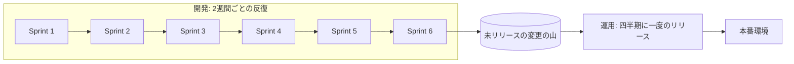
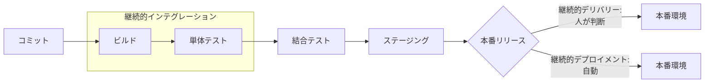
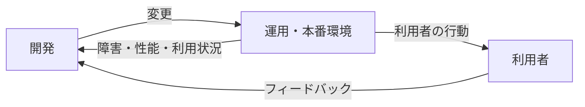
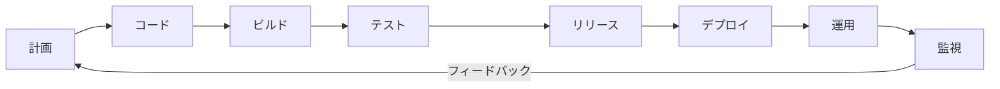

> **第Ⅱ部　DevOps、SRE、Cloud Nativeの時代**
>
> 第Ⅰ部では、運用が「手順を正確に繰り返す仕事」として成立し、監視ツールの進化とともに高度化しながらも、規模と変化の速さに追いつけなくなっていく過程を見た。第Ⅱ部では、2000年代後半から2010年代にかけて起きた転換――運用を**ソフトウェアとして扱う**転換――を扱う。DevOpsは開発と運用の壁を越え、SREは信頼性を工学の対象にし、Cloud Nativeはインフラそのものをプログラム可能にし、Observabilityは未知の障害を調べる手段を与えた。

## 本章の問い

「変更したい開発」と「安定させたい運用」は、なぜ対立したのか。

第1章の最後で、開発と運用の対立が個人の性格ではなく、組織構造と評価指標の問題であることを見た。開発は機能を届けた数で評価され、運用は障害の少なさで評価される。両者が誠実に職務を果たすほど、対立は深まる。

DevOpsは、この対立を「どちらが正しいか」ではなく、**両者の目標を一致させる仕組みをどう作るか**という問いに置き換えた運動である。本章では、DevOpsの背景にあるAgileと継続的デリバリーの潮流、DevOpsという言葉の誕生、その中核となる価値と技術、そしてDORAの研究による測定の確立をたどる。最後に、DevOpsが解決したことと、解決しきれなかったこと――開発者の認知負荷――を明らかにし、第Ⅳ部のPlatform Engineeringへの伏線を張る。

## 4.1　Agileと継続的デリバリーの潮流

### Agileが変えたもの

2001年、ソフトウェア開発者のグループが「アジャイルソフトウェア開発宣言（Manifesto for Agile Software Development）」を公表した。宣言は、プロセスやツールよりも個人と対話を、包括的なドキュメントよりも動くソフトウェアを、契約交渉よりも顧客との協調を、計画に従うことよりも変化への対応を重視すると述べた。

Agileは、ソフトウェア開発を「長期の計画に基づく一回の大きなリリース」から「**短い反復による継続的な価値の提供**」へと変えた。数週間ごとに動くソフトウェアを作り、利用者からのフィードバックを得て、次の反復に反映する。

### Agileが運用にもたらした問題

しかし、Agileは主に**開発チームの内部**の変革だった。開発チームが2週間ごとに新しい機能を完成させても、それを本番環境に届けるのが運用チームの仕事である限り、リリースは運用の変更管理プロセスに従う。四半期に一度のリリース枠、変更諮問委員会の承認、手作業のデプロイ手順書――開発の速度が上がるほど、開発と本番環境の間に「完成したが、リリースされていない」変更が溜まっていく。



溜まった変更は、まとめてリリースされる。一回のリリースに含まれる変更が多いほど、何が障害を引き起こしたのかを特定しにくくなり、リリースのリスクは高まる。リスクが高まれば、運用はさらに慎重になり、リリースの間隔は広がる。こうして**大きなリリースが、さらに大きなリリースを生む**悪循環が起きる。

### 継続的デリバリー

この問題に対する技術的な答えが、**継続的デリバリー（Continuous Delivery）**である。Jez HumbleとDavid Farleyは、2010年の著書 *Continuous Delivery* で、ソフトウェアを**いつでも本番環境にリリースできる状態に保つ**ための原則と実践を体系化した。

継続的デリバリーの核心にある考え方は、直感に反する。

> **リリースが怖いなら、もっと頻繁にリリースせよ。**

頻繁にリリースすれば、一回あたりの変更は小さくなる。小さな変更は、理解しやすく、テストしやすく、問題が起きても原因を特定しやすく、元に戻しやすい。そして、頻繁に行う作業は、自動化する価値が高まり、手順として洗練されていく。

| 観点 | 大きく稀なリリース | 小さく頻繁なリリース |
|---|---|---|
| 一回の変更量 | 大きい | 小さい |
| 障害時の原因特定 | 難しい（多数の変更の組み合わせ） | 容易（直近の小さな変更） |
| ロールバックの影響 | 大きい（多くの機能が巻き戻る） | 小さい |
| リリース作業の習熟 | 低い（年に数回しか行わない） | 高い（日常的に行う） |
| 自動化の動機 | 弱い | 強い |
| フィードバックの速さ | 遅い（数か月） | 速い（数時間〜数日） |

## 4.2　DevOpsという言葉と2009年前後のコミュニティ

### 言葉の誕生

DevOpsという言葉は、特定の標準化団体や企業が定義したものではなく、**実務家のコミュニティから生まれた**。

その経緯としてよく語られるのは、次のような出来事である。ベルギーのコンサルタントPatrick Deboisは、データセンター移行のプロジェクトで開発と運用の両方に関わり、両者の断絶に強い問題意識を持っていた。2008年のAgileカンファレンスでは、Andrew Clay Shaferが「Agile Infrastructure」に関するセッションを提案し、Deboisがそれに参加したことが、両者の議論のきっかけになったと言われる。

2009年、O'ReillyのVelocityカンファレンスで、FlickrのJohn AllspawとPaul Hammondが「10+ Deploys Per Day: Dev and Ops Cooperation at Flickr」という講演を行った。開発と運用が協力することで、一日に10回以上のデプロイを安全に行っているという報告は、多くの技術者に衝撃を与えた。この講演に触発されたDeboisは、同年ベルギーのゲントで**DevOpsDays**というカンファレンスを開催した。DevOpsという言葉は、このカンファレンスの名前から広まったとされる。

> **執筆メモ**：上記の経緯は複数の回想や講演記録に基づく通説である。「DevOpsという言葉が初めて使われたのはいつか」という主張は、執筆・引用ルール第4項に従い、DevOpsDaysの公式記録、Velocity 2009の講演記録、当事者の回想など、複数の独立した資料で裏付けてから断定すること。本書では「2009年前後のコミュニティ形成」として記述する。

### DevOpsは何でないか

DevOpsは、その誕生の経緯から、明確な定義を持たないまま広がった。そのため、多くの誤解も生まれた。本書の議論のために、DevOpsが**何でないか**を確認しておく。

- **DevOpsは職種名ではない**：「DevOpsエンジニア」という職種名は広く使われているが、DevOpsの本来の主張は、特定の担当者を置くことではなく、開発と運用の協働の仕方を変えることにある。
- **DevOpsはチームの名前ではない**：開発チームと運用チームの間に「DevOpsチーム」を新設すると、壁が一つ増えるだけになりかねない。
- **DevOpsはツールではない**：CI/CDツールやIaCツールはDevOpsの実践を支えるが、ツールを導入しただけではDevOpsにはならない。

本書では、DevOpsを次のように理解する。

> **DevOps**とは、開発と運用の協働を通じて、ソフトウェアの変更を速く、安全に、継続的に届けるための文化・実践・技術の総体である。（本書の理解。DORAの研究 [R06] における技術・組織能力の整理を踏まえる）

## 4.3　Culture、Automation、Measurement、Sharing

### CAMS

DevOpsの初期に、その中核的な価値を表す枠組みとして広まったのが**CAMS**である。CAMSは、John WillisとDamon Edwardsが2010年頃に提唱したとされる。

| 要素 | 意味 | 具体的な実践 |
|---|---|---|
| **Culture（文化）** | 開発と運用が共通の目標を持ち、互いに協力する | 共同の責任、Blamelessな振り返り、相互の尊重 |
| **Automation（自動化）** | 繰り返しの作業を自動化し、速く確実にする | CI/CD、IaC、自動テスト |
| **Measurement（測定）** | 改善のために、成果と過程を測る | デリバリーの指標、運用の指標、利用者の指標 |
| **Sharing（共有）** | 知識、道具、責任、失敗を共有する | ドキュメント、ポストモーテム、ツールの共有 |

後に、Jez HumbleがLean（リーン）の要素を加えて**CALMS**とする整理も広まった。Leanは、価値の流れ（バリューストリーム）を可視化し、待ち時間や手戻りといった無駄を減らすことを重視する。

### 文化が最初に来る理由

CAMSで**文化（Culture）が最初に置かれている**ことには意味がある。自動化や測定は、文化の変化なしには機能しない。

例えば、デプロイを自動化しても、障害が起きたときに「誰がデプロイしたのか」を責める文化があれば、人々はデプロイを避けるようになる。測定を始めても、指標が個人の評価に使われれば、人々は指標を操作し始める。共有を促しても、失敗を報告した人が不利益を受ければ、誰も失敗を共有しなくなる。

この点で、DevOpsの文化的側面は、第3章で扱ったBlamelessなポストモーテムと深く結びついている。

### 「You build it, you run it」

DevOpsの文化を象徴する言葉として、Amazonの最高技術責任者Werner Vogelsが2006年のインタビューで語った「**You build it, you run it**（作った者が運用する）」がよく引用される。開発者が自分の作ったソフトウェアの運用にも責任を持つことで、運用のしやすさが設計の段階から考慮されるようになる、という考え方である。

この考え方は強力だが、後に重要な副作用をもたらすことになる。これについては4.7節で論じる。

## 4.4　Continuous Integration、Continuous Delivery、Infrastructure as Code

DevOpsを技術的に支える三つの柱を整理する。

### Continuous Integration（継続的インテグレーション）

**継続的インテグレーション（CI）**は、開発者が自分の変更を頻繁に（少なくとも一日一回）共有のメインラインに統合し、統合のたびに自動でビルドとテストを行う実践である。

CIが解決するのは「**統合地獄（Integration Hell）**」と呼ばれる問題である。複数の開発者が長期間それぞれのブランチで作業し、最後にまとめて統合しようとすると、変更同士の衝突や不整合が大量に発生する。頻繁に統合すれば、一回の統合で扱う差分は小さくなり、問題は早く小さいうちに見つかる。

CIの実践には、次の要素が含まれる。

1. すべてのコードを一つのバージョン管理システムで管理する。
2. ビルドを自動化する。
3. テストを自動化し、ビルドの一部として実行する。
4. 全員が頻繁にメインラインへ統合する。
5. メインラインのビルドが壊れたら、最優先で直す。

### Continuous DeliveryとContinuous Deployment

**継続的デリバリー（CD）**は、CIをさらに進め、ソフトウェアを**いつでも本番環境にリリースできる状態に保つ**実践である。ビルドされた成果物は、自動テスト、ステージング環境での検証などの段階（デプロイメントパイプライン）を経て、リリース可能な状態になる。本番環境へのリリースそのものは、人が判断して実行する。

**継続的デプロイメント（Continuous Deployment）**は、さらに一歩進めて、パイプラインのすべての段階を通過した変更を、**人の判断を介さず自動的に本番環境へリリース**する実践である。



### Infrastructure as Code（IaC）

**Infrastructure as Code（IaC）**は、サーバー、ネットワーク、ストレージなどのインフラの構成を、**コードとして記述し、バージョン管理し、自動で適用する**実践である。

第1章で、構成管理の記録（CMDB）がすぐに現実と乖離するという問題を見た。IaCは、この問題を逆の方向から解く。現実の構成を記録するのではなく、**構成の定義からインフラを生成する**。定義がコードとしてバージョン管理されていれば、

- 誰が、いつ、何を、なぜ変更したかが履歴として残る。
- 変更をレビューできる。
- 同じ構成を何度でも再現できる（開発・ステージング・本番を同一に保てる）。
- 障害時に、以前の状態に戻せる。

IaCには、手順を記述する**命令的（Imperative）**なアプローチと、望ましい状態を記述する**宣言的（Declarative）**なアプローチがある。

| アプローチ | 記述するもの | 例 |
|---|---|---|
| 命令的 | 「何をするか」の手順 | シェルスクリプト、初期の構成管理ツールの手続き的な記述 |
| 宣言的 | 「どうあるべきか」の状態 | Terraform、CloudFormation、Kubernetesのマニフェスト |

宣言的なアプローチでは、ツールが現在の状態と望ましい状態の差分を計算し、差分を埋める操作を自動で実行する。この考え方は、第6章のKubernetesとGitOpsで中心的な役割を果たす。

## 4.5　DORAのソフトウェアデリバリー指標

### 「DevOpsは効果があるのか」という問い

DevOpsが広まるにつれ、一つの問いが重要になった。**DevOpsの実践は、本当に組織の成果を改善するのか。** 速くリリースすれば、障害は増えるのではないか。

この問いに、大規模な調査研究で答えようとしたのが**DORA（DevOps Research and Assessment）**である。DORAは、Nicole Forsgren、Jez Humble、Gene Kimらが中心となって、毎年数千人規模の技術者を対象とした調査を行い、その結果を *State of DevOps Report* として公表してきた。DORAはその後Googleに買収され、現在もGoogle Cloudのもとで研究を継続している。[R06]

### Accelerate

DORAの研究成果は、2018年の書籍 *Accelerate: The Science of Lean Software and DevOps*（Forsgren, Humble, Kim）にまとめられた。[R06] この本の重要な主張は、次の二点に要約できる。

1. **ソフトウェアデリバリーのパフォーマンスは、測定できる。** そのための少数の指標を定義できる。
2. **速度と安定性は、トレードオフの関係にない。** 高いパフォーマンスを示す組織は、速度と安定性の両方で優れている。

二点目は、第1章で見た「変更の速度と安定性はゼロサムである」という伝統的な運用の前提を、データによって否定するものだった。

### 歴史的な4指標と現行の5指標

2018年の *Accelerate* は、ソフトウェアデリバリーのパフォーマンスを、デプロイ頻度、変更のリードタイム、変更失敗率、復旧時間の4指標で説明した。[R42]

DORAは研究の進展に応じて指標を更新している。2024年には **Deployment rework rate（デプロイの再作業率）** を加え、現行ガイドでは次の5指標を示している。[R41]

| 指標 | 意味 | 現行の分類 |
|---|---|---|
| **変更のリードタイム（Change lead time）** | コードのコミットから本番への正常なデプロイまでの時間 | Throughput |
| **デプロイ頻度（Deployment frequency）** | 一定期間のデプロイ回数、またはデプロイ間隔 | Throughput |
| **失敗したデプロイからの復旧時間（Failed deployment recovery time）** | 介入を要するデプロイ失敗から復旧するまでの時間 | Throughput |
| **変更失敗率（Change fail rate）** | デプロイ後に即時の介入を要した割合 | Instability |
| **デプロイの再作業率（Deployment rework rate）** | 本番インシデントに起因する計画外デプロイの割合 | Instability |

したがって、本書で「DORAの4指標」と書くときは歴史的なモデルを、「現行のDORA指標」と書くときは上の5指標を指す。DORA Core Modelのように、確立した知見に絞って4指標を掲載する資料もあるため、資料名と版を併記する。

### 指標の使い方と誤用

DORA指標は強力だが、使い方を誤ると害になる。

**指標は改善のためのものであり、評価のためのものではない。** チームの比較や個人の評価にDORA指標を使えば、指標は操作の対象になる。デプロイ頻度を上げるために意味のない小さなデプロイを繰り返す、変更失敗率を下げるために障害の報告を避ける、といった行動が生まれる。これは「指標が目標になると、良い指標ではなくなる」というグッドハートの法則の典型である。

**指標は結果であり、原因ではない。** DORA指標を改善したいなら、指標そのものではなく、指標を改善する**能力（Capabilities）**に投資する必要がある。DORAの研究は、継続的インテグレーション、トランクベース開発、テストの自動化、疎結合なアーキテクチャ、変更承認の軽量化、生成的な組織文化など、デリバリーのパフォーマンスを予測する技術・組織能力を特定している。[R06]

## 4.6　DevOpsと組織構造――チーム間のフィードバック

### コンウェイの法則

DevOpsを組織の問題として考えるとき、避けて通れないのが**コンウェイの法則**である。Melvin Conwayは1968年の論文で、システムを設計する組織は、その組織のコミュニケーション構造を写した設計を生み出す、と指摘した。

開発チームと運用チームが分かれ、両者のコミュニケーションがチケットと手順書に限られていれば、システムも「開発が作ったもの」と「運用が動かすもの」の間に明確な断絶を持つ。逆に、システムのアーキテクチャを変えたいなら、組織の構造とコミュニケーションを変える必要がある。

### フィードバックループ

DevOpsの組織的な本質は、**開発と運用の間のフィードバックループを短く、太くすること**にある。



伝統的な組織では、本番環境で起きたことが開発者に届くまでに、長い時間と多くの中間者を経る。障害は運用チームが対処し、報告書にまとめられ、数週間後に開発チームの課題一覧に載る。その頃には、開発者はその機能のことを忘れている。

DevOpsの組織では、開発者が本番環境の状態を直接見ることができ、自分の変更が利用者と運用にどう影響したかを、数分から数時間で知ることができる。このフィードバックの速さが、品質と運用性の改善を加速する。

### 組織パターンの多様性

DevOpsを実現する組織の形は一つではない。開発と運用を一つのチームに統合する、運用の専門家を開発チームに配置する、運用の能力をサービスとして提供するチームを置く、など、さまざまな形がある。どの形が適切かは、組織の規模、システムの性質、人材の状況によって異なる。

この「どのようなチームの形と、チーム間の関わり方が適切か」という問いを体系的に扱ったのが、第14章で扱う *Team Topologies* である。[R22]

## 4.7　なぜDevOpsだけでは「開発者の認知負荷」を解決できないのか

### 「You build it, you run it」の副作用

4.3節で触れた「You build it, you run it」は、開発者に運用の責任を持たせることで、運用のしやすさを設計に組み込むという考え方だった。この考え方は、多くの組織で成果を上げた。しかし、時間が経つにつれ、重要な副作用が明らかになってきた。

開発者が「運用する」ために知っておかなければならないことは、膨大である。

- CI/CDパイプラインの構築と保守
- コンテナイメージの作成とセキュリティスキャン
- Kubernetesのマニフェスト、Helmチャート
- Terraformによるクラウドリソースの管理
- 監視、ログ、トレースの設定
- アラートとOn-call
- シークレット管理、IAM、ネットワークポリシー
- コストの把握と最適化
- コンプライアンスと監査への対応

第6章以降で見るように、Cloud Nativeの技術はこのリストをさらに長くした。そして第Ⅲ部で見るように、ML、データ、LLM、エージェントの運用が加わると、リストは際限なく伸びていく。

### 認知負荷

心理学には**認知負荷（Cognitive Load）**という概念がある。人が同時に処理できる情報の量には限りがあり、それを超えると、学習の効率が落ち、判断の誤りが増える。

開発者の本来の仕事は、利用者に価値を届けるプロダクトを作ることである。しかし、インフラと運用に関する知識と作業の量が増えるにつれ、開発者の認知の容量の多くが、本来の仕事以外に費やされるようになった。各チームが独自にCI/CDを組み、独自に監視を設定し、独自にセキュリティ対策を行う。その結果、

- 組織全体で、同じような仕組みが何十も重複して作られる。
- チームごとに品質とセキュリティの水準がばらつく。
- 新しいメンバーがチームに加わるたびに、そのチーム固有の仕組みを学ぶ必要がある。
- インフラの専門知識を持たないチームは、運用の負担に押しつぶされる。

### DevOpsが解決したことと、残したこと

ここで、DevOpsの成果と限界を整理しておく。

| DevOpsが解決したこと | DevOpsが残した（または生んだ）課題 |
|---|---|
| 開発と運用の目標の対立を、協働と共通の指標で和らげた | 開発者が運用の知識と作業を大量に抱えるようになった |
| CI/CD・IaCによって変更を速く安全にした | 各チームが独自のパイプラインと基盤を作り、重複と不統一が生じた |
| DORA指標によって改善を測定可能にした | 指標を改善するための「能力」を、各チームがゼロから作らなければならなかった |
| 小さく頻繁な変更で、リスクを下げた | 変更の頻度に、セキュリティ・コンプライアンスの確認が追いつかなくなった |

この表の右側の列は、DevOpsの失敗を示しているのではない。むしろ、DevOpsが成功し、組織に広まったからこそ表面化した課題である。

この課題に対する一つの答えが、第14章で扱う**Platform Engineering**である。Platform Engineeringは、各チームが独自に作っていた能力のうち、共通化すべきものを**プラットフォーム**として提供し、開発者の認知負荷を下げる。DevOpsの「You build it, you run it」を否定するのではなく、「**自分で運用できるように、運用のための良い道具と道筋を提供する**」ことで、それを持続可能にする試みである。

ただし、その前に、第Ⅱ部の残りの章で、DevOpsと並行して発展したSRE、Cloud Native、Observabilityを見ておく必要がある。これらはいずれも、Platform Engineeringが提供する共通能力の重要な構成要素になるからである。

## 図・実装例

### DevOpsのループ図

DevOpsは、無限大の記号（∞）の形をしたループで表現されることが多い。ここでは、本書の議論に沿って、各段階と主な技術を対応づける。



| 段階 | 主な実践 | 本書の関連章 |
|---|---|---|
| 計画 | バックログ、ポストモーテムからの改善項目 | 第3章 |
| コード | バージョン管理、トランクベース開発、コードレビュー | 本章 |
| ビルド・テスト | CI、自動テスト、セキュリティスキャン | 本章、第11章 |
| リリース・デプロイ | CD、IaC、GitOps、段階的リリース | 本章、第6章 |
| 運用 | SLO、On-call、自動復旧 | 第5章 |
| 監視 | メトリクス、ログ、トレース | 第7章 |

### 実装例：GitHub Actionsの最小パイプライン

Asklineの問い合わせ受付APIを、GitHub Actionsでビルド・テストし、コンテナイメージを作成するパイプラインを設計する。本書の他の章と同様、Pythonのパッケージ管理にはuvを、テストにはpytestを使う。

まず、リポジトリの構成を示す。

```text
askline-api/
├── pyproject.toml
├── uv.lock
├── src/askline_api/
│   ├── __init__.py
│   ├── app.py
│   └── inquiry.py
├── tests/
│   └── test_inquiry.py
├── Dockerfile
└── .github/workflows/ci.yml
```

テスト対象となる、問い合わせの検証ロジックの例である。関数を小さく保ち、入出力が明確な純粋関数にしておくことで、テストが容易になる。

```python
# src/askline_api/inquiry.py
from dataclasses import dataclass

MAX_SUBJECT_LENGTH = 200

@dataclass(frozen=True)
class Inquiry:
    tenant_id: str
    subject: str
    body: str

class InvalidInquiry(ValueError):
    pass

def validate(inquiry: Inquiry) -> Inquiry:
    """問い合わせの必須項目と長さを検証する。"""
    if not inquiry.tenant_id:
        raise InvalidInquiry("tenant_id is required")
    if not inquiry.subject.strip():
        raise InvalidInquiry("subject is required")
    if len(inquiry.subject) > MAX_SUBJECT_LENGTH:
        raise InvalidInquiry("subject is too long")
    return inquiry
```

```python
# tests/test_inquiry.py
import pytest

from askline_api.inquiry import Inquiry, InvalidInquiry, validate

def test_valid_inquiry_passes():
    inquiry = Inquiry("t-001", "ログインできない", "昨日から...")
    assert validate(inquiry) == inquiry

@pytest.mark.parametrize("subject", ["", "   "])
def test_blank_subject_is_rejected(subject):
    with pytest.raises(InvalidInquiry):
        validate(Inquiry("t-001", subject, "body"))

def test_too_long_subject_is_rejected():
    with pytest.raises(InvalidInquiry):
        validate(Inquiry("t-001", "あ" * 201, "body"))
```

次に、GitHub Actionsのワークフローを示す。

```yaml
# .github/workflows/ci.yml
name: ci

on:
  pull_request:
  push:
    branches: [main]

permissions:
  contents: read

jobs:
  test:
    runs-on: ubuntu-latest
    steps:
      - uses: actions/checkout@v4

      - name: Set up uv
        uses: astral-sh/setup-uv@v5
        with:
          enable-cache: true

      - name: Install dependencies
        run: uv sync --locked

      - name: Lint
        run: uv run ruff check .

      - name: Test
        run: uv run pytest -q

  build:
    needs: test
    if: github.ref == 'refs/heads/main'
    runs-on: ubuntu-latest
    permissions:
      contents: read
      packages: write
    steps:
      - uses: actions/checkout@v4

      - name: Log in to GHCR
        uses: docker/login-action@v3
        with:
          registry: ghcr.io
          username: ${{ github.actor }}
          password: ${{ secrets.GITHUB_TOKEN }}

      - name: Build and push image
        uses: docker/build-push-action@v6
        with:
          context: .
          push: true
          tags: ghcr.io/${{ github.repository }}/askline-api:${{ github.sha }}
```

> **バージョンに関する注意**：Actionのメジャーバージョン（`@v4` など）は執筆時点のものである。本書の執筆・引用ルール第7項に従い、刊行前に動作確認したバージョンを明記する。セキュリティを重視する場合は、タグではなくコミットSHAで固定することを検討する。

このパイプラインの設計上のポイントを挙げる。

1. **プルリクエストごとにテストを実行する**：変更をメインラインに統合する前に問題を見つける（CI）。
2. **依存関係をロックファイルで固定する**：`uv sync --locked` により、ロックファイルと異なる依存関係が入ることを防ぎ、再現性を確保する。
3. **テストが通った場合のみビルドする**：`needs: test` によって、テストの失敗した変更はイメージにならない。
4. **イメージにコミットSHAのタグを付ける**：どのコミットからどのイメージが作られたかを追跡でき、ロールバックの対象を特定しやすくなる。
5. **権限を最小にする**：ワークフロー全体は `contents: read` のみとし、イメージをプッシュするジョブにだけ `packages: write` を与える。この「最小権限」の考え方は、第11章と第20章で詳しく扱う。

このパイプラインはまだ「本番環境へのデプロイ」を含んでいない。デプロイについては、第6章でGitOpsの考え方に基づいて設計する。

## 評価指標とトレードオフ

| 指標 | 測定方法の例 | 注意点 |
|---|---|---|
| デプロイ頻度 | 本番環境へのデプロイ回数／期間 | 意味のないデプロイで水増ししない |
| 変更のリードタイム | コミット時刻から本番稼働時刻までの中央値 | 平均ではなく中央値やパーセンタイルで見る |
| 変更失敗率 | 障害対処を要したデプロイ数／全デプロイ数 | 「失敗」の定義をチームで揃える |
| 復旧時間 | 障害発生から復旧までの中央値 | 第3章のMTTRの定義と揃える |
| CIの所要時間 | プルリクエストのCI完了までの時間 | 長すぎるCIは統合の頻度を下げる |
| メインラインの赤い時間 | メインラインのビルドが失敗している時間の割合 | 長いほど全員の作業を妨げる |

本章の中心的なトレードオフについて、DORAの研究は重要な示唆を与えている。**速度と安定性は、適切な能力に投資すれば両立できる**。しかし、それは「何もしなくても両立する」という意味ではない。小さく頻繁な変更を安全にするためには、自動テスト、CI、迅速なロールバック、監視といった能力への投資が必要であり、その投資が不十分なまま速度だけを上げれば、安定性は損なわれる。

そして、その能力への投資を**各チームが個別に行う**ことのコストが、4.7節で見た認知負荷の問題を生む。

## 演習

### 演習4-1：リリースの悪循環を断ち切る

Asklineの開発チームは、現在、月に一度、土曜日の深夜にリリースを行っている。リリースには毎回4時間かかり、3回に1回は何らかの問題が起きて、一部の変更を切り戻している。

1. この状況を、4.1節の「大きなリリースが、さらに大きなリリースを生む」悪循環の観点から説明せよ。
2. リリースの頻度を週一回、さらに毎日へと上げていくために、どのような能力への投資が必要か、優先順位をつけて挙げよ。

### 演習4-2：DORA指標を測る

あなたのチーム（またはAsklineの開発チームを想定）について、DORAの四つの指標を測定する方法を設計せよ。

1. それぞれの指標について、どのシステム（Git、CI/CD、インシデント管理など）から、どのデータを取得すればよいか。
2. 「変更失敗」を、どのように定義するか。
3. 測定した指標を、チームの改善にどう使うか。また、どのような使い方を避けるべきか。

### 演習4-3：パイプラインを拡張する

本章のGitHub Actionsのパイプラインに、次の機能を追加するとしたら、どのように設計するか。

1. 依存パッケージの既知の脆弱性を検査する段階（第11章で詳しく扱う）
2. テストのカバレッジが一定以下なら失敗させる段階
3. 開発者が自分のプルリクエストの変更を、一時的な環境で確認できる仕組み

それぞれについて、パイプラインの所要時間への影響と、得られる価値を比較せよ。

## 参考文献

- [R06] DORA, *Software Delivery Performance*（研究・ガイド）. https://dora.dev/
- [R41] DORA, *DORA’s software delivery performance metrics*. https://dora.dev/guides/dora-metrics/
- [R42] N. Forsgren, J. Humble, G. Kim, *Accelerate: The Science of Lean Software and DevOps*, IT Revolution Press, 2018.
- [R22] M. Skelton, M. Pais, *Team Topologies*, IT Revolution Press, 2019. https://teamtopologies.com/
- K. Beck et al., *Manifesto for Agile Software Development*, 2001. https://agilemanifesto.org/
- J. Humble, D. Farley, *Continuous Delivery*, Addison-Wesley, 2010.
- M. E. Conway, "How Do Committees Invent?," *Datamation*, 1968.
- J. Allspaw, P. Hammond, "10+ Deploys Per Day: Dev and Ops Cooperation at Flickr," Velocity Conference, 2009.（講演記録のURLを刊行前に確認）
