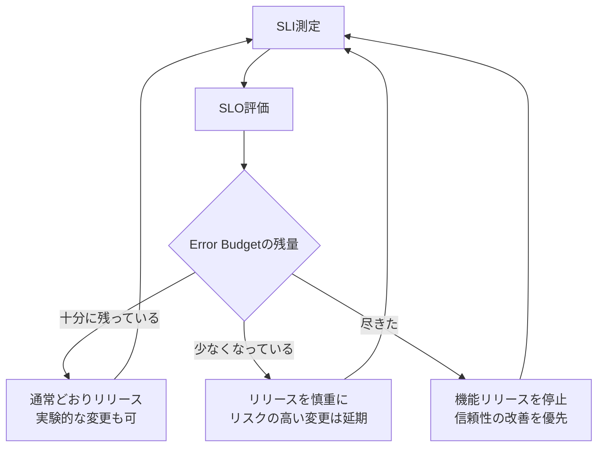
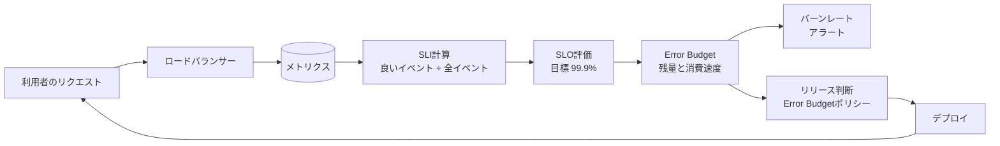

## 本章の問い

信頼性は経験と勘だけでなく、測定・設計・改善できるのか。

第3章の最後で、伝統的な運用が「運用の仕事量がサービスの規模に比例して増える」という構造的な行き詰まりに直面したことを見た。そして第4章では、DevOpsが開発と運用の協働によって変更の速度と安定性を両立させようとしたことを見た。

SRE（Site Reliability Engineering）は、同じ時期に、Googleという一つの企業の中で、異なる角度からこの問題に取り組んだ実践である。SREの最大の貢献は、**信頼性を、測定可能で、交渉可能で、工学的に管理できる対象にした**ことにある。本章では、SLI・SLO・Error Budgetという三つの概念を中心に、SREの考え方と実践を学ぶ。

## 5.1　GoogleにおけるSREの成立

### 始まり

SREは、2003年にGoogleでBenjamin Treynor Slossが率いるチームから始まった。Google SRE Book（2016年）の序章で、Treynor SlossはSREを次のように説明している。[R05]

> SRE is what happens when you ask a software engineer to design an operations team.

（SREとは、ソフトウェアエンジニアに運用チームの設計を任せたときに起きることである。）

出典：Google, *Site Reliability Engineering*, Chapter 1, Introduction。[R05]

この短い一文に、SREの本質が込められている。運用の課題を、手作業や手順の追加で解決するのではなく、**ソフトウェアエンジニアリングの手法で解決する**。運用チームのメンバーは、システム管理の経験と同時に、ソフトウェアを書く能力を持つ。そして彼らは、手作業の運用を繰り返すのではなく、その手作業をなくすためのソフトウェアを書く。

### SREの基本原則

SRE Bookの序章は、SREチームの運営に関するいくつかの原則を示している。[R05] 本書の議論に関わるものを要約する。

1. **エンジニアリングへの時間の確保**：SREの仕事のうち、チケット対応、On-call、手作業などの運用業務は上限（SRE Bookでは50%）を設け、残りの時間をエンジニアリング――自動化やシステムの改善――に使う。
2. **Error Budgetによる意思決定**：100%の信頼性を目指さず、許容される不信頼性（Error Budget）を定め、その範囲内で変更の速度を最大化する。
3. **監視は人が解釈しなくてよい形にする**：監視の出力は、人がアクションを取るべきアラート、記録として残すチケット、ログに分ける。
4. **緊急対応とポストモーテム**：インシデントへの対応手順を整え、Blamelessなポストモーテムで学ぶ。
5. **変更管理の自動化**：障害の多くは変更から生じるため、段階的なロールアウト、問題の迅速な検知、安全なロールバックを自動化する。

これらは、第3章で見た伝統的な運用の課題――アラート疲れ、手作業の増加、変更と安定の対立、失敗から学べないこと――に、それぞれ対応している。

## 5.2　SREとDevOpsの違い／共通点

### よく引用される整理

SREとDevOpsの関係については、Googleから「**class SRE implements interface DevOps**」（SREはDevOpsというインターフェースを実装したクラスである）という比喩が示されている。DevOpsが「何をすべきか」という原則と価値を示すのに対し、SREは「それをどう実現するか」の具体的な実践の一つである、という見方である。

### 比較

| 観点 | DevOps | SRE |
|---|---|---|
| 起源 | 実務家のコミュニティ運動（2009年前後） | Google社内の実践（2003年〜） |
| 性格 | 文化・原則・実践の総体 | 具体的な役割・実践・指標の体系 |
| 中心となる問い | 開発と運用の壁をどう越えるか | 信頼性をどう測定し、管理するか |
| 主な指標 | DORA指標（デリバリーのパフォーマンス） | SLI/SLO、Error Budget |
| 組織の形 | 特定の形を規定しない | SREという職種・チームを置くことが多い |
| 変更へのアプローチ | 小さく頻繁な変更と自動化 | Error Budgetの範囲内で変更速度を最大化 |
| 失敗への態度 | Blamelessな学習 | Blameless Postmortem |

### 共通する前提

違いはあるが、両者は重要な前提を共有している。

- **失敗は避けられない**：複雑なシステムでは、障害を完全になくすことはできない。重要なのは、すばやく検知し、回復し、学ぶことである。
- **自動化は手段である**：繰り返しの手作業を自動化し、人はより価値の高い仕事に集中する。
- **測定に基づいて改善する**：感覚ではなく、データに基づいて判断する。
- **開発と運用は目標を共有すべきである**：信頼性は運用だけの責任ではなく、変更の速度は開発だけの関心事ではない。

## 5.3　Service Level Indicator（SLI）

### SLIとは

**SLI（Service Level Indicator：サービスレベル指標）**は、提供しているサービスの水準を測る、注意深く定義された定量的な指標である。[R44]

SLIの選び方で最も重要なのは、**利用者が経験していることを測る**ことである。第3章で、原因（CPU使用率など）ではなく症状（エラー率、応答時間など）に基づいてアラートを出すべきだと述べた。SLIは、その「症状」を体系的に定義したものと言える。

### 代表的なSLIの種類

| 種類 | 意味 | 例 |
|---|---|---|
| **可用性（Availability）** | リクエストのうち正常に処理された割合 | 成功したHTTPリクエスト数 ÷ 全リクエスト数 |
| **レイテンシ（Latency）** | リクエストの処理にかかった時間 | 応答時間が300ms未満だったリクエストの割合 |
| **品質（Quality）** | 劣化した応答ではなく完全な応答を返した割合 | 推薦機能が代替結果ではなく本来の結果を返した割合 |
| **鮮度（Freshness）** | データが一定時間内に更新されている割合 | 10分以内に更新されたダッシュボードの割合 |
| **正確性（Correctness）** | 正しい結果を返した割合 | 集計結果が検証用の計算と一致した割合 |
| **スループット（Throughput）** | 一定時間に処理できた量 | バッチ処理が1時間に処理したレコード数 |

### 「良いイベントの割合」として定義する

SLIは、**良いイベントの数 ÷ 有効なイベントの総数**という比率で定義すると扱いやすい。

$$
\text{SLI} = \frac{\text{良いイベントの数}}{\text{有効なイベントの総数}} \times 100\%
$$

例えば、Asklineの問い合わせ受付APIのSLIを次のように定義する。

- **可用性SLI**：有効な問い合わせ送信リクエスト（`POST /inquiries`）のうち、業務上の成功条件を満たしたものの割合。入力不備など利用者側の4xxは分母から除外し、認証基盤の障害やレート制限などサービス側に起因する失敗は不成功として扱う
- **レイテンシSLI**：問い合わせ送信リクエストのうち、ロードバランサーで計測した応答時間が500ms未満だったものの割合

比率で定義する利点は、レイテンシのような連続値の指標も「目標を満たしたかどうか」という二値に変換でき、可用性と同じ尺度で扱えることにある。また、平均値で定義すると一部の極端に遅いリクエストが隠れてしまうが、「500ms未満の割合」と定義すれば、遅いリクエストの影響を直接測れる。

### SLIの仕様と実装を分ける

SLIの定義では、**仕様（何を測りたいか）**と**実装（どこで、どう測るか）**を区別するとよい。

| 測定点 | 利点 | 欠点 |
|---|---|---|
| アプリケーションのログ・メトリクス | 詳細な情報が得られる | アプリケーションが落ちていると記録されない |
| ロードバランサー | 利用者に近い位置で、アプリに依存せず測れる | ネットワーク経路やクライアント側の問題は見えない |
| 合成監視（プローブ） | 利用者の操作を模擬できる。トラフィックがなくても測れる | 実際の利用者の多様な状況を反映しきれない |
| クライアント側の計測 | 利用者の体験に最も近い | データの収集と信頼性に課題がある |

利用者の体験に近い測定点ほど、SLIとしての価値は高いが、測定は難しくなる。多くの場合、ロードバランサーでの測定から始め、必要に応じてクライアント側の計測や合成監視を加えていくのが現実的である。

## 5.4　Service Level Objective（SLO）、Service Level Agreement（SLA）

### SLO

**SLO（Service Level Objective：サービスレベル目標）**は、SLIに対する目標値である。[R44] 通常、一定の期間（評価ウィンドウ）と組み合わせて定義する。

> **Asklineの問い合わせ受付APIのSLO（例）**
> - 可用性：直近28日間で、問い合わせ送信リクエストの99.9%が成功する
> - レイテンシ：直近28日間で、問い合わせ送信リクエストの99%が500ms未満で応答する

### SLA

**SLA（Service Level Agreement：サービスレベル合意）**は、サービス提供者と利用者（顧客）の間の**契約上の合意**であり、目標を達成できなかった場合の結果（返金、クレジットなど）を伴う。[R44]

SLOとSLAの違いは、目標を外したときに何が起きるかにある。

| 観点 | SLO | SLA |
|---|---|---|
| 性格 | 内部の工学的な目標 | 外部との契約 |
| 外したときの結果 | 内部の意思決定（変更の凍結、信頼性への投資） | 契約上のペナルティ（返金など） |
| 誰が決めるか | サービスチーム、プロダクトオーナー、SRE | 事業部門、法務、顧客 |
| 水準の関係 | SLAより厳しく置くことが多い | SLOより緩く置くことが多い |

SLOをSLAより厳しく設定するのは、一般的な設計の一つである。SLOを外した段階で対処を始め、SLAに違反する前に信頼性を回復できる。ただし、SLOとSLAの関係は契約と運用方針によって異なり、定義そのものがこの大小関係を要求するわけではない。

### 100%を目指さない理由

SREの最も重要な主張の一つは、**信頼性の目標を100%にすべきではない**ということである。[R05] その理由は三つある。

1. **100%は達成できない**：複雑なシステムでは、障害を完全に防ぐことはできない。100%を目標にすれば、目標は常に破られ、意味を失う。
2. **利用者は違いに気づかない**：利用者の端末、家庭のネットワーク、通信事業者の回線は、それ自体が100%の信頼性を持たない。サービスの信頼性を99.99%から99.999%に上げても、利用者の体験はほとんど変わらない。
3. **信頼性には費用がかかる**：信頼性を一桁上げるたびに、冗長化、自動化、テスト、運用体制のための費用は大きく増える。そして何より、**変更の速度が落ちる**。

信頼性は、高ければ高いほど良いのではない。**利用者が満足する水準を見極め、それを満たしたうえで、残りの余裕を変更と革新に使う**べきである。この考え方を具体的な意思決定の仕組みにしたのが、次節のError Budgetである。

### SLOを決めるのは誰か

第8章のOps一覧表でも注意したように、SLOは**SREやプラットフォームチームが一方的に決めるものではない**。SLOは、利用者がどの程度の信頼性を必要としているか、事業がどの程度の信頼性に投資できるか、という判断を含むため、サービスのプロダクトオーナー、開発チーム、SREの間で合意して決める必要がある。

SREやプラットフォームの役割は、SLOを「決める」ことではなく、SLOを**定義しやすく、測りやすく、守りやすくする**ことにある。これは5.7節で詳しく扱う。

## 5.5　Error Budgetによる意思決定

### Error Budgetとは

**Error Budget（エラーバジェット）**は、SLOによって許容される不信頼性の量である。

$$
\text{Error Budget} = 1 - \text{SLO}
$$

SLOが99.9%なら、Error Budgetは0.1%である。28日間に問い合わせ送信リクエストが1,000万件あれば、そのうち1万件までは失敗してもSLOを満たす。

時間で表すと、28日間（40,320分）で約40分の全面停止に相当する。

### 予算としての信頼性

Error Budgetの考え方の核心は、不信頼性を**使ってよい予算**として扱うことにある。

予算が残っていれば、開発チームは新機能のリリース、実験的な変更、インフラの移行など、リスクを伴う変更を進めてよい。予算が尽きかけていれば、変更を慎重にし、信頼性の改善に取り組む。予算が尽きたら、緊急の修正以外の変更を止め、信頼性の回復を最優先する。



### 対立を解消する仕組み

Error Budgetの価値は、第1章と第4章で見た**開発と運用の対立を、共通の尺度で解消する**ことにある。

伝統的な組織では、「このリリースは危険すぎる」と主張する運用と、「このリリースは事業上必要だ」と主張する開発の間で、交渉と政治が繰り返された。判断は、声の大きさや組織の力関係で決まりがちだった。

Error Budgetがあれば、判断は**データに基づく**ものになる。予算が残っていれば、運用は変更に反対する理由を持たない。予算が尽きていれば、開発は信頼性の改善を優先することに同意している（事前に合意したポリシーによって）。開発も運用も、同じ数字を見て、同じルールで判断する。

### Error Budgetポリシー

Error Budgetが機能するためには、予算が尽きたときに何をするかを**事前に文書化し、合意しておく**必要がある。これを**Error Budgetポリシー**と呼ぶ。

```markdown
# Askline 問い合わせ受付API Error Budgetポリシー

## 対象SLO
可用性 99.9%（28日間ローリングウィンドウ）

## ポリシー
1. 予算の残量が50%を下回った場合
   - リリース前のレビューで、ロールバック手順を必ず確認する
2. 予算を使い切った場合
   - P0（障害修正・セキュリティ修正）以外のリリースを停止する
   - 開発チームの次スプリントの優先事項を、信頼性の改善とする
   - 予算が回復するまで、この状態を維持する
3. 単一のインシデントで予算の20%以上を消費した場合
   - ポストモーテムを必須とし、P0のアクションアイテムを1つ以上設定する

## 例外
事業上の重大な理由がある場合、プロダクト責任者とSRE責任者の合意により
例外を認める。例外は記録し、次回のSLOレビューで振り返る。

## 合意者
プロダクト責任者 / 開発チームリーダー / SRE責任者（2026-10-01）
```

### バーンレートアラート

Error Budgetの考え方は、アラートの設計にも使える。**バーンレート（Burn Rate）**とは、Error Budgetを消費する速さであり、SLOの期間中にちょうど予算を使い切る速さを1とする。

例えば、SLOが99.9%（Error Budget 0.1%）のとき、エラー率が1.44%であれば、バーンレートは14.4になる。この速さが続けば、28日分の予算を約2日で使い切る。

バーンレートに基づくアラートは、第3章で論じた症状ベースのアラートを、さらに洗練させたものである。

- 短期間に大量の予算を消費している（バーンレートが高い）なら、すぐに人を呼ぶ（ページング）。
- 長期間にわたってゆっくり予算を消費している（バーンレートが低いが1を超えている）なら、チケットを作って翌営業日に対処する。

Google SRE Workbookでは、複数の時間窓とバーンレートを組み合わせることで、検知の速さと誤検知の少なさを両立する手法（マルチウィンドウ・マルチバーンレートアラート）が説明されている。

## 5.6　Toilの削減、On-call、Blameless Postmortem

### Toil

SREにおける**Toil（トイル）**とは、本番サービスの運用に関連する作業のうち、次の特徴を持つものを指す。[R45]

| 特徴 | 意味 |
|---|---|
| 手作業（Manual） | 人が手で行う |
| 繰り返し（Repetitive） | 何度も同じことを行う |
| 自動化可能（Automatable） | 機械でもできる |
| 戦術的（Tactical） | 割り込みで発生し、事後対応的である |
| 永続的な価値がない（No enduring value） | 作業の後も、サービスは改善されない |
| サービスの成長に比例して増える（Scales linearly） | サービスが2倍になれば、作業も2倍になる |

Toilは「嫌な仕事」や「退屈な仕事」と同じではない。重要なのは、最後の特徴――**サービスの成長に比例して増える**――である。第3章で見た伝統的な運用の行き詰まりは、まさにToilの増加によるものだった。

SREは、Toilの割合に上限を設け（5.1節）、それを超えないよう自動化に投資する。Toilを測定し、可視化し、削減することは、SREの最も基本的な活動である。

### Toilの例と自動化の方向

| Toilの例 | 自動化の方向 |
|---|---|
| 新しい顧客テナントの作成を手作業で行う | セルフサービスのテナント作成API |
| ディスク容量の逼迫アラートに毎回手作業で対処する | ログの自動ローテーション、自動拡張 |
| デプロイのたびに手順書を見ながらコマンドを打つ | CI/CDパイプライン、GitOps |
| 証明書の期限切れを手作業で更新する | 証明書の自動発行・更新 |
| 開発者の依頼でデータベースのアカウントを作る | セルフサービスの申請と自動プロビジョニング |

表の最後の二行は特に注目に値する。これらは「SREチームが開発者からの依頼を処理する」という形のToilであり、その解決策は**セルフサービス**――開発者が自分で、安全に、必要なものを得られるようにすること――である。これは、第14章で扱うPlatform Engineeringの中心的な考え方そのものである。

### On-callの持続可能性

第3章で、On-callの負荷が運用の人的コストを最も直接的に表すことを見た。SREでは、On-callを持続可能にするために、次のような考え方を取る。[R46]

- On-callの担当者が一回のシフトで扱うインシデントの数に上限の目安を設ける。
- 対応のたびに、ポストモーテムとフォローアップに十分な時間を確保する。
- On-callの負荷が上限を超えるなら、それはシステムやアラートの設計に問題がある信号として扱い、改善に投資する。
- 開発者もOn-callに参加することで、運用の負担を自分ごととして理解する。

### Blameless Postmortem

第3章で紹介したBlamelessなポストモーテムは、SREの文化の中核にある。Google SRE Bookは、ポストモーテムの目的を、インシデントを文書化し、その寄与要因をすべて理解し、再発の可能性と影響を減らすための予防策を確実に実施することとしている。そして、ポストモーテムは個人やチームを責めるためのものではないことを強調している。

SREにおけるポストモーテムの特徴は、それが**Error Budgetと結びついている**ことである。大きな予算を消費したインシデントは、ポストモーテムの対象になる。ポストモーテムで得られた改善は、予算の消費を減らすことで、将来の変更の余地を広げる。信頼性の改善が、開発の速度に直接つながる構造になっている。

## 5.7　SREをプラットフォーム機能として提供する方法

### SREの規模の問題

SREは強力な実践だが、すべての組織が、すべてのサービスにSREチームを配置できるわけではない。SREには、システム運用とソフトウェアエンジニアリングの両方の能力が求められ、そのような人材は希少である。数十、数百のサービスを持つ組織で、サービスごとにSREを置くことは現実的ではない。

そこで重要になるのが、**SREの実践をプラットフォームの機能として提供する**という考え方である。SREが一つひとつのサービスに張り付いて信頼性を管理するのではなく、どのサービスチームでも信頼性の実践を容易に取り入れられる**道具と道筋**を提供する。

### プラットフォームが提供できるSRE機能

| SREの実践 | プラットフォームが提供する機能 | サービスチームが担うこと |
|---|---|---|
| SLI/SLOの定義 | SLOを宣言的に定義できるテンプレートと、自動で計測・可視化する仕組み | 自サービスにとって意味のあるSLIの選択、SLOの目標値の合意 |
| Error Budget | 予算の残量の自動計算とダッシュボード、ポリシーの雛形 | ポリシーの合意と運用 |
| アラート | SLOからバーンレートアラートを自動生成する仕組み | 通知先とOn-call体制の決定 |
| On-call | 当番表、エスカレーション、通知のツール | 当番の担当 |
| ポストモーテム | テンプレート、共有の場、アクションアイテムの追跡 | 分析と改善の実施 |
| Toilの削減 | 共通のセルフサービス機能（デプロイ、環境作成、証明書管理など） | サービス固有の自動化 |
| 安全な変更 | 段階的ロールアウト、自動ロールバックを備えたデプロイ基盤 | ロールアウトの判断基準の設定 |

この表で重要なのは、右の列――サービスチームが担うこと――がなくならないことである。**SLOの目標値を何にするかは、プラットフォームが決めるべきことではない**。プラットフォームは「SLOを定義するための仕組み」を提供し、サービスチームは「自分たちのサービスにとって適切なSLO」を決める。この責任の分界が曖昧になると、プラットフォームチームが全サービスの信頼性の責任を負わされるか、サービスチームが仕組みを持たないまま信頼性の責任を負わされることになる。

### SLO as Code

SLOをプラットフォームの機能として提供する具体的な方法の一つが、**SLOをコードとして宣言する**ことである。サービスチームはリポジトリにSLOの定義ファイルを置くだけで、プラットフォームがそれを読み取り、計測、可視化、アラートを自動で設定する。

```yaml
# askline-api/slo.yaml（筆者による例示的な形式）
service: askline-inquiry-api
owner: team-askline-api
slos:
  - name: inquiry-availability
    description: 問い合わせ送信の成功率
    sli:
      good: sum(rate(http_requests_total{route="/inquiries",method="POST",code!~"5.."}[{{window}}]))
      total: sum(rate(http_requests_total{route="/inquiries",method="POST"}[{{window}}]))
    objective: 99.9
    window: 28d
    alerting:
      page: team-askline-api-oncall
      ticket: team-askline-api
  - name: inquiry-latency
    description: 問い合わせ送信の応答時間
    sli:
      good: sum(rate(http_request_duration_seconds_bucket{route="/inquiries",method="POST",le="0.5"}[{{window}}]))
      total: sum(rate(http_request_duration_seconds_count{route="/inquiries",method="POST"}[{{window}}]))
    objective: 99.0
    window: 28d
```

> **注意**：上記は本書による例示的な形式である。実際には、OpenSLOのような共通仕様や、Prometheus向けのSLO生成ツールなど、既存の取り組みを検討するとよい。採用する際は、参照した仕様のバージョンを明記する。

この形は、第6章のGitOps、第15章のIDPと同じ構造を持っている。**望ましい状態を宣言し、プラットフォームがそれを実現する**。この構造が、本書の後半で繰り返し登場する。

## 図・実装例

### SLI→SLO→Error Budget→リリース判断



### 実装例：Error Budgetの計算

SLO、Error Budget、バーンレートの計算を、小さな関数に分けて実装する。

```python
"""SLO と Error Budget の計算。"""
from __future__ import annotations

from dataclasses import dataclass

@dataclass(frozen=True)
class SloWindow:
    objective: float        # 例: 0.999
    window_minutes: int     # 例: 28日 = 40320

@dataclass(frozen=True)
class EventCounts:
    good: int
    total: int

def sli(counts: EventCounts) -> float:
    """良いイベントの割合。イベントがなければ 1.0 とみなす。"""
    return counts.good / counts.total if counts.total else 1.0

def error_budget_ratio(slo: SloWindow) -> float:
    """許容される失敗の割合（1 - SLO）。"""
    return 1.0 - slo.objective

def allowed_downtime_minutes(slo: SloWindow) -> float:
    """全面停止に換算した許容停止時間（分）。"""
    return slo.window_minutes * error_budget_ratio(slo)

def budget_remaining(slo: SloWindow, counts: EventCounts) -> float:
    """Error Budget の残量（1.0 = 未使用、0.0 = 使い切り、負 = 超過）。"""
    budget = error_budget_ratio(slo) * counts.total
    failures = counts.total - counts.good
    return 1.0 - failures / budget if budget else 1.0

def burn_rate(slo: SloWindow, counts: EventCounts) -> float:
    """観測期間のエラー率が、予算をちょうど使い切る速さの何倍か。"""
    error_rate = 1.0 - sli(counts)
    return error_rate / error_budget_ratio(slo)
```

```python
# test_slo.py
import pytest

from slo import (EventCounts, SloWindow, allowed_downtime_minutes,
                 budget_remaining, burn_rate)

SLO_999_28D = SloWindow(objective=0.999, window_minutes=28 * 24 * 60)

def test_allowed_downtime_for_999_over_28_days():
    assert allowed_downtime_minutes(SLO_999_28D) == pytest.approx(40.32)

def test_budget_half_consumed():
    counts = EventCounts(good=9_995_000, total=10_000_000)  # 5,000件失敗
    assert budget_remaining(SLO_999_28D, counts) == pytest.approx(0.5)

def test_burn_rate_of_14_4():
    counts = EventCounts(good=9_856, total=10_000)  # エラー率 1.44%
    assert burn_rate(SLO_999_28D, counts) == pytest.approx(14.4)
```

### 演習：月間99.9%の可用性目標と許容停止時間

次の問いに答えよ。

1. 30日間で99.9%の可用性目標のとき、全面停止に換算した許容停止時間は何分か。
2. 同じ目標で、全リクエストの10%が失敗する部分障害であれば、何分間まで許容されるか。
3. ある日、エラー率2%の状態が3時間続いた。この障害で、30日間のError Budgetの何%を消費したか（トラフィックは一定とする）。
4. 3の状況で、バーンレートはいくつか。このバーンレートが続いた場合、予算を何時間で使い切るか。

**解答例**

1. 30日 = 43,200分。43,200 × 0.001 = **43.2分**。
2. 失敗率10%の状態は、1分あたり全面停止0.1分に相当する。43.2 ÷ 0.1 = **432分**（7.2時間）。
3. エラー率2%で180分続くと、全面停止換算で 0.02 × 180 = 3.6分。3.6 ÷ 43.2 ≒ **約8.3%**。
4. バーンレート = 0.02 ÷ 0.001 = **20**。30日分の予算を 30日 ÷ 20 = 1.5日（**36時間**）で使い切る。

## 評価指標とトレードオフ

| 指標 | 意味 | 注意点 |
|---|---|---|
| SLO達成率 | 期間内にSLOを満たしたサービスの割合 | 全サービスが常に達成していれば、SLOが緩すぎる可能性 |
| Error Budget消費率 | 期間内に消費した予算の割合 | 使い残しが続くなら、変更の速度を上げる余地がある |
| Toil比率 | SREの作業時間のうちToilが占める割合 | 自己申告では過小評価されやすい |
| On-call負荷 | シフトあたりのページ数、夜間の呼び出し数 | 個人ごとの偏りも見る |
| ポストモーテムのアクションアイテム完了率 | 期限内に完了した対策の割合 | 完了しない対策は、学習が実を結んでいない兆候 |
| SLO導入率 | 重要サービスのうちSLOを定義・計測しているものの割合 | 導入しただけで使われていないSLOに注意 |

SREの中心的なトレードオフは、**信頼性と変更の速度**である。SREはこれを否定するのではなく、**Error Budgetという形で明示的に扱い、交渉可能にした**。信頼性を高くするほど、変更に使える予算は小さくなる。どこでバランスを取るかは、技術者だけでなく、事業と利用者の視点を含めて決めるべきことである。

Error Budgetを使い残すことにも注意が必要である。予算が毎回大きく残っているなら、それは「もっと速く変更できた」ことを意味する。**信頼性が必要以上に高いことは、それ自体が一種の機会損失である**。

## 本章の結論

SREは、信頼性を「運用担当者の経験と勘」の領域から、「測定し、交渉し、工学的に管理する」領域へと移した。

- **SLI**は、利用者の体験を定量的に測る。
- **SLO**は、利用者と事業が必要とする信頼性の目標を定める。
- **Error Budget**は、信頼性と変更の速度の対立を、共通の尺度で解消する。
- **Toilの削減**は、運用の仕事量がサービスの成長に比例して増える構造を断ち切る。

そして、SREの実践を組織全体に広げるには、それを**プラットフォームの機能として提供する**ことが有効である。ただしSLOの目標値をどう決めるかは、プラットフォームではなくサービスチームと事業の判断に属する。

次章では、SREやDevOpsの実践を技術的に大きく変えたCloud Nativeの技術――コンテナ、Kubernetes、GitOps――を扱う。

## 参考文献

- [R05] B. Treynor Sloss et al., "Introduction," in *Site Reliability Engineering: How Google Runs Production Systems*, O'Reilly, 2016. https://sre.google/sre-book/introduction/
- [R44] Google, *Site Reliability Engineering*, "Service Level Objectives." https://sre.google/sre-book/service-level-objectives/
- [R45] Google, *Site Reliability Engineering*, "Eliminating Toil." https://sre.google/sre-book/eliminating-toil/
- [R46] Google, *Site Reliability Engineering*, "Being On-Call." https://sre.google/sre-book/being-on-call/
- [R47] Google, *Site Reliability Engineering*, "Postmortem Culture: Learning from Failure." https://sre.google/sre-book/postmortem-culture/
- Google, *The Site Reliability Workbook*, "Implementing SLOs," "Alerting on SLOs," O'Reilly, 2018. https://sre.google/workbook/table-of-contents/
- OpenSLO（SLOの宣言的仕様。参照するバージョンを刊行前に確認）
