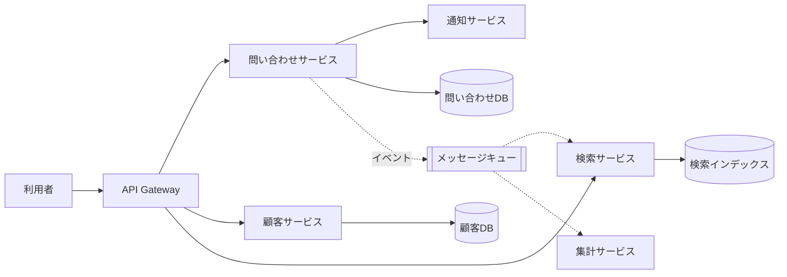
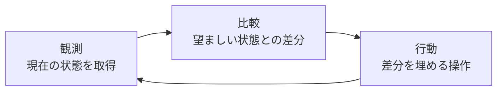
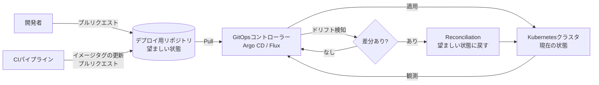

## 本章の問い

インフラがプログラム可能になったとき、運用の単位と責任はどう変わったのか。

第4章でIaCを、第5章でSREのセルフサービスと自動化を見た。これらの実践が本格的に花開くには、インフラそのものが<strong>APIを通じて操作できる</strong>ものになる必要があった。2000年代後半からのクラウドの普及、2013年のDockerの登場、2014年のKubernetesの公開は、その条件を整えた。

本章では、仮想化からコンテナ、オーケストレーションへの流れをたどり、Kubernetesの宣言的APIとReconciliation Loop（調整ループ）という、本書の後半全体を貫く設計パターンを学ぶ。そしてGitOpsの4原則を通じて、「望ましい状態を宣言し、システムがそれに収束する」という運用のあり方を理解する。最後に、自動化が進むほど「システムが理解しやすいこと」が重要になるという、見落とされがちな論点を扱う。

## Cloud Nativeの定義

議論の出発点として、CNCF（Cloud Native Computing Foundation）による定義を確認する。CNCFは、Cloud Native技術を、パブリック・プライベート・ハイブリッドクラウドなどの近代的で動的な環境において、スケーラブルなアプリケーションを構築・実行するための能力を組織に与えるものと位置づけている。そして、コンテナ、サービスメッシュ、マイクロサービス、イミュータブルインフラストラクチャ、宣言的APIを、このアプローチの代表例として挙げている。さらに、これらの技術は、回復性があり、管理しやすく、観測可能な疎結合システムを可能にし、堅牢な自動化と組み合わせることで、エンジニアが大きな影響を持つ変更を頻繁に、予測可能に、最小限の労力で行えるようにする、と述べている。[R07]

この定義の最後の部分――<strong>大きな影響を持つ変更を、頻繁に、予測可能に、最小限の労力で</strong>――は、第4章のDevOpsと第5章のSREが目指したことと一致している。Cloud Nativeは、DevOpsとSREの理念を実現するための技術基盤と言える。

## 6.1　仮想化、コンテナ、オーケストレーション

### 物理サーバーから仮想マシンへ

第1章で見たように、クライアントサーバー時代のアプリケーションは、物理サーバーの上で動いていた。サーバーの調達には数週間から数か月かかり、一台のサーバーで一つのアプリケーションを動かすことが多かったため、資源の利用効率は低かった。

<strong>仮想化</strong>は、一台の物理サーバーの上で、複数の仮想マシン（VM）を動かす技術である。ハイパーバイザーが物理的な資源を抽象化し、各VMに独立したOSと資源を割り当てる。仮想化によって、サーバーの調達は「物理的な機器の購入」から「ソフトウェアによる作成」に変わった。

クラウドコンピューティングは、この仮想化をさらに推し進め、<strong>APIを通じて、数分でVMを作成・削除できる</strong>ようにした。インフラは、所有するものから、必要なときに必要なだけ借りるものになった。

### コンテナ

仮想マシンは、それぞれが完全なOSを持つため、起動に時間がかかり、資源の消費も大きい。<strong>コンテナ</strong>は、OSのカーネルを共有しながら、プロセスを隔離して動かす技術である。Linuxの名前空間（namespace）とcgroupsという機能を使い、各コンテナに独立したファイルシステム、ネットワーク、プロセス空間、資源の上限を与える。

2013年に登場したDockerは、コンテナを<strong>イメージ</strong>として作成・配布・実行するための使いやすい道具を提供し、コンテナの普及を一気に進めた。コンテナイメージには、アプリケーションとその依存関係がすべて含まれるため、「開発者の環境では動くが、本番環境では動かない」という問題が大きく減った。

| 観点 | 物理サーバー | 仮想マシン | コンテナ |
|---|---|---|---|
| 隔離の単位 | 機器 | OS | プロセス |
| 起動時間 | 数分〜（調達は数週間〜） | 数十秒〜数分 | 数秒以下 |
| 資源のオーバーヘッド | なし | OS分 | 小さい |
| 配布の単位 | なし（手作業の構築） | VMイメージ | コンテナイメージ |
| 隔離の強さ | 最も強い | 強い | カーネルを共有するため相対的に弱い |

最後の行は重要である。コンテナはカーネルを共有するため、隔離の強さはVMに劣る。信頼できないコードを動かす場合には、より強い隔離（軽量VMやサンドボックス技術）が必要になる。この点は、第13章と第20章でAIエージェントの実行環境を論じるときに再び問題になる。

### オーケストレーション

コンテナが普及すると、新しい問題が生まれた。数百、数千のコンテナを、多数のサーバーの上で、どう配置し、どう起動し、どう監視し、障害時にどう再起動するのか。この問題を解くのが<strong>コンテナオーケストレーション</strong>である。

オーケストレーションシステムは、次のような機能を提供する。

- <strong>スケジューリング</strong>：どのコンテナを、どのサーバーで動かすかを決める。
- <strong>自己修復</strong>：コンテナやサーバーが落ちたら、自動で別の場所で再起動する。
- <strong>スケーリング</strong>：負荷に応じて、コンテナの数を増減する。
- <strong>サービスディスカバリと負荷分散</strong>：コンテナの場所が変わっても、他のコンテナから到達できるようにする。
- <strong>ローリングアップデート</strong>：サービスを止めずに、コンテナを新しいバージョンに置き換える。

この分野では複数のシステムが競い合ったが、最終的に事実上の標準となったのが<strong>Kubernetes</strong>である。KubernetesはGoogleが社内のクラスタ管理システムBorgの経験をもとに開発し、2014年にオープンソースとして公開した。2015年には、Kubernetesを中心にCNCFが設立された。

## 6.2　マイクロサービスとサービス間通信

### モノリスからマイクロサービスへ

コンテナとオーケストレーションの普及と並行して、アプリケーションのアーキテクチャも変わった。一つの大きなアプリケーション（<strong>モノリス</strong>）を、独立してデプロイできる小さなサービスの集まり（<strong>マイクロサービス</strong>）に分割するアーキテクチャが広まった。

Asklineで考えてみよう。最初のAsklineは、一つのアプリケーションが、問い合わせの受付、顧客の管理、通知、検索、集計をすべて担っていた。これをマイクロサービスに分割すると、次のようになる。



### マイクロサービスの利点と代償

| 利点 | 代償 |
|---|---|
| サービスごとに独立してデプロイできる | サービス間の通信が増え、ネットワーク障害の影響を受ける |
| チームごとに技術を選べる | 技術の多様性が運用の負担を増やす |
| 一部の障害が全体に波及しにくい（設計次第） | 障害の原因の特定が難しくなる |
| サービスごとに独立してスケールできる | 監視・ログ・トレースの仕組みが複雑になる |
| チームの自律性が高まる | サービス間のデータの整合性の維持が難しい |

第4章で紹介したコンウェイの法則に照らせば、マイクロサービスは、<strong>チームの独立性をアーキテクチャに反映したもの</strong>と言える。小さな自律的なチームが、それぞれのサービスを独立して開発・デプロイ・運用する。これはDevOpsの「You build it, you run it」と相性が良い。

一方で、代償の列はすべて<strong>運用の負担</strong>として現れる。第1章で見た分散システムの難しさ――観測点の分散、部分障害、境界に潜む原因――は、マイクロサービスによって何倍にも拡大された。この問題に対応するための技術が、第7章で扱うObservabilityと分散トレーシングである。

### サービス間通信の信頼性

マイクロサービスでは、あるサービスが別のサービスを呼び出す通信が、障害の主要な原因になる。そのため、通信の信頼性を高めるためのパターンが重要になる。

- <strong>タイムアウト</strong>：応答を無限に待たず、一定時間で打ち切る。
- <strong>リトライ</strong>：一時的な失敗に対して、再試行する。ただし、指数バックオフ（待ち時間を徐々に長くする）とジッター（ランダムな揺らぎ）を加え、再試行が負荷を増やさないようにする。
- <strong>サーキットブレーカー</strong>：呼び出し先が失敗し続けているなら、一時的に呼び出しを止め、障害の連鎖を防ぐ。
- <strong>冪等性</strong>：同じリクエストを複数回送っても、結果が一度送った場合と同じになるようにする。リトライを安全にするための前提条件である。

これらのパターンを各サービスに実装する代わりに、サービス間通信を仲介する基盤（<strong>サービスメッシュ</strong>）で一括して提供する方法もある。これは「共通の能力をプラットフォームとして提供する」という考え方の一例である。

第13章で見るように、AIエージェントがツールを呼び出す場面でも、タイムアウト、リトライ、冪等性はまったく同じ形で問題になる。

## 6.3　Kubernetesの宣言的APIとReconciliation Loop

### 宣言的API

Kubernetesの設計の中心にあるのは、<strong>宣言的API</strong>である。利用者は「何をすべきか」（命令）ではなく、「<strong>どうあるべきか</strong>」（望ましい状態）をKubernetesに伝える。

```yaml
# 「問い合わせサービスのコンテナが3つ動いている状態」を宣言する
apiVersion: apps/v1
kind: Deployment
metadata:
  name: askline-inquiry
  namespace: askline
spec:
  replicas: 3
  selector:
    matchLabels:
      app: askline-inquiry
  template:
    metadata:
      labels:
        app: askline-inquiry
    spec:
      containers:
        - name: api
          image: ghcr.io/minato/askline-api:3f9c2a1
          ports:
            - containerPort: 8080
          readinessProbe:
            httpGet:
              path: /healthz
              port: 8080
          resources:
            requests:
              cpu: "250m"
              memory: "256Mi"
            limits:
              memory: "512Mi"
```

このマニフェストは、「askline-inquiryというアプリケーションのコンテナが、指定したイメージで、3つ動いていること」を宣言している。どのサーバーで動かすか、コンテナが落ちたらどうするか、といった手順は書かれていない。それはKubernetesの仕事である。

### Reconciliation Loop（調整ループ）

宣言的APIを支えるのが、<strong>Reconciliation Loop（調整ループ）</strong>である。Kubernetesには、さまざまな種類のリソースに対応する<strong>コントローラー</strong>が存在し、それぞれが次のループを繰り返し実行している。



1. <strong>観測（Observe）</strong>：現在の状態を取得する（例：コンテナが2つ動いている）。
2. <strong>比較（Diff）</strong>：望ましい状態と比較する（例：望ましいのは3つ。1つ足りない）。
3. <strong>行動（Act）</strong>：差分を埋める操作を行う（例：コンテナを1つ起動する）。

このループは、一度実行して終わりではなく、<strong>常に</strong>繰り返されている。そのため、コンテナが落ちる、サーバーが故障する、誰かが手作業で設定を変える、といった理由で現在の状態が望ましい状態からずれても、コントローラーが自動的にそれを元に戻す。

### なぜこの設計が重要なのか

Reconciliation Loopの設計は、運用の考え方を根本から変えた。

| 観点 | 命令的な運用 | 宣言的な運用（Reconciliation） |
|---|---|---|
| 人が伝えるもの | 手順（何をするか） | 状態（どうあるべきか） |
| 障害時 | 人が気づき、手順を実行する | コントローラーが差分を検知し、自動で回復する |
| 途中での失敗 | どこまで実行したかを人が確認する | 次のループで残りの差分を埋める |
| 構成の乖離 | 時間とともに乖離が蓄積する | 常に望ましい状態に引き戻される |
| 冪等性 | 手順ごとに考慮が必要 | 「状態」の宣言は本質的に冪等 |

第1章で、構成管理の記録（CMDB）が現実と乖離するという問題を見た。第4章で、IaCが「構成の定義からインフラを生成する」ことでこの問題を逆方向から解くことを見た。Reconciliation Loopは、さらに一歩進んで、<strong>生成した後も、定義と現実の一致を継続的に保つ</strong>。

この「観測→比較→行動」のループは、本書の後半で何度も登場する。第10章のAIOpsにおける自動復旧、第22章のIBM Autonomic ComputingのMAPE-Kループ、そして自己改善型プラットフォームの改善ループは、いずれもこの構造の変種である。

## 6.4　IaC、Immutable Infrastructure、Operator

### Kubernetes以外のリソースのIaC

Kubernetesのマニフェストは、Kubernetesクラスタの中のリソースを宣言する。しかし、アプリケーションを動かすには、クラスタの外のリソース――クラウドのネットワーク、データベース、ストレージ、DNS、IAMの権限――も必要である。これらは、TerraformやCloudFormationなどのIaCツールで管理することが多い。

```hcl
# Asklineの問い合わせDB（マネージドPostgreSQL）をTerraformで宣言する例（AWS）
resource "aws_db_instance" "askline_inquiry" {
  identifier              = "askline-inquiry-prod"
  engine                  = "postgres"
  engine_version          = "16"
  instance_class          = "db.t4g.medium"
  allocated_storage       = 100
  storage_encrypted       = true
  multi_az                = true
  backup_retention_period = 7
  deletion_protection     = true
  db_subnet_group_name    = aws_db_subnet_group.askline.name
  vpc_security_group_ids  = [aws_security_group.askline_db.id]
  username                = "askline_admin"
  manage_master_user_password = true

  tags = {
    service     = "askline"
    owner       = "team-askline-api"
    environment = "prod"
    cost-center = "cs-support"
  }
}
```

この定義には、第3章のRPO（`backup_retention_period`）、第5章の信頼性（`multi_az`）、第11章のセキュリティ（`storage_encrypted`、`manage_master_user_password`）とコスト管理（`tags`）に関わる設定が含まれている。IaCは、これらの<strong>運用上の要件をコードとしてレビューし、標準化できる</strong>ようにする。

> <strong>注意</strong>：エンジンのバージョンやインスタンスタイプは執筆時点の例示である。採用時はサポート状況を確認すること。

### Immutable Infrastructure

<strong>Immutable Infrastructure（イミュータブルインフラストラクチャ）</strong>は、一度作成したサーバーやコンテナを<strong>変更しない</strong>という原則である。変更が必要になったら、既存のものに手を加えるのではなく、新しい構成で作り直し、古いものと置き換える。

従来の運用では、サーバーに直接ログインしてパッケージを更新し、設定ファイルを編集していた。その結果、同じ役割のはずのサーバー同士で、少しずつ構成が異なる状態（<strong>構成のドリフト</strong>）が生まれた。このようなサーバーは「ペット」にたとえられる。名前が付けられ、一台一台が手厚く世話され、代わりがきかない。

Immutable Infrastructureでは、サーバーやコンテナは「家畜（cattle）」として扱われる。どれも同じ定義から作られ、問題があれば修理するのではなく、置き換える。コンテナイメージは、この原則を自然に実現する。イメージは一度作れば変わらず、変更は新しいイメージを作ることでしか行えない。

### Operator

Kubernetesは、標準でDeploymentやServiceなどのリソースを管理するが、データベースやメッセージキューのような<strong>状態を持つ複雑なソフトウェア</strong>の運用は、標準のリソースだけでは表現しきれない。データベースのバックアップ、フェイルオーバー、バージョンアップには、そのソフトウェアに固有の運用知識が必要である。

<strong>Operatorパターン</strong>は、この運用知識を<strong>Kubernetesのコントローラーとしてコード化する</strong>手法である。Operatorは、カスタムリソース（CRD: Custom Resource Definition）で「望ましい状態」を受け取り、Reconciliation Loopで現実をそれに近づける。

```yaml
# PostgreSQL Operatorのカスタムリソースの例（概念的な形式）
apiVersion: example.com/v1
kind: PostgresCluster
metadata:
  name: askline-search-db
spec:
  version: "16"
  instances: 3
  storage:
    size: 50Gi
  backup:
    schedule: "0 2 * * *"
    retention: 7d
```

Operatorは、第3章で見た<strong>Runbookの自動化</strong>の究極の形と言える。「プライマリが落ちたらレプリカを昇格させる」「毎日2時にバックアップを取る」といった、人がRunbookに従って行っていた作業を、ソフトウェアが継続的に実行する。これはまさに、SREの「運用の課題をソフトウェアエンジニアリングで解決する」という考え方の実践である。

## 6.5　GitOpsの4原則

### GitOpsとは

<strong>GitOps</strong>は、宣言的に記述されたシステムの望ましい状態を、バージョン管理されたリポジトリで管理し、ソフトウェアエージェントがそれを本番環境に継続的に適用する運用のあり方である。

GitOpsという言葉は、2017年にWeaveworksが提唱したことで広まった。その後、CNCFのワーキンググループであるOpenGitOpsが、ベンダーに依存しない原則として、GitOpsの4原則を定めた。[R08]

### OpenGitOpsの4原則

OpenGitOpsのGitOps Principles v1.0.0は、次の4つの原則を示している。[R08]

| 原則 | 内容（本書による要約） |
|---|---|
| <strong>1. 宣言的（Declarative）</strong> | GitOpsで管理されるシステムは、その望ましい状態が宣言的に表現されていなければならない |
| <strong>2. バージョン管理され、不変である（Versioned and Immutable）</strong> | 望ましい状態は、不変性とバージョン管理を強制し、完全なバージョン履歴を保持する方法で保存される |
| <strong>3. 自動的にPullされる（Pulled Automatically）</strong> | ソフトウェアエージェントが、保存場所から望ましい状態の宣言を自動的に取得（Pull）する |
| <strong>4. 継続的にReconcileされる（Continuously Reconciled）</strong> | ソフトウェアエージェントが、実際のシステムの状態を継続的に観測し、望ましい状態を適用しようとする |

### 「Gitを使うだけ」ではない

GitOpsという名前から、「Gitでマニフェストを管理すればGitOps」と誤解されることが多い。しかし、4原則を見れば、GitOpsの本質がGitそのものにはないことがわかる。

- 原則2は「バージョン管理され、不変であること」を求めているが、<strong>それがGitでなければならないとは言っていない</strong>。Gitは最も一般的な保存先だが、原則を満たすなら、OCIレジストリなど他の保存先でもよい。
- 原則3と4は、<strong>エージェントが望ましい状態をPullし、継続的にReconcileする</strong>ことを求めている。CIパイプラインからkubectl applyを実行する（Push型）だけでは、原則3と4を満たさない。

本書では、GitOpsの本質を次のように理解する。

> GitOpsの本質は、<strong>バージョン管理された望ましい状態</strong>と、それに現実を収束させ続ける<strong>継続的なReconciliation</strong>にある。Gitはその保存先として最も広く使われている手段である。

### Push型とPull型

| 観点 | Push型（CIからデプロイ） | Pull型（GitOps） |
|---|---|---|
| デプロイの起点 | CIパイプラインがクラスタに変更を送る | クラスタ内のエージェントがリポジトリから取得する |
| クラスタへの認証情報 | CIシステムが持つ必要がある | クラスタ内のエージェントだけが持てばよい |
| ドリフトの検知 | デプロイ時にしか比較しない | 継続的に比較し、検知・修正する |
| 手作業の変更 | 次のデプロイまで残る | エージェントによって元に戻される（設定による） |
| 変更の履歴 | CIのログに散らばる | リポジトリの履歴に集約される |

Pull型の重要な利点の一つは、<strong>セキュリティ</strong>である。Push型では、CIシステムが本番クラスタへの強い権限を持つ必要があり、CIシステムが侵害されると本番環境も危険にさらされる。Pull型では、本番クラスタへの権限はクラスタ内のエージェントだけが持ち、外部のシステムに渡す必要がない。

### GitOpsと変更管理

GitOpsは、第1章で見たITSMの変更管理を、まったく新しい形で実現する。

| 変更管理の要素 | 伝統的な実現方法 | GitOpsでの実現方法 |
|---|---|---|
| 変更要求 | 変更要求票の提出 | プルリクエストの作成 |
| 影響の評価 | 変更諮問委員会での議論 | 差分のレビュー、自動テスト、ポリシー検査 |
| 承認 | 委員会の承認 | プルリクエストの承認とマージ |
| 実施 | 手順書に従った手作業 | エージェントによる自動適用 |
| 記録 | 変更記録の作成 | リポジトリの履歴（誰が、いつ、何を、なぜ） |
| 切り戻し | 切り戻し手順書の実行 | コミットのrevert |
| 構成の記録 | CMDBの更新 | リポジトリそのものが構成の記録 |

GitOpsは、変更管理を廃止したのではない。<strong>変更管理を、開発者の日常のワークフローに組み込み、自動化した</strong>のである。

## 6.6　Argo CDとFluxの基本思想

GitOpsを実現する代表的なツールが、<strong>Argo CD</strong>と<strong>Flux</strong>である。いずれもCNCFのGraduatedプロジェクトであり、Kubernetes上でGitOpsエージェントとして動作する。

### Argo CD

Argo CDは、Kubernetesのための宣言的なGitOps継続的デリバリーツールである。`Application`というカスタムリソースで「どのリポジトリの、どのパスのマニフェストを、どのクラスタの、どの名前空間に適用するか」を定義する。

```yaml
apiVersion: argoproj.io/v1alpha1
kind: Application
metadata:
  name: askline-inquiry-prod
  namespace: argocd
spec:
  project: askline
  source:
    repoURL: https://github.com/minato/askline-deploy.git
    targetRevision: main
    path: apps/inquiry/overlays/prod
  destination:
    server: https://kubernetes.default.svc
    namespace: askline
  syncPolicy:
    automated:
      prune: true      # リポジトリから削除されたリソースはクラスタからも削除する
      selfHeal: true   # 手作業の変更を検知したら、リポジトリの状態に戻す
    syncOptions:
      - CreateNamespace=true
```

Argo CDの特徴は、Web UIで<strong>望ましい状態と現在の状態の差分を可視化</strong>できることにある。どのリソースが同期済みで、どれがずれているか（OutOfSync）、どれが正常でどれが異常か（Health）を、視覚的に確認できる。

### Flux

Fluxは、Kubernetesのための GitOpsツールキットであり、ソース（Gitリポジトリ、Helmリポジトリ、OCIリポジトリなど）の取得、Kustomizationの適用、Helmリリースの管理、イメージの自動更新などを、それぞれ独立したコントローラーとして提供する。

```yaml
apiVersion: source.toolkit.fluxcd.io/v1
kind: GitRepository
metadata:
  name: askline-deploy
  namespace: flux-system
spec:
  interval: 1m
  url: https://github.com/minato/askline-deploy.git
  ref:
    branch: main
---
apiVersion: kustomize.toolkit.fluxcd.io/v1
kind: Kustomization
metadata:
  name: askline-inquiry-prod
  namespace: flux-system
spec:
  interval: 5m
  sourceRef:
    kind: GitRepository
    name: askline-deploy
  path: ./apps/inquiry/overlays/prod
  prune: true
  targetNamespace: askline
```

### 思想の比較

| 観点 | Argo CD | Flux |
|---|---|---|
| 中心となる概念 | Application（アプリケーション単位の同期） | 独立したコントローラーの組み合わせ（ツールキット） |
| UI | 豊富なWeb UIを標準で提供 | CLI・Kubernetesネイティブな操作が中心（UIは別途） |
| マルチクラスタ | 一つのArgo CDから複数クラスタを管理する構成が一般的 | 各クラスタにFluxを置く構成が一般的 |
| 拡張性 | ApplicationSetによる大量のアプリケーション生成 | コントローラーの組み合わせによる柔軟な構成 |

どちらを選ぶかは、組織の運用スタイルによる。重要なのは、両者がともに<strong>OpenGitOpsの4原則を実装している</strong>ことであり、ツールの違いよりも、原則を理解することの方が大切である。

> <strong>注意</strong>：APIバージョン（`v1alpha1`、`v1`など）は執筆時点のものである。刊行前に、各プロジェクトの公式ドキュメントで確認すること。

## 6.7　「自動化できること」と「システムが理解しやすいこと」は異なる

### 自動化が進むと見えなくなるもの

本章で見てきた技術は、運用を劇的に自動化した。コンテナは自動で再起動し、Deploymentはローリングアップデートを自動で行い、オートスケーラーは負荷に応じて自動でコンテナを増減し、GitOpsエージェントは構成のずれを自動で修正する。

しかし、自動化が進むほど、<strong>システムが何をしているのかを人が理解することは難しくなる</strong>。

例えば、Asklineの問い合わせサービスで、応答時間が断続的に遅くなる問題が起きたとしよう。調べてみると、次のような相互作用が起きていた。

1. 負荷が増えると、オートスケーラーがコンテナを増やす。
2. 新しいコンテナが起動すると、データベースへの接続が急増する。
3. データベースの接続数が上限に近づき、既存のコンテナの応答が遅くなる。
4. 応答が遅くなったコンテナはReadinessプローブに失敗し、負荷分散から外される。
5. 残りのコンテナに負荷が集中し、オートスケーラーがさらにコンテナを増やす。

個々の自動化――オートスケーラー、Readinessプローブ、接続プール――は、それぞれ正しく設計どおりに動いている。しかし、それらの<strong>相互作用</strong>が、予期しない振る舞いを生んでいる。第3章で「自動化同士が相互作用する」危険を指摘したが、Cloud Nativeの環境では、この問題がより頻繁に、より複雑な形で現れる。

### 理解しやすさを設計する

「自動化できること」と「理解しやすいこと」は、別々に設計しなければならない。理解しやすさのためには、次のような取り組みが必要である。

- <strong>自動化の行動を記録する</strong>：オートスケーラーがいつ、なぜコンテナを増やしたのか、GitOpsエージェントがいつ、何を修正したのかを、イベントとして記録し、検索できるようにする。
- <strong>自動化の境界を明示する</strong>：どの自動化が、どの範囲で、どの条件で動くのかを、文書とコードで明示する。
- <strong>相互作用を観測する</strong>：個々のコンポーネントの状態だけでなく、コンポーネント間の関係とリクエストの流れを観測する（第7章の分散トレーシング）。
- <strong>抽象化の層を適切に設計する</strong>：開発者がKubernetesの細部を理解しなくてもよいように抽象化しつつ、問題が起きたときには下の層を調べられるようにする（第15章）。

最後の点は、Platform Engineeringの設計における重要な課題である。抽象化しすぎれば、問題が起きたときに何も見えなくなる。抽象化が足りなければ、開発者の認知負荷は下がらない。

### 運用の単位と責任の変化

本章の問いに戻ろう。インフラがプログラム可能になったとき、運用の単位と責任はどう変わったのか。

| 観点 | Cloud Native以前 | Cloud Native以後 |
|---|---|---|
| 運用の単位 | サーバー（ペット） | 宣言された状態（家畜の集まり） |
| 運用者の仕事 | 手順の実行 | 望ましい状態の定義と、自動化の設計・監督 |
| 障害への対応 | 人が検知し、手順を実行する | システムが自己修復し、人は自己修復できない問題に対応する |
| 変更の手段 | ログインしてコマンドを実行 | 宣言を変更し、プルリクエストでレビューする |
| 主な難しさ | 手作業の量と誤り | 自動化の相互作用と、システムの理解しにくさ |
| 責任の所在 | 運用チーム | 開発チームと、自動化の基盤を提供するチームの分担 |

最後の行が、本書の後半につながる論点である。Cloud Nativeの技術は強力だが、その複雑さは大きい。Kubernetes、Terraform、Argo CD、サービスメッシュ、オートスケーラー、Operatorを、すべての開発チームが深く理解することは現実的ではない。<strong>誰が、どの層の複雑さを引き受けるのか</strong>――この問いへの組織的な答えが、第14章のPlatform Engineeringである。

## 図・実装例

### GitOpsの流れ



第4章のCIパイプラインは、コンテナイメージを作成するところまでを担った。GitOpsでは、CIパイプラインは本番クラスタに直接デプロイせず、<strong>デプロイ用リポジトリのイメージタグを更新する</strong>（プルリクエストを作成する）。本番への適用は、クラスタ内のGitOpsコントローラーが行う。

### 実装例：アプリケーションリポジトリとデプロイ用リポジトリの分離

```text
askline-api/                    # アプリケーションリポジトリ
├── src/ ...
├── tests/ ...
├── Dockerfile
└── .github/workflows/ci.yml    # テスト → イメージ作成 → デプロイ用リポジトリへPR

askline-deploy/                 # デプロイ用リポジトリ（望ましい状態）
└── apps/inquiry/
    ├── base/
    │   ├── deployment.yaml
    │   ├── service.yaml
    │   └── kustomization.yaml
    └── overlays/
        ├── staging/
        │   └── kustomization.yaml   # staging用の差分（レプリカ数など）
        └── prod/
            └── kustomization.yaml   # prod用の差分
```

```yaml
# askline-deploy/apps/inquiry/overlays/prod/kustomization.yaml
apiVersion: kustomize.config.k8s.io/v1beta1
kind: Kustomization
resources:
  - ../../base
replicas:
  - name: askline-inquiry
    count: 3
images:
  - name: ghcr.io/minato/askline-api
    newTag: 3f9c2a1     # CIがこの行を更新するプルリクエストを作る
```

リポジトリを分ける理由は三つある。

1. <strong>権限の分離</strong>：アプリケーションのコードを変更できる人と、本番環境の構成を変更できる人を分けられる。
2. <strong>履歴の明確化</strong>：デプロイ用リポジトリの履歴が、そのまま「本番環境に何が、いつデプロイされたか」の記録になる。
3. <strong>環境ごとの昇格</strong>：同じイメージを、staging → prodの順に、プルリクエストで昇格させられる。

### ドリフトの実験

GitOpsのReconciliationを体験するために、次の実験を行う。

```bash
# 1. Argo CD で askline-inquiry-prod が Synced / Healthy であることを確認
argocd app get askline-inquiry-prod

# 2. 手作業でレプリカ数を変更する（ドリフトを起こす）
kubectl -n askline scale deployment askline-inquiry --replicas=1

# 3. 数十秒〜数分待ち、レプリカ数が3に戻ることを確認する（selfHeal: true の場合）
kubectl -n askline get deployment askline-inquiry -w

# 4. Argo CD のイベント履歴で、何が検知され、何が修正されたかを確認する
argocd app history askline-inquiry-prod
```

この実験で確認してほしいのは、修正が起きたことだけでなく、<strong>修正が起きたことが記録として残り、後から確認できるか</strong>である。6.7節で述べた「自動化の行動を記録する」ことが、ここでも重要になる。

## 評価指標とトレードオフ

| 指標 | 意味 | 注意点 |
|---|---|---|
| デプロイのリードタイム | マージから本番稼働までの時間 | GitOpsのPull間隔も含めて測る |
| ドリフト検知件数 | 望ましい状態からのずれを検知した回数 | 多い場合は、手作業の変更が常態化している兆候 |
| 自己修復の件数 | コントローラーが自動で回復させた件数 | 回復が頻繁なら、根本原因が放置されている可能性 |
| ロールバック所要時間 | revertから旧状態への復帰までの時間 | 第3章のMTTRに直結する |
| 構成の再現性 | リポジトリから環境を再構築できるか | 定期的に実際に再構築して確かめる |
| 開発者が触れる抽象度 | 開発者が直接書く必要のある設定の量 | 多すぎれば認知負荷、少なすぎれば調査困難 |

本章の中心的なトレードオフは次の二つである。

1. <strong>自動化と理解しやすさ</strong>：自動化は運用を楽にするが、相互作用によってシステムの振る舞いを理解しにくくする。
2. <strong>柔軟性と複雑さ</strong>：Cloud Nativeの技術は、ほぼあらゆる構成を表現できる柔軟性を持つが、その柔軟性こそが、開発者にとっての複雑さの源になる。

## 演習

### 演習6-1：命令から宣言へ

次の命令的な手順を、宣言的な定義（Kubernetesのマニフェスト、またはTerraformの定義）に書き換えよ。そのうえで、宣言的に書いたことで何が変わったかを説明せよ。

> 1. 問い合わせサービスのコンテナを3つ起動する
> 2. そのうち1つが落ちていたら、再起動する
> 3. 新しいバージョンをデプロイするときは、1つずつ順番に置き換える
> 4. 置き換えた新しいコンテナが /healthz に応答するまで、次の置き換えを待つ

### 演習6-2：GitOpsの4原則を点検する

次の運用は、OpenGitOpsの4原則のうち、どれを満たし、どれを満たしていないか。

1. マニフェストをGitで管理し、mainブランチへのマージ時にCIが `kubectl apply` を実行する。
2. マニフェストをGitで管理し、Argo CDが自動でPullして適用するが、`selfHeal` は無効にしている。
3. 運用担当者が、Argo CDのUIから「Sync」ボタンを押したときだけ適用する。
4. Helmチャートの値をS3バケットに置き、Fluxが定期的に取得して適用する。

### 演習6-3：自動化の相互作用を探す

6.7節のオートスケーラーとデータベース接続の事例について、

1. この問題を早く発見するには、何を観測すべきだったか。
2. この問題を防ぐには、どのような設計の変更が考えられるか。
3. この問題を開発チームとプラットフォームチームのどちらが解決すべきか、あるいは両者がどう分担すべきか。

## 参考文献

- [R07] CNCF, *Cloud Native Definition*. https://www.cncf.io/about/who-we-are/（定義の原文は CNCF の TOC リポジトリでも公開されている。刊行前にURLを確認）
- [R08] OpenGitOps, *GitOps Principles v1.0.0*. https://opengitops.dev/
- Kubernetes公式ドキュメント, "Controllers," "Operator pattern." https://kubernetes.io/docs/
- Argo CD公式ドキュメント. https://argo-cd.readthedocs.io/
- Flux公式ドキュメント. https://fluxcd.io/flux/
- A. Verma et al., "Large-scale cluster management at Google with Borg," *EuroSys*, 2015.
