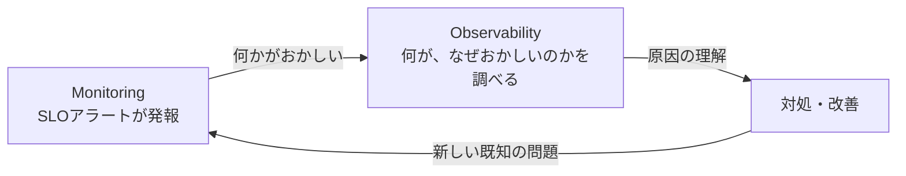
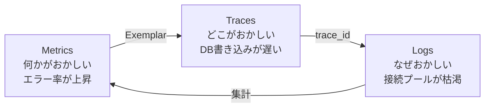
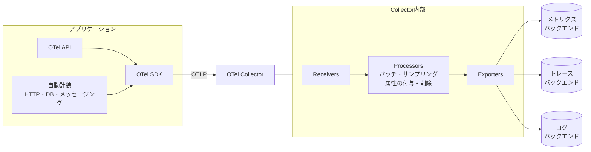
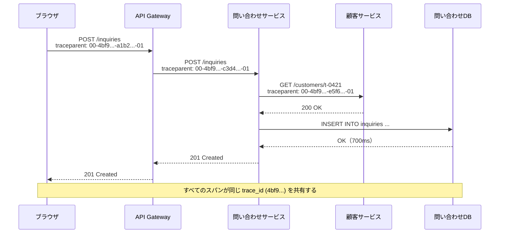

## 本章の問い

未知の障害を、事前に設定した閾値だけで発見できるのか。

第2章の最後で、閾値監視の四つの限界を挙げた。正常の範囲は一定ではない、変化の仕方が見えない、閾値は原因の指標であることが多い、そして**未知の障害を検知できない**。第5章のSLOは三つ目の限界に答えた。本章では、四つ目の限界――事前に想定していなかった障害をどう調べるか――に取り組む。

第6章で見たように、マイクロサービスとCloud Nativeの技術は、システムを数十、数百の独立したコンポーネントに分割し、それらの相互作用を複雑にした。このようなシステムで起きる障害の多くは、誰も想定していなかった組み合わせから生まれる。**何が起きるかを事前に知らなくても、起きたことを調べられる**能力――それがObservability（可観測性）である。

## 7.1　MonitoringとObservabilityの概念上の違い

### 制御理論における可観測性

Observabilityという言葉は、もともと制御理論の用語である。1960年頃、Rudolf E. Kálmánは、システムの**外部出力の観測から、内部状態を推定できる**性質を「可観測性」として定式化した。

ソフトウェアの運用におけるObservabilityは、この概念を借用したものである。本書では、次のように定義する。

> **Observability**とは、外部から取得できる信号を使って、システムの内部状態・振る舞いを説明・調査できる性質である。（本書の定義。OpenTelemetryの文書 [R09] における観測データの考え方を踏まえる）

### 監視とObservabilityの対比

| 観点 | Monitoring（監視） | Observability（可観測性） |
|---|---|---|
| 性格 | 活動（何かを見張ること） | 性質（システムがどれだけ調べやすいか） |
| 問い | 主に「既知の問題が起きていないか」 | 主に「何が起きているのか、なぜ起きているのか」 |
| 前提 | 主に、見るべき対象を事前に定める | 問いを事前に固定せず探索できる |
| 主な手段 | 閾値、ダッシュボード、アラート | 高次元のデータに対する探索的な問い合わせ、トレース |
| 対象とする障害 | 主に既知の障害（Known unknowns） | 未知の障害を含む（Unknown unknowns） |

この対比は、監視が不要になったことを意味しない。監視は「既知の問題が起きていないか」を効率よく確認するために依然として必要である。SLOに基づくアラート（第5章）は、監視の最も洗練された形である。Observabilityは、アラート後の調査に限らず、システムの振る舞いを探索し、既知・未知の問いを調べられる性質である。MonitoringとObservabilityは排他的な段階ではなく、同じテレメトリーを異なる目的で使うこともある。



### Observabilityは「性質」である

Observabilityが「活動」ではなく「性質」であるという点は重要である。Observabilityは、ツールを導入すれば得られるものではない。システムが**適切な信号を、適切な文脈とともに出力するように設計されている**ことによって初めて得られる。

例えば、エラーログに「処理に失敗しました」としか書かれていなければ、どれほど高性能なログ検索ツールを使っても原因は調べられない。逆に、エラーログに、どの利用者の、どのリクエストで、どの処理の、どの入力値で、何が起きたかが書かれていれば、原因の調査は容易になる。Observabilityは、ツールの問題である以前に、**計装（instrumentation）の設計の問題**である。

## 7.2　Metrics、Logs、Traces

Observabilityのための信号は、伝統的に三つに分類される。これを「Observabilityの三本柱」と呼ぶこともある。

### Metrics（メトリクス）

**メトリクス**は、一定の時間間隔で集計された数値の時系列である。リクエスト数、エラー数、応答時間の分布、CPU使用率などがこれにあたる。

| 長所 | 短所 |
|---|---|
| 保存と問い合わせが効率的（集計済み） | 個々のイベントの詳細は失われる |
| 長期間の傾向を見るのに向く | ラベルの組み合わせが多いと系列数が爆発する（第2章） |
| アラートとSLOの基礎になる | 「なぜ」に答えるには情報が足りないことが多い |

### Logs（ログ）

**ログ**は、個々のイベントの記録である。いつ、どこで、何が起きたかを、テキストまたは構造化データで記録する。

| 長所 | 短所 |
|---|---|
| 個々のイベントの詳細がわかる | データ量が大きく、保存と検索のコストが高い |
| 柔軟に情報を記録できる | 形式がばらばらだと、検索と集計が難しい |
| デバッグに直接役立つ | 分散システムでは、一つの処理のログが多数のサービスに散らばる |

ログの価値を大きく高めるのが**構造化ログ**である。自由形式のテキストではなく、キーと値の組（JSONなど）で記録すれば、検索と集計が容易になる。

```json
{
  "timestamp": "2026-09-12T14:22:31.482Z",
  "level": "ERROR",
  "service": "askline-inquiry",
  "message": "failed to acquire db connection",
  "tenant_id": "t-0421",
  "route": "POST /inquiries",
  "pool_in_use": 50,
  "pool_max": 50,
  "wait_ms": 5000,
  "trace_id": "4bf92f3577b34da6a3ce929d0e0e4736",
  "span_id": "00f067aa0ba902b7"
}
```

### Traces（トレース）

**トレース**は、一つのリクエストが、分散システムの中をどのように流れたかの記録である。トレースは、複数の**スパン（span）**から構成される。スパンは、一つの処理単位（あるサービスでのリクエストの処理、データベースへの問い合わせ、外部APIの呼び出しなど）の開始時刻、終了時刻、属性、親子関係を記録したものである。

```mermaid
gantt
    title トレースの例: POST /inquiries
    dateFormat x
    axisFormat %L ms
    section API Gateway
    gateway        :0, 820
    section 問い合わせサービス
    handle_inquiry :20, 790
    validate       :25, 35
    db.insert      :40, 740
    publish_event  :745, 780
    section 顧客サービス
    get_customer   :30, 60
```



この図から、問い合わせ送信の820msのうち、700ms（40〜740ms）がデータベースへの書き込みに費やされていることが一目でわかる。メトリクスでは「応答が遅い」ことしかわからず、ログでは各サービスの記録を時刻で突き合わせる必要があった情報が、トレースでは一つの図として得られる。

### 三つの信号の関係

三つの信号は、独立した道具ではなく、**相互に参照し合うことで価値が高まる**。



- メトリクスでエラー率の上昇に気づく。
- そのメトリクスに紐づく代表的なトレース（**Exemplar**）を開き、どのサービスのどの処理が遅いかを特定する。
- そのトレースの`trace_id`でログを検索し、具体的なエラーの内容を確認する。

この流れを可能にするのは、三つの信号が**共通の識別子（trace_id、span_id）と共通の属性（service、route、tenant_idなど）を持っていること**である。この「信号間の相関」を標準化したのが、7.4節のOpenTelemetryである。

> **補足**：近年は、三本柱に加えて**プロファイル**（CPUやメモリの使用を関数単位で記録したもの）を第四の信号として扱う動きもある。また、三本柱という分類そのものに対して、「すべては構造化されたイベントであり、信号の種類で分けるべきではない」という批判もある。本書では、実務上の整理として三本柱を用いる。

## 7.3　Prometheus、Grafana、Jaeger

Cloud Nativeの時代のObservabilityを支えてきた代表的なオープンソースのツールを紹介する。

### Prometheus

**Prometheus**は、SoundCloudで2012年に開発が始まった、メトリクスの収集と保存のためのシステムである。2016年にCNCFに参加した二番目のプロジェクトであり（一番目はKubernetes）、2018年にGraduatedとなった。

Prometheusの設計上の特徴は、次の三点である。

**第一に、Pull型の収集。** Prometheusは、監視対象が公開するHTTPエンドポイント（通常 `/metrics`）を定期的に取得（scrape）する。第1章のSNMPのポーリングと同じ方式である。Pull型の利点は、監視対象が応答しないこと自体を検知できることと、収集の頻度と対象を監視側で制御できることにある。

**第二に、ラベル付きの多次元データモデル。** 第2章で、RRDToolが「一つのファイルが一つの対象の系列に対応する」ため、柔軟な集計が難しいことを見た。Prometheusでは、メトリクスはメトリクス名と**ラベル**（キーと値の組）の組み合わせで識別される。

```text
http_requests_total{service="askline-inquiry", route="/inquiries", method="POST", code="201"} 128934
http_requests_total{service="askline-inquiry", route="/inquiries", method="POST", code="503"} 412
```

**第三に、PromQLという問い合わせ言語。** ラベルを使って、柔軟に集計・計算できる。

```promql
# 問い合わせ送信のエラー率（直近5分）
sum(rate(http_requests_total{service="askline-inquiry", route="/inquiries", code=~"5.."}[5m]))
/
sum(rate(http_requests_total{service="askline-inquiry", route="/inquiries"}[5m]))

# 問い合わせ送信の95パーセンタイル応答時間（直近5分）
histogram_quantile(
  0.95,
  sum by (le) (rate(http_request_duration_seconds_bucket{service="askline-inquiry", route="/inquiries"}[5m]))
)
```

さらに、Prometheusは**サービスディスカバリ**の仕組みを持ち、Kubernetesと連携して、監視対象を自動で発見できる。第2章で見た「対象数の増加と、動的な生成・削除」という問題への答えである。

一方、ラベル付きのデータモデルは、第2章で述べた**高カーディナリティ問題**を生む。`tenant_id`や`user_id`のような値の種類が非常に多いラベルをメトリクスに付けると、系列数が爆発し、Prometheusの性能が劣化する。このような高カーディナリティの情報は、メトリクスではなく、トレースやログで扱うのが原則である。

### Grafana

**Grafana**は、さまざまなデータソース（Prometheus、Loki、Elasticsearch、各種データベース、クラウドの監視サービスなど）に接続し、ダッシュボードとして可視化するツールである。Grafanaの価値は、**複数の信号を一つの画面で、相互に参照しながら見られる**ことにある。メトリクスのグラフからトレースへ、トレースからログへ、という7.2節の流れを、UIの上で実現する。

### Jaeger

**Jaeger**は、Uberで開発された分散トレーシングシステムであり、CNCFのGraduatedプロジェクトである。トレースの収集、保存、検索、可視化の機能を提供する。

分散トレーシングの考え方の源流としては、Googleが2010年に発表した論文 *Dapper, a Large-Scale Distributed Systems Tracing Infrastructure* がよく知られている。Dapperは、大規模な分散システムで、低いオーバーヘッドで常時トレースを取得する手法を示し、ZipkinやJaegerなど多くのオープンソースのトレーシングシステムに影響を与えた。

> **注意**：Jaegerは近年、OpenTelemetryとの統合を深めており、アーキテクチャが大きく変わりつつある。具体的な構成要素の説明は、刊行前に公式ドキュメントで確認すること。

## 7.4　OpenTelemetry（OTel）と計装

### 計装の分断という問題

2010年代半ば、分散トレーシングとメトリクスのためのライブラリは乱立していた。トレーシングにはOpenTracingという仕様があり、GoogleからはOpenCensusというライブラリが公開されていた。各監視ベンダーも独自のエージェントとライブラリを提供していた。

この状況は、利用者に大きな負担を強いた。ある監視ツールのために計装したアプリケーションは、別のツールに乗り換えるときに、計装をやり直さなければならない。ライブラリの作者は、どの計装の仕組みに対応すべきか判断できない。**計装がベンダーに縛られる**という問題である。

### OpenTelemetryの誕生

2019年、OpenTracingとOpenCensusは統合され、**OpenTelemetry（OTel）**が誕生した。OpenTelemetryはCNCFのプロジェクトであり、OpenTelemetryの公式文書は、自らを、トレース、メトリクス、ログなどのテレメトリーデータを生成・収集・管理するための、ベンダー中立のオープンソースのObservabilityフレームワークおよびツールキットとして説明している。[R09]

OpenTelemetryの重要な点は、**それ自体はデータの保存や可視化を行わない**ことである。[R09] OpenTelemetryが標準化するのは、データの**生成**（計装）と**収集・送信**の部分であり、保存と可視化には、Prometheus、Jaeger、各種の商用サービスなど、任意のバックエンドを選べる。

### OpenTelemetryの構成要素



| 構成要素 | 役割 |
|---|---|
| **仕様（Specification）** | API、SDK、データモデル、プロトコルの言語非依存の仕様 |
| **API** | アプリケーションやライブラリが計装に使うインターフェース |
| **SDK** | APIの実装。サンプリング、バッチ処理、エクスポートなどを行う |
| **自動計装（Instrumentation libraries）** | 主要なフレームワークやライブラリ（HTTP、DB、メッセージング）の計装を自動で行う |
| **OTLP（OpenTelemetry Protocol）** | テレメトリーデータを送信するためのプロトコル |
| **Collector** | テレメトリーデータを受信、処理、送信するための独立したプログラム |
| **セマンティック規約（Semantic Conventions）** | 属性の名前と意味の標準（例：`http.request.method`、`service.name`） |

### セマンティック規約の意義

セマンティック規約は、OpenTelemetryの構成要素の中で最も地味だが、最も重要なものの一つである。

第1章で、SNMPのMIBが「機器の状態を、ベンダーに依存しない共通の語彙で表現する」ことで、異なるベンダーの機器を一つのツールで監視できるようにしたことを見た。セマンティック規約は、これと同じことをテレメトリーデータに対して行う。HTTPのメソッドは`http.request.method`、サービス名は`service.name`、データベースの種類は`db.system`という名前で記録する。この規約に従えば、どの言語で書かれた、どのライブラリで計装されたサービスのデータも、同じ問い合わせで集計できる。

> **注意**：セマンティック規約は改訂が続いており、属性名が変更されることがある（例：HTTPに関する属性名は安定版で変更された）。採用するバージョンを固定し、刊行前に確認すること。

### Collectorの役割

**OTel Collector**は、アプリケーションとバックエンドの間に置かれ、テレメトリーデータを中継・加工する。Collectorを置くことで、次のことが可能になる。

- **バックエンドの切り替え**：アプリケーションの変更なしに、送信先を変えられる。
- **共通の処理**：機密情報の削除、属性の付与（クラスタ名、環境名）、サンプリングを一か所で行える。
- **負荷の緩和**：バッチ処理とリトライにより、バックエンドへの負荷を平準化する。

Collectorは、Platform Engineeringの観点から特に重要である。プラットフォームチームがCollectorを共通基盤として提供すれば、各サービスチームはOTel SDKで計装するだけで、テレメトリーの収集・加工・保存の仕組みを意識する必要がなくなる。これは第15章で扱う「共通部品（Capability）」の典型例である。

## 7.5　Distributed Tracingと相関分析

### コンテキスト伝播

分散トレーシングを実現するには、あるサービスから別のサービスを呼び出すときに、**トレースの識別子（trace_id）と親スパンの識別子（span_id）を一緒に送る**必要がある。これを**コンテキスト伝播（Context Propagation）**と呼ぶ。

HTTPの場合、コンテキストはヘッダーで伝播される。その標準形式が、W3Cの**Trace Context**仕様であり、`traceparent`ヘッダーで伝える。

```text
traceparent: 00-4bf92f3577b34da6a3ce929d0e0e4736-00f067aa0ba902b7-01
             │  │                                │                │
             │  trace-id (16バイト)               parent-id(8バイト)  trace-flags
             version
```

コンテキスト伝播が一か所でも途切れると、トレースはそこで分断される。例えば、メッセージキューを経由する非同期処理で、メッセージにコンテキストを含めなければ、キューの先の処理は別のトレースになってしまう。**計装の網羅性**は、分散トレーシングの価値を左右する。

### サンプリング

すべてのリクエストのトレースを保存すると、データ量は膨大になる。そのため、トレースの一部だけを保存する**サンプリング**が行われる。

| 方式 | 仕組み | 長所 | 短所 |
|---|---|---|---|
| ヘッドベース | リクエストの開始時に、保存するかを確率で決める | 単純で低負荷 | エラーや遅いリクエストを取り逃がす可能性がある |
| テールベース | リクエストの完了後に、内容を見て保存するかを決める | エラーや遅いリクエストを優先して保存できる | 完了まで全スパンを保持する必要があり、負荷が高い |

障害の調査で重要なのは、エラーになったリクエストや、異常に遅いリクエストのトレースである。テールベースサンプリングは、これらを確実に保存できる。OTel Collectorには、テールベースサンプリングを行うための処理（Processor）が用意されている。

### 相関分析

分散トレーシングの真価は、個々のトレースを見ることだけでなく、**多数のトレースを集計し、相関を分析する**ことにある。

例えば、「問い合わせ送信が遅い」という問題について、遅いトレースと速いトレースの属性を比較すると、次のような相関が見えてくることがある。

- 遅いトレースの90%は、特定のテナント（`tenant_id=t-0421`）からのリクエストである。
- そのテナントは、添付ファイルの数が平均の10倍である。
- 添付ファイルの数に比例して、データベースへの書き込み回数が増えている。

このような分析は、閾値監視では不可能である。事前に「添付ファイルの数とテナントの組み合わせ」を監視しようと考える人はいない。**高い次元（多くの属性）を持つデータに対して、問題が起きてから自由に問いを立てられること**――これがObservabilityの本質的な価値である。

## 7.6　RED/USEなどの実務指標とSLO

Observabilityのデータは膨大であり、何から見ればよいかの指針が必要である。実務では、いくつかの定型的な指標の組が使われている。

### 四つのゴールデンシグナル

Google SRE Bookは、ユーザー向けのシステムを監視する際に、最低限見るべき四つの指標を**四つのゴールデンシグナル**として挙げている。

| シグナル | 意味 |
|---|---|
| Latency（レイテンシ） | リクエストの処理にかかる時間。成功と失敗を分けて見る |
| Traffic（トラフィック） | システムへの需要の量（リクエスト数など） |
| Errors（エラー） | 失敗したリクエストの割合 |
| Saturation（飽和度） | システムの資源がどれだけ逼迫しているか |

### REDメソッド

**REDメソッド**は、Tom Wilkieが提唱した、**サービス（リクエストを処理するもの）**を監視するための指標の組である。

| 指標 | 意味 |
|---|---|
| Rate | 1秒あたりのリクエスト数 |
| Errors | 1秒あたりの失敗したリクエスト数 |
| Duration | リクエストの処理時間の分布 |

### USEメソッド

**USEメソッド**は、Brendan Greggが提唱した、**資源（CPU、メモリ、ディスク、ネットワークなど）**を分析するための指標の組である。

| 指標 | 意味 |
|---|---|
| Utilization | 資源が使用されている時間の割合 |
| Saturation | 資源が処理しきれずに待たされている仕事の量（キューの長さなど） |
| Errors | エラーの発生数 |

### 使い分けとSLOとの関係

| 指標の組 | 対象 | 主な用途 | SLOとの関係 |
|---|---|---|---|
| RED | サービス | 利用者から見たサービスの状態 | Rate/Errors/DurationはそのままSLIの候補になる |
| USE | 資源 | 性能問題の原因の切り分け | SLOの違反が起きたとき、原因を調べるために使う |
| ゴールデンシグナル | ユーザー向けシステム | 監視の最低限の網羅 | Latency/ErrorsはSLI、Saturationは予兆 |

この使い分けは、第3章で述べた「**症状に基づいてアラートし、原因は調査に使う**」という原則と対応している。REDはサービスの症状を、USEは資源（原因の候補）を表す。SLOとアラートはREDに基づいて設計し、USEはダッシュボードと調査に使う。

## 7.7　AIOps・LLMOps・AgentOpsにつながる観測データ

本章で扱ったObservabilityのデータと仕組みは、第Ⅲ部以降で扱う新しいOpsの基盤になる。

### AIOpsの入力として

第10章で扱う**AIOps**は、機械学習を使ってIT運用を支援する実践である。AIOpsの異常検知、イベントの相関、原因分析は、いずれも本章で扱ったメトリクス、ログ、トレースを入力とする。**観測データの質がAIOpsの質の上限を決める**。セマンティック規約に従い、適切な属性を持ち、信号間で相関がとれるデータがなければ、どれほど高度なアルゴリズムを使っても、有用な分析はできない。

### LLMOpsの観測として

第12章で扱う**LLMOps**では、LLMアプリケーションの一つのリクエストが、プロンプトの組み立て、ベクトルデータベースの検索、LLMの呼び出し、出力の後処理という複数のステップを経る。これは、分散トレーシングがマイクロサービスに対して行ったことを、LLMアプリケーションの内部に適用することに相当する。各ステップをスパンとして記録すれば、「回答の品質が低い原因は、検索で関連する文書が取得できなかったことにある」といった分析が可能になる。

OpenTelemetryでも、生成AIに関するセマンティック規約（モデル名、入出力トークン数などの属性）の策定が進められている。

### AgentOpsの監査として

第13章で扱う**AgentOps**では、AIエージェントが複数のステップで計画を立て、ツールを呼び出し、外部システムの状態を変更する。エージェントの一回の実行は、数十のLLM呼び出しとツール呼び出しからなる長いトレースになる。このトレースは、障害の調査だけでなく、**エージェントが何を、なぜ行ったかを事後に検証する監査記録**としての役割も持つ。

| 対象 | トレースの単位 | 主な用途 | 本書の章 |
|---|---|---|---|
| マイクロサービス | HTTPリクエスト | 性能問題・障害の調査 | 本章 |
| LLMアプリケーション | ユーザーの質問から回答まで | 品質の評価、コストの把握 | 第12章 |
| AIエージェント | タスクの開始から完了まで | 行動の検証、監査、評価 | 第13章 |
| Software Factory | 要件からリリースまで | 生産工程の追跡、責任の記録 | 第21章 |

この表が示すように、**トレースという考え方は、運用対象が変わっても形を変えて引き継がれる**。だからこそ、Observabilityの基盤を、特定の運用対象に閉じない共通能力として設計することが重要になる。

## 図・実装例

### フロントエンド→API→DBの分散トレース



### 実装例：OpenTelemetryによる計装

Asklineの問い合わせサービスを、OpenTelemetryのPython SDKで計装する。HTTPフレームワークやデータベースクライアントの自動計装に加えて、業務上意味のある処理には手動でスパンを作成する。

まず、依存関係を追加する（uvを使用）。

```bash
uv add opentelemetry-api opentelemetry-sdk \
       opentelemetry-exporter-otlp \
       opentelemetry-instrumentation-fastapi
```

テレメトリーの初期化を、アプリケーションの業務ロジックから分離する。

```python
# src/askline_api/telemetry.py
from opentelemetry import trace
from opentelemetry.exporter.otlp.proto.grpc.trace_exporter import OTLPSpanExporter
from opentelemetry.sdk.resources import Resource
from opentelemetry.sdk.trace import TracerProvider
from opentelemetry.sdk.trace.export import BatchSpanProcessor

def build_resource(service_name: str, environment: str, version: str) -> Resource:
    """セマンティック規約に沿ったリソース属性を作る。"""
    return Resource.create({
        "service.name": service_name,
        "service.version": version,
        "deployment.environment.name": environment,
    })

def init_tracing(resource: Resource, endpoint: str) -> None:
    """OTLPでCollectorに送るTracerProviderを設定する。"""
    provider = TracerProvider(resource=resource)
    provider.add_span_processor(BatchSpanProcessor(OTLPSpanExporter(endpoint=endpoint)))
    trace.set_tracer_provider(provider)
```

業務ロジックでは、意味のある処理単位にスパンを作り、調査に役立つ属性を付ける。なお、本章以降の `Inquiry` は、第4章の定義に添付ファイルの一覧（`attachments: tuple[str, ...]`）を加えたものとする。

```python
# src/askline_api/service.py
from opentelemetry import trace

from askline_api.inquiry import Inquiry, validate

tracer = trace.get_tracer("askline.inquiry")

class InquiryService:
    def __init__(self, repository, publisher):
        self._repository = repository
        self._publisher = publisher

    def submit(self, inquiry: Inquiry) -> str:
        with tracer.start_as_current_span("inquiry.submit") as span:
            span.set_attribute("askline.tenant_id", inquiry.tenant_id)
            span.set_attribute("askline.attachment_count", len(inquiry.attachments))
            validate(inquiry)
            inquiry_id = self._repository.save(inquiry)
            span.set_attribute("askline.inquiry_id", inquiry_id)
            self._publisher.publish_created(inquiry_id)
            return inquiry_id
```

> **注意**：`askline.tenant_id` のような独自の属性には、組織固有の名前空間（ここでは`askline.`）を付け、セマンティック規約の属性と衝突しないようにする。また、個人情報や機密情報をスパンの属性に含めないこと。テナントIDのような識別子は、メトリクスのラベルにすると高カーディナリティ問題を起こすが、トレースの属性としては有用である。

計装のテストでは、メモリ上にスパンを記録する`InMemorySpanExporter`を使えば、外部の仕組みなしに、スパンと属性が正しく記録されているかを確認できる。

```python
# tests/test_service_tracing.py
from dataclasses import dataclass, field

from opentelemetry import trace
from opentelemetry.sdk.trace import TracerProvider
from opentelemetry.sdk.trace.export import SimpleSpanProcessor
from opentelemetry.sdk.trace.export.in_memory_span_exporter import InMemorySpanExporter

from askline_api.service import InquiryService

exporter = InMemorySpanExporter()
provider = TracerProvider()
provider.add_span_processor(SimpleSpanProcessor(exporter))
trace.set_tracer_provider(provider)

@dataclass
class FakeInquiry:
    tenant_id: str = "t-0421"
    subject: str = "ログインできない"
    body: str = "..."
    attachments: list = field(default_factory=lambda: ["a.png", "b.png"])

class FakeRepository:
    def save(self, inquiry):
        return "inq-001"

class FakePublisher:
    def publish_created(self, inquiry_id):
        pass

def test_submit_records_span_with_business_attributes(monkeypatch):
    monkeypatch.setattr("askline_api.service.validate", lambda i: i)
    exporter.clear()
    InquiryService(FakeRepository(), FakePublisher()).submit(FakeInquiry())
    span = exporter.get_finished_spans()[0]
    assert span.name == "inquiry.submit"
    assert span.attributes["askline.tenant_id"] == "t-0421"
    assert span.attributes["askline.attachment_count"] == 2
    assert span.attributes["askline.inquiry_id"] == "inq-001"
```

### Collectorの設定例

プラットフォームとして提供するCollectorの設定例を示す。機密情報の削除と、環境情報の付与を共通の処理として行う。

```yaml
# otel-collector-config.yaml
receivers:
  otlp:
    protocols:
      grpc:
        endpoint: 0.0.0.0:4317
      http:
        endpoint: 0.0.0.0:4318

processors:
  memory_limiter:
    check_interval: 1s
    limit_percentage: 80
  batch: {}
  attributes/scrub:
    actions:
      - key: user.email
        action: delete
      - key: http.request.header.authorization
        action: delete
  resource/env:
    attributes:
      - key: k8s.cluster.name
        value: askline-prod-tokyo
        action: upsert

exporters:
  otlp/traces:
    endpoint: tracing-backend.observability.svc:4317
    tls:
      insecure: false

service:
  pipelines:
    traces:
      receivers: [otlp]
      processors: [memory_limiter, attributes/scrub, resource/env, batch]
      exporters: [otlp/traces]
```

> **注意**：Collectorのコンポーネント名と設定項目は、Collectorのディストリビューション（core / contrib）とバージョンによって異なる。刊行前に動作確認したバージョンを明記する。

### 演習：サービス横断の障害を調査する

第3章の演習3-1のポストモーテム（DB接続プールの枯渇）について、本章の計装がされていたと仮定して、次の問いに答えよ。

1. エラー率アラートの発報から、接続プールの枯渇の特定まで、どのような順で、どの信号（メトリクス、トレース、ログ）を見るか。
2. その調査を可能にするために、どのスパンに、どの属性が必要か。
3. 第3章のポストモーテムでは、原因の特定に17分かかった。本章の仕組みがあれば、どこまで短縮できると考えられるか。

## 評価指標とトレードオフ

| 指標 | 意味 | 注意点 |
|---|---|---|
| 計装カバレッジ | 重要なサービスのうち、トレースとメトリクスを出力しているものの割合 | サービス単位だけでなく、非同期処理の伝播も確認する |
| トレースの断絶率 | 途中でコンテキストが途切れたトレースの割合 | 非同期処理、外部サービス呼び出しで起きやすい |
| 調査時間 | アラートから原因の特定までの時間 | 第3章のMTTRの分解で最も大きな部分 |
| テレメトリーのコスト | 収集・保存・問い合わせにかかる費用 | サンプリング率と保存期間で大きく変わる |
| 系列数 | メトリクスの時系列の総数 | 高カーディナリティのラベルの混入を監視する |
| 機密情報の混入 | テレメトリーに個人情報・秘密情報が含まれた件数 | ゼロを目指す。Collectorでの削除と計装時の注意の両方が必要 |

本章の中心的なトレードオフは、**情報量とコスト**である。属性を多くし、サンプリング率を高くし、保存期間を長くすれば、調査は容易になるが、費用は増える。逆に、費用を抑えれば、調査に必要な情報が足りなくなる。このバランスは、第11章のFinOpsの観点からも重要な判断になる。

## 本章の結論

Monitoringは「既知の問題が起きていないか」を確認し、Observabilityは「何が、なぜ起きているのか」を調べる。両者は対立するものではなく、補い合うものである。

- メトリクス、ログ、トレースは、共通の識別子と属性によって相関がとれるとき、最も価値を持つ。
- OpenTelemetryは、計装をベンダーから切り離し、セマンティック規約によって共通の語彙を与えた。
- Observabilityはツールではなく、システムの**性質**であり、計装の設計によって作られる。
- Observabilityの基盤は、AIOps、LLMOps、AgentOpsへと引き継がれる共通能力である。

第Ⅱ部で見てきたDevOps、SRE、Cloud Native、Observabilityは、いずれも「運用をソフトウェアとして扱う」という転換の一部だった。次の第Ⅲ部では、運用の対象そのものが、ソフトウェアからデータ、モデル、LLM、エージェントへと広がっていく過程を見る。

## 参考文献

- [R09] OpenTelemetry, *What is OpenTelemetry?* https://opentelemetry.io/docs/what-is-opentelemetry/
- OpenTelemetry, *Semantic Conventions*.（参照したバージョンを明記する） https://opentelemetry.io/docs/specs/semconv/
- W3C, *Trace Context*, W3C Recommendation. https://www.w3.org/TR/trace-context/
- B. H. Sigelman et al., "Dapper, a Large-Scale Distributed Systems Tracing Infrastructure," Google Technical Report, 2010.
- Google, *Site Reliability Engineering*, "Monitoring Distributed Systems"（四つのゴールデンシグナル）. https://sre.google/sre-book/monitoring-distributed-systems/
- B. Gregg, "The USE Method." https://www.brendangregg.com/usemethod.html
- Prometheus公式ドキュメント. https://prometheus.io/docs/
- R. E. Kálmán, "On the General Theory of Control Systems," 1960.（書誌情報を刊行前に確認）
