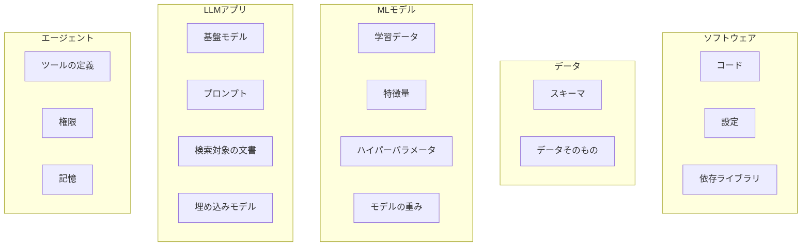
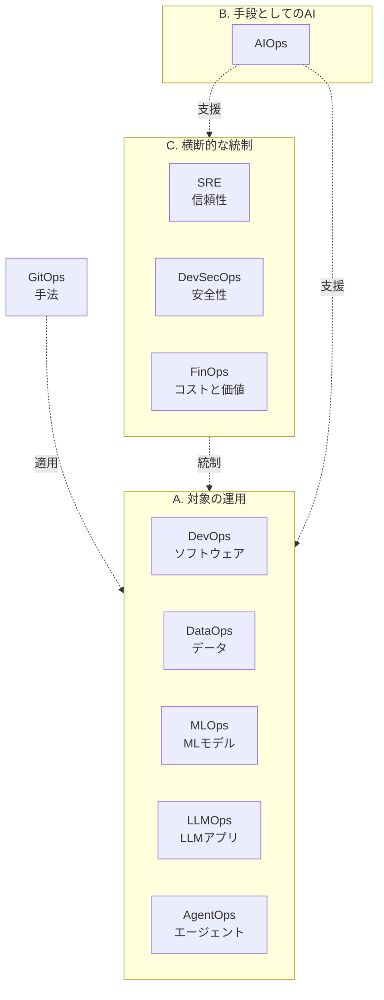
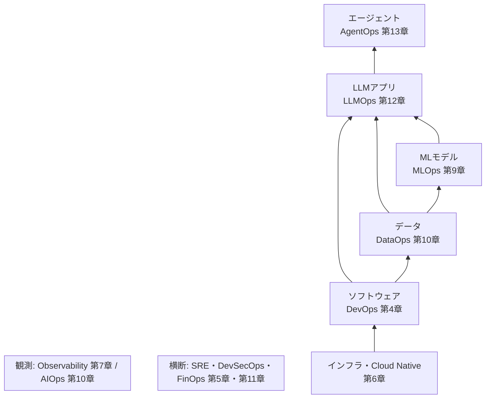

> <strong>第Ⅲ部　XOpsの時代――運用対象が広がる</strong>
>
> 第Ⅱ部では、運用が「手順」から「ソフトウェア」へと転換した時代を見た。第Ⅲ部では、その転換が一段落した後に起きた、もう一つの変化を扱う。<strong>運用の対象そのものが広がった</strong>のである。ソフトウェアに加えて、データ、機械学習モデル、LLMアプリケーション、AIエージェントが本番環境に入り、それぞれに固有の失敗の仕方と、固有の運用技術が生まれた。同時に、セキュリティとコストは、すべての対象に横断的に関わる責任として専門化した。
>
> 第Ⅲ部の最初の章である本章では、増え続けるOpsを分類するための枠組みを示し、それぞれがPlatform Engineeringとどう関係するかの見取り図を描く。第9章以降は、この見取り図に沿って個々のOpsを掘り下げる。

## 本章の問い

DevOpsがあるのに、なぜMLOps、AIOps、LLMOps、AgentOps、FinOpsなどが必要になったのか。

DevOpsは、開発と運用の壁を越え、ソフトウェアの変更を速く安全に届ける方法を確立した。それならば、機械学習モデルもLLMアプリケーションも、DevOpsの方法で運用すればよいのではないか。なぜ、わざわざ別の名前を付けた実践が必要なのか。

本章の答えを先に述べておく。<strong>新しいOpsが必要になったのは、DevOpsが不十分だったからではなく、DevOpsが前提としていなかった性質を持つ対象が本番環境に入ってきたからである。</strong> そして、そのことは、各Opsの専門性が今後もなくならないことと、それでも共通化すべき部分が大きいことの両方を意味している。

## 8.1　XOpsという整理の有用性と限界

### XOpsという言葉

「〇〇Ops」と呼ばれる実践の総称として、<strong>XOps</strong>という言葉が使われることがある。XはDev、ML、Data、AI、LLM、Agent、Sec、Finなど、さまざまな接頭辞を代表する変数である。

XOpsという整理には、明確な有用性がある。

- <strong>共通の型を見出せる</strong>：多くのOpsは、DevOpsが確立した「継続的な変更、自動化、測定、フィードバック」という型を、それぞれの対象に適用したものである。共通の型を意識すれば、ある領域の知見を別の領域に移しやすくなる。
- <strong>全体の地図が描ける</strong>：組織が取り組むべき運用の領域を一覧でき、抜け漏れや重複を確認できる。
- <strong>会話の共通語になる</strong>：異なる専門のチームが、互いの仕事の位置づけを理解しやすくなる。

XOpsの包括的な整理としては、アジアクエストによる2026年の解説記事がある。[R10] ただし、これは業界の実践を分類した解説であり、<strong>すべてのOpsに共通する公式の標準を定めた文書ではない</strong>。XOpsという言葉そのものも、標準化団体が定義したものではない。

### XOpsという整理の限界

一方で、XOpsという整理には限界もある。

<strong>第一に、性格の異なるものが同列に並ぶ。</strong> MLOpsは「機械学習モデル」という運用対象に関する実践である。AIOpsは「AIを使ってIT運用を行う」という手段に関する実践である。FinOpsは「コストと価値」という、すべての対象に横断的に関わる関心事に関する実践である。GitOpsは、特定の対象というより、運用の<strong>手法</strong>である。これらを「〇〇Ops」として同列に並べると、本質的な違いが見えにくくなる。

<strong>第二に、名前が実践の代わりになる。</strong> 新しいOpsの名前が生まれるたびに、それに対応する専任チーム、専用ツール、専用基盤が作られがちである。名前が増えることが、組織の分断と基盤の乱立を招く（8.5節）。

<strong>第三に、定義が流動的である。</strong> 特にLLMOpsやAgentOpsは新しい領域であり、何を含み、何を含まないかについて、確立した合意がない。

本書では、XOpsという言葉を<strong>分類のための便宜的な枠組み</strong>として用い、各Opsの性格の違いを明示したうえで扱う。

## 8.2　運用対象の拡張――ソフトウェア、データ、モデル、エージェント

### 対象によって失敗の仕方が違う

なぜ、DevOpsの方法だけでは不十分なのか。その答えは、運用対象ごとに<strong>失敗の仕方</strong>が異なることにある。

| 運用対象 | 振る舞いを決めるもの | 典型的な失敗 | 失敗の検知の難しさ |
|---|---|---|---|
| <strong>ソフトウェア</strong> | コード（決定的） | バグ、設定ミス、資源不足 | エラーや例外として現れやすい |
| <strong>データ</strong> | 上流のシステムと業務 | スキーマ変更、欠損、遅延、意味の変化 | パイプラインは成功しても、中身が誤っていることがある |
| <strong>MLモデル</strong> | コード＋学習データ＋特徴量 | データドリフト、性能の劣化、偏り | 予測は返り続けるが、精度が静かに落ちる |
| <strong>LLMアプリ</strong> | モデル＋プロンプト＋検索結果＋文脈 | 誤った回答（ハルシネーション）、不適切な出力、コスト急増 | 出力は常に「もっともらしい」 |
| <strong>AIエージェント</strong> | LLM＋ツール＋計画＋記憶＋権限 | 誤ったツール呼び出し、意図しない外部状態の変更、権限の濫用 | 一連の行動の結果として初めて問題が見える |

この表の最も右の列に注目してほしい。ソフトウェアの失敗は、多くの場合、エラーや例外という<strong>明示的な信号</strong>として現れる。第Ⅱ部で見た監視とObservabilityの技術は、この信号を捉えるために発展してきた。

しかし、表の下に行くほど、失敗は<strong>明示的な信号を伴わなく</strong>なる。データパイプラインは「成功」と報告しながら、誤ったデータを書き込む。MLモデルはエラーを出さずに、静かに精度を落とす。LLMは、事実と異なる内容を、流暢で自信に満ちた文章で返す。エージェントは、一つひとつのツール呼び出しは成功しながら、全体として誤った結果に到達する。

<strong>失敗を検知するには、「正しさ」の定義と、それを評価する仕組みが必要になる</strong>。そして、何が正しいかは対象ごとに異なり、多くの場合、その領域の専門知識なしには定義できない。これが、各Opsが独自の専門性を持つ根本的な理由である。

### 変更の単位が増える

もう一つの理由は、<strong>変更の単位が増える</strong>ことである。



DevOpsは、主にコードと設定の変更を、バージョン管理し、テストし、段階的にリリースする方法を確立した。しかし、MLモデルの振る舞いは学習データが変わるだけで変わり、LLMアプリの振る舞いはプロンプトの一文を変えるだけで変わり、エージェントの振る舞いはツールの権限を一つ追加するだけで変わる。これらの<strong>コード以外の変更</strong>を、どうバージョン管理し、どうテストし、どう安全にリリースするのか。この問いに、各Opsはそれぞれの答えを出してきた。

## 8.3　「Xの運用」「運用にAIを使う」「横断的な統制」を区別する

8.1節で指摘した「性格の異なるものが同列に並ぶ」問題に対処するため、本書では、Opsを次の三つ（と手法）に分類する。これは<strong>本書による分類</strong>である。

| 分類 | 意味 | 該当するOps |
|---|---|---|
| <strong>A. 対象の運用（Ops for X）</strong> | 特定の種類の対象を、本番環境で継続的に運用する | DevOps（ソフトウェア）、DataOps（データ）、MLOps（MLモデル）、LLMOps（LLMアプリ）、AgentOps（エージェント） |
| <strong>B. 手段としてのAI（AI for Ops）</strong> | AIを使って、運用そのものを高度化する | AIOps |
| <strong>C. 横断的な統制（Cross-cutting）</strong> | すべての対象に横断的に関わる関心事を統制する | SRE（信頼性）、DevSecOps（安全性）、FinOps（コストと価値） |
| <strong>（手法）</strong> | 上記のいずれにも適用できる運用の手法 | GitOps |



### この分類から見えること

<strong>MLOpsとAIOpsは別物である。</strong> 名前が似ているため混同されやすいが、MLOpsは「MLモデルを運用する」実践であり、AIOpsは「AIで運用する」実践である。MLOpsの対象はモデルであり、AIOpsの対象はITシステム全体である。両者が同じ技術（機械学習）を使うことはあっても、目的は異なる。

<strong>横断的な統制は、すべての対象に必要である。</strong> 信頼性、安全性、コストは、ソフトウェアにも、データにも、モデルにも、エージェントにも関わる。LLMアプリのSLOをどう定義するか、エージェントの権限をどう制御するか、GPUのコストをどう配賦するか――横断的な統制のOpsは、新しい対象が現れるたびに、その対象に合わせた形で適用される必要がある。

<strong>対象の運用は、積み重なっていく。</strong> LLMアプリはソフトウェアの上に作られ、データ（検索対象の文書）を使い、モデル（LLM）を呼び出す。エージェントはLLMアプリの上に作られる。上の層の対象を運用するには、下の層の運用がすべて機能している必要がある。

## 8.4　Ops一覧とPlatform Engineeringとの関係

各Opsの目的と、Platform Engineeringが提供しうる共通能力を、一覧にまとめる。

### OpsとPlatform Engineeringの関係一覧

| 名称 | 主な目的・運用対象 | Platform Engineeringが提供する代表的な共通能力 | 注意点 |
|---|---|---|---|
| <strong>DevOps</strong> | 開発と運用の協働、継続的デリバリー | CI/CD、IaC、セルフサービス環境、Golden Path | DevOpsは文化・実践を含み、Platform Engineeringと同義ではない |
| <strong>SRE</strong> | サービスの信頼性・可用性・復旧 | SLO計測、Observability、On-call支援、自動復旧 | SLOなどの責任はサービスチームと合意して決める |
| <strong>DevSecOps</strong> | 開発・運用工程へのセキュリティ統合 | SAST/DAST、SBOM、IAM、Secrets、Policy as Code | セキュリティ責任そのものをプラットフォーム側へ丸投げしない |
| <strong>FinOps</strong> | 技術利用コストとビジネス価値の最適化 | タグ付け、配賦、予算、GPU/推論コスト可視化、停止ポリシー | 単純な費用削減だけでなく価値の最大化を目指す |
| <strong>GitOps</strong> | 宣言的な望ましい状態との継続的同期 | GitOps Controller、環境定義、変更履歴、承認フロー | 他のOpsと並列の独立ドメインというより運用手法 |
| <strong>DataOps</strong> | データの品質・供給・再現性 | Data Catalog、Lineage、テスト、Pipeline Runner | データ意味論や品質基準はデータの所有者と協働する |
| <strong>MLOps</strong> | MLモデルの学習・配布・評価・再学習 | 実験追跡、Feature Store、Model Registry、GPU、Serving | データ／モデルの専門知識と共通インフラを分離する |
| <strong>AIOps</strong> | AIによるIT運用の高度化 | メトリクス・ログ集約、イベント相関、異常検知、RCA | MLOps（MLモデルそのものの運用）とは別物 |
| <strong>LLMOps</strong> | LLMアプリの品質、信頼性、費用 | Model Gateway、Prompt Registry、RAG、評価、Trace | モデル評価と業務評価は一体ではない |
| <strong>AgentOps</strong> | AIエージェントの実行、行動、安全性 | Agent Runtime、Tool Gateway、認可、実行記録、評価 | 新興分野であり用語・責任モデルは進化中 |

### 表の読み方

この表の三列目と四列目は、対になっている。三列目は「プラットフォームが<strong>提供できる</strong>もの」であり、四列目は「プラットフォームに<strong>任せてはいけない</strong>もの」あるいは「誤解しやすい点」である。

例えばSREの行では、プラットフォームはSLOの計測と可視化の仕組みを提供できるが、SLOの目標値をどうするかはサービスチームと事業が合意して決めるべきである（第5章）。DevSecOpsの行では、プラットフォームはセキュリティスキャンやポリシーの仕組みを提供できるが、セキュリティの責任そのものをプラットフォームチームに丸投げしてはならない（第11章）。DataOpsの行では、プラットフォームはデータカタログやリネージの仕組みを提供できるが、データの意味や品質の基準は、そのデータを最もよく知る所有者が決めるべきである（第10章、第18章）。

この「提供できるもの」と「任せてはいけないもの」の境界を引くことが、本書の第Ⅳ部の中心的な課題になる。

### LLMOpsとPlatform Engineeringの分担

新しい領域であるLLMOpsとPlatform Engineeringの関係については、Daniel Bryantが2026年にCNCFのブログに寄稿した論考 *LLMOps and platform engineering: Who should own the AI pipeline?* が、この問題を正面から扱っている。[R17] Bryantは、モデル、プロンプト、ベクトルデータベース、評価環境が、チームごとにばらばらの専用基盤として作られるリスクを指摘している。

本書では、この論考の問題意識を踏まえ、次のように整理する。

> <strong>LLMOpsはドメインの実践であり、IDP（Internal Developer Platform）は共通能力の提供経路である。</strong>（本書の整理）

LLMアプリの品質をどう評価するか、どのプロンプトが良いかは、LLMOpsの専門性に属する。一方、モデルへのアクセスを仲介するゲートウェイ、プロンプトのバージョン管理、評価を実行する仕組み、トレースの収集は、多くのLLMアプリに共通する能力であり、プラットフォームとして提供できる。この整理は第12章で詳しく扱う。

## 8.5　Ops疲れと専用基盤の乱立

### 新しいOpsごとに新しい基盤

新しいOpsが登場するたびに、組織の中では次のようなことが起きやすい。

1. 新しい種類の対象（例：LLMアプリ）を扱うチームが生まれる。
2. そのチームは、既存の基盤が自分たちの要求に合わないと考え、専用の基盤を作る。
3. 専用の基盤には、認証、デプロイ、ログ収集、監視、権限管理、コスト管理が必要になる。
4. それらは、既存の基盤とは別に、新たに作られる。


こうして、組織の中に、<strong>同じような能力を持つ基盤が、Opsの数だけ並ぶ</strong>ことになる。これが専用基盤の乱立である。

### 乱立がもたらす問題

| 問題 | 内容 |
|---|---|
| <strong>重複投資</strong> | 同じような機能（認証、ログ、監視）が何度も作られ、保守される |
| <strong>統制の分断</strong> | セキュリティ、監査、コストの統制が基盤ごとにばらばらになり、全体を把握できない |
| <strong>知識の分断</strong> | ある基盤の運用知識が、そのチームの中に閉じる。人が異動すると知識が失われる |
| <strong>連携の困難</strong> | LLMアプリがMLモデルを呼び、エージェントがLLMアプリを呼ぶとき、基盤をまたいだトレースや権限の連携ができない |
| <strong>Ops疲れ</strong> | 技術者が、本来の専門ではない基盤の構築と運用に疲弊する |

最後の「Ops疲れ」は、第4章で見た開発者の認知負荷の問題が、さらに拡大した形である。データサイエンティストは、モデルを作ることではなく、GPUクラスタの運用に時間を取られる。LLMアプリの開発者は、良いプロンプトを考えることではなく、ゲートウェイのレート制限の設定に時間を取られる。

### 統合の誘惑と、その危険

乱立の問題に気づいた組織は、しばしば反対方向の誘惑に駆られる。<strong>すべてを一つの巨大な基盤に統合する</strong>という誘惑である。

しかし、これも失敗しやすい。各Opsには、それぞれに固有の要求がある。MLの学習にはGPUの長時間のジョブ実行が必要であり、LLMアプリには低レイテンシのモデル呼び出しが必要であり、データパイプラインには大量のデータの移動が必要である。これらをすべて満たす一つの基盤を作ろうとすれば、基盤は巨大で複雑になり、どの要求にも中途半端にしか応えられなくなる。

本書の中心命題（はじめに）が、Platform Engineeringを「複雑化した運用を一つに置き換える営みではない」と述べたのは、この危険を念頭に置いたものである。必要なのは、乱立でも統合でもなく、<strong>共通化すべき部分と、専門化すべき部分の境界を、意識的に設計すること</strong>である。

## 8.6　共通能力とドメイン固有能力の責任分界

### 二つの層

本書では、各Opsが必要とする能力を、次の二つの層に分けて考える。

| 層 | 意味 | 例 | 誰が担うか |
|---|---|---|---|
| <strong>共通能力（Common Capabilities）</strong> | 多くのOpsが共通して必要とし、専門知識がなくても提供できる能力 | 認証・認可、シークレット管理、計算資源の払い出し、CI/CD、テレメトリーの収集、監査ログ、コストの計測 | プラットフォームチーム |
| <strong>ドメイン固有能力（Domain-specific Capabilities）</strong> | そのOpsの対象に固有で、専門知識を必要とする能力 | データ品質の基準、モデルの評価指標、プロンプトの設計、エージェントに許可する行動の判断 | 各ドメインのチーム |

### 境界を引くための問い

ある能力を共通能力としてプラットフォームで提供すべきか、ドメインのチームに任せるべきかは、次の問いで判断できる。

1. <strong>複数のチームが同じものを必要としているか。</strong> 一つのチームしか使わないものは、共通化する価値が小さい。
2. <strong>その能力の「正しさ」は、ドメインの知識なしに判断できるか。</strong> 認証が正しく機能しているかはドメインの知識なしに判断できるが、モデルの精度が十分かはドメインの知識なしには判断できない。
3. <strong>統一されていないと、組織全体のリスクになるか。</strong> セキュリティや監査は、ばらばらだと組織全体のリスクになる。
4. <strong>変化の速さはどうか。</strong> 頻繁に変わる、実験的な能力は、共通化すると変化が遅くなる。安定した能力ほど共通化に向く。

### 責任分界の例

LLMアプリの評価を例に、責任分界を具体的に考える。

| 要素 | 担当 | 理由 |
|---|---|---|
| 評価を実行する仕組み（Eval Runner） | プラットフォーム | 多くのLLMアプリが必要とし、仕組み自体の正しさはドメイン知識なしに判断できる |
| 評価結果の保存と可視化 | プラットフォーム | 同上 |
| 評価に使うデータセット | ドメイン | 何が良い回答かは、業務の知識が必要 |
| 評価指標の選択と合格基準 | ドメイン | 業務への影響を判断するのはドメインのチーム |
| 評価の結果に基づくリリース判断 | ドメイン（プラットフォームが仕組みを提供） | Error Budgetと同様に、ポリシーはドメインが決め、仕組みはプラットフォームが提供する |

この構造は、第5章でSLOについて見た構造――プラットフォームは「SLOを定義・計測する仕組み」を提供し、サービスチームは「適切なSLO」を決める――と同じである。<strong>仕組みは共通化し、判断はドメインに残す</strong>。これが、本書を通じて繰り返し登場する責任分界の基本形である。

## 8.7　以降の各章への読み方

第Ⅲ部の残りの章は、8.3節の分類に沿って、次のように構成されている。

| 章 | 扱うOps | 分類 | 本章の問いとの関係 |
|---|---|---|---|
| 第9章 | MLOps | A. 対象の運用 | モデルは、なぜコードと同じ方法で運用できないのか |
| 第10章 | DataOps、AIOps | A. 対象の運用／B. 手段としてのAI | 名前の似た二つのOpsは、それぞれ何を改善するのか |
| 第11章 | DevSecOps、FinOps | C. 横断的な統制 | 安全性とコストを、最初からどう組み込むか |
| 第12章 | LLMOps | A. 対象の運用 | 確率的な出力を、どう本番運用するか |
| 第13章 | AgentOps | A. 対象の運用 | 外部状態を変更するAIを、何をもって監督するか |

各章では、次の三点を意識して読んでほしい。

1. <strong>その対象に固有の失敗の仕方は何か</strong>（8.2節）
2. <strong>その対象の「正しさ」は、誰が、どう定義するのか</strong>（8.2節、8.6節）
3. <strong>その能力のうち、何を共通化し、何をドメインに残すべきか</strong>（8.6節）

これらの問いへの答えを集めたものが、第Ⅳ部で設計するプラットフォームの要件になる。

## 図・実装例

### Opsの分類と積み重なり



### 実装例：Opsの能力棚卸しシート

自組織の各チームが、どのOpsの能力を、どの基盤で実現しているかを棚卸しするためのデータ構造と、重複を検出する簡単なスクリプトを示す。乱立の実態を把握することが、共通化の議論の出発点になる。

```python
"""チームごとの能力の実装を棚卸しし、重複を検出する。"""
from __future__ import annotations

from collections import defaultdict
from dataclasses import dataclass

@dataclass(frozen=True)
class CapabilityUsage:
    team: str
    capability: str        # 例: "auth", "ci_cd", "telemetry", "secrets", "cost_tracking"
    implementation: str    # 例: "自前Keycloak", "共通IdP", "独自スクリプト"

def group_by_capability(usages: list[CapabilityUsage]) -> dict[str, set[str]]:
    """能力ごとに、使われている実装の集合を返す。"""
    grouped: dict[str, set[str]] = defaultdict(set)
    for u in usages:
        grouped[u.capability].add(u.implementation)
    return dict(grouped)

def fragmented_capabilities(usages: list[CapabilityUsage], threshold: int = 2) -> dict[str, set[str]]:
    """実装が threshold 種類以上に分かれている能力（共通化の候補）を返す。"""
    return {
        cap: impls
        for cap, impls in group_by_capability(usages).items()
        if len(impls) >= threshold
    }
```

```python
# test_capability_inventory.py
from capability_inventory import CapabilityUsage, fragmented_capabilities

def test_detects_fragmented_auth():
    usages = [
        CapabilityUsage("app", "auth", "共通IdP"),
        CapabilityUsage("ml", "auth", "自前Keycloak"),
        CapabilityUsage("llm", "auth", "APIキー直書き"),
        CapabilityUsage("app", "ci_cd", "GitHub Actions"),
        CapabilityUsage("ml", "ci_cd", "GitHub Actions"),
    ]
    result = fragmented_capabilities(usages)
    assert set(result) == {"auth"}
    assert len(result["auth"]) == 3
```

この棚卸しの結果、「認証の実装が5種類ある」「テレメトリーの送信先が4種類ある」といった事実が明らかになれば、それが共通化の優先順位を決める材料になる。ただし、8.6節で述べたように、実装が分かれていること自体が常に悪いわけではない。<strong>分かれている理由がドメイン固有の要求によるものか、単に共通の選択肢がなかったからか</strong>を見極める必要がある。

## 評価指標とトレードオフ

| 指標 | 意味 | 注意点 |
|---|---|---|
| 能力の実装の種類数 | 同じ能力（認証、ログ等）に対する実装の種類 | 多すぎれば乱立、1つに固執すれば硬直 |
| 共通能力の利用率 | 共通能力を使っているチームの割合 | 強制ではなく、選ばれているかを見る |
| 新しいOps領域の立ち上げ時間 | 新しい種類の対象を本番運用できるまでの時間 | 共通能力が整っていれば短くなる |
| 横断的統制の網羅率 | セキュリティ・監査・コストの統制がかかっている基盤の割合 | 専用基盤の乱立で下がりやすい |
| ドメインチームの専門業務時間比率 | 各チームが本来の専門業務に使える時間の割合 | Ops疲れの指標 |

本章の中心的なトレードオフは、<strong>共通化と専門化</strong>である。共通化すれば、重複が減り、統制が効き、知識が共有される。専門化すれば、各ドメインの固有の要求に応えられ、変化が速くなる。どちらか一方に振り切るのではなく、8.6節の問いを使って、能力ごとに境界を引く必要がある。

## 本章の結論

新しいOpsが次々に登場したのは、DevOpsが不十分だったからではない。データ、モデル、LLM、エージェントという、<strong>DevOpsが前提としていなかった性質――暗黙の失敗、コード以外の変更、確率的な振る舞い、外部状態の変更――を持つ対象</strong>が本番環境に入ってきたからである。

<strong>各Opsの専門性はなくならない。共通して使う能力を製品化し、境界を明確にすることがPlatform Engineeringの価値である。</strong>

次章からは、この見取り図に沿って、個々のOpsを掘り下げていく。まずは、最初に「コードと同じ方法では運用できない」ことが広く認識された対象――機械学習モデル――から始めよう。

## 参考文献

- [R10] アジアクエスト, *XOps（〇〇Ops）とは？*, 2026. https://www.asia-quest.jp/information/resources/what-is-xops
- [R17] D. Bryant, *LLMOps and platform engineering: Who should own the AI pipeline?*, CNCF Blog, 2026. https://www.cncf.io/blog/2026/08/13/llmops-and-platform-engineering-who-should-own-the-ai-pipeline/
- [R08] OpenGitOps, *GitOps Principles*. https://opengitops.dev/
- [R20] CNCF, *Platforms White Paper*, 2023. https://tag-app-delivery.cncf.io/whitepapers/platforms/
