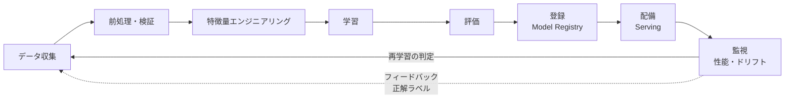
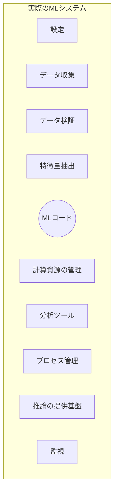
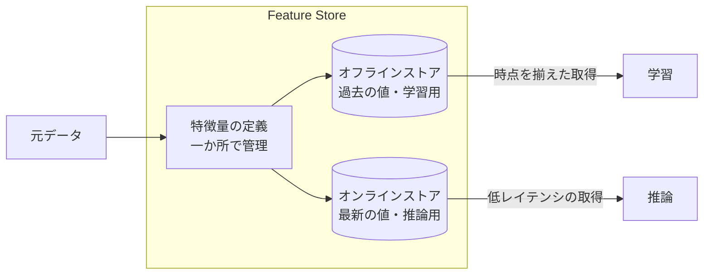
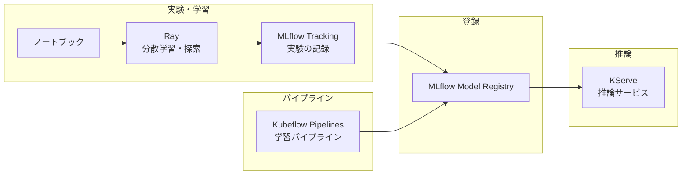
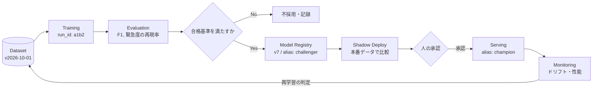

## 本章の問い

推論モデルは、なぜソースコードと同じ方法では運用できないのか。

第8章で、運用対象ごとに失敗の仕方が異なることを見た。機械学習モデルは、その違いが最初に、そして最も明確に認識された対象である。モデルはエラーを出さずに静かに精度を落とし、その振る舞いはコードだけでなく学習データによって決まり、本番環境で受け取るデータは時間とともに変化する。

本章では、MLシステムのライフサイクルを概観したうえで、D. Sculleyらの論文が指摘した「隠れた技術的負債」を手がかりに、MLに固有の運用課題を整理する。そして、実験追跡、モデルレジストリ、特徴量ストア、継続的な学習、ドリフトの検知といったMLOpsの技術を学び、最後にML Platform Engineeringにおける責任分界を考える。

## MLOpsの定義

Google Cloudは、MLOpsを、ML システムの開発（Dev）と運用（Ops）を統合することを目指すMLエンジニアリングの文化と実践として説明し、MLシステムの構築におけるすべてのステップ――統合、テスト、リリース、デプロイ、インフラ管理――の自動化と監視を提唱するものとしている。[R12]

本書では、次のように定義する。

> <strong>MLOps</strong>とは、機械学習モデルの開発から、配備、監視、再学習までを、一つの継続的なライフサイクルとして管理する実践である。（本書の定義。Google Cloud [R12] の説明を踏まえる）

## 9.1　MLシステムのライフサイクル――データ、特徴量、学習、評価、配備

### 「モデルを作る」と「モデルを運用する」

機械学習の研究や実験では、目的は「良いモデルを作ること」である。データを集め、前処理し、モデルを学習させ、評価指標が改善したら成功である。

しかし本番環境では、モデルを作ることは始まりにすぎない。モデルは本番環境のデータを受け取って予測を返し続け、その予測は業務の判断に使われる。データが変われば、モデルは再学習しなければならない。新しいモデルは、古いモデルより本当に良いのかを確かめてから置き換えなければならない。

### ライフサイクルの全体像



| 段階 | 主な活動 | 主な成果物 |
|---|---|---|
| データ収集 | 業務システム、ログ、外部データからのデータの取得 | 生データ |
| 前処理・検証 | 欠損の処理、スキーマの検証、異常値の確認 | 学習用データセット |
| 特徴量エンジニアリング | 生データからモデルの入力となる特徴量を計算する | 特徴量 |
| 学習 | アルゴリズムとハイパーパラメータを選び、モデルを学習させる | モデルの重み |
| 評価 | 学習に使わなかったデータで性能を測る | 評価指標 |
| 登録 | モデルとそのメタデータを保存し、バージョン管理する | 登録済みモデル |
| 配備 | モデルを推論サービスとして本番環境に置く | 推論エンドポイント |
| 監視 | 予測の性能、入力データの分布、資源使用を監視する | 監視指標、アラート |

### Asklineの問い合わせ分類モデル

本章では、Asklineに追加された<strong>問い合わせ分類モデル</strong>を例に考える。このモデルは、問い合わせの件名と本文から、問い合わせのカテゴリ（「ログイン」「請求」「障害報告」「機能要望」など）と緊急度を予測する。予測結果は、問い合わせを適切な担当チームに自動で振り分けるために使われる。

このモデルが誤って「障害報告」を「機能要望」に分類すれば、緊急の問題が数日間放置されるかもしれない。しかし、モデルはエラーを出さない。誤った分類を、自信を持って返し続ける。

## 9.2　データ依存性とHidden Technical Debt

### Hidden Technical Debt論文

2015年、GoogleのD. Sculleyらは、NeurIPS（当時の名称はNIPS）で論文 *Hidden Technical Debt in Machine Learning Systems* を発表した。[R11] この論文は、MLシステムが、通常のソフトウェアの技術的負債に加えて、<strong>ML固有の技術的負債</strong>を抱えやすいことを指摘し、MLOpsという分野が形成される重要な契機の一つとなった。

論文の中で最もよく引用されるのは、実際のMLシステムのうち、<strong>MLのコードそのものはごく一部にすぎない</strong>ことを示した図である。MLのコードの周りには、データの収集、データの検証、特徴量の抽出、設定、資源の管理、推論の提供、監視などの、はるかに大きな周辺の仕組みがある。



> 上図は、論文の図の趣旨（MLコードは小さく、周辺のインフラが大きい）を、本書が簡略化して示したものであり、論文の図の複製ではない。

### 論文が指摘した主な負債

論文は多くの種類の負債を挙げているが、本書の議論に関わる主なものを整理する。[R11]

| 負債の種類 | 内容 | Asklineでの例 |
|---|---|---|
| <strong>境界の侵食（CACE原則）</strong> | MLモデルでは、入力のどれか一つを変えると、他のすべての入力の重みや重要性が変わりうる。論文はこれを「Changing Anything Changes Everything」と呼んだ | 件名の前処理を少し変えただけで、本文の特徴量の効き方まで変わる |
| <strong>データ依存性</strong> | コードの依存関係と違い、データの依存関係は静的解析で見つけにくい。不安定なデータや、ほとんど寄与しないデータへの依存が蓄積する | 顧客の業種情報を特徴量に使っていたが、上流のシステムで業種の分類が変更された |
| <strong>隠れたフィードバックループ</strong> | モデルの予測が、将来の学習データに影響を与える | 分類モデルが「請求」と予測した問い合わせは請求チームに送られ、請求チームが付けたラベルが次の学習データになる。誤った振り分けが、誤ったラベルとして固定される |
| <strong>宣言されていない利用者</strong> | モデルの出力を、誰が使っているかが管理されていない | 分類結果を、別のチームが勝手に集計ダッシュボードに使っていた。モデルを更新したら、ダッシュボードの数字が変わった |
| <strong>グルーコード、パイプラインジャングル</strong> | 汎用のMLパッケージを使うための接着コードや、場当たり的に継ぎ足されたデータ処理の連鎖 | 前処理スクリプトが、数年で数十個の段階に膨れ上がっている |
| <strong>設定の負債</strong> | MLシステムの設定は量が多く、誤りが起きやすいのに、コードほど厳密に管理されない | 学習時と推論時で、異なる語彙辞書のバージョンを使っていた |
| <strong>外部世界の変化</strong> | 現実世界は変化し、モデルが学習した前提が崩れる | 新製品の発売で、それまでなかった種類の問い合わせが急増した |

### なぜコードと同じ方法では運用できないのか

論文の指摘を踏まえると、本章の問いに答えることができる。MLモデルがソースコードと同じ方法で運用できない理由は、次の三点に集約される。

<strong>第一に、振る舞いを決めるのがコードだけではない。</strong> モデルの振る舞いは、コード、学習データ、特徴量、ハイパーパラメータ、学習の乱数の種の組み合わせで決まる。コードのバージョン管理だけでは、モデルを再現できない。

<strong>第二に、正しさをテストで確かめられない。</strong> 通常のソフトウェアでは、「この入力に対して、この出力が返るべき」という仕様をテストとして書ける。MLモデルでは、個々の入力に対する正解は確率的にしか決まらず、モデルの正しさは評価データに対する<strong>統計的な性能</strong>としてしか測れない。

<strong>第三に、本番環境で劣化する。</strong> 通常のソフトウェアは、コードを変えなければ振る舞いは変わらない。MLモデルは、モデルを変えなくても、<strong>入力されるデータが変われば、性能が変わる</strong>。デプロイした時点では正しかったモデルが、時間とともに誤るようになる。

## 9.3　Experiment Tracking、Dataset/Model Versioning

### 実験追跡

モデルの開発では、データの前処理、特徴量、アルゴリズム、ハイパーパラメータの組み合わせを変えながら、多数の実験を行う。どの実験で、どの設定を使い、どの結果が得られたかを記録しなければ、良い結果を再現することも、なぜ良かったのかを理解することもできない。

<strong>実験追跡（Experiment Tracking）</strong>は、各実験について、次の情報を記録・比較する仕組みである。

| 記録する情報 | 例 |
|---|---|
| パラメータ | 学習率、エポック数、正則化の強さ、使った特徴量の一覧 |
| 指標 | 正解率、F1スコア、カテゴリごとの再現率 |
| 成果物（Artifacts） | 学習済みモデル、混同行列の図、特徴量の重要度 |
| コードのバージョン | Gitのコミットハッシュ |
| データのバージョン | 学習データのバージョン、またはハッシュ |
| 実行環境 | ライブラリのバージョン、ハードウェア |

### データとモデルのバージョン管理

9.2節で述べたように、モデルを再現するには、コードだけでなく<strong>データのバージョン</strong>も管理する必要がある。しかし、学習データは数GBから数TBに及ぶことがあり、Gitで直接管理するには向かない。

データのバージョン管理には、いくつかのアプローチがある。

| アプローチ | 仕組み | 例 |
|---|---|---|
| 不変のスナップショット | データセットを不変のオブジェクトとして保存し、識別子で参照する | オブジェクトストレージ上の日付付きパス、データセットのハッシュ |
| メタデータによる管理 | データ本体は外部に置き、そのハッシュと場所をGitで管理する | DVCなどのツール |
| テーブル形式のタイムトラベル | テーブルの過去のバージョンを問い合わせられる形式を使う | Delta Lake、Apache Icebergなど（第18章） |

どのアプローチを採るにせよ、重要なのは、<strong>あるモデルが、どのデータで学習されたかを、後から必ず特定できる</strong>ことである。これは、モデルの性能に問題が見つかったときの調査、規制への対応、そして再学習の比較のために欠かせない。

## 9.4　Model RegistryとFeature Store

### Model Registry

<strong>Model Registry（モデルレジストリ）</strong>は、学習済みモデルを、バージョン、メタデータ、状態とともに管理する中央の保管庫である。

モデルレジストリが管理する主な情報は次のとおりである。

- <strong>モデルのバージョン</strong>：同じモデルの複数の版を区別する。
- <strong>系譜（Lineage）</strong>：どの実験、どのコード、どのデータから作られたか。
- <strong>評価結果</strong>：どの評価データで、どの性能が得られたか。
- <strong>状態・別名</strong>：開発中、検証中、本番で使用中、廃止などの状態、または「champion（本番）」「challenger（候補）」のような別名。
- <strong>承認の記録</strong>：誰が、いつ、本番への昇格を承認したか。

モデルレジストリは、第6章のGitOpsにおける「バージョン管理された望ましい状態」に相当する役割を、モデルに対して果たす。「本番で使うべきモデルはどれか」がレジストリに記録されていれば、推論サービスはそれに従ってモデルを取得できる。

### Feature Store

<strong>Feature Store（特徴量ストア）</strong>は、特徴量の定義、計算、保存、提供を一元的に管理する仕組みである。

特徴量ストアが解決する最も重要な問題は、<strong>学習時と推論時の特徴量の不一致（Training-Serving Skew）</strong>である。

例えば、Asklineの分類モデルで「この顧客が過去30日間に送った問い合わせの数」を特徴量として使うとする。学習時には、データウェアハウスでSQLを使ってこの値を計算する。推論時には、問い合わせを受け付けたその瞬間に、アプリケーションのコードでこの値を計算する。二つの計算が、少しでも異なる定義（例：30日の数え方、削除された問い合わせの扱い）で実装されていれば、モデルは学習時と異なる入力を受け取ることになり、性能は落ちる。しかも、この問題はエラーとして現れない。



特徴量ストアは、<strong>一つの定義から、学習用（オフライン）と推論用（オンライン）の両方の値を作る</strong>ことで、この不一致を防ぐ。また、学習データを作る際に、各時点で「その時点で利用可能だった値」だけを使う（<strong>Point-in-time correctness</strong>）ことで、未来の情報が学習データに漏れ込む（データリーケージ）のを防ぐ。

## 9.5　Training、Continuous Training、Deployment、Serving

### 学習パイプライン

本番運用されるモデルは、データサイエンティストのノートブックで一度だけ学習させるのではなく、<strong>再現可能なパイプライン</strong>として学習させる必要がある。学習パイプラインは、データの取得、検証、特徴量の計算、学習、評価、登録の各段階を、コードとして定義し、自動で実行できるようにしたものである。

### MLOpsの成熟度

Google CloudのMLOpsの解説は、MLOpsの自動化の程度を段階として整理している。[R12] 本書の議論に沿って要約すると、次のようになる。

| 段階 | 特徴 | 課題 |
|---|---|---|
| 手作業のプロセス | データの準備、学習、評価、配備がすべて手作業。モデルの更新は稀 | 再現性がない。モデルの劣化に対応できない |
| MLパイプラインの自動化 | 学習パイプラインが自動化され、新しいデータで<strong>継続的に学習（Continuous Training）</strong>できる | パイプライン自体の変更は手作業でテスト・配備している |
| CI/CDパイプラインの自動化 | 学習パイプラインのコードそのものも、CI/CDで自動的にテスト・配備される | ― |

この整理で重要なのは、MLOpsには<strong>二種類のCI/CDがある</strong>ということである。

1. <strong>パイプラインのCI/CD</strong>：学習パイプラインのコード（前処理、特徴量、学習のコード）の変更を、テストしてデプロイする。これは通常のソフトウェアのCI/CDと同じである。
2. <strong>モデルの継続的な学習（CT）とデリバリー</strong>：パイプラインを新しいデータで実行し、新しいモデルを作り、評価して、本番に配備する。これはML固有のものである。

### 配備の戦略

新しいモデルを本番環境に配備する際には、通常のソフトウェアと同様の段階的なリリース戦略を使える。ただし、MLモデルには固有の戦略もある。

| 戦略 | 内容 | MLでの意義 |
|---|---|---|
| <strong>シャドーデプロイ</strong> | 新しいモデルに本番のリクエストを送り、予測を記録するが、結果は使わない | 本番データでの振る舞いを、利用者に影響を与えずに確認できる |
| <strong>カナリアリリース</strong> | 一部のリクエストだけを新しいモデルで処理する | 問題があれば影響を限定できる |
| <strong>A/Bテスト</strong> | リクエストを二つのモデルに振り分け、業務上の成果を比較する | オフラインの評価指標ではなく、業務への影響で比較できる |
| <strong>Champion / Challenger</strong> | 本番のモデル（Champion）と候補のモデル（Challenger）を並行して評価し、Challengerが勝ったら置き換える | 継続的な改善の仕組みとして運用できる |

特に重要なのは、<strong>オフラインの評価とオンラインの成果は一致しない</strong>ことである。評価データで正解率が2%向上したモデルが、本番環境では、問い合わせの振り分けの誤りを減らさないことがある。評価データが本番のデータを代表していない、正解率が業務上の重要な誤り（緊急の問い合わせの見逃し）を反映していない、といった理由である。

### Serving（推論の提供）

学習済みのモデルを、本番環境で予測を返すサービスとして動かすことを<strong>Serving（サービング）</strong>と呼ぶ。推論の提供方式には、主に次のものがある。

| 方式 | 内容 | 例 |
|---|---|---|
| オンライン推論 | リクエストごとに、低レイテンシで予測を返す | 問い合わせ受付時の即時分類 |
| バッチ推論 | 大量のデータに対して、まとめて予測を計算する | 夜間に、全顧客の解約リスクを計算する |
| ストリーミング推論 | 連続して流れてくるイベントに対して、逐次予測する | リアルタイムの不正検知 |

推論サービスは、通常のWebサービスと同様に、第5章のSLO（可用性、レイテンシ）と第7章のObservabilityの対象になる。それに加えて、推論サービスには、<strong>予測の質</strong>を監視する必要がある。これが次節のテーマである。

## 9.6　Data Drift／Concept Driftと再学習判定

### ドリフトとは

MLモデルは、学習データと本番データが<strong>同じ分布に従う</strong>という前提のもとで機能する。しかし現実には、本番のデータは時間とともに変化する。この変化を<strong>ドリフト（Drift）</strong>と呼ぶ。

ドリフトには、主に次の二種類がある。

| 種類 | 何が変わるか | 例 |
|---|---|---|
| <strong>Data Drift（データドリフト、共変量シフト）</strong> | 入力データの分布 P(X) | 新製品の発売で、それまで少なかった語彙を含む問い合わせが急増した |
| <strong>Concept Drift（コンセプトドリフト）</strong> | 入力と出力の関係 P(Y\|X) | 社内の組織変更で、「請求書の再発行」の問い合わせの担当が、請求チームからサポートチームに変わった。同じ問い合わせでも、正しい分類が変わった |

データドリフトは、入力データの統計を見れば検知できる。しかしコンセプトドリフトは、入力データの分布が変わらなくても起きるため、<strong>正解ラベルと比較しなければ検知できない</strong>。そして、正解ラベルは多くの場合、予測から時間が経ってから得られる（問い合わせが最終的にどのチームで解決されたかは、数日後にわかる）。

### ドリフトの検知

データドリフトの検知には、学習時の入力データの分布と、本番の入力データの分布を比較する統計的な手法が使われる。

| 手法 | 内容 | 向いている特徴量 |
|---|---|---|
| PSI（Population Stability Index） | 区間ごとの割合の違いを集計した指標 | 数値・カテゴリ |
| KS検定（Kolmogorov–Smirnov） | 二つの分布の累積分布関数の最大の差 | 数値 |
| カイ二乗検定 | カテゴリの出現頻度の違い | カテゴリ |
| 埋め込みの距離 | テキストや画像の埋め込みベクトルの分布の違い | テキスト・画像 |

ドリフトの検知で注意すべきは、<strong>統計的に有意な変化が、業務上重要な変化とは限らない</strong>ことである。大量のデータでは、ごく小さな変化も統計的には有意になる。逆に、小さな分布の変化が、重要なカテゴリの性能を大きく落とすこともある。

### 再学習の判定

ドリフトを検知したら、モデルを再学習すべきか。再学習の判定には、次のような方針がある。

| 方針 | 内容 | 長所 | 短所 |
|---|---|---|---|
| 定期的 | 毎週、毎月など決まった周期で再学習する | 単純で予測可能 | 不要な再学習をする、または急な変化に間に合わない |
| ドリフト検知時 | 入力データのドリフトが閾値を超えたら再学習する | 変化に反応できる | データドリフトとして現れないコンセプトドリフトを見逃す |
| 性能劣化時 | 正解ラベルと比較した性能が閾値を下回ったら再学習する | 業務上の影響に直結する | 正解ラベルが得られるまで遅れる |
| 組み合わせ | 上記を組み合わせ、最終的に人が判断する | バランスが良い | 運用が複雑になる |

いずれの方針でも、<strong>再学習したモデルを無条件に本番に配備してはならない</strong>。再学習したモデルが、現在のモデルより良いことを、評価データとシャドーデプロイで確かめてから置き換えるべきである。自動化された再学習が、品質の低いデータを取り込んで、モデルを悪化させることもあるからである。これは第3章で論じた「自動化は誤りも速く、大規模に実行する」問題の、ML版である。

## 9.7　MLflow、Kubeflow、KServe、Rayの使い分け

MLOpsのための代表的なオープンソースのツールを、それぞれが主に担う役割で整理する。

| ツール | 主な役割 | 特徴 |
|---|---|---|
| <strong>MLflow</strong> | 実験追跡、モデルレジストリ、モデルのパッケージング | 軽量で導入しやすい。特定の学習フレームワークや実行基盤に依存しない |
| <strong>Kubeflow</strong> | Kubernetes上でのMLワークフローの構築と実行 | パイプライン、学習ジョブ、ノートブックなど、Kubernetes上のML基盤一式を提供する |
| <strong>KServe</strong> | Kubernetes上でのモデルの推論提供 | 推論サービスを宣言的に定義でき、オートスケール、カナリアリリースなどを提供する |
| <strong>Ray</strong> | 分散計算の汎用フレームワーク | 分散学習、ハイパーパラメータ探索、バッチ推論、推論サービスなど、Pythonの処理を分散実行する |

### 使い分けの考え方

これらのツールは、競合するというより、<strong>ライフサイクルの異なる段階を担う</strong>ものとして組み合わせて使われることが多い。



どのツールを選ぶかは、組織の状況によって変わる。

- <strong>小規模に始めたい</strong>：MLflowの実験追跡とモデルレジストリから始めるのが現実的である。
- <strong>Kubernetesを共通基盤として使っている</strong>：KubeflowやKServeを使えば、MLの基盤を既存のKubernetesの運用（第6章）と統合できる。
- <strong>大規模な分散計算が必要</strong>：Rayを使えば、Pythonのコードを大きく変えずに分散実行できる。
- <strong>マネージドサービスを使いたい</strong>：クラウドのMLプラットフォーム（第17章）や、データプラットフォームに統合されたML機能（第18章）を検討する。

> <strong>注意</strong>：各ツールの機能範囲は、版を重ねるごとに広がっている（例：MLflowは近年、生成AI・LLM向けの機能を大幅に拡充している）。本節の整理は主たる役割に基づくものであり、刊行前に各ツールの最新の機能を確認すること。

## 9.8　ML Platform Engineeringと責任分界

### ML Platformが必要になる理由

第8章で見た専用基盤の乱立は、MLの領域で特に起きやすい。各チームのデータサイエンティストが、それぞれ独自のGPUサーバー、独自の実験記録の方法、独自の推論サーバーを持つ。その結果、

- GPUの利用効率が低い（あるチームのGPUは遊んでいるのに、別のチームは不足している）。
- モデルがどのデータで学習されたかを、組織として追跡できない。
- 推論サービスの監視とセキュリティの水準がばらばらになる。
- データサイエンティストが、インフラの構築と運用に多くの時間を取られる。

この問題に対して、MLに必要な共通能力をプラットフォームとして提供するのが<strong>ML Platform Engineering</strong>である。

### 責任分界

第8章の8.6節の考え方を、MLに適用する。

| 能力 | 担当 | 理由 |
|---|---|---|
| GPU・計算資源の払い出しとスケジューリング | プラットフォーム | 多くのチームが共通して必要とし、効率的な共有が組織全体の利益になる |
| 実験追跡・モデルレジストリの基盤 | プラットフォーム | 仕組み自体はドメイン知識なしに提供できる |
| 推論サービスの基盤（デプロイ、オートスケール、監視） | プラットフォーム | 第5章・第7章の共通能力を、推論サービスにも適用する |
| 特徴量ストアの基盤 | プラットフォーム | 仕組みは共通化できる |
| 特徴量の定義と意味 | ドメイン（データサイエンティスト、データ所有者） | 何が良い特徴量かは、業務とデータの知識が必要 |
| モデルの評価指標と合格基準 | ドメイン | 業務上どの誤りが重要かは、業務の知識が必要 |
| 再学習の判定方針 | ドメイン（プラットフォームが仕組みを提供） | ドリフトの閾値や判定は、業務への影響に依存する |
| 本番昇格の承認 | ドメイン（プラットフォームが承認フローを提供） | Error Budgetと同様、ポリシーはドメイン、仕組みはプラットフォーム |
| モデルの公平性・説明可能性の基準 | ドメイン＋ガバナンス（第20章） | 組織のリスク許容と規制に依存する |

### 共通インフラと専門知識の分離

ML Platform Engineeringの要点は、第8章のOps一覧表の注意点に書いたとおり、<strong>データ／モデルの専門知識と共通インフラを分離する</strong>ことである。

データサイエンティストは、GPUクラスタの運用、Kubernetesのマニフェスト、推論サーバーのオートスケールの設定に習熟する必要はない。それらはプラットフォームが提供する。一方、プラットフォームチームは、問い合わせ分類モデルにとって何が良い評価指標かを決める必要はない。それはデータサイエンティストと業務の担当者が決める。

両者の間のインターフェース――データサイエンティストがプラットフォームに渡すもの（学習コード、評価基準、推論の要件）と、プラットフォームが返すもの（計算資源、実験の記録、推論エンドポイント、監視）――を明確に定義することが、ML Platform Engineeringの設計の中心になる。この「インターフェースを製品として設計する」考え方は、第14章で詳しく扱う。

## 図・実装例

### Dataset→Training→Evaluation→Registry→Serving→Monitoring→Retraining



### 実装例：MLflowで学習実験と本番モデルのバージョンを関連づける

Asklineの問い合わせ分類モデルを、MLflowで実験追跡し、モデルレジストリに登録する。学習データのバージョンとコードのコミットを記録し、本番モデルから学習の条件を遡れるようにする。

```bash
uv add mlflow scikit-learn pandas
```

```python
# train.py
"""問い合わせ分類モデルを学習し、MLflow に記録・登録する。"""
from __future__ import annotations

import subprocess
from dataclasses import dataclass

import mlflow
import pandas as pd
from mlflow.models import infer_signature
from sklearn.feature_extraction.text import TfidfVectorizer
from sklearn.linear_model import LogisticRegression
from sklearn.metrics import f1_score, recall_score
from sklearn.model_selection import train_test_split
from sklearn.pipeline import Pipeline

MODEL_NAME = "askline-inquiry-classifier"
URGENT_LABEL = "incident"   # 障害報告。見逃しを特に避けたいカテゴリ

@dataclass(frozen=True)
class TrainConfig:
    dataset_uri: str
    dataset_version: str
    c: float = 1.0
    max_features: int = 20000

def current_commit() -> str:
    return subprocess.run(["git", "rev-parse", "HEAD"], capture_output=True,
                          text=True, check=True).stdout.strip()

def build_pipeline(cfg: TrainConfig) -> Pipeline:
    return Pipeline([
        ("tfidf", TfidfVectorizer(max_features=cfg.max_features, ngram_range=(1, 2))),
        ("clf", LogisticRegression(C=cfg.c, max_iter=1000)),
    ])

def evaluate(y_true, y_pred) -> dict[str, float]:
    """全体のF1に加え、業務上重要な『障害報告』の再現率を測る。"""
    return {
        "f1_macro": f1_score(y_true, y_pred, average="macro"),
        "recall_incident": recall_score(y_true, y_pred, labels=[URGENT_LABEL], average="macro"),
    }

def train(cfg: TrainConfig) -> str:
    df = pd.read_parquet(cfg.dataset_uri)
    text = df["subject"] + " " + df["body"]
    x_train, x_test, y_train, y_test = train_test_split(
        text, df["category"], test_size=0.2, random_state=42, stratify=df["category"])

    with mlflow.start_run() as run:
        mlflow.set_tags({"git_commit": current_commit(),
                         "dataset_version": cfg.dataset_version})
        mlflow.log_params({"C": cfg.c, "max_features": cfg.max_features,
                           "dataset_uri": cfg.dataset_uri})
        model = build_pipeline(cfg).fit(x_train, y_train)
        metrics = evaluate(y_test, model.predict(x_test))
        mlflow.log_metrics(metrics)
        mlflow.sklearn.log_model(
            model, name="model",
            signature=infer_signature(x_test.to_frame(), model.predict(x_test)),
            registered_model_name=MODEL_NAME,
        )
        return run.info.run_id
```

> <strong>注意</strong>：`mlflow.sklearn.log_model` の引数名（`name` / `artifact_path`）はMLflowのバージョンによって異なる。MLflow 3系では `name` が推奨されている。刊行前に動作確認したバージョンを明記する。

評価関数は、ネットワークやMLflowに依存しないため、単体テストできる。

```python
# test_train.py
import pytest

from train import evaluate

def test_recall_incident_detects_missed_urgent_inquiries():
    y_true = ["incident", "incident", "billing", "login"]
    y_pred = ["incident", "feature", "billing", "login"]   # 障害報告を1件見逃した
    metrics = evaluate(y_true, y_pred)
    assert metrics["recall_incident"] == pytest.approx(0.5)
```

登録されたモデルのうち、合格基準を満たしたものに別名（alias）を付けて本番への昇格を管理する。昇格の判定ロジックも小さな関数として切り出す。

```python
# promote.py
"""合格基準を満たしたモデルに challenger の別名を付ける。"""
from dataclasses import dataclass

from mlflow import MlflowClient

MODEL_NAME = "askline-inquiry-classifier"

@dataclass(frozen=True)
class AcceptanceCriteria:
    min_f1_macro: float = 0.85
    min_recall_incident: float = 0.95   # 障害報告の見逃しは5%未満

def is_acceptable(metrics: dict[str, float], criteria: AcceptanceCriteria) -> bool:
    return (metrics.get("f1_macro", 0) >= criteria.min_f1_macro
            and metrics.get("recall_incident", 0) >= criteria.min_recall_incident)

def promote_to_challenger(version: str, criteria: AcceptanceCriteria) -> bool:
    client = MlflowClient()
    mv = client.get_model_version(MODEL_NAME, version)
    metrics = client.get_run(mv.run_id).data.metrics
    if not is_acceptable(metrics, criteria):
        return False
    client.set_registered_model_alias(MODEL_NAME, "challenger", version)
    return True
```

本番の推論サービスは、`models:/askline-inquiry-classifier@champion` を読み込む。`challenger` から `champion` への切り替えは、シャドーデプロイでの比較結果を確認したうえで、<strong>人が承認して行う</strong>。第3章の自動化の段階でいえば、段階2（提案と人の承認）にあたる。

この設計で重要なのは、本番のモデルから、`run_id` を通じて、学習に使ったデータのバージョン（`dataset_version`）とコードのコミット（`git_commit`）を必ず遡れることである。問い合わせ分類に問題が見つかったとき、「どのデータで、どのコードで学習したモデルが、いつから本番で使われていたか」を即座に答えられる。

### ドリフト検知の最小実装

本番の問い合わせのカテゴリの予測分布を、学習時の分布と比較するPSIの計算を示す。

```python
"""予測カテゴリの分布について PSI を計算する。"""
import math
from collections import Counter

EPSILON = 1e-6

def distribution(labels: list[str], categories: list[str]) -> list[float]:
    counts = Counter(labels)
    total = len(labels) or 1
    return [max(counts[c] / total, EPSILON) for c in categories]

def psi(expected: list[float], actual: list[float]) -> float:
    """Population Stability Index。一般に 0.1 未満は安定、0.25 以上は大きな変化の目安とされる。"""
    return sum((a - e) * math.log(a / e) for e, a in zip(expected, actual))
```

```python
# test_drift.py
from drift import distribution, psi

CATS = ["login", "billing", "incident", "feature"]

def test_identical_distribution_has_zero_psi():
    d = distribution(["login", "billing", "incident", "feature"], CATS)
    assert psi(d, d) == 0

def test_shifted_distribution_has_large_psi():
    base = distribution(["login"] * 25 + ["billing"] * 25 + ["incident"] * 25 + ["feature"] * 25, CATS)
    now = distribution(["login"] * 70 + ["billing"] * 10 + ["incident"] * 10 + ["feature"] * 10, CATS)
    assert psi(base, now) > 0.25
```

> <strong>注意</strong>：PSIの閾値（0.1、0.25）は実務上の経験則であり、理論的な根拠を持つ基準ではない。9.6節で述べたように、統計的な変化と業務上の重要性は別に判断すること。

## 評価指標とトレードオフ

| 指標 | 意味 | 注意点 |
|---|---|---|
| オフライン評価指標 | 評価データでの性能（F1、再現率など） | 業務上重要な誤りを反映した指標を選ぶ |
| オンライン業務指標 | 本番での業務成果（誤振り分け率、解決までの時間） | 正解ラベルが得られるまでの遅れがある |
| ドリフト指標 | 入力・予測の分布の変化（PSIなど） | 統計的有意性と業務上の重要性を区別する |
| モデルの鮮度 | 本番モデルの学習データがどれだけ新しいか | 新しければ良いとは限らない |
| 再現性 | 本番モデルを、記録から再学習して再現できるか | 定期的に実際に試す |
| 系譜の完全性 | 本番モデルのうち、データ・コード・承認者を遡れるものの割合 | 監査・規制対応の前提 |
| 推論のSLO | 推論サービスの可用性・レイテンシ | 第5章のSLOと同じ枠組みで扱う |
| 学習・推論のコスト | GPU時間、推論あたりの費用 | 第11章のFinOpsで扱う |

本章の中心的なトレードオフは、<strong>自動化と品質の保証</strong>である。継続的な学習と自動の配備は、モデルをデータの変化に追従させるが、品質の低いデータや予期しないフィードバックループを、気づかないうちに本番に持ち込む危険がある。どこまで自動化し、どこで人が判断するかは、モデルの誤りが業務に与える影響の大きさで決めるべきである。

## 本章の結論

MLモデルがソースコードと同じ方法で運用できないのは、

- 振る舞いがコードだけでなく、<strong>データ</strong>によって決まるから
- 正しさが個々のテストではなく、<strong>統計的な性能</strong>としてしか測れないから
- コードを変えなくても、<strong>本番環境で劣化する</strong>から

である。MLOpsは、データとモデルのバージョン管理、実験追跡、モデルレジストリ、特徴量ストア、継続的な学習、ドリフトの検知によって、これらの課題に応えてきた。

そしてML Platform Engineeringは、計算資源、実験追跡、レジストリ、推論基盤といった共通インフラを提供し、評価指標や特徴量の意味といった専門知識をドメインのチームに残すことで、両者を分離する。

次章では、MLモデルの土台であるデータそのものを運用するDataOpsと、名前は似ているがまったく異なる目的を持つAIOpsを扱う。

## 参考文献

- [R11] D. Sculley et al., "Hidden Technical Debt in Machine Learning Systems," *Advances in Neural Information Processing Systems 28 (NIPS 2015)*. https://research.google/pubs/hidden-technical-debt-in-machine-learning-systems/
- [R12] Google Cloud, *What is MLOps?* https://cloud.google.com/discover/what-is-mlops
- Google Cloud, *MLOps: Continuous delivery and automation pipelines in machine learning*（Architecture Center）.（刊行前にURLを確認）
- MLflow公式ドキュメント. https://mlflow.org/docs/latest/
- Kubeflow公式ドキュメント. https://www.kubeflow.org/docs/
- KServe公式ドキュメント. https://kserve.github.io/website/
- Ray公式ドキュメント. https://docs.ray.io/
