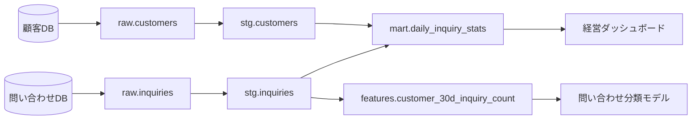
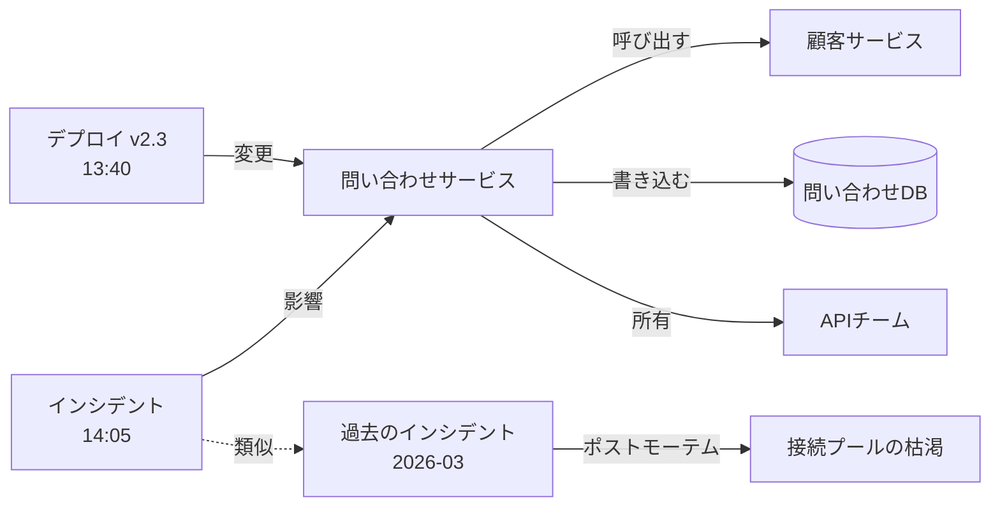
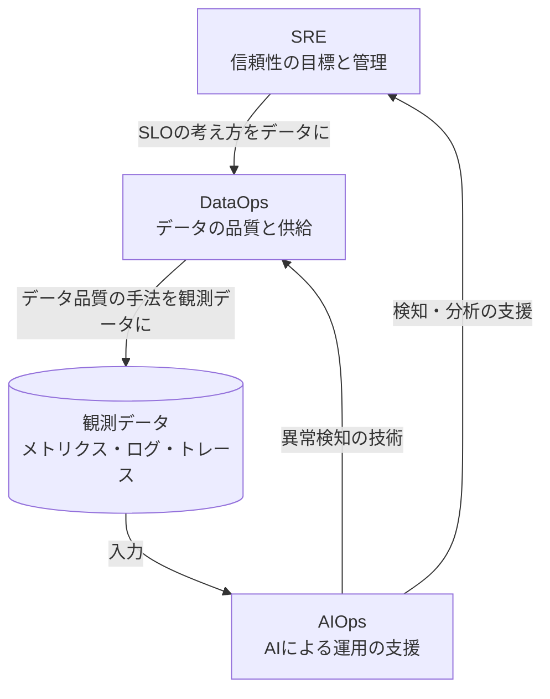
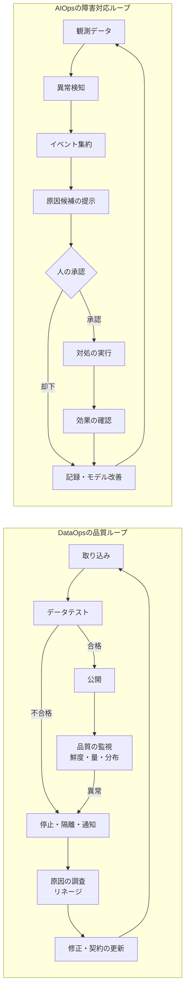

## 本章の問い

DataOpsとAIOpsは名前が似ているが、どちらが何を改善するのか。

第8章の分類（8.3節）で、DataOpsは「対象の運用」に、AIOpsは「手段としてのAI」に分類した。DataOpsは**データという対象**を、品質を保ちながら継続的に提供するための実践である。AIOpsは**AIという手段**を使って、IT運用そのものを高度化する実践である。両者は改善の対象も方向も異なる。

それでも本章で二つを並べて扱うのは、両者に深い接点があるからだ。AIOpsは観測データという「データ」を入力とし、その質に全面的に依存する。そしてDataOpsの品質監視は、AIOpsの異常検知の技術を使うことができる。本章の前半ではDataOpsを、後半ではAIOpsを扱い、最後に両者とSREの接点を整理する。

---

## 前半：DataOps

## 10.1　DataOps――データの継続的な品質保証

### データが「本番」になった

かつて、データ分析は業務システムの「外側」にあった。業務システムがデータを生み、分析チームがそれを月に一度取り出してレポートを作る。分析の誤りは、レポートの誤りにとどまった。

しかし今日、データは業務の**本番の一部**になっている。第9章の問い合わせ分類モデルは、データパイプラインが作った特徴量を使って予測する。経営ダッシュボードは、毎時更新される集計を表示する。第12章のRAGは、データパイプラインが取り込んだ社内文書を検索してLLMに渡す。データパイプラインが誤ったデータを出せば、モデルは誤った予測をし、経営者は誤った判断をし、LLMは誤った回答をする。

**データの障害は、ソフトウェアの障害と同じように、利用者に影響を与えるようになった**。DataOpsは、この認識から生まれた実践である。

### DataOps Manifesto

DataOpsの考え方を原則として示したものに、*DataOps Manifesto* がある。[R13] このマニフェストは、アジャイル開発、DevOps、リーン生産方式（統計的工程管理）の考え方をデータ分析に適用し、18の原則を掲げている。本書の議論に関わる主な考え方を要約する。

| 考え方 | 内容（本書による要約） | 対応する先行実践 |
|---|---|---|
| 分析はコードである | データの変換や分析の処理は、コードとしてバージョン管理し、レビューする | DevOps（第4章） |
| 再現可能にする | データ、コード、環境を管理し、同じ結果を再現できるようにする | MLOps（第9章） |
| 品質を最優先する | パイプラインは、データの誤りを自動で検知し、利用者に届く前に止める | 統計的工程管理 |
| 品質と性能を監視する | データの品質と処理の性能を継続的に監視する | SRE（第5章） |
| 使い捨ての環境 | 実験と開発のための環境を、安価に作って捨てられるようにする | Cloud Native（第6章） |
| 分析は製造である | データの処理を、工場の生産ラインのように捉え、工程ごとに品質を管理する | リーン生産方式 |
| サイクルタイムを改善する | 利用者の要求から、有用な分析が届くまでの時間を短くする | DORA指標（第4章） |

> **執筆メモ**：DataOps Manifestoの18原則の原文（英語）を確認し、本文では要約と直接引用を区別する。上表は要約である。

### DataOpsの定義

本書では、次のように定義する。

> **DataOps**とは、データの開発・供給・品質管理を、継続的に改善するための実践である。（本書の定義。DataOps Manifesto [R13] の原則を踏まえる）

## 10.2　ELT/ETL、Data Contract、Lineage、Observability

### ETLとELT

データパイプラインの基本的な処理は、データを取り出し（Extract）、変換し（Transform）、格納する（Load）ことである。

| 方式 | 処理の順序 | 特徴 |
|---|---|---|
| **ETL** | 取り出し → 変換 → 格納 | 変換を専用のサーバーで行い、整った形で格納する。従来のデータウェアハウスで一般的 |
| **ELT** | 取り出し → 格納 → 変換 | 生データをそのまま格納し、格納先（クラウドのデータウェアハウスなど）の計算能力で変換する |

クラウドのデータウェアハウスが大規模な計算能力を持つようになったことで、ELTが広く使われるようになった。ELTでは、変換の処理をSQLとして記述し、それをコードとして管理する（dbtなどのツールが代表的である）。これは、DataOps Manifestoの「分析はコードである」という原則を、実際に可能にした。

### Data Contract（データ契約）

マイクロサービスでは、サービス間のAPIに明確な仕様（OpenAPIなど）を定め、互換性を保つ。しかしデータパイプラインでは、上流のシステムのデータベースのテーブルを、下流のパイプラインが直接読むことが多かった。上流のチームは、自分たちのテーブルを誰が使っているかを知らず、カラムの名前や意味を変更し、下流のパイプラインを壊す。第9章で見た「宣言されていない利用者」と同じ問題である。

**Data Contract（データ契約）**は、データの生産者と消費者の間で、**データの形式、意味、品質、提供の条件を明示的に合意する**ための仕組みである。

```yaml
# Asklineの問い合わせイベントのデータ契約（例示的な形式）
dataset: askline.inquiry_created
owner: team-askline-api
version: 2.1.0
description: 問い合わせが作成されたときに発行されるイベント
schema:
  - name: inquiry_id
    type: string
    required: true
    unique: true
  - name: tenant_id
    type: string
    required: true
  - name: category
    type: string
    required: false
    allowed_values: [login, billing, incident, feature, other]
    description: 分類モデルによる予測カテゴリ。未分類の場合はnull
  - name: created_at
    type: timestamp
    required: true
quality:
  - rule: freshness
    max_delay: 15m          # 発生から15分以内に到着する
  - rule: null_ratio
    column: category
    max: 0.05               # 未分類は5%以下
sla:
  availability: 99.5%
consumers:
  - team-analytics
  - team-ml-classifier
compatibility: backward      # 後方互換性のない変更はメジャーバージョンを上げる
```

> **注意**：上記は本書による例示的な形式である。Data Contractについては、Open Data Contract Standard（ODCS）など、共通仕様の策定が進んでいる。採用する場合は、参照した仕様とバージョンを明記する。

データ契約は、第5章のSLOをデータに適用したものと見ることもできる。鮮度、欠損率、可用性といった品質の目標を、生産者と消費者が合意する。

### Lineage（データの系譜）

**Lineage（リネージ、データの系譜）**は、あるデータが、どのデータから、どの処理を経て作られたかの記録である。



リネージがあれば、次の問いに答えられる。

- **影響分析**：上流の`raw.customers`のスキーマを変更したら、どのダッシュボードとモデルに影響するか。
- **原因分析**：経営ダッシュボードの数字がおかしいとき、どの上流のデータに問題があるか。
- **規制対応**：個人情報を含むデータが、どこに流れているか。

リネージは、第7章の分散トレーシングがリクエストの流れに対して行ったことを、データの流れに対して行うものと言える。OpenLineageのように、リネージの情報を共通の形式で収集するための仕様も策定されている。

### Data Observability

第7章のObservabilityの考え方をデータに適用したものを、**Data Observability**と呼ぶことがある。データパイプラインの「処理が成功したか」だけでなく、「**処理されたデータが正しいか**」を観測する。

| 観測の観点 | 内容 | 例 |
|---|---|---|
| 鮮度（Freshness） | データが期待どおりの時刻に更新されているか | 毎時更新のテーブルが3時間更新されていない |
| 量（Volume） | 行数が期待どおりか | 普段は1日10万行の問い合わせが、今日は2万行しかない |
| スキーマ（Schema） | 列の構成や型が変わっていないか | `category`列が突然なくなった |
| 分布（Distribution） | 値の分布が変わっていないか | `category`のnullの割合が1%から40%に急増した |
| リネージ（Lineage） | どの上流とどの下流に関係するか | 問題の影響範囲を特定する |

第8章で、データパイプラインは「成功」と報告しながら誤ったデータを書き込むことがあると述べた。Data Observabilityは、この**暗黙の失敗**を検知するための仕組みである。

## 10.3　データテストとスキーマ変更への追従

### データテスト

ソフトウェアのテストがコードの正しさを確かめるように、**データテスト**はデータの正しさを確かめる。データテストは、パイプラインの各段階で実行し、問題のあるデータが下流に流れる前に止める。

| テストの種類 | 内容 | 例 |
|---|---|---|
| スキーマテスト | 列の存在、型、必須性 | `inquiry_id`は文字列で、nullではない |
| 一意性テスト | キーの重複がない | `inquiry_id`は一意である |
| 参照整合性テスト | 外部キーが参照先に存在する | すべての`tenant_id`が顧客テーブルに存在する |
| 値の範囲テスト | 値が許容範囲内にある | `category`は許可された値のいずれか |
| 統計的テスト | 分布や量が期待どおり | 前日比で行数が50%以上減っていない |
| 業務ルールテスト | 業務上の整合性 | 解決日時は作成日時より後である |

### データテストの「失敗」をどう扱うか

データテストが失敗したとき、パイプラインをどうすべきか。これは、ソフトウェアのテストよりも難しい判断になる。

| 方針 | 内容 | 適した場面 |
|---|---|---|
| 停止（Fail） | パイプラインを止め、下流を更新しない | 誤ったデータが重大な判断や外部への報告に使われる場合 |
| 隔離（Quarantine） | 問題のある行を別の場所に隔離し、残りを処理する | 一部の不正なデータが混入しても、全体は使える場合 |
| 警告（Warn） | 処理は続け、担当者に通知する | 鮮度が品質より重要な場合 |

例えば、経営ダッシュボードの数字が1日更新されないことと、誤った数字が表示されることの、どちらが問題か。モデルの学習を1日遅らせることと、汚れたデータで学習することの、どちらが問題か。この判断は、データの**利用者と用途**に依存し、プラットフォームが一律に決めることはできない。第8章の責任分界でいえば、テストの仕組みはプラットフォームが提供し、テストの失敗時の方針はデータの所有者と利用者が決める。

### スキーマ変更への追従

上流のスキーマ変更は、データパイプラインの障害の主要な原因の一つである。スキーマ変更に追従するためのアプローチを整理する。

1. **データ契約による事前の合意**：互換性のない変更は、契約のバージョンを上げ、消費者に事前に通知する。
2. **CIでの契約の検証**：上流のチームが変更を加えるとき、データ契約に違反していないかをCIで自動検査する。
3. **スキーマレジストリ**：イベントのスキーマを中央で管理し、互換性のない変更を登録時に拒否する。
4. **リネージによる影響分析**：変更の前に、影響を受ける下流を特定する。

契約を自動検証する仕組みは特に重要である。データ契約を文書として持つだけでは、守られる保証はない。**契約をコードとしてCIや実行時の検証に組み込み、違反を自動で検出する**ことで、実効性を高められる。これは、第6章で見た「望ましい状態を宣言し、仕組みがそれを強制する」というパターンの、データへの適用である。

---

## 後半：AIOps

## 10.4　AIOps――IT運用に機械学習を応用する

### AIOpsという言葉

AIOpsという言葉は、調査会社Gartnerが2016年頃に用いたことで広まったとされる。当初は「Algorithmic IT Operations」の略とされ、その後「Artificial Intelligence for IT Operations」と説明されるようになった。

> **執筆メモ**：AIOpsという用語の初出と定義の変遷は、Gartnerの公開資料など複数の資料で確認してから記述する。

AIOpsという言葉は、多くの製品のマーケティングで使われてきたため、その意味は製品によってさまざまである。本書では、特定の製品の定義と切り離し、次のように操作的に定義する。

> **AIOps**とは、AI（機械学習を含む）をIT運用に適用し、検知・分析・対処を支援・高度化する活動である。（本書の操作的定義）

### AIOpsが解こうとする問題

第2章から第7章で見てきた運用の課題のうち、AIOpsが取り組むのは主に次のものである。

| 課題 | 本書の関連章 | AIOpsのアプローチ |
|---|---|---|
| 固定の閾値では、正常の範囲の変動に対応できない | 第2章 2.7節 | 時系列の異常検知、動的閾値 |
| アラートが多すぎて、重要なものが埋もれる | 第3章 3.5節 | イベントの集約、重複排除、相関 |
| 原因の特定に時間がかかる | 第3章 3.2節、第7章 | 原因候補の推定、関連する変更の特定 |
| 同じ手順の対処を繰り返している | 第3章 3.3節、第5章 | 対処の推薦、自動実行 |
| 未知の障害を発見できない | 第7章 | 大量の観測データからのパターンの発見 |

### MLOpsとの違い

第8章で強調したことを、ここでもう一度確認しておく。**AIOpsとMLOpsは別物である**。

| 観点 | MLOps | AIOps |
|---|---|---|
| 対象 | MLモデル | ITシステム全体 |
| 目的 | モデルを本番で運用する | AIでIT運用を改善する |
| 関係 | AIOpsのモデルも、MLOpsの方法で運用されるべきである | ― |

最後の行は重要である。AIOpsで使う異常検知モデルも、MLモデルである。したがって、第9章で見たMLOpsの課題――データドリフト、再学習、評価――は、AIOpsのモデルにもそのまま当てはまる。システムの構成が変わり、トラフィックの傾向が変われば、異常検知モデルの「正常」の基準も変わる。AIOpsを導入するなら、そのモデルをMLOpsの方法で管理しなければならない。

## 10.5　時系列異常検知、イベント集約、原因分析

### 時系列異常検知

AIOpsの最も基本的な機能は、メトリクスの時系列から**異常**を検知することである。第2章で見た固定の閾値の代わりに、データから「正常の範囲」を学習する。

| 手法の系統 | 内容 | 長所 | 短所 |
|---|---|---|---|
| 統計的手法 | 移動平均と標準偏差、季節性分解などから、予測範囲を外れた点を異常とする | 単純で説明しやすい。計算が軽い | 複雑なパターンに弱い |
| 予測モデル | 時系列モデルで次の値を予測し、予測との差が大きい点を異常とする | 季節性やトレンドを扱える | モデルの調整が必要 |
| 機械学習・深層学習 | 正常時のデータから多変量のパターンを学習する | 複数の指標の関係を捉えられる | 説明が難しい。学習データが必要 |

ここで、第3章で論じた**誤検知と見逃しのトレードオフ**は、AIOpsでも解消されない。異常検知は、統計的に「珍しい」点を見つけるが、珍しいことが常に問題であるとは限らない。月末の締め処理、マーケティングキャンペーン、計画されたメンテナンスは、統計的には異常でも、運用上は正常である。逆に、ゆっくりと進行する劣化は、統計的には異常に見えないことがある。

**異常検知は、第5章のSLOに基づくアラートを置き換えるものではない**。SLOは「利用者が困っているか」という問いに答え、異常検知は「普段と違うことが起きているか」という問いに答える。前者を人を呼ぶアラートに、後者を調査の手がかりに使うのが、基本的な使い分けである。

### イベント集約

大規模な障害が起きると、多数のコンポーネントから同時に大量のアラートが発報する。データベースが落ちれば、それに依存するすべてのサービスがエラーを報告し、すべてのサービスのレイテンシのアラートが鳴る。当番者は、数百のアラートの中から、何が起きているのかを読み取らなければならない。

**イベント集約**は、関連するアラートやイベントをまとめて、一つのインシデントとして提示する機能である。

| 手法 | 内容 |
|---|---|
| 重複排除 | 同じアラートの繰り返しをまとめる |
| 時間的な近さ | 短い時間内に発生したイベントをまとめる |
| トポロジー | サービスの依存関係（第7章のトレース、第15章のカタログ）に基づいて、関連するイベントをまとめる |
| テキストの類似性 | アラートのメッセージの類似性でまとめる |

ここで、第2章で見たNagiosの**依存関係**の仕組み――親が落ちているときは子の障害を「到達不能」として扱う――を思い出してほしい。イベント集約は、この考え方を、静的な設定ではなく、観測データから推定した依存関係に基づいて行うものと言える。

### 原因分析の支援

AIOpsの原因分析の支援は、主に次のような形を取る。

1. **関連する変更の提示**：障害の発生の直前に行われたデプロイ、設定変更、インフラの変更を提示する。第1章で見たように、障害の多くは変更によって引き起こされるため、これは最も単純で、最も効果的な支援の一つである。
2. **異常な指標の絞り込み**：障害の時間帯に、普段と異なる振る舞いをした指標を、数千の候補から絞り込む。
3. **トレースの比較**：第7章7.5節で見たように、失敗したリクエストと成功したリクエストの属性を比較し、相関の強い属性を提示する。
4. **類似の過去の事例の提示**：過去のインシデントとポストモーテムから、類似の事例とその対処を提示する。

近年は、LLMを使って、アラート、ログ、トレース、過去のポストモーテムを読み、原因の仮説を自然言語で提示する取り組みも広がっている。これは第13章のAgentOpsや、第22章の自己改善型プラットフォームにつながる流れである。

## 10.6　因果推論、Knowledge GraphとRCAの可能性

### 相関と因果

原因分析の支援の多くは、**相関**に基づいている。「障害の時間帯に、データベースの接続数が増えていた」「失敗したリクエストの90%は、特定のテナントからのものだった」。しかし、相関は因果を意味しない。データベースの接続数が増えたのは障害の原因かもしれないし、障害の結果（リトライの増加）かもしれない。

**因果推論**は、観測データから、変数間の因果関係を推定する統計的な手法である。サービスの依存関係のグラフと、メトリクスの時系列を組み合わせ、「どのコンポーネントの異常が、他のコンポーネントの異常を引き起こしたか」を推定する研究が行われている。

### Knowledge Graph

**Knowledge Graph（知識グラフ）**は、システムの構成要素とその関係をグラフとして表現したものである。サービス、ホスト、データベース、デプロイ、チーム、インシデントといったノードと、「呼び出す」「依存する」「所有する」「デプロイされた」といった関係を記録する。



知識グラフがあれば、障害が起きたときに、影響を受けたサービス、その依存先、直近の変更、所有チーム、類似の過去の事例を、グラフをたどって集められる。知識グラフの構築には、第7章のトレース（実際の呼び出し関係）、第15章のソフトウェアカタログ（所有者と依存関係のメタデータ）、第6章のGitOpsの履歴（変更の記録）が材料になる。

### 適用条件と制約

因果推論とKnowledge Graphによる原因分析は有望な領域だが、その適用には明確な制約がある。本書の執筆方針に従い、それを明記しておく。

| 制約 | 内容 |
|---|---|
| **観測可能性の制約** | 観測されていない要因（計装されていない外部サービス、ネットワークの中間機器）は、因果の推定に含められない。原因が観測の外にあれば、推定は誤る |
| **グラフの正確さ** | 依存関係のグラフが現実と異なれば（古い、欠けている）、推定も誤る |
| **交絡** | 共通の原因（例：トラフィックの急増）が複数の指標を同時に動かすと、それらの間に見かけの因果が推定されやすい |
| **フィードバック** | リトライやオートスケールのように、結果が原因に影響を与える構造があると、因果の方向の推定が難しくなる |
| **データの量** | 障害は稀な事象であり、統計的な推定に十分なデータが得られないことが多い |

これらの制約から、**因果推論による原因分析の結果は、原因の「候補」として提示し、最終的な判断は人が行う**べきである。原因を断定して自動で対処するには、現時点では信頼性が十分ではない。

## 10.7　自動復旧の誤作動と承認プロセス

### 自動復旧の誘惑

AIOpsが原因を推定できるなら、対処も自動で行えばよいのではないか。異常を検知したら、自動でロールバックし、自動でスケールし、自動で再起動する。

第3章3.6節で、自動化の危険を論じた。自動化は誤りも速く、大規模に実行し、人の理解を奪い、自動化同士が相互作用する。AIOpsによる自動復旧には、これらに加えて、固有の危険がある。

**判断の根拠が確率的である。** 閾値に基づく自動化は、「CPU使用率が95%を超えたら」という明確な条件で動く。AIOpsの自動化は、「異常の確率が0.87で、原因の候補として最も可能性が高いのはデプロイv2.3」という確率的な判断で動く。この判断が誤っていれば、無関係なロールバックが実行され、新たな問題を生む。

**判断の根拠が説明しにくい。** 機械学習モデルが、なぜその判断をしたのかを説明することは難しい。自動化が誤作動したとき、何が起きたのかを理解することも難しくなる。

### 承認プロセスの設計

AIOpsによる対処の自動化は、第3章の自動化の段階に沿って、慎重に進めるべきである。

| 段階 | AIOpsでの形 | 適した対処 |
|---|---|---|
| 1. 情報提供 | 原因の候補、関連する変更、類似事例を、当番者に提示する | すべての障害 |
| 2. 提案 | 対処を提案し、当番者が承認して実行する | ロールバック、スケールアウト、トラフィックの切り替え |
| 3. 条件付き自動実行 | 安全と確認された範囲で自動実行し、通知する | 可逆で影響範囲の小さい対処（単一コンテナの再起動など） |
| 4. 完全自動 | ― | AIOpsの確率的な判断に基づく完全自動化は、現時点では限定的にとどめる |

段階2の「提案と承認」は、特に重要である。当番者は、AIOpsが集めた情報と提案を見て、数秒から数分で判断できる。人がゼロから調査するより遥かに速く、しかし最終的な判断には人が責任を持つ。

承認プロセスを設計する際には、次の点を考慮する。

1. **提案の根拠を示す**：なぜその対処を提案するのか、どの観測データに基づくのかを、当番者が確認できるようにする。
2. **対処の影響範囲を示す**：その対処が、何に、どれだけ影響するのかを示す。
3. **元に戻す方法を示す**：対処が誤っていた場合に、どう元に戻すかを示す。
4. **判断を記録する**：誰が、いつ、何を承認（または却下）したかを記録し、後の評価に使う。

最後の点は、AIOpsのモデルを改善するためにも重要である。当番者が却下した提案は、モデルの誤りの記録であり、再学習の材料になる。

この「確率的な判断を行うAIに、どこまで行動を任せ、どこで人の承認を挟むか」という問題は、第13章のAgentOps、第20章のエージェントのガバナンス、第22章の自己改善型プラットフォームで、より大きな形で再び現れる。

## 10.8　DataOps、AIOps、SREの接点

### 三者の関係

本章で扱った二つのOpsと、第5章のSREの関係を整理する。



| 接点 | 内容 |
|---|---|
| **SRE → DataOps** | SLOとError Budgetの考え方を、データの鮮度・品質に適用する（データのSLO、データ契約） |
| **DataOps → 観測データ** | 観測データ（テレメトリー）そのものもデータであり、その品質（欠損、遅延、スキーマの変化）をDataOpsの方法で管理する |
| **観測データ → AIOps** | AIOpsの分析の質は、観測データの質で上限が決まる |
| **AIOps → SRE** | AIOpsは、SREのインシデント対応（検知、トリアージ、原因分析）を支援する |
| **AIOps → DataOps** | AIOpsの異常検知の技術を、データの量・分布の監視に使う |

### 観測データは「データ製品」である

この関係から導かれる重要な結論は、**観測データ（テレメトリー）は、それ自体が品質管理の対象となるデータ製品である**ということである。

第7章で、Observabilityはツールではなく計装の設計によって作られる性質だと述べた。本章の観点からは、計装によって生み出されるテレメトリーは、データパイプラインを通って収集・保存され、AIOpsやダッシュボードやSLOの計算に使われる**データ**である。テレメトリーの欠損、遅延、属性の不統一は、データ品質の問題であり、DataOpsの方法――スキーマの管理（セマンティック規約）、品質のテスト、リネージ――で扱える。

この観点は、第Ⅳ部でプラットフォームを設計する際に重要になる。テレメトリーの基盤は、単なる「ログの置き場」ではなく、**組織の運用の判断を支えるデータ基盤**として設計すべきである。

## 図・実装例

### DataOpsの品質ループとAIOpsの障害対応ループの比較



| 観点 | DataOpsの品質ループ | AIOpsの障害対応ループ |
|---|---|---|
| 対象 | データ | ITシステム |
| 異常の定義 | データ契約・テストへの違反 | 正常パターンからの逸脱、SLO違反 |
| 調査の手段 | リネージ | トレース、知識グラフ |
| 対処 | 停止・隔離・再処理 | ロールバック・スケール・切り替え |
| 人の役割 | 契約と品質基準の決定、失敗時の方針の決定 | 対処の承認、モデルの評価 |

### 実装例：データテストを小さな関数で書く

Asklineの問い合わせイベントのデータに対して、データ契約（10.2節）の品質ルールを検査する。ここでは、外部のツールに依存しない最小の実装を示す。実務では、dbtのテストやGreat Expectationsなどの専用ツールを使うことが多い。

```python
"""問い合わせイベントのデータテスト。"""
from __future__ import annotations

from dataclasses import dataclass
from datetime import datetime, timedelta

import pandas as pd

ALLOWED_CATEGORIES = {"login", "billing", "incident", "feature", "other"}

@dataclass(frozen=True)
class TestResult:
    name: str
    passed: bool
    detail: str

def check_unique(df: pd.DataFrame, column: str) -> TestResult:
    dup = int(df[column].duplicated().sum())
    return TestResult(f"unique:{column}", dup == 0, f"{dup} duplicates")

def check_allowed_values(df: pd.DataFrame, column: str, allowed: set[str]) -> TestResult:
    invalid = df[column].dropna()[~df[column].dropna().isin(allowed)]
    return TestResult(f"allowed:{column}", invalid.empty, f"{len(invalid)} invalid values")

def check_null_ratio(df: pd.DataFrame, column: str, max_ratio: float) -> TestResult:
    ratio = float(df[column].isna().mean()) if len(df) else 0.0
    return TestResult(f"null_ratio:{column}", ratio <= max_ratio, f"{ratio:.1%}")

def check_freshness(latest: datetime, now: datetime, max_delay: timedelta) -> TestResult:
    delay = now - latest
    return TestResult("freshness", delay <= max_delay, f"delay={delay}")

def run_contract_tests(df: pd.DataFrame, now: datetime) -> list[TestResult]:
    return [
        check_unique(df, "inquiry_id"),
        check_allowed_values(df, "category", ALLOWED_CATEGORIES),
        check_null_ratio(df, "category", max_ratio=0.05),
        check_freshness(df["created_at"].max().to_pydatetime(), now, timedelta(minutes=15)),
    ]
```

```python
# test_data_contract.py
from datetime import datetime, timedelta

import pandas as pd

from data_contract import check_allowed_values, check_freshness, check_null_ratio, check_unique

ALLOWED = {"login", "billing", "incident", "feature", "other"}

def test_duplicate_ids_fail():
    df = pd.DataFrame({"inquiry_id": ["a", "a", "b"]})
    assert not check_unique(df, "inquiry_id").passed

def test_unknown_category_fails():
    df = pd.DataFrame({"category": ["login", "refund"]})
    assert not check_allowed_values(df, "category", ALLOWED).passed

def test_null_category_within_limit_passes():
    df = pd.DataFrame({"category": ["login"] * 96 + [None] * 4})
    assert check_null_ratio(df, "category", 0.05).passed

def test_stale_data_fails():
    now = datetime(2026, 11, 14, 12, 0)
    assert not check_freshness(now - timedelta(hours=1), now, timedelta(minutes=15)).passed
```

### 演習：Prometheusのメトリクスから異常候補を見つける

Asklineの問い合わせ受付APIのリクエスト数について、曜日と時間帯による季節性を考慮した異常候補を見つける。

1. PromQLで、現在のリクエスト数と、**1週間前の同じ時刻**のリクエスト数の比を計算せよ。

```promql
sum(rate(http_requests_total{service="askline-inquiry"}[10m]))
/
sum(rate(http_requests_total{service="askline-inquiry"}[10m] offset 1w))
```

2. この比が0.5未満、または2.0を超えた時間帯を異常候補とする。この方法の長所と短所を述べよ（ヒント：1週間前が祝日だった場合、1週間前に障害があった場合）。
3. 次の簡単な異常スコア関数を実装し、pytestでテストせよ。過去4週の同時刻の値の中央値と、その散らばり（中央絶対偏差）を使う。

```python
import statistics

def robust_anomaly_score(current: float, history: list[float]) -> float:
    """過去の同時刻の値に対する、中央値と中央絶対偏差（MAD）に基づく異常スコア。"""
    median = statistics.median(history)
    mad = statistics.median(abs(x - median) for x in history) or 1e-9
    return abs(current - median) / mad
```

4. このスコアが高い時間帯を、そのまま人を呼ぶアラートにすべきか。第5章のSLOとの関係から論ぜよ。

## 評価指標とトレードオフ

### DataOps

| 指標 | 意味 | 注意点 |
|---|---|---|
| データ品質テストの合格率 | 実行したテストのうち合格したものの割合 | テストの網羅性とセットで見る |
| データインシデント数 | 利用者に影響したデータの問題の件数 | 発見者が利用者だった割合も見る |
| データ障害の検知時間 | 問題の発生から検知までの時間 | 利用者が先に気づいたなら、監視が不足している |
| 鮮度SLOの達成率 | 期限内に更新されたデータセットの割合 | 第5章のSLOと同じ枠組み |
| データ契約のカバレッジ | 重要なデータセットのうち契約を持つものの割合 | 契約がCIで検証されているかも見る |
| リネージのカバレッジ | 重要なデータセットのうち系譜を遡れるものの割合 | 規制対応の前提 |

### AIOps

| 指標 | 意味 | 注意点 |
|---|---|---|
| アラートの削減率 | イベント集約によって削減された通知の割合 | 重要なアラートの見逃しが増えていないかを同時に見る |
| 原因候補の的中率 | 提示した原因候補のうち、実際の原因だったものの割合 | 上位k件以内に含まれた割合で見る |
| 提案の採用率 | 当番者が承認した対処の割合 | 低ければ提案の質に問題、高すぎれば盲従の可能性 |
| 調査時間の短縮 | AIOps導入前後の、原因特定までの時間 | 第3章のMTTRの分解で評価する |
| 誤作動件数 | 自動対処が誤って実行された件数 | ゼロでなくても、影響と回復を記録する |

DataOpsの中心的なトレードオフは、**鮮度と品質**である。品質のテストを厳しくし、問題があればパイプラインを止めれば、誤ったデータは届かないが、データは遅れる。AIOpsの中心的なトレードオフは、**自動化の速さと判断の確からしさ**である。確率的な判断に基づく自動化は、速いが、誤りを含む。

## 本章の結論

DataOpsとAIOpsは、名前は似ているが、改善するものが異なる。

- **DataOps**は、データという対象を、データ契約、データテスト、リネージ、Data Observabilityによって、品質を保ちながら継続的に提供する。
- **AIOps**は、AIという手段を使って、異常検知、イベント集約、原因分析の支援によって、IT運用を高度化する。

両者は、**観測データ**を介してつながる。観測データはそれ自体がデータ製品であり、その品質がAIOpsの質の上限を決める。そしてAIOpsの自動化は、確率的な判断に基づく以上、人の承認を適切に挟む設計が必要である。

次章では、すべてのOpsに横断的に関わる二つの関心事――安全性とコスト――を扱う。

## 参考文献

- [R13] *The DataOps Manifesto*. https://dataopsmanifesto.org/en/
- OpenLineage（データリネージの共通仕様）. https://openlineage.io/
- Open Data Contract Standard（ODCS）.（参照したバージョンとURLを刊行前に確認）
- dbt公式ドキュメント（データテスト）. https://docs.getdbt.com/
- Gartner, AIOpsに関する用語集・解説.（刊行前に参照資料を特定する）
