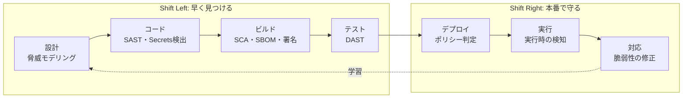
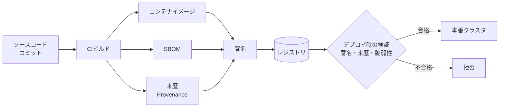
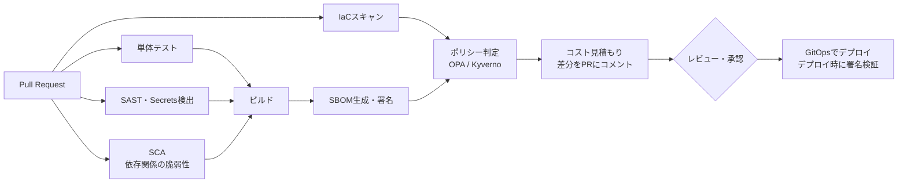

## 本章の問い

安全性とコストは、開発の最後に専門家が点検すれば十分なのか。

第8章の分類で、DevSecOpsとFinOpsは「横断的な統制」に位置づけた。ソフトウェア、データ、モデル、LLMアプリ、エージェントのいずれにも、安全性とコストの問題がある。そして両者には、共通する歴史的な構図がある。どちらも、かつては**開発の最後に、専門家が点検するもの**だった。リリースの直前にセキュリティ担当者が脆弱性診断を行い、月末に経理担当者がクラウドの請求書を見て驚く。

本章の答えを先に述べる。**最後の点検だけでは、変更の速度に追いつけない**。第4章で見たように、DevOpsは変更を小さく頻繁にした。一日に何十回もリリースする組織で、リリースのたびに専門家が手作業で点検することはできない。安全性とコストは、開発と運用の**流れの中に、最初から、自動的に組み込む**必要がある。そしてその仕組みを、開発者にとって使いやすい形で提供することが、Platform Engineeringの重要な役割になる。

---

## 前半：DevSecOps

## 11.1　DevSecOpsとShift Left／Shift Right

### 「最後の門番」の限界

伝統的な開発では、セキュリティは**最後の門番**だった。開発が完了し、テストが終わり、リリースの直前に、セキュリティチームが脆弱性診断を行う。問題が見つかれば、リリースは延期され、開発チームは修正に戻る。

この方式には、三つの問題がある。

1. **発見が遅い**：設計の段階で埋め込まれた問題は、最後に見つかっても修正に大きな手戻りが必要になる。
2. **ボトルネックになる**：セキュリティチームの人数は限られ、リリースの頻度が上がると点検が追いつかない。
3. **対立を生む**：セキュリティチームは「リリースを止める人」と見なされ、開発チームとの対立が生まれる。第1章で見た開発と運用の対立と同じ構図である。

### DevSecOpsとは

**DevSecOps**は、セキュリティを、開発と運用のライフサイクル全体に組み込む実践である。セキュリティを「最後の門番」から「全員の責任」へ、「手作業の点検」から「自動化されたガードレール」へと変える。

本書では、次のように定義する。

> **DevSecOps**とは、セキュリティを開発・運用のライフサイクルに組み込み、自動化された検査とガードレールによって、変更の速度を保ちながら安全性を確保する実践である。（本書の定義。NIST SSDF [R14] の考え方を踏まえる）

### Shift LeftとShift Right

DevSecOpsを語るときに使われるのが、**Shift Left**と**Shift Right**という言葉である。開発のライフサイクルを左（設計・開発）から右（運用）への時間軸として描いたとき、

- **Shift Left**は、セキュリティの検査を**より早い段階**（左側）に移すことを意味する。設計時の脅威分析、コーディング時の静的解析、プルリクエストでの依存関係の検査など。
- **Shift Right**は、本番環境（右側）での**継続的な監視と対応**を強化することを意味する。実行時の脅威検知、異常な振る舞いの監視、インシデント対応など。



Shift Leftだけでは不十分である。どれほど早い段階で検査しても、未知の脆弱性は後から見つかり、設定は本番で変わり、攻撃者は予想外の経路を使う。Shift Leftで**既知の問題を早く安く見つけ**、Shift Rightで**未知の問題に備える**。両者は補い合う。

## 11.2　SAST、DAST、SCA、SBOM、署名、Supply Chain Security

### 主な検査手法

| 手法 | 正式名称 | 何を検査するか | いつ行うか |
|---|---|---|---|
| **SAST** | Static Application Security Testing | ソースコードを静的に解析し、脆弱なパターン（SQLインジェクションなど）を見つける | コーディング時、プルリクエスト時 |
| **DAST** | Dynamic Application Security Testing | 動作しているアプリケーションに外部から攻撃を模したリクエストを送り、脆弱性を見つける | テスト環境、ステージング |
| **SCA** | Software Composition Analysis | 依存しているオープンソースのライブラリに、既知の脆弱性がないかを調べる | ビルド時、継続的に |
| **Secrets検出** | ― | コードや設定に、パスワードやAPIキーが含まれていないかを調べる | コミット時、プルリクエスト時 |
| **IaCスキャン** | ― | Terraformやマニフェストに、危険な設定（公開されたストレージなど）がないかを調べる | プルリクエスト時 |
| **コンテナスキャン** | ― | コンテナイメージのOSパッケージやライブラリに既知の脆弱性がないかを調べる | ビルド時、レジストリ保存時、継続的に |

### ソフトウェアサプライチェーンの問題

現代のソフトウェアは、自分たちで書いたコードよりも、**他者が書いたコード**の方がはるかに多い。オープンソースのライブラリ、コンテナのベースイメージ、CI/CDのツール、ビルドのプラグイン。これらのどこかが侵害されれば、自分たちのソフトウェアも侵害される。

2020年代に入り、ビルドシステムの侵害による大規模な被害や、広く使われているライブラリの深刻な脆弱性が相次いで明らかになり、**ソフトウェアサプライチェーンのセキュリティ**が大きな関心事となった。米国では2021年の大統領令（Executive Order 14028）がソフトウェアサプライチェーンのセキュリティの強化を求め、本章で扱うNIST SSDFやSBOMの普及を後押しした。

### SBOM

**SBOM（Software Bill of Materials：ソフトウェア部品表）**は、ソフトウェアを構成するコンポーネント（ライブラリ、そのバージョン、ライセンス、供給元）の一覧である。製造業の部品表のソフトウェア版と言える。

SBOMがあれば、新しい脆弱性が公表されたとき、「その脆弱なライブラリを、自分たちのどのソフトウェアが、どのバージョンで使っているか」を即座に調べられる。SBOMがなければ、すべてのリポジトリを手作業で調べることになる。

SBOMの代表的な形式には、**SPDX**と**CycloneDX**がある。

### 署名と来歴

**署名**は、ソフトウェアの成果物（コンテナイメージなど）が、信頼できる作成者によって作られ、作成後に改ざんされていないことを保証する仕組みである。Sigstoreプロジェクトのcosignなどのツールを使えば、コンテナイメージに署名し、デプロイ時に署名を検証できる。

**来歴（Provenance）**は、成果物が、どのソースコードから、どのビルドシステムで、どの手順で作られたかの記録である。SLSA（Supply-chain Levels for Software Artifacts）は、ソフトウェアサプライチェーンの完全性を段階的に高めるための枠組みであり、来歴の生成と検証を中心に据えている。



### NIST SSDF

**NIST SP 800-218: Secure Software Development Framework（SSDF）**は、米国国立標準技術研究所（NIST）が2022年に公表した、セキュアなソフトウェア開発の実践の枠組みである。[R14] SSDFは、特定の開発手法に依存せず、既存の開発ライフサイクルにセキュアな開発の実践を**統合する**ことを意図している。

SSDFは、実践を四つのグループに整理している。[R14]

| グループ | 名称 | 内容（本書による要約） |
|---|---|---|
| **PO** | Prepare the Organization（組織の準備） | セキュアな開発のための要件、役割、ツール、環境を整える |
| **PS** | Protect the Software（ソフトウェアの保護） | コード、成果物、リリースを、改ざんや不正なアクセスから守る |
| **PW** | Produce Well-Secured Software（十分に保護されたソフトウェアの作成） | 設計、実装、検証の各段階で、脆弱性を最小にする |
| **RV** | Respond to Vulnerabilities（脆弱性への対応） | リリース後に見つかった脆弱性を特定し、評価し、修正する |

SSDFの意義は、セキュアな開発を「何をすべきか」の観点から体系化したことにある。SSDFは「どのツールを使うべきか」は指定しない。組織は、自らの開発プロセスの各段階で、SSDFのどの実践を、どのツールと手順で実現しているかを対応づけることで、セキュリティの抜け漏れを確認できる。

## 11.3　IAM、Secrets、Policy as Code、OPA/Kyverno

### IAMと最小権限

**IAM（Identity and Access Management）**は、誰が（主体）、何に（リソース）、何をしてよいか（操作）を管理する仕組みである。クラウドの時代には、人だけでなく、CI/CDのパイプライン、アプリケーション、そして第13章で扱うAIエージェントも、IAMの主体になる。

IAMの最も重要な原則は、**最小権限（Least Privilege）**である。各主体には、その仕事に必要な最小限の権限だけを与える。第4章のGitHub Actionsのパイプラインで、ワークフロー全体には読み取り権限だけを与え、イメージをプッシュするジョブにだけ書き込み権限を与えたのは、この原則の実践である。

最小権限を実践する上での難しさは、**権限は与えるのは簡単だが、減らすのは難しい**ことにある。開発者は作業を進めるために広い権限を求め、一度与えた権限は、使われなくなっても残り続ける。権限の棚卸しと、未使用の権限の自動検出が必要になる。

### Secrets管理

**Secrets（秘密情報）**は、パスワード、APIキー、証明書の秘密鍵、データベースの接続文字列など、漏えいすると被害が生じる情報である。

| 悪い実践 | 良い実践 |
|---|---|
| コードや設定ファイルに直接書く | 専用のシークレット管理サービスに保管し、実行時に取得する |
| 長期間有効な固定のキーを使う | 短期間で失効する資格情報を、必要なときに発行する |
| 複数のサービスで同じキーを共有する | サービスごとに別の資格情報を使う |
| 漏えいしても気づかない | Secrets検出ツールで、コミットやログへの混入を検出する |

特に重要なのは、**長期間有効な固定のキーを、短命の資格情報に置き換える**ことである。例えば、CI/CDのパイプラインからクラウドにアクセスする場合、クラウドのアクセスキーをCIのシークレットとして保存する代わりに、OIDC（OpenID Connect）による**ワークロードID連携**を使えば、パイプラインの実行ごとに短命の資格情報を発行できる。固定のキーが存在しなければ、漏えいすることもない。この考え方は、第20章のAIエージェントのJust-in-Time Accessにつながる。

### Policy as Code

**Policy as Code**は、セキュリティ、コンプライアンス、運用のポリシーを、**コードとして記述し、バージョン管理し、自動で評価する**実践である。

伝統的には、ポリシーは文書として存在した。「本番環境のコンテナは、root権限で動かしてはならない」「すべてのクラウドリソースには、所有者のタグを付けなければならない」。しかし文書のポリシーは、人が読んで、人が守り、人が点検しなければならない。変更の速度が上がると、点検は追いつかなくなる。

Policy as Codeでは、ポリシーをコードとして記述し、次のような場面で自動的に評価する。

| 評価の場面 | 例 |
|---|---|
| プルリクエスト時 | Terraformの変更が、暗号化なしのストレージを作ろうとしていないか |
| デプロイ時（Admission Control） | Kubernetesに適用されるマニフェストが、root権限のコンテナを含んでいないか |
| 実行時 | 稼働中のリソースが、ポリシーに違反する状態になっていないか |
| 認可時 | APIの呼び出しが、呼び出し元の権限で許可されているか |

### OPAとKyverno

Kubernetesのポリシーエンジンとして代表的なのが、**OPA（Open Policy Agent）**と**Kyverno**である。いずれもCNCFのプロジェクトである。

**OPA**は、汎用のポリシーエンジンであり、Regoという専用の言語でポリシーを記述する。Kubernetesに限らず、APIの認可、Terraformの検査、CI/CDのゲートなど、さまざまな場面で使える。Kubernetesでは、Gatekeeperというプロジェクトを通じてAdmission Controlに組み込まれることが多い。

```rego
# すべてのDeploymentに owner ラベルを要求する（OPA / Rego v1 の構文）
package askline.kubernetes.admission

deny contains msg if {
    input.request.kind.kind == "Deployment"
    not input.request.object.metadata.labels.owner
    msg := sprintf("Deployment %s には owner ラベルが必要です", [input.request.object.metadata.name])
}
```

**Kyverno**は、Kubernetesに特化したポリシーエンジンであり、ポリシーをKubernetesのリソース（YAML）として記述する。Regoのような新しい言語を学ぶ必要がないため、Kubernetesに慣れた技術者にとって導入しやすい。

```yaml
# 本番の名前空間では、署名されたイメージ以外の実行を禁止し、
# root権限での実行を禁止する（Kyvernoの例）
apiVersion: kyverno.io/v1
kind: ClusterPolicy
metadata:
  name: askline-prod-baseline
spec:
  validationFailureAction: Enforce
  background: true
  rules:
    - name: require-owner-label
      match:
        any:
          - resources:
              kinds: [Deployment]
              namespaces: [askline]
      validate:
        message: "owner ラベルが必要です"
        pattern:
          metadata:
            labels:
              owner: "?*"
    - name: disallow-root
      match:
        any:
          - resources:
              kinds: [Pod]
              namespaces: [askline]
      validate:
        message: "コンテナは root 以外のユーザーで実行してください"
        pattern:
          spec:
            securityContext:
              runAsNonRoot: true
```

> **注意**：Kyvernoのポリシーの構文（`validationFailureAction` の指定位置など）や、新しいポリシーの種類（CEL式に基づくものなど）は、バージョンによって変化している。刊行前に動作確認したバージョンを明記する。

| 観点 | OPA（＋Gatekeeper） | Kyverno |
|---|---|---|
| ポリシーの記述 | Rego（専用言語） | YAML（Kubernetesリソース） |
| 適用範囲 | 汎用（Kubernetes以外にも使える） | Kubernetesに特化 |
| 機能 | 検証（validate）が中心 | 検証に加え、変更（mutate）、生成（generate）、イメージ検証 |
| 学習コスト | Regoの習得が必要 | Kubernetesの知識で始められる |

## 前半のまとめ：セキュリティ責任の丸投げを避ける

第8章のOps一覧表で、DevSecOpsの注意点として「**セキュリティ責任そのものをプラットフォーム側へ丸投げしない**」と書いた。

プラットフォームは、SAST、SCA、SBOMの生成、署名、ポリシーエンジン、シークレット管理を、共通能力として提供できる。そして、それらをGolden Path（第14章）に組み込めば、開発者は特別な努力をしなくても、一定のセキュリティの水準を満たせる。

しかし、プラットフォームが提供できるのは「仕組み」である。アプリケーションの認可のロジックが正しいか、業務上の機密情報が適切に扱われているか、新しい機能が新しい脅威を生まないか――これらは、アプリケーションを最もよく知る開発チームにしか判断できない。プラットフォームの検査に合格したことは、アプリケーションが安全であることを意味しない。

---

## 後半：FinOps

## 11.4　FinOpsの考え方――技術支出とビジネス価値

### クラウドが変えたコスト構造

オンプレミスの時代、ITのコストは**資本支出（CapEx）**として、年に一度の予算と調達の計画の中で管理された。サーバーを買う前に、稟議が通り、経理が承認した。

クラウドは、これを**運用支出（OpEx）**に変えた。リソースは、APIを呼べば数秒で作られ、使った分だけ課金される。開発者は、稟議なしに、数分で数百台のサーバーを立ち上げられる。これは第6章で見たCloud Nativeの俊敏性の源泉である。しかし同時に、**コストを生む判断が、財務部門から開発者の手に移った**ことを意味する。

その結果、多くの組織が同じ経験をした。月末にクラウドの請求書を見て、予想を大幅に超えていることに驚く。誰が、何のために、そのリソースを使ったのかがわからない。開発環境のGPUインスタンスが、週末の間ずっと動いていた。

### FinOpsとは

**FinOps**は、この問題に対する実践である。FinOps Foundationは、FinOps Frameworkを継続的に改訂しており、2026年時点の定義では、単なるクラウド料金の削減ではなく、**技術への支出がもたらす事業価値の最大化**、**データに基づく意思決定**、そして**職能横断の説明責任**を重視している。[R15]

本書では、次のように定義する。

> **FinOps**とは、技術への支出の事業価値と説明責任を高めるための、運用のフレームワークと文化である。（本書の定義。FinOps Foundation [R15] を踏まえる）

### 「削減」ではなく「価値」

FinOpsの最も重要な主張は、**目的はコストの削減ではなく、価値の最大化である**ということである。

コストを最小にするのは簡単である。すべてのリソースを止めればよい。しかしそれでは事業も止まる。FinOpsが問うのは、「**この支出は、それに見合う価値を生んでいるか**」である。

- 月に100万円のクラウド費用が、月に1,000万円の売上を生んでいるなら、それは良い支出かもしれない。
- 月に10万円の開発環境が、誰にも使われていないなら、それは無駄である。
- コストを30%削減したが、サービスのレイテンシが悪化して解約が増えたなら、それは失敗である。

この考え方は、第5章のError Budgetと似ている。SREが「信頼性は高ければ高いほど良いのではない」と主張したように、FinOpsは「コストは低ければ低いほど良いのではない」と主張する。いずれも、**トレードオフを明示し、事業の判断として扱う**ことを求めている。

### FinOpsのライフサイクル

FinOps Frameworkは、FinOpsの活動を、繰り返されるフェーズとして整理している。[R15] 代表的な整理は次の三つである。

| フェーズ | 内容 |
|---|---|
| **Inform（可視化）** | 誰が、何に、いくら使っているかを可視化し、配賦し、予測する |
| **Optimize（最適化）** | 無駄を削減し、料金体系（予約、割引）を最適化し、リソースの規模を適正化する |
| **Operate（運用）** | 組織の目標に沿って、継続的に改善し、ポリシーと自動化を整備する |

## 11.5　Showback／Chargeback、Unit Economics、予算アラート

### コストの配賦

FinOpsの最初の一歩は、**コストを、それを生んだチーム、サービス、顧客に結びつける**ことである。これを**配賦（Allocation）**と呼ぶ。

配賦の基礎となるのが、リソースへの**タグ（ラベル）付け**である。第6章のTerraformの例で、データベースに`service`、`owner`、`environment`、`cost-center`のタグを付けたのは、このためである。タグが付いていないリソースのコストは、誰のものかわからず、「その他」として誰も責任を持たない。

| 方式 | 内容 | 効果 |
|---|---|---|
| **Showback（可視化）** | 各チームに、自分たちが使ったコストを見せる。実際の費用の負担はしない | コストへの意識が高まる |
| **Chargeback（課金）** | 各チームの予算から、実際に使ったコストを差し引く | コストに対する説明責任が明確になる |

多くの組織は、Showbackから始め、配賦の精度が十分に高まってからChargebackに移行する。配賦が不正確なままChargebackを始めると、チーム間で「このコストは誰のものか」の争いが起きる。

### 共有コストの配賦

配賦で難しいのは、**共有コスト**である。複数のチームが共有するKubernetesクラスタ、ネットワーク、Observabilityの基盤、そしてプラットフォームそのもののコストを、どう配賦するか。

| 方法 | 内容 | 長所 | 短所 |
|---|---|---|---|
| 均等割り | チーム数で均等に割る | 単純 | 使用量と無関係で不公平 |
| 使用量比例 | CPU・メモリの要求量、リクエスト数などに比例して割る | 公平に近い | 計測の仕組みが必要 |
| 固定比率 | 事前に合意した比率で割る | 予測可能 | 実態との乖離 |
| 配賦しない | プラットフォームの共通費として扱う | 共通基盤の利用を促す | 利用の抑制が効かない |

プラットフォームのコストをどう配賦するかは、Platform Engineeringの戦略的な判断でもある。プラットフォームの利用に課金すれば、チームはプラットフォームを避けて独自に作るかもしれない（第8章の乱立）。配賦しなければ、プラットフォームの過剰な利用を抑えられない。

### Unit Economics（単位経済性）

コストの総額だけを見ていても、それが適切かどうかは判断できない。事業が成長すれば、コストも増えるのは当然である。重要なのは、**事業の単位あたりのコスト**である。これを**Unit Economics（単位経済性）**と呼ぶ。

Asklineの例で考えると、次のような単位が考えられる。

| 単位 | 計算 | 意味 |
|---|---|---|
| 問い合わせ1件あたりのコスト | 月間コスト ÷ 月間問い合わせ数 | サービスの効率 |
| 顧客テナント1社あたりのコスト | 月間コスト ÷ 顧客数 | 価格設定の妥当性 |
| AI回答1件あたりのコスト | LLM関連コスト ÷ AI回答数 | 第12章のLLMアプリの効率 |
| 解決した問い合わせ1件あたりのコスト | 月間コスト ÷ 解決数 | 事業成果に対する効率 |

総コストが増えていても、問い合わせ1件あたりのコストが下がっていれば、効率は改善している。逆に、総コストが一定でも、1件あたりのコストが上がっていれば、何かが非効率になっている。Unit Economicsは、コストを**事業の言葉で語る**ための道具である。

### 予算アラート

FinOpsでも、SREと同様に、**問題が大きくなる前に気づく**仕組みが必要である。

- **予算の閾値アラート**：月の予算の50%、80%、100%に達したら通知する。
- **予測アラート**：現在の消費ペースが続くと、月末に予算を超えると予測されたら通知する。
- **異常検知アラート**：普段の消費パターンから大きく外れた増加を検知したら通知する（第10章のAIOpsの技術が使える）。

予測アラートは、第5章のバーンレートアラートと同じ考え方である。予算を「使い切った」ことを知らせるのではなく、「このペースでは使い切る」ことを早めに知らせる。

## 11.6　GPU・推論API・トークン・データ転送のコスト

### AI時代のコストの特徴

第9章から第13章で扱うML、LLM、エージェントは、FinOpsに新しい課題をもたらした。

| コストの種類 | 特徴 | 管理の難しさ |
|---|---|---|
| **GPU** | 単価が非常に高い。学習には長時間、推論には常時の確保が必要 | 確保したGPUが遊んでいても課金される。需給が逼迫すると確保自体が難しい |
| **推論API（LLM）** | リクエスト単位、またはトークン単位で課金される | 一回のリクエストのコストが、入力の長さ、出力の長さ、モデルの種類で大きく変わる |
| **トークン** | 入力トークンと出力トークンで単価が異なる。モデルによって単価が桁違いに異なる | プロンプトの変更、検索結果の量、会話の履歴の長さで、コストが変動する |
| **エージェントの実行** | 一つのタスクで、多数のLLM呼び出しとツール呼び出しが行われる | タスクの複雑さによって、呼び出しの回数が予測できない。ループに陥ると際限なく増える |
| **データ転送** | クラウド間、リージョン間、インターネットへの転送に課金される | 大量のデータを移動するデータパイプラインや学習で、予想外に大きくなる |
| **ベクトルDB・ストレージ** | 埋め込みベクトルの保存と検索に課金される | 文書の量と、埋め込みの次元数に比例する |

### LLMのコストが予測しにくい理由

LLMアプリのコストは、従来のWebサービスのコストよりも予測しにくい。その理由は、**一回のリクエストのコストが、入力によって大きく変わる**ことにある。

Asklineの問い合わせへのAI回答を例に考える。

$$
\text{1回のコスト} = (\text{入力トークン数} \times \text{入力単価}) + (\text{出力トークン数} \times \text{出力単価})
$$

入力トークン数は、システムプロンプト、問い合わせの本文、RAGで検索した文書、会話の履歴の合計である。検索で取得する文書を5件から10件に増やせば、入力トークン数はほぼ倍になる。会話が長くなれば、履歴の分だけ増える。高性能なモデルに切り替えれば、単価が数倍から数十倍になることもある。

そして、エージェント（第13章）では、さらに予測が難しくなる。エージェントは、タスクを達成するまで、LLMの呼び出しとツールの呼び出しを繰り返す。簡単なタスクなら3回の呼び出しで終わるが、難しいタスクなら30回かかるかもしれない。エージェントが誤った計画を立ててループに陥れば、呼び出しは止まらない。

### AI時代のFinOpsの実践

| 実践 | 内容 | 本書の関連章 |
|---|---|---|
| トークン使用量の計測 | リクエストごとに入出力のトークン数を記録し、アプリ・機能・テナント別に集計する | 第7章（トレースの属性）、第12章 |
| モデルの使い分け | タスクの難しさに応じて、安価なモデルと高性能なモデルを使い分ける（ルーティング） | 第12章 |
| キャッシュ | 同じ、または類似の入力に対する出力を再利用する | 第12章 |
| 予算の上限 | アプリ、テナント、エージェントのタスクごとに、トークンや費用の上限を設ける | 第13章、第19章 |
| GPUの共有と停止 | 使われていないGPUを自動で停止し、チーム間で共有する | 第9章 |
| Unit Economicsの監視 | AI回答1件あたり、解決した問い合わせ1件あたりのコストを監視する | 本章 |

特に、エージェントのタスクごとの**予算の上限**は、コストの問題であると同時に、安全性の問題でもある。ループに陥ったエージェントを止める仕組みは、第13章のタイムアウトやリトライの上限、第20章のKill Switchと同じ役割を果たす。

## 11.7　Security by Default／Cost by Default

### デフォルトの力

人は、多くの場合、デフォルト（既定値）を変えない。これは行動経済学でよく知られた現象であり、技術の世界でも同じである。開発者は、テンプレートに書かれた設定をそのまま使い、ツールの既定の動作をそのまま受け入れる。

この性質は、セキュリティとコストの両方にとって、**最も強力な道具**になる。

- **Security by Default（デフォルトで安全）**：何も設定しなければ、安全な状態になるようにする。暗号化は既定で有効、外部公開は既定で無効、コンテナは既定で非root、権限は既定で最小。
- **Cost by Default（デフォルトで経済的）**：何も設定しなければ、無駄のない状態になるようにする。タグは既定で付与、開発環境は既定で夜間停止、リソースは既定で小さめ、ログの保存期間は既定で適切に設定。

### Golden Pathへの組み込み

Security by DefaultとCost by Defaultを実現する最も効果的な方法は、それらを**Golden Path（第14章）**――組織が推奨する標準的な開発の道筋――に組み込むことである。

| Golden Pathの要素 | Security by Default | Cost by Default |
|---|---|---|
| サービスのテンプレート | 依存関係の脆弱性検査、Secrets検出、SBOM生成がCIに組み込み済み | コスト配賦のタグが自動で付与される |
| コンテナのベースイメージ | 最小構成で、脆弱性が修正済み | 小さく、ビルドと転送が速い |
| Kubernetesのマニフェスト | 非root、読み取り専用ファイルシステム、ネットワークポリシー | リソースの要求量と上限が適切に設定済み |
| クラウドリソースのモジュール | 暗号化有効、公開アクセス無効 | 開発環境は小さいサイズ、自動停止 |
| LLMへのアクセス | ゲートウェイ経由、機密情報のマスキング | トークンの上限、安価なモデルが既定 |

開発者がGolden Pathを使えば、特別な努力をしなくても、セキュリティとコストの基準を満たせる。Golden Pathから外れることは許されるが、外れる場合には、その理由を明示し、自分たちで責任を持つ必要がある。

## 11.8　ガードレールを使いやすく設計する

### ゲートとガードレール

セキュリティとコストの統制には、二つの形がある。

| 形 | 比喩 | 内容 | 開発者の体験 |
|---|---|---|---|
| **ゲート（Gate）** | 関所 | 通過する前に、承認や検査を受けなければならない | 待たされる。承認者がボトルネックになる |
| **ガードレール（Guardrail）** | 道路の柵 | 危険な領域に入らないよう、自動的に防ぐ。安全な範囲内では自由に動ける | 普段は意識しない。危険なときだけ止められる |

伝統的なセキュリティとコストの統制は、ゲートだった。リリース前のセキュリティ診断、リソースの作成前の稟議。DevSecOpsとFinOpsは、可能な限り、ゲートをガードレールに置き換えることを目指す。

### 使いやすいガードレールの条件

ガードレールは、使いにくければ、開発者に回避される。開発者がガードレールを回避して独自の方法を使い始めれば、統制は失われる。使いやすいガードレールには、次の条件がある。

1. **速い**：検査は数秒から数分で終わる。CIが30分待たされるなら、開発者は検査を嫌う。
2. **具体的である**：何が問題で、どう直せばよいかを示す。「ポリシー違反」だけでは、開発者は何をすればよいかわからない。
3. **誤検知が少ない**：誤検知が多ければ、第3章のアラート疲れと同じことが起きる。開発者は警告を無視するようになる。
4. **段階的である**：新しいポリシーは、まず警告（Audit）として導入し、影響を確認してから強制（Enforce）に移す。
5. **例外の手続きがある**：正当な理由がある場合に、ポリシーの例外を申請し、承認を受け、期限付きで認める手続きがある。例外の手続きがなければ、開発者はポリシーを回避する方法を探す。
6. **開発者の環境で試せる**：プルリクエストを出す前に、手元でポリシーの検査を実行できる。

### 良いエラーメッセージの例

```text
❌ ポリシー違反: askline-prod-baseline/disallow-root

Deployment "askline-inquiry" のコンテナ "api" は root で実行される設定になっています。
本番の名前空間 "askline" では、root 以外のユーザーでの実行が必要です。

修正方法:
  spec.template.spec.securityContext に以下を追加してください:
    runAsNonRoot: true
    runAsUser: 10001

なぜこのポリシーがあるのか:
  コンテナが侵害された場合の影響範囲を限定するためです。
  詳細: https://platform.minato.example/docs/policies/disallow-root

例外が必要な場合:
  https://platform.minato.example/policy-exceptions から申請してください（承認者: セキュリティチーム、最長90日）。
```

このメッセージは、**何が問題で、どう直せばよく、なぜそのポリシーがあり、例外が必要な場合はどうすればよいか**を伝えている。ガードレールは、開発者を止めるためではなく、**開発者が安全に速く進めるように導くため**にある。

この「ガードレールと開発者体験の両立」は、第20章でAIエージェントのガードレールを論じる際にも、中心的なテーマとなる。

## 図・実装例

### Pull Request→セキュリティテスト→ポリシー判定→コスト見積もり→デプロイ



### 実装例：標準テンプレートへSBOMと費用タグを追加する

第4章で作成したGitHub Actionsのパイプラインに、依存関係の脆弱性検査、SBOMの生成、イメージの署名を追加する。

```yaml
# .github/workflows/ci.yml（第4章のbuildジョブを拡張）
  build:
    needs: test
    if: github.ref == 'refs/heads/main'
    runs-on: ubuntu-latest
    permissions:
      contents: read
      packages: write
      id-token: write          # 鍵なし署名（OIDC）のために必要
    steps:
      - uses: actions/checkout@v4

      - name: Log in to GHCR
        uses: docker/login-action@v3
        with:
          registry: ghcr.io
          username: ${{ github.actor }}
          password: ${{ secrets.GITHUB_TOKEN }}

      - name: Build and push image
        id: build
        uses: docker/build-push-action@v6
        with:
          context: .
          push: true
          tags: ghcr.io/${{ github.repository }}/askline-api:${{ github.sha }}
          labels: |
            org.opencontainers.image.source=${{ github.server_url }}/${{ github.repository }}
            com.minato.owner=team-askline-api
            com.minato.cost-center=cs-support

      - name: Generate SBOM (CycloneDX)
        uses: anchore/sbom-action@v0
        with:
          image: ghcr.io/${{ github.repository }}/askline-api@${{ steps.build.outputs.digest }}
          format: cyclonedx-json
          output-file: sbom.cdx.json

      - name: Scan image for known vulnerabilities
        uses: anchore/scan-action@v6
        with:
          image: ghcr.io/${{ github.repository }}/askline-api@${{ steps.build.outputs.digest }}
          fail-build: true
          severity-cutoff: critical

      - name: Install cosign
        uses: sigstore/cosign-installer@v3

      - name: Sign image and attach SBOM attestation
        env:
          IMAGE: ghcr.io/${{ github.repository }}/askline-api@${{ steps.build.outputs.digest }}
        run: |
          cosign sign --yes "$IMAGE"
          cosign attest --yes --type cyclonedx --predicate sbom.cdx.json "$IMAGE"
```

> **注意**：各Actionのバージョン、入力パラメータ名は執筆時点の例示である。セキュリティを重視する場合は、Actionをタグではなくコミットのハッシュで固定すること。刊行前に動作確認したバージョンを明記する。

この変更のポイントは次のとおりである。

1. **イメージをダイジェストで参照する**：タグは付け替えられるが、ダイジェスト（`@sha256:...`）は内容に対して一意である。署名と検査は、ダイジェストに対して行う。
2. **鍵なし署名**：`id-token: write` の権限で、GitHub ActionsのOIDCトークンを使い、長期間有効な署名鍵を管理せずに署名する（11.3節の短命の資格情報の考え方）。
3. **重大な脆弱性があればビルドを失敗させる**：`severity-cutoff: critical` によって、重大な脆弱性を含むイメージは本番に進まない。ただし、11.8節で述べたように、閾値をいきなり厳しくすると開発が止まるため、段階的に導入する。
4. **費用タグをイメージのラベルに付ける**：所有者とコストセンターの情報を、成果物そのものに付けておく。

### 実装例：タグのないリソースを検出する

Cost by Defaultの基盤となるタグ付けを検査する、小さなポリシー関数を示す。Terraformのプラン（JSON形式）を入力として、必須のタグが欠けているリソースを列挙する。

```python
"""Terraform plan JSON から、必須タグのないリソースを検出する。"""
from __future__ import annotations

import json
import sys
from dataclasses import dataclass
from pathlib import Path

REQUIRED_TAGS = ("service", "owner", "environment", "cost-center")

@dataclass(frozen=True)
class Violation:
    address: str
    missing: tuple[str, ...]

def planned_resources(plan: dict) -> list[dict]:
    """作成・更新されるリソースの after 状態を返す。"""
    return [
        {"address": rc["address"], "after": rc["change"]["after"] or {}}
        for rc in plan.get("resource_changes", [])
        if set(rc["change"]["actions"]) & {"create", "update"}
    ]

def missing_tags(after: dict, required: tuple[str, ...]) -> tuple[str, ...]:
    if "tags" not in after:          # タグに対応しないリソースは対象外
        return ()
    tags = after.get("tags") or {}
    return tuple(t for t in required if not tags.get(t))

def find_violations(plan: dict, required: tuple[str, ...] = REQUIRED_TAGS) -> list[Violation]:
    return [
        Violation(r["address"], miss)
        for r in planned_resources(plan)
        if (miss := missing_tags(r["after"], required))
    ]

if __name__ == "__main__":
    violations = find_violations(json.loads(Path(sys.argv[1]).read_text()))
    for v in violations:
        print(f"{v.address}: 必須タグが不足しています {list(v.missing)}")
    sys.exit(1 if violations else 0)
```

```python
# test_tag_policy.py
from tag_policy import find_violations

def plan_with(tags):
    return {"resource_changes": [{
        "address": "aws_db_instance.askline_inquiry",
        "change": {"actions": ["create"], "after": {"tags": tags}},
    }]}

def test_resource_with_all_tags_passes():
    tags = {"service": "askline", "owner": "team-api", "environment": "prod", "cost-center": "cs"}
    assert find_violations(plan_with(tags)) == []

def test_missing_owner_is_reported():
    tags = {"service": "askline", "environment": "prod", "cost-center": "cs"}
    [v] = find_violations(plan_with(tags))
    assert v.missing == ("owner",)

def test_resource_without_tag_support_is_ignored():
    plan = {"resource_changes": [{
        "address": "aws_iam_role_policy_attachment.x",
        "change": {"actions": ["create"], "after": {"role": "r"}},
    }]}
    assert find_violations(plan) == []
```

実務では、同じ検査をOPAのRegoで記述し、Terraformの検査ツールに組み込むことが多い。本書でPythonで示したのは、ポリシーの論理を小さく分けてテストできることを示すためである。また、プルリクエストの段階で、変更によるコストの増減を見積もってコメントするツール（Infracostなど）を組み合わせれば、開発者はコストの影響をレビューの段階で把握できる。

## 評価指標とトレードオフ

### DevSecOps

| 指標 | 意味 | 注意点 |
|---|---|---|
| 脆弱性の修正時間 | 重大な脆弱性の公表から、本番環境での修正までの時間 | 深刻度別に測る |
| SBOMのカバレッジ | 本番の成果物のうちSBOMを持つものの割合 | SBOMが最新かも確認する |
| 署名検証の強制率 | 本番環境で署名の検証が強制されている名前空間の割合 | 例外の数も見る |
| ポリシー違反の件数と傾向 | ポリシーに違反した変更の数 | 減っていれば、Golden Pathが機能している |
| ポリシーの例外数 | 有効な例外の数と期限切れの例外 | 例外が増え続けるなら、ポリシーが現実に合っていない |
| セキュリティ検査の所要時間 | CIにおけるセキュリティ検査の時間 | 長すぎれば開発者体験を損なう |

### FinOps

| 指標 | 意味 | 注意点 |
|---|---|---|
| 配賦率 | コストのうち、チーム・サービスに配賦できた割合 | タグ付けの網羅性に依存する |
| Unit Economics | 問い合わせ1件あたり、AI回答1件あたりのコスト | 傾向を見る |
| 予算の予測精度 | 予測と実績の差 | 大きく外れるなら、予測の方法を見直す |
| 遊休リソースの割合 | 使われていないリソースのコスト | GPUは特に重要 |
| トークン単価の推移 | AI機能のトークンあたりのコスト | モデルの選択とキャッシュの効果を見る |
| コスト異常の検知時間 | 異常なコストの増加から検知までの時間 | 月末の請求書で気づくのでは遅い |

本章の中心的なトレードオフは、**統制と速度**である。セキュリティとコストの統制を厳しくすれば、リスクと無駄は減るが、開発の速度は落ち、開発者は統制を回避しようとする。統制を緩くすれば、速度は上がるが、リスクと無駄が増える。このトレードオフを和らげる鍵は、**ゲートをガードレールに置き換え、安全で経済的な選択をデフォルトにする**ことである。

## 本章の結論

安全性とコストは、開発の最後に専門家が点検するだけでは、変更の速度に追いつけない。

- **DevSecOps**は、SAST、SCA、SBOM、署名、Policy as Codeによって、セキュリティを開発と運用の流れに組み込む。NIST SSDFは、そのための実践を体系化した。
- **FinOps**は、コストの可視化、配賦、Unit Economics、予算アラートによって、技術への支出を事業価値と結びつける。AIの時代には、GPU、トークン、エージェントの実行が新たな課題となった。
- 両者に共通する鍵は、**Security by Default／Cost by Default**であり、それをGolden Pathに組み込み、**使いやすいガードレール**として提供することである。

ただし、プラットフォームが提供できるのは仕組みであり、セキュリティとコストの責任そのものは、各チームに残る。

次章では、確率的な出力を持つ新しい運用対象――LLMアプリケーション――を扱う。

## 参考文献

- [R14] NIST, *Secure Software Development Framework (SSDF) Version 1.1: Recommendations for Mitigating the Risk of Software Vulnerabilities*, SP 800-218, 2022. https://csrc.nist.gov/pubs/sp/800/218/final
- [R15] FinOps Foundation, *FinOps Framework*（2026年改訂）. https://www.finops.org/framework/
- SLSA, *Supply-chain Levels for Software Artifacts*. https://slsa.dev/
- Sigstore（cosign）公式ドキュメント. https://docs.sigstore.dev/
- CycloneDX仕様. https://cyclonedx.org/ ／ SPDX仕様. https://spdx.dev/
- Open Policy Agent公式ドキュメント. https://www.openpolicyagent.org/docs/
- Kyverno公式ドキュメント. https://kyverno.io/docs/
- FinOps Foundation, *FOCUS: FinOps Open Cost and Usage Specification*.（参照したバージョンを明記する）
- The White House, *Executive Order 14028: Improving the Nation's Cybersecurity*, 2021.
