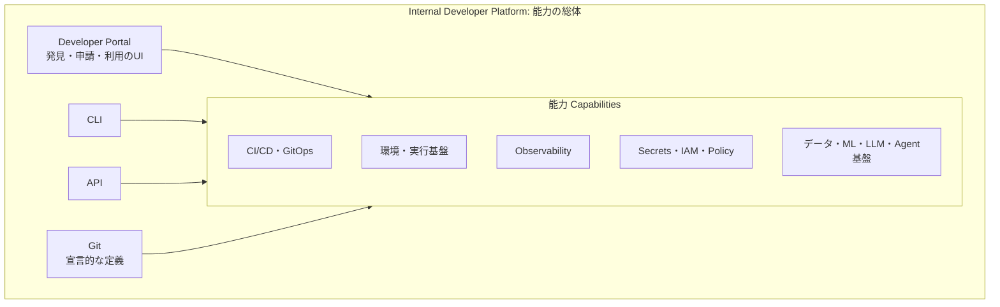
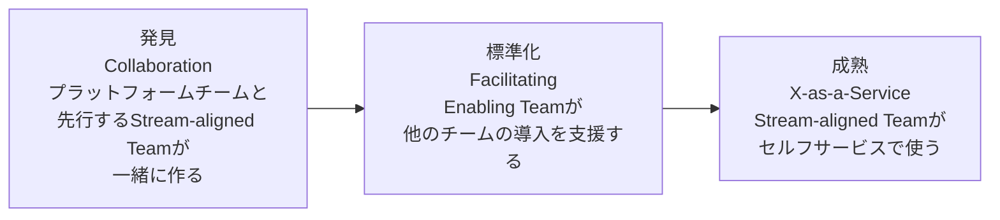
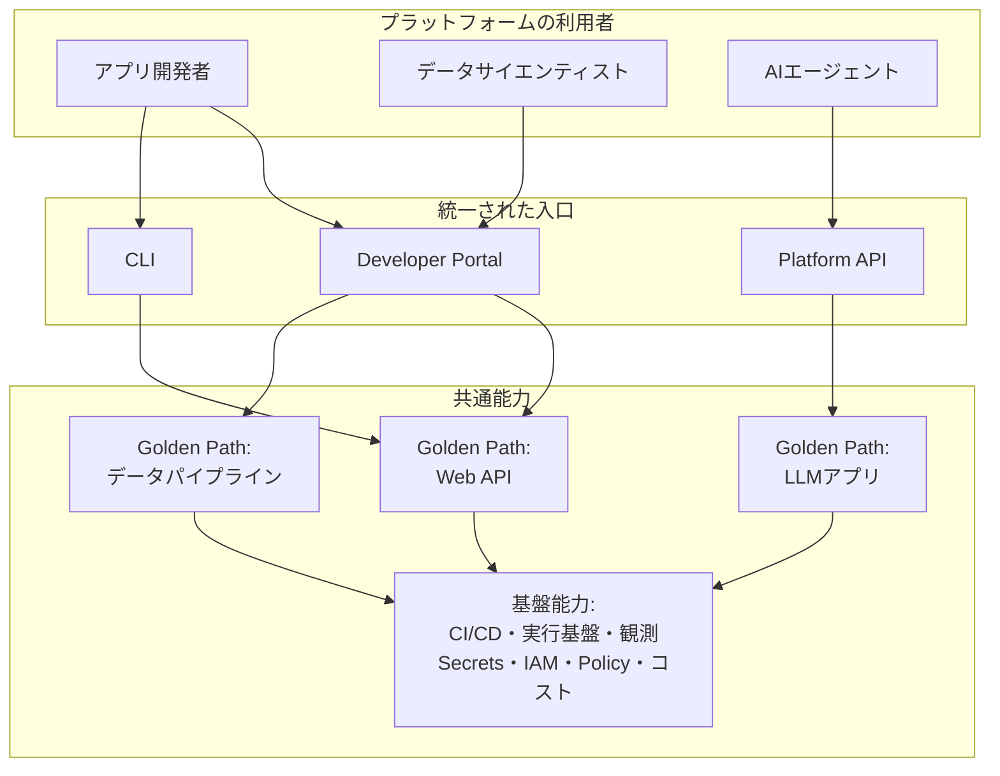

> <strong>第Ⅳ部　Platform Engineeringの設計と実装</strong>
>
> 第Ⅲ部では、運用対象がソフトウェアからデータ、モデル、LLM、エージェントへと広がり、それぞれに固有のOpsが生まれる過程を見た。そして、それらのOpsの多くが、同じ共通能力――認証、権限、ポリシー、CI/CD、トレース、評価、予算、承認――を必要としていることを確認した。
>
> 第Ⅳ部は本書の中核である。共通能力を、開発者（そして後にはAIエージェント）が使う<strong>製品</strong>として設計し、提供するPlatform Engineeringを、その成立の理由から、構成技術、アーキテクチャ、クラウドでの実装、データガバナンスまで、順に扱う。

## 本章の問い

各チームがDevOpsを実践しているのに、なぜ開発者向けの「共通プラットフォーム製品」を作る必要があるのか。

第4章の最後で、DevOpsの「You build it, you run it」が、開発者に運用の知識と作業を大量に背負わせる副作用を持つことを見た。第6章で、Cloud Nativeの技術がその負担をさらに大きくしたことを見た。第8章で、新しいOpsごとに専用基盤が乱立することを見た。本章は、これらの問題に対する組織的な答えとしてのPlatform Engineeringを扱う。

## 14.1　DevOpsが実現したこと、依然として残った複雑さ

### DevOpsの成功

第4章で整理したように、DevOpsは多くのことを実現した。開発と運用の対立を和らげ、CI/CDとIaCによって変更を速く安全にし、DORA指標によって改善を測れるようにした。小さく頻繁な変更は、リリースのリスクを下げた。

### 残った複雑さ

しかし、DevOpsの成功は、別の問題を表面化させた。第4章4.7節の表を、第Ⅱ部・第Ⅲ部の内容で更新すると、開発チームが「自分で運用する」ために扱わなければならないものは、次のようになる。

| 領域 | 扱うもの | 本書の章 |
|---|---|---|
| デリバリー | CI/CDパイプライン、コンテナイメージ、GitOps | 第4章、第6章 |
| 実行基盤 | Kubernetesのマニフェスト、オートスケール、ネットワーク | 第6章 |
| インフラ | Terraform、クラウドのリソース、データベース | 第6章 |
| 信頼性 | SLI/SLO、アラート、On-call、ポストモーテム | 第5章 |
| 観測 | メトリクス、ログ、トレース、計装 | 第7章 |
| セキュリティ | 脆弱性検査、SBOM、署名、Secrets、IAM、ポリシー | 第11章 |
| コスト | タグ、配賦、予算 | 第11章 |
| データ | データ契約、品質テスト、リネージ | 第10章 |
| ML | 実験追跡、モデルレジストリ、推論基盤、ドリフト | 第9章 |
| LLM | ゲートウェイ、プロンプト管理、評価、ガードレール | 第12章 |
| エージェント | ツールの認可、承認、トレース、サンドボックス | 第13章 |

この表のすべてを、一つのプロダクトチームが深く理解し、正しく運用することは現実的ではない。そして、各チームがそれぞれ独自に取り組めば、第8章で見た<strong>重複、不統一、統制の分断、Ops疲れ</strong>が起きる。

### 二つの失敗パターン

この状況で、組織はしばしば二つの失敗パターンに陥る。

<strong>パターン1：チケット駆動の運用チームへの回帰。</strong> 複雑さに耐えかねて、インフラの作業を再び運用チームに集中させる。開発者は、環境が必要になるたびにチケットを起票し、運用チームが手作業で対応する。第1章の世界への逆戻りであり、第5章で見たToilの典型である。開発の速度は落ち、運用チームはチケットに埋もれる。

<strong>パターン2：無統制の自律。</strong> 各チームの自律性を尊重し、それぞれが好きな技術を選んで構築することを許す。短期的には速いが、長期的には第8章の乱立が起き、組織全体のセキュリティ、コスト、知識の共有が損なわれる。

Platform Engineeringは、この二つの間に第三の道を示す。<strong>複雑さを中央のチームが引き受けるが、チケットではなく、セルフサービスの製品として提供する</strong>。

## 14.2　Platform Engineeringの成立と位置づけ

### CNCFによる整理

Platform Engineeringという言葉は、2020年代の初めから広く使われるようになった。この分野の整理として重要なのが、CNCFのTAG App Delivery（アプリケーションデリバリーの技術諮問グループ）が2023年に公開した *Platforms White Paper* である。[R20]

このホワイトペーパーは、クラウドネイティブなコンピューティングのためのプラットフォームを、<strong>プラットフォームの利用者のニーズに応じて定義・提示される、統合された能力の集合</strong>として説明している。[R20] そして、プラットフォームが、利用者であるアプリケーションの開発者やデータサイエンティストなどに対して、一貫した体験を提供し、彼らが自らの製品の価値の提供に集中できるようにするものであることを強調している。

ホワイトペーパーは、プラットフォームが提供しうる能力の領域として、Web ポータル、API、ゴールデンパスのテンプレートとドキュメント、自動化、開発環境、Observability、インフラの提供、データサービス、メッセージング、アイデンティティとシークレットの管理、セキュリティ、成果物の保管などを例示している。[R20] これは、上の表とよく対応している。

### 本書の定義との関係

本書の「はじめに」で、次の命題を示した。

> Platform Engineeringは、複雑化した運用を一つに置き換える営みではない。各Opsの専門性を生かしながら、再利用可能な共通能力、使いやすい開発体験、統一されたガバナンスを提供するためのエンジニアリングである。

CNCFの定義と本書の命題は、多くの点で一致している。両者とも、プラットフォームを<strong>利用者のニーズに基づく能力の集合</strong>として捉え、利用者が自らの価値の提供に集中できるようにすることを目的としている。

本書の命題が強調しているのは、次の二点である。

1. <strong>「一つに置き換える」のではない</strong>：第8章で見たように、各Opsの専門性はなくならない。プラットフォームは、専門性を置き換えるのではなく、専門性が依って立つ共通の土台を提供する。
2. <strong>ガバナンスを含む</strong>：プラットフォームは、開発者の便利さのためだけではなく、セキュリティ、コスト、監査の統制を、使いやすい形で組み込む経路でもある（第11章）。

### 定義の整理

| 用語 | 本書での定義 |
|---|---|
| <strong>Platform Engineering</strong> | 共通能力・開発体験を、内製のプラットフォーム製品として提供する実践（CNCF [R20][R21] を踏まえた本書の定義） |
| <strong>Platform（プラットフォーム）</strong> | 利用者のニーズに応じて定義・提示される、統合された能力の集合（CNCF [R20] の要約） |
| <strong>Platform Team（プラットフォームチーム）</strong> | プラットフォームを製品として開発・運用するチーム |

## 14.3　Platform as a Product――利用者を顧客として考える

### 「作れば使われる」の誤り

プラットフォームの取り組みが失敗する最も典型的な原因は、<strong>利用者のニーズを理解せずに作る</strong>ことである。インフラの専門家が、技術的に優れていると考えるものを作り、開発者に使うよう求める。しかし、開発者の実際の困りごとに応えていなければ、プラットフォームは使われない。あるいは、使うことを強制され、開発者の不満が溜まる。

### Platform as a Product

<strong>Platform as a Product（製品としてのプラットフォーム）</strong>は、プラットフォームを社内向けの<strong>製品</strong>として扱い、利用者（開発者）を<strong>顧客</strong>として扱う考え方である。CNCFのホワイトペーパーも、プラットフォームを製品として扱い、利用者のニーズに基づいて開発することの重要性を強調している。[R20]

製品として扱うとは、具体的には次のことを意味する。

| 製品開発の実践 | プラットフォームでの実践 |
|---|---|
| 顧客の理解 | 開発者へのインタビュー、作業の観察、困りごとの調査 |
| 製品の責任者 | プラットフォームのプロダクトマネージャーを置く |
| ロードマップ | 利用者の価値に基づいて優先順位をつけ、公開する |
| 最小限の製品（MVP） | 最初から完全なものを作らず、最も価値の高い機能から提供する |
| ドキュメントとサポート | 使い方の説明、問い合わせの窓口、移行の支援 |
| フィードバックと改善 | 利用状況の計測、満足度の調査、継続的な改善 |
| 製品の廃止 | 使われなくなった機能を、計画的に廃止する |

### 「任意」であることの意味

Platform as a Productの考え方には、もう一つ重要な含意がある。<strong>プラットフォームの利用は、原則として任意であるべき</strong>、という考え方である。

利用を強制すれば、プラットフォームチームは利用者のニーズに応える動機を失う。利用者がプラットフォームを選ぶかどうかで、プラットフォームの価値が試されるべきである。利用者が自ら選ぶプラットフォームは、良い製品である。

ただし、これは「何でも自由」という意味ではない。第11章で見たセキュリティ、コスト、監査の<strong>統制</strong>は、プラットフォームを使うかどうかにかかわらず、守られるべきである。現実的な形は、次のようになる。

- <strong>統制（ガードレール）は全員に適用する</strong>：署名されていないイメージは本番で動かない、タグのないリソースは作れない、エージェントのツール呼び出しは必ず認可を経る。
- <strong>プラットフォーム（Golden Path）は任意とする</strong>：ただし、プラットフォームを使えば、統制を自動的に満たせる。使わない場合は、自分たちで統制を満たす必要がある。

こうすれば、プラットフォームは「統制を満たす最も簡単な方法」として選ばれる。強制ではなく、<strong>利便性によって選ばれる</strong>。

## 14.4　Internal Developer Platform（IDP）とDeveloper Portalの違い

### IDPとは

<strong>Internal Developer Platform（IDP、社内開発者プラットフォーム）</strong>は、開発者がセルフサービスで利用できる共通能力の集合体である。環境の作成、CI/CD、デプロイ、観測、シークレット、データベース、権限など、14.1節の表の能力を、セルフサービスで提供する。

### Developer Portalとは

<strong>Developer Portal（開発者ポータル）</strong>は、IDPの能力を<strong>発見し、申請し、利用するための入口</strong>となるUIである。サービスのカタログ、ドキュメント、テンプレートからの新規作成、各種ツールへのリンクなどを、一つの画面にまとめる。第15章で扱うBackstageは、Developer Portalを構築するための代表的なフレームワークである。

### 区別の重要性

本書の執筆方針として、<strong>IDPとDeveloper Portalは同じではない</strong>ことを明確にしておく。[R23]



| 観点 | IDP | Developer Portal |
|---|---|---|
| 性格 | 能力の総体 | 能力への入口（UI） |
| 構成要素 | CI/CD、実行基盤、観測、セキュリティ、データ基盤など | カタログ、テンプレート、ドキュメント、検索 |
| 入口の種類 | ポータル、CLI、API、Git（宣言的な定義）など複数 | Web UI |
| ポータルがなくても成り立つか | 成り立つ（CLIやGitだけで使えるIDPもある） | IDPの能力がなければ、ただのリンク集になる |

この区別が重要なのは、<strong>Developer Portalを導入すればIDPができる、という誤解</strong>が広く見られるからである。ポータルは、その背後にある能力が整っていなければ、見た目の良いリンク集にすぎない。逆に、能力が整っていれば、ポータルがなくても、CLIやGitの宣言的な定義を通じて、開発者は能力を使える。

第15章では、Backstageのドキュメントも、Backstageをプラットフォーム全体そのものとして誤認しないように説明していることを確認する。[R23][R24]

## 14.5　Golden Path／Paved Roadによる標準化

### Golden Pathとは

<strong>Golden Path（ゴールデンパス）</strong>は、組織が推奨する、<strong>ある種類の仕事を成し遂げるための標準的な道筋</strong>である。この言葉はSpotifyで使われたことで知られる。Netflixでは、同様の考え方を<strong>Paved Road（舗装道路）</strong>と呼んでいる。

例えば、「新しいWeb APIを作って本番にリリースする」というGolden Pathは、次のようなものを一揃いで提供する。

- リポジトリの雛形（推奨される言語、フレームワーク、ディレクトリ構成）
- CI/CDのパイプライン（テスト、脆弱性検査、SBOM、署名を含む。第4章、第11章）
- デプロイの定義（GitOps、Kubernetesのマニフェスト。第6章）
- 観測の計装（OpenTelemetry。第7章）
- SLOの雛形とダッシュボード（第5章）
- シークレットとデータベースの接続（第11章）
- ドキュメントの雛形と、サービスカタログへの登録（第15章）

### Golden Pathの性質

Golden Pathには、次の性質がある。

1. <strong>推奨であって、強制ではない</strong>：Golden Pathから外れることは許される。ただし、外れる場合は、自分たちで責任を持つ（14.3節）。
2. <strong>最も簡単な道である</strong>：Golden Pathを使うことが、最も速く、最も楽な方法であるように設計する。そうでなければ、選ばれない。
3. <strong>統制を内蔵している</strong>：Golden Pathを使えば、セキュリティ、コスト、信頼性の基準を自動的に満たせる（第11章のSecurity by Default／Cost by Default）。
4. <strong>意見を持っている（Opinionated）</strong>：すべての選択肢を提供するのではなく、組織として推奨する選択をあらかじめ行っている。開発者は、多くの選択をしなくて済む。
5. <strong>進化する</strong>：利用者のフィードバックと技術の変化に応じて、継続的に改善される。

### 第2章のテンプレートとの関係

第2章で、Zabbixの<strong>テンプレート</strong>が「良い監視とは何か」を組織の知識として部品化し、誰でも再利用できるようにしたことを見た。そして、それがGolden Pathと本質的に同じ考え方であると述べた。

Golden Pathは、この考え方を、監視だけでなく、<strong>ソフトウェアの作成からリリース、運用までの全体</strong>に広げたものである。組織が経験から学んだ「良いやり方」を、文書ではなく、<strong>実行可能な部品</strong>として提供する。

### Golden Pathの数

Golden Pathは、何本作るべきか。一本ですべてを賄うことはできないが、多すぎれば保守できない。

実務的には、組織で最も頻繁に行われる仕事から始めるのがよい。Asklineの組織であれば、次のような順序が考えられる。

1. 新しいWeb API（最も頻繁）
2. 非同期のワーカー（キューを処理するもの）
3. データパイプライン（第10章）
4. LLMアプリ（第12章）
5. エージェント（第13章）

## 14.6　Team TopologiesとCognitive Load

### Team Topologies

Platform Engineeringの組織的な側面を考えるうえで、最も影響力のある枠組みが、Matthew SkeltonとManuel Paisによる2019年の書籍 *Team Topologies* である。[R22]

*Team Topologies* は、ソフトウェアを提供する組織を、<strong>四つの基本的なチームの型</strong>と、<strong>三つのチーム間の相互作用の形</strong>で設計することを提案している。[R22] その中心にあるのが、<strong>チームの認知負荷</strong>という概念である。

### Cognitive Load（認知負荷）

第4章4.7節で、認知負荷――人が同時に処理できる情報の量には限りがあること――を紹介した。*Team Topologies* は、この概念を<strong>チーム</strong>に適用し、チームが扱うソフトウェアとその周辺の複雑さが、チームの認知の容量を超えないように組織を設計すべきだと主張している。[R22]

認知負荷の理論では、認知負荷を三つの種類に分けて考える。

| 種類 | 内容 | ソフトウェア開発での例 | 方針 |
|---|---|---|---|
| <strong>内在的（Intrinsic）</strong> | 仕事そのものが本質的に持つ難しさ | 業務ロジックの理解、ドメインの知識 | 学習と経験で扱う |
| <strong>外在的（Extraneous）</strong> | 仕事の本質とは関係のない、環境や手段の難しさ | デプロイの手順、インフラの設定、ツールの使い方 | <strong>できる限り減らす</strong> |
| <strong>学習関連（Germane）</strong> | 新しい知識を身につけ、理解を深めるための負荷 | ドメインの深い理解、設計の改善 | 余裕を確保する |

Platform Engineeringの目的は、この枠組みで言えば、<strong>プロダクトチームの外在的な認知負荷を減らす</strong>ことである。デプロイの手順、Kubernetesの設定、監視の仕組みといった、プロダクトの本質とは関係のない難しさをプラットフォームが引き受ければ、プロダクトチームは、内在的な負荷（業務の難しさ）と学習関連の負荷（ドメインの深い理解）に、認知の容量を使える。

## 14.7　Platform Team、Enabling Team、Stream-aligned Team

### 四つのチームの型

*Team Topologies* が示す四つのチームの型は次のとおりである。[R22]

| チームの型 | 役割 | Asklineの例 |
|---|---|---|
| <strong>Stream-aligned Team（ストリームアラインドチーム）</strong> | 事業の価値の流れ（製品、サービス、利用者の層など）に沿って、価値を継続的に届ける。組織の中心となるチーム | 問い合わせ受付チーム、AI回答チーム、請求チーム |
| <strong>Platform Team（プラットフォームチーム）</strong> | Stream-aligned Teamが、自律的に価値を届けられるように、内部のサービスを提供する | 開発者プラットフォームチーム、データプラットフォームチーム |
| <strong>Enabling Team（イネーブリングチーム）</strong> | 他のチームが新しい能力を身につけるのを、一時的に支援する | SREの実践の導入を支援するチーム、LLM評価の手法を教えるチーム |
| <strong>Complicated-subsystem Team（コンプリケイテッド・サブシステムチーム）</strong> | 高度な専門知識を要するサブシステムを担当する | 検索エンジンの中核、問い合わせ分類モデルの研究開発 |

### 三つの相互作用の形

| 相互作用 | 内容 | 適した場面 |
|---|---|---|
| <strong>Collaboration（コラボレーション）</strong> | 二つのチームが、一定期間、密接に協力する | 新しい能力を共同で発見・設計するとき |
| <strong>X-as-a-Service</strong> | 一方のチームが、他方のチームに、最小限のやりとりで使えるサービスを提供する | 能力が成熟し、インターフェースが明確になったとき |
| <strong>Facilitating（ファシリテーティング）</strong> | 一方のチームが、他方のチームの学習と能力の向上を支援する | Enabling Teamの典型的な関わり方 |

### プラットフォームチームと他のチームの関わり方

Platform Engineeringの文脈では、相互作用の形が<strong>時間とともに変わる</strong>ことが重要である。



新しい能力（例：LLMアプリのGolden Path）を作るときは、プラットフォームチームが、最初にLLMアプリを作るStream-aligned Team（AI回答チーム）と<strong>Collaboration</strong>の関係で、一緒に設計する。抽象的な要件から作るのではなく、実際の利用者と一緒に、実際の課題を解きながら作る。

能力がある程度固まったら、Enabling Teamが他のチームの導入を<strong>Facilitating</strong>で支援する。

能力が成熟すれば、他のチームは、プラットフォームチームとほとんどやりとりせずに、<strong>X-as-a-Service</strong>として使えるようになる。これがPlatform Engineeringの目指す状態である。

### Thinnest Viable Platform

*Team Topologies* は、プラットフォームについて<strong>Thinnest Viable Platform（TVP、最も薄い実用的なプラットフォーム）</strong>という考え方も示している。[R22] プラットフォームは、必ずしも大規模なソフトウェアである必要はない。組織の状況によっては、よく整理されたドキュメントとテンプレートの集まりが、最初の「プラットフォーム」として十分に機能する。

これは、第15章の「IDPの設計過多を防ぐ」議論につながる重要な考え方である。プラットフォームを大きく作ることが目的ではない。<strong>Stream-aligned Teamの外在的な認知負荷を減らすために必要な、最も薄いもの</strong>を作ることが目的である。

## 14.8　プラットフォーム導入率ではなくユーザー価値で測る

### 導入率の罠

プラットフォームの成果を測るとき、最も簡単なのは<strong>導入率</strong>――プラットフォームを使っているチームやサービスの割合――である。しかし、導入率だけを追うことは危険である。

- 利用を強制すれば、導入率は簡単に100%になる。しかし、それはプラットフォームが価値を生んでいることを意味しない。
- 導入率が高くても、開発者が不満を抱え、プラットフォームを回避する方法を探しているかもしれない。
- 導入率は、プラットフォームが<strong>何を改善したか</strong>を示さない。

これは、第4章で見たグッドハートの法則――指標が目標になると、良い指標ではなくなる――の、プラットフォーム版である。

### ユーザー価値で測る

プラットフォームの成果は、<strong>利用者にとっての価値</strong>で測るべきである。CNCFのPlatform Engineering Maturity Modelも、プラットフォームの「Measurement（測定）」の側面として、利用者のフィードバックと成果に基づく測定の成熟を扱っている。[R21]

### Platform Engineering Maturity Model

CNCFは、Platforms White Paperに続いて、2023年に *Platform Engineering Maturity Model* を公開した。[R21] この成熟度モデルは、プラットフォームの取り組みを、いくつかの側面（Aspects）ごとに、段階的な成熟の水準で評価する枠組みである。

| 側面 | 問い（本書による要約） |
|---|---|
| <strong>Investment（投資）</strong> | プラットフォームに、どのように人と予算が投じられているか |
| <strong>Adoption（採用）</strong> | 利用者は、なぜ、どのようにプラットフォームを使い始めるのか |
| <strong>Interfaces（インターフェース）</strong> | 利用者は、どのようにプラットフォームの能力にアクセスするのか |
| <strong>Operations（運用）</strong> | プラットフォームとその能力は、どのように計画され、運用されるのか |
| <strong>Measurement（測定）</strong> | プラットフォームの価値は、どのように測られ、改善に使われるのか |

成熟度の水準は、Provisional（暫定的）、Operational（運用的）、Scalable（拡張可能）、Optimizing（最適化）の四段階で示されている。[R21]

成熟度モデルの使い方として重要なのは、<strong>すべての側面で最高の水準を目指す必要はない</strong>ということである。組織の規模と状況によって、適切な水準は異なる。成熟度モデルは、現状を把握し、次に改善すべき側面を見つけるための地図として使うべきであり、他組織との比較や、チームの評価に使うべきではない。

### 何を測るか

本書では、プラットフォームの価値を、次の三つの層で測ることを提案する。

| 層 | 指標の例 | 意味 |
|---|---|---|
| <strong>利用者の体験</strong> | 開発者満足度、新しいサービスを本番に出すまでの時間、オンボーディングの時間、問い合わせの件数 | プラットフォームが開発者の困りごとを解決しているか |
| <strong>デリバリーと運用の成果</strong> | DORA指標（第4章）、SLO達成率（第5章）、脆弱性の修正時間（第11章） | プラットフォームが組織の能力を高めているか |
| <strong>組織の成果</strong> | 重複投資の削減、統制の網羅率、Stream-aligned Teamの専門業務時間比率（第8章） | プラットフォームが組織全体に価値をもたらしているか |

開発者の体験を測る枠組みとしては、SPACE（満足度と幸福度、成果、活動、コミュニケーションと協働、効率とフロー）や、DevEx（フィードバックループ、認知負荷、フロー状態）などの研究がある。これらの枠組みは、<strong>一つの指標ではなく、複数の観点を組み合わせて</strong>開発者の体験を捉えることを勧めている。第16章と第23章で、これらの測定を再び扱う。

## 図・実装例

### 異なる利用者が統一された入口から基盤能力を使う



この図で注目してほしいのは、AIエージェントが利用者として含まれていることである。第16章と第19章で、AIエージェントがプラットフォームのAPIを使う場合の設計を扱う。

### 演習：開発者インタビューからGolden Pathを一本設計する

Asklineの開発組織で、プラットフォームの最初のGolden Pathを設計する。

<strong>ステップ1：インタビュー</strong>

三つのStream-aligned Teamの開発者に、次の質問でインタビューを行うと想定する。

1. 最近、新しいサービスや機能を本番に出したとき、最も時間がかかったのは何か。
2. 本来の仕事（機能の開発）以外で、繰り返し発生している作業は何か。
3. 他のチームに依頼して、待たされている作業は何か。
4. 「これがなければ楽になる」と思うことは何か。

<strong>ステップ2：インタビュー結果の例</strong>

| 困りごと | 言及したチーム数 | 1回あたりの時間 | 頻度 |
|---|---|---|---|
| 新しいサービスのCI/CDを一から作る | 3 | 2〜3日 | 四半期に1〜2回 |
| Kubernetesのマニフェストを書いて、レビューで指摘される | 3 | 1日 | 月に数回 |
| 本番のデータベースの作成をインフラチームに依頼して待つ | 2 | 3〜5営業日（待ち時間） | 四半期に1回 |
| 監視とアラートの設定方法がわからない | 2 | 半日 | 新サービスごと |
| セキュリティ検査で毎回同じ指摘を受ける | 3 | 半日 | リリースごと |

<strong>ステップ3：設計</strong>

この結果から、最初のGolden Pathとして「新しいWeb APIを作って本番に出す」を選ぶ。次の問いに答えよ。

1. このGolden Pathに含めるべき要素を、インタビュー結果の困りごとに対応づけて列挙せよ。
2. このGolden Pathの成果を測る指標を三つ挙げよ（14.8節の三つの層から一つずつ）。
3. このGolden Pathを最初に一緒に作るStream-aligned Teamを、どのような基準で選ぶか（14.7節のCollaboration）。
4. このGolden Pathを使わないチームに対して、何を求め、何を求めないか（14.3節）。

```python
"""インタビュー結果から、Golden Path の候補を優先順位づけする簡単な試算。"""
from dataclasses import dataclass

@dataclass(frozen=True)
class PainPoint:
    name: str
    teams: int
    hours_per_occurrence: float
    occurrences_per_quarter: float

    @property
    def quarterly_hours(self) -> float:
        """組織全体で四半期あたりに失われている時間の概算。"""
        return self.teams * self.hours_per_occurrence * self.occurrences_per_quarter

def rank(points: list[PainPoint]) -> list[PainPoint]:
    return sorted(points, key=lambda p: p.quarterly_hours, reverse=True)
```

```python
# test_painpoint.py
from painpoint import PainPoint, rank

def test_rank_by_quarterly_hours():
    ci = PainPoint("CI/CDを一から作る", teams=3, hours_per_occurrence=20, occurrences_per_quarter=1.5)
    k8s = PainPoint("マニフェストの指摘", teams=3, hours_per_occurrence=8, occurrences_per_quarter=6)
    assert [p.name for p in rank([ci, k8s])] == ["マニフェストの指摘", "CI/CDを一から作る"]
```

> <strong>注意</strong>：この試算は、優先順位を議論するための材料にすぎない。待ち時間（依頼して待たされる時間）は、作業時間よりも開発者の体験を大きく損なうことが多く、時間の合計だけでは評価できない。また、セキュリティの指摘のように、時間は小さくても組織のリスクに関わる困りごとは、別の観点で評価する必要がある。

## 評価指標とトレードオフ

| 指標 | 意味 | 注意点 |
|---|---|---|
| 新サービスの本番投入までの時間 | Golden Pathを使って、新しいサービスを本番に出すまでの時間 | プラットフォームの価値を最も直接的に示す |
| オンボーディングの時間 | 新しいメンバーが最初の変更を本番に出すまでの時間 | 外在的な認知負荷の代理指標 |
| 開発者満足度 | プラットフォームに対する満足度の調査 | 定期的に、同じ質問で測る |
| Golden Pathの利用率 | 新しいサービスのうちGolden Pathを使ったものの割合 | 強制ではなく選ばれているかを見る。導入率だけで評価しない |
| プラットフォームへの問い合わせ件数 | 使い方がわからない、うまく動かないという問い合わせ | ドキュメントと設計の改善の材料 |
| チケットによる依頼の件数 | セルフサービスではなく、依頼で行われている作業 | 減っていれば、セルフサービス化が進んでいる |
| DORA指標・SLO達成率 | プラットフォームを使うチームの成果 | 使わないチームとの単純な比較は避ける（選択の偏り） |

本章の中心的なトレードオフは、<strong>標準化と自律性</strong>である。Golden Pathによる標準化は、認知負荷を下げ、統制を効かせ、知識を共有させる。しかし、標準化が強すぎれば、チームの自律性と、新しい技術を試す余地を奪う。Platform as a Productの考え方――利用は任意、統制は全員に、Golden Pathは最も簡単な道に――は、このトレードオフを和らげるための一つの答えである。

## 本章の結論

各チームがDevOpsを実践していても、共通プラットフォーム製品が必要になるのは、

- DevOpsの成功によって、開発者が扱うべき複雑さが、チームの<strong>認知の容量を超えた</strong>から
- 各チームが独自に取り組むと、<strong>重複、不統一、統制の分断</strong>が起きるから
- チケット駆動の運用チームへの回帰も、無統制の自律も、<strong>持続可能ではない</strong>から

である。Platform Engineeringは、複雑さを<strong>セルフサービスの製品</strong>として引き受けることで、この問題に応える。

- <strong>Platform as a Product</strong>：利用者を顧客として扱い、ニーズに基づいて作る。
- <strong>IDPとDeveloper Portal</strong>：能力の総体と、その入口を区別する。
- <strong>Golden Path</strong>：組織の「良いやり方」を、実行可能な部品として提供する。
- <strong>Team Topologies</strong>：プラットフォームの目的は、Stream-aligned Teamの外在的な認知負荷を減らすことである。
- <strong>測定</strong>：導入率ではなく、利用者にとっての価値で測る。

次章では、IDPを構成する具体的な技術を見ていく。

## 参考文献

- [R20] CNCF TAG App Delivery, *Platforms White Paper*, 2023. https://tag-app-delivery.cncf.io/whitepapers/platforms/
- [R21] CNCF TAG App Delivery, *Platform Engineering Maturity Model*, 2023以降. https://tag-app-delivery.cncf.io/whitepapers/platform-eng-maturity-model/
- [R22] M. Skelton, M. Pais, *Team Topologies: Organizing Business and Technology Teams for Fast Flow*, IT Revolution Press, 2019. https://teamtopologies.com/
- [R23] Backstage, *Technical Overview*. https://backstage.io/docs/overview/technical-overview/
- [R16] Google Cloud, *What is platform engineering?* https://cloud.google.com/solutions/platform-engineering
- [R24] AWS, *Building an Internal Developer Platform on AWS*. https://docs.aws.amazon.com/prescriptive-guidance/latest/internal-developer-platform/introduction.html
- N. Forsgren et al., "The SPACE of Developer Productivity," *ACM Queue*, 19(1), 2021.
- A. Noda, M.-A. Storey, N. Forsgren, M. Greiler, "DevEx: What Actually Drives Productivity," *ACM Queue*, 21(2), 2023.
- J. Sweller, "Cognitive Load During Problem Solving: Effects on Learning," *Cognitive Science*, 12(2), 1988.
