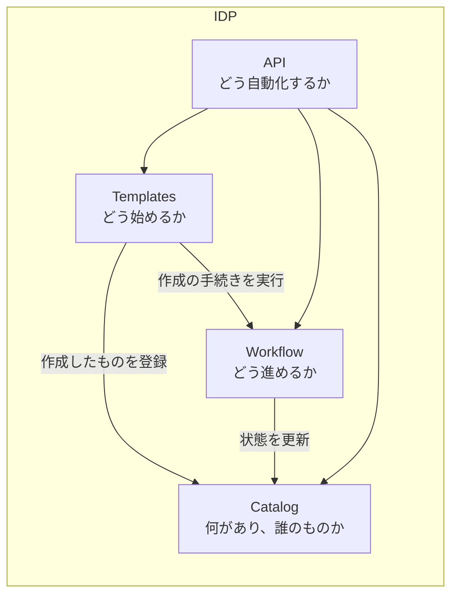
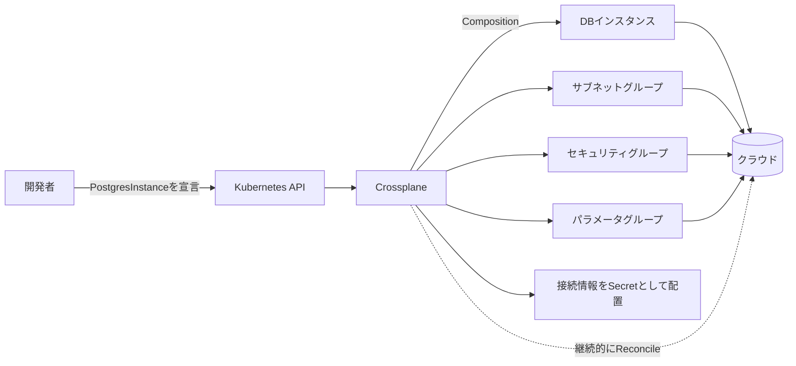
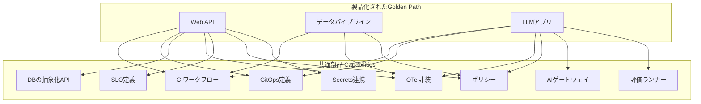
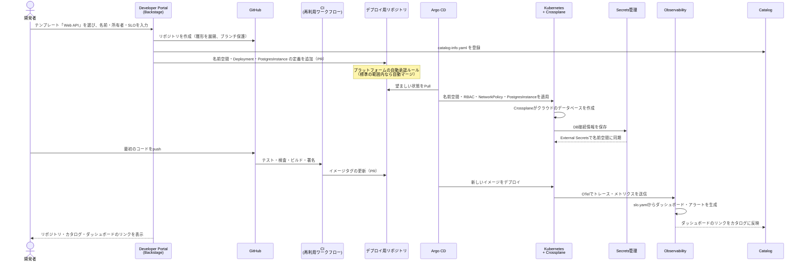

## 本章の問い

開発者が自力で安全に環境を作り、本番へリリースするまでに必要な能力とは何か。

第14章で、IDP（Internal Developer Platform）を「開発者がセルフサービスで利用できる共通能力の集合体」と定義し、それがDeveloper Portalと同じではないことを確認した。本章では、IDPを構成する具体的な技術を見ていく。

本章の構成は、IDPの最小構成から始め、Developer Portalの代表であるBackstage、リソースのプロビジョニング、CI/CDとGitOps、セキュリティ、メタデータの順に扱い、最後に「共通部品（Capability）」と「製品化されたGolden Path」の違いと、IDPの設計過多を防ぐ方法を論じる。

## 15.1　IDPの最小構成――Catalog、Templates、Workflow、API

### 四つの要素

IDPは、さまざまな形で実現できるが、その中核には次の四つの要素がある。これは本書による整理である。

| 要素 | 役割 | 答える問い |
|---|---|---|
| **Catalog（カタログ）** | 組織のソフトウェア、リソース、チーム、所有関係を一覧できる | 「何があり、誰のものか」 |
| **Templates（テンプレート）** | 新しいサービスやリソースを、標準的な形で作成できる | 「どう始めるか」 |
| **Workflow（ワークフロー）** | 作成、変更、デプロイ、承認などの手続きを自動で実行する | 「どう進めるか」 |
| **API** | 上記のすべてを、プログラムから操作できる | 「どう自動化するか」 |



### APIが要素に含まれる理由

四つの要素に**API**を含めていることには理由がある。

第14章で、IDPの入口はポータルだけでなく、CLI、API、Gitの宣言的な定義など複数あると述べた。そして第14章の図では、AIエージェントがPlatform APIを通じてIDPを使う姿を描いた。人間の開発者はポータルのボタンを押せばよいが、CIのパイプラインや、他のシステムや、AIエージェントは、ボタンを押せない。**IDPのすべての能力は、APIとして提供されているべきである**。ポータルは、そのAPIの上に作られた、人間のためのUIの一つにすぎない。

この「API first」の考え方は、第16章で開発者向けとAIエージェント向けのAPIを設計する際、そして第19章でAgent Meshを設計する際の前提になる。

## 15.2　BackstageのSoftware Catalog、Template、TechDocs

### Backstageとは

**Backstage**は、Spotifyが社内で開発し、2020年にオープンソースとして公開した、Developer Portalを構築するためのフレームワークである。同年にCNCFに寄贈され、現在はCNCFのIncubatingプロジェクトとして発展している。

Backstageの公式ドキュメントは、Backstageを、開発者ポータルを構築するためのオープンなフレームワークとして説明している。[R23] ここで重要なのは、Backstageが**完成品のポータル**ではなく、**ポータルを作るための枠組み**であるという点である。組織は、Backstageの上に、自組織のプラグインと設定を加えて、自分たちのポータルを作る。

> **執筆メモ**：BackstageのCNCFでの成熟度（Incubating等）は、刊行前に最新の状態を確認すること。

### Backstageの主な機能

| 機能 | 内容 |
|---|---|
| **Software Catalog** | サービス、ライブラリ、Webサイト、データパイプライン、APIなど、組織のソフトウェアとその所有者・依存関係を一元管理する |
| **Software Templates（Scaffolder）** | テンプレートから、新しいリポジトリ、CI/CD、インフラなどを作成する |
| **TechDocs** | リポジトリ内のMarkdownから、技術文書をポータル上に公開する（Docs like code） |
| **Search** | カタログ、文書、その他の情報を横断的に検索する |
| **Plugins** | CI/CD、監視、コスト、セキュリティなど、さまざまなツールの情報をポータルに統合する |

### Software Catalog

Software Catalogは、Backstageの中核である。カタログの情報は、各リポジトリに置かれた**記述ファイル**（通常 `catalog-info.yaml`）から読み込まれる。

```yaml
# askline-api/catalog-info.yaml
apiVersion: backstage.io/v1alpha1
kind: Component
metadata:
  name: askline-inquiry-api
  description: 問い合わせの受付と管理を行うAPI
  annotations:
    github.com/project-slug: minato/askline-api
    backstage.io/techdocs-ref: dir:.
    argocd/app-name: askline-inquiry-prod
  tags: [python, fastapi]
  links:
    - url: https://grafana.minato.example/d/askline-inquiry
      title: ダッシュボード
spec:
  type: service
  lifecycle: production
  owner: group:team-askline-api
  system: askline
  providesApis: [askline-inquiry-api]
  consumesApis: [askline-customer-api]
  dependsOn:
    - resource:askline-inquiry-db
---
apiVersion: backstage.io/v1alpha1
kind: Resource
metadata:
  name: askline-inquiry-db
  description: 問い合わせデータベース（PostgreSQL）
spec:
  type: database
  owner: group:team-askline-api
  system: askline
```

この記述ファイルには、第1章で見た**構成管理**の情報――何があり、誰が所有し、何に依存しているか――が含まれている。そして、第1章で指摘したCMDBの陳腐化という問題に対して、Backstageのカタログは次の方法で対処しようとする。

1. **情報をリポジトリに置く**：記述ファイルは、そのソフトウェアのコードと同じリポジトリに置かれる。コードを変更する人が、同じ場所で記述も更新する。
2. **所有者を必須にする**：すべてのコンポーネントに所有者（`owner`）を定める。情報の正しさに責任を持つ人が明確になる。
3. **他のシステムから情報を取り込む**：クラウドのリソース、Kubernetesの状態、CI/CDの結果などは、プラグインやプロバイダーを通じて自動で取り込む。

ただし、これらの方法をとっても、**カタログの情報は放っておけば古くなる**。所有者のいないコンポーネント、存在しないチームが所有するコンポーネント、実際には廃止されたのに `production` のままのコンポーネント。カタログの品質を保つには、第10章のDataOpsと同じく、カタログの情報そのものに品質のテストを行う必要がある（本章末の実装例）。

### カタログの意義

カタログは、IDPの他の多くの能力の**基盤**になる。

| カタログの情報 | それを使う能力 | 本書の関連章 |
|---|---|---|
| 所有者 | アラートの通知先、On-callの割り当て、コストの配賦 | 第5章、第11章 |
| 依存関係 | 障害の影響範囲の特定、AIOpsのイベント集約、知識グラフ | 第10章 |
| ライフサイクル | 本番のサービスにだけ厳しいポリシーを適用する | 第11章 |
| API | 互換性のない変更の影響分析 | 第10章（データ契約） |
| システム | 複数のコンポーネントをまとめたSLO、コスト | 第5章、第11章 |

第10章で、Knowledge Graphの材料として、トレース、カタログ、GitOpsの履歴を挙げた。カタログは、組織のソフトウェアに関する**メタデータの中心**である。

### Software Templates

Software Templatesは、新しいソフトウェアを、組織の標準に沿った形で作成するための機能である。テンプレートは、利用者が入力するパラメータと、実行する手順（ステップ）で定義される。

```yaml
# templates/web-api/template.yaml
apiVersion: scaffolder.backstage.io/v1beta3
kind: Template
metadata:
  name: askline-web-api
  title: Web API（Python / FastAPI）
  description: CI/CD、観測、SLO、セキュリティ検査が組み込まれた新しいWeb API
  tags: [recommended, python]
spec:
  owner: group:platform-team
  type: service
  parameters:
    - title: サービスの情報
      required: [name, owner, system]
      properties:
        name:
          type: string
          pattern: '^[a-z][a-z0-9-]{2,30}$'
        description:
          type: string
        owner:
          type: string
          ui:field: OwnerPicker
          ui:options:
            catalogFilter:
              kind: Group
        system:
          type: string
          ui:field: EntityPicker
          ui:options:
            catalogFilter:
              kind: System
    - title: 運用の情報
      properties:
        availabilitySlo:
          type: number
          enum: [99.0, 99.5, 99.9]
          default: 99.5
        needsDatabase:
          type: boolean
          default: false
  steps:
    - id: fetch
      name: 雛形を生成
      action: fetch:template
      input:
        url: ./skeleton
        values:
          name: ${{ parameters.name }}
          owner: ${{ parameters.owner }}
          system: ${{ parameters.system }}
          availabilitySlo: ${{ parameters.availabilitySlo }}
    - id: publish
      name: リポジトリを作成
      action: publish:github
      input:
        repoUrl: github.com?owner=minato&repo=${{ parameters.name }}
        defaultBranch: main
        protectDefaultBranch: true
    - id: register
      name: カタログに登録
      action: catalog:register
      input:
        repoContentsUrl: ${{ steps.publish.output.repoContentsUrl }}
        catalogInfoPath: /catalog-info.yaml
  output:
    links:
      - title: リポジトリ
        url: ${{ steps.publish.output.remoteUrl }}
      - title: カタログ
        icon: catalog
        entityRef: ${{ steps.register.output.entityRef }}
```

テンプレートの`skeleton`ディレクトリには、第4章のCIパイプライン、第6章のKubernetesのマニフェスト、第7章のOpenTelemetryの計装、第5章のSLOの定義、第11章のセキュリティ検査が、すべて組み込まれた雛形を置く。開発者は、テンプレートを選んで数項目を入力するだけで、組織の標準を満たした新しいサービスの出発点を得られる。

> **注意**：テンプレートのアクション（`publish:github` など）の名前と入力パラメータは、Backstageのバージョンとインストールしたプラグインによって異なる。刊行前に動作確認したバージョンを明記する。

### テンプレートの限界：Day 1とDay 2

テンプレートには、重要な限界がある。テンプレートは、**作成の時点（Day 1）**の標準を提供するが、**作成の後（Day 2）**の変化には追従しない。

テンプレートから作成されたリポジトリは、作成された瞬間から、テンプレートとは独立して変化していく。テンプレートを改善しても（例：CIに新しいセキュリティ検査を追加しても）、既存のリポジトリには反映されない。100のサービスがテンプレートから作られた後でテンプレートを改善すれば、100のリポジトリで個別に変更が必要になる。

この問題への対策として、次のようなアプローチがある。

| アプローチ | 内容 |
|---|---|
| 共通部品の参照 | CIのパイプラインを、各リポジトリにコピーするのではなく、共通のワークフロー（再利用可能なワークフロー）を参照する形にする。共通部品を更新すれば、全リポジトリに反映される |
| 自動の更新提案 | テンプレートの変更を、各リポジトリへのプルリクエストとして自動で提案する |
| 宣言的な抽象化 | 開発者は「何が欲しいか」だけを宣言し、具体的な実装はプラットフォームが生成し続ける（15.3節のCrossplane、15.7節） |

このDay 1とDay 2の区別は、15.7節で「共通部品」と「製品化されたGolden Path」を区別する際の重要な観点になる。

### TechDocs

TechDocsは、リポジトリ内のMarkdownの文書を、Backstageのポータル上に公開する機能である。文書をコードと同じリポジトリに置き、コードと同じ方法でレビューし、更新する（Docs like code）。第3章のRunbookや、第5章のError Budgetポリシーも、TechDocsとしてサービスのリポジトリに置けば、カタログからすぐにたどれるようになる。

## 15.3　Kubernetes、Terraform、Crossplaneとリソースプロビジョニング

### リソースプロビジョニングの課題

開発者が新しいサービスを作るとき、Kubernetesの名前空間、データベース、メッセージキュー、ストレージ、DNS、証明書など、さまざまなリソースが必要になる。第14章のインタビューの例で、「本番のデータベースの作成をインフラチームに依頼して待つ」ことが困りごとに挙がっていた。リソースのプロビジョニングをセルフサービスにすることは、IDPの最も重要な機能の一つである。

### 三つのアプローチ

| アプローチ | 内容 | 長所 | 短所 |
|---|---|---|---|
| **開発者がTerraformを書く** | 開発者が、自分のサービスのリソースをTerraformで定義する | 柔軟。IaCの利点（第4章）がそのまま得られる | 開発者がクラウドとTerraformを深く理解する必要がある。外在的な認知負荷が大きい |
| **Terraformモジュールを提供する** | プラットフォームチームが、標準化されたTerraformモジュールを提供し、開発者はそれを呼び出す | 標準化と柔軟性のバランスが良い | モジュールの更新を各リポジトリに反映する必要がある（Day 2の問題） |
| **Kubernetes APIによる抽象化（Crossplaneなど）** | 開発者は、Kubernetesのカスタムリソースとして「データベースが欲しい」と宣言し、プラットフォームがクラウドのリソースを作成・管理する | 開発者は抽象化された少数の項目だけを扱う。Reconciliationによって、作成後も望ましい状態が保たれる | 抽象化の設計が難しい。抽象化の外のことをしたい場合に不自由 |

### Terraformモジュール

Terraformモジュールは、第11章のSecurity by Default／Cost by Defaultを実現する直接的な手段である。

```hcl
# 開発者のリポジトリ: 標準モジュールを呼び出すだけ
module "inquiry_db" {
  source  = "app.terraform.io/minato/postgres-standard/aws"
  version = "~> 3.2"

  name        = "askline-inquiry"
  environment = "prod"
  owner       = "team-askline-api"
  size        = "medium"      # small / medium / large の三択
}
```

モジュールの内部では、暗号化、バックアップ、マルチAZ、削除保護、必須タグなどが、組織の標準に沿って設定される。開発者が指定するのは、名前、環境、所有者、サイズの四項目だけである。

### Crossplane

**Crossplane**は、Kubernetesを、クラウドのリソースを管理するための**コントロールプレーン**として使えるようにするオープンソースのプロジェクトであり、CNCFのプロジェクトである。

Crossplaneの中心にあるのは、第6章で見た**Kubernetesの宣言的APIとReconciliation Loop**を、Kubernetesの外のリソース（クラウドのデータベース、ストレージ、ネットワークなど）に広げるという考え方である。

Crossplaneでは、プラットフォームチームが、**Composite Resource Definition（XRD）**で開発者向けの抽象化されたAPI（例：`PostgresInstance`）を定義し、**Composition**でそのAPIを具体的なクラウドのリソースの組み合わせに対応づける。

```yaml
# 開発者が書くもの（抽象化されたAPI）
apiVersion: platform.minato.example/v1alpha1
kind: PostgresInstance
metadata:
  name: askline-inquiry-db
  namespace: askline
spec:
  size: medium
  environment: prod
  owner: team-askline-api
```



Crossplaneの利点は、**作成の後も、望ましい状態が保たれる**ことである（Day 2の問題への答え）。プラットフォームチームがCompositionを更新すれば（例：新しいバックアップの設定を追加すれば）、そのCompositionを使うすべてのデータベースに、Reconciliationによって反映される。また、誰かがクラウドのコンソールから設定を手作業で変更しても、Crossplaneが望ましい状態に戻す（第6章のドリフトの修正）。

> **注意**：CrossplaneのAPI（XRD、Composition、Composition Functionsなど）は、版を重ねて大きく変化している。具体的な定義の書き方は、刊行前に参照した版の公式ドキュメントで確認すること。

### 抽象化の設計

どのアプローチを選ぶにせよ、最も難しいのは**抽象化の設計**である。第6章6.7節で、「抽象化しすぎれば、問題が起きたときに何も見えなくなる。抽象化が足りなければ、開発者の認知負荷は下がらない」と述べた。

良い抽象化のための指針を示す。

1. **開発者の言葉で設計する**：「db.r6g.large、gp3、Multi-AZ」ではなく、「本番用・中規模」のように、開発者が判断できる言葉で選択肢を示す。
2. **選択肢を絞る**：自由な数値ではなく、少数の選択肢（small／medium／large）にする。選択肢が少ないほど、判断は楽になり、標準化は進む。
3. **出口を用意する**：抽象化では表現できない要求がある場合に、より詳細な設定に降りられる道を用意する。出口がなければ、開発者はプラットフォームを捨てて独自に作る。
4. **下の層を見えるようにする**：抽象化されたリソースが、実際にどのクラウドのリソースに対応しているかを、カタログや監視から調べられるようにする。

## 15.4　GitHub Actions／GitLab CIとArgo CD／Flux

### CIとCDの役割分担

第4章でCIを、第6章でGitOpsによるCDを扱った。IDPでは、両者を次のように役割分担させるのが一般的である。

| 段階 | 担当 | 内容 |
|---|---|---|
| **CI** | GitHub Actions、GitLab CIなど | テスト、ビルド、セキュリティ検査、SBOM、署名、イメージの公開、デプロイ用リポジトリへの変更の提案 |
| **CD** | Argo CD、Fluxなど | デプロイ用リポジトリの望ましい状態を、クラスタに継続的に適用する |

この分担の理由は、第6章6.5節で述べたPull型の利点――本番クラスタへの権限をCIに渡さない――にある。

### 再利用可能なワークフロー

15.2節で述べたDay 2の問題に対して、CIでは**再利用可能なワークフロー**が有効である。GitHub Actionsでは、他のリポジトリのワークフローを呼び出せる（reusable workflows）。GitLab CIでは、`include`で共通の定義を読み込める。

```yaml
# 各サービスのリポジトリ: .github/workflows/ci.yml
name: ci
on:
  pull_request:
  push:
    branches: [main]

jobs:
  standard:
    uses: minato/platform-workflows/.github/workflows/python-service.yml@v4
    with:
      service-name: askline-inquiry-api
      python-version: "3.12"
    permissions:
      contents: read
      packages: write
      id-token: write
    secrets: inherit
```

共通のワークフロー（`python-service.yml`）には、第4章のテスト、第11章の脆弱性検査、SBOM、署名、そして第6章のデプロイ用リポジトリへの変更の提案が含まれる。プラットフォームチームが共通のワークフローを改善すれば（バージョン`v4`の範囲内で）、すべてのサービスに反映される。

### バージョニングの考え方

共通部品を参照させる場合、**バージョニング**の方針が重要になる。

| 方針 | 内容 | 長所 | 短所 |
|---|---|---|---|
| 最新を参照（`@main`） | 常に最新の共通部品を使う | 改善が即座に全体に反映される | 共通部品の誤りが即座に全体を壊す |
| メジャーバージョンを参照（`@v4`） | 互換性のある変更は自動で反映、互換性のない変更は明示的に移行 | バランスが良い | メジャーバージョンの移行を計画的に進める必要がある |
| 固定（`@v4.2.1`やコミットハッシュ） | 明示的に更新するまで変わらない | 予測可能。セキュリティ上も安全 | 改善が反映されない。自動の更新提案の仕組みが必要 |

これは、ライブラリのバージョン管理と同じ問題であり、プラットフォームの共通部品は**ライブラリと同じように、意味のあるバージョニングと変更履歴をもって提供されるべき**である。

## 15.5　Secrets、IAM、Policy Engine

第11章で、Secrets管理、IAM、Policy as Codeを扱った。IDPでは、これらを**開発者が意識しなくても正しく使える**形で提供する。

### Secrets

| 開発者がすること | プラットフォームが提供すること |
|---|---|
| 「このサービスはこのデータベースに接続する」と宣言する | 接続情報を、シークレット管理サービスに保存し、実行時にサービスに配置する |
| 外部のAPIキーを、ポータルから登録する | APIキーを暗号化して保存し、アクセスを監査する |
| 何もしない | シークレットの定期的なローテーション |

Kubernetesでは、External Secrets Operatorのような仕組みを使って、外部のシークレット管理サービスの値を、Kubernetesの`Secret`として同期する方法がよく使われる。開発者は、シークレットの値そのものに触れずに、参照だけを宣言する。

### IAM

第11章で、CI/CDからクラウドへのアクセスに、OIDCによる**ワークロードID連携**を使い、長期間有効なキーをなくす方法を述べた。同じ考え方を、実行中のサービスにも適用する。Kubernetes上のサービスは、サービスアカウントとクラウドのIAMロールを対応づけ、短命の資格情報でクラウドのリソースにアクセスする。

IDPでは、テンプレートからサービスを作成した時点で、そのサービス専用のIDと、最小限の権限が自動で作成されるようにする。開発者が「データベースへの接続が必要」と宣言すれば、そのデータベースへの接続の権限だけが付与される。

### Policy Engine

第11章のOPA／Kyvernoによるポリシーを、IDPのすべての経路で一貫して適用する。

| 経路 | ポリシーの適用点 |
|---|---|
| テンプレートからの作成 | テンプレート自体がポリシーを満たすように作られている |
| プルリクエスト | IaCやマニフェストの変更を、CIでポリシー検査する |
| デプロイ | KubernetesのAdmission Controlで、適用時に検査する |
| 実行時 | 稼働中のリソースを、バックグラウンドで定期的に検査する |
| API呼び出し | Platform APIの呼び出しを、ポリシーで認可する（第16章） |

**同じポリシーを、複数の経路で、同じ定義から適用する**ことが重要である。プルリクエストのCIでは合格したのに、デプロイ時に拒否される、という状況は、開発者を混乱させる。ポリシーの定義を一か所で管理し、CIでの検査とAdmission Controlの両方で同じ定義を使えば、早い段階で問題を発見でき、デプロイ時の驚きを防げる。

## 15.6　Service Discovery、Observability、Ownership Metadata

### Service Discovery

**Service Discovery（サービスディスカバリ）**は、サービスが、他のサービスの場所（アドレス）を、動的に見つける仕組みである。第6章で、Kubernetesがサービスディスカバリを提供することを見た。第7章で、Prometheusがサービスディスカバリによって監視対象を自動で発見することを見た。

IDPの観点からは、サービスディスカバリは**実行時の発見**（どこで動いているか）であり、カタログは**設計時・組織的な発見**（何があり、誰のものか）である。両者を結びつけることで、「この監視対象は、どのカタログのコンポーネントに対応し、誰が所有しているか」を答えられるようになる。

### Observabilityの自動接続

IDPは、テンプレートから作成されたサービスを、自動的にObservabilityの基盤に接続する。

1. テンプレートに、OpenTelemetryの計装と、Collectorへの送信の設定を組み込む（第7章）。
2. サービスの`service.name`を、カタログのコンポーネント名と一致させる。
3. SLOの定義（第5章）から、ダッシュボードとアラートを自動で生成する。
4. カタログのページから、そのサービスのダッシュボード、トレース、ログ、アラートにリンクする。

この「名前の一致」は単純だが、きわめて重要である。カタログ、Kubernetes、監視、トレース、コスト、インシデント管理で、同じサービスが同じ名前で識別されていれば、すべての情報をサービスを軸に結びつけられる。名前がばらばらであれば、人が頭の中で対応づけなければならない。

### Ownership Metadata

**所有者のメタデータ**は、IDPの中で最も地味だが、最も多くの能力の前提となる情報である。

| 所有者の情報を使う能力 | 所有者が不明なら起きること |
|---|---|
| アラートの通知先 | アラートが誰にも届かない、または全員に届く |
| インシデントのエスカレーション | 誰を呼べばよいかわからない |
| コストの配賦 | コストが「その他」に積み上がる |
| 脆弱性の修正依頼 | 誰に修正を依頼すればよいかわからない |
| 廃止の判断 | 使われているかどうかを誰にも確認できない |
| エージェントの承認者 | エージェントの行動を承認する人が決まらない（第13章） |

所有者の情報を正しく保つには、次の仕組みが有効である。

- 所有者のない（または存在しないチームが所有する）コンポーネントを、定期的に検出して報告する。
- チームの組織変更（統合、分割、解散）のときに、所有するコンポーネントの引き継ぎを手続きに組み込む。
- 所有者の情報を、人事・組織のシステムと同期する。

## 15.7　共通部品（Capability）と製品化されたGolden Path

### 二つの層

ここまで見てきた技術は、IDPの中で二つの異なる層を構成している。

| 層 | 内容 | 例 | 利用者 |
|---|---|---|---|
| **共通部品（Capability）** | 単一の機能を提供する、再利用可能な部品 | Terraformモジュール、再利用可能なCIワークフロー、Crossplaneの抽象化API、Collectorの設定、ポリシーの定義、AIゲートウェイ | Golden Pathの作り手、上級の開発者 |
| **製品化されたGolden Path** | 共通部品を組み合わせ、ある種類の仕事を最初から最後まで成し遂げられるようにしたもの | 「新しいWeb APIを作って本番に出す」「新しいLLMアプリを作る」 | 一般の開発者 |



### 両者の違い

| 観点 | 共通部品 | 製品化されたGolden Path |
|---|---|---|
| 粒度 | 単一の機能 | 仕事の全体 |
| 設計の起点 | 技術的な機能 | 利用者の仕事（ユースケース） |
| 使い方 | 組み合わせて使う。組み合わせ方は利用者が決める | そのまま使う。組み合わせ方はプラットフォームが決めている |
| 求められる知識 | 部品とその組み合わせ方の理解 | 自分の仕事の理解 |
| ドキュメント | APIリファレンス | 手順のガイド（チュートリアル） |
| 成果の測り方 | 部品の利用数、信頼性 | 仕事の完了までの時間、利用者の満足度 |

### なぜこの区別が重要なのか

プラットフォームチームは、しばしば共通部品を作ることに集中し、それで「プラットフォームができた」と考えてしまう。しかし、部品が揃っていても、それを組み合わせて仕事を成し遂げるには、部品の知識と組み合わせ方の判断が必要になる。それは、まさにプラットフォームが減らそうとしていた外在的な認知負荷である。

一方、Golden Pathだけを作り、その内部が部品化されていなければ、Golden Pathの数が増えるたびに、同じ機能が重複して実装され、保守ができなくなる。

**共通部品は、Golden Pathを作り、保守し、進化させるための材料である。Golden Pathは、共通部品を利用者の価値に変える製品である**。両方が必要であり、プラットフォームチームは両方を意識して設計する必要がある。

## 15.8　IDPの設計過多を防ぐ

### 設計過多の兆候

IDPの取り組みでよく見られる失敗は、**作りすぎる**ことである。次のような兆候があれば、設計過多を疑うべきである。

| 兆候 | 内容 |
|---|---|
| 利用者のいない機能 | 誰かが使うだろうと考えて作ったが、誰も使っていない |
| ポータルの作り込み | 背後の能力が整っていないのに、ポータルのUIに多くの労力を注いでいる |
| 早すぎる抽象化 | 一つの利用者のためだけに、汎用的な抽象化を設計している |
| すべてを網羅しようとする | あらゆる言語、あらゆるフレームワーク、あらゆるクラウドに対応しようとしている |
| 移行の計画がない | 新しいプラットフォームを作ったが、既存のサービスをどう移行するかの計画がない |
| プラットフォームチームの肥大 | プラットフォームの保守に、Stream-aligned Teamよりも多くの人が必要になっている |

### 設計過多を防ぐ原則

第14章で紹介した**Thinnest Viable Platform（TVP）**の考え方に立ち返る。[R22] プラットフォームは、Stream-aligned Teamの外在的な認知負荷を減らすために必要な、最も薄いものであるべきである。

設計過多を防ぐための原則を、本書の提案として示す。

1. **困りごとから始める**：第14章の演習のように、開発者の実際の困りごとから、最も価値の高いものを選ぶ。
2. **既存のものを使う**：クラウドのマネージドサービス、既存のオープンソースで足りるなら、自分たちで作らない。プラットフォームの価値は、作ったものの量ではなく、組み合わせと標準化にある。
3. **一つのGolden Pathを完成させる**：多くのGolden Pathを中途半端に作るより、一つを最初から最後まで使えるものにする。
4. **最初の利用者と一緒に作る**：第14章のCollaborationの関係で、実際の利用者と一緒に作り、実際に使われることを確かめてから広げる。
5. **ポータルは後から**：最初はCLI、Gitの宣言的な定義、ドキュメントだけでもよい。能力が整ってから、ポータルで発見しやすくする。
6. **廃止を計画する**：使われていない機能、古いバージョンの共通部品を、計画的に廃止する。

### AWSのIDP設計ガイドとの関係

AWSは、*Building an Internal Developer Platform on AWS* という設計ガイドを公開している。[R24] このガイドは、IDPの構成要素と設計の考え方を整理しており、Developer Portalを、IDPの全体ではなく、その**構成要素の一つ**として位置づけている。これは本書の第14章の区別と一致している。第16章・第17章で、このガイドを参照アーキテクチャの一例として再び取り上げる。

> **執筆メモ**：AWSのIDP設計ガイド [R24] における構成要素の分類（例：開発者コントロールプレーン、統合・デリバリー、監視、セキュリティ、リソースなどの層）を原文で確認し、本書の四要素（Catalog、Templates、Workflow、API）との対応表を作成する。

## 図・実装例

### Software Templateの申請からリソースが生成されるまで



### 実装例：カタログの品質を検査する

15.2節と15.6節で、カタログの情報が古くなる問題と、所有者のメタデータの重要性を述べた。カタログの記述ファイルを検査し、問題を報告する小さなツールを実装する。

```python
"""Backstage のカタログ記述を検査し、品質の問題を報告する。"""
from __future__ import annotations

from dataclasses import dataclass
from pathlib import Path

import yaml

VALID_LIFECYCLES = {"experimental", "production", "deprecated"}

@dataclass(frozen=True)
class Finding:
    entity: str
    rule: str
    message: str

def load_entities(path: Path) -> list[dict]:
    return [doc for doc in yaml.safe_load_all(path.read_text(encoding="utf-8")) if doc]

def entity_ref(entity: dict) -> str:
    return f"{entity.get('kind', '?')}:{entity.get('metadata', {}).get('name', '?')}"

def check_owner(entity: dict, known_groups: set[str]) -> Finding | None:
    owner = entity.get("spec", {}).get("owner")
    if not owner:
        return Finding(entity_ref(entity), "owner-required", "所有者が設定されていません")
    if owner.removeprefix("group:") not in known_groups:
        return Finding(entity_ref(entity), "owner-exists", f"所有者 {owner} は存在しないグループです")
    return None

def check_lifecycle(entity: dict) -> Finding | None:
    if entity.get("kind") != "Component":
        return None
    lifecycle = entity.get("spec", {}).get("lifecycle")
    if lifecycle not in VALID_LIFECYCLES:
        return Finding(entity_ref(entity), "lifecycle-valid", f"lifecycle={lifecycle} は不正です")
    return None

def check_production_has_dashboard(entity: dict) -> Finding | None:
    spec, meta = entity.get("spec", {}), entity.get("metadata", {})
    if entity.get("kind") == "Component" and spec.get("lifecycle") == "production":
        titles = {link.get("title") for link in meta.get("links", [])}
        if "ダッシュボード" not in titles:
            return Finding(entity_ref(entity), "prod-dashboard",
                           "本番のコンポーネントにダッシュボードのリンクがありません")
    return None

def lint(entities: list[dict], known_groups: set[str]) -> list[Finding]:
    findings: list[Finding] = []
    for e in entities:
        for result in (check_owner(e, known_groups), check_lifecycle(e),
                       check_production_has_dashboard(e)):
            if result:
                findings.append(result)
    return findings
```

```python
# test_catalog_lint.py
from catalog_lint import lint

GROUPS = {"team-askline-api", "platform-team"}

def component(**spec):
    return {"kind": "Component", "metadata": {"name": "svc", "links": []}, "spec": spec}

def test_missing_owner_is_reported():
    findings = lint([component(lifecycle="experimental")], GROUPS)
    assert [f.rule for f in findings] == ["owner-required"]

def test_unknown_owner_group_is_reported():
    findings = lint([component(owner="group:team-gone", lifecycle="experimental")], GROUPS)
    assert [f.rule for f in findings] == ["owner-exists"]

def test_production_component_needs_dashboard():
    findings = lint([component(owner="group:team-askline-api", lifecycle="production")], GROUPS)
    assert [f.rule for f in findings] == ["prod-dashboard"]

def test_valid_component_has_no_findings():
    e = component(owner="group:team-askline-api", lifecycle="production")
    e["metadata"]["links"] = [{"title": "ダッシュボード", "url": "https://example"}]
    assert lint([e], GROUPS) == []
```

このツールを、各リポジトリのCI（`catalog-info.yaml`の変更時）と、全リポジトリに対する定期的な検査の両方で実行する。第10章のデータテストと同じく、**カタログの情報もデータ製品であり、品質のテストの対象である**。

## 評価指標とトレードオフ

| 指標 | 意味 | 注意点 |
|---|---|---|
| テンプレートからの作成数 | テンプレートを使って作成されたサービスの数 | 作成後も標準に追従しているかを別に見る |
| 標準への追従率（Day 2） | 共通部品の最新のメジャーバージョンを使っているサービスの割合 | 低ければ、更新の負担が大きいか、変更の価値が伝わっていない |
| セルフサービス化率 | リソースの作成のうち、依頼なしで完了したものの割合 | チケットの件数とセットで見る |
| リソースの払い出し時間 | 依頼または宣言から、リソースが使えるようになるまでの時間 | 待ち時間を含めて測る |
| カタログの品質 | 所有者・ライフサイクル・リンクが正しいコンポーネントの割合 | 本章末の検査で測る |
| 名前の一致率 | カタログ、監視、コスト、インシデントで同じ名前で識別されるサービスの割合 | 情報の結合の前提 |
| プラットフォームの変更失敗率 | 共通部品の変更が、利用者のサービスを壊した割合 | プラットフォームにもDORA指標を適用する |

本章の中心的なトレードオフは、**抽象化の度合い**である。抽象化を高くすれば、開発者の認知負荷は下がり、標準化は進み、Day 2の追従も容易になる。しかし、抽象化の外の要求に応えにくくなり、問題が起きたときに下の層が見えにくくなる。抽象化を低くすれば柔軟だが、開発者の負担は減らない。良い抽象化は、**開発者の言葉で、少数の選択肢を示し、出口を用意し、下の層を見えるようにする**。

## 本章の結論

開発者が自力で安全に環境を作り、本番へリリースするには、IDPが次の能力を提供する必要がある。

- **Catalog**：何があり、誰のものかを答える。所有者のメタデータは、多くの能力の前提になる。
- **Templates**：組織の標準を満たした出発点を提供する。ただし、Day 2の追従には別の仕組みが必要である。
- **Workflow**：CI、GitOps、リソースのプロビジョニングを自動で進める。
- **API**：人間だけでなく、システムとAIエージェントが、すべての能力をプログラムから使えるようにする。

そして、IDPは**共通部品**と**製品化されたGolden Path**の二層で設計し、Thinnest Viable Platformの考え方で、作りすぎを防ぐ。

次章では、これらの能力を全社の共通プラットフォームとして、統制を維持しながら拡張するためのアーキテクチャを設計する。

## 参考文献

- [R23] Backstage, *Technical Overview*. https://backstage.io/docs/overview/technical-overview/
- [R24] AWS, *Building an Internal Developer Platform on AWS*（AWS Prescriptive Guidance）. https://docs.aws.amazon.com/prescriptive-guidance/latest/internal-developer-platform/introduction.html
- [R22] M. Skelton, M. Pais, *Team Topologies*, IT Revolution Press, 2019.
- Backstage公式ドキュメント（Software Catalog、Software Templates、TechDocs）. https://backstage.io/docs/
- Crossplane公式ドキュメント. https://docs.crossplane.io/
- GitHub Docs, *Reusing workflows*. https://docs.github.com/actions/using-workflows/reusing-workflows
- External Secrets Operator公式ドキュメント. https://external-secrets.io/
