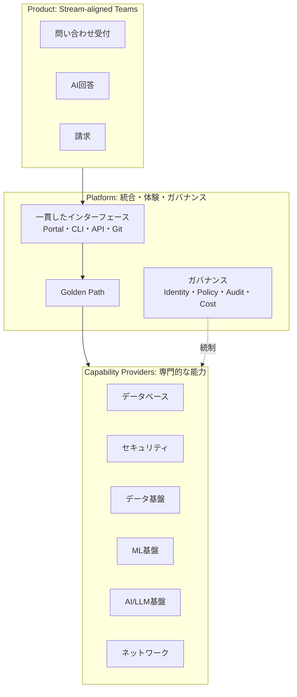
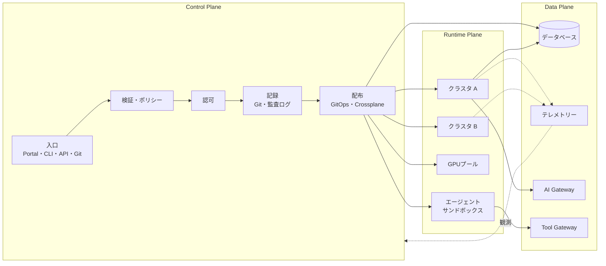
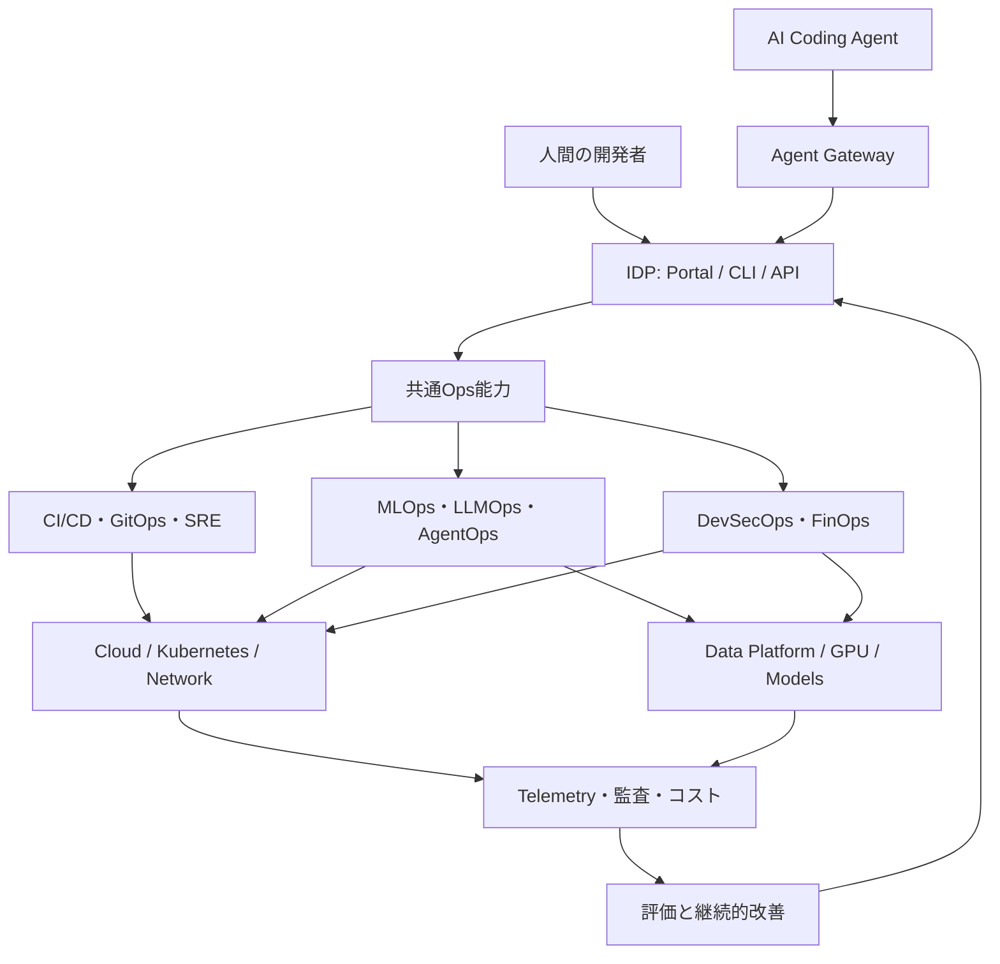

## 本章の問い

各Opsが使う共通能力を、統制を維持しながらどう拡張するのか。

第15章で、IDPを構成する技術を見た。一つのチーム、一つのGolden Pathから始めたプラットフォームは、成功すれば、やがて全社に広がる。利用者は数十のチームから数百のチームへ、Golden Pathは一本から十数本へ、対象はWeb APIからデータ、ML、LLM、エージェントへと広がる。そして利用者には、人間の開発者だけでなく、AIエージェントが加わる。

規模が大きくなると、プラットフォームそのものが、**大規模な分散システム**であり、**多数の利害関係者を持つ組織的な構造物**になる。本章では、そのアーキテクチャを、責任の分離、プレーンの分離、テナントの分離、統制の仕組み、利用者のためのAPI、横断的な機能の組み込み、測定、技術選定の順に設計する。

> **本章の位置づけ**：本章の参照アーキテクチャは、CNCF Platforms White Paperの層構造 [R20]、Platform Engineering Maturity Model [R21]、AWSのIDP設計資料 [R24] を照合したうえでの**筆者の提案**である。特定の標準や製品のアーキテクチャをそのまま示すものではない。

## 16.1　Product／Platform／Capability Providerの分離

### 三つの役割

全社のプラットフォームには、少なくとも三つの役割の主体が関わる。

| 役割 | 内容 | 例 |
|---|---|---|
| **Product（プロダクトチーム）** | プラットフォームを使って、事業の価値を届ける。第14章のStream-aligned Team | 問い合わせ受付チーム、AI回答チーム |
| **Platform（プラットフォームチーム）** | 共通能力を、一貫した体験とガバナンスのもとで、製品として提供する | 開発者プラットフォームチーム |
| **Capability Provider（能力の提供者）** | 特定の領域の能力を、専門性をもって提供する | データベースチーム、セキュリティチーム、データプラットフォームチーム、ML基盤チーム、AIプラットフォームチーム、ネットワークチーム |

### なぜ分離するのか

小さな組織では、プラットフォームチームが、すべての能力を自ら作り、運用する。しかし組織が大きくなると、これは成り立たなくなる。データベース、セキュリティ、ネットワーク、ML基盤、LLMゲートウェイは、それぞれに深い専門性を必要とし、一つのプラットフォームチームがすべてを担うことはできない。

第8章で、各Opsの専門性はなくならないことを見た。全社のプラットフォームでは、各Opsの専門家が**Capability Provider**として、それぞれの能力を提供する。そしてプラットフォームチームは、それらの能力を**一貫したインターフェース、一貫した体験、一貫したガバナンスのもとに統合する**役割を担う。



### 能力の提供者とプラットフォームの契約

Capability Providerがプラットフォームに能力を提供するとき、両者の間には**契約**が必要である。これは第10章のデータ契約、第5章のSLOと同じ考え方を、プラットフォームの内部に適用するものである。

| 契約の項目 | 内容 |
|---|---|
| インターフェース | 能力を、どのAPI（宣言的な定義、Crossplaneの抽象化など）で提供するか |
| SLO | 能力の可用性、払い出しの時間 |
| ガバナンスの準拠 | 共通のIdentity、ポリシー、監査、コストのタグに対応しているか |
| 観測 | 能力の利用状況、エラー、コストを、共通のObservabilityに送っているか |
| サポート | 問い合わせの窓口、障害時のエスカレーション |
| ライフサイクル | 能力のバージョン、非推奨化、廃止の手続き |

この契約によって、プロダクトチームは、能力が誰によって提供されているかを意識せずに、一貫した方法で使える。そしてCapability Providerは、自らの専門性に集中しながら、全社のガバナンスに準拠できる。

## 16.2　Control Plane、Data Plane、Runtime Plane

### プレーンの分離

ネットワークの分野では、経路の制御を行う**コントロールプレーン**と、実際のパケットを転送する**データプレーン**を分離する設計が確立している。第6章で見たKubernetesも、APIサーバーやコントローラーからなるコントロールプレーンと、ワークロードが動くノードを分けている。

本書では、全社のプラットフォームを、次の三つのプレーンに分けて設計することを提案する。

| プレーン | 役割 | 構成要素の例 | 求められる性質 |
|---|---|---|---|
| **Control Plane（制御プレーン）** | 望ましい状態の受付、検証、認可、記録、配布 | Portal、Platform API、カタログ、テンプレート、GitOpsのリポジトリとコントローラー、ポリシーエンジン、Crossplane | 整合性、監査可能性、変更の安全性 |
| **Data Plane（データプレーン）** | 業務のデータとテレメトリーの流れ | データベース、メッセージング、データ基盤、テレメトリーのパイプライン、AIゲートウェイ、Tool Gateway | スループット、低レイテンシ、データの保護 |
| **Runtime Plane（実行プレーン）** | ワークロードの実行 | Kubernetesのクラスタ、サーバーレス、GPU、エージェントのサンドボックス | 隔離、スケーラビリティ、可用性 |

> **用語の注意**：「データプレーン」という言葉は、ネットワークやサービスメッシュの文脈では「実際の通信を処理する層」を意味し、本書の用法（業務データとテレメトリーの流れ）とは範囲が異なる。本書のプレーンの区分は、説明のための筆者の整理である。

### なぜ分離するのか

**第一に、障害の影響を分離する。** コントロールプレーンが障害を起こしても、実行中のワークロードとデータの流れは止まらないように設計する。ポータルが落ちても、問い合わせ受付APIは動き続けるべきである。逆に、実行プレーンの一つのクラスタの障害が、コントロールプレーンや他のクラスタに波及しないようにする。

**第二に、求められる性質が違う。** コントロールプレーンは、すべての変更を検証し、記録することが重要であり、多少遅くても正確であるべきである。データプレーンは、大量のリクエストを低レイテンシで処理することが重要である。実行プレーンは、ワークロード間の隔離が重要である。一つの仕組みにすべての性質を求めると、どれも中途半端になる。

**第三に、統制の要を明確にする。** すべての変更が**コントロールプレーンを通る**ように設計すれば、ポリシーの検証、認可、監査を、コントロールプレーンの一か所に集中できる。実行プレーンへの直接の変更（クラスタへのkubectlでの直接操作、クラウドのコンソールからの直接変更）を禁止または例外とし、コントロールプレーンのGitOpsとReconciliationによって望ましい状態を保つ（第6章）。

### 変更の流れ



この図の最後の矢印――テレメトリーがコントロールプレーンに観測としてフィードバックされる――は、第6章のReconciliation Loopの「観測」に相当する。コントロールプレーンは、望ましい状態を配布するだけでなく、現在の状態を観測し、差分を検知する。

## 16.3　マルチテナント、環境分離、マルチクラウド

### テナントとは

全社のプラットフォームでは、多くのチームが同じ基盤を共有する。この共有の単位を**テナント**と呼ぶ。プラットフォームの文脈でのテナントは、多くの場合チームやプロダクトである。（Asklineの「顧客テナント」――Asklineのサービスを使う顧客企業――とは異なる。本章では、混同を避けるため、プラットフォームの利用者の単位を「プラットフォームテナント」と呼ぶ。）

### 分離の度合い

プラットフォームテナントをどの程度分離するかには、選択の幅がある。

| 分離の度合い | 内容 | 長所 | 短所 |
|---|---|---|---|
| **名前空間の分離** | 一つのクラスタを共有し、名前空間で分ける | 資源の効率が高い。運用が容易 | 隔離が弱い。一つのテナントの問題が他に影響しうる |
| **クラスタの分離** | テナントごとに専用のクラスタを用意する | 隔離が強い。テナント固有の設定ができる | 資源の効率が低い。クラスタの数だけ運用が増える |
| **アカウント・プロジェクトの分離** | クラウドのアカウント（プロジェクト、サブスクリプション）を分ける | 権限、コスト、障害の境界が明確 | 管理するアカウントの数が増える |

多くの組織は、これらを組み合わせる。例えば、

- 開発環境：共有クラスタの名前空間で分離（効率を優先）
- 本番環境：プロダクトごとにクラウドのアカウントを分け、その中で共有クラスタを使う（権限とコストの境界を優先）
- 機密性の高いワークロード：専用のクラスタとアカウント（隔離を優先）

### 名前空間の分離で必要なもの

名前空間で分離する場合、次のものを、プラットフォームが名前空間の作成時に自動で設定する必要がある。

| 項目 | 内容 | 防ぐもの |
|---|---|---|
| RBAC | テナントのメンバーは自分の名前空間だけを操作できる | 他テナントのリソースの操作 |
| ResourceQuota・LimitRange | 名前空間ごとのCPU・メモリの上限と既定値 | 資源の独占（Noisy Neighbor） |
| NetworkPolicy | 既定で他の名前空間からの通信を拒否し、必要な通信だけを許可する | 横方向の侵入 |
| Pod Security | 特権コンテナ、ホストのファイルシステムへのアクセスなどを禁止する | コンテナからの脱出 |
| コストのラベル | 名前空間に所有者とコストセンターのラベルを付ける | 配賦できないコスト（第11章） |

### 環境の分離

開発、ステージング、本番といった**環境**の分離も、アーキテクチャの重要な判断である。

| 観点 | 推奨 |
|---|---|
| 本番と非本番の分離 | 本番は、少なくともクラウドのアカウントレベルで非本番から分離する。権限、ネットワーク、データを分ける |
| 本番データの扱い | 非本番の環境に、本番の個人情報や機密情報を持ち込まない。必要な場合はマスキングする |
| 環境間の昇格 | 同じ成果物（同じイメージのダイジェスト）を、GitOpsのプルリクエストで環境間を昇格させる（第6章） |
| 一時的な環境 | プルリクエストごとの一時的なプレビュー環境は、自動で作成・破棄し、費用の上限を設ける（第11章） |

### マルチクラウド

組織が複数のクラウドを使う理由は、さまざまである。買収によって異なるクラウドを使うチームが合流した、特定のクラウドにしかないサービスを使いたい、規制上の理由で特定の地域のクラウドを使う必要がある、一つのクラウドへの依存を避けたい、などである。

マルチクラウドは、プラットフォームの設計を大きく複雑にする。本書の立場は次のとおりである。

- **マルチクラウドは目的ではなく、制約である**：マルチクラウドを「すべきこと」として追求するのではなく、上記のような理由がある場合に、その制約として扱う。
- **抽象化する層を選ぶ**：すべての層をクラウドから独立させようとすれば、各クラウドの最も基本的な機能しか使えなくなる（最小公倍数の問題）。開発者から見えるインターフェース（Golden Path、Platform API）はクラウドから独立させ、その下の実装は各クラウドの能力を活用する、という設計が現実的である。

この考え方は、第17章で「ベンダーに依存しないGolden Path」として具体化する。

## 16.4　IAM、認可、監査、Policy as Code

### Identityの統一

全社のプラットフォームのガバナンスの基盤は、**Identity（ID）の統一**である。人、サービス、CIのパイプライン、AIエージェントのすべてが、組織の共通のIDの仕組みによって識別されなければ、認可も監査も一貫しない。

| 主体 | IDの例 | 認証の方式 |
|---|---|---|
| 人（開発者、運用者、承認者） | 組織のIdP（Identity Provider）のアカウント | SSO、多要素認証 |
| サービス（ワークロード） | ワークロードID（Kubernetesのサービスアカウントとクラウドのロールの対応、SPIFFEなど） | 短命の資格情報、相互TLS |
| CI/CDのパイプライン | OIDCによるワークロードID連携 | 実行ごとの短命のトークン（第11章） |
| AIエージェント | エージェント固有のID（第13章、第20章） | 短命の資格情報、委任の範囲を含むトークン |

### 認可の層

認可は、複数の層で行われる。

| 層 | 問い | 仕組みの例 |
|---|---|---|
| プラットフォームの操作 | この主体は、このテナントのリソースを作成・変更できるか | Platform APIの認可、GitOpsリポジトリの権限、Backstageの権限 |
| 実行基盤の操作 | この主体は、このクラスタのこの名前空間を操作できるか | KubernetesのRBAC |
| クラウドのリソース | このワークロードは、このクラウドのリソースにアクセスできるか | クラウドのIAM |
| データ | この主体は、このデータのこの行・列を読めるか | データ基盤の権限（第18章） |
| ツール | このエージェントは、このツールをこの引数で呼べるか | Tool Gatewayのポリシー（第13章） |

これらの層の認可を、**同じIDと、同じ属性（所有者、テナント、環境、データの分類）に基づいて**判断することが、一貫したガバナンスの鍵である。カタログ（第15章）の所有者の情報と、IdPのグループの情報が一致していれば、「このチームのメンバーは、このチームが所有するサービスを変更できる」というポリシーを、すべての層で同じように書ける。

### 監査

**監査ログ**は、「誰が、いつ、何を、どの権限で、なぜ行ったか」を記録する。全社のプラットフォームでは、監査ログを次の性質を持つように設計する。

1. **網羅的**：コントロールプレーンを通るすべての変更が記録される。コントロールプレーンを通らない変更（例外的な直接操作）も、別の経路で記録される。
2. **改ざん困難**：監査ログは、記録された後に変更・削除できない場所に保存する。
3. **相関可能**：Gitのコミット、プルリクエスト、承認、デプロイ、実行時のイベントを、共通の識別子で結びつけられる。
4. **主体の連鎖を記録する**：エージェントが行った操作では、エージェントのIDだけでなく、依頼者のID、委任の範囲を記録する（第13章）。

GitOps（第6章）は、監査の観点から大きな利点を持つ。望ましい状態の変更はすべてGitのコミットとプルリクエストとして記録され、誰がレビューし、誰が承認したかが残る。

### Policy as Codeの階層

第11章でPolicy as Codeを、第15章でポリシーを複数の経路で一貫して適用することを扱った。全社のプラットフォームでは、ポリシーそのものにも**階層**が生まれる。

| 階層 | 誰が定めるか | 例 |
|---|---|---|
| 全社 | セキュリティ、リスク管理、法務 | 本番のイメージは署名必須、個人情報は特定の地域に保存、エージェントによる返金は禁止 |
| プラットフォーム | プラットフォームチーム | 名前空間にはコストのラベル必須、リソースの要求量は必須 |
| 能力ごと | Capability Provider | データベースは暗号化必須、GPUの利用は予約制 |
| テナント | プロダクトチーム | このサービスは特定のリージョンにだけデプロイする |

下の階層のポリシーは、上の階層のポリシーを**緩めることはできず、厳しくすることだけができる**、という原則を定めておくと、ポリシーの衝突を防げる。

## 16.5　開発者向けとAIエージェント向けのAPI

### 二種類の利用者

第14章の図で、プラットフォームの利用者として、人間の開発者とAIエージェントを並べた。第21章で詳しく扱うように、AIエージェントは、コードを書き、テストを実行し、プルリクエストを作り、環境を作成し、デプロイを行うようになりつつある。プラットフォームは、AIエージェントを**正式な利用者**として設計する必要がある。

### 人間とエージェントの違い

| 観点 | 人間の開発者 | AIエージェント |
|---|---|---|
| 主な入口 | Portal、CLI、Git | API（MCP、REST、gRPC）、Git |
| 操作の速度・量 | 遅く、少ない | 速く、多い。並列に大量の操作をしうる |
| 判断の確かさ | 経験に基づく。文脈を理解する | 確率的。誤った前提で操作を続けることがある |
| 誘導への耐性 | 比較的高い | プロンプトインジェクションで誘導されうる（第13章） |
| 責任の主体 | 本人 | 依頼者と、エージェントを運用する組織 |
| エラーへの反応 | エラーメッセージを読んで理解する | エラーメッセージを入力として次の行動を決める |

### エージェント向けAPIの設計原則

この違いから、AIエージェント向けのPlatform APIには、次の設計原則が導かれる。これは本書の提案である。

1. **人間向けと同じ能力を、同じ統制のもとで提供する**：エージェント専用の「裏口」を作らない。エージェントの操作も、コントロールプレーンの検証、認可、記録を必ず通る。
2. **エージェントの権限は、人間より狭くする**：エージェントは、依頼者の権限のうち、タスクに必要な範囲だけを委任される（第13章）。依頼者が本番の変更権限を持っていても、エージェントには、プルリクエストの作成までを許し、マージは人間に残す、といった設計にする。
3. **操作の量と速度に上限を設ける**：エージェントごと、タスクごとに、API呼び出しの回数、作成できるリソースの数、費用の上限を設ける。
4. **ドライランを提供する**：変更を実際に行う前に、「この変更を行ったら何が起きるか」を返すドライランのAPIを提供する。エージェントは、ドライランの結果を見て計画を修正できる。
5. **機械が読めるエラーを返す**：エラーは、人間が読める説明に加えて、構造化されたコード、違反したポリシー、修正の方法を返す。第11章の「良いエラーメッセージ」を、機械が読める形で提供する。
6. **操作の結果を確かめるAPIを提供する**：第13章で述べたように、エージェントは操作の後に結果を確かめるべきである。リソースの状態を問い合わせるAPIを提供する。
7. **操作の意図を記録する**：エージェントの操作には、タスクの識別子、依頼者、操作の理由（エージェントの説明）を付けて記録する。

### API設計の例

```yaml
# Platform API（OpenAPI の一部、例示）
paths:
  /v1/environments:
    post:
      summary: 一時的なプレビュー環境を作成する
      parameters:
        - name: dry_run
          in: query
          schema: {type: boolean, default: false}
      requestBody:
        content:
          application/json:
            schema:
              type: object
              required: [service, git_ref, ttl_hours]
              properties:
                service: {type: string}
                git_ref: {type: string}
                ttl_hours: {type: integer, maximum: 72}
      responses:
        "202":
          description: 作成を受け付けた（dry_run=true の場合は計画のみを返す）
          content:
            application/json:
              schema:
                type: object
                properties:
                  environment_id: {type: string}
                  plan: {type: array, items: {type: string}}
                  estimated_cost_per_day: {type: number}
                  status_url: {type: string}
        "403":
          description: ポリシー違反
          content:
            application/json:
              schema:
                type: object
                properties:
                  code: {type: string, example: "POLICY_DENIED"}
                  policy: {type: string, example: "agent-env-quota"}
                  message: {type: string}
                  remediation: {type: string}
```

このAPIは、人間の開発者のCLIからも、AIエージェントからも、同じように使える。違いは、呼び出し元のIDと、そのIDに委任された権限と上限だけである。

## 16.6　SRE・DevSecOps・FinOpsをデフォルト機能にする

第8章の分類で、SRE、DevSecOps、FinOpsを「横断的な統制」とした。全社のプラットフォームでは、これらを**オプションの追加機能ではなく、デフォルトの機能**として組み込む。

| 横断的な関心事 | デフォルト機能 | 組み込む場所 |
|---|---|---|
| **SRE** | SLOの雛形、ダッシュボードとバーンレートアラートの自動生成、On-callの通知先の設定、ポストモーテムのテンプレート | Golden Path、カタログ、Observability（第5章、第7章） |
| **DevSecOps** | 脆弱性検査、SBOM、署名、Secrets、最小権限のID、ポリシー | CIの共通ワークフロー、Admission Control、テンプレート（第11章） |
| **FinOps** | コストのタグの自動付与、テナント・サービスごとの配賦、予算アラート、一時環境の自動破棄、トークン予算 | テンプレート、名前空間の作成、AIゲートウェイ（第11章、第12章） |

### 「デフォルト」の意味

ここでの「デフォルト」とは、**何もしなければ有効になっている**ことを意味する。第11章で論じたように、人は多くの場合デフォルトを変えない。デフォルトで有効にすれば、組織のほとんどのサービスが、特別な努力なしに、SLO、セキュリティ、コストの基準を満たす。

ただし、第5章と第8章で繰り返し述べたように、デフォルト機能は**仕組み**であり、**判断**ではない。SLOの雛形は99.5%を既定値にしているかもしれないが、そのサービスに本当に適切な値は、サービスチームと事業が合意して決める。プラットフォームは、既定値のまま使われ続けているSLOを検出し、見直しを促すべきである。

## 16.7　Platform Engineering成熟度、採用率、Developer Experience

### 成熟度モデルの活用

第14章で紹介したCNCFのPlatform Engineering Maturity Model [R21] は、全社のプラットフォームの現状を把握し、次に改善すべき側面を見つけるために使える。

| 側面 | 全社のプラットフォームで問うべきこと |
|---|---|
| Investment（投資） | プラットフォームチームとCapability Providerへの投資は、利用者の価値に基づいて配分されているか |
| Adoption（採用） | 利用者は、強制ではなく、価値によってプラットフォームを選んでいるか |
| Interfaces（インターフェース） | 人間とAIエージェントの両方が、一貫したインターフェースで能力を使えるか |
| Operations（運用） | プラットフォームそのものが、SLO、変更管理、ポストモーテムによって運用されているか |
| Measurement（測定） | プラットフォームの価値が、利用者の成果に基づいて測定され、改善に使われているか |

「Operations」の側面について、特に強調しておく。**プラットフォームそのものも、本番のサービスである**。プラットフォームのコントロールプレーンが止まれば、全社の開発が止まる。CIの共通ワークフローに誤りがあれば、全社のデプロイが止まる。プラットフォームには、第5章のSLO、第4章のDORA指標、第3章のポストモーテムを、他のどのサービスよりも厳格に適用すべきである。

### 採用率の正しい使い方

第14章で、導入率だけで評価する危険を述べた。それでも、採用率は有用な指標である。重要なのは、**採用率を、価値の指標と組み合わせて見る**ことである。

| 状況 | 解釈 |
|---|---|
| 採用率が高く、満足度も高い | プラットフォームが価値を生んでいる |
| 採用率が高いが、満足度が低い | 強制されている、または代替がない。改善が必要 |
| 採用率が低いが、使っている人の満足度は高い | 発見されていない、移行の負担が大きい。周知と移行支援が必要 |
| 採用率も満足度も低い | プラットフォームが利用者のニーズに合っていない |

### Developer Experienceの測定

第14章で紹介したSPACEやDevExの枠組みに基づき、Developer Experience（開発者体験）を、**認識（調査）と行動（システムのデータ）の両方**で測る。

| 観点 | 調査で測るもの（認識） | システムで測るもの（行動） |
|---|---|---|
| フィードバックループ | 「ビルドとテストの結果を待つ時間は許容できるか」 | CIの所要時間、プルリクエストのレビューまでの時間 |
| 認知負荷 | 「本番に出すまでに理解しなければならないことは多すぎないか」 | オンボーディングの時間、ドキュメントの閲覧と問い合わせの件数 |
| フロー | 「集中して作業できる時間は十分か」 | 割り込み（On-callの呼び出し、依頼の待ち）の頻度 |

調査だけでは、回答者の主観に左右される。システムのデータだけでは、開発者がなぜ困っているのかがわからない。両方を組み合わせることで、改善すべき点を正確に特定できる。

## 16.8　技術選定の評価軸――再利用性、拡張性、移植性、費用

### 評価軸

全社のプラットフォームの技術を選ぶときの評価軸を、本書の提案として示す。

| 評価軸 | 問い | 重視すべき状況 |
|---|---|---|
| **再利用性** | 多くのチーム、多くのGolden Pathで使えるか | 共通部品の選定 |
| **拡張性** | 利用者と対象が増えたとき、性能と運用が破綻しないか。新しい能力を追加できるか | コントロールプレーンの中核 |
| **移植性** | 別の実行環境、別のクラウドに移せるか。開かれた標準に基づいているか | マルチクラウドの制約がある場合、長期の利用が想定される場合 |
| **費用** | 導入、運用、ライセンス、人の学習にかかる費用はどれだけか | すべての選定 |
| **運用負荷** | 自分たちで運用するのか、マネージドサービスを使うのか。運用に必要な専門性は組織にあるか | 小規模なプラットフォームチーム |
| **成熟度と持続性** | プロジェクトやサービスは成熟しているか。将来も維持されるか | 長期の基盤 |
| **統制との整合** | 組織のID、ポリシー、監査、コストの仕組みと統合できるか | すべての選定 |
| **開発者体験** | 利用者にとって使いやすいか | 利用者が直接触れる部分 |

### 開かれた標準を優先する

本書を通じて、共通の語彙とインターフェースを定めることの価値を繰り返し見てきた。SNMPとMIB（第1章）、Nagiosのプラグインの約束（第2章）、OpenGitOpsの原則（第6章）、OpenTelemetryとセマンティック規約（第7章）、MCP（第13章）。

技術選定において、**開かれた標準に基づく技術を優先する**ことは、移植性を高め、ベンダーへの依存を減らし、将来の選択肢を残す。具体的な製品を交換することになっても、標準に基づくインターフェースが保たれていれば、利用者への影響を小さくできる。

### サービスの廃止に備える

技術選定では、選んだ技術が**いつか廃止される**ことを前提にすべきである。オープンソースのプロジェクトは開発が停止することがあり、クラウドのサービスは終了が発表されることがある。第17章で、クラウドのサービスの終了を具体的なケースとして扱う。

廃止に備えるための設計は、ここまでの議論と一致する。

- 開発者が直接触れるインターフェースを、具体的な技術から切り離す（Golden Path、Platform API、Crossplaneの抽象化）。
- 開かれた標準に基づくインターフェースを使う。
- 技術ごとに、利用状況をカタログで把握しておく（何が、どこで使われているか）。

## 図・実装例

### 全社共通プラットフォームの参照アーキテクチャ（筆者の提案）



この図を、本章の議論に沿って読み解く。

| 図の要素 | 本章の対応 |
|---|---|
| 人間の開発者／AI Coding Agent | 二種類の利用者（16.5節） |
| Agent Gateway | エージェントの操作を、権限・上限・記録のもとでIDPに中継する（16.5節、第19章） |
| IDP: Portal / CLI / API | コントロールプレーンの入口（16.2節） |
| 共通Ops能力 | Capability Providerが提供し、プラットフォームが統合する能力（16.1節） |
| CI/CD・GitOps・SRE／DevSecOps・FinOps | デフォルト機能として組み込む横断的な関心事（16.6節） |
| Cloud / Kubernetes / Network | 実行プレーン（16.2節）、マルチテナント・マルチクラウド（16.3節） |
| Data Platform / GPU / Models | データプレーンと実行プレーンの専門的な能力（16.2節、第18章） |
| Telemetry・監査・コスト | 観測と監査（16.4節） |
| 評価と継続的改善 → IDP | 測定に基づく改善のループ（16.7節、第22章） |

最後のループ――テレメトリー、監査、コストから評価と改善を経てIDPに戻る――は、本書の第Ⅵ部で扱う**自己改善型プラットフォーム**の基盤となる構造である。

### 実装例：名前空間の払い出しを宣言から生成する

16.3節で、名前空間の作成時にプラットフォームが自動で設定すべきもの（RBAC、ResourceQuota、NetworkPolicy、ラベル）を挙げた。これらを、プラットフォームテナントの宣言から生成する小さな関数群を示す。実務では、CrossplaneのCompositionやKyvernoのgenerateポリシー、Helmチャートなどで実現することが多いが、ここでは生成の論理を明確にするためにPythonで示す。

```python
"""プラットフォームテナントの宣言から、名前空間一式のマニフェストを生成する。"""
from __future__ import annotations

from dataclasses import dataclass

SIZES = {
    "small":  {"cpu": "4",  "memory": "8Gi"},
    "medium": {"cpu": "16", "memory": "32Gi"},
    "large":  {"cpu": "64", "memory": "128Gi"},
}

@dataclass(frozen=True)
class TenantSpec:
    name: str
    owner_group: str
    cost_center: str
    environment: str   # dev / staging / prod
    size: str          # small / medium / large

def labels(spec: TenantSpec) -> dict[str, str]:
    return {
        "platform.minato.example/tenant": spec.name,
        "owner": spec.owner_group,
        "cost-center": spec.cost_center,
        "environment": spec.environment,
    }

def namespace(spec: TenantSpec) -> dict:
    ns_labels = labels(spec) | {"pod-security.kubernetes.io/enforce": "restricted"}
    return {"apiVersion": "v1", "kind": "Namespace",
            "metadata": {"name": spec.name, "labels": ns_labels}}

def resource_quota(spec: TenantSpec) -> dict:
    size = SIZES[spec.size]
    return {"apiVersion": "v1", "kind": "ResourceQuota",
            "metadata": {"name": "tenant-quota", "namespace": spec.name},
            "spec": {"hard": {"requests.cpu": size["cpu"], "requests.memory": size["memory"]}}}

def default_deny_network_policy(spec: TenantSpec) -> dict:
    """既定で他の名前空間からの通信を拒否する（同じ名前空間内は許可）。"""
    return {"apiVersion": "networking.k8s.io/v1", "kind": "NetworkPolicy",
            "metadata": {"name": "default-deny-cross-namespace", "namespace": spec.name},
            "spec": {"podSelector": {}, "policyTypes": ["Ingress"],
                     "ingress": [{"from": [{"podSelector": {}}]}]}}

def team_role_binding(spec: TenantSpec) -> dict:
    return {"apiVersion": "rbac.authorization.k8s.io/v1", "kind": "RoleBinding",
            "metadata": {"name": "tenant-editors", "namespace": spec.name},
            "roleRef": {"apiGroup": "rbac.authorization.k8s.io", "kind": "ClusterRole",
                        "name": "view" if spec.environment == "prod" else "edit"},
            "subjects": [{"kind": "Group", "name": spec.owner_group,
                          "apiGroup": "rbac.authorization.k8s.io"}]}

def render(spec: TenantSpec) -> list[dict]:
    if spec.size not in SIZES:
        raise ValueError(f"unknown size: {spec.size}")
    return [namespace(spec), resource_quota(spec),
            default_deny_network_policy(spec), team_role_binding(spec)]
```

```python
# test_tenant.py
import pytest

from tenant import TenantSpec, render

PROD = TenantSpec("askline-inquiry", "team-askline-api", "cs-support", "prod", "medium")

def kinds(manifests):
    return [m["kind"] for m in manifests]

def test_render_produces_full_baseline():
    assert kinds(render(PROD)) == ["Namespace", "ResourceQuota", "NetworkPolicy", "RoleBinding"]

def test_every_manifest_is_in_tenant_namespace():
    for m in render(PROD)[1:]:
        assert m["metadata"]["namespace"] == "askline-inquiry"

def test_cost_labels_are_attached():
    ns = render(PROD)[0]
    assert ns["metadata"]["labels"]["cost-center"] == "cs-support"

def test_humans_get_read_only_in_prod():
    """本番では人間に直接の編集権限を与えず、変更は GitOps 経由とする。"""
    binding = render(PROD)[3]
    assert binding["roleRef"]["name"] == "view"

def test_unknown_size_is_rejected():
    with pytest.raises(ValueError):
        render(TenantSpec("x", "g", "c", "dev", "huge"))
```

この実装で注目してほしいのは、`test_humans_get_read_only_in_prod` である。本番環境では、チームのメンバーに名前空間の**閲覧**権限だけを与え、変更はGitOps（コントロールプレーン）を経由させる。16.2節で述べた「すべての変更がコントロールプレーンを通る」設計を、権限の設定として実現している。

## 評価指標とトレードオフ

| 指標 | 意味 | 注意点 |
|---|---|---|
| コントロールプレーンのSLO | ポータル、API、GitOpsの可用性と反映時間 | プラットフォームそのものの信頼性 |
| 実行プレーンの障害の波及 | 一つのクラスタ・テナントの障害が、他に影響した件数 | ゼロを目指す |
| コントロールプレーン外の変更 | 直接操作による変更の件数 | 例外の手続きを経たものと、そうでないものを分ける |
| 監査の完全性 | 変更のうち、主体・承認・理由が記録されているものの割合 | エージェントの操作は主体の連鎖まで |
| ポリシーの網羅率 | 全社ポリシーが適用されている経路・環境の割合 | 第11章・第15章 |
| Capability Providerの契約準拠率 | 共通のID・ポリシー・監査・コスト・観測に対応している能力の割合 | 16.1節 |
| 開発者体験（認識と行動） | 調査とシステムのデータ | 16.7節 |
| エージェントの操作のうち拒否された割合 | エージェント向けAPIのポリシーによる拒否 | 高すぎれば権限設計、低すぎれば上限設計を見直す |

本章の中心的なトレードオフは、**集中と分散**である。コントロールプレーン、ID、ポリシー、監査を集中させれば、統制は一貫し、全体を把握しやすくなる。しかし、集中した部分は単一障害点になり、変更のボトルネックになる。Capability Providerと実行プレーンを分散させれば、専門性と障害の分離が得られるが、一貫性を保つための契約と仕組みが必要になる。本章のアーキテクチャは、**統制の要（ID、ポリシー、監査、望ましい状態の記録）は集中させ、能力の提供と実行は分散させる**という答えを示した。

## 本章の結論

各Opsが使う共通能力を、統制を維持しながら拡張するために、本章では次のアーキテクチャを提案した。

- **役割の分離**：Product、Platform、Capability Providerを分け、契約で結ぶ。
- **プレーンの分離**：Control、Data、Runtimeを分け、すべての変更をコントロールプレーンに通す。
- **テナントと環境の分離**：分離の度合いを、効率・隔離・境界の観点から使い分ける。
- **統一されたIDと階層化されたポリシー**：すべての主体を共通のIDで識別し、同じ属性で認可し、すべてを監査する。
- **二種類の利用者**：人間とAIエージェントに、同じ能力を、同じ統制のもとで、異なる権限と上限で提供する。
- **横断的な関心事のデフォルト化**：SRE、DevSecOps、FinOpsを、何もしなくても有効な機能にする。
- **測定と技術選定**：成熟度モデルで現状を把握し、開かれた標準を優先し、廃止に備える。

次章では、このアーキテクチャを、AWS、Azure、Google Cloudの具体的なサービスにどう対応づけるかを見ていく。

## 参考文献

- [R20] CNCF TAG App Delivery, *Platforms White Paper*, 2023. https://tag-app-delivery.cncf.io/whitepapers/platforms/
- [R21] CNCF TAG App Delivery, *Platform Engineering Maturity Model*. https://tag-app-delivery.cncf.io/whitepapers/platform-eng-maturity-model/
- [R24] AWS, *Building an Internal Developer Platform on AWS*. https://docs.aws.amazon.com/prescriptive-guidance/latest/internal-developer-platform/introduction.html
- Kubernetes公式ドキュメント（Multi-tenancy、Pod Security Standards、Network Policies、RBAC）. https://kubernetes.io/docs/
- SPIFFE / SPIRE（ワークロードIDの標準）. https://spiffe.io/
- N. Forsgren et al., "The SPACE of Developer Productivity," *ACM Queue*, 2021.
- A. Noda et al., "DevEx: What Actually Drives Productivity," *ACM Queue*, 2023.
