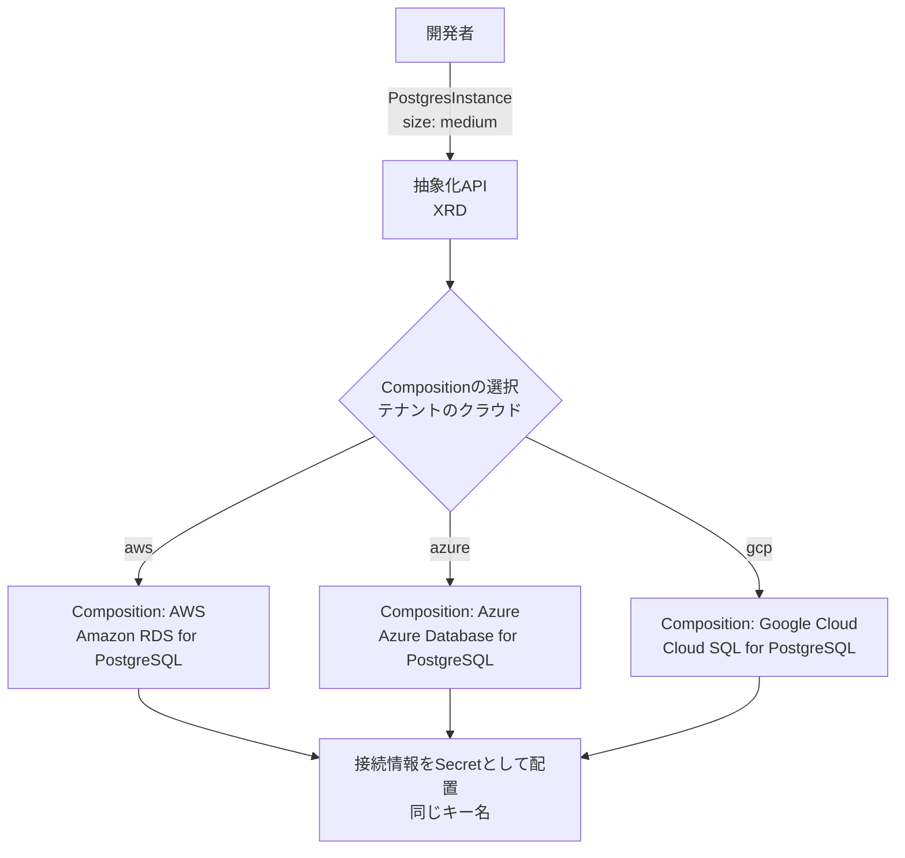
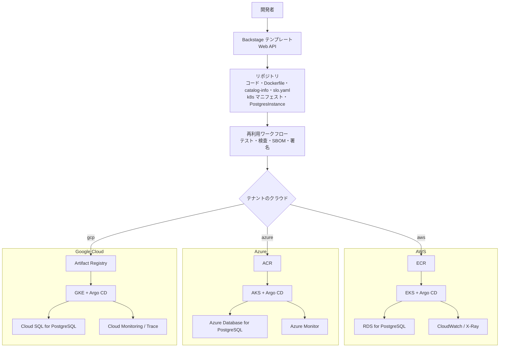

## 本章の問い

共通のプラットフォーム設計を、各クラウドのサービスへどう対応づけるのか。

第16章で、全社共通プラットフォームの参照アーキテクチャを、特定のクラウドに依存しない形で設計した。しかし、プラットフォームは最終的に、具体的なクラウドのサービスの上に実装される。本章では、第16章のアーキテクチャを、AWS、Azure、Google Cloudの三つの主要なクラウドに対応づける。

本章の目的は、各クラウドのサービスの網羅的な解説ではない。各クラウドの公式ドキュメントが、その役割を果たしている。本章の目的は、**共通のアーキテクチャと、ベンダー固有の実装を区別する方法**を示し、サービスの廃止や名称変更を含む**ベンダーのライフサイクル**にどう備えるかを考えることである。

> **時点についての重要な注意**：本章のサービス名、提供状況（GA／Preview）、終了予定は、**2026年11月時点の例示**である。クラウドのサービスは、名称変更、統合、廃止が頻繁に起きる。本書の執筆・引用ルールに従い、各表の名称、提供リージョン、GA／Preview、価格は**刊行直前に再検証する**。読者も、採用の判断にあたっては、必ず最新の公式情報を確認してほしい。

## 17.1　ベンダー固有の機能と共通するアーキテクチャ

### 共通するもの

三つのクラウドは、細部では大きく異なるが、第16章のアーキテクチャの各要素に対応するサービスを、いずれも提供している。

| 第16章の要素 | 三つのクラウドに共通する概念 |
|---|---|
| テナント・環境の境界 | 組織の階層（アカウント／サブスクリプション／プロジェクト）と、その上のポリシー |
| ID | 組織のIdPとの連携、ワークロードID、短命の資格情報 |
| 実行プレーン | マネージドKubernetes、コンテナの実行サービス、サーバーレス関数 |
| CI/CD | マネージドのビルドとデプロイのサービス（またはGitHub Actionsなどの外部サービスとの連携） |
| IaC | 各クラウド固有のIaCと、Terraformなどのクラウド横断のIaC |
| Observability | メトリクス、ログ、トレースのマネージドサービス（OpenTelemetryへの対応） |
| AI / ML | 基盤モデルへのアクセス、ML基盤、エージェントの実行基盤 |
| ガバナンス | 組織全体のポリシー、監査ログ、コスト管理 |

### 異なるもの

一方、次の点はクラウドによって大きく異なる。

- **組織の階層の構造**：アカウント、サブスクリプション、プロジェクト、フォルダ、管理グループなど、名前も構造も異なる。
- **IAMのモデル**：権限の記述の仕方、ロールの継承、条件の書き方が異なる。
- **マネージドサービスの範囲**：同じ「コンテナの実行サービス」でも、管理の範囲と抽象化の度合いが異なる。
- **AI／MLのサービスの構成**：利用できる基盤モデル、エージェントの実行基盤の形、データとの統合の方法が大きく異なり、変化も速い。

### 設計の原則

本章を通じて、次の原則で対応づけを考える。

> **開発者が触れるインターフェース（Golden Path、Platform API、宣言的な定義）はクラウドから独立させ、その下の実装は、各クラウドの能力を積極的に活用する。**（本書の提案）

第16章16.3節で述べたように、すべての層をクラウドから独立させようとすれば、最小公倍数の機能しか使えなくなる。逆に、すべての層を特定のクラウドに依存させれば、サービスの廃止や移行のたびに、開発者に大きな影響が及ぶ。**独立させる層を選ぶ**ことが、設計の核心である。

## 17.2　AWS――EKS/ECS、IAM、CodeBuild/CodePipeline、CloudWatch、Bedrock

### 主なサービスの対応

| 第16章の要素 | AWSの主なサービス（2026年11月時点の例示） |
|---|---|
| 組織・テナントの境界 | AWS Organizations（アカウント、OU）、AWS Control Tower |
| 人のID | IAM Identity Center |
| ワークロードID | IAMロール（EKSではPod IdentityまたはIRSA） |
| 組織全体のポリシー | Service Control Policies、AWS Config |
| 実行プレーン | Amazon EKS、Amazon ECS、AWS Lambda |
| CI/CD | AWS CodeBuild、AWS CodePipeline（またはGitHub Actionsとの連携） |
| IaC | AWS CloudFormation、AWS CDK、Terraform |
| Observability | Amazon CloudWatch、AWS X-Ray（OpenTelemetryのディストリビューションとしてAWS Distro for OpenTelemetry） |
| AI / ML | Amazon Bedrock（基盤モデル、エージェント関連の機能）、Amazon SageMaker AI |
| 監査 | AWS CloudTrail |
| コスト | AWS Cost Explorer、AWS Budgets、コスト配分タグ |

### AWSのIDP設計ガイド

AWSは、*Building an Internal Developer Platform on AWS*（AWS Prescriptive Guidance）で、AWS上でIDPを構築するための設計の考え方を示している。[R24] 本書はこのガイドを、**基準アーキテクチャの一例**として参照する。第15章で述べたように、このガイドもDeveloper PortalをIDPの構成要素の一つとして位置づけている。

### AWSでの設計の要点

- **アカウントを境界にする**：AWSでは、アカウントが、権限、コスト、障害の最も強い境界である。第16章のテナントと環境の分離を、AWS Organizationsのアカウントと組織単位（OU）の構造で表現し、Service Control Policiesで組織全体のガードレール（例：特定のリージョン以外の利用の禁止、監査ログの無効化の禁止）を設ける。
- **EKSとECSの選択**：Kubernetesのエコシステム（Argo CD、Crossplane、Kyvernoなど）を共通基盤として使うならEKSが、AWSのマネージドサービスとしての簡潔さを優先するならECSが、選択肢になる。第15章のGolden Pathの多くはKubernetesを前提としているため、本書の例ではEKSを想定する。
- **Bedrockと第12章のAIゲートウェイ**：Bedrockは、複数の基盤モデルへのアクセスを提供する。第12章のAIゲートウェイを、Bedrockの前段に置くか、Bedrockの機能（ガードレール、利用状況の記録）で代替するかは、組織のマルチクラウド・マルチ提供者の方針による。

## 17.3　Azure――AKS、Entra ID、GitHub Actions／Azure Pipelines、Azure Monitor、Microsoft Foundry系サービス

### 主なサービスの対応

| 第16章の要素 | Azureの主なサービス（2026年11月時点の例示） |
|---|---|
| 組織・テナントの境界 | 管理グループ、サブスクリプション、リソースグループ |
| 人のID | Microsoft Entra ID |
| ワークロードID | マネージドID、Workload Identity（AKS） |
| 組織全体のポリシー | Azure Policy |
| 実行プレーン | Azure Kubernetes Service（AKS）、Azure Container Apps、Azure Functions |
| CI/CD | GitHub Actions、Azure Pipelines（Azure DevOps） |
| IaC | Bicep、ARMテンプレート、Terraform、Azure Verified Modules |
| Observability | Azure Monitor、Application Insights |
| AI / ML | Microsoft Foundry系のサービス（基盤モデル、エージェント関連の機能）、Azure Machine Learning |
| 監査 | Azure Monitorのアクティビティログ |
| コスト | Microsoft Cost Management |
| 開発環境 | Microsoft Dev Box |

> **名称についての注意**：MicrosoftのAI関連のサービスは、名称と構成の変更が続いている（例：Azure AI StudioからAzure AI Foundry、さらにMicrosoft Foundryへの名称変更など）。本書では「Microsoft Foundry系サービス」と総称し、個別のサービス名は刊行前に確認する。

### Azure Deployment Environmentsの終了

Azureには、開発者がテンプレートから環境をセルフサービスで作成できる **Azure Deployment Environments** というサービスがあった。これは、第15章のテンプレートとリソースプロビジョニングに直接対応する、IDPのためのサービスだった。

しかし、Microsoftは、**Azure Deployment Environmentsの提供を2027年2月22日に終了する**ことを案内している。[R25] そして、移行のためのガイドを公開している。

この事実は、本章の議論にとって重要な意味を持つ。

1. **長期の新規採用候補として無条件に推奨しない**：本書の時点（2026年11月）で、終了まで約3か月である。新しくIDPを設計する組織が、このサービスを中核に据えることは適切ではない。
2. **代替の設計を検討する**：Microsoftの移行ガイドが示す選択肢や、Bicep、Azure Verified Modules、GitHub Actions、Azure DevOpsなどを組み合わせて、同等の能力を実現する設計を検討する。
3. **IDPのためのサービスでさえ、廃止されうる**：Platform Engineeringのために提供されたマネージドサービスであっても、ベンダーの戦略の変更によって終了しうる。この事例は、17.7節のライフサイクルの議論の具体的なケースになる。

### Azureでの設計の要点

- **管理グループとAzure Policyを境界にする**：Azureでは、管理グループの階層にAzure Policyを割り当て、組織全体のガードレールを設ける。サブスクリプションを、テナントや環境の境界として使う。
- **Entra IDとの統合**：Azureの最大の強みの一つは、Entra IDによる、人とワークロードのIDの統合である。第16章16.4節のIDの統一を、Entra IDを中心に設計できる。
- **GitHubとの統合**：MicrosoftはGitHubを傘下に持ち、GitHub ActionsとAzureの連携（OIDCによるワークロードID連携など）は緊密である。第15章の再利用可能なワークフローを、GitHub Actionsで実現するのが自然である。
- **Azure Verified Modules**：Microsoftは、BicepとTerraformのための検証済みのモジュール群（Azure Verified Modules）を提供している。第15章のTerraformモジュールの戦略の土台として使える。

## 17.4　Google Cloud――GKE、Cloud Run、IAM、Cloud Build/Deploy、Cloud Monitoring、Vertex AI系サービス

### 主なサービスの対応

| 第16章の要素 | Google Cloudの主なサービス（2026年11月時点の例示） |
|---|---|
| 組織・テナントの境界 | 組織、フォルダ、プロジェクト |
| 人のID | Cloud Identity（またはGoogle Workspace）、外部IdPとの連携 |
| ワークロードID | サービスアカウント、Workload Identity Federation（GKEではWorkload Identity Federation for GKE） |
| 組織全体のポリシー | Organization Policy Service |
| 実行プレーン | Google Kubernetes Engine（GKE）、Cloud Run、Cloud Run functions |
| CI/CD | Cloud Build、Cloud Deploy |
| IaC | Terraform、Infrastructure Manager |
| Observability | Cloud Monitoring、Cloud Logging、Cloud Trace |
| AI / ML | Vertex AI系のサービス（基盤モデル、エージェント関連の機能） |
| 監査 | Cloud Audit Logs |
| コスト | Cloud Billingのレポート、予算とアラート |

### Google CloudのPlatform Engineeringの解説

Google Cloudは、Platform Engineeringに関する公式の解説を公開し、IDPを構成する能力と、その価値を説明している。[R16] 本書では、この解説を、各種のIDPの能力を比較するための資料の一つとして参照する。また、第4章と第23章で参照するDORAの研究は、Google Cloudのもとで行われている。

### Google Cloudでの設計の要点

- **プロジェクトを境界にする**：Google Cloudでは、プロジェクトが、リソース、権限、課金の基本的な単位である。フォルダの階層にOrganization Policyを適用し、組織全体のガードレールを設ける。
- **GKEとCloud Runの選択**：Kubernetesのエコシステムを共通基盤とするならGKEが、コンテナを最小限の運用で動かしたいならCloud Runが、選択肢になる。Cloud Runは、第15章の抽象化の考え方――開発者は「コンテナを動かしたい」とだけ宣言する――を、マネージドサービスとして実現したものと見ることもできる。
- **Cloud Deployによる段階的なリリース**：Cloud Deployは、環境間の昇格（第16章16.3節）と承認を、マネージドサービスとして提供する。GitOpsのPull型（第6章）とは異なるモデルであり、どちらを採用するかは組織の方針による。

## 17.5　BackstageとCrossplaneを使ったマルチクラウドIDP

### なぜBackstageとCrossplaneなのか

第15章で扱ったBackstageとCrossplaneは、いずれも**特定のクラウドに依存しない**オープンソースのプロジェクトである。この二つを組み合わせると、17.1節の原則――開発者が触れるインターフェースはクラウドから独立させ、下の実装は各クラウドの能力を活用する――を、直接的に実現できる。

| 層 | 担当 | クラウドへの依存 |
|---|---|---|
| 開発者の入口 | Backstage（カタログ、テンプレート、TechDocs） | 独立 |
| 開発者が宣言するAPI | Crossplaneの抽象化API（XRD） | 独立 |
| クラウドへの対応づけ | CrossplaneのComposition（クラウドごとに用意） | 依存（意図的に） |
| クラウドのリソース | 各クラウドのマネージドサービス | 依存 |

### 同じAPI、異なる実装

第15章で定義した`PostgresInstance`の抽象化APIを、三つのクラウドに対応づける。



開発者は、どのクラウドでも同じ`PostgresInstance`を宣言し、同じキー名の`Secret`から接続情報を得る。どのクラウドのどのサービスが使われるかは、テナントの設定に基づいてプラットフォームが決める。

### 抽象化の限界

ただし、この方式にも限界がある。第15章で述べた抽象化の設計の難しさは、マルチクラウドではさらに大きくなる。

- **機能の差**：各クラウドのPostgreSQLのマネージドサービスは、拡張機能、バージョンの提供時期、高可用性の構成、バックアップの方式が異なる。抽象化APIで表現できるのは、共通する範囲だけである。
- **性能と費用の差**：「size: medium」が、各クラウドで同じ性能と費用になるとは限らない。
- **運用の差**：障害時の振る舞い、メンテナンスの方式、監視の指標が異なる。

したがって、マルチクラウドの抽象化APIは、**すべてを隠す**ことを目指すのではなく、**開発者が日常的に判断すべきことを、共通の言葉で表現する**ことを目指すべきである。そして、各クラウドの違いは、プラットフォームチームとCapability Providerが引き受ける。

## 17.6　統制・費用・運用責任に基づく選択

### 選択の軸

組織が、どのクラウドを、どの用途に使うかを選ぶとき、本書は次の三つの軸で考えることを提案する。

| 軸 | 問い |
|---|---|
| **統制** | 組織のID、ポリシー、監査の仕組みと、どれだけ統合できるか。規制上の要件（データの所在地、認証）を満たせるか |
| **費用** | 利用料だけでなく、運用の人件費、学習の費用、移行の費用、契約上の割引を含めた総費用はどれだけか |
| **運用責任** | どこまでをクラウドに任せ（マネージド）、どこからを自分たちで運用するか。その運用に必要な専門性は組織にあるか |

### マネージドサービスと運用責任

マネージドサービスを使うことは、運用責任の一部をクラウドに移すことを意味する。しかし、**すべての責任が移るわけではない**。

| 責任 | マネージドKubernetes | コンテナの実行サービス（Cloud Run、Container Appsなど） | サーバーレス関数 |
|---|---|---|---|
| ハードウェア・データセンター | クラウド | クラウド | クラウド |
| コントロールプレーンの運用 | クラウド | クラウド | クラウド |
| ノードの更新・スケール | 共有（構成による） | クラウド | クラウド |
| クラスタのアドオン（GitOps、ポリシー、監視） | 利用者 | （該当しない、またはクラウド） | （該当しない） |
| アプリケーションの設定・セキュリティ | 利用者 | 利用者 | 利用者 |
| アプリケーションの信頼性（SLO） | 利用者 | 利用者 | 利用者 |
| データの保護・バックアップ | 利用者（構成による） | 利用者 | 利用者 |
| コストの管理 | 利用者 | 利用者 | 利用者 |

この表の下の行――アプリケーションの設定、信頼性、データの保護、コスト――は、どのサービスを選んでも利用者の責任である。そして、これらこそが、プラットフォームがGolden Pathとデフォルト機能で支援すべき領域である。

## 17.7　サービス廃止・名称変更とベンダーロックイン

### ベンダーのライフサイクル

クラウドのサービスには、ライフサイクルがある。

| 段階 | 内容 | 利用者への影響 |
|---|---|---|
| Preview | 試験的な提供。仕様が変わる可能性がある | 本番での利用には注意が必要 |
| GA（一般提供） | 正式な提供。SLAが適用される | 本番で使える |
| 名称変更・統合 | ブランドの変更、他のサービスとの統合 | ドキュメント、IaC、社内の用語の更新が必要 |
| 非推奨化 | 新規の利用を推奨しない | 移行の計画が必要 |
| 新規受付の停止 | 新しい利用者は使えない | 新しいテナントには別の方法が必要 |
| 提供終了 | サービスが停止する | 期限までに移行が必要 |

17.3節のAzure Deployment Environmentsは、この「提供終了」の具体的なケースである。[R25] IDPのために作られたサービスでさえ、終了しうる。

### ベンダーロックインの再定義

**ベンダーロックイン**は、特定のベンダーへの依存が強まり、他への移行が困難になる状態である。ロックインは、しばしば「避けるべきもの」として語られる。しかし本書は、ロックインを**ゼロにすることを目標にすべきではない**と考える。

ロックインをゼロにしようとすれば、各クラウドの固有の能力を使えず、最小公倍数の機能で、すべてを自分たちで作り、運用することになる。それは、プラットフォームチームの負担を大きくし、利用者の価値を損なう。

本書では、ロックインを次のように捉え直す。

> **ロックインは、移行のコストである。** 問うべきは「ロックインしているか」ではなく、「**移行のコストを、どの層で、どれだけ負うか**」である。（本書の提案）

| 層 | ロックインの許容度 | 理由 |
|---|---|---|
| 開発者が触れるインターフェース（Golden Path、Platform API、宣言的な定義） | **低く保つ** | ここがロックインすると、移行のコストが全社の開発者に及ぶ |
| プラットフォームの内部の実装（Composition、モジュール、CIの共通部品） | 中程度を許容する | 移行のコストはプラットフォームチームが負う。数は限られる |
| マネージドサービスの固有機能 | 価値に応じて許容する | 固有の機能が大きな価値をもたらすなら、移行のコストを受け入れる |
| データ | 特に注意する | データの移行は、量と整合性の点で最もコストが高い。開かれた形式を優先する |

### 廃止に備える実践

1. **利用状況をカタログで把握する**：どのクラウドのどのサービスを、どのチームが、どこで使っているかを、カタログ（第15章）で把握する。廃止が発表されたとき、影響範囲を即座に特定できる。
2. **ベンダーのライフサイクルを監視する**：利用しているサービスの非推奨化、終了の発表を、定期的に確認する仕組みを持つ。
3. **Previewのサービスを本番の中核に置かない**：Previewのサービスは、仕様の変更や提供の中止がありうる。Golden Pathの中核には、GAのサービスを使う。
4. **移行を「定常業務」として計画する**：第12章で、基盤モデルの移行を避けられない定常業務として計画すべきだと述べた。クラウドのサービスについても同じである。移行は例外的な出来事ではなく、一定の頻度で起きるものとして、プラットフォームのロードマップに組み込む。

## 17.8　ベンダーに依存しないGolden Pathを設計する

### 開発者から見たAPIを共通に保つ

本章の議論をまとめると、ベンダーに依存しないGolden Pathとは、**開発者から見たAPI（入力と出力）を、クラウドにかかわらず共通に保つ**Golden Pathである。

| Golden Pathの要素 | 開発者から見た共通のAPI | 各クラウドでの実装 |
|---|---|---|
| サービスの作成 | Backstageのテンプレート（名前、所有者、SLO） | 同じ |
| ソースコードとCI | リポジトリと、再利用可能なワークフローの呼び出し | ワークフローの内部で、クラウドごとにレジストリとID連携を切り替える |
| 実行の定義 | Kubernetesのマニフェスト（またはScoreのようなワークロード仕様） | EKS、AKS、GKE |
| データベース | Crossplaneの`PostgresInstance` | RDS、Azure Database、Cloud SQL |
| シークレット | `ExternalSecret`の参照 | Secrets Manager、Key Vault、Secret Manager |
| 観測 | OpenTelemetryの計装と`slo.yaml` | Collectorの送信先を、クラウドのサービスまたは共通の基盤に切り替える |
| LLMの呼び出し | AIゲートウェイのルート名（第12章） | ゲートウェイの設定で、Bedrock、Foundry系、Vertex AI系、または他の提供者に対応づける |

### 開かれた標準の役割

この表で、クラウドからの独立を支えているのは、ほとんどが**開かれた標準**である。

- Kubernetesのマニフェスト（CNCF）
- OpenTelemetryとOTLP（第7章）
- OCIのコンテナイメージ
- OIDCによるワークロードID連携（第11章）
- GitOpsの原則（第6章）

第16章16.8節で、開かれた標準を優先することを技術選定の原則とした。本章の具体的な対応づけは、その原則が、マルチクラウドとベンダーのライフサイクルへの備えとして、実際にどう機能するかを示している。

## 図・実装例

### 「新しいWeb APIを作る」Golden Pathを3クラウドに割り当てる



### 代表的な対応表（2026年11月時点、例示）

| 共通機能 | AWS | Azure | Google Cloud |
|---|---|---|---|
| Container / Runtime | EKS、ECS、Lambda | AKS、Container Apps、Functions | GKE、Cloud Run、Cloud Functions系 |
| CI/CD | CodeBuild、CodePipeline、GitHub Actions | GitHub Actions、Azure Pipelines | Cloud Build、Cloud Deploy |
| IaC / Provisioning | CloudFormation、CDK、Terraform | Bicep、ARM、Terraform | Terraform、Infrastructure Manager |
| Identity / Policy | IAM、Organizations、Config | Entra ID、Azure Policy | IAM、Organization Policy |
| Observability | CloudWatch、X-Ray | Azure Monitor、Application Insights | Cloud Monitoring、Cloud Trace |
| AI / ML | Bedrock、SageMaker AI | Microsoft Foundry系、Azure ML | Vertex AI／Agent関連サービス |
| Developer Portal | Backstageなどを組み合わせる | Backstageなどを組み合わせる | Backstageなどを組み合わせる |

**重要な更新点**：Microsoftは **Azure Deployment Environmentsの2027年2月22日終了**を案内している。[R25] したがって、これを長期の新規採用候補として無条件に推奨せず、Bicep、Azure Verified Modules、GitHub Actions、Azure DevOpsなどを利用する移行・代替設計を検討する。

### 実装例：クラウドごとの対応づけを設定として分離する

再利用可能なワークフローの内部で、テナントのクラウドに応じて、コンテナレジストリとID連携の設定を切り替える。クラウドごとの差分を**設定（データ）として分離**し、ワークフローのロジックは共通に保つ。

```yaml
# platform-workflows/config/cloud-targets.yaml
aws:
  registry: "{account}.dkr.ecr.{region}.amazonaws.com"
  oidc_role: "arn:aws:iam::{account}:role/platform-ci-push"
  login_action: aws-actions/configure-aws-credentials
azure:
  registry: "{registry_name}.azurecr.io"
  oidc_client_id_secret: AZURE_CLIENT_ID
  login_action: azure/login
gcp:
  registry: "{region}-docker.pkg.dev/{project}/{repo}"
  workload_identity_provider: "projects/{project_number}/locations/global/workloadIdentityPools/ci/providers/github"
  login_action: google-github-actions/auth
```

```python
"""テナントの設定から、クラウドごとのイメージの参照先を解決する。"""
from __future__ import annotations

from dataclasses import dataclass

import yaml

@dataclass(frozen=True)
class Tenant:
    name: str
    cloud: str                 # aws / azure / gcp
    params: dict[str, str]     # account, region, project など

class UnsupportedCloud(ValueError):
    pass

def load_targets(text: str) -> dict:
    return yaml.safe_load(text)

def image_ref(targets: dict, tenant: Tenant, service: str, digest: str) -> str:
    """クラウドに依存しないサービス名とダイジェストから、具体的なイメージの参照を作る。"""
    if tenant.cloud not in targets:
        raise UnsupportedCloud(tenant.cloud)
    registry = targets[tenant.cloud]["registry"].format(**tenant.params)
    return f"{registry}/{service}@{digest}"
```

```python
# test_cloud_targets.py
import pytest

from cloud_targets import Tenant, UnsupportedCloud, image_ref, load_targets

TARGETS = load_targets("""
aws:
  registry: "{account}.dkr.ecr.{region}.amazonaws.com"
gcp:
  registry: "{region}-docker.pkg.dev/{project}/{repo}"
""")
DIGEST = "sha256:abc123"

def test_aws_image_ref():
    t = Tenant("askline", "aws", {"account": "111122223333", "region": "ap-northeast-1"})
    assert image_ref(TARGETS, t, "askline-api", DIGEST) == \
        "111122223333.dkr.ecr.ap-northeast-1.amazonaws.com/askline-api@sha256:abc123"

def test_gcp_image_ref():
    t = Tenant("askline", "gcp", {"region": "asia-northeast1", "project": "minato", "repo": "apps"})
    assert image_ref(TARGETS, t, "askline-api", DIGEST) == \
        "asia-northeast1-docker.pkg.dev/minato/apps/askline-api@sha256:abc123"

def test_unsupported_cloud_is_rejected():
    with pytest.raises(UnsupportedCloud):
        image_ref(TARGETS, Tenant("x", "other", {}), "svc", DIGEST)
```

この設計の要点は、**開発者のリポジトリには、クラウドを指定する記述がない**ことである。開発者のワークフローは`service-name`を渡すだけであり、どのクラウドのどのレジストリに送られるかは、プラットフォームのテナントの設定によって決まる。テナントが別のクラウドに移行する場合も、開発者のリポジトリを変更する必要はない。

## 評価指標とトレードオフ

| 指標 | 意味 | 注意点 |
|---|---|---|
| 開発者のリポジトリ内のクラウド固有の記述 | Golden Pathを使うリポジトリに含まれる、特定のクラウドに依存する設定の量 | 少ないほど、移行のコストが開発者に及ばない |
| ベンダーのライフサイクルの把握率 | 使用中のクラウドのサービスのうち、非推奨化・終了の情報を追跡しているものの割合 | 17.7節 |
| Previewのサービスへの依存 | Golden Pathの中核で使われているPreviewのサービスの数 | 少なく保つ |
| 移行の所要期間 | 廃止が発表されてから、全テナントの移行が完了するまでの期間 | 期限との余裕を見る |
| クラウドごとの単位コスト | 同じGolden Pathの、クラウドごとのUnit Economics | 第11章 |
| マルチクラウドの運用負荷 | クラウドごとに維持しているComposition・モジュール・ワークフローの数 | 増えすぎれば、マルチクラウドの価値を損なう |

本章の中心的なトレードオフは、**固有の能力の活用と、移行のコスト**である。各クラウドの固有の能力を深く使えば、価値は高まるが、移行のコストも高まる。共通の機能だけを使えば、移行は容易だが、価値は限られる。本章の答えは、**層ごとにロックインの許容度を変え、開発者が触れるインターフェースのロックインを低く保つ**ことである。

## 本章の結論

共通のプラットフォーム設計を各クラウドに対応づけるために、

- **共通するアーキテクチャとベンダー固有の実装を区別する**：組織の境界、ID、実行、CI/CD、IaC、観測、AI、ガバナンスの各要素は、三つのクラウドのいずれにも対応するサービスがある。
- **開発者が触れるインターフェースをクラウドから独立させる**：Backstage、Crossplaneの抽象化API、開かれた標準によって、開発者から見たAPIを共通に保つ。
- **ベンダーのライフサイクルに備える**：Azure Deployment Environmentsの終了 [R25] が示すように、IDPのためのサービスでさえ終了しうる。移行を定常業務として計画する。
- **ロックインを移行のコストとして扱う**：層ごとに許容度を変え、どの層で、どれだけのコストを負うかを意識的に選ぶ。

次章では、AIアプリとエージェントが企業のデータを使うときに必要となる、データプラットフォームとデータガバナンスを扱う。

## 参考文献

- [R24] AWS, *Building an Internal Developer Platform on AWS*（AWS Prescriptive Guidance）. https://docs.aws.amazon.com/prescriptive-guidance/latest/internal-developer-platform/introduction.html
- [R25] Microsoft, *Azure Deployment Environments retirement guide*（2026年時点）. https://learn.microsoft.com/en-us/azure/deployment-environments/deployment-environments-retirement-guide
- [R16] Google Cloud, *What is platform engineering?* https://cloud.google.com/solutions/platform-engineering
- [R23] Backstage, *Technical Overview*. https://backstage.io/docs/overview/technical-overview/
- Crossplane公式ドキュメント. https://docs.crossplane.io/
- Score（ワークロード仕様のオープンな標準）. https://score.dev/（採用する場合は参照したバージョンを明記）
- 各クラウドの公式ドキュメント（サービス名・提供状況は刊行直前に再確認）
