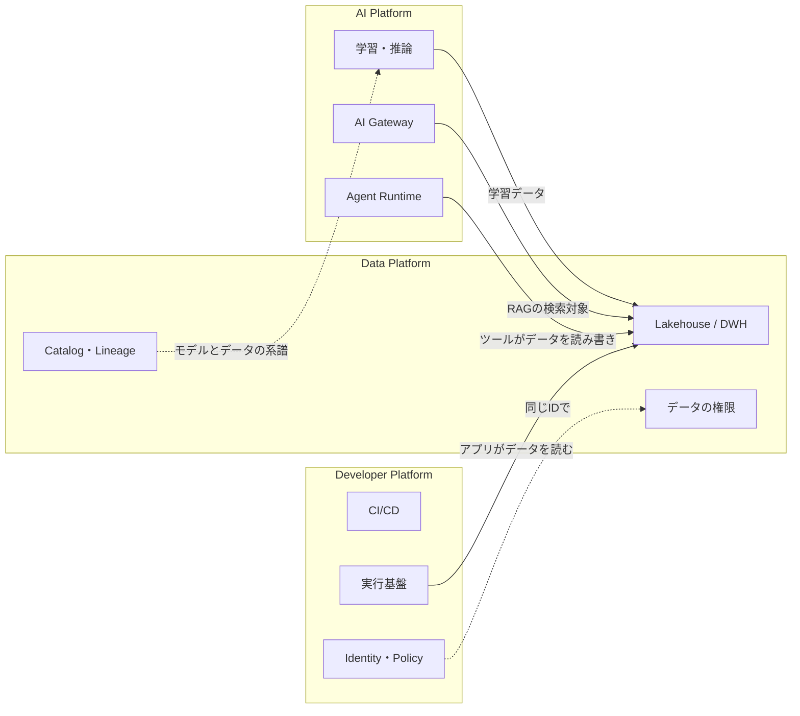
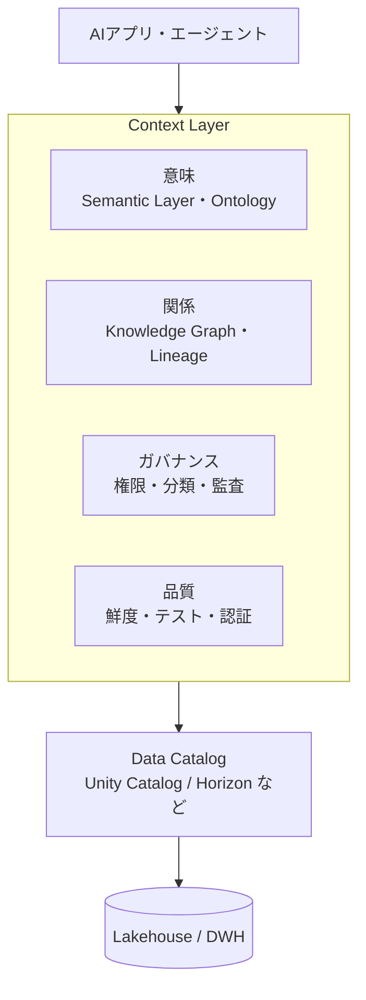
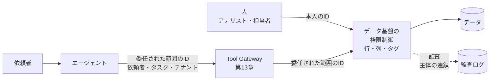
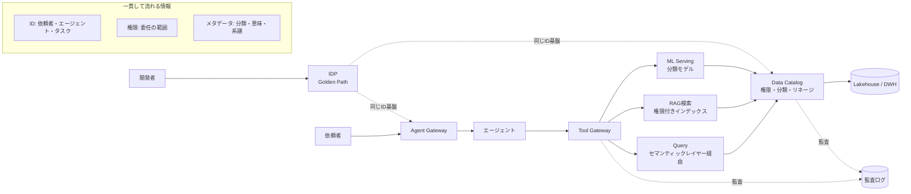

## 本章の問い

AIアプリとエージェントが企業データを利用するとき、IDPだけで十分なのか。

第14章から第17章で設計したIDPは、主に**ソフトウェアを作り、動かす**ための能力を提供する。リポジトリ、CI/CD、実行基盤、観測、セキュリティ、コスト。しかし、第9章のMLモデル、第12章のLLMアプリ、第13章のエージェントが価値を生むには、**企業のデータ**が必要である。問い合わせ分類モデルは過去の問い合わせで学習し、AI回答はヘルプ記事と過去の解決事例を検索し、エージェントは顧客情報と請求情報を参照する。

データには、ソフトウェアとは異なる統制の問題がある。誰がどのデータを読めるか、どの行とどの列まで読めるか、そのデータはどこから来たか、その意味は何か、AIに渡してよいか。本章の答えを先に述べる。**IDPだけでは十分ではない。データの意味と権限を扱うデータプラットフォームとガバナンスが、IDPと一体となって機能する必要がある**。

## 18.1　Developer Platform、Data Platform、AI Platformの関係

### 三つのプラットフォーム

全社のプラットフォームは、実際には、少なくとも三つのプラットフォームの組み合わせとして存在することが多い。

| プラットフォーム | 主な利用者 | 主な能力 | 本書の章 |
|---|---|---|---|
| **Developer Platform** | アプリ開発者 | リポジトリ、CI/CD、実行基盤、観測、Secrets、Policy | 第14〜17章 |
| **Data Platform** | データエンジニア、アナリスト、データサイエンティスト | データの取り込み、保存、変換、カタログ、リネージ、権限、品質 | 第10章、本章 |
| **AI Platform** | MLエンジニア、AIアプリ開発者、エージェント開発者 | 学習、モデルレジストリ、推論、AIゲートウェイ、評価、エージェント実行基盤 | 第9章、第12章、第13章 |

### 境界が溶けていく

かつて、三つのプラットフォームは、それぞれ別の組織が、別の技術で運用していた。しかしAIの時代には、その境界が溶けていく。



- AIアプリはDeveloper Platformの上で動き、Data Platformのデータを読み、AI Platformのゲートウェイを使う。
- エージェントのツールは、Data Platformのデータを読み書きする。
- MLモデルの系譜（第9章）は、Data Platformのリネージとつながっていなければ意味がない。
- そして最も重要なのは、**誰がそのデータを読めるか**という判断が、三つのプラットフォームで**同じIDと同じ権限**に基づいていなければならないことである。

### 統合の中心はガバナンス

三つのプラットフォームを一つの製品に統合する必要はない。第8章で述べたように、すべてを一つの巨大な基盤に統合しようとすれば失敗しやすい。統合すべきは、**ガバナンス**――ID、権限、メタデータ、監査――である。本章の後半では、この統合の設計を扱う。

## 18.2　Data Lake、Data Warehouse、Lakehouse

### 三つのアーキテクチャ

企業のデータ基盤のアーキテクチャは、大きく三つの系譜に分けられる。

| アーキテクチャ | 内容 | 長所 | 短所 |
|---|---|---|---|
| **Data Warehouse（DWH）** | 構造化されたデータを、分析のために最適化された形式で保存する | 高速な分析、強い一貫性、成熟した権限管理 | 非構造化データ（文書、画像）に向かない。保存の費用が高い傾向 |
| **Data Lake** | あらゆる形式のデータを、生のままオブジェクトストレージに保存する | 安価、柔軟、MLや非構造化データに向く | 品質と一貫性の管理が難しい。「データの沼（Data Swamp）」になりやすい |
| **Lakehouse** | Data Lakeのオブジェクトストレージの上に、テーブル形式（トランザクション、スキーマ、タイムトラベル）を加え、DWHの機能を実現する | 安価な保存と、DWHに近い管理と性能の両立 | 比較的新しく、運用の知見が蓄積途上 |

### オープンなテーブル形式

Lakehouseを支えるのが、**オープンなテーブル形式**――Delta Lake、Apache Iceberg、Apache Hudiなど――である。これらの形式は、オブジェクトストレージ上のファイル（Parquetなど）に、トランザクションのログとメタデータを加えることで、次の機能を提供する。

- **ACIDトランザクション**：同時の書き込みでもデータの一貫性を保つ。
- **スキーマの強制と進化**：スキーマに合わないデータの書き込みを拒否し、互換性のあるスキーマの変更を許す（第10章のスキーマ変更への追従）。
- **タイムトラベル**：過去のある時点のテーブルの状態を問い合わせる（第9章の学習データのバージョン管理）。

オープンなテーブル形式は、第16章・第17章で論じた**開かれた標準**の、データにおける実践である。データを特定の製品の独自の形式に閉じ込めず、複数のエンジン（SQLエンジン、Spark、MLのライブラリ）から読み書きできるようにする。第17章17.7節で、データの移行は最もコストが高いと述べた。開かれたテーブル形式は、データのロックインを下げる最も有効な手段の一つである。

## 18.3　Data Catalog、Lineage、Data Contract、Metadata

### Data Catalog

**Data Catalog（データカタログ）**は、組織のデータ資産――テーブル、ファイル、ダッシュボード、モデル、特徴量――を一覧し、その意味、所有者、品質、権限を管理する仕組みである。

第15章で、BackstageのSoftware Catalogが「何があり、誰のものか」に答えることを見た。Data Catalogは、データについて同じ問いに答える。

| 問い | Software Catalog（第15章） | Data Catalog |
|---|---|---|
| 何があるか | サービス、API、リソース | テーブル、ビュー、ファイル、モデル、特徴量 |
| 誰のものか | 所有チーム | データの所有者（データオーナー） |
| 何に依存しているか | 依存するサービス | 上流のデータ（リネージ） |
| どういう状態か | ライフサイクル | 品質、鮮度、認証済みか |
| 何を意味するか | 説明、API仕様 | 列の意味、業務上の定義、分類（個人情報か） |

### Metadata（メタデータ）

データカタログの中身は、**メタデータ**――データについてのデータ――である。メタデータは、いくつかの種類に分けて考えられる。

| 種類 | 内容 | 例 |
|---|---|---|
| 技術的メタデータ | スキーマ、型、保存場所、形式 | `inquiries.created_at`は`TIMESTAMP`型 |
| 業務的メタデータ | 業務上の意味、定義、用語 | 「解決済み問い合わせ」とは、ステータスが`resolved`で、顧客が再オープンしていないもの |
| 運用的メタデータ | 鮮度、品質、利用状況 | 最終更新は5分前、データテストは全件合格、先月の参照数は2,300回 |
| ガバナンスのメタデータ | 所有者、分類、権限、保持期間 | 所有者はAPIチーム、`customer_email`は個人情報、保持期間は5年 |

AIの時代には、**業務的メタデータとガバナンスのメタデータ**の重要性が大きく高まる。18.7節で述べるように、LLMやエージェントがデータを正しく使うには、データの意味を知る必要がある。そして18.4節で述べるように、AIにデータを渡してよいかの判断には、データの分類が必要である。

### LineageとData Contract

第10章で、リネージ（データの系譜）とデータ契約を扱った。データプラットフォームでは、これらをカタログの中で一元的に管理する。

- **リネージ**は、カタログの中で、テーブルからテーブルへ、テーブルからダッシュボードへ、テーブルからモデルへ、テーブルからRAGのインデックスへの関係として記録される。
- **データ契約**は、カタログの中で、データセットの約束（スキーマ、品質、鮮度、利用者）として記録され、CIで検証される。

特に、**データからAIへのリネージ**は重要である。ある顧客の個人情報を含むテーブルが、どの特徴量に使われ、どのモデルの学習に使われ、どのRAGのインデックスに取り込まれ、どのエージェントのツールから参照されているか。これを追跡できなければ、個人情報の削除の要求（「忘れられる権利」など）に応えることも、データの誤りの影響範囲を特定することもできない。

## 18.4　データ権限、行・列レベルの制御、監査

### データ権限の粒度

データの権限は、ソフトウェアの権限よりも細かい粒度で考える必要がある。

| 粒度 | 内容 | 例 |
|---|---|---|
| カタログ・スキーマ | データの集まりへのアクセス | 「サポート」のスキーマを読める |
| テーブル | 特定のテーブルへのアクセス | `inquiries`テーブルを読める |
| **列（Column-level）** | テーブルの特定の列へのアクセス、または値のマスキング | `customer_email`列は、マスクされた値しか見えない |
| **行（Row-level）** | テーブルの特定の行へのアクセス | 自分が担当するテナントの問い合わせの行だけが見える |
| 属性ベース | データの分類（タグ）とアクセスする主体の属性に基づくアクセス | 「個人情報」タグの付いた列は、「個人情報の取扱いの許可」を持つ人だけが見られる |

### 行・列レベルの制御

Asklineの`inquiries`テーブルを例に考える。

| 主体 | 見える行 | `customer_email`列 | `body`列 |
|---|---|---|---|
| サポート担当者 | 担当するテナントの行 | 見える | 見える |
| アナリスト | すべての行 | マスク（`***@***`） | 見えない |
| 問い合わせ対応エージェント（第13章） | **タスクの対象テナントの行だけ** | 見える（返信に必要） | 見える |
| 分類モデルの学習パイプライン | すべての行（承認された期間） | 見えない | 見える（匿名化済み） |
| AI回答のRAGインデックス作成 | 解決済みで、顧客が公開に同意した行 | 見えない | 見える（個人情報を除去済み） |

この表で注目してほしいのは、**エージェントの行**である。第13章のTool Gatewayで、エージェントのツール呼び出しを「タスクの対象テナント」に限定した。しかし、ツールの背後のデータ基盤が、エージェントに全テナントのデータを読める権限を与えていれば、Tool Gatewayの検査をすり抜ける経路（例：ツールの実装の誤り、SQLを自由に書けるツール）があったとき、制限は破られる。**データ基盤の行レベルの制御と、Tool Gatewayの制御を、同じ委任の範囲に基づいて二重にかける**ことが、多層防御（第13章）の実践である。

### 属性ベースのアクセス制御とタグ

数千のテーブルと数万の列について、一つひとつ権限を設定することは現実的ではない。そこで、データに**分類のタグ**（例：`pii`、`confidential`、`public`）を付け、タグに基づいてアクセスのポリシーを定義する、**属性ベースのアクセス制御（ABAC）**が使われる。

```text
ポリシー: pii-masking
  対象: タグ "pii" が付いたすべての列
  条件: アクセスする主体が "pii-reader" グループに属していない
  動作: 値をマスクして返す
```

タグに基づくポリシーであれば、新しいテーブルに個人情報の列が追加されても、その列に`pii`タグが付けば、自動的にポリシーが適用される。逆に言えば、**タグ付けの正しさ**がガバナンスの前提になる。タグ付けの漏れを検出するために、列の名前や値のパターンから個人情報を推定する自動分類の仕組みが使われることも多い。

### 監査

データの監査ログは、「誰が、いつ、どのデータを、どの目的で、どれだけ読んだか（書いたか）」を記録する。第16章16.4節の監査の原則――網羅的、改ざん困難、相関可能、主体の連鎖を記録する――は、データの監査にもそのまま当てはまる。

特に、AIによるデータの利用では、**主体の連鎖**の記録が重要になる。エージェントがデータを読んだとき、監査ログには、エージェントのIDだけでなく、どの利用者の依頼で、どのタスクのために読んだのかが記録されるべきである。そうでなければ、「AIが顧客のデータを読んだ」という事実はわかっても、それが正当だったかを判断できない。

## 18.5　Databricks：Unity Catalog、MLflow、Model Serving

### 位置づけ

Databricksは、Lakehouseのアーキテクチャを中心としたデータとAIのプラットフォームである。DatabricksはUnity Catalogを、**データとAIのための統合されたガバナンスのレイヤー**として説明している。[R26]

### 主な構成要素

| 構成要素 | 役割 | 本書の関連章 |
|---|---|---|
| **Unity Catalog** | テーブル、ファイル（ボリューム）、モデル、関数などのデータとAIの資産を、共通の名前空間で管理し、権限、リネージ、監査、検出を提供する | 本章 |
| **Delta Lake** | Lakehouseのオープンなテーブル形式 | 本章18.2節 |
| **MLflow** | 実験追跡、モデルレジストリ（Unity Catalogに統合）、生成AIの評価とトレース | 第9章、第12章 |
| **Model Serving** | モデル（自社のモデル、外部の基盤モデル）の推論エンドポイント | 第9章、第12章 |

### 設計上の特徴

Databricksの設計上の特徴は、**データとAIの資産を、同じカタログの中で、同じ権限モデルで管理する**ことにある。テーブルとモデルが同じ名前空間（例：`catalog.schema.object`）に置かれ、同じ方法で権限を付与でき、テーブルからモデルへのリネージを追跡できる。これは、18.1節で述べた「統合の中心はガバナンス」という考え方を、一つの製品の中で実現しようとするものである。

またUnity Catalogは、2024年にオープンソースとして公開されており、Databricks以外の環境でもカタログのAPIを使えるようにする取り組みが進められている。

## 18.6　Snowflake：Horizon Catalog、Cortex、AI Governance

### 位置づけ

Snowflakeは、クラウドのデータウェアハウスから始まり、データの共有、アプリケーション、AIへと領域を広げてきたデータプラットフォームである。SnowflakeはHorizon Catalogを、データの発見、Semantic Context（意味の文脈）、リネージ、権限の制御を含む、**企業のガバナンス**のための仕組みとして位置づけている。[R27]

### 主な構成要素

| 構成要素 | 役割 | 本書の関連章 |
|---|---|---|
| **Horizon Catalog** | データの発見、分類、リネージ、アクセスの制御、監査、データの品質の監視 | 本章 |
| **行アクセスポリシー・マスキングポリシー** | 行・列レベルのアクセス制御、タグに基づくポリシー | 本章18.4節 |
| **Cortex** | Snowflakeの中でLLMの機能、検索（RAG）、自然言語によるデータへの問い合わせなどを提供するAIの機能群 | 第12章 |
| **Apache Icebergへの対応** | オープンなテーブル形式でのデータの管理 | 本章18.2節 |

### 設計上の特徴

Snowflakeの設計上の特徴は、**データを動かさずに、データのあるところでAIを使う**という考え方にある。LLMの機能をデータプラットフォームの内部で提供することで、データを外部のLLMの提供者に送る必要を減らし、データプラットフォームの権限とガバナンスを、AIの利用にもそのまま適用する。

### DatabricksとSnowflakeを同一視しない

本書の執筆方針として、**DatabricksとSnowflakeを同一の製品とみなさず、目的と接続方式を比較する**。

| 観点 | Databricks | Snowflake |
|---|---|---|
| 出自 | Apache Sparkを起源とするデータ処理とMLの基盤 | クラウドのデータウェアハウス |
| 中心となるアーキテクチャ | Lakehouse（Delta Lake） | データウェアハウス（Icebergへの対応を拡大） |
| ガバナンスの中心 | Unity Catalog（データとAIの資産の統合カタログ） | Horizon Catalog（発見、意味の文脈、リネージ、アクセス制御） |
| AIへの主なアプローチ | MLの学習・管理・推論の基盤と、生成AIのアプリ構築の機能 | データのあるところでLLMの機能を使う |
| IDP・エージェントとの接続 | カタログのAPI、モデルの推論エンドポイント、SQLのエンドポイント | SQL、AIの機能のAPI |

組織がどちらを選ぶか（あるいは両方を使うか）は、既存のデータ基盤、主なワークロード（大規模なデータ処理とMLか、分析とBIか）、組織の専門性によって決まる。本章にとって重要なのは、**どちらを選んでも、18.8節で述べる「人とエージェントが共有するデータアクセス境界」を設計する必要がある**ことである。

## 18.7　Semantic Layer、Ontology、Knowledge GraphとContext Layer

### データの「意味」という問題

LLMやエージェントが企業のデータを使うとき、最も難しいのは、データへの**アクセス**ではなく、データの**意味**の理解である。

Asklineのデータに、`inquiries`テーブルがあり、`status`列に`open`、`pending`、`resolved`、`closed`という値があるとする。「先月の解決率を教えて」という質問に答えるには、次のことを知る必要がある。

- 「解決」とは、`resolved`のことか、`closed`も含むのか。
- 顧客が再オープンした問い合わせは、どう数えるのか。
- 「先月」は、作成日で数えるのか、解決日で数えるのか。
- テスト用のテナントは除外するのか。

これらは、テーブルのスキーマには書かれていない。組織の中の、特定の人の頭の中や、特定のダッシュボードのSQLの中にある。LLMがスキーマだけを見てSQLを生成すれば、もっともらしい、しかし組織の定義とは異なる数字を返すだろう。第12章で見た「もっともらしい誤り」が、データの分析で起きる。

### Semantic Layer（セマンティックレイヤー）

**Semantic Layer（セマンティックレイヤー）**は、業務上の指標（メトリクス）とその定義を、データの物理的な構造から切り離して、一か所で定義する仕組みである。

```yaml
# セマンティックレイヤーでの指標の定義（例示的な形式）
metrics:
  - name: resolution_rate
    description: 解決率。期間内に作成された問い合わせのうち、解決されたものの割合
    numerator:
      measure: inquiries_resolved
    denominator:
      measure: inquiries_created
    filters:
      - "tenant.is_test = false"
    time_dimension: created_at
    owner: team-cs-analytics

measures:
  - name: inquiries_resolved
    expr: "count(case when status in ('resolved', 'closed') and reopened_count = 0 then 1 end)"
  - name: inquiries_created
    expr: "count(*)"
```

セマンティックレイヤーがあれば、ダッシュボードも、アナリストのSQLも、LLMも、**同じ定義の「解決率」**を使える。LLMは、スキーマからSQLを推測する代わりに、セマンティックレイヤーの指標を問い合わせればよい。これは、第7章のOpenTelemetryのセマンティック規約や、第1章のMIBが、技術的な信号に共通の意味を与えたことの、業務データにおける実践である。

### OntologyとKnowledge Graph

**Ontology（オントロジー）**は、ある領域の概念とその関係を、形式的に定義したものである。「顧客」「テナント」「問い合わせ」「請求書」「担当者」という概念があり、「顧客はテナントに属する」「問い合わせは顧客から送られる」「請求書はテナントに発行される」という関係がある。

**Knowledge Graph（知識グラフ）**は、オントロジーに従って、実際のデータ（個々の顧客、問い合わせ、請求書）をグラフとして表現したものである。第10章で、IT運用のための知識グラフ（サービス、デプロイ、インシデントの関係）を見た。業務データの知識グラフは、同じ考え方を業務の概念に適用する。

### Context Layer（コンテキストレイヤー）

近年、LLMやエージェントのために、**データの意味、関係、権限、品質の情報をまとめて提供する層**を、**Context Layer（コンテキストレイヤー）**と呼ぶ議論がある。本書では、この言葉を次のように用いる。

> **Context Layer**とは、AIアプリとエージェントが企業のデータを正しく使うために必要な、意味（セマンティックレイヤー、オントロジー）、関係（知識グラフ、リネージ）、ガバナンス（権限、分類）、品質（鮮度、認証）の情報を、統一的に提供する層である。（本書の操作的定義。標準化された用語ではない）



Context Layerは、新しい製品というよりも、**データカタログ、セマンティックレイヤー、リネージ、権限の仕組みを、AIが使える形（APIやMCPのツール）で公開する**という設計の考え方である。第13章で、エージェントが外部のシステムとつながる標準としてMCPを見た。データカタログやセマンティックレイヤーをMCPのサーバーとして公開すれば、エージェントは、データの意味と権限を理解したうえでデータを使えるようになる。

> **注意**：Context Layer、Semantic Layer、Ontologyの境界と用語は、ベンダーや論者によって異なる。本節は概念の整理であり、特定の製品のアーキテクチャを示すものではない。

## 18.8　人とエージェントが共有するデータアクセス境界

### 二つの経路の問題

AIアプリとエージェントが企業のデータを使うとき、データへのアクセスの経路は、大きく二つある。

1. **人の経路**：アナリストやサポート担当者が、BIツールやSQLクライアントから、データ基盤に直接アクセスする。
2. **AIの経路**：エージェントやAIアプリが、ツールやRAGを通じて、データにアクセスする。

この二つの経路で、**異なる権限の仕組み**が使われていると、問題が起きる。人の経路では、データ基盤の行・列レベルの制御が効いているのに、AIの経路では、ツールの実装が強い権限のサービスアカウントでデータを読み、ツールのコードで絞り込んでいる。この場合、ツールの実装に誤りがあれば、あるいはエージェントがプロンプトインジェクションで誘導されれば（第13章）、データ基盤の制御はまったく効かない。

### 原則：一つの境界

本書は、次の原則を提案する。

> **人とエージェントは、同じデータアクセスの境界を共有すべきである。** エージェントのデータアクセスは、依頼者から委任された範囲の権限で、データ基盤そのものの行・列レベルの制御を通して行われるべきである。（本書の提案）



この設計では、

- エージェントは、強い権限の共有のサービスアカウントではなく、**依頼者から委任された範囲**のIDでデータ基盤にアクセスする。
- データ基盤の**行・列レベルの制御**が、人の経路と同じように、エージェントの経路にも適用される。
- Tool Gatewayの検査（第13章）とデータ基盤の制御が、**二重の防御**になる。
- 監査ログには、エージェント、依頼者、タスクの**主体の連鎖**が記録される。

### RAGのインデックスと権限

RAG（第12章）では、データをベクトルデータベースのインデックスに取り込む。このとき、**元のデータの権限が、インデックスに引き継がれない**という問題が起きやすい。元のデータでは担当者しか見られない問い合わせの本文が、インデックスに取り込まれた後は、AI回答の検索を通じて、誰でも間接的に見られるようになる。

対策としては、次のものがある。

| 対策 | 内容 |
|---|---|
| 取り込む範囲を限定する | 公開してよいと判断されたデータだけをインデックスに取り込む（18.4節の表のRAGインデックス作成の行） |
| 権限の情報をインデックスに持たせる | 文書ごとにアクセスできる主体（テナント、グループ）のメタデータを持たせ、検索時に絞り込む |
| 検索時に元の権限を確認する | 検索結果の文書について、依頼者が元のデータにアクセスできるかをデータ基盤に問い合わせて確認する |
| リネージを記録する | どのデータが、どのインデックスに取り込まれたかを記録し、削除の要求に応えられるようにする |

### 責任分界

本章のまとめとして、データに関わる責任分界を整理する。

| 責任 | データオーナー | データプラットフォームオーナー | AIアプリ・エージェントのオーナー |
|---|---|---|---|
| データの意味と定義（セマンティックレイヤーの指標） | **主** | 仕組みを提供 | 利用 |
| データの品質の基準とデータ契約 | **主** | テストの仕組みを提供 | 要求を伝える |
| データの分類（個人情報、機密）の判断 | **主**（＋セキュリティ・法務） | 自動分類の仕組みを提供 | ― |
| アクセスのポリシー（誰が何を見られるか） | **主**（＋セキュリティ） | 行・列・タグの制御の仕組みを提供 | 必要なアクセスを申請 |
| カタログ、リネージ、監査の基盤 | ― | **主** | ― |
| Context Layer（AI向けのAPI・MCPサーバー） | 内容を提供 | **主** | 利用 |
| AIに渡してよいデータの範囲の判断 | **主**（＋リスク管理） | 制御の仕組みを提供 | 用途を説明 |
| RAGのインデックスへの取り込みと権限の引き継ぎ | 取り込みの承認 | 仕組みを提供 | **主**（設計と実装） |
| エージェントのデータアクセスの委任範囲 | ― | 委任の仕組みを提供 | **主**（タスクの範囲の設計） |
| AIの出力の品質と業務上の妥当性 | ― | ― | **主** |

この表は、第8章から一貫して示してきた原則――**仕組みはプラットフォームが提供し、判断はドメインに残す**――を、データに適用したものである。データの場合、「ドメイン」はさらに二つに分かれる。データの意味と権限を知る**データオーナー**と、AIの用途と業務上の妥当性を知る**AIアプリ・エージェントのオーナー**である。

## 図・実装例

### IDP→Agent Gateway→Query／RAG／ML Serving→Lakehouse／DWH



この図で、ID、権限、メタデータ、監査は、IDP、Agent Gateway、Tool Gateway、データカタログを**一貫して流れる**。依頼者のIDと委任の範囲は、エージェントの起動からデータの読み出しまで途切れずに伝わり、データの分類と意味は、カタログからエージェントに提供され、すべてのアクセスは主体の連鎖とともに監査ログに記録される。

### 実装例：委任の範囲に基づく行・列のフィルタ

18.8節の「人とエージェントが同じデータアクセスの境界を共有する」原則を、データアクセスの層で実装する例を示す。実際のデータ基盤では、行アクセスポリシーやマスキングポリシーとして実装されるが、ここではその論理を小さな関数で示す。

```python
"""主体（人またはエージェント）の属性に基づいて、行と列のアクセスを判定する。"""
from __future__ import annotations

from dataclasses import dataclass, field

MASK = "***"

@dataclass(frozen=True)
class Principal:
    id: str
    kind: str                                  # "human" / "agent"
    groups: frozenset[str] = frozenset()
    allowed_tenants: frozenset[str] = frozenset()   # 人: 担当テナント / エージェント: 委任されたテナント
    on_behalf_of: str | None = None            # エージェントの依頼者

@dataclass(frozen=True)
class ColumnPolicy:
    tags: dict[str, set[str]] = field(default_factory=dict)   # 列名 -> タグ

def row_visible(principal: Principal, row: dict) -> bool:
    """行レベルの制御: 許可されたテナントの行だけが見える。"""
    return row.get("tenant_id") in principal.allowed_tenants

def column_value(principal: Principal, column: str, value, policy: ColumnPolicy):
    """列レベルの制御: pii タグの列は pii-reader 以外にはマスクする。"""
    if "pii" in policy.tags.get(column, set()) and "pii-reader" not in principal.groups:
        return MASK
    return value

def read_rows(principal: Principal, rows: list[dict], policy: ColumnPolicy) -> list[dict]:
    """人とエージェントで同じ関数を通す（境界を共有する）。"""
    if principal.kind == "agent" and principal.on_behalf_of is None:
        raise PermissionError("エージェントのアクセスには依頼者が必要です")
    return [
        {c: column_value(principal, c, v, policy) for c, v in row.items()}
        for row in rows if row_visible(principal, row)
    ]
```

```python
# test_data_access.py
import pytest

from data_access import MASK, ColumnPolicy, Principal, read_rows

ROWS = [
    {"inquiry_id": "q1", "tenant_id": "t-0421", "customer_email": "a@example.com"},
    {"inquiry_id": "q2", "tenant_id": "t-9999", "customer_email": "b@example.com"},
]
POLICY = ColumnPolicy(tags={"customer_email": {"pii"}})

def test_agent_sees_only_delegated_tenant():
    agent = Principal("agent-inquiry", "agent", frozenset({"pii-reader"}),
                      frozenset({"t-0421"}), on_behalf_of="user-42")
    assert [r["inquiry_id"] for r in read_rows(agent, ROWS, POLICY)] == ["q1"]

def test_analyst_sees_masked_email():
    analyst = Principal("user-7", "human", frozenset({"analyst"}), frozenset({"t-0421", "t-9999"}))
    rows = read_rows(analyst, ROWS, POLICY)
    assert {r["customer_email"] for r in rows} == {MASK}

def test_agent_without_requester_is_rejected():
    orphan = Principal("agent-x", "agent", allowed_tenants=frozenset({"t-0421"}))
    with pytest.raises(PermissionError):
        read_rows(orphan, ROWS, POLICY)
```

この実装の要点は、**人とエージェントが同じ`read_rows`を通る**ことである。エージェントだけが別の経路で、別の権限でデータを読むことはない。そして、依頼者のないエージェントのアクセスは拒否される。第13章のTool Gatewayの「既定で拒否」と同じ考え方を、データアクセスの層でも適用している。

## 評価指標とトレードオフ

| 指標 | 意味 | 注意点 |
|---|---|---|
| カタログのカバレッジ | 重要なデータ資産のうち、所有者・説明・分類が登録されているものの割合 | 第15章のSoftware Catalogと同じ品質の検査を行う |
| 分類のカバレッジ | 個人情報を含む列のうち、正しくタグ付けされているものの割合 | 自動分類の結果と人の確認を組み合わせる |
| データからAIへのリネージ | AIのモデル・インデックスのうち、元のデータまで遡れるものの割合 | 削除の要求への対応の前提 |
| 指標の定義の一元化率 | 主要な業務指標のうち、セマンティックレイヤーで定義されているものの割合 | AIの分析の正確さの前提 |
| エージェントのデータアクセスの委任率 | エージェントのデータアクセスのうち、委任された範囲のIDで行われたものの割合 | 100%を目指す。共有の強い権限のアカウントを残さない |
| 権限違反の検知 | 行・列の制御で拒否されたアクセスの件数 | エージェントによる拒否は、誘導や設計の誤りの兆候 |
| データアクセスの監査の完全性 | データアクセスのうち、主体の連鎖が記録されているものの割合 | 第16章の監査の原則 |

本章の中心的なトレードオフは、**データの活用と保護**である。AIにより多くのデータを、より自由に使わせれば、AIの価値は高まるが、漏えいと誤用のリスクも高まる。データを厳しく制限すれば、安全だが、AIは役に立たない。このトレードオフを和らげる鍵は、**データの意味と分類をメタデータとして整え、人とエージェントが同じ境界を共有し、細かい粒度で制御し、すべてを監査する**ことである。

## 本章の結論

AIアプリとエージェントが企業データを利用するとき、IDPだけでは十分ではない。

- **三つのプラットフォーム**（Developer、Data、AI）は、境界が溶けつつある。統合すべきは製品ではなく、**ガバナンス**（ID、権限、メタデータ、監査）である。
- **Lakehouseとオープンなテーブル形式**は、データのロックインを下げ、AIとの統合を容易にする。
- **データカタログ、リネージ、データ契約、メタデータ**は、データの「何があり、誰のもので、どこから来て、何を意味するか」に答える。
- **行・列・タグに基づくアクセス制御**と**主体の連鎖を含む監査**は、AIによるデータの利用の前提である。
- **DatabricksとSnowflake**は、同一の製品ではなく、目的と接続方式が異なる。いずれを選んでも、データアクセスの境界の設計が必要である。
- **Semantic Layer、Ontology、Knowledge Graph、Context Layer**は、AIがデータの意味を理解し、もっともらしい誤りを避けるために必要である。
- **人とエージェントは、同じデータアクセスの境界を共有すべきである**。

第Ⅳ部では、Platform Engineeringの成立から、IDPの構成技術、全社のアーキテクチャ、クラウドでの実装、データガバナンスまでを設計した。次の第Ⅴ部では、これまで「利用者の一人」として扱ってきたAIエージェントが、複数で連携し、さらにはソフトウェアそのものを生産するようになる世界を考える。

## 参考文献

- [R26] Databricks, *What is Unity Catalog?* https://docs.databricks.com/gcp/en/data-governance/unity-catalog/
- [R27] Snowflake, *Horizon Catalog*. https://docs.snowflake.com/en/user-guide/snowflake-horizon
- [R13] *The DataOps Manifesto*. https://dataopsmanifesto.org/en/
- Delta Lake. https://delta.io/ ／ Apache Iceberg. https://iceberg.apache.org/
- Unity Catalog（オープンソース）. https://www.unitycatalog.io/
- OpenLineage. https://openlineage.io/
- M. Armbrust et al., "Lakehouse: A New Generation of Open Platforms that Unify Data Warehousing and Advanced Analytics," *CIDR*, 2021.
