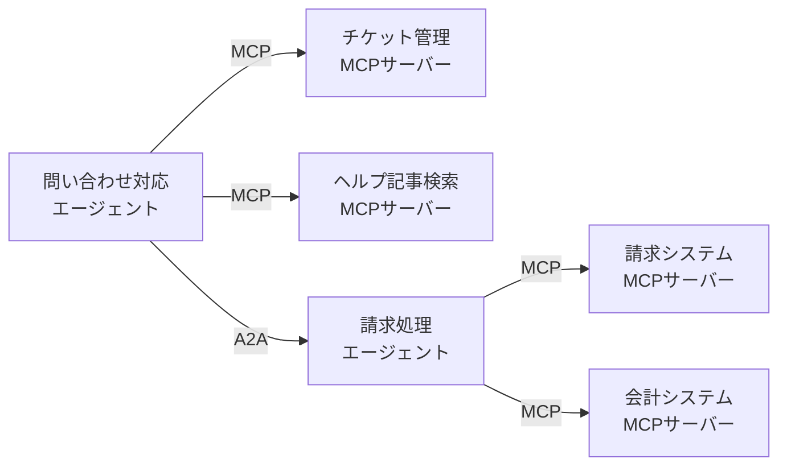
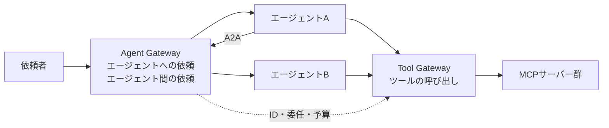
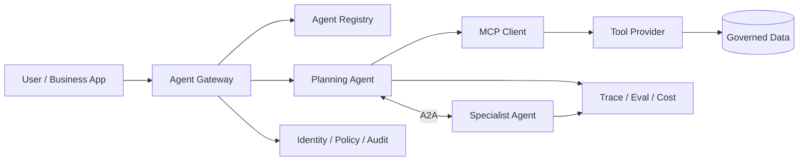

> <strong>第Ⅴ部　Agent MeshとSoftware Factory</strong>
>
> 第Ⅳ部では、Platform Engineeringを、人間の開発者とAIエージェントの両方を利用者とするものとして設計した。第Ⅴ部では、AIエージェントの役割をさらに大きく捉える。エージェントは、一つで働くだけでなく、<strong>複数で連携し</strong>（第19章）、<strong>統制のもとで自律的に行動し</strong>（第20章）、そして<strong>ソフトウェアそのものを生産する</strong>（第21章）。プラットフォームは、エージェントの利用者であると同時に、エージェントの運用対象にもなる。

## 本章の問い

人間と同様に、複数のAIエージェントが共通プラットフォームの利用者になると何が変わるのか。

第13章では、一つのエージェントが、ツールを呼び出して外部の状態を変更する場面を扱った。しかし、組織の中でエージェントの利用が広がると、エージェントは一つではなくなる。問い合わせ対応のエージェント、請求処理のエージェント、データ分析のエージェント、コードを書くエージェント（第21章）。それぞれが異なるチームによって作られ、異なるフレームワークで実装され、異なるツールを使う。そして、あるエージェントが、別のエージェントに仕事を依頼するようになる。

本章では、このような<strong>複数のエージェントが連携し、共通のプラットフォームの上で動く構造</strong>を<strong>Agent Mesh</strong>と呼び、その設計を考える。

## Agent Meshという用語について

本書の執筆方針として、次の点を明確にしておく。

> <strong>Agent Meshは、本書ではアーキテクチャパターンの名称であり、単一の確立した標準規格という意味ではない。</strong>

「Agent Mesh」という言葉は、一部のベンダーや論者によって使われているが、その意味は統一されていない。本書では、第6章で見た<strong>サービスメッシュ</strong>――マイクロサービス間の通信を、共通の基盤で仲介し、観測し、統制する――との類比から、この言葉を次のように定義する。

> <strong>Agent Mesh</strong>とは、複数のAIエージェントを、共通の発見・通信・ID・ポリシー・観測・予算の仕組みのもとで連携・管理するアーキテクチャパターンである。（本書の操作的定義）

そして、Agent Meshを構成する要素として、二つのプロトコル――エージェントとツールを接続する<strong>MCP</strong>と、エージェントとエージェントを接続する<strong>A2A</strong>――を区別して扱う。

## 19.1　単一Agent、Multi-Agent、Agent Meshの違い

### 三つの形

| 形 | 内容 | 例 |
|---|---|---|
| <strong>単一Agent</strong> | 一つのエージェントが、複数のツールを使ってタスクを遂行する | 第13章の問い合わせ対応エージェント |
| <strong>Multi-Agent</strong> | 一つのアプリケーションの中で、役割の異なる複数のエージェントが協力する。通常、同じチームが同じフレームワークで作る | 計画を立てるエージェントと、調査するエージェントと、文章を書くエージェントが協力するアプリ |
| <strong>Agent Mesh</strong> | 組織の中で、異なるチームが作った、異なるフレームワークのエージェントが、共通の基盤の上で発見し合い、連携する | 問い合わせ対応エージェントが、請求チームの請求処理エージェントに仕事を依頼する |

### Multi-AgentとAgent Meshの違い

Multi-AgentとAgent Meshの違いは、技術よりも<strong>組織の境界</strong>にある。

| 観点 | Multi-Agent | Agent Mesh |
|---|---|---|
| 作り手 | 一つのチーム | 複数のチーム |
| 実装 | 同じフレームワーク、同じコードベース | 異なるフレームワーク、異なるコードベース |
| 連携の方法 | 関数呼び出し、共有のメモリ | ネットワーク越しのプロトコル（A2Aなど） |
| 信頼の前提 | 互いを信頼できる | 互いを完全には信頼できない |
| 統制 | アプリケーションの内部 | 組織の共通基盤（プラットフォーム） |
| 類比 | モノリスの内部のモジュール | マイクロサービス |

この類比は、本書の第6章の議論と直接つながっている。モノリスがマイクロサービスに分割されたとき、サービス間の通信が増え、障害の原因が境界に潜み、観測と統制が難しくなった。そしてサービスメッシュやAPIゲートウェイ、分散トレーシングが、その問題に応えた。<strong>Agent Meshは、エージェントの世界で同じことが起きることへの備えである</strong>。

## 19.2　エージェントの発見、登録、ルーティング

### Agent Registry

組織の中に多くのエージェントがあるとき、まず必要になるのは、<strong>どのようなエージェントがあり、何ができ、誰のもので、どう呼び出せるか</strong>を管理する仕組みである。これを<strong>Agent Registry（エージェントレジストリ）</strong>と呼ぶ。

Agent Registryは、第15章のSoftware Catalogのエージェント版と言える。実際、エージェントをBackstageのカタログに、新しい種類のコンポーネントとして登録する設計も考えられる。

| 登録する情報 | 内容 | 用途 |
|---|---|---|
| 識別子とバージョン | エージェントの名前、構成のバージョン | 呼び出し先の特定、トレースとの対応 |
| 能力（Skills） | 何ができるか（自然言語の説明と、入出力の形式） | 他のエージェントによる発見、ルーティング |
| 所有者 | 作ったチーム、運用の責任者 | 障害時の連絡、承認者の決定（第15章） |
| エンドポイントと認証 | どこで、どの方式で呼び出せるか | 接続 |
| 使用するツールと権限 | どのツール（MCPサーバー）を、どの権限で使うか | 影響範囲の把握、セキュリティのレビュー |
| データの分類 | どの分類のデータを扱うか | ガバナンス（第18章） |
| SLOと予算 | 可用性、応答時間、タスクあたりの費用の目安 | 呼び出し側の設計、コスト管理 |
| 状態 | 試験中、本番、非推奨、停止 | ルーティングの判断 |

### 発見とルーティング

エージェントが別のエージェントに仕事を依頼するとき、依頼先をどう決めるか。

| 方式 | 内容 | 長所 | 短所 |
|---|---|---|---|
| <strong>静的な指定</strong> | 依頼先のエージェントを、構成で固定する | 予測可能。統制しやすい | 柔軟性が低い |
| <strong>レジストリによる発見</strong> | 必要な能力をレジストリに問い合わせ、候補から選ぶ | 柔軟。新しいエージェントを追加しやすい | 誤ったエージェントを選ぶ可能性。統制が難しい |
| <strong>ゲートウェイによるルーティング</strong> | 依頼をAgent Gatewayに送り、ゲートウェイがポリシーに基づいて依頼先を決める | 統制と柔軟性のバランス。ルーティングの変更が一か所で済む | ゲートウェイの設計と運用が必要 |

本書は、組織のAgent Meshでは<strong>ゲートウェイによるルーティング</strong>を基本とすることを提案する。第12章のAIゲートウェイが、アプリにモデルの具体名ではなく「ルート名」を指定させたのと同じように、エージェントに依頼先の具体名ではなく「必要な能力」を指定させ、ゲートウェイがポリシーに基づいて、本番の状態にある、権限のある、予算内のエージェントにルーティングする。

## 19.3　A2A――Agent間の連携

### A2Aの動機

<strong>A2A（Agent2Agent Protocol）</strong>は、Googleが2025年に発表した、エージェント間の通信のためのオープンなプロトコルである。A2Aの発表記事は、<strong>異なるフレームワーク、異なるベンダーによって作られたエージェントが、相互に運用できるようにすること</strong>を、このプロトコルの動機として挙げている。[R28] その後、A2AはLinux Foundationへ移管され、オープンガバナンスのプロジェクトとして開発が続けられている。[R49]

### A2Aの主な概念

A2Aの仕様の詳細は版によって異なるが、本書の議論に関わる主な概念を、概要として整理する。

| 概念 | 内容（本書による概要） |
|---|---|
| <strong>Agent Card</strong> | エージェントが、自らの名前、能力（スキル）、エンドポイント、認証の方式などを記述した、機械が読めるメタデータ。他のエージェントは、これを読んで、そのエージェントに何を依頼できるかを知る |
| <strong>Task</strong> | エージェント間で依頼される仕事の単位。状態（受付、作業中、入力待ち、完了、失敗など）を持つ |
| <strong>Message / Part</strong> | エージェント間でやりとりされる内容。テキスト、ファイル、構造化データなどを含む |
| <strong>Artifact</strong> | タスクの成果物 |
| <strong>非同期・長時間のタスク</strong> | 完了までに時間のかかるタスクの進捗の通知（ストリーミング、プッシュ通知） |

### A2Aの意義と限界

A2Aの意義は、第13章のMCPと同じく、<strong>共通のプロトコルによって、多様なものを一つの方法で接続できる</strong>ことにある。問い合わせ対応チームのエージェントと、請求チームのエージェントが、異なるフレームワークで作られていても、A2Aに対応していれば、互いに仕事を依頼できる。

一方で、A2Aは通信の<strong>プロトコル</strong>であり、MCPと同じく、それだけで安全性や統制が保証されるわけではない。どのエージェントが、どのエージェントに、何を依頼してよいか。依頼の連鎖の中で、権限と予算をどう引き継ぐか。依頼先のエージェントの応答を、どこまで信頼するか。これらは、A2Aの上に、組織が設計しなければならない（19.5節、19.7節）。

## 19.4　MCP――ツール／コンテキストの接続

### MCPとA2Aの役割の違い

第13章で、MCPを、AIアプリケーションとツールやデータソースを接続するためのプロトコルとして紹介した。MCPの公式仕様は、ホスト、クライアント、サーバーの関係と、サーバーが提供するツール、リソース、プロンプトなどを定めている。[R19]

Agent Meshの文脈では、MCPとA2Aの役割の違いを明確にしておくことが重要である。

| 観点 | MCP | A2A |
|---|---|---|
| 接続するもの | エージェント（AIアプリ）と、ツール・データソース | エージェントと、エージェント |
| 相手の性質 | 決められた機能を実行する（関数のように振る舞う） | 自ら判断し、計画し、行動する（自律的に振る舞う） |
| やりとりの単位 | ツールの呼び出しと結果、リソースの読み出し | タスクの依頼、進捗、成果物 |
| 時間の長さ | 多くは短い（秒単位） | 長いことがある（分〜時間、人の承認待ちを含む） |
| 類比 | ライブラリやAPIの呼び出し | 他のチームへの仕事の依頼 |



この図で、問い合わせ対応エージェントは、請求システムのツールを<strong>直接は使わない</strong>。請求に関する仕事は、請求のドメインを知り、請求のツールの権限を持つ、請求チームのエージェントに<strong>依頼する</strong>。これは、第14章のTeam Topologiesにおける、チームの境界と責任の考え方を、エージェントに適用したものである。

> <strong>補足</strong>：MCPは、Anthropicによる公開後、Linux Foundation傘下のAgentic AI Foundation（AAIF）へ移管され、オープンガバナンスのもとで開発が続けられている。[R50] 参照する仕様の版と、ガバナンス体制を刊行前に確認すること。

### コンテキストの接続

MCPは、ツールだけでなく、<strong>リソース</strong>（エージェントが読める情報）の提供にも使える。第18章で、データの意味、関係、権限、品質をAIに提供する<strong>Context Layer</strong>を論じた。データカタログやセマンティックレイヤーをMCPのサーバーとして公開すれば、Agent Meshのどのエージェントも、同じ方法で、データの意味と権限を参照できる。

## 19.5　Agent Gateway、Identity、Policy

### Agent Gateway

第16章の参照アーキテクチャで、<strong>Agent Gateway</strong>を、AIエージェントの操作を権限・上限・記録のもとでIDPに中継するものとして置いた。Agent Meshでは、Agent Gatewayの役割はさらに大きくなる。

| 機能 | 内容 | 対応する既存の仕組み |
|---|---|---|
| 入口の一元化 | 利用者（人、業務アプリ）からエージェントへの依頼、エージェント間の依頼を、ゲートウェイを通す | APIゲートウェイ |
| 認証 | 依頼者とエージェントのIDを確認する | 第16章のIDの統一 |
| 認可 | どの依頼者・エージェントが、どのエージェントに、何を依頼できるかを判定する | 第11章のPolicy as Code |
| ルーティング | 能力の指定から、依頼先のエージェントを決める | 第12章のAIゲートウェイのルーティング |
| 委任の伝播 | 依頼者のIDと委任の範囲を、依頼の連鎖に沿って伝える | 19.7節 |
| 予算の管理 | 依頼の連鎖全体の予算を管理する | 第11章、19.7節 |
| 観測 | すべての依頼をトレースし、監査ログに記録する | 第7章、第13章 |

### Agent GatewayとTool Gateway

第13章では、エージェントのツール呼び出しを認可する<strong>Tool Gateway</strong>を設計した。Agent Gatewayは、エージェントへの依頼とエージェント間の依頼を扱う。両者の関係を整理する。



| 観点 | Agent Gateway | Tool Gateway |
|---|---|---|
| 扱うもの | 依頼（タスク） | ツールの呼び出し |
| 判断の内容 | このエージェントに、この依頼をしてよいか | このツールを、この引数で呼んでよいか |
| 相手 | 自律的なエージェント | 決められた機能 |

両者は、<strong>同じID基盤と、同じポリシーエンジン</strong>を使うべきである。Agent Gatewayで確認された依頼者のIDと委任の範囲は、Tool Gatewayに引き継がれ、ツールの呼び出しの認可に使われる。

### Identityの連鎖

第13章で、エージェントのIDを、エージェント固有のIDと、依頼者から委任された範囲の権限で設計した。Agent Meshでは、依頼が<strong>連鎖する</strong>ため、IDの設計はさらに重要になる。

利用者（サポート担当者）が問い合わせ対応エージェントに依頼し、問い合わせ対応エージェントが請求処理エージェントに依頼し、請求処理エージェントが請求システムのツールを呼び出す。このとき、請求システムから見て、<strong>誰が操作しているのか</strong>。

本書は、次の原則を提案する。

1. <strong>元の依頼者を常に伝える</strong>：連鎖のどの段階でも、元の依頼者（サポート担当者）のIDが伝わる。
2. <strong>連鎖の経路を記録する</strong>：どのエージェントを経由したかを、順に記録する。
3. <strong>権限は連鎖に沿って狭まる</strong>：依頼先のエージェントに渡される権限は、依頼元の権限を超えない。元の依頼者が持っていない権限を、連鎖の途中で得ることはできない。
4. <strong>各エージェントは、自らの固有の権限との共通部分しか使えない</strong>：請求処理エージェントは、請求のツールの権限を持つが、それを使えるのは、元の依頼者の委任の範囲と重なる部分だけである。

原則3と4は、<strong>権限の昇格（混乱した代理人問題、Confused Deputy Problem）</strong>を防ぐためのものである。強い権限を持つエージェントに、弱い権限しか持たない依頼者が、強いエージェントの権限を使わせるような依頼をすることを防ぐ。

## 19.6　エージェント実行基盤とKubernetes

### エージェントのワークロードの特徴

エージェントを実行するワークロードは、従来のWebサービスとは異なる特徴を持つ。

| 観点 | Webサービス | エージェント |
|---|---|---|
| リクエストの長さ | 短い（ミリ秒〜秒） | 長い（秒〜時間）。人の承認待ちを含む |
| 状態 | 多くはステートレス | タスクの文脈と進捗を持つ |
| 資源の使い方 | 予測しやすい | LLMの呼び出しを待つ時間が長く、CPUは使わないことが多い。コードを実行する場合は急に資源を使う |
| 隔離の要求 | 通常のコンテナの隔離 | コードを実行する場合、強い隔離（サンドボックス）が必要（第13章） |
| 失敗からの回復 | 再試行 | 途中の状態からの再開（チェックポイント） |

### Kubernetesの上での実行

第6章で、Kubernetesが宣言的API、Reconciliation、スケジューリング、自己修復を提供することを見た。これらは、エージェントの実行基盤にも有用である。そして実際に、Kubernetesの上でエージェントを動かすためのオープンソースの取り組みや、エージェントのサンドボックスをKubernetesで管理するための取り組みが進められている。CNCFのブログに掲載された論考 *Platform engineering for the agentic enterprise* も、アプリケーション、資源、AIエージェントをプラットフォームで一体的に管理する議論を、現状の実装の議論として示している。[R40]

Kubernetesの上でエージェントを実行するときの設計の要点を、本書の提案として示す。

1. <strong>エージェントを宣言的に定義する</strong>：エージェントの構成（モデルのルート、プロンプトのバージョン、使用するツール、権限、予算）を、Kubernetesのカスタムリソースとして宣言し、GitOps（第6章）で管理する。
2. <strong>長時間のタスクを、Webサービスとは別のワークロードとして扱う</strong>：タスクの実行には、キューとワーカー、またはジョブを使い、タスクの状態を外部に保存して、途中からの再開を可能にする。
3. <strong>コードの実行には、強い隔離を使う</strong>：エージェントが生成したコードは、サンドボックス（軽量VMなど）で実行する（第13章）。
4. <strong>名前空間とテナントの分離を適用する</strong>：第16章の名前空間の分離（RBAC、NetworkPolicy、ResourceQuota）を、エージェントのワークロードにも適用する。特に、<strong>NetworkPolicyで、エージェントが通信できる先を、Agent Gateway、Tool Gateway、AIゲートウェイに限定する</strong>。エージェントが外部のサービスやツールに直接通信できれば、ゲートウェイの統制は回避される。

```yaml
# エージェントの宣言的な定義（本書による例示的なカスタムリソース）
apiVersion: agents.platform.minato.example/v1alpha1
kind: Agent
metadata:
  name: inquiry-assistant
  namespace: askline-agents
  labels:
    owner: team-askline-ai
spec:
  version: "3.4.0"
  model:
    route: agent-default            # AIゲートウェイのルート名（第12章）
  prompt:
    id: inquiry-assistant
    version: 12
  skills:
    - id: handle-billing-inquiry
      description: 請求に関する問い合わせに対応する
  tools:                            # Tool Gateway経由で使えるMCPサーバー
    - server: tickets
    - server: help-search
  delegates:                        # A2Aで依頼できるエージェント
    - capability: billing.update-recipient
  limits:
    maxStepsPerTask: 20
    maxTokensPerTask: 200000
    maxDelegationDepth: 2
    taskTimeout: 10m
  dataClassification: [internal, pii]
```

## 19.7　エージェント間の観測、予算、失敗伝播

### 観測：依頼の連鎖をトレースする

```mermaid
gantt
    title Agent Meshのトレースの例
    dateFormat x
    axisFormat %s s
    section 問い合わせ対応エージェント
    task.inquiry               :0, 42000
    llm.plan                   :0, 3000
    tool.get_ticket            :3000, 3500
    a2a.delegate(billing)      :3500, 30000
    llm.compose_reply          :30000, 34000
    approval.wait              :34000, 41000
    tool.send_reply            :41000, 42000
    section 請求処理エージェント
    task.billing               :3800, 29500
    llm.plan                   :3800, 6500
    tool.list_invoices         :6500, 7200
    policy.check               :7200, 7300
    approval.wait              :7300, 26000
    tool.update_recipient      :26000, 27000
    tool.verify                :27000, 27500
    llm.summarize              :27500, 29500
```

第7章で、マイクロサービスの分散トレーシングが、一つのリクエストがどのサービスを通ったかを記録することを見た。第13章で、エージェントのトレースを、タスクとステップの階層で記録することを見た。Agent Meshでは、これらを組み合わせ、<strong>依頼の連鎖全体を、一つのトレースとして記録する</strong>。



A2Aの依頼に、第7章のW3C Trace Contextのようなトレースのコンテキストを含めれば、依頼先のエージェントのスパンが、依頼元のトレースの子として記録される。こうして、<strong>元の依頼者の依頼から、最終的なツールの呼び出しまで</strong>を、一つのトレースとしてたどれるようになる。

### 予算：連鎖全体で管理する

第11章で、エージェントのタスクごとに予算の上限を設けることを述べた。Agent Meshでは、<strong>予算を連鎖全体で管理する</strong>必要がある。

もし各エージェントが、それぞれ独立に「タスクあたり20万トークン」の上限を持っていれば、問い合わせ対応エージェントが請求処理エージェントに依頼し、請求処理エージェントがさらに別のエージェントに依頼すると、連鎖全体では上限の数倍のトークンを消費しうる。

本書は、<strong>予算を依頼の連鎖に沿って引き継ぐ</strong>設計を提案する。元のタスクに予算を割り当て、依頼先には、残りの予算の一部を渡す。依頼先が使った分は、元のタスクの予算から差し引かれる。

### 失敗伝播

マイクロサービスで、一つのサービスの障害が、依存するサービスに連鎖的に波及する（カスケード障害）ことを、第6章で見た。Agent Meshでも、同じことが起きる。さらに、エージェントには固有の失敗の伝播がある。

| 失敗の伝播 | 内容 | 対策 |
|---|---|---|
| <strong>応答の遅延の連鎖</strong> | 依頼先のエージェントの応答が遅れ、依頼元も遅れる | 依頼ごとのタイムアウト、タスク全体のタイムアウト |
| <strong>依頼の循環</strong> | エージェントAがBに依頼し、BがAに依頼し返す | 依頼の深さの上限、連鎖の経路の記録と循環の検出 |
| <strong>依頼の爆発</strong> | 一つの依頼が、多数のエージェントへの依頼に分岐し、さらに分岐する | 依頼の深さと幅の上限、連鎖全体の予算 |
| <strong>誤りの伝播</strong> | 依頼先のエージェントの誤った出力を、依頼元が正しいものとして使う | 依頼先の出力の検証、重要な結果の外部の状態での確認（第13章） |
| <strong>インジェクションの伝播</strong> | 依頼先のエージェントの出力に、依頼元のエージェントを操作する指示が含まれる | 他のエージェントの出力を、信頼できない入力として扱う（第13章、第20章） |

最後の<strong>インジェクションの伝播</strong>は、特に重要である。第13章で、間接的なプロンプトインジェクションが、エージェントが読み込む外部のデータを通じて起きることを見た。Agent Meshでは、<strong>他のエージェントの出力</strong>も、外部のデータの一つである。依頼先のエージェントが、悪意のある入力によって誘導されていれば、その出力には、依頼元のエージェントを誘導する指示が含まれうる。<strong>組織の内部のエージェントであっても、その出力を、信頼できる指示として扱ってはならない</strong>。

### サーキットブレーカー

第6章のサーキットブレーカー――呼び出し先が失敗し続けているなら、一時的に呼び出しを止める――は、Agent Meshでも有効である。Agent Gatewayが、依頼先のエージェントの失敗率、タイムアウト率、ポリシー違反の率を監視し、閾値を超えたら、そのエージェントへのルーティングを一時的に止める。

## 19.8　Agent MeshをIDPの能力として提供する

### プラットフォームが提供するもの

Agent Meshは、各チームが独自に作るべきものではない。第8章で見た専用基盤の乱立が、エージェントの世界で起きれば、問い合わせ対応チームと請求チームのエージェントは、異なる認証、異なるトレース、異なる予算の仕組みを持ち、連携できない、あるいは統制のないまま連携することになる。

Agent Meshの共通の仕組みは、IDPの能力として提供すべきである。第8章8.6節と第13章13.8節の責任分界を、Agent Meshに適用する。

| 能力 | 担当 | 理由 |
|---|---|---|
| Agent Registry（カタログへの統合） | プラットフォーム | 発見と所有者の管理は、全社で一貫すべき |
| Agent Gateway（認証、認可、ルーティング、委任、予算、観測） | プラットフォーム | 統制の要 |
| Tool Gateway、AIゲートウェイ | プラットフォーム | 第12章、第13章 |
| エージェントの実行基盤（Kubernetes、サンドボックス） | プラットフォーム | 第16章の実行プレーン |
| A2A・MCPの共通ライブラリとテンプレート | プラットフォーム | Golden Pathとして提供（第14章） |
| トレース、監査、評価の基盤 | プラットフォーム | 第7章、第13章 |
| エージェントの目的、能力の説明、プロンプト | ドメイン | 業務の知識が必要 |
| どのエージェントに何を依頼してよいかの判断 | ドメイン（＋セキュリティ・リスク管理） | 業務のリスク許容に依存する |
| 依頼の受け入れの判断（どの依頼を受け、どれを断るか） | ドメイン | 依頼先のエージェントの所有者が決める |
| 評価シナリオと合格基準 | ドメイン | 第13章 |

### エージェントのGolden Path

第14章で、Golden Pathを「ある種類の仕事を成し遂げるための標準的な道筋」とした。エージェントのGolden Pathは、新しいエージェントを作るチームに、次のものを最初から提供する。

- エージェントの宣言的な定義（19.6節のカスタムリソース）の雛形
- Agent Registryへの登録（カタログの記述）
- AIゲートウェイ、Tool Gateway、Agent Gatewayを経由するクライアントライブラリ
- A2Aのエンドポイント（依頼を受ける場合）とAgent Cardの雛形
- トレース（依頼の連鎖を含む）の計装
- 予算と上限の既定値
- 評価シナリオの雛形（成功、逸脱、攻撃のシナリオ）と、CIでの評価の実行
- NetworkPolicy（ゲートウェイ以外への通信を禁止）

チームは、エージェントの目的、プロンプト、使うツールの選定、評価シナリオという、<strong>自分たちにしか決められないこと</strong>に集中できる。

## 図・実装例

### Agent Meshの構成



この図を、本章の議論に沿って読み解く。

| 図の要素 | 本章の対応 |
|---|---|
| User / Business App → Agent Gateway | 入口の一元化、認証（19.5節） |
| Agent Registry | 発見、所有者、能力、状態の管理（19.2節） |
| Planning Agent ⇔ Specialist Agent（A2A） | エージェント間の依頼（19.3節）。Specialist Agentは、そのドメインのツールと権限を持つ |
| MCP Client → Tool Provider → Governed Data | ツールとデータへの接続（19.4節）。データは第18章のガバナンスのもとにある |
| Identity / Policy / Audit | 委任の連鎖、認可、監査（19.5節） |
| Trace / Eval / Cost | 依頼の連鎖のトレース、評価、連鎖全体の予算（19.7節） |

### 実装例：委任と予算を連鎖に沿って引き継ぐ

19.5節の「権限は連鎖に沿って狭まる」原則と、19.7節の「予算を連鎖全体で管理する」設計、依頼の深さの上限と循環の検出を、Agent Gatewayの中核の論理として実装する。

```python
"""Agent Gateway: 委任・予算・深さを依頼の連鎖に沿って引き継ぐ。"""
from __future__ import annotations

from dataclasses import dataclass, replace

@dataclass(frozen=True)
class Delegation:
    requester: str                    # 元の依頼者（人）
    chain: tuple[str, ...]            # 経由したエージェントの順序
    scopes: frozenset[str]            # 委任された権限の範囲
    token_budget: int                 # 残りのトークン予算
    max_depth: int

@dataclass(frozen=True)
class AgentEntry:
    agent_id: str
    capabilities: frozenset[str]
    own_scopes: frozenset[str]        # エージェント固有の権限
    status: str                       # "production" など

class DelegationRejected(Exception):
    pass

def start(requester: str, scopes: frozenset[str], budget: int, max_depth: int) -> Delegation:
    return Delegation(requester, (), scopes, budget, max_depth)

def route(registry: list[AgentEntry], capability: str) -> AgentEntry:
    """能力を持ち、本番状態にあるエージェントを選ぶ。"""
    for entry in registry:
        if capability in entry.capabilities and entry.status == "production":
            return entry
    raise DelegationRejected(f"no production agent for {capability}")

def delegate(d: Delegation, target: AgentEntry, share: float) -> Delegation:
    """依頼先への委任を作る。権限は共通部分に狭まり、予算は一部だけ渡す。"""
    if target.agent_id in d.chain:
        raise DelegationRejected(f"cycle detected: {d.chain + (target.agent_id,)}")
    if len(d.chain) >= d.max_depth:
        raise DelegationRejected(f"max delegation depth {d.max_depth} exceeded")
    scopes = d.scopes & target.own_scopes
    if not scopes:
        raise DelegationRejected("no overlapping scopes between requester and target")
    return replace(d, chain=d.chain + (target.agent_id,), scopes=scopes,
                   token_budget=int(d.token_budget * share))

def consume(d: Delegation, tokens: int) -> Delegation:
    if tokens > d.token_budget:
        raise DelegationRejected(f"token budget exceeded: {tokens} > {d.token_budget}")
    return replace(d, token_budget=d.token_budget - tokens)
```

```python
# test_agent_gateway.py
import pytest

from agent_gateway import (AgentEntry, DelegationRejected, consume, delegate,
                           route, start)

INQUIRY = AgentEntry("inquiry-assistant", frozenset({"inquiry.handle"}),
                     frozenset({"tickets:read", "tickets:write", "billing:read"}), "production")
BILLING = AgentEntry("billing-agent", frozenset({"billing.update-recipient"}),
                     frozenset({"billing:read", "billing:write"}), "production")
REGISTRY = [INQUIRY, BILLING]

ROOT = start("user-42", frozenset({"tickets:read", "tickets:write", "billing:read"}),
             budget=200_000, max_depth=2)

def test_scopes_narrow_along_the_chain():
    d1 = delegate(ROOT, INQUIRY, share=1.0)
    d2 = delegate(d1, route(REGISTRY, "billing.update-recipient"), share=0.5)
    # 依頼者は billing:write を持たないので、請求エージェントも書き込めない
    assert d2.scopes == frozenset({"billing:read"})
    assert d2.chain == ("inquiry-assistant", "billing-agent")
    assert d2.requester == "user-42"

def test_budget_is_shared_not_multiplied():
    d1 = delegate(ROOT, INQUIRY, share=1.0)
    d2 = delegate(d1, BILLING, share=0.5)
    assert d2.token_budget == 100_000
    with pytest.raises(DelegationRejected):
        consume(d2, 150_000)

def test_cycle_is_rejected():
    d1 = delegate(ROOT, INQUIRY, share=1.0)
    with pytest.raises(DelegationRejected):
        delegate(d1, INQUIRY, share=0.5)

def test_depth_limit():
    shallow = start("user-42", frozenset({"billing:read"}), 1000, max_depth=1)
    d1 = delegate(shallow, INQUIRY, share=1.0)
    with pytest.raises(DelegationRejected):
        delegate(d1, BILLING, share=0.5)

def test_non_production_agent_is_not_routed():
    staging = AgentEntry("billing-v2", frozenset({"billing.refund"}), frozenset(), "staging")
    with pytest.raises(DelegationRejected):
        route([staging], "billing.refund")
```

`test_scopes_narrow_along_the_chain`は、19.5節の<strong>混乱した代理人問題</strong>への対策を確かめている。請求処理エージェントは、固有の権限として`billing:write`を持っている。しかし、元の依頼者（`user-42`）は`billing:write`を持っていないため、連鎖を通じて得られる権限は`billing:read`だけになる。弱い権限の依頼者が、強い権限のエージェントを通じて、権限を昇格させることはできない。

> <strong>補足</strong>：この例では、請求の宛名の変更という本来のタスクは、依頼者が`billing:write`を持たないため、請求処理エージェントでは実行できない。その場合、請求処理エージェントは、宛名の変更を「請求チームの担当者の承認が必要な依頼」として扱い、第13章の承認の仕組みに回すことになる。<strong>権限が足りないことは、エラーではなく、人の判断を求める正当な理由である</strong>。

## 評価指標とトレードオフ

| 指標 | 意味 | 注意点 |
|---|---|---|
| レジストリのカバレッジ | 本番で動くエージェントのうち、レジストリに登録されているものの割合 | 未登録のエージェント（シャドーAI）の検出 |
| ゲートウェイ経由率 | エージェントの依頼・ツール呼び出しのうち、ゲートウェイを経由したものの割合 | 100%を目指す。NetworkPolicyで強制する |
| 連鎖の深さと幅の分布 | 依頼の連鎖の深さ、分岐の数 | 上限に達した連鎖の割合も見る |
| 連鎖全体の費用 | 元のタスクあたりの、連鎖全体のトークンと費用 | 個々のエージェントの費用だけでは見えない |
| 委任の拒否率 | 権限の不足、深さ、循環、予算で拒否された依頼の割合 | 高ければ設計の見直し、急増は攻撃の兆候 |
| 連鎖のトレースの完全性 | 依頼の連鎖のうち、元の依頼者から最終的なツール呼び出しまでたどれるものの割合 | 監査の前提 |
| サーキットブレーカーの発動 | エージェントへのルーティングが停止された回数 | 依頼先の品質の問題の兆候 |

本章の中心的なトレードオフは、<strong>連携の柔軟性と統制</strong>である。エージェントが自由に他のエージェントを発見し、依頼できれば、組織のエージェントの能力は組み合わさって大きな価値を生む。しかし、依頼の連鎖が長く、広くなるほど、権限、予算、失敗、インジェクションの伝播を制御することは難しくなる。本章の答えは、<strong>ゲートウェイを通して連携させ、委任と予算を連鎖に沿って引き継ぎ、権限を狭め、深さを制限する</strong>ことである。

## 本章の結論

複数のAIエージェントが共通プラットフォームの利用者になると、

- <strong>組織の境界を越えた連携</strong>が生まれる。Multi-AgentとAgent Meshの違いは、技術よりも組織の境界にある。
- <strong>発見とルーティング</strong>が必要になる。Agent Registryは、Software Catalogのエージェント版である。
- <strong>二つのプロトコル</strong>を区別する。MCPはエージェントとツールを、A2Aはエージェントとエージェントを接続する。いずれも、それだけでは統制を保証しない。
- <strong>IDと権限は連鎖する</strong>。元の依頼者を伝え、経路を記録し、権限は連鎖に沿って狭まる。
- <strong>観測、予算、失敗は連鎖全体で扱う</strong>。他のエージェントの出力も、信頼できない入力である。
- <strong>Agent MeshはIDPの能力として提供する</strong>。仕組みはプラットフォームが、判断はドメインが担う。

次章では、高い自律性を持つエージェントの権限と影響範囲を、どう制御するかを、ガバナンスとセキュリティの観点から詳しく扱う。

## 参考文献

- [R28] Google, *Announcing the Agent2Agent Protocol (A2A)*, 2025. https://developers.googleblog.com/en/a2a-a-new-era-of-agent-interoperability/
- [R49] Linux Foundation, *Launches the Agent2Agent Protocol Project*, 2025. https://www.linuxfoundation.org/press/linux-foundation-launches-the-agent2agent-protocol-project-to-enable-secure-intelligent-communication-between-ai-agents
- [R50] Linux Foundation, *Formation of the Agentic AI Foundation*, 2025. https://www.linuxfoundation.org/press/linux-foundation-announces-the-formation-of-the-agentic-ai-foundation
- [R19] Model Context Protocol, *Specification*. https://modelcontextprotocol.io/specification
- [R40] CNCF, *Platform engineering for the agentic enterprise: Managing applications, resources, and AI agents*, 2026. https://www.cncf.io/blog/2026/07/21/platform-engineering-for-the-agentic-enterprise-managing-applications-resources-and-ai-agents/
- A2A Protocol仕様（参照した版を明記する）. https://a2a-protocol.org/
- N. Hardy, "The Confused Deputy (or why capabilities might have been invented)," *ACM SIGOPS Operating Systems Review*, 22(4), 1988.
- W3C, *Trace Context*. https://www.w3.org/TR/trace-context/
