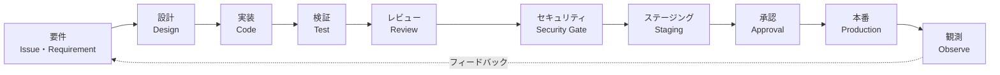
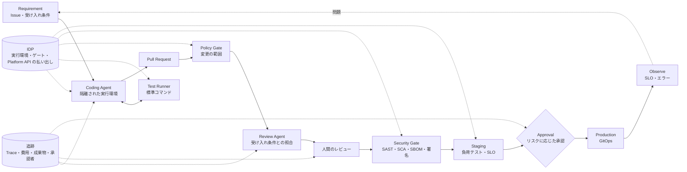

## 本章の問い

ソフトウェアを書くだけでなく、設計、実装、検証、リリースまで実行するAIにはどのようなプラットフォームが必要か。

第13章のエージェントは、問い合わせに対応し、請求書の宛名を変更した。第19章のエージェントは、他のエージェントに仕事を依頼した。本章のエージェントは、**ソフトウェアそのもの**を作る。課題を読み、リポジトリを調べ、設計を考え、コードを書き、テストを実行し、プルリクエストを作り、レビューを受け、修正し、リリースする。

AIによるソフトウェア開発の支援は、コードの補完から始まり、対話による支援を経て、課題を自律的に解決するエージェントへと急速に進化してきた。本章では、この変化をSoftware Factory（ソフトウェア工場）という歴史的な概念と結びつけ、AIがソフトウェアを生産する時代のプラットフォームを考える。

## 21.1　Software Factoryという考え方の歴史と現代的意味

### 歴史的な意味

**Software Factory（ソフトウェア工場）**という言葉は、新しいものではない。

1960年代後半、ソフトウェアの規模が急速に大きくなり、開発が遅れ、予算を超え、品質が低いという問題――いわゆる「ソフトウェア危機」――が認識された。1968年のNATOのソフトウェア工学の会議では、ソフトウェアの開発を、工学の規律に基づいて行うべきだという議論がなされ、その中には、再利用可能な部品を組み合わせてソフトウェアを作るという構想も含まれていた。

この時代、ソフトウェアの開発を、**工場の生産のように体系化する**という考え方が生まれた。開発の工程を標準化し、道具を整え、部品を再利用し、品質を工程ごとに管理する。日本では、1960年代末から1970年代にかけて、大手の計算機メーカーがソフトウェアの開発組織を「ソフトウェア工場」として組織し、その取り組みは後に研究者によって詳しく分析された（例：Michael A. Cusumano, *Japan's Software Factories*, 1991）。

### 歴史的なSoftware Factoryの要素

| 要素 | 内容 |
|---|---|
| 工程の標準化 | 要件定義、設計、実装、テストの各工程の手順と成果物を標準化する |
| 道具の整備 | 開発のための共通の道具（ツール、ライブラリ）を整える |
| 部品の再利用 | 再利用可能な部品を蓄積し、組み合わせて使う |
| 品質の工程管理 | 工程ごとに品質を測定し、管理する |
| 人材の育成 | 標準的な手順に従える人材を、体系的に育成する |

これらの要素は、本書のPlatform Engineeringの要素と驚くほどよく対応している。工程の標準化はGolden Path（第14章）に、道具の整備はIDP（第15章）に、部品の再利用は共通部品（Capability、第15章）に、品質の工程管理はCI/CDの検査とDORA指標（第4章、第11章）に対応する。

### 現代的な意味

AIの時代に、Software Factoryという言葉は新しい意味を帯び始めている。本書では、次のように使い分ける。

| 用法 | 意味 |
|---|---|
| 歴史的な用法 | ソフトウェアの開発工程を、工場の生産のように体系化・標準化する組織と方法 |
| AI時代の用法（本書） | 要件からリリースまでの生産工程を、**AIエージェントと人間が協働して**実行する仕組みを、プラットフォームとして体系化・自動化したもの |

本書の付録Bでは、Software Factoryを「要件からリリースまでの生産工程を体系化・自動化する仕組み」と定義し、歴史的な意味とAI時代の使用を区別している。

歴史的なSoftware Factoryは、人間を標準的な工程に従わせることで生産性と品質を高めようとした。その試みは、ソフトウェアの開発が創造的な活動でもあることとの緊張を抱え続けた。AI時代のSoftware Factoryでは、**標準的な工程に従う作業者として、AIエージェントが加わる**。この変化が、何を可能にし、何を新たな課題とするのかが、本章のテーマである。

## 21.2　AI Coding AssistantからAgentic Software Engineeringへ

### 支援の段階

AIによるソフトウェア開発の支援は、次のような段階を経て進化してきた。

| 段階 | 内容 | 人間の役割 | 影響範囲 |
|---|---|---|---|
| **補完** | 開発者が書いているコードの続きを提案する | すべての判断。提案を受け入れるか選ぶ | 数行 |
| **対話による支援** | 開発者の質問に答え、コードを生成・説明・修正する | 何を頼むかを決め、結果を確認して取り込む | 関数〜ファイル |
| **エディタ内のエージェント** | 開発者の指示で、複数のファイルを調べ、変更し、コマンドを実行する | 指示と確認。変更を逐次承認する | 複数のファイル |
| **自律的なエージェント** | 課題（Issue）を受け取り、調査、実装、テスト、プルリクエストの作成までを自律的に行う | 課題の作成、レビュー、マージの判断 | リポジトリ全体 |
| **Software Factory** | 複数のエージェントが、要件から設計、実装、検証、リリースまでの工程を分担し、人間が工程の要所で判断する | 目的と制約の定義、要所の承認、工程そのものの改善 | 生産工程全体 |

### Agentic Software Engineering

本書では、エージェントが課題を自律的に解決する段階以降を、**Agentic Software Engineering（エージェント型ソフトウェア工学）**と呼ぶ。

この段階の大きな転換点は、AIが**コードを書くだけでなく、実行環境の中で行動する**ようになったことである。コードを書き、テストを実行し、その結果を見て、コードを直す。エラーメッセージを読み、ログを調べ、別の方法を試す。これは、第13章のエージェントのループ――計画、ツールの呼び出し、結果の観測、次の判断――を、ソフトウェア開発に適用したものである。

この転換によって、ソフトウェア開発のプラットフォームに対する要求は大きく変わる。人間の開発者のために作られたIDPは、エージェントのためにも使えるのか。エージェントがリポジトリを操作し、テストを実行し、環境を作り、デプロイを行うとき、どのような統制が必要なのか。

## 21.3　Issue／Requirement／Design／Code／Test／Deployの接続

### 工程の全体像

Software Factoryでは、ソフトウェアの生産の工程を、要件からリリースまでの一連の流れとして捉える。



### 工程間の接続

各工程の成果物は、次の工程の入力になる。工程の間の接続が、**機械が読める形で、追跡可能に**なっていることが、Software Factoryの前提である。

| 工程 | 入力 | 成果物 | 追跡すべき情報 |
|---|---|---|---|
| 要件 | 利用者の要望、ポストモーテムの対策、SLOの違反 | Issue（目的、受け入れ条件、制約） | 誰の要望か、優先度 |
| 設計 | Issue | 設計の文書（変更の方針、影響範囲、代替案） | 設計の判断の理由 |
| 実装 | Issue、設計 | コードの変更（ブランチ、コミット） | どのIssueに対応するか、誰（どのエージェント）が書いたか |
| 検証 | コードの変更 | テストの結果、カバレッジ、評価の結果 | どのテストで、何が確かめられたか |
| レビュー | コードの変更、テストの結果 | レビューのコメント、承認 | 誰が、何を確認したか |
| セキュリティ | コードの変更、成果物 | 検査の結果、SBOM、署名 | どの検査に合格したか（第11章） |
| ステージング | 成果物 | ステージングでの動作の確認 | 本番に近い環境での振る舞い |
| 承認 | すべての結果 | 本番への昇格の承認 | 誰が承認したか |
| 本番 | 承認された成果物 | デプロイ | どの成果物が、いつ本番に入ったか（第6章） |
| 観測 | 本番の振る舞い | SLO、エラー、利用状況 | 変更の影響（第5章、第7章） |

### 受け入れ条件の重要性

エージェントにソフトウェアを作らせるとき、最も重要な入力は**受け入れ条件**である。人間の開発者は、曖昧な要件でも、文脈と経験から意図を推測し、不明な点は質問する。エージェントも推測はするが、その推測が誤っていても、もっともらしいコードを書き、自信をもって完了を報告する（第12章の「もっともらしい誤り」）。

したがって、エージェントに渡すIssueには、**検証可能な受け入れ条件**を含めるべきである。

```markdown
## Issue #482: 問い合わせの一覧APIにカテゴリでの絞り込みを追加する

### 目的
サポート担当者が、特定のカテゴリの問い合わせだけを一覧できるようにする。

### 受け入れ条件
- [ ] `GET /inquiries?category=billing` で、カテゴリが billing の問い合わせだけが返る
- [ ] 複数指定 `?category=billing,login` に対応する
- [ ] 許可されていないカテゴリ値には 400 を返す（許可値はデータ契約 askline.inquiry_created に従う）
- [ ] テナントの範囲外の問い合わせは、絞り込みの有無にかかわらず返らない（既存のテストが通る）
- [ ] 一覧APIの p95 レイテンシのSLO（300ms）を、負荷テストで悪化させない
- [ ] OpenAPI の定義を更新する

### 制約
- データベースのスキーマ変更は行わない（既存の category 列を使う）
- 新しい外部ライブラリを追加しない
```

この受け入れ条件は、そのまま**テストと評価に変換できる**。エージェントは、受け入れ条件をテストとして書き、テストが通るまで実装を繰り返せる。そしてレビューする人間も、受け入れ条件に照らして、変更を評価できる。

## 21.4　SWE-agentのAgent-Computer Interface

### SWE-agentの問い

John Yangらの論文 *SWE-agent: Agent-Computer Interfaces Enable Automated Software Engineering*（2024）は、AIがソフトウェアのリポジトリを扱って課題を解決するための仕組みを研究した。[R31]

この論文の中心的な問いは、次のようなものである。人間の開発者には、エディタやIDE、シェルなど、人間のために設計されたインターフェースがある。では、**LLMのエージェントのために設計されたインターフェース**は、どうあるべきか。

### Agent-Computer Interface（ACI）

論文は、この問いに対して、**Agent-Computer Interface（ACI）**という概念を提示した。[R31] 人間とコンピュータの間のインターフェース（HCI: Human-Computer Interface）が、人間の認知の特性に合わせて設計されるように、エージェントとコンピュータの間のインターフェースは、**LLMのエージェントの特性に合わせて設計されるべき**だ、という考え方である。

論文は、エージェントのために設計した、ファイルの閲覧、検索、編集のためのコマンドと、その出力の形式を提示し、それを用いたエージェントが、ソフトウェアの課題を解決するベンチマーク（SWE-bench）で、当時の手法を上回る結果を示した。[R31]

### ACIの設計原則とプラットフォームへの示唆

論文が示したACIの設計の考え方を、本書の議論に関わる形で整理する。[R31]

| ACIの考え方（本書による要約） | 内容 | プラットフォームへの示唆 |
|---|---|---|
| 簡潔な操作 | エージェントが使うコマンドは、単純で、少数で、わかりやすくする | Platform APIは、少数の明確な操作で設計する（第16章） |
| 簡潔なフィードバック | コマンドの出力は、必要な情報に絞り、エージェントの文脈を浪費しない | APIの応答とエラーは、構造化され、必要十分な情報を返す（第16章の機械が読めるエラー） |
| 誤りの防止 | 構文の誤りのような典型的な失敗を、インターフェースの側で検出し、すぐに知らせる | ドライラン、検証のAPI、事前のポリシー判定（第16章、第20章） |
| 状態の可視化 | エージェントが今どこにいて、何を見ているかを、明確に示す | 操作の結果と現在の状態を問い合わせるAPI（第13章、第16章） |

ACIの概念は、本書の第16章で論じた「開発者向けとAIエージェント向けのAPI」の議論に、研究の裏付けを与えるものである。**エージェントの成果は、モデルの能力だけでなく、エージェントが使うインターフェースの設計に大きく依存する**。そして、そのインターフェースを提供するのは、プラットフォームである。

## 21.5　OpenHandsと実行環境の設計

### OpenHands

**OpenHands**（旧称OpenDevin）は、ソフトウェア開発のためのAIエージェントを開発・評価するためのオープンなプラットフォームである。Xingyao Wangらの論文 *OpenHands: An Open Platform for AI Software Developers as Generalist Agents*（2025）は、その設計を報告している。[R32]

本書では、OpenHandsを、**ソフトウェア開発エージェントのためのプラットフォームと実験環境**の一例として参照する。

### 実行環境の設計

論文が示すOpenHandsの設計で、本書の議論にとって特に重要なのは、**エージェントの実行環境**の扱いである。ソフトウェア開発のエージェントは、コードを書くだけでなく、シェルのコマンドを実行し、テストを動かし、場合によってはWebブラウザを操作する。論文は、エージェントの操作を、隔離された実行環境（サンドボックス）の中で行う設計を示している。[R32]

ソフトウェア開発のエージェントの実行環境に求められる性質を、第13章と第20章の議論を踏まえて整理する。

| 性質 | 内容 | 理由 |
|---|---|---|
| 隔離 | 一つのタスクの実行環境を、他のタスクと、ホストから隔離する | エージェントが生成したコードは信頼できない（第13章、第20章） |
| 再現性 | タスクの開始時に、決まった状態の環境から始める | 結果を比較・評価するため |
| 開発環境の忠実さ | 依存関係、ツール、テストの実行環境が、人間の開発者の環境と同じ | エージェントが通したテストが、CIでも通るように |
| ネットワークの制限 | パッケージのリポジトリなど、許可された宛先にだけ通信できる | 情報の持ち出し、統制の回避の防止（第20章） |
| 資格情報の非配置 | 本番の資格情報を置かない。リポジトリへの書き込みは、ゲートウェイ経由で、限られた範囲で | 第20章 |
| 観測 | すべてのコマンドと結果を記録する | 監査、評価、Replay（第13章） |
| 使い捨て | タスクの完了後に破棄する | 永続化の防止、費用の管理 |

### 開発環境はプラットフォームの能力である

この表の「開発環境の忠実さ」は、プラットフォームの観点から重要である。人間の開発者のための開発環境（第14章のGolden Pathの一部）と、エージェントのための実行環境が、**同じ定義から作られる**べきである。

例えば、リポジトリに、開発環境の定義（コンテナのイメージ、依存関係、ツール）を置き、人間の開発者はそれをローカルやクラウドの開発環境で使い、エージェントはそれを隔離された実行環境で使う。同じ定義を使えば、エージェントが「自分の環境では通ったテスト」が、人間の環境でもCIでも通る。

## 21.6　Code Review、Security、Test、Release Gate

### ゲートの必要性

エージェントが書いたコードは、人間が書いたコードと同じく、あるいはそれ以上に、**検証を経てから本番に入る**べきである。第11章で、ゲートをガードレールに置き換えることを勧めた。しかしSoftware Factoryでは、工程の要所に、**通過しなければ先に進めないゲート**が必要になる。それは、エージェントが大量の変更を高速に生み出すため、人間の注意だけでは、すべてを確認しきれないからである。

### ゲートの種類

| ゲート | 確かめること | 自動化の程度 |
|---|---|---|
| **テストゲート** | 受け入れ条件のテスト、既存のテスト、カバレッジ | 自動 |
| **品質ゲート** | 静的解析、型検査、複雑度、規約 | 自動 |
| **セキュリティゲート** | SAST、SCA、Secrets、IaCの検査、SBOM、署名（第11章） | 自動 |
| **ポリシーゲート** | 変更してよい範囲か（例：エージェントは認証のコードを変更してはならない） | 自動 |
| **性能・SLOゲート** | 負荷テスト、SLOへの影響 | 自動（ステージング） |
| **レビューゲート** | 設計の妥当性、受け入れ条件との一致、保守性 | AIのレビュー＋人間のレビュー |
| **リリースゲート** | 本番への昇格の判断 | 人間の承認（変更のリスクに応じて） |

### Review Agentと人間のレビュー

Software Factoryでは、エージェントが書いたコードを、別のエージェント（**Review Agent**）がレビューする構成がよく考えられる。Review Agentは、受け入れ条件との一致、テストの十分さ、典型的な誤り、組織の規約への準拠を確認し、コメントする。

しかし、Review Agentのレビューは、**人間のレビューの代わりにはならない**。第12章で、LLM-as-a-Judgeの評価者自体が誤り、偏ることを見た。コードを書いたエージェントと、レビューするエージェントが、同じモデル系統であれば、同じ種類の誤りを見逃す可能性がある。

本書は、次の役割分担を提案する。

| 担当 | 確認すること |
|---|---|
| 自動のゲート | 決定的に検査できること（テスト、静的解析、セキュリティ、ポリシー） |
| Review Agent | 受け入れ条件との一致、テストの網羅性、規約、典型的な誤りの指摘。人間のレビューの**準備** |
| 人間のレビュー | 設計の妥当性、業務上の正しさ、長期的な保守性、Review Agentが見逃しうること。**最終的な判断** |

### 変更の範囲のポリシー

ポリシーゲートは、Software Factoryで特に重要である。エージェントに、リポジトリのすべてのファイルを自由に変更させるべきではない。

```yaml
# .platform/agent-change-policy.yaml（本書による例示的な形式）
agent_change_policy:
  allowed_paths:
    - "src/askline_api/**"
    - "tests/**"
    - "openapi/**"
  forbidden_paths:
    - "src/askline_api/auth/**"          # 認証・認可のコード
    - ".github/workflows/**"             # CIの定義（ゲートそのもの）
    - "deploy/**"                        # デプロイの定義
    - "**/*.lock"                        # ロックファイル（依存関係の追加は人が判断）
  require_human_review_paths:
    - "src/askline_api/billing/**"       # 金額の計算
    - "migrations/**"                    # データベースの変更
  max_changed_lines: 500
```

特に重要なのは、**CIの定義（ゲートそのもの）をエージェントに変更させない**ことである。エージェントが、テストに通らないとき、テストを修正するのではなく、テストを削除したり、CIのゲートを緩めたりすれば、ゲートは意味を失う。これは悪意によらなくても、「テストを通す」という目的に対して、エージェントが近道を見つけることで起こりうる。**目的を達成したように見せかける近道**（評価の抜け穴を突くこと）は、第22章の自己改善型システムでも中心的な問題になる。

## 21.7　Agent向けGolden Path、標準化されたリポジトリ

### リポジトリの標準化がエージェントの成果を左右する

21.4節で、エージェントの成果は、エージェントが使うインターフェースの設計に大きく依存することを見た。ソフトウェア開発のエージェントにとって、最も重要なインターフェースの一つは、**リポジトリそのもの**である。

人間の開発者は、構成がばらばらのリポジトリでも、時間をかけて理解できる。しかしエージェントにとって、リポジトリの構成が標準化されていないことは、大きな障害になる。テストの実行方法がリポジトリごとに違う、ビルドの手順がREADMEにしか書かれていない、規約が暗黙の了解になっている。

第14章のGolden Pathで作られたリポジトリは、標準化された構成を持つ。これは、人間の開発者の認知負荷を下げるだけでなく、**エージェントの成果を高める**。

### Agent向けGolden Pathの要素

| 要素 | 内容 | エージェントにとっての価値 |
|---|---|---|
| 標準的なディレクトリ構成 | ソース、テスト、設定、ドキュメントの場所が決まっている | どこに何があるかを推測しなくてよい |
| 標準的なコマンド | `make test`、`make lint` のように、どのリポジトリでも同じコマンドで、テスト、静的解析、ビルドができる | 実行方法を調べなくてよい |
| 開発環境の定義 | 依存関係とツールが、コンテナなどで再現可能に定義されている | 実行環境をすぐに作れる（21.5節） |
| エージェント向けの指示 | リポジトリの規約、設計の方針、注意点を、エージェントが読める形で記述したファイル | 暗黙の了解を明示する |
| 変更の範囲のポリシー | エージェントが変更してよい範囲（21.6節） | 何をしてはいけないかがわかる |
| 受け入れ条件のテンプレート | Issueのテンプレート（21.3節） | 何をすべきかが明確になる |
| 速いテスト | 単体テストが短時間で終わる | 試行錯誤のループを速く回せる |
| カタログとの連携 | `catalog-info.yaml`で、所有者、依存関係、SLOが記述されている（第15章） | 変更の影響範囲を調べられる |

最後の**速いテスト**について補足する。エージェントは、コードを書き、テストを実行し、結果を見て直す、というループを繰り返す。テストに10分かかれば、ループの一回に10分かかり、エージェントのタスク全体の時間と費用（第11章）が大きく増える。第4章で、CIの所要時間が長すぎると統合の頻度が下がると述べた。エージェントにとっても、**テストの速さは生産性の上限を決める**。

### エージェント向けの指示ファイル

多くのAIコーディングツールは、リポジトリに置かれた特定のファイルから、そのリポジトリの規約や注意点を読み込む仕組みを持っている。Golden Pathのテンプレートに、このファイルの雛形を含めておく。

```markdown
# このリポジトリについて（エージェント向け）

## 概要
Askline の問い合わせ受付API。Python 3.12 / FastAPI。

## コマンド
- テスト: `uv run pytest -q`
- 静的解析: `uv run ruff check .`
- 型検査: `uv run mypy src`

## 規約
- 関数は小さく保ち、一つの責務に限定する（SOLID原則）
- 業務ロジックはネットワーク・DBに依存しない純粋関数にし、単体テストを書く
- 新しい外部ライブラリは追加しない。必要な場合は Issue にその旨を書いて人間に判断を求める

## 変更してはならないもの
- `src/askline_api/auth/` 以下（認証・認可）
- `.github/workflows/`（CIの定義）
- テストの削除、テストの期待値を実装に合わせて書き換えること

## 判断に迷ったら
推測で進めず、プルリクエストの説明に疑問点を書いて、人間のレビューを求めること。
```

この指示ファイルは、第12章のプロンプトと同じく、**エージェントの振る舞いを決める構成要素**であり、バージョン管理とレビューの対象である。ただし第20章で強調したように、指示ファイルの「変更してはならない」は**お願い**であって**保証**ではない。保証は、21.6節のポリシーゲートによって、エージェントの外側で行う。

## 21.8　プラットフォームそのものを「生産システム」として改善する

### 工程を測る

歴史的なSoftware Factoryは、工程ごとに品質を測定し、管理することを重視した。AI時代のSoftware Factoryでも、生産の工程を**測定し、改善する**ことが重要である。

| 指標 | 意味 | 改善の手がかり |
|---|---|---|
| Issueから本番までのリードタイム | 要件から本番稼働までの時間 | どの工程で待ちが発生しているか |
| エージェントのタスク成功率 | エージェントが担当したIssueのうち、マージされたものの割合 | どの種類のIssueでエージェントが失敗するか |
| ゲートでの差し戻し率 | 各ゲートで差し戻された変更の割合 | どのゲートで、どの種類の問題が多いか |
| 人間のレビュー時間 | プルリクエストあたりの人間のレビューの時間 | Review Agentの準備が役立っているか |
| 変更失敗率（DORA） | 本番で問題を起こした変更の割合（エージェントによるもの／人間によるもの） | エージェントの変更の品質 |
| タスクあたりの費用 | エージェントの実行の費用（トークン、実行環境） | 第11章のUnit Economics |
| 手戻りの割合 | マージ後に、修正の変更が必要になった割合 | 受け入れ条件とレビューの質 |

### 工程の改善は誰が行うのか

これらの指標を見て、生産の工程を改善するのは誰か。

- テストが遅い → テストの並列化、テストの分割
- 特定の種類のIssueでエージェントが失敗する → 受け入れ条件のテンプレートの改善、エージェント向けの指示ファイルの改善
- セキュリティゲートで同じ指摘が繰り返される → Golden Pathのテンプレートの改善、エージェント向けの規約への追加
- 人間のレビューに時間がかかる → Review Agentの改善、変更の粒度の調整

これらの改善の多くは、**プラットフォームの改善**である。テンプレート、ゲート、指示ファイル、実行環境、Platform API。そして、これらの改善の候補を見つけ、改善の変更を書き、その効果を確かめることは、それ自体がソフトウェア開発の仕事であり、**Software Factoryの中で、エージェントに担わせることができる**。

ここに、本書の次の部へとつながる問いが生まれる。**プラットフォームは、自分自身を改善するSoftware Factoryになりうるのか**。第22章では、この問いを、研究の成果に基づいて検討する。

## 図・実装例

### Requirement→Coding Agent→Test Runner→Review Agent→Security Gate→Staging→Approval→Production



各ステップは、IDPによって払い出される。Coding Agentの実行環境はIDPの開発環境の定義から作られ、ゲートはIDPの共通のワークフローとポリシーから構成され、ステージングはIDPのプレビュー環境として作られる。そして、各ステップの**Trace、費用、成果物、承認者**は、一貫して追跡される。

### 実装例：変更の範囲のポリシーゲート

21.6節の変更の範囲のポリシーを、プルリクエストの変更されたファイルの一覧に対して判定するゲートを実装する。

```python
"""エージェントによる変更が、許可された範囲に収まっているかを判定する。"""
from __future__ import annotations

from dataclasses import dataclass
from fnmatch import fnmatch

@dataclass(frozen=True)
class ChangePolicy:
    allowed: tuple[str, ...]
    forbidden: tuple[str, ...]
    require_human: tuple[str, ...]
    max_changed_lines: int

@dataclass(frozen=True)
class FileChange:
    path: str
    added: int
    deleted: int

@dataclass(frozen=True)
class GateResult:
    passed: bool
    needs_human_review: bool
    violations: tuple[str, ...]

def matches(path: str, patterns: tuple[str, ...]) -> bool:
    return any(fnmatch(path, p) for p in patterns)

def check_paths(changes: list[FileChange], policy: ChangePolicy) -> list[str]:
    violations = []
    for c in changes:
        if matches(c.path, policy.forbidden):
            violations.append(f"forbidden path: {c.path}")
        elif not matches(c.path, policy.allowed):
            violations.append(f"path not in allowed list: {c.path}")
    return violations

def check_size(changes: list[FileChange], policy: ChangePolicy) -> list[str]:
    total = sum(c.added + c.deleted for c in changes)
    return [f"too many changed lines: {total} > {policy.max_changed_lines}"] \
        if total > policy.max_changed_lines else []

def check_test_deletion(changes: list[FileChange]) -> list[str]:
    """テストファイルの大幅な削除は、テストを消して通そうとした兆候として扱う。"""
    return [f"suspicious test deletion: {c.path}" for c in changes
            if c.path.startswith("tests/") and c.deleted > 0 and c.added == 0]

def evaluate_agent_change(changes: list[FileChange], policy: ChangePolicy) -> GateResult:
    violations = check_paths(changes, policy) + check_size(changes, policy) + check_test_deletion(changes)
    needs_human = any(matches(c.path, policy.require_human) for c in changes)
    return GateResult(not violations, needs_human, tuple(violations))
```

```python
# test_change_gate.py
from change_gate import ChangePolicy, FileChange, evaluate_agent_change

POLICY = ChangePolicy(
    allowed=("src/askline_api/*", "src/askline_api/**", "tests/*", "openapi/*"),
    forbidden=("src/askline_api/auth/*", ".github/workflows/*", "*.lock"),
    require_human=("src/askline_api/billing/*",),
    max_changed_lines=500,
)

def test_normal_change_passes():
    r = evaluate_agent_change([FileChange("src/askline_api/inquiry.py", 30, 5),
                               FileChange("tests/test_inquiry.py", 40, 0)], POLICY)
    assert r.passed and not r.needs_human_review

def test_ci_definition_change_is_blocked():
    r = evaluate_agent_change([FileChange(".github/workflows/ci.yml", 1, 3)], POLICY)
    assert not r.passed

def test_auth_change_is_blocked():
    r = evaluate_agent_change([FileChange("src/askline_api/auth/token.py", 5, 1)], POLICY)
    assert not r.passed

def test_billing_change_requires_human_review():
    r = evaluate_agent_change([FileChange("src/askline_api/billing/amount.py", 10, 2)], POLICY)
    assert r.passed and r.needs_human_review

def test_deleting_tests_is_suspicious():
    r = evaluate_agent_change([FileChange("tests/test_inquiry.py", 0, 25)], POLICY)
    assert not r.passed
```

> **注意**：`fnmatch`の`*`はパスの区切り文字`/`にも一致するため、`src/askline_api/*`は配下のすべての階層に一致する。より厳密なパターンの一致が必要な場合は、`pathlib.PurePath.match`やglobのライブラリを使う。ポリシーの記法と判定の挙動を、テストで明確にしておくこと。

`test_deleting_tests_is_suspicious`は、21.6節で述べた「テストを通すためにテストを消す」近道を検出するものである。単純な規則だが、エージェントによる変更のゲートでは、このような**目的の抜け穴を突く変更**を明示的に検出する規則が重要になる。

## 評価指標とトレードオフ

| 指標 | 意味 | 注意点 |
|---|---|---|
| エージェントのタスク成功率 | マージに至ったIssueの割合 | Issueの難しさで層別する |
| エージェントの変更の変更失敗率 | エージェントの変更が本番で問題を起こした割合 | 人間の変更と比較する。ただし担当するIssueの種類が違う点に注意 |
| ゲートの差し戻し率 | 各ゲートでの差し戻しの割合と理由 | ポリシーゲートの差し戻しは、エージェントの指示の改善の材料 |
| 人間のレビューの負荷 | プルリクエストあたりのレビュー時間、レビュー待ちの数 | エージェントの変更が増えると、人間のレビューがボトルネックになる |
| Issueから本番までのリードタイム | 要件から本番稼働までの時間 | 第4章のDORA指標の拡張 |
| 目的の抜け穴の検出件数 | テストの削除、ゲートの緩和などの試みの件数 | ゼロでなくても、すべて検出されていることを確認する |
| タスクあたりの費用 | エージェントの実行の費用 | 第11章 |

本章の中心的なトレードオフは、**生産の速度と、人間の判断の量**である。エージェントは大量の変更を高速に生み出せる。しかし、人間のレビューと承認の能力は増えない。すべての変更を人間が深くレビューすれば、人間がボトルネックになる。人間のレビューを減らせば、品質と安全性のリスクが増える。本章の答えは、**決定的に検査できることは自動のゲートで、典型的な確認はReview Agentで準備し、人間は設計の妥当性と業務上の正しさという、人間にしかできない判断に集中する**ことである。そして、**ゲートそのものをエージェントに変更させない**。

## 本章の結論

ソフトウェアの設計、実装、検証、リリースまで実行するAIには、次のようなプラットフォームが必要である。

- **工程を接続し、追跡する**：要件から本番までの各工程の成果物を、機械が読める形で、追跡可能につなぐ。検証可能な受け入れ条件が、エージェントへの最も重要な入力になる。
- **エージェントのためのインターフェースを設計する**：SWE-agentのACIが示したように、エージェントの成果はインターフェースの設計に大きく依存する。Platform APIとリポジトリの標準化が、そのインターフェースである。
- **隔離された、忠実な実行環境を提供する**：OpenHandsのような実行環境の設計に学び、人間の開発環境と同じ定義から、隔離された使い捨ての環境を作る。
- **工程の要所にゲートを置く**：テスト、品質、セキュリティ、ポリシー、性能のゲートを自動化し、Review Agentで人間のレビューを準備し、人間が最終的に判断する。ゲートそのものをエージェントに変更させない。
- **Agent向けGolden Pathを提供する**：標準化されたリポジトリ、標準的なコマンド、速いテスト、エージェント向けの指示が、エージェントの成果を高める。
- **プラットフォームを生産システムとして測り、改善する**。

歴史的なSoftware Factoryが目指した工程の標準化、道具の整備、部品の再利用、品質の工程管理は、Platform Engineeringによって、そしてAIエージェントという新しい作業者によって、新しい形で実現されつつある。

第Ⅴ部では、AIエージェントを、プラットフォームの利用者として、統制の対象として、そしてソフトウェアの生産者として見てきた。最後の第Ⅵ部では、AIエージェントが、**プラットフォームそのものを改善する**可能性と限界を考える。

## 参考文献

- [R31] J. Yang, C. E. Jimenez, A. Wettig, K. Lieret, S. Yao, K. Narasimhan, O. Press, "SWE-agent: Agent-Computer Interfaces Enable Automated Software Engineering," 2024. https://arxiv.org/abs/2405.15793
- [R32] X. Wang et al., "OpenHands: An Open Platform for AI Software Developers as Generalist Agents," 2025. https://arxiv.org/abs/2407.16741
- C. E. Jimenez et al., "SWE-bench: Can Language Models Resolve Real-World GitHub Issues?," 2023. https://arxiv.org/abs/2310.06770
- M. A. Cusumano, *Japan's Software Factories: A Challenge to U.S. Management*, Oxford University Press, 1991.
- P. Naur, B. Randell (eds.), *Software Engineering: Report on a conference sponsored by the NATO Science Committee*, Garmisch, Germany, 1968.
- [R06] DORA, *Software Delivery Performance*. https://dora.dev/
