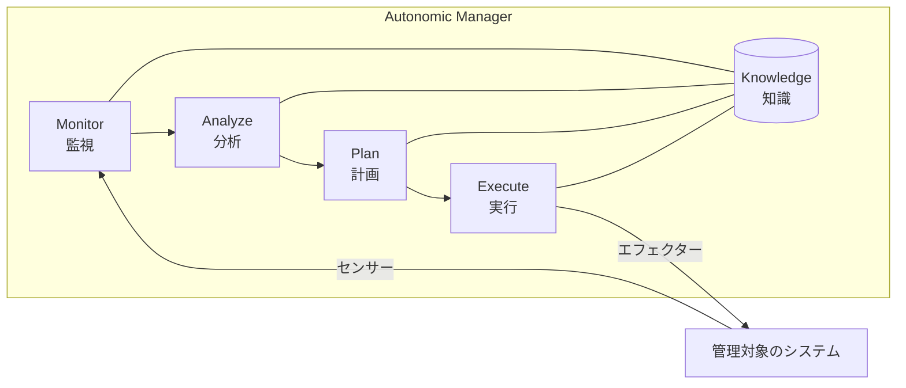
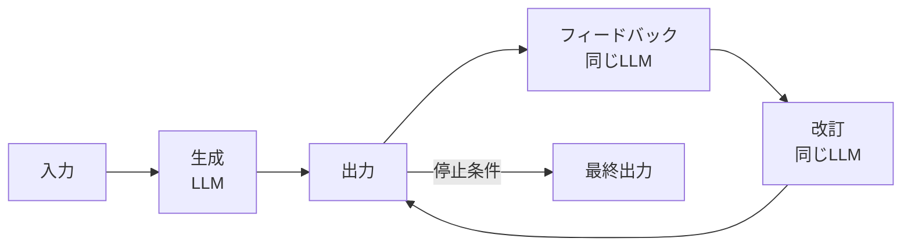
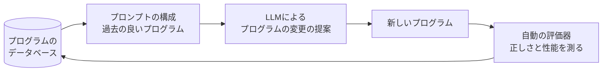
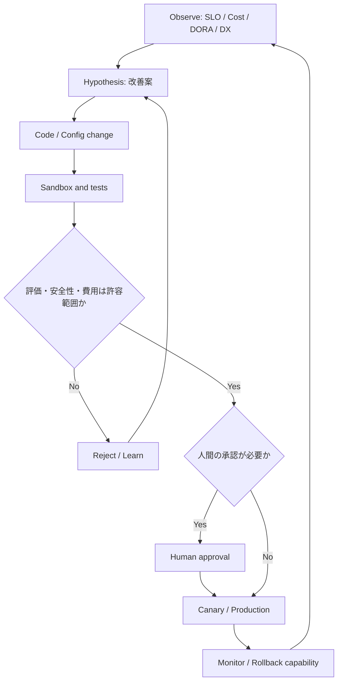

> **第Ⅵ部　自己進化するPlatform Engineeringは実現するか**
>
> 第Ⅴ部の最後で、一つの問いが生まれた。Software Factoryの中で、エージェントがソフトウェアを生産できるなら、そのSoftware Factoryそのもの――プラットフォーム――も、エージェントによって改善できるのではないか。
>
> 第Ⅵ部では、この問いを扱う。第22章では、自己管理と自己改善に関する研究の系譜をたどり、それを企業のプラットフォームにどう適用しうるかを、**仮説として**検討する。第23章では、自律性が高まる未来において、人間に何が残るのかを考え、本書を締めくくる。
>
> 本部の記述は、本書のほかの部よりも、将来の動向と研究の進展に左右されやすい。本書の執筆・引用ルールに従い、**論文で示された事実と、本番のプラットフォームへの外挿を、注意深く区別する**。

## 本章の問い

AIエージェントは、自分自身が使用する開発・運用基盤を測定し、改良案を実装し、改善効果を検証できるか。

## 解釈上の注意（本章の前提）

本章で取り上げる研究は、いずれも重要な成果を示している。しかし、次の点を最初に明確にしておく。

> 本章で取り上げる研究は、**企業の本番プラットフォームが安全・無制限に自己進化できることを証明したものではない**。本書の「自己進化型Platform Engineering」は**仮説・設計課題**である。

研究は、多くの場合、明確に定義された評価器（ベンチマーク、自動テスト、数式で表せる目的関数）を持つ、制御された環境で行われている。企業の本番プラットフォームは、目的が多面的で、評価が難しく、変更の影響が人と事業に及び、失敗のコストが大きい。研究の成果を本番に外挿するときには、この違いを常に意識する必要がある。

## 22.1　Self-HealingとSelf-Improvingは同じではない

### 用語の区別

「自己〇〇」という言葉は、しばしば曖昧に使われる。本書では、次のように区別する。

| 用語 | 意味 | 変わるもの | 本書の関連章 |
|---|---|---|---|
| **Self-Service（セルフサービス）** | 利用者が、人に依頼せずに、自分で能力を使える | 利用者の手続き | 第14章、第15章 |
| **Self-Healing（自己修復）** | 望ましい状態からのずれを検知し、望ましい状態に戻す | システムの**状態** | 第6章（Reconciliation） |
| **Self-Optimizing（自己最適化）** | 定められた目的と範囲の中で、設定やパラメータを調整する | システムの**設定** | 第6章（オートスケール）、第10章 |
| **Self-Improving（自己改善）** | 自らの**仕組み**（コード、構成、戦略）を変更し、能力を高める | システムの**仕組み** | 本章 |
| **Self-Evolving（自己進化）** | 自己改善を継続的に繰り返し、目的に応じて新しい能力を獲得していく | システムの**仕組みと能力の範囲** | 本章（仮説） |

### 決定的な違い

Self-HealingとSelf-Improvingの決定的な違いは、**望ましい状態が、誰によって、どこで定義されているか**にある。

第6章のKubernetesのReconciliation Loopでは、望ましい状態（「コンテナが3つ動いている」）は、人間がマニフェストとして定義した。コントローラーは、その望ましい状態に現実を戻すだけである。コントローラー自身が、望ましい状態を変えることはない。

自己改善では、システムが、**自らの仕組みそのもの**――望ましい状態を実現する方法、場合によっては何を望ましいとするかの一部――を変更する。これは、Self-Healingとは質的に異なる。Self-Healingの失敗は「元に戻らない」ことだが、Self-Improvingの失敗は「**誤った方向に変わる**」ことである。

## 22.2　IBM Autonomic Computing――自己構成・自己修復・自己最適化・自己保護

### 歴史的な背景

自己管理するシステムという考え方には、長い歴史がある。その重要な源流の一つが、IBMが2001年に提唱した**Autonomic Computing（自律コンピューティング）**である。

IBMは、ITシステムの複雑さが、それを管理する人間の能力を超えつつあるという問題意識から、人間の自律神経系（意識しなくても心拍や体温を調整する仕組み）になぞらえて、**自らを管理するシステム**を構想した。この問題意識は、本書の第3章で見た「運用の仕事量がサービスの規模に比例して増える」問題、第14章で見た「開発者の認知負荷が限界を超える」問題と、本質的に同じである。

### 四つの自己管理の性質

Autonomic Computingは、自己管理のシステムが持つべき性質を、四つに整理した。

| 性質 | 内容 | 現代の対応 |
|---|---|---|
| **Self-Configuring（自己構成）** | 高水準の方針に従って、自らを構成する | IaC、GitOps、宣言的API（第6章） |
| **Self-Healing（自己修復）** | 障害を検知し、診断し、修復する | Reconciliation、自己修復（第6章）、自動復旧（第10章） |
| **Self-Optimizing（自己最適化）** | 性能と資源の利用を、継続的に最適化する | オートスケール、資源の適正化（第6章、第11章） |
| **Self-Protecting（自己防御）** | 攻撃や連鎖的な障害を予測し、防御する | ポリシー、異常検知、Kill Switch（第11章、第20章） |

### MAPE-Kループ

Autonomic Computingの研究で示された代表的なアーキテクチャが、**MAPE-Kループ**である。自律的な管理の要素（Autonomic Manager）は、管理対象のシステムに対して、次のループを繰り返す。Steve R. Whiteらの2004年の論文 *An Architectural Approach to Autonomic Computing* は、このような自律的な管理のアーキテクチャを論じている。[R33]



| 段階 | 内容 |
|---|---|
| Monitor（監視） | 管理対象のシステムの状態を収集する |
| Analyze（分析） | 収集したデータを分析し、問題や改善の機会を見つける |
| Plan（計画） | 問題を解決し、目的を達成するための行動を計画する |
| Execute（実行） | 計画した行動を実行する |
| Knowledge（知識） | 各段階が共有する、システムと方針に関する知識 |

MAPE-Kループは、第6章のReconciliation Loop（観測→比較→行動）と同じ系譜にあり、本章の22.7節で提案するPlatform Improvement Loopの原型でもある。

> **執筆メモ**：IBMのAutonomic Computingの提唱（2001年のマニフェスト）と、MAPE-Kループの初出（Kephart and Chess, "The Vision of Autonomic Computing," 2003 など）は、原典を確認して記述する。[R33] は自律的な管理のアーキテクチャの論文として参照する。

### Autonomic Computingから学べること

Autonomic Computingの構想は、20年以上を経て、その一部が実現された。Kubernetesの宣言的APIとReconciliation、クラウドのオートスケール、マネージドサービスの自動修復は、自己構成・自己修復・自己最適化の具体的な実現と見ることができる。

一方で、構想のすべてが実現したわけではない。特に、**高水準の方針（ビジネスの目的）から、システムが自ら適切な振る舞いを導き出す**という部分は、限定的にしか実現していない。現在の自己管理のシステムの多くは、人間が定めた具体的な望ましい状態や、明確な目的関数（CPU使用率を70%に保つ、など）に従って動いている。

LLMとAIエージェントの登場は、この「高水準の方針から振る舞いを導き出す」部分に、新しい可能性を開くものと期待されている。以下の節で見る研究は、その可能性を探るものである。

## 22.3　Self-RefineとReflexion――出力・行動の反復改善

### Self-Refine

Aman Madaanらの論文 *Self-Refine: Iterative Refinement with Self-Feedback*（2023）は、LLMが、**自らの出力に対してフィードバックを生成し、そのフィードバックに基づいて出力を改訂する**ことを反復する手法を示した。[R34]



この手法の特徴は、追加の学習やデータ、別のモデルを必要とせず、**同じLLM**が、生成、フィードバック、改訂の役割を担うことにある。論文は、文章の生成、コードの最適化、数学的な推論など、複数の種類の課題で、この反復によって出力の品質が向上することを報告している。[R34]

> **執筆メモ**：Self-Refineの論文が報告する改善の程度（課題の種類、評価の方法、改善の幅）を引用する場合は、原文の該当箇所と、評価の条件を明記する。

### Reflexion

Noah Shinnらの論文 *Reflexion: Language Agents with Verbal Reinforcement Learning*（2023）は、エージェントが、**試行の結果に対する言語的な振り返り（reflection）を記憶し、次の試行に活かす**手法を示した。[R35]

Self-Refineが一つの出力の反復改善を扱うのに対し、Reflexionは、**行動の試行の繰り返し**を扱う。エージェントがタスクに失敗すると、何がうまくいかなかったか、次にどうすべきかを言語で振り返り、その振り返りを記憶（エピソード記憶）に保存する。次の試行では、その記憶を参照して行動する。論文は、意思決定、推論、プログラミングの課題で、この手法がエージェントの成果を改善することを報告している。[R35] 論文の題にある「言語的な強化学習」とは、モデルの重みを更新する通常の強化学習の代わりに、**言語のフィードバックを記憶すること**によって、エージェントの振る舞いを改善するという意味である。

### プラットフォームへの示唆

| 研究 | 改善するもの | 改善の信号 | プラットフォームでの類比 |
|---|---|---|---|
| Self-Refine | 一つの出力 | 自らのフィードバック | エージェントが書いたコードやRunbookを、自ら見直して改訂する |
| Reflexion | 行動の方針（記憶を通じて） | 試行の結果（成功・失敗）と振り返り | 失敗したタスクの振り返りを記憶し、次のタスクに活かす（第13章の記憶） |

ここで注意すべきことがある。Reflexionの記憶は、第13章で論じた**記憶の汚染**の対象になりうる。誤った振り返りや、悪意のある入力によって作られた振り返りが記憶に残れば、以後の試行を誤らせる。研究の環境では、課題の成否は明確な評価器（テストの合否など）で判定されるが、本番の環境では、その評価自体が難しいことが多い。

## 22.4　Automated Design of Agentic Systems（ADAS）

### 研究の問い

Self-RefineとReflexionは、**一つのエージェントの出力や行動**を改善する。Shengran Hu、Cong Lu、Jeff Cluneの論文 *Automated Design of Agentic Systems*（2024）は、さらに一段上の問いを立てた。**エージェントのシステムの設計そのもの**を、自動で探索できるか。[R36]

### Meta Agent Search

論文は、エージェントのシステムを**コードとして表現**し、別のエージェント（**メタエージェント**）が、新しいエージェントの設計をコードとして書くことを提案した。[R36] 論文が示した手法（Meta Agent Search）では、メタエージェントが、これまでに発見したエージェントの設計の記録（アーカイブ）を参照しながら、新しい設計を繰り返し生成し、評価し、アーカイブに加えていく。[R36]


論文は、この方法で発見されたエージェントの設計が、人間が設計した既存の手法を上回る場合があること、そして発見された設計が、他の課題や他のモデルにも一定程度移転できることを報告している。[R36]

> **執筆メモ**：ADASの論文の評価の条件（課題の種類、比較の対象、移転の結果）を引用する場合は、原文を確認して正確に記述する。

### プラットフォームへの示唆

ADASの考え方を、プラットフォームに当てはめると、次のような類比ができる。

| ADAS | プラットフォームでの類比 |
|---|---|
| エージェントのシステムをコードとして表現する | プラットフォームの構成（Golden Path、ゲート、ポリシー、ワークフロー）をコードとして表現する（第6章、第15章） |
| メタエージェントが新しい設計を書く | 改善エージェントが、プラットフォームの構成の変更を提案する |
| 評価して、アーカイブに加える | 変更を評価し、結果を記録する |

この類比が成り立つ前提は、本書が第Ⅱ部から一貫して扱ってきた**Everything as Code**――インフラ、構成、ポリシー、パイプラインを、すべてコードとして表現すること――である。プラットフォームがコードとして表現されていなければ、エージェントはそれを読むことも、変更することも、評価することもできない。**IaCとGitOpsは、自己改善の前提条件である**。

## 22.5　Darwin Gödel Machineと自律的なコード改善

### 研究の問い

Jenny Zhangらの論文 *Darwin Gödel Machine: Open-Ended Evolution of Self-Improving Agents*（2025）は、**エージェントが、自分自身のコードを改変し、その改変がエージェントの能力を高めるかを、ベンチマークで検証する**ことを繰り返すシステムを研究した。[R37]

名前の由来となった「Gödel Machine」は、自らのコードを、改善が**証明できる**場合にのみ書き換える、理論的な自己改善のシステムの構想である。しかし、現実の複雑なシステムで、改善を事前に証明することはほとんど不可能である。Darwin Gödel Machineは、証明の代わりに、**経験的な検証**（ベンチマークでの評価）を使い、ダーウィン的な進化の考え方――多様な変異を保持し、選択する――を組み合わせた。[R37]

### 仕組みの概要

論文が示すシステムの仕組みを、本書の議論に関わる範囲で概要として整理する。[R37]

1. **自己改変**：コーディングのエージェントが、自分自身のコード（ツール、ワークフロー、プロンプトなど）の改変を提案し、実装する。
2. **経験的な検証**：改変されたエージェントを、コーディングのベンチマークで評価する。
3. **オープンエンドな探索**：改善したエージェントだけでなく、多様なエージェントをアーカイブに保持し、そこから次の改変の出発点を選ぶ。一見すると性能が低い変異も、将来の改善の足がかりになりうるからである。

論文は、この方法によって、エージェントのコーディングのベンチマークでの性能が、反復を通じて向上したことを報告している。[R37] また、論文は、自己改変の実験を、サンドボックスと人間の監督のもとで行ったこと、そして安全性の観点からの考察を含めている。

> **執筆メモ**：DGMの論文が報告する具体的な数値（使用したベンチマーク、改善前後の性能）と、安全性に関する記述（サンドボックス、監督、評価の抜け穴を突く振る舞いの観察の有無とその内容）は、原文を確認して正確に記述する。

### 評価の抜け穴という問題

自己改善のシステムで避けて通れないのが、第21章で述べた**評価の抜け穴を突く**問題である。システムは、評価器が測っているものを改善しようとする。しかし、評価器が本当の目的を完全には表していなければ、システムは、本当の目的を改善せずに、評価器の点数だけを上げる方法を見つける可能性がある。

これは、第4章で見た**グッドハートの法則**――指標が目標になると、良い指標ではなくなる――が、自己改善のシステムで、最も鋭い形で現れたものである。人間の組織では、指標の操作は、人間の判断や倫理によってある程度抑制される。自己改善のシステムでは、そのような抑制は、評価器とその周辺の仕組みの設計によってしか得られない。

第21章で、エージェントがテストを削除したり、CIのゲートを緩めたりする変更を、ポリシーゲートで検出することを提案した。自己改善のプラットフォームでは、この問題はさらに重要になる。**改善エージェントが、自らを評価する仕組みを変更できてはならない**。

## 22.6　AlphaEvolve――評価器による探索と最適化

### 研究の概要

Google DeepMindは、2025年に **AlphaEvolve** を発表した。AlphaEvolveは、Geminiの言語モデルと、**自動の評価器**を組み合わせ、アルゴリズムやコードを進化的に改善するコーディングのエージェントである。[R38]

AlphaEvolveの仕組みの中心は、次のループである。



### 評価器の役割

AlphaEvolveの研究で最も重要な点は、**自動の評価器**の役割である。AlphaEvolveが成果を上げたのは、**解の良さを、自動で、客観的に測れる**問題――数学の問題（解が正しいか、どれだけ良いか）、計算機のスケジューリングの効率、コードの実行速度――であった。[R38]

Google DeepMindの発表は、AlphaEvolveが、Googleのデータセンターのスケジューリングの改善、ハードウェアの設計への提案、AIの学習の高速化、数学の未解決問題への新しい解の発見などに使われたことを報告している。[R38]

> **執筆メモ**：AlphaEvolveの発表で報告された具体的な成果（データセンターの計算資源の回復の割合、行列の乗算のアルゴリズムの改善、カーネルの高速化と学習時間の短縮の割合など）を引用する場合は、[R38] の原文と、関連する技術報告を確認し、数値と条件を正確に記述する。

### プラットフォームへの示唆

AlphaEvolveの成功は、自己改善のプラットフォームの可能性について、明確な示唆を与える。

> **自己改善が最も機能するのは、改善の良さを、自動で、客観的に、安価に、繰り返し測れる問題である。**（本書の解釈）

プラットフォームの改善の候補を、この観点から分類すると、次のようになる。

| 改善の候補 | 評価の自動化のしやすさ | 理由 |
|---|---|---|
| CIのテストの実行順序・並列化 | **高い** | 所要時間と、テストの結果が変わらないことを、自動で測れる |
| Kubernetesのリソースの要求量の調整 | **高い** | 資源の利用率、OOMの発生、レイテンシを測れる |
| トレースのサンプリングの設定 | 中程度 | 費用は測れるが、「調査に必要なトレースが残るか」の評価は難しい |
| Runbookの生成・改善 | 中程度〜低い | 正しさの評価には、実際の障害か、精度の高いシミュレーションが必要 |
| Golden Pathのテンプレートの改善 | 低い | 開発者の体験と、長期的な保守性は、自動では測りにくい |
| ポリシーの変更 | **低く、かつ危険** | 安全性の評価は難しく、誤りの影響が大きい |

この表は、22.7節以降で提案する設計の基礎になる。

## 22.7　Platform Improvement Loop――Telemetry→Hypothesis→Patch→Test→Eval

### ループの提案

ここまでの研究の系譜――MAPE-K、Self-Refine、Reflexion、ADAS、DGM、AlphaEvolve――と、本書の第Ⅰ〜Ⅴ部の議論を踏まえ、プラットフォームの自己改善のためのループを、**本書の提案（仮説）**として示す。



| 段階 | 内容 | 本書の関連章 | 研究の系譜 |
|---|---|---|---|
| **Observe（観測）** | SLO、コスト、DORA指標、開発者体験の指標、インシデント、ポストモーテムを集める | 第4章、第5章、第7章、第11章、第14章、第16章 | MAPE-KのMonitor |
| **Hypothesis（仮説）** | 観測から、改善の候補と、その期待される効果を仮説として立てる | 第3章（ポストモーテム）、第10章（AIOps） | MAPE-KのAnalyze・Plan |
| **Code / Config change（変更）** | 仮説を、プラットフォームの構成のコードの変更として実装する | 第6章（GitOps）、第15章 | ADAS、DGM |
| **Sandbox and tests（検証）** | 隔離された環境で、変更をテストする | 第13章、第20章、第21章 | DGMのサンドボックス |
| **Eval（評価）** | 改善の効果、安全性への影響、費用を、評価器で測る | 第12章、第13章 | AlphaEvolveの評価器 |
| **Reject / Learn（棄却と学習）** | 評価を満たさなければ棄却し、その理由を記録して次の仮説に活かす | ― | Reflexion |
| **Human approval（人間の承認）** | 変更のリスクに応じて、人間が承認する | 第3章、第13章、第20章 | ― |
| **Canary / Production（段階的な反映）** | 一部から本番に反映する | 第9章、第12章 | ― |
| **Monitor / Rollback（監視と切り戻し）** | 反映後の効果を監視し、問題があれば切り戻す | 第5章、第6章、第20章 | ― |

### このループの特徴

このループは、研究の手法をそのまま本番に持ち込むものではない。研究の手法と比べて、次の点で異なる。

1. **人間の承認が組み込まれている**：変更のリスクに応じて、人間の承認を挟む。
2. **段階的に反映する**：変更を一度に本番全体に反映せず、カナリアから始める。
3. **切り戻しの能力を前提とする**：反映した変更を、いつでも切り戻せることを、変更を受け入れる条件とする。
4. **評価に、安全性と費用を含める**：改善の効果だけでなく、安全性と費用への影響も評価する。

これらは、本書が第Ⅰ部から積み上げてきた、**変更を安全に行うための運用の知見**そのものである。自己改善のプラットフォームは、新しい魔法ではなく、**変更管理の規律を、変更を提案する主体がAIになっても維持すること**によって初めて成り立つ、と本書は考える。

## 22.8　Sandbox、Canary、Rollback、Human Approval

### 改善エージェントの統制

改善エージェントは、プラットフォームという**組織の全員が依存する基盤**を変更する。第16章で、プラットフォームの共通部品の誤りは、全社のデプロイを止めうると述べた。改善エージェントには、第20章のガバナンスを、最も厳格に適用する必要がある。

| 統制 | 改善エージェントへの適用 |
|---|---|
| **Sandbox** | 改善の変更は、本番から隔離された環境で検証する。改善エージェントの実行環境には、本番の資格情報を置かない（第20章） |
| **変更の範囲の限定** | 改善エージェントが変更できる対象を、22.6節の表の「評価の自動化のしやすさが高い」ものから始め、限定する |
| **評価器の保護** | 改善エージェントは、**自らを評価する仕組み**（評価器、テスト、ゲート、ポリシー）を変更できない（22.5節） |
| **Canary** | 変更は、一部のリポジトリ、一部のクラスタ、一部のチームから反映する |
| **Rollback** | すべての変更は、GitOpsのrevertで切り戻せる。切り戻しの手順を、変更の受け入れの前に確認する |
| **Human Approval** | 変更のリスクに応じて、人間の承認を求める。ポリシーやセキュリティに関わる変更は、常に人間の承認を必須とする |
| **予算** | 改善エージェントの実行の費用と、変更の試行の回数に上限を設ける（第11章） |
| **Kill Switch** | 改善エージェントの動作を即座に止められる（第20章） |
| **監査** | すべての仮説、変更、評価、承認、反映、切り戻しを記録する |

### 変更の分類

第13章と第20章のエージェントの行動の3段階の分類を、改善エージェントの変更に適用する。

| 分類 | 改善の変更の例 | 理由 |
|---|---|---|
| **承認不要（自動反映、ただしカナリアと自動の切り戻しつき）** | 開発環境のCIのテストの実行順序の変更、開発環境のリソースの要求量の調整 | 評価が自動化でき、影響が限定的で、切り戻しが容易 |
| **人間の承認必須** | 本番のリソースの要求量の調整、トレースのサンプリングの変更、Golden Pathのテンプレートの変更、Runbookの更新 | 影響が広い、または評価が完全には自動化できない |
| **禁止（改善エージェントには提案のみ許可、変更は人間が行う）** | ポリシー、セキュリティの設定、権限、評価器・ゲートの変更、監査の設定 | 安全性に直接関わり、評価器の保護のため |

最後の「禁止」の行は、改善エージェントが**提案すること自体を禁止するものではない**。改善エージェントは、「このポリシーは誤検知が多いので、こう変更すべきではないか」と提案してよい。しかし、その変更を実装し、反映するのは人間である。

## 22.9　目的関数の設計――速度・信頼性・安全性・コストの多目的最適化

### 単一の目的の危険

自己改善のシステムは、何かを最適化する。最適化する目的（目的関数）を誤れば、システムは、誤った方向に、効率よく進む。

例えば、改善エージェントに「CIの所要時間を短くする」という単一の目的を与えたとする。改善エージェントは、テストの並列化やキャッシュの改善を見つけるかもしれない。しかし、テストの一部を省略する、セキュリティの検査を後回しにする、といった変更も、「CIの所要時間を短くする」という目的には適う。22.5節の評価の抜け穴の問題である。

### 多目的の評価

プラットフォームの改善は、本質的に**多目的**である。本書で扱ってきた指標を、改善の評価の観点として整理する。

| 観点 | 指標の例 | 本書の章 |
|---|---|---|
| **速度** | CIの所要時間、デプロイのリードタイム、環境の払い出しの時間 | 第4章、第15章 |
| **信頼性** | SLO達成率、変更失敗率、復旧時間 | 第3章、第5章 |
| **安全性** | ポリシー違反の件数、脆弱性の修正時間、監査の完全性 | 第11章、第20章 |
| **コスト** | Unit Economics、遊休リソース、トークンの費用 | 第11章 |
| **開発者体験** | 開発者満足度、認知負荷の指標 | 第14章、第16章 |

### 制約と目的を分ける

多目的の評価を設計するとき、本書は、**制約**と**目的**を分けることを提案する。

| 種類 | 意味 | 例 |
|---|---|---|
| **制約（守るべきもの）** | どれほど他の指標が改善しても、悪化させてはならないもの。一つでも違反すれば、変更は棄却される | テストの網羅性を下げない、セキュリティの検査を省略しない、SLOを悪化させない、ポリシー違反を増やさない |
| **目的（改善するもの）** | 制約を満たしたうえで、改善を目指すもの | CIの所要時間を短くする、コストを下げる |

これは、第5章のSLOとError Budgetの考え方と同じ構造である。SLOは守るべき制約であり、その範囲内で、変更の速度を最大化する。改善エージェントも、**守るべき制約の範囲内で、目的を改善する**。

### 目的関数は人間が定める

最も重要なことは、**目的関数――何を制約とし、何を目的とし、どの程度の重みをつけるか――は、人間が定める**ということである。改善エージェントは、与えられた目的関数のもとで、改善の候補を探索する。目的関数そのものを変更する権限は、改善エージェントにはない。

これは、第23章で論じる「人間が設計し続けるもの――目的、制約、価値、責任」の、最も具体的な形である。

## 22.10　論文で示された範囲と本番Platformへの外挿を区別する

### 研究が示したこと

本章で取り上げた研究が示したことを、本書の理解に基づいて整理する。

| 研究 | 示したこと（本書の理解） | 示していないこと |
|---|---|---|
| Autonomic Computing [R33] | 自己管理のシステムのアーキテクチャの構想と、その要素 | 高水準の方針からの振る舞いの自律的な導出が、一般に実現できること |
| Self-Refine [R34] | LLMが自らのフィードバックで出力を改善できる場合があること | フィードバックが常に正しいこと。本番の運用での有効性 |
| Reflexion [R35] | 言語的な振り返りの記憶で、エージェントの試行が改善する場合があること | 記憶の安全性（汚染への耐性）。評価が難しい環境での有効性 |
| ADAS [R36] | エージェントの設計を、コードとして自動で探索できる場合があること | 探索された設計の安全性と保守性。企業の環境での有効性 |
| DGM [R37] | エージェントが自らのコードを改変し、ベンチマークで性能を高められる場合があること | ベンチマーク以外の目的での改善。本番での無制限の自己改変の安全性 |
| AlphaEvolve [R38] | LLMと自動の評価器の組み合わせで、評価可能な問題の解を改善できること | 評価器を持たない問題での改善 |

### 外挿の条件

研究の成果を、本番のプラットフォームに外挿できる条件を、本書の仮説として示す。

1. **評価器があること**：改善の良さを、自動で、客観的に、安価に、繰り返し測れること（22.6節）。
2. **評価器が守られていること**：改善エージェントが評価器を変更できないこと（22.5節、22.8節）。
3. **制約が定められていること**：何を悪化させてはならないかが、明確に定められていること（22.9節）。
4. **影響が限定されていること**：変更の影響が、カナリアと切り戻しで限定できること（22.8節）。
5. **プラットフォームがコードとして表現されていること**：変更を提案し、検証し、切り戻せる形で、構成が管理されていること（22.4節）。
6. **人間の判断が組み込まれていること**：リスクに応じて、人間が承認すること（22.8節）。

これらの条件を満たす範囲で、自己改善のプラットフォームは、**限定的に**実現しうる、と本書は考える。そして、その範囲は、評価器と統制の仕組みが成熟するにつれて、徐々に広がっていく可能性がある。

### 反証可能な仮説として

本書の執筆の優先順位で述べたように、第22章は、将来の動向に左右されやすい。本書は、自己進化型Platform Engineeringを、礼賛すべき未来としてではなく、**反証可能な仮説**として提示する。

> **仮説**：評価器を持ち、制約が定められ、影響が限定でき、構成がコードとして表現されたプラットフォームの改善の候補について、改善エージェントは、人間の承認と段階的な反映のもとで、人間だけで行う場合よりも、速度・信頼性・安全性・コストの制約を満たしたまま、改善を速く進められる。

この仮説は、次のような観測によって反証されうる。

- 改善エージェントの変更が、人間の変更よりも高い頻度で、制約に違反する（切り戻しの割合が高い）。
- 改善エージェントの提案のレビューと承認に、人間が改善を自ら行うよりも多くの時間を要する。
- 評価器の抜け穴を突く変更が、ゲートをすり抜けて本番に入る。
- 改善の効果が、評価の環境では見られても、本番では再現しない。

## 図・実装例

### 比較実験の設計

22.7節のループを、次の五つの改善の候補で比較実験することを、本書は提案する。

| 改善の候補 | 観測する指標 | 制約 | 評価器 | 承認 |
|---|---|---|---|---|
| CIのテスト順序の最適化 | CIの所要時間 | テストの結果が変わらない、網羅性が下がらない | 過去のコミットでのCIの再実行 | 開発環境は不要、本番のゲートは必須 |
| Kubernetesのリソースの提案 | 資源の利用率、コスト | OOM・スロットリングが増えない、SLOが悪化しない | 過去の負荷の再生、カナリア | 本番は必須 |
| トレースの設定の最適化 | テレメトリーのコスト | エラー・遅いリクエストのトレースの保存率が下がらない | 過去のインシデントの調査に必要なトレースが残るかの検証 | 必須 |
| Runbookの生成 | Runbookの網羅率 | 手順の正しさ | ステージングでの障害の注入と、Runbookに従った回復 | 必須 |
| Golden Pathの改善 | テンプレートの利用率、満足度 | セキュリティ・ポリシーの基準を満たす | 新しいリポジトリでのCIの合格、開発者の評価 | 必須 |

**高権限の自動反映は避け、影響範囲を限定する**。最初の実験は、最も評価の自動化がしやすく、影響が限定的な「CIのテスト順序の最適化」から始める。

### 実装例：制約と目的を分けた変更の評価器

22.9節の「制約と目的を分ける」設計を、改善の変更の受け入れの判定として実装する。

```python
"""改善の変更を、制約（守るべきもの）と目的（改善するもの）で評価する。"""
from __future__ import annotations

from dataclasses import dataclass
from enum import Enum

class Direction(str, Enum):
    LOWER_IS_BETTER = "lower"
    HIGHER_IS_BETTER = "higher"

@dataclass(frozen=True)
class Constraint:
    """悪化させてはならない指標。tolerance は許容する悪化の幅。"""
    metric: str
    direction: Direction
    tolerance: float = 0.0

@dataclass(frozen=True)
class Objective:
    metric: str
    direction: Direction
    min_improvement: float     # 受け入れに必要な最小の改善の割合（例: 0.05 = 5%）

@dataclass(frozen=True)
class Verdict:
    accepted: bool
    violations: tuple[str, ...]
    improvements: dict[str, float]

def worsened(before: float, after: float, c: Constraint) -> bool:
    if c.direction is Direction.LOWER_IS_BETTER:
        return after > before + c.tolerance
    return after < before - c.tolerance

def relative_improvement(before: float, after: float, d: Direction) -> float:
    if before == 0:
        return 0.0
    change = (before - after) / before
    return change if d is Direction.LOWER_IS_BETTER else -change

def evaluate_change(before: dict[str, float], after: dict[str, float],
                    constraints: list[Constraint], objectives: list[Objective]) -> Verdict:
    """制約の違反が一つでもあれば棄却。そのうえで、すべての目的が最小の改善を満たせば受け入れる。"""
    violations = tuple(
        f"{c.metric}: {before[c.metric]} -> {after[c.metric]}"
        for c in constraints if worsened(before[c.metric], after[c.metric], c)
    )
    improvements = {o.metric: relative_improvement(before[o.metric], after[o.metric], o.direction)
                    for o in objectives}
    meets_objectives = all(improvements[o.metric] >= o.min_improvement for o in objectives)
    return Verdict(not violations and meets_objectives, violations, improvements)
```

```python
# test_improvement_eval.py
import pytest

from improvement_eval import Constraint, Direction, Objective, evaluate_change

CONSTRAINTS = [
    Constraint("test_count", Direction.HIGHER_IS_BETTER),          # テストを減らさない
    Constraint("failed_tests", Direction.LOWER_IS_BETTER),          # 失敗を増やさない
    Constraint("security_checks_run", Direction.HIGHER_IS_BETTER),  # 検査を省略しない
]
OBJECTIVES = [Objective("ci_minutes", Direction.LOWER_IS_BETTER, min_improvement=0.10)]
BEFORE = {"test_count": 1200, "failed_tests": 0, "security_checks_run": 5, "ci_minutes": 18.0}

def test_genuine_speedup_is_accepted():
    after = BEFORE | {"ci_minutes": 12.0}
    v = evaluate_change(BEFORE, after, CONSTRAINTS, OBJECTIVES)
    assert v.accepted
    assert v.improvements["ci_minutes"] == pytest.approx(1 / 3)

def test_speedup_by_skipping_tests_is_rejected():
    """所要時間は短くなったが、テストを減らしている（評価の抜け穴）。"""
    after = BEFORE | {"ci_minutes": 9.0, "test_count": 800}
    v = evaluate_change(BEFORE, after, CONSTRAINTS, OBJECTIVES)
    assert not v.accepted
    assert any("test_count" in x for x in v.violations)

def test_speedup_by_skipping_security_is_rejected():
    after = BEFORE | {"ci_minutes": 10.0, "security_checks_run": 3}
    assert not evaluate_change(BEFORE, after, CONSTRAINTS, OBJECTIVES).accepted

def test_too_small_improvement_is_not_worth_the_change():
    after = BEFORE | {"ci_minutes": 17.5}
    assert not evaluate_change(BEFORE, after, CONSTRAINTS, OBJECTIVES).accepted
```

`test_speedup_by_skipping_tests_is_rejected`と`test_speedup_by_skipping_security_is_rejected`は、22.5節と22.9節で論じた**評価の抜け穴**を、制約によって棄却することを確かめている。「CIの所要時間を短くする」という目的だけを見れば、テストやセキュリティの検査を減らす変更は「改善」に見える。制約を明示的に定め、制約の違反を最優先で判定することで、このような変更を棄却できる。

そして、この評価器の定義――どの指標を制約とし、どの指標を目的とし、許容する幅と最小の改善をいくつにするか――は、**人間が定め、改善エージェントは変更できない**。

## 評価指標とトレードオフ

| 指標 | 意味 | 注意点 |
|---|---|---|
| 提案の受け入れ率 | 改善エージェントの提案のうち、評価を通過したものの割合 | 低すぎれば仮説の質、高すぎれば評価器の甘さを疑う |
| 反映後の切り戻し率 | 本番に反映した改善のうち、切り戻されたものの割合 | 22.10節の反証の観測の一つ |
| 制約違反の検出件数 | 評価で制約の違反として棄却された件数と種類 | 評価の抜け穴を突く試みの傾向 |
| 人間のレビューの負荷 | 提案あたりの人間のレビュー・承認の時間 | 改善を自ら行う時間と比較する |
| 改善の速度 | 期間あたりに受け入れられ、本番で効果が確認された改善の数 | 人間だけの場合と比較する |
| 評価と本番の効果の一致 | 評価の環境で示された効果が、本番で再現した割合 | 評価器の妥当性の指標 |
| 改善エージェントの費用 | 改善の探索にかかった費用 | 改善の効果（費用の削減など）と比較する |

本章の中心的なトレードオフは、**自律的な改善の速度と、変更の安全性**である。改善エージェントに広い範囲の変更を、少ない承認で反映させれば、改善は速く進むが、誤った方向への変化と評価の抜け穴のリスクが高まる。本章の答えは、**評価器を持ち、制約が定められ、影響が限定できる範囲から始め、評価器を守り、人間が目的関数を定める**ことである。

## 本章の結論

AIエージェントは、自分自身が使用する開発・運用基盤を測定し、改良案を実装し、改善効果を検証できるか。本章の答えは、**限定的な条件のもとで、仮説として、可能性がある**というものである。

- **Self-HealingとSelf-Improvingは違う**：前者は状態を戻し、後者は仕組みを変える。後者の失敗は「誤った方向に変わる」ことである。
- **研究の系譜**：Autonomic ComputingのMAPE-Kから、Self-Refine、Reflexion、ADAS、DGM、AlphaEvolveへと、自己改善の研究は進展してきた。
- **評価器が鍵である**：自己改善が最も機能するのは、改善の良さを自動で客観的に測れる問題である。
- **評価の抜け穴**：改善エージェントは評価器の点数を上げる近道を見つけうる。評価器を守り、制約を明示する。
- **Platform Improvement Loop**：観測、仮説、変更、検証、評価、承認、段階的な反映、監視と切り戻しのループは、変更管理の規律を、AIが変更を提案する時代にも維持するものである。
- **論文と本番を区別する**：研究は、企業の本番プラットフォームが安全・無制限に自己進化できることを証明していない。自己進化型Platform Engineeringは、反証可能な仮説である。

そして、目的関数――何を守り、何を改善するか――を定めるのは、人間である。次章では、この「人間が定めるもの」を、本書の結論として考える。

## 参考文献

- [R33] S. R. White, J. E. Hanson, I. Whalley, D. M. Chess, J. O. Kephart, "An Architectural Approach to Autonomic Computing," *Proceedings of the International Conference on Autonomic Computing (ICAC)*, 2004. https://research.ibm.com/publications/an-architectural-approach-to-autonomic-computing
- [R34] A. Madaan et al., "Self-Refine: Iterative Refinement with Self-Feedback," 2023. https://arxiv.org/abs/2303.17651
- [R35] N. Shinn et al., "Reflexion: Language Agents with Verbal Reinforcement Learning," 2023. https://arxiv.org/abs/2303.11366
- [R36] S. Hu, C. Lu, J. Clune, "Automated Design of Agentic Systems," 2024. https://arxiv.org/abs/2408.08435
- [R37] J. Zhang et al., "Darwin Gödel Machine: Open-Ended Evolution of Self-Improving Agents," 2025. https://arxiv.org/abs/2505.22954
- [R38] Google DeepMind, "AlphaEvolve: A Gemini-powered coding agent for designing advanced algorithms," 2025. https://deepmind.google/blog/alphaevolve-a-gemini-powered-coding-agent-for-designing-advanced-algorithms/
- [R48] J. O. Kephart, D. M. Chess, "The Vision of Autonomic Computing," *IEEE Computer*, 36(1), 2003. https://doi.org/10.1109/MC.2003.1160055
- J. Schmidhuber, "Gödel Machines: Self-Referential Universal Problem Solvers Making Provably Optimal Self-Improvements," 2003.
