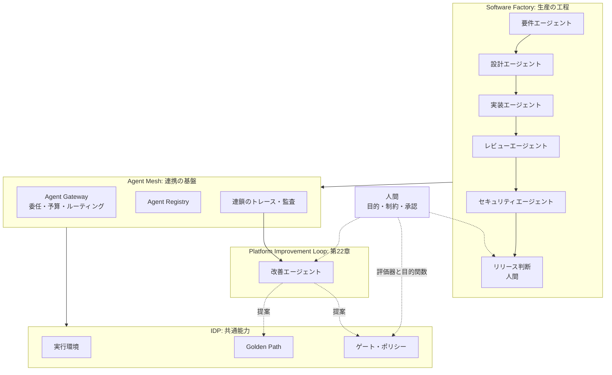
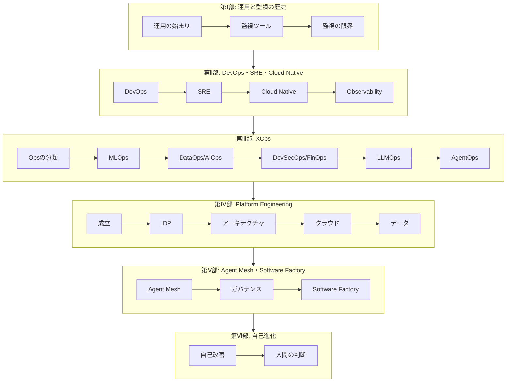

## 本章の問い

自己改善が進んでも、人間のPlatform EngineerやSREに何が残るのか。

本書は、計算機室のオペレーターの仕事から始まった。手順書を見てジョブを投入し、コンソールのメッセージを読み、テープを掛け替える。それから60年近くを経て、本書は、AIエージェントがソフトウェアを生産し、さらにはプラットフォームそのものの改善を提案する可能性まで論じてきた。

この長い歴史の中で、人間の仕事は何度も変わった。手順を実行する仕事は自動化され、監視を見張る仕事はアラートに置き換えられ、サーバーを構築する仕事はIaCに置き換えられた。では、AIが改善の候補を生み、実装し、検証するようになったとき、人間の仕事として何が残るのか。

本章では、本書の議論を振り返りながら、この問いに答え、本書を締めくくる。

## 23.1　人間だけを利用者とするIDPから、人間＋AI利用者のIDPへ

### 利用者の変化

第14章で、Platform as a Productの考え方を紹介した。プラットフォームを製品として扱い、利用者を顧客として扱う。その「利用者」は、当初、人間の開発者だった。

第16章で、プラットフォームの利用者にAIエージェントを加え、人間とエージェントに、同じ能力を、同じ統制のもとで、異なる権限と上限で提供する設計を示した。第19章ではエージェント同士が連携し、第21章ではエージェントがソフトウェアを生産するようになった。

| 段階 | プラットフォームの主な利用者 | プラットフォームの主な入口 | 本書の章 |
|---|---|---|---|
| 1 | 人間の開発者 | Portal、CLI、Git | 第14章、第15章 |
| 2 | 人間の開発者＋開発者を支援するAI | 同上＋エディタ内のAI | 第21章 |
| 3 | 人間の開発者＋自律的に作業するエージェント | 同上＋Platform API（MCPなど） | 第16章、第21章 |
| 4 | 人間＋連携する多数のエージェント | 同上＋Agent Gateway、A2A | 第19章 |

### 利用者の変化がプラットフォームに求めるもの

利用者にAIエージェントが加わることで、プラットフォームに求められるものは、次のように変わる。

| 観点 | 人間だけを利用者とするIDP | 人間＋AIを利用者とするIDP |
|---|---|---|
| インターフェース | 人間が使いやすいUIとドキュメント | それに加えて、機械が読めるAPI、構造化されたエラー、ドライラン（第16章） |
| 権限 | 人間の役割に基づく権限 | それに加えて、委任の範囲、連鎖に沿った縮小、JIT（第19章、第20章） |
| 量と速度 | 人間の作業の速度を前提とする | エージェントの大量・高速の操作に耐え、上限を設ける（第16章） |
| 標準化 | 人間の認知負荷を下げるため | それに加えて、エージェントの成果を高めるため（第21章のACI） |
| 監査 | 誰が行ったか | 誰の依頼で、どのエージェントが、どの判断で行ったか（第20章） |

この変化の中で、第14章のPlatform as a Productの考え方は、むしろ重要性を増す。**利用者が誰であれ、利用者のニーズを理解し、利用者の価値で測る**。ただし、AIエージェントという利用者の「ニーズ」は、エージェントの背後にいる人間――依頼者、エージェントの所有者――のニーズとして理解しなければならない。エージェントそのものは、満足度の調査に答えない。

## 23.2　Software FactoryとAgent Meshの統合

### 二つの構造

第19章のAgent Meshと、第21章のSoftware Factoryは、異なる問いから生まれた構造だった。

- **Agent Mesh**は、「複数のエージェントが、組織の境界を越えて、どう連携するか」という問いに答える。
- **Software Factory**は、「要件からリリースまでの生産の工程を、エージェントと人間がどう協働して実行するか」という問いに答える。

### 統合の姿

両者は、将来、一つの構造として統合されていく可能性がある。Software Factoryの各工程――要件の整理、設計、実装、レビュー、セキュリティの検査、リリースの判断――を、専門化したエージェントが担い、それらがAgent Meshの仕組み（発見、委任、予算、観測）の上で連携する。

この図の最も重要な点は、**人間が、構造の外側から、目的・制約・承認を与えている**ことである。人間は、工程の個々の作業からは離れていくかもしれない。しかし、工程全体の目的を定め、制約を定め、要所で承認し、評価器と目的関数を定める役割は、人間に残る。

> **注意**：この統合の姿は、本書の**仮説**である。現時点で、このような統合された構造が、企業の本番で広く実現しているわけではない。

## 23.3　Self-Service、Self-Healing、Self-Optimizing、Self-Evolvingの違い

### 四つの「自己」

第22章で、Self-Service、Self-Healing、Self-Optimizing、Self-Improving、Self-Evolvingを区別した。本書の議論の全体を、この区別に沿って整理する。

| 段階 | 何が「自己」で行われるか | 人間が定めるもの | 本書で扱った主な仕組み | 成熟度（本書の評価） |
|---|---|---|---|---|
| **Self-Service** | 利用者が、自分で能力を使う | 提供する能力と、その範囲 | IDP、Golden Path、テンプレート（第14〜15章） | 広く実践されている |
| **Self-Healing** | 望ましい状態からのずれを、自動で戻す | 望ましい状態 | Reconciliation、GitOps、Operator（第6章） | 広く実践されている |
| **Self-Optimizing** | 定められた目的と範囲の中で、設定を調整する | 目的と範囲 | オートスケール、資源の適正化（第6章、第11章） | 限定的な範囲で実践されている |
| **Self-Improving** | 自らの仕組みを変更し、能力を高める | 目的関数、制約、評価器、変更の範囲 | Platform Improvement Loop（第22章） | 研究と限定的な実験の段階 |
| **Self-Evolving** | 自己改善を継続し、新しい能力を獲得する | 目的と価値 | （第22章の仮説） | 仮説 |

### 下の段階が上の段階の前提になる

この表で重要なのは、**下の段階が、上の段階の前提になっている**ことである。

- Self-Healingは、望ましい状態が宣言的に定義されていること（Self-Serviceの基盤であるIaCとGitOps）を前提とする。
- Self-Optimizingは、状態を観測し、望ましい状態に戻せること（Self-Healing）を前提とする。
- Self-Improvingは、変更を安全に反映し、切り戻せること（Self-Healing、GitOps）と、効果を測定できること（Observability、SLO、DORA指標）を前提とする。

したがって、自己改善のプラットフォームを目指す組織が、最初に取り組むべきことは、AIエージェントの導入ではない。**Everything as Code、GitOps、Observability、SLO、ポリシー、監査という、本書の第Ⅱ部から第Ⅳ部で扱った基盤を整えること**である。基盤のないところに自己改善を持ち込めば、第22章で見た評価の抜け穴と誤った方向への変化が、検知も切り戻しもできないまま起きることになる。

## 23.4　組織設計――Platform、SRE、Security、Data、AIの責任分界

### 責任分界の全体像

本書では、各章で責任分界の表を示してきた。その全体を、組織の機能ごとにまとめる。これは本書の提案であり、組織の規模と状況によって調整すべきものである。

| 機能 | 提供する仕組み | 持ち続ける判断 | 本書の章 |
|---|---|---|---|
| **Platform** | IDP、Golden Path、共通部品、コントロールプレーン、Agent Gateway、Tool Gateway、AIゲートウェイ、Platform Improvement Loopの基盤 | プラットフォームの製品としての優先順位、抽象化の設計、改善エージェントに許す変更の範囲 | 第14〜17章、第19章、第22章 |
| **SRE** | SLOの計測、Observability、On-call、インシデント対応、ポストモーテムの仕組み | プラットフォーム自体の信頼性の目標、障害時の判断 | 第5章、第7章 |
| **Security** | ポリシー、ID、署名、検査、Kill Switch、監査 | 全社のポリシー、禁止する操作、リスクの許容、承認の要件 | 第11章、第20章 |
| **Data** | データカタログ、リネージ、権限の制御、Context Layer | データの分類、アクセスのポリシー、データの意味の定義 | 第10章、第18章 |
| **AI** | ML・LLM・エージェントの基盤、評価の仕組み | 評価の方法の標準、モデルの選定の方針 | 第9章、第12章、第13章 |
| **Product（Stream-aligned Team）** | ― | SLOの目標値、評価データセットと合格基準、プロンプト、エージェントの行動の分類、承認 | 全章 |

### 本書を通じた原則

この表は、本書が第8章から一貫して示してきた原則の集大成である。

> **仕組みは共通化し、判断はドメインに残す。**

この原則は、AIの時代にも変わらない、と本書は考える。むしろ、AIが「仕組み」の多くを担うようになるほど、「判断」を誰が、どの根拠で行うのかを明確にすることの重要性は増す。

### 新しい役割

AIエージェントの普及によって、組織の中に新しい役割が生まれる可能性がある。

| 役割 | 内容 |
|---|---|
| エージェントの所有者 | エージェントの目的、能力、評価、行動の分類に責任を持つ（第13章、第20章） |
| 評価の設計者 | 評価データセット、評価シナリオ、評価器、目的関数を設計し、維持する（第12章、第13章、第22章） |
| 承認者 | エージェントの重要な操作を、内容を理解して承認する（第13章、第20章） |
| エージェントのSRE | エージェントの実行基盤とAgent Meshの信頼性を担う（第19章） |

これらの役割の多くは、**評価と判断**に関わるものである。

## 23.5　速度・品質・セキュリティ・費用・幸福度のトレードオフ

### 五つの観点

本書の各章の「評価指標とトレードオフ」の節で、さまざまなトレードオフを扱ってきた。それらは、最終的に、次の五つの観点の間のトレードオフに集約できる。

| 観点 | 主な指標 | 本書の章 |
|---|---|---|
| **速度** | DORA指標のスループット、リードタイム、環境の払い出し時間 | 第4章、第15章 |
| **品質（信頼性）** | SLO、変更失敗率、復旧時間、AIの評価指標 | 第5章、第9章、第12章、第13章 |
| **セキュリティ** | 脆弱性の修正時間、ポリシーの違反、監査の完全性 | 第11章、第20章 |
| **費用** | Unit Economics、遊休リソース、トークンの費用 | 第11章 |
| **幸福度** | 開発者の満足度、認知負荷、On-callの負荷、燃え尽き | 第3章、第5章、第14章、第16章 |

### 幸福度を観点に含める理由

五つ目の**幸福度**を、明示的に観点に含めることには理由がある。

運用の歴史は、人間の負荷の歴史でもあった。第3章のアラート疲れとOn-callの疲弊、第4章の開発者の認知負荷、第8章のOps疲れ、第13章の承認疲れ。技術がどれほど進歩しても、それを使い、運用し、判断する人間が疲弊すれば、組織の能力は損なわれる。

AIの導入は、人間の負荷を減らす可能性がある。Toilを自動化し、調査を支援し、定型的なコードを書く。しかし同時に、新しい負荷を生む可能性もある。大量に生成される変更のレビュー、エージェントの操作の承認、AIの出力の検証、そして「AIに仕事を奪われるのではないか」という不安。

速度、品質、セキュリティ、費用だけを最適化すれば、幸福度は見過ごされやすい。幸福度は、短期的な指標には現れにくいが、長期的には、人材の定着、判断の質、組織の学習の能力に、決定的な影響を与える。

### トレードオフは消えない

第4章で、DORAの研究が「速度と安定性は、適切な能力に投資すれば両立できる」ことを示したことを見た。本書は、その知見を尊重しつつ、次のことも強調したい。

> **トレードオフは、能力への投資で和らげることはできても、消えることはない。** どこでバランスを取るかは、組織の目的と価値に基づく判断である。（本書の立場）

その判断を、AIに委ねることはできない。AIは、与えられた目的関数のもとで最適化することはできるが、**何を目的関数にすべきか**を決めることはできない（第22章）。

## 23.6　DORA、SLO、Developer Experience、事業成果で測る

### 測定の層

プラットフォームとAIの価値を、何で測るべきか。本書では、各章で多くの指標を示してきた。それらを、次の四つの層で整理する。

| 層 | 問い | 主な指標 |
|---|---|---|
| **デリバリー（DORA）** | ソフトウェアを、速く、安全に届けられているか | デプロイ頻度、リードタイム、変更失敗率、復旧時間（第4章） |
| **信頼性（SLO）** | 利用者が必要とする信頼性を満たしているか | SLO達成率、Error Budgetの消費（第5章） |
| **開発者体験（DX）** | 開発者は、本来の仕事に集中できているか | 満足度、認知負荷、フロー、オンボーディングの時間（第14章、第16章） |
| **事業成果** | 組織の目的に、価値をもたらしているか | 顧客価値、問い合わせの解決時間、運用負担の削減、Unit Economics（第11章、付録D） |

### AIの効果を測る

AIの導入の効果を測るとき、特に注意すべきことがある。

**活動の量は、成果ではない。** AIが生成したコードの行数、AIが作成したプルリクエストの数、AIが処理したタスクの数は、AIの活動の量を示すが、それが組織に価値をもたらしたかは示さない。第4章で、デプロイ頻度を水増しする危険を述べた。AIの活動の量を目標にすれば、同じことが起きる。

**部分の改善が、全体の改善とは限らない。** AIによってコードを書く時間が短くなっても、レビューの待ち時間が長くなれば、リードタイムは改善しない。AIによって変更の量が増えても、変更失敗率が上がれば、デリバリーのパフォーマンスは改善しない。**AIの効果は、システム全体の指標で測るべきである**。

### DORA 2025

DORAは、2025年の報告書 *State of AI-assisted Software Development* で、AIの導入がソフトウェア開発の組織にもたらす影響を調査している。[R39] 本書の議論にとって最も重要な洞察は、**AIは、既存の組織の強みと弱みを増幅する**というものである。[R39]

> **執筆メモ**：DORA 2025の報告書の主要な発見（AIを「増幅器」とする洞察、AIの効果を高める組織の能力の整理など）は、[R39] の原文を確認し、直接引用と要約を区別して記述する。報告書が示す能力のモデルに、質の高い内部プラットフォームが含まれているかどうかも確認する。

この洞察は、次節のテーマである。

## 23.7　AIの導入で組織の弱点が増幅される可能性

### 増幅器としてのAI

DORA 2025の洞察――AIは組織の強みと弱みを増幅する [R39] ――を、本書の議論に当てはめて考える。

| 組織の状態 | AIが増幅するもの |
|---|---|
| テストが充実し、CIが速い | エージェントは、速いフィードバックのもとで、正しい変更を速く作る |
| テストが不十分で、CIが遅い | エージェントは、検証されない変更を大量に作り、品質の問題が増える |
| リポジトリが標準化されている | エージェントは、構成を理解し、成果を上げる（第21章） |
| リポジトリがばらばらで、規約が暗黙 | エージェントは、誤った推測で、もっともらしい誤りを生む |
| 小さく頻繁な変更の文化がある | AIによる変更も、小さく、レビューしやすく、切り戻しやすい |
| 大きく稀な変更の文化がある | AIによる大量の変更が、大きな塊でリリースされ、リスクが増える（第4章） |
| データの意味と権限が整理されている | AIは、データを正しく、安全に使う（第18章） |
| データの意味が属人的で、権限が粗い | AIは、誤った指標を自信をもって示し、機密情報を漏らす |
| 質の高いプラットフォームがある | AIは、プラットフォームの統制のもとで、安全に能力を使う |
| プラットフォームがなく、各チームがばらばら | AIの利用もばらばらになり、シャドーAIが広がる（第20章） |

この表の左の列の多くは、本書の第Ⅰ部から第Ⅳ部で扱った内容である。テストとCI（第4章）、リポジトリの標準化（第14章、第15章）、小さく頻繁な変更（第4章）、データのガバナンス（第18章）、プラットフォーム（第14〜17章）。

### AIの導入の前に、基盤を整える

この観点から、本書は、AIの導入を進める組織に、次のことを提案する。

> **AIを導入する前に、あるいはAIの導入と並行して、AIが増幅することになる組織の基盤を整えること。** テスト、CI、リポジトリの標準化、小さな変更、Observability、SLO、データのガバナンス、そしてPlatform Engineering。これらは、AIの時代に古くなるのではなく、AIの効果を決める前提として、より重要になる。（本書の提案）

これは、23.3節で「自己改善のプラットフォームを目指す組織が、最初に取り組むべきことは、AIエージェントの導入ではない」と述べたことと、同じ主張である。

## 23.8　人間が設計し続けるもの――目的、制約、価値、責任

### 本章の問いへの答え

自己改善が進んでも、人間のPlatform EngineerやSREに何が残るのか。本書の答えは、次の四つである。

| 人間が設計し続けるもの | 内容 | 本書で見た具体的な形 |
|---|---|---|
| **目的（Purpose）** | 何のために、何を実現するのか | 事業成果、利用者の価値、Platform as a Productの利用者のニーズ（第14章）、目的関数の「目的」（第22章） |
| **制約（Constraints）** | 何を守り、何をしてはならないのか | SLO（第5章）、ポリシー（第11章、第20章）、禁止する操作（第13章、第20章）、目的関数の「制約」（第22章） |
| **価値（Values）** | どのトレードオフを、どう選ぶのか | 速度・品質・セキュリティ・費用・幸福度のバランス（本章23.5節）、Blamelessな文化（第3章、第5章） |
| **責任（Accountability）** | 誰が、何に責任を持つのか | 責任のモデル（第20章）、責任分界（第8章、本章23.4節）、承認（第13章） |

### 運用の仕事の変化

本書がたどってきた運用の歴史を、人間の仕事の変化として振り返る。

| 時代 | 人間の主な仕事 | 機械に移った仕事 |
|---|---|---|
| メインフレーム（第1章） | 手順の正確な実行、コンソールの監視 | ― |
| 監視ツール（第2章） | 監視の設定、アラートへの対応 | 定期的な確認 |
| SRE・DevOps（第4〜5章） | 自動化の設計、SLOの合意、ポストモーテム | 手順の実行（Toilの自動化） |
| Cloud Native（第6章） | 望ましい状態の定義、自動化の監督 | 状態の維持（Reconciliation） |
| Platform Engineering（第14〜18章） | 共通能力の製品としての設計、抽象化の設計 | 環境の構築（セルフサービス） |
| AIエージェント（第13章、第19〜21章） | エージェントの目的と権限の設計、評価の設計、承認 | 定型的な調査、コードの作成 |
| 自己改善（第22章） | 目的関数・制約・評価器の設計、改善の承認 | 改善の候補の探索と検証 |

この表から見えるのは、**人間の仕事が、「実行」から「設計」へ、「設計」から「目的と制約の定義」へと、抽象度を上げてきた**ということである。そして、どの時代にも、**人間の仕事はなくならなかった**。形を変え、より上位の判断へと移っていった。

AIの時代にも、この流れは続く、と本書は考える。ただし、それは自動的に起きるものではない。人間が「目的と制約の定義」という役割を担うには、その能力――システムを理解し、トレードオフを判断し、責任を引き受ける能力――を持ち続ける必要がある。第3章で見た「自動化の皮肉」――自動化が人の理解を奪う――は、AIの時代にもっとも鋭い形で現れうる。**AIに仕事を任せるほど、人間がシステムを理解し続けるための仕組み**（Observability、ポストモーテム、評価の可視化、承認の際の十分な情報）が重要になる。

### 本書の結論

本書の「はじめに」で、次の中心命題を示した。

> Platform Engineeringは、複雑化した運用を一つに置き換える営みではない。各Opsの専門性を生かしながら、再利用可能な共通能力、使いやすい開発体験、統一されたガバナンスを提供するためのエンジニアリングである。

本書の全体を通じて、この命題を、運用の歴史、DevOpsとSRE、Cloud NativeとObservability、XOps、Platform Engineeringの設計、AIエージェントとSoftware Factory、自己改善型プラットフォームの各段階で検討してきた。

そして、本書の結論を、次のように示す。

> **プラットフォームの未来は、すべてをAIに任せることではない。人間が価値と制約を定義し、AIが改善候補を生み、測定と検証を通して安全な変更だけを採用する仕組みを育てることである。**

これは本書の筆者による結論文であり、直接引用ではない。

Opsは増え続ける。しかし、価値を生むために必要な共通機能を適切にプラットフォーム化すれば、人間とAIエージェントはそれぞれの専門的な仕事に集中できる。Platform Engineeringは、今後その基盤自体を継続的に改善する工学へと進化する可能性がある。

その進化を導くのは、目的を問い、制約を定め、価値を選び、責任を引き受ける、人間の判断である。

## 図・実装例

### 本書の全体像

### 演習：自組織の「人間が設計し続けるもの」を書き出す

本書の最後の演習として、あなたの組織（またはAsklineの組織）について、次の表を埋めよ。

| 項目 | 現在、誰が定めているか | 文書化されているか | AIの導入で、どう変わるべきか |
|---|---|---|---|
| プラットフォームの目的 | | | |
| 主要なサービスのSLO | | | |
| 全社のセキュリティポリシー | | | |
| エージェントに禁止する操作 | | | |
| AIの評価データセットと合格基準 | | | |
| 改善エージェントの目的関数と制約 | | | |
| 速度・品質・セキュリティ・費用・幸福度のバランス | | | |
| インシデントの責任の所在 | | | |

そのうえで、次の問いに答えよ。

1. 「誰が定めているか」が空欄になった項目はあるか。それは、誰が定めるべきか。
2. 「文書化されているか」が「いいえ」の項目は、AIに判断を委ねたときに、どのような問題を起こしうるか。
3. この表を、半年後にもう一度埋めるとしたら、何が変わっていてほしいか。

## 評価指標とトレードオフ

本章では、新しい指標を追加するのではなく、本書の指標の使い方の原則を、最後にまとめる。

1. **システム全体で測る**：AIやプラットフォームの部分的な活動ではなく、デリバリー、信頼性、開発者体験、事業成果の全体で測る。
2. **活動ではなく成果を測る**：生成した量ではなく、利用者と事業にもたらした価値を測る。
3. **複数の観点を組み合わせる**：速度、品質、セキュリティ、費用、幸福度を、一つの指標に還元しない。
4. **指標を目標にしない**：指標は改善のための道具であり、評価や比較の道具ではない（グッドハートの法則）。
5. **評価の仕組みも評価する**：評価器、評価データセット、指標の定義そのものが、目的を正しく表しているかを、定期的に見直す。
6. **人間が目的関数を定める**：何を測り、何を守り、何を改善するかは、人間が定める。

## 本章の結論

自己改善が進んでも、人間のPlatform EngineerやSREに残るのは、**目的、制約、価値、責任**を設計し続けることである。

- プラットフォームの利用者は、人間から、人間とAIへと広がる。しかし、利用者の価値で測るという原則は変わらない。
- Self-Service、Self-Healing、Self-Optimizing、Self-Improving、Self-Evolvingは、下の段階が上の段階の前提になる。自己改善は、基盤の上にしか成り立たない。
- 仕組みは共通化し、判断はドメインに残す。この原則は、AIの時代にこそ重要になる。
- AIは、組織の強みと弱みを増幅する [R39]。AIの導入の前に、あるいは並行して、AIが増幅する基盤を整える。
- 人間の仕事は、実行から設計へ、設計から目的と制約の定義へと、抽象度を上げてきた。その流れは続くが、人間がシステムを理解し続けるための仕組みが不可欠である。

本書が、運用の歴史を学び、現在のプラットフォームを設計し、AIとともに働く未来を考えるための、一つの地図となれば幸いである。

## 参考文献

- [R39] DORA, *2025 State of AI-assisted Software Development*, 2025. https://dora.dev/research/2025/dora-report/
- [R06] DORA, *Software Delivery Performance*. https://dora.dev/
- [R20] CNCF, *Platforms White Paper*, 2023. https://tag-app-delivery.cncf.io/whitepapers/platforms/
- [R21] CNCF, *Platform Engineering Maturity Model*. https://tag-app-delivery.cncf.io/whitepapers/platform-eng-maturity-model/
- [R22] M. Skelton, M. Pais, *Team Topologies*, IT Revolution Press, 2019.
- [R29] NIST, *AI Risk Management Framework*, 2023. https://airc.nist.gov/airmf-resources/airmf/
- L. Bainbridge, "Ironies of Automation," *Automatica*, 19(6), 1983.
